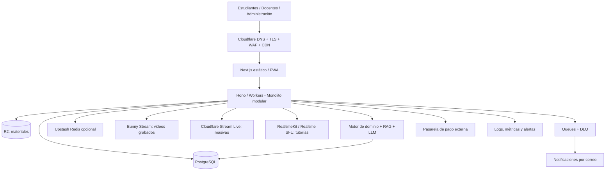

# 07. Decisiones arquitectónicas — Mentelyx

**Versión:** propuesta arquitectónica integrada 0.4
 
**Estado:** decisiones base aprobables y selecciones de proveedor sujetas a pruebas de concepto, presupuesto y revisión del equipo.  
**Alcance:** centro educativo multidisciplinario (Primaria, Secundaria y Preuniversitario), acceso web/PWA; cursos grabados, tutorías y videoclases, personalización, suscripciones y convenios.

> **Convención:** «Adoptar» es la opción elegida para implementar y validar; no significa que haya sido desplegada, probada o que el docente haya aprobado el costo. «Condicionada» necesita una prueba de concepto, validación comercial o de demanda. **Se conserva ADR-011 sin asignar**, porque no estaba en el documento anterior. Las nuevas propuestas comienzan en ADR-013.

## 1. Criterios de evaluación

Las alternativas se evalúan por (1) trazabilidad con RF, AC, RC y drivers; (2) costo total de propiedad —no solo precio de VM—; (3) trabajo de operación; (4) privacidad e integridad; (5) disponibilidad y degradación ante fallas; (6) facilidad de probar y sustituir proveedores; y (7) capacidad de evolución sin imponer microservicios prematuros.

Los valores «1.500 estudiantes concurrentes» y «200 docentes activos» son **supuestos de dimensionamiento**, NO una prueba de carga realizada. «Activos» no implica necesariamente que los 200 docentes estén transmitiendo video al mismo tiempo. Las cuentas reales se basarán en usuarios, sesiones, duración, bitrate y tipo de interacción.

## 2. Tabla de decisiones principales

| ID | Decisión arquitectónica | Driver relacionado | Justificación | Resultado / tecnología | Estado |
|---|---|---|---|---|---|
| ADR-001 | **Monolito modular**, no microservicios en el inicio | DA-05, DA-09 | Menos despliegues, menor complejidad de integración, módulos independientes de negocio | Identidad, Académico, Evaluación, Perfil, Recomendación, Docentes, Tutorías, Pagos, Convenios, Notificaciones | Adoptar |
| ADR-002 | **Clean Architecture y puertos/adaptadores por módulo** | DA-05, DA-11, DA-12 | Reglas educativas y comerciales independientes de HTTP, ORM, cloud e IA | Dominio → aplicación ← adaptadores de infraestructura y presentación; pruebas aisladas | Adoptar |
| ADR-003 | **TypeScript en Web/PWA y API REST** | DA-05, DA-10 | Un stack tipado con ecosistema web y posibilidad de compartir contratos | **Next.js** (exportación estática donde aplique) + API **Hono/Cloudflare Workers** sobre HTTPS; OpenAPI. Next.js dinámico/SSR será evaluado por separado | Adoptar con prueba del runtime |
| ADR-004 | **Identidad y autorización en backend** | DA-03, DA-09 | Impedir acceso a calificaciones y pagos ajenos; impedir privilegios docentes sin aprobación | Sesiones seguras, roles, permisos y autorización por recurso, controles de auditoría | Adoptar |
| ADR-005 | **Pasarela de pagos desacoplada** | DA-04, DA-06, DA-12 | Poder sustituir proveedor; evitar inconsistencias con tutorías y suscripciones | `PaymentPort` + adaptadores; evaluar Mercado Pago/Culqi Perú; webhooks firmados | Adoptar la interfaz, proveedor condicionado |
| ADR-006 | **PostgreSQL como fuente de verdad** | DA-06, DA-11 | Relaciones y transacciones necesarias para aprendizaje, cupos, pagos y suscripciones | PostgreSQL administrado (evaluar Neon/Prisma Postgres), transacciones, índices, backups; `JSONB` para metadatos variables | Adoptar |
| ADR-007 | **Eventos externos y pagos idempotentes** | DA-04, DA-06 | Reintentos de webhooks no deben duplicar cobros o reservas | Claves únicas, máquina de estados, tabla de eventos procesados y operaciones transaccionales | Adoptar |
| ADR-008 | **Cola de tareas gestionada para trabajo asíncrono** | DA-07, DA-09, DA-12 | Los fallos de correo o tareas lentas no deben detener las operaciones principales | Cloudflare Queues + consumidores Workers, reintentos, dead-letter queue, tareas programadas | Adoptar si se usa Workers |
| ADR-009 | **Separación de archivos y BD** | DA-01, DA-02 | El contenido multimedia no debe inflar la base de datos transaccional | Cloudflare R2 para PDFs/imágenes/archivos, servicio especializado de video para las clases | Adoptar |
| ADR-010 | **Cuentas independientes de convenios** | DA-08 | Mantener cuenta, historial y permisos aun cuando venza un convenio | Dominio Identidad separado de Convenios y Beneficios | Adoptar |
| ADR-012 | **Caché selectiva; Redis definido pero no impuesto** | DA-01, DA-02, DA-06 | Evitar lecturas repetidas sin introducir inconsistencia de datos sensibles | CDN/caché HTTP para público; Redis administrado (Upstash) para datos efímeros/rate limiting si lo justifican pruebas | Condicionada |
| ADR-013 | **Despliegue serverless-first con bajo trabajo de operación** | DA-01, DA-02, DA-07, DA-09; DA-13 | Evitar administración permanente de máquinas y pagar conforme al consumo | Cloudflare Workers/Pages, Queues, R2 y servicio externo PostgreSQL; alertas de costo | Adoptar con prueba de carga |
| ADR-014 | **Videos grabados mediante plataforma de streaming** | DA-01, DA-02; DA-14 | Transcodificación y CDN son más económicos y sencillos si están gestionados | **Bunny Stream** (primera opción, región/tier sujeto a piloto), carga directa autenticada, HLS y enlaces firmados | Condicionada a pruebas en Perú |
| ADR-015 | **Separar clases masivas de tutorías interactivas** | DA-01, DA-02, DA-07; DA-14 | El patrón uno-a-muchos y la interacción bidireccional tienen exigencias/costos distintos | Masivas: Cloudflare Stream Live con chat/Q&A; tutorías: WebRTC SFU; grabación opcional y consentida | Adoptar topología; proveedor condicionado |
| ADR-016 | **SFU gestionado; no servidor WebRTC propio** | DA-07, DA-09; DA-14 | Reducción de operación TURN/SFU y capacidad de conectar salas | Primera fase: **Cloudflare RealtimeKit** por SDK; alternativa de escala: **Cloudflare Realtime SFU** con señalización/estado propio | Condicionada a prueba de funciones/costo |
| ADR-017 | **No usar Kafka como bus inicial** | DA-05, DA-07, DA-09, DA-12 | No hay streams de eventos independientes que justifiquen cluster, particiones y operación adicionales | Cloudflare Queues + patrones Event/Outbox cuando corresponda; revaluar Kafka solo ante demanda demostrada | Adoptar (descartar por ahora) |
| ADR-018 | **Motor de dominio académico sin llamada obligatoria a LLM** | DA-11, DA-05, DA-06 | Diagnósticos, prerrequisitos y recomendaciones deben ser reproducibles, comprobables y baratos | Motor de reglas/estadísticas con `RecommendationPort`, estrategia sustituible; el LLM no decide unilateralmente calificaciones | Adoptar |
| ADR-019 | **Tutor IA con RAG separado de la evaluación** | DA-11, DA-12; DA-15 | Las explicaciones requieren contexto académico y control de costos por tokens | Retrieval desde contenido autorizado, `pgvector` inicial, proveedores LLM intercambiables, límites por plan y revisión de calidad | Condicionada a pruebas pedagógicas |
| ADR-020 | **Observabilidad, control de costos y privacidad** | DA-03, DA-07, DA-09; DA-13 | Permitir operar con poco personal y detectar crecimiento o errores de facturación | Logs estructurados sin datos sensibles, métricas p95/error/DB/colas/stream/IA, alertas y presupuestos | Adoptar |
| ADR-021 | **CI/CD y contenedores para pruebas y portabilidad** | DA-05, DA-07, DA-12 | Despliegue reproducible y posibilidad de cambiar de proveedor si el runtime edge no cumple | GitHub Actions, pruebas, previews y reversión; Docker Compose para desarrollo/testing; **Docker no es requisito para ejecutar Workers** | Adoptar |
| ADR-022 | **Disponibilidad proporcional; no afirmar HA de extremo a extremo** | DA-06, DA-07; DA-13 | Una aplicación serverless todavía depende de PostgreSQL y proveedores externos | Timeouts, reintentos selectivos, DLQ, backups/restauración, pruebas de recuperación, degradación de IA/correo | Adoptar |
| ADR-023 | **NoSQL adicional solo si emerge un caso medido** | DA-05, DA-06, DA-11 | PostgreSQL + JSONB + pgvector cubre inicialmente datos estructurados, flexibles y embeddings | Sin MongoDB/DynamoDB iniciales. Redis **no sustituye** PostgreSQL y R2 **no es** base de datos transaccional | Adoptar |
| ADR-024 | **Contratos para videoclases y grabaciones** | DA-03, DA-06; DA-14 | Salas, permisos docentes, aforo, moderación, grabación y visibilidad requieren reglas claras. | Crear/entrar/salir sala, rol, límites, grabación opcional, autorización, conservación y auditoría. | Propuesta vinculada a RF-36, RF-37, RF-45 y RF-48; pendiente de prueba |
| ADR-025 | **Publicidad contextual separada del aprendizaje** | DA-16, DA-03; RC-10, RC-15 | Financiar parcialmente la modalidad Gratuita sin usar información académica privada ni interrumpir actividades. | Componente `Publicidad/Patrocinios` con ubicaciones aprobadas, validación de plan/edad-contexto, campañas y métricas agregadas; no banners en exámenes, clases en vivo, editor, lecciones de pago o liquidaciones. | Adoptar política, proveedor condicionado |
| ADR-026 | **Licenciamiento editorial e indexación RAG con ACL** | DA-15, DA-17; RC-11, RC-12 | El permiso de publicación no equivale al de indexación, explotación comercial o entrenamiento. | Workflow de revisión, versionado, contrato y permisos; indexación/desindexación en pgvector; filtros por audiencia al recuperar; no fine-tuning automático. | Adoptar |
| ADR-027 | **Comisiones docentes con ledger y reglas versionadas** | DA-18, DA-06 | Separar precio, impuestos, comisión de cobro, porcentaje de reparto y costos para liquidaciones auditables. | Tablas de tarifas/versiones, transacciones, eventos y liquidaciones, saldos por docente y conciliación verificable. | Adoptar diseño; porcentajes condicionados |
| ADR-028 | **Derechos de plan y cuotas medibles** | DA-13, DA-15, DA-16, DA-18 | Limitar consumos variables caros sin impedir el aprendizaje básico autorizado. | Entitlements por plan/convenio, medidor de tokens/minutos, límites de IA, alertas y reglas de expiración de beneficios. | Adoptar; cuotas/precios condicionados |
| ADR-029 | **Cursos comerciales docentes sujetos a acuerdo separado** | DA-17, DA-18 | Los videos demostrativos son promocionales y no generan regalías automáticas; los cursos integrales pueden requerir otra remuneración. | Registro de contratos, licencia por contenido, alcance de distribución y estados de liquidación diferenciados de tutorías. | Adoptar modelo contractual, condiciones condicionadas |

**Drivers ampliados y trazados en `../01-analisis-del-sistema/06-drivers-arquitectonicos.md`:**

- **DA-13:** costo operativo, presupuesto y carga de administración reducida.
- **DA-14:** distribución de videos grabados, clases magistrales y tutorías interactivas.
- **DA-15:** tutor pedagógico con IA y RAG que respeta derechos, calidad y cuotas.
- **DA-16:** publicidad educativa contextual, separada de actividades académicas y datos privados.
- **DA-17:** derechos de contenidos docentes, versiones, licencias y desindexación verificable.
- **DA-18:** comisiones, pagos y liquidaciones docentes consistentes y auditables.

> Una ADR no crea por sí sola un requisito funcional. Las historias HU-26 a HU-35 y los requisitos RF-35 a RF-48 fueron incorporados como **ampliaciones propuestas** en los documentos `../01-analisis-del-sistema/02-historias-del-usuario.md` y `../01-analisis-del-sistema/03-requisitos-funcionales.md`; su incorporación no significa que los componentes estén implementados o probados.

## 3. Stack de tecnología seleccionado

| Capa | Tecnología | Motivo / compromiso |
|---|---|---|
| UI | TypeScript, React, **Next.js**, Tailwind CSS | PWA, UI por rutas, ecosistema sólido. En Cloudflare Pages usar exportación estática; para SSR real se requiere otro despliegue probado |
| Backend HTTP | TypeScript, **Hono**, Cloudflare Workers | API stateless y serverless sin VM; NestJS queda como alternativa compatible con Node en contenedores, no se promete migración directa a Workers |
| Dominio/casos de uso | TypeScript, Clean Architecture, SOLID | Lógica desacoplada de Hono, ORM y proveedores |
| Contratos | REST + OpenAPI + validación (Zod o equivalente) | Asegurar compatibilidad y testabilidad |
| Datos | PostgreSQL administrado + Prisma (prototipo de compatibilidad) | Transacciones + `JSONB`; comprobar adaptador/driver con Workers/Hyperdrive, pooling y costos |
| Embeddings | `pgvector` | Una base de datos inicial y menos servicios de sincronización |
| Redis | Upstash Redis administrado por HTTP/REST (**condicional**) | Caché de bajo volumen, datos efímeros, limitadores; verificar costo por comando |
| Mensajería | Cloudflare Queues + DLQ; Cron Triggers | Trabajo asíncrono y reintentos. Kafka excluido de fase inicial |
| Archivos | Cloudflare R2 | Materiales PDF, imágenes y adjuntos; no sustituye streaming de video |
| Cursos grabados | Bunny Stream | Almacenar video, transcodificar, HLS, CDN y tokens; probar red Volume/Standard en Perú |
| Clases masivas | Cloudflare Stream Live + preguntas por API/canal en tiempo real | Broadcast uno-a-muchos; no asumir videollamada bidireccional |
| Tutorías interactivas | Cloudflare RealtimeKit inicialmente; Realtime SFU como alternativa escalable | La tarifa por participante y la tarifa por egress se modelan por separado |
| Motor recomendador | Reglas/algoritmos propios detrás de puerto | Menor costo, auditabilidad, independencia del LLM |
| Tutor IA | Modelo de lenguaje externo + RAG; prompt versionado | Enseñanza contextual, límites por plan, monitoreo de tokens, evaluación pedagógica |
| Monitoreo | Workers observability, analítica cloud, alertas + seguimiento de costos | Operación de bajo mantenimiento |
| Entrega | GitHub Actions, Cloudflare deploy, Docker Compose local | Evidencia de curso e infraestructura reproducible |

**Aclaración:** TypeScript no tiene problema de compatibilidad con Cloudflare Workers. La restricción está en **algunas API de Node.js y librerías que requieren un runtime Node completo**, como ciertos usos de NestJS o librerías nativas. Hono es compatible con el modelo `fetch` de Workers. Prisma documenta ejecución sobre Workers con adaptadores; se prueba versión/driver concreta antes de aprobar despliegue.

## 4. Arquitectura de alto nivel (propuesta)

**Importante:** el contenido audiovisual viaja desde el proveedor de video hacia los clientes; no atraviesa el backend de Mentelyx. El backend solo autoriza, crea sesiones, entrega enlaces firmados, recibe eventos y registra metadatos.

## 5. Redis vs Kafka: decisión razonada

**Redis:** conservar como opción tecnológica explícita, inicialmente **no obligatorio**. Casos posibles: caché de catálogos públicos, sesiones efímeras si se justifican, rate limiting distribuido, antiabuso y contadores no críticos. PostgreSQL sigue siendo fuente de verdad. No guardar cupos confirmados, pagos o notas solo en Redis. Costos de referencia de Upstash: 500.000 comandos/mes gratis; pago por uso US$0,20 por 100.000 comandos (sin sumar cargos adicionales si aplican). El modo por solicitudes permite costo cercano a cero sin carga, aunque tráfico constante puede hacer conveniente tarifa fija.

**Kafka:** no transmite audio/video de WebRTC, no reemplaza SFU ni CDN. Solo se justificaría para streams de eventos retenidos/reproducibles, múltiples equipos/consumidores y volumen elevado; introducir Kafka ahora impondría broker, configuración, monitoreo y esquemas. Para correos, procesamiento de video y eventos de negocio simples usaremos **Queues** con consumidores idempotentes. Revaluar Kafka si las necesidades lo exigen.

## 6. Diseño de video y control de contenidos

### 6.1 Videos grabados de docentes
1. Docente habilitado solicita una subida; el backend verifica permisos, límites del plan y políticas.
2. Backend genera credenciales temporales o un enlace de **subida directa** al proveedor de video; los GB no pasan por el Worker.
3. Bunny Stream recibe el archivo, transcodifica y prepara HLS/resoluciones; recibimos estado y metadatos (webhook o consulta).
4. Administración revisa o aplica política de publicación; la base de datos guarda ID del video, docente, curso, permisos, duración, estado y metadatos.
5. Estudiante autorizado solicita reproducción; el backend valida sus derechos de acceso y genera token de reproducción **de corta duración**.
6. CDN entrega segmentos de video. Aplicar cuotas, control de abuso y seguimiento del tráfico y costos. Evitar copia redundante de videos completos en R2 si no existe una justificación de respaldo/portabilidad.

### 6.2 Videoclases masivas
Un docente publica audio/pantalla/video y muchos estudiantes lo reciben. Usar **broadcast** con canal separado de chat, preguntas y moderación, inicialmente Cloudflare Stream Live. La latencia y la interacción no son iguales a una videollamada. Si todos deben encender cámara y hablar, **no es una transmisión masiva**, sino una sesión WebRTC SFU y su costo cambia.

### 6.3 Tutorías interactivas
Usar **WebRTC SFU** administrado con salas, cupos, permisos, activación de cámara/micrófono, chat, reconexión y cierre. Cloudflare RealtimeKit reduce tiempo de desarrollo al aportar SDK, salas y gestión de participantes; su costo escalado puede ser significativamente más alto que Cloudflare Realtime SFU puro, que exige construir gestión de salas/señalización/estado. La grabación no se habilita de forma automática: requiere política explícita, límites y consentimiento/información aplicables.

### 6.4 Patrón que no debemos usar
**No** desplegar videos como descargas servidas por Next.js/Hono ni enviar audio/video por Kafka o Redis. Eso consumiría recursos del backend y complicaría el escalado.

## 7. Costos por volumen — NO son cotizaciones

**Supuesto de tráfico:** 1.500 estudiantes viendo 2 horas diarias por 22 días: 3.960.000 minutos de visionado al mes. El pico de concurrencia NO determina este consumo por sí solo; el escenario es deliberadamente explícito. Para un bitrate promedio de 1,5 Mb/s, son ~44.550 GB (decimales) descargados.

| Tipo | Proveedor/tarifa pública | Ejemplo de costo mensual |
|---|---|---:|
| Grabados, entrega de 44.550 GB | Bunny Stream Volume, US$0,005/GB | **US$222,75** |
| Grabados, misma entrega | Bunny Standard Sudamérica, US$0,045/GB | **US$2.004,75** |
| Grabados, 3.960.000 min vistos | Cloudflare Stream, US$1/1.000 min | **US$3.960,00** |
| Almacenar 20.000 min de videos | Cloudflare Stream, US$5/1.000 min | **US$100,00/mes** |
| Almacenar por GB videos transcodificados | Bunny Stream | **US$0,01/GB-mes** (mínimo de facturación, réplicas y volumen final por verificar) |

**Escenario biblioteca:** 200 docentes publican 5 videos de 20 minutos cada uno = 20.000 minutos originales. Para estimar el almacenamiento de Bunny necesitamos medir GB efectivamente almacenados tras transcodificación (varias calidades, miniaturas, etc.), no equiparar minutos con GB sin bitrate y rendiciones.

**Videollamadas interactivas (escenario de costo alto, no demanda real observada):** 1.500 estudiantes y 200 docentes realizan sesiones de 2 h/día × 22 días = 4.488.000 minutos-participante al mes.

| Opción | Base de facturación | Ejemplo mensual |
|---|---|---:|
| Cloudflare RealtimeKit | 4.488.000 minutos-participante A/V, 10.000 incluidos y US$0,002/min adicional | **US$8.956** de participantes, sin grabaciones/exportaciones |
| Cloudflare Realtime SFU | 1 Mbps recibido por participante promedio ≈ 33.660 GB; 1.000 GB incluidos y US$0,05/GB adicional | **US$1.633** de egress SFU, sin señalización, estado, grabación ni extras |
| Cloudflare Realtime SFU | 1,5 Mbps promedio ≈ 50.490 GB; mismas reglas | **US$2.474,50** de egress SFU, sin extras |

**Advertencias:** RealtimeKit ha anunciado periodos beta con precio cero; no basar una operación comercial en una promoción temporal. La modalidad de participantes solo audio, la cantidad de pistas recibidas, calidad, duración, simultaneidad de salas, reconexiones y grabaciones alteran los importes. Realtime SFU puro implica más ingeniería propia. Para una sola clase masiva con muchos espectadores debe evaluarse broadcast (Stream Live) en vez de videollamadas bidireccionales por defecto.

**Costos fuera de estas tablas:** Workers/Pages, PostgreSQL, Redis (si se usa), colas, dominio, correo, almacenamiento R2, soporte, comisiones de pago, grabaciones, IA/embeddings, monitoreo y operación. **No es honesto prometer producción de 1.500 concurrentes por US$20/mes** con estos supuestos de video.

## 8. Disponibilidad y recuperación

| Falla | Comportamiento esperado | Límite |
|---|---|---|
| Correo o proveedor de notificaciones caído | Cola persiste tarea, reintentos, DLQ; la operación principal concluye | Requiere monitoreo del atasco |
| Servicio IA caído | Explicación no disponible; ruta determinista y contenidos normales continúan | No inventar resultados generados por IA |
| Proveedor SFU caído | Sala afectada, aviso/reintento/posible reagenda | No hay reemplazo instantáneo garantizado sin proveedor alterno integrado |
| PostgreSQL caído | Deshabilitar operaciones que necesitan BD; observabilidad, backups y procedimiento de recuperación | La API serverless no restaura la BD por sí sola |
| Worker con error de despliegue | CI/CD, pruebas previas y rollback; alertas de errores | El monolito modular sigue siendo un ámbito de fallo compartido |
| Pago webhook duplicado | Claves de idempotencia/transacción previenen efectos dobles | Validar firma y orden de eventos |
| Caída de una VM | No aplica al runtime Workers; si pasamos a Docker/VM, hace falta otra instancia/HA administrada | `restart: always` no resuelve caída de host |

**No** prometer failover automático total ni 99,5% de disponibilidad sin confirmar SLA de PostgreSQL, video, API y recuperación. Analizar RTO y RPO para datos académicos y pagos.

## 9. Controles de costos y evolución

- Separar costos por: API, base de datos, archivos, videos grabados, videoclases, email, IA y pagos; monitorizar **costo por estudiante activo** y **costo por minuto visto/participante**.
- Alertas de facturación en rangos de presupuesto, límites de tokens de IA, límite mensual de subida docente y duración de reuniones por tipo de plan.
- No activar grabación universal de videoclases. Grabar solamente cuando una política explícita y presupuesto lo justifiquen.
- Optimizar video: calidad adaptativa, 720p por defecto en actividades educativas donde sea apropiado; medir reproducción móvil en Perú.
- Comparar Bunny Volume y Standard desde Ayacucho y otras zonas del país (inicio, buffering, latencia, errores, costo/GB).
- Realizar k6/Artillery en API sin confundir concurrencia de HTTP con minutos de video; prueba aparte de WebRTC por sala y broadcast masivo.
- Empezar con PostgreSQL sin MongoDB; pasar a servicios adicionales solo cuando exista una prueba de necesidad.
- Si cada hora estamos pagando de manera continua por servicios serverless, comparar sus tarifas con una VM/container administrado; «serverless» no significa automáticamente más económico en uso sostenido.

## 10. Tareas de validación para convertir la propuesta en ADR aceptados

1. **Trazabilidad funcional:** agregar a HU/RF los procesos de creación/programación de clases, asistencia, cupos, grabación, permisos, video docente y tutor IA si se aprueban como alcance funcional.
2. **Prueba stack:** crear `Next.js` estático → `Hono Worker` → `Prisma/pg` → PostgreSQL, comprobar autenticación, migraciones, timeout y transacciones con el driver de despliegue.
3. **Prueba audiovisual:** subir video de 20 minutos a Bunny Stream, reproducirlo en Perú mediante Volume/Standard y medir consumos reales. Simular una clase masiva y una sala WebRTC con 5–20 personas antes de afirmar soporte de 1.500 concurrentes.
4. **Costeo con datos medidos:** crear presupuesto de usuario activo/curso/teacher-hour, no únicamente pico de usuarios; establecer alertas antes de activar producción comercial.
5. **Resiliencia:** simular caída de email, proveedor IA, backend y PostgreSQL; comprobar recuperación y ausencia de operaciones duplicadas.
6. **Entrega del curso:** colocar decisiones en este documento, diagramas C4 de contexto/contenedor/componente y código de muestra que demuestre patrones, tests y despliegue.

## 11. Referencias consultadas (tarifas públicas; verificadas 14-10-2026)

- Cloudflare Workers: https://developers.cloudflare.com/workers/platform/pricing/
- Cloudflare Workers y compatibilidad Node: https://developers.cloudflare.com/workers/runtime-apis/nodejs/
- Cloudflare Pages, Next.js estático: https://developers.cloudflare.com/pages/framework-guides/nextjs/deploy-a-static-nextjs-site/
- Prisma en Cloudflare Workers: https://www.prisma.io/docs/guides/deployment/cloudflare-workers
- Cloudflare Queues: https://developers.cloudflare.com/queues/platform/pricing/
- Cloudflare R2: https://developers.cloudflare.com/r2/pricing/
- Cloudflare Stream: https://developers.cloudflare.com/stream/pricing/
- Cloudflare Stream Live: https://developers.cloudflare.com/stream/stream-live/
- Cloudflare RealtimeKit: https://developers.cloudflare.com/realtime/realtimekit/pricing/
- Cloudflare Realtime SFU: https://developers.cloudflare.com/realtime/sfu/platform/pricing/
- Cloudflare RealtimeKit y SFU (comparación): https://developers.cloudflare.com/realtime/
- Bunny Stream: https://bunny.net/pricing/stream/
- Bunny CDN: https://bunny.net/pricing/
- Bunny video security: https://github.com/BunnyWay/documentation/blob/main/stream/security.mdx
- Upstash Redis: https://upstash.com/pricing/redis
- Cervantes Maceda, Velasco-Elizondo y Castro Careaga. *Arquitectura de software: conceptos y ciclo de desarrollo*, caps. 2, 3 y 5 (fuente suministrada en el proyecto).
- Blancarte Iturralde. *Introducción a la arquitectura de software: un enfoque práctico*, secciones de estilos, eventos, balanceo, webhooks, API Gateway, Circuit Breaker y agregación de logs (fuente suministrada en el proyecto).

> **Integridad académica:** las decisiones son propuestas justificadas, no despliegues implementados, benchmarks certificados ni cotizaciones contractuales. Actualizar importes y alternativas al contratar servicios.

## 12. Política comercial y editorial (ampliación de la tabla)

- El plan gratuito podrá financiarse parcialmente con banners contextuales y patrocinios aprobados. Plus y Pro no muestran anuncios durante la experiencia educativa de pago. Se admite un espacio discreto en el inicio del panel docente, pero **nunca** en edición de contenido, clases en vivo, evaluaciones, reproducción de clases pagadas o liquidaciones.
- La publicidad no se personalizará con notas, diagnósticos, dificultades, conversaciones privadas o perfil educativo. Para menores se aplicarán restricciones legales y de los proveedores; no se permite segmentación comportamental de esas personas.
- Las tasas **20 % tutoría individual, 30 % tutoría grupal, 25 % clase magistral** y precios **S/24,90 Plus, S/49,90 Pro** son escenarios propuestos; no se fijarán en código. Requieren validación financiera/tributaria, viabilidad de pasarela, costos de streaming y acuerdos expresos.
- Publicar materiales docentes no transfiere automáticamente titularidad ni licencia comercial; la integración al RAG exige permiso diferenciado y control de acceso. No se utilizarán por defecto para entrenar modelos ni se grabarán clases automáticamente.
- La distribución del video grabado se hará por plataforma especializada; videoclases magistrales uno-a-muchos por broadcast y tutorías interactivas por SFU. Se tomarán decisiones de proveedor definitivas solo con pruebas en Perú y tarifas verificadas.
- Al incorporar Redis (caché/estado efímero) o el proveedor de IA, nunca reemplazarán la fuente de verdad PostgreSQL ni deberán alterar la integridad de reservas, permisos y calificaciones.

## 13. Criterios de aprobación pendientes

| Decisión / política | Evidencia requerida | Estado |
|---|---|---|
| ADR-003 y ADR-013 | Prototipo Next.js → Hono/Workers → PostgreSQL; medir tiempos, conexión y consumo | Pendiente |
| ADR-014, ADR-015 y ADR-016 | Prueba en red peruana de video grabado, directo uno-a-muchos y tutoría SFU; comparar costo/minuto | Pendiente |
| ADR-019 y ADR-026 | Ensayos RAG que comprueben licencias, ACL, citación y desindexación | Pendiente |
| ADR-025 | Inspección de superficies sin anuncios indebidos y verificación de reglas para menores | Pendiente |
| ADR-027 y ADR-028 | Simulación financiera y pruebas de liquidaciones y cuotas con políticas versionadas | Pendiente |
| ADR-022 | Pruebas de fallas y recuperación sin prometer HA de extremo a extremo | Pendiente |

> **Estado general:** arquitectura seleccionada para el proyecto y su prototipo, con proveedores y cifras comerciales todavía sujetos a validación. Ninguna ADR de esta versión implica evidencia de implementación.
