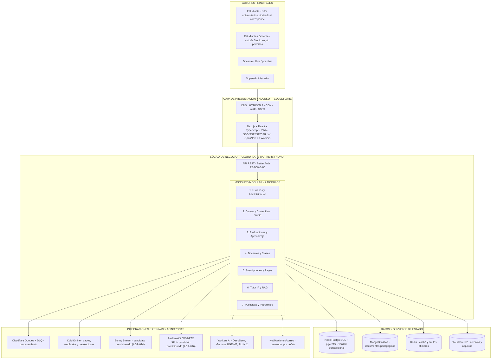

# Arquitectura inicial — Mentelyx

> **Versión:** 1.6 · **Estado:** arquitectura conceptual del producto completo; las decisiones vigentes se precisan en las ADR. El diseño no acredita implementación, contratación ni validación de proveedores.

> **Corrección integral:** 1.7 — 20/11/2026. Aplica la [instrucción maestra](../00-gestion-del-proyecto/sprint-02/instruccion-maestra.md): frontend híbrido con OpenNext, modelos de Workers AI, CulqiOnline, modelo docente, cuotas en M5, Tutor, pizarra y biblioteca.

> **Revisión de alcance:** 1.8 — 25/11/2026. La arquitectura describe el producto completo; en V1 se construye aprendizaje y preparación de exámenes según ADR-093. Studio, funciones docentes, clases, tutorías humanas, gestión institucional y publicación de cursos se posponen, sin eliminar su diseño.

## 1. Propósito y alcance

Mentelyx es un **centro educativo virtual independiente** orientado a Primaria, Secundaria, Preuniversitario y Universitario. Se utiliza desde una aplicación web *mobile-first* instalable como PWA. Se registran públicamente **Estudiante y Docente**; el **Superadministrador** es una cuenta interna. Docente comprende las modalidades **independiente/libre** y **por nivel académico**. Un Estudiante universitario adulto puede obtener una habilitación adicional para tutorías sin cambiar de cuenta.

La arquitectura propuesta es un **cliente–servidor con separación en presentación, lógica de negocio y persistencia/integraciones**, implementado inicialmente mediante **un backend monolítico modular de siete módulos**. El enfoque interno por módulos será **Clean Architecture**: el dominio y los casos de uso no dependen de Cloudflare ni de las bases de datos. Son dos descripciones complementarias: el estilo describe organización/despliegue; el enfoque describe dependencias del código.

## 2. Diagrama de alto nivel

**Nota de representación:** la etiqueta de autoría Studio representa una capacidad de Estudiantes y Docentes, no un actor ni un tipo de cuenta adicional. Las líneas `MOD → servicio` muestran dependencias lógicas **a través de puertos/adaptadores**, no conexiones físicas directas desde cada módulo. El audio/video en vivo viaja entre dispositivos y la infraestructura WebRTC; **no atraviesa** la API Hono. Queues procesa tareas en segundo plano, sin transportar el archivo completo.

## 3. Responsabilidades de los siete módulos

| Módulo | Responsabilidades principales | Datos y dependencias relevantes |
|---|---|---|
| **1. Usuarios y Administración** | Gestión de cuentas, autenticación, sesiones y control de acceso; registro público de Estudiante y Docente, modalidades docentes, moderación y auditoría. | Neon; Better Auth seleccionado como diseño, pendiente validar compatibilidad runtime; Redis para límites efímeros. |
| **2. Cursos y Contenidos** | Catálogo de cuatro niveles, contenidos, versiones, licencias, Mentelyx Studio y archivos. | Atlas (documentos), Neon (derechos/metadatos), R2, Queues. |
| **3. Evaluaciones y Aprendizaje** | Diagnósticos, ejercicios, simulacros, preparación de exámenes, progreso y rutas de estudio. | Neon para resultados confirmados; Atlas para materiales. |
| **4. Docentes y Clases** | Perfiles de dos modalidades, autorización del estudiante tutor, acreditaciones, oferta, reservas, aulas hasta 35 alumnos inicialmente, asistencia y grabación opcional. | Neon, WebRTC/SFU, video y Queues. |
| **5. Suscripciones y Pagos** | Planes estudiantiles (Gratuito, Estándar, Plus y Premium) y docentes (Inicial y Live), cuotas comerciales de recursos, saldo audiovisual docente, concesión de recompensas, cobros CulqiOnline, devoluciones, comisiones por medio de pago, registro y conciliación de pagos directos al docente e idempotencia. | Neon transaccional, pasarela, outbox y Queues. |
| **6. Tutor IA y RAG** | Recuperación autorizada, explicación pedagógica, medición de tokens/costos, cuotas y presupuestos de IA. | pgvector, proveedores LLM, permisos desde Neon. |
| **7. Publicidad y Patrocinios** | Redes publicitarias externas compatibles, anuncios recompensados con verificación de eventos, campañas y patrocinios opcionales, y métricas agregadas. | Neon y proveedores publicitarios; sin perfilado de menores. |

**Redis, colas, autenticación, notificaciones y videoconferencia no crean módulos comerciales adicionales**: son capacidades transversales o adaptadores de infraestructura.

## 4. Arquitectura por entornos

| Componente | Desarrollo local | Producción objetivo (parcialmente híbrida) |
|---|---|---|
| Interfaz | Next.js/React local | Next.js híbrido (SSG/SSR/ISR/CSR) en Cloudflare Workers mediante OpenNext (ADR-074); sustituye «Pages con salida estática» |
| Backend | Hono / TypeScript local | Cloudflare Workers |
| Base relacional | PostgreSQL local | Neon PostgreSQL con `pgvector` |
| Documentos | MongoDB local | MongoDB Atlas; probar conectividad desde Workers |
| Caché | Redis local | Upstash Redis REST, con bases `cache` y `control` (ADR-012; persistencia, sección 9.3) |
| Archivos | Almacenamiento de prueba local | Cloudflare R2 |
| Trabajos | Adaptador de cola de pruebas | Cloudflare Queues + DLQ |
| Videoclase | Prototipo WebRTC / servicio de prueba | RealtimeKit es candidato, condicionado a prueba 35+1; proveedor y activación quedan bloqueados para producción según ADR-046 y ADR-093. |
| Grabados | Archivos de pruebas | Bunny Stream, candidato sujeto a piloto en Perú (ADR-014); permisos y grabación bajo consentimiento |
| IA | Proveedores simulados o llamadas medidas | Workers AI con DeepSeek V4.1 Flash, Gemma 4 26B A4B, BGE-M3 y FLUX.2 Klein (ADR-077); BYOK para adultos elegibles; presupuestos de consumo |
| Pagos | Adaptador simulado | CulqiOnline (ADR-082), sin contratar |
| Correo | Simulado | Resend como referencia (IM, sección 18) |

## 5. Flujos prioritarios

### 5.1 Registro y habilitación para enseñar

El usuario escoge Estudiante o Docente. Si escoge Docente define la modalidad libre/independiente o por nivel académico; en este último caso puede declarar formación, **sin acreditación automática**. El backend comprueba la edad y, para las operaciones protegidas, valida la sesión autenticada y los permisos por recurso. La solicitud de habilitación requiere la verificación documental del solicitante; esta no equivale a la validación de credenciales académicas. Un universitario adulto mantiene su cuenta Estudiante aun cuando obtenga un **permiso adicional** para tutorías. Las tutorías remuneradas siempre requieren habilitación, separada del acceso al editor.

### 5.2 Creación de contenidos y documentos

La aplicación obtiene permiso de subida y el archivo se almacena en R2. PostgreSQL registra propietario, licencia, estado y trabajo. Un mensaje pequeño se envía a Queues, donde se valida y procesa el contenido, guardando su estructura en MongoDB y fragmentos autorizados para RAG en PostgreSQL/pgvector. Los trabajos se procesan de forma **idempotente**, con reintentos y DLQ. El estudiante puede subir apuntes sin cambiar de cuenta.

### 5.3 Reserva de clase y capacidad audiovisual docente

El estudiante reserva una clase por horas a la tarifa del docente; el pago es directo al docente y Mentelyx lo registra, verifica y concilia junto con su comisión (ADR-081). Antes de iniciar, M4 reserva el cupo y la capacidad audiovisual del plan Docente Live en transacciones PostgreSQL. RealtimeKit entrega credenciales de corta duración. Se mide el consumo en participante-minutos y al cierre del periodo se calcula la devolución del saldo no usado. Clases grupales (diseño base 35 + 1), de reforzamiento o individuales.

### 5.4 Pago y conciliación

CulqiOnline procesa el cobro de las suscripciones (ADR-082) y el servidor consulta el estado real del pago. Hono comprueba notificaciones firmadas, conserva **idempotency keys** y realiza transacciones ACID en Neon; una **outbox transaccional** permite publicar tareas para conciliación/notificaciones. Redis **no** mantiene saldos financieros ni confirma pagos. La modalidad de recaudación y liquidación al docente necesita validación comercial, tributaria y contractual antes del lanzamiento.

### 5.5 Tutor IA, fuentes privadas, pizarra, biblioteca y Studio

El Tutor IA enseña cualquier tema pertinente y, si hay fuentes del estudiante, las prioriza y cita, diferenciando lo recuperado del complemento general (ADR-078). Trabaja sobre un lienzo extensible con selección contextual (ADR-083) y reutiliza recursos de la biblioteca antes de generar (ADR-084). Studio ofrece edición manual gratuita y consume recursos del plan en las acciones generativas, mostrando el consumo antes de confirmar. M5 reserva y confirma las cuotas comerciales y M6 mide el consumo técnico (ADR-080).

## 6. Calidad, seguridad, disponibilidad y rentabilidad

- **Disponibilidad:** AC-02 propone 99,5 % mensual en funciones esenciales como objetivo inicial de diseño, **no SLA**. Añadir monitoreo, alertas, backups ensayados, RTO/RPO por dependencia y degradación segura; los planes gratuitos de base de datos no equivalen a alta disponibilidad con conmutación automática.
- **Fallo de Redis:** permitir degradación de consultas públicas con límites de carga; no desactivar controles de seguridad de pagos o login.
- **Fallo de IA:** mantener edición manual y contenidos ya publicados; no descontar definitivamente recursos de plan por solicitudes fallidas. Una falla común de Workers AI se degrada a herramientas deterministas y a la biblioteca.
- **Fallo de base de datos:** no confirmar respuestas, recursos, cupos, saldos o pagos sin persistencia verificable.
- **Seguridad:** HTTPS, WAF/DDoS, secretos en servidor, sesiones seguras, MFA administrativo, validación por recurso y permisos audiovisuales especialmente para menores.
- **Escalabilidad:** Workers distribuye el tráfico de API; un **balanceador dedicado** solo tiene sentido con orígenes independientes y pruebas de salud. No evita por sí solo una caída de PostgreSQL/Atlas.
- **Economía:** planes estudiantiles y docentes aprobados (IM, secciones 14 y 15); medir el consumo de IA frente a las cotas de diseño (IM, sección 18.1), participante-minutos, comisiones por medio de pago, devoluciones y márgenes con cuotas totalmente utilizadas.
- **Privacidad de contenidos:** usar Studio o publicar clases no equivale a otorgar derechos para entrenar modelos; los datos identificables de menores quedan excluidos de ese entrenamiento por política de Mentelyx.

## 7. Relación con los siguientes entregables

Esta **Arquitectura inicial** constituye el modelo de contexto, capas y despliegue conceptual. Se complementa con `estilo-arquitectonico.md`, que justifica el estilo **monolito modular con separación en capas**, con `enfoque-arquitectonico.md`, que explica **Clean Architecture** dentro de los módulos, y con `componentes-arquitectonicos.md`, que presenta los componentes C4 nivel 3. Estos documentos describen el producto completo; ADR-093 determina qué capacidades se construyen en V1.

### Trazabilidad

`01-actores.md`, `02-historias-del-usuario.md`, `03-requisitos-funcionales.md`, `04-atributos-de-calidad.md` (AC-02/04/06/10), `05-restricciones.md` (RC-07/20/21/23/24/25/28/34), `06-drivers-arquitectonicos.md` (DA-03/06/07/19/21/27/28), `07-decisiones-arquitectonicas.md` (ADR-001/002/023/034/074/080–082/093) y `08-escenarios-atributos-calidad.md` (EQ-22).
