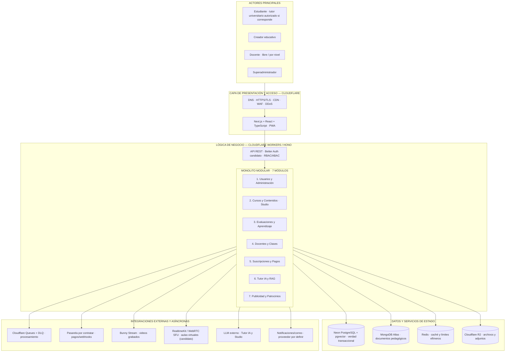

# Arquitectura inicial — Mentelyx

> **Versión:** 1.6 · **Estado:** propuesta de arquitectura inicial, previa al diseño detallado del estilo arquitectónico y Clean Architecture. Las capacidades, precios y tecnologías candidatas deberán validarse mediante prototipos y pruebas.

## 1. Propósito y alcance

Mentelyx es un **centro educativo virtual independiente** orientado a Primaria, Secundaria, Preuniversitario y Universitario. Se utiliza desde una aplicación web *mobile-first* instalable como PWA. Se registran públicamente **Estudiante, Creador educativo y Docente**; el **Superadministrador** es una cuenta interna. Docente comprende las modalidades **independiente/libre** y **por nivel académico**. Un Estudiante universitario adulto puede obtener una habilitación adicional para tutorías sin cambiar de cuenta.

La arquitectura propuesta es un **cliente–servidor con separación en presentación, lógica de negocio y persistencia/integraciones**, implementado inicialmente mediante **un backend monolítico modular de siete módulos**. El enfoque interno por módulos será **Clean Architecture**: el dominio y los casos de uso no dependen de Cloudflare ni de las bases de datos. Son dos descripciones complementarias: el estilo describe organización/despliegue; el enfoque describe dependencias del código.

## 2. Diagrama de alto nivel

**Nota de representación:** las líneas `MOD → servicio` muestran dependencias lógicas **a través de puertos/adaptadores**, no conexiones físicas directas desde cada módulo. El audio/video en vivo viaja entre dispositivos y la infraestructura WebRTC; **no atraviesa** la API Hono. Queues procesa tareas en segundo plano, sin transportar el archivo completo.

## 3. Responsabilidades de los siete módulos

| Módulo | Responsabilidades principales | Datos y dependencias relevantes |
|---|---|---|
| **1. Usuarios y Administración** | Registro de tres tipos de cuenta, sesiones, roles, modalidades docentes, permisos, moderación, identidad y auditoría. | Neon; Better Auth candidato; Redis para límites efímeros. |
| **2. Cursos y Contenidos** | Catálogo de cuatro niveles, contenidos, versiones, licencias, Mentelyx Studio y archivos. | Atlas (documentos), Neon (derechos/metadatos), R2, Queues. |
| **3. Evaluaciones y Aprendizaje** | Diagnósticos, ejercicios, simulacros, preparación de exámenes, progreso y rutas de estudio. | Neon para resultados confirmados; Atlas para materiales. |
| **4. Docentes y Clases** | Perfiles de dos modalidades, autorización del estudiante tutor, acreditaciones, oferta, reservas, aulas hasta 35 alumnos inicialmente, asistencia y grabación opcional. | Neon, WebRTC/SFU, video y Queues. |
| **5. Suscripciones y Pagos** | Productos Plus/Pro, Aulas Live, Studio, créditos independientes, cobros, reembolsos, pagos docentes, conciliación e idempotencia. | Neon transaccional, pasarela, outbox y Queues. |
| **6. Tutor IA y RAG** | Recuperación autorizada, explicación pedagógica, medición de tokens/costos, cuotas y presupuestos de IA. | pgvector, proveedores LLM, permisos desde Neon. |
| **7. Publicidad y Patrocinios** | Campañas autorizadas y agregados de medición; acuerdos de financiación de clases gratuitas, si se aprueban. | Neon y proveedores publicitarios; sin perfilado de menores. |

**Redis, colas, autenticación, notificaciones y videoconferencia no crean módulos comerciales adicionales**: son capacidades transversales o adaptadores de infraestructura.

## 4. Arquitectura por entornos

| Componente | Desarrollo local | Producción objetivo (parcialmente híbrida) |
|---|---|---|
| Interfaz | Next.js/React local | Cloudflare Pages si se usa salida estática compatible; SSR exige estrategia específica |
| Backend | Hono / TypeScript local | Cloudflare Workers |
| Base relacional | PostgreSQL local | Neon PostgreSQL con `pgvector` |
| Documentos | MongoDB local | MongoDB Atlas; probar conectividad desde Workers |
| Caché | Redis local | Redis administrado compatible con Workers, proveedor pendiente |
| Archivos | Almacenamiento de prueba local | Cloudflare R2 |
| Trabajos | Adaptador de cola de pruebas | Cloudflare Queues + DLQ |
| Videoclase | Prototipo WebRTC / servicio de prueba | RealtimeKit como candidato; medir calidad y costos con 35+1 |
| Grabados | Archivos de pruebas | Bunny Stream, con permisos y grabación bajo consentimiento |
| IA | Mock o llamadas medidas | Proveedor LLM externo por seleccionar y presupuestos de consumo |

## 5. Flujos prioritarios

### 5.1 Registro y habilitación para enseñar

El usuario escoge Estudiante, Creador educativo o Docente. Si escoge Docente define la modalidad libre/independiente o por nivel académico; en este último caso puede declarar formación, **sin acreditación automática**. El backend verifica edad, identidad y acceso por recurso. Un universitario adulto mantiene su cuenta Estudiante aun cuando obtenga un **permiso adicional** para tutorías. Las tutorías remuneradas siempre requieren habilitación, separada del acceso al editor.

### 5.2 Creación de contenidos y documentos

La aplicación obtiene permiso de subida y el archivo se almacena en R2. PostgreSQL registra propietario, licencia, estado y trabajo. Un mensaje pequeño se envía a Queues, donde se valida y procesa el contenido, guardando su estructura en MongoDB y fragmentos autorizados para RAG en PostgreSQL/pgvector. Los trabajos se procesan de forma **idempotente**, con reintentos y DLQ. El estudiante puede subir apuntes sin cambiar de cuenta.

### 5.3 Reserva de clase y créditos Live

El estudiante compra o renueva Aulas Live y obtiene una cuota transaccional de créditos según el plan. La reserva retiene saldo y cupo mediante transacciones PostgreSQL; la habilitación de acceso a RealtimeKit se concede con credenciales de corta duración. La clase puede ser grupal (diseño base 35 estudiantes + docente), de reforzamiento reducido o individual. La remuneración docente se reconoce según una clase válidamente prestada y contrato vigente, no por crear una reserva. Los importes y cuotas comerciales siguen siendo propuestas.

### 5.4 Pago y conciliación

La pasarela externa procesa el cobro. Hono comprueba notificaciones firmadas, conserva **idempotency keys** y realiza transacciones ACID en Neon; una **outbox transaccional** permite publicar tareas para conciliación/notificaciones. Redis **no** mantiene saldos financieros ni confirma pagos. La modalidad de recaudación y liquidación al docente necesita validación comercial, tributaria y contractual antes del lanzamiento.

### 5.5 Tutor IA y Studio

Tutor IA recupera únicamente fuentes autorizadas y registra su consumo; Studio utiliza herramientas manuales gratuitas según permisos y descuenta créditos de IA para acciones generativas, mostrando el costo antes de confirmar. El precio y cantidad de créditos mensuales de cada suscripción son **hipótesis comerciales** para probar, no generaciones ilimitadas.

## 6. Calidad, seguridad, disponibilidad y rentabilidad

- **Disponibilidad:** AC-02 propone 99,5 % mensual en funciones esenciales como objetivo inicial de diseño, **no SLA**. Añadir monitoreo, alertas, backups ensayados, RTO/RPO por dependencia y degradación segura; los planes gratuitos de base de datos no equivalen a alta disponibilidad con conmutación automática.
- **Fallo de Redis:** permitir degradación de consultas públicas con límites de carga; no desactivar controles de seguridad de pagos o login.
- **Fallo de IA:** mantener edición manual y contenidos ya publicados; no descontar definitivamente créditos por solicitudes fallidas conforme a reglas de consumo.
- **Fallo de base de datos:** no confirmar respuestas, créditos, cupos o pagos sin persistencia verificable.
- **Seguridad:** HTTPS, WAF/DDoS, secretos en servidor, sesiones seguras, MFA administrativo, validación por recurso y permisos audiovisuales especialmente para menores.
- **Escalabilidad:** Workers distribuye el tráfico de API; un **balanceador dedicado** solo tiene sentido con orígenes independientes y pruebas de salud. No evita por sí solo una caída de PostgreSQL/Atlas.
- **Economía:** Plus/Pro, Aulas Live y Studio son productos diferenciados; medir consumo de IA, costos por minuto-participante, comisiones, liquidaciones y márgenes incluso con cuotas totalmente utilizadas.
- **Privacidad de contenidos:** usar Studio o publicar clases no equivale a otorgar derechos para entrenar modelos; los datos identificables de menores quedan excluidos de ese entrenamiento por política de Mentelyx.

## 7. Relación con los siguientes entregables

Esta **Arquitectura inicial** constituye el modelo de contexto, capas y despliegue conceptual. El siguiente `estilo-arquitectonico.md` justificará formalmente el estilo **monolito modular con separación en capas**, diferenciándolo de microservicios. `enfoque-arquitectonico.md` explicará **Clean Architecture** dentro de los módulos (dominio, casos de uso, interfaces, adaptadores) y sus reglas de dependencia. La diagramación detallada de componentes podrá elaborarse posteriormente en C4 o draw.io.

### Trazabilidad

`01-actores.md`, `02-historias-del-usuario.md`, `03-requisitos-funcionales.md`, `04-atributos-de-calidad.md` (AC-02/04/06/10), `05-restricciones.md` (RC-07/20/21/23/24/25/28/34), `06-drivers-arquitectonicos.md` (DA-03/06/07/19/21/27/28), `07-decisiones-arquitectonicas.md` (ADR-001/002/023/034/045/047/048) y `08-escenarios-atributos-calidad.md` (EQ-22).
