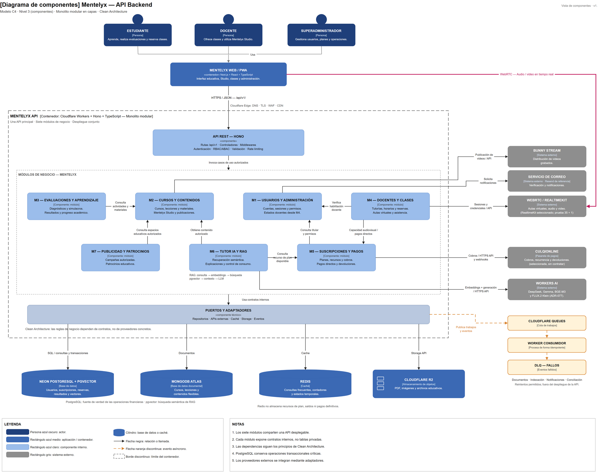

# Componentes arquitectónicos de Mentelyx

Se utiliza el **modelo C4, nivel 3 (Componentes)** para representar los componentes principales del backend de **Mentelyx**, sus responsabilidades y las relaciones con la aplicación web, las bases de datos y los servicios externos. La solución sigue el estilo de **monolito modular en capas** y aplica **Clean Architecture** para desacoplar las reglas de negocio de las tecnologías.

> **Alcance:** este modelo representa el producto completo. V1 se limita a aprendizaje y preparación de exámenes según ADR-093; Studio, docentes, clases, tutorías humanas, gestión institucional y publicación de cursos se posponen. El diagrama no indica implementación.

| Elemento | Descripción aplicada a Mentelyx |
|---|---|
| **Modelo arquitectónico** | C4, nivel 3: componentes del contenedor **Mentelyx API Backend**. |
| **Estilo arquitectónico** | Monolito modular en capas: siete módulos de negocio dentro de una única API principal. |
| **Enfoque arquitectónico** | Clean Architecture: colaboración mediante casos de uso, contratos y adaptadores. |
| **Objetivo** | Identificar qué componentes conforman el backend, sus responsabilidades y cómo se relacionan. |
| **¿Qué problema resuelve?** | Evita mezclar responsabilidades y reduce el acoplamiento directo entre módulos, bases de datos y proveedores externos. |
| **Aplicación cliente** | Web/PWA desarrollada con Next.js, React y TypeScript, con renderizado híbrido en Workers mediante OpenNext. |
| **Backend** | API REST con Hono y TypeScript; despliegue principal previsto en Cloudflare Workers. |
| **Persistencia y caché** | Neon PostgreSQL + pgvector (1024 dimensiones) para datos transaccionales y búsqueda vectorial; MongoDB Atlas para contenido documental y lienzos; Upstash Redis para caché; Cloudflare R2 para archivos. |
| **Integraciones** | Workers AI (DeepSeek, Gemma, BGE-M3, FLUX.2), CulqiOnline, RealtimeKit candidato sujeto a ADR-046, Bunny Stream condicionado a piloto en Perú (ADR-014), Cloudflare Browser Run, Resend, redes publicitarias externas, proveedores BYOK autorizados y Cloudflare Queues. |
| **Beneficios** | Claridad de responsabilidades, mantenibilidad, pruebas independientes, integración controlada y evolución de componentes sin convertirlos en microservicios. |

## Componentes principales

| Código | Componente | Responsabilidad |
|---|---|---|
| **C01** | Usuarios y Administración | Registro, perfil académico y edad, sesiones, permisos y habilitaciones para enseñar. |
| **C02** | Cursos y Contenidos | Catálogo, espacios y fuentes privadas, biblioteca reutilizable, lienzos guardados, Mentelyx Studio y publicación. |
| **C03** | Evaluaciones y Aprendizaje | Diagnósticos, evaluaciones personalizadas y de generación rápida, simulacros, objetivos, planes y progreso académico. |
| **C04** | Docentes y Clases | Tarifas por hora, disponibilidad, reservas, tutorías, aulas virtuales, grupos privados, consumo audiovisual y registro de pagos directos. |
| **C05** | Suscripciones y Pagos | Planes, cuotas comerciales de recursos, saldo audiovisual docente, cobros CulqiOnline, devoluciones, comisiones, recompensas y conciliación de pagos directos. |
| **C06** | Tutor IA y RAG | Orquestación por intención (general y con fuentes), RAG híbrido BGE-M3/pgvector 1024, búsqueda en la biblioteca, selección contextual de la pizarra, BYOK y consumo técnico. |
| **C07** | Publicidad y Patrocinios | Redes publicitarias externas, anuncios recompensados, campañas y patrocinios opcionales. |

**Figura 1.** Diagrama de componentes de Mentelyx (C4, nivel 3). Los siete módulos se encuentran dentro del mismo backend; las bases de datos y los servicios externos se representan fuera de ese límite. **Fuente:** elaboración propia, tomando como referencia el ejemplo académico proporcionado por la docente.

**Regla arquitectónica:** los módulos se comunican mediante contratos internos; sus controladores no deben acceder directamente a bases de datos ni a implementaciones privadas de otros módulos. Las tecnologías externas se integran mediante adaptadores.

> **Estado:** propuesta de arquitectura. Los proveedores seleccionados, su contingencia y su condición de activación están en la [sección 10 de los ADR](../01-analisis-de-sistema/07-decisiones-arquitectonicas.md); las capacidades previstas se validan durante la implementación.
