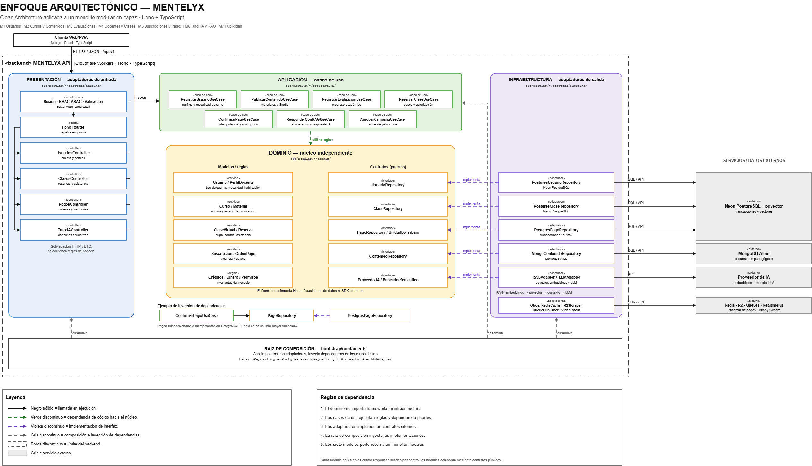

# Enfoque arquitectónico de Mentelyx

Se utiliza el enfoque **Clean Architecture (Arquitectura Limpia)** para separar las responsabilidades del sistema y controlar las dependencias del código hacia el dominio. Este enfoque se aplica dentro de los siete módulos del **monolito modular en capas** de Mentelyx.

| Elemento | Descripción aplicada a Mentelyx |
|---|---|
| **Patrón / enfoque arquitectónico** | Clean Architecture (Arquitectura Limpia). |
| **Estilo arquitectónico** | Arquitectura en capas y monolito modular. |
| **Objetivo** | Separar las reglas educativas y comerciales de la presentación, la persistencia y los servicios externos, mediante contratos y adaptadores. |
| **¿Qué problema resuelve?** | Evita el acoplamiento directo entre Hono, los casos de uso y tecnologías como Neon PostgreSQL, MongoDB Atlas, Redis, R2, pasarelas de pago y proveedores de IA. |
| **Capas definidas** | **Presentación:** rutas, controladores y validación. **Aplicación:** casos de uso y coordinación. **Dominio:** entidades y reglas de negocio. **Infraestructura:** repositorios y adaptadores de servicios externos. |
| **Aplicación en el proyecto** | Los siete módulos comparten una API principal; por ejemplo, *ConfirmarPago*, *ReservarClase* y *ResponderConRAG* utilizan interfaces internas en lugar de depender de implementaciones concretas. |
| **Beneficios** | Facilita las pruebas unitarias y el mantenimiento; permite sustituir implementaciones técnicas con menor impacto; protege las reglas del negocio y mejora la separación de responsabilidades. |

**Figura 1.** Enfoque Clean Architecture aplicado a Mentelyx: presentación, aplicación, dominio, infraestructura y sus dependencias. *Fuente: elaboración propia, con base en las decisiones arquitectónicas del proyecto.*

**Regla principal:** las dependencias del código apuntan hacia el núcleo; el dominio no depende de frameworks, bases de datos ni proveedores externos.
