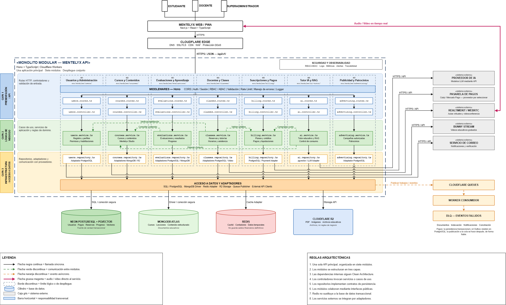

# Estilo arquitectónico de Mentelyx

Se adopta el estilo de **monolito modular en tres capas** con despliegue **serverless-first** y procesamiento asíncrono complementario. Este documento describe la estructura física/lógica del backend, sus tres capas horizontales, sus siete módulos verticales de negocio y su conexión con bases de datos y servicios externos, complementando el documento `enfoque-arquitectonico.md` (que detalla la inversión de dependencias interna con Clean Architecture).

| Elemento | Descripción aplicada a Mentelyx |
|---|---|
| **Estilo arquitectónico** | **Monolito modular en tres capas** con capacidades asíncronas serverless-first. |
| **Enfoque complementario** | Clean Architecture dentro de cada módulo para orientar dependencias hacia el dominio. |
| **Objetivo** | Organizar los siete módulos de negocio en una única unidad desplegable con fronteras explícitas, separando presentación HTTP, lógica de negocio y persistencia/integraciones. |
| **¿Qué problema resuelve?** | Evita la sobrecarga operativa y de red de una arquitectura de microservicios prematura, impidiendo al mismo tiempo que el sistema se convierta en un monolito acoplado sin límites entre módulos. |
| **Capas del estilo** | **Capa 1 — Presentación / API:** middlewares Hono, rutas (`*.routes.ts`) y controladores (`*.controller.ts`). **Capa 2 — Lógica de Negocio:** casos de uso, servicios de aplicación y reglas de dominio (`*.service.ts` / casos de uso). **Capa 3 — Infraestructura / Acceso a Datos:** repositorios (`*.repository.ts`), adaptadores y clientes de servicios externos. |
| **Módulos verticales (M1–M7)** | **M1** Usuarios y Administración · **M2** Cursos y Contenidos (Studio) · **M3** Evaluaciones y Aprendizaje · **M4** Docentes y Clases · **M5** Suscripciones y Pagos · **M6** Tutor IA y RAG · **M7** Publicidad y Patrocinios. |
| **Persistencia y estado** | **Neon PostgreSQL + pgvector** (fuente de verdad transaccional y vectores), **MongoDB Atlas** (documentos educativos estructurados), **Redis** (caché y contadores efímeros, nunca saldos financieros) y **Cloudflare R2** (archivos binarios). |
| **Integraciones y asincronía** | Proveedor de IA (LLM/embeddings), pasarela de pagos, WebRTC/SFU (RealtimeKit candidato), Bunny Stream, servicio de correo y **Cloudflare Queues + Worker consumidor + DLQ**. |
| **Beneficios** | Despliegue unificado en Cloudflare Workers, latencia nula en llamadas entre módulos mediante contratos internos TypeScript, transacciones ACID locales en PostgreSQL y evolución ordenada por dominios. |

**Figura 1.** Estilo arquitectónico de Mentelyx: monolito modular en tres capas con siete módulos de negocio, persistencia políglota controlada, procesamiento asíncrono con colas y servicios externos. *Fuente: elaboración propia, con base en las decisiones arquitectónicas del proyecto (ADR-001, ADR-002, ADR-013, ADR-023).*

## Reglas arquitectónicas del estilo

1. **Una sola API principal** (`Hono + TypeScript` sobre Cloudflare Workers), organizada en siete módulos de negocio con responsabilidades delimitadas.
2. **Estructura en tres capas horizontales** (Presentación/API, Lógica de Negocio e Infraestructura/Acceso a Datos), manteniendo las dependencias de código alineadas con Clean Architecture.
3. **Colaboración modular por contratos públicos**: los módulos se comunican mediante interfaces públicas internas (flechas verdes discontinuas en la figura), sin consultar directamente tablas ni repositorios privados de otros módulos.
4. **Flujo audiovisual directo al SFU**: el tráfico de audio y video en tiempo real viaja entre el cliente Web/PWA y el proveedor WebRTC/SFU (flecha magenta), sin atravesar la API REST de Hono.
5. **Persistencia transaccional y Outbox en PostgreSQL**: los pagos, créditos, cupos y permisos residen en PostgreSQL; la publicación hacia Cloudflare Queues se realiza de forma fiable tras confirmar la transacción local, con consumidor idempotente y cola de fallidos (DLQ).
6. **Redis como caché efímera**: Redis acelera lecturas y controles de tasa (rate limit), pero no sustituye a PostgreSQL como libro mayor ni fuente de verdad financiera.
