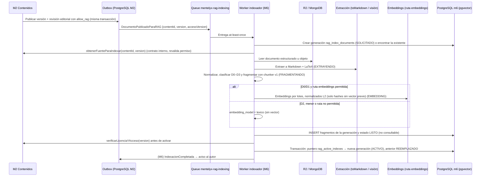

# Diseño RAG: ingestión, recuperación autorizada y referencias — Mentelyx

> **Proyecto:** Mentelyx · **Ubicación:** `docs/03-diseño-de-software/diseño-especializado/02-diseño-rag.md`
> **Módulo propietario:** M6 — Tutor IA y RAG (M2 es dueño de contenidos, versiones y licencias)
> **Versión:** 1.1 — 17/11/2026 · **Estado:** especificación de diseño propuesta; no implementada.
> **Cambios 1.1:** sincronización con el [contrato de coordinación](../contrato-coordinacion-datos-seguridad-infraestructura.md): CO-01 (secciones 9, 10.2, 13.1 y 13.3) y CO-05 (secciones 10.1 y 10.4). El esquema físico normativo es el de [persistencia, sección 7.6](../diseño-externo/01-diseño-de-persistencia-y-datos.md).

## 1. Propósito y alcance

Este documento completa ADR-019 y ADR-026 y el diseño de M6 (`diseño-interno-de-modulos.md` sección 8). Define cómo un material autorizado se convierte en fragmentos recuperables y cómo esos fragmentos se recuperan **solo** para quien tiene derecho a verlos. También cubre cómo se citan, cómo se reindexan y cómo se retiran.

**Contratos que se mantienen:**

- `rag_document_chunks` con `vector(1536)`, índice HNSW y `UNIQUE (document_id, version, chunk_index)` (persistencia sección 3.6);
- la cola `mentelyx-rag-indexing` con el evento `DocumentoPublicadoParaRAG` y la clave `docId + version + stage` (API sección 3);
- la revalidación con M2 antes de usar y antes de entregar (`ContentAccessPort.revalidar`).

Las ampliaciones se formulan como solicitudes de cambio (SC-01, SC-02, SC-13 y SC-15) en `07-registro-de-decisiones-y-solicitudes-de-cambio.md`.

## 2. Fuentes y ámbitos

| Fuente | Propietario | Ámbito ACL (`scope`) | Aprobación para RAG | Clase de dato |
|---|---|---|---|---|
| Lecciones y materiales editoriales publicados | M2 | `CATALOGO` (acceso según el curso, el plan y la licencia) | Revisión editorial y licencia con `allow_rag_indexing = true` (HU-30, RF-41) | D0 |
| Proyectos Studio publicados por autores | M2 | `LICENCIA` (los consumidores autorizados por la licencia de esa versión) | Permiso RAG explícito del autor, separado de publicar y de entrenar (HU-53, RC-11) | D0 |
| Fichas y temarios de examen | M2 | `CATALOGO` con la marca `oficial` o `referencial` | Fuente y fecha verificadas (RC-16) | D0 |
| Apuntes personales del usuario | M2 (documento) / M6 (índice) | `PRIVADO` (solo el propietario) | Activación del propietario («Usar en mi Tutor») | D1 si es texto; D2 si es imagen o escaneo |
| Ayuda de la plataforma | M2 | `PUBLICO` | Editorial interna | D0 |

**Nunca se indexan:** borradores no publicados de terceros, evaluaciones con soluciones oficiales (las soluciones se excluyen del corpus del Tutor), conversaciones del Tutor ni documentos de verificación (D3).

## 3. Flujo extremo a extremo



Revocación: `DocumentoRetiradoDeRAG` marca la generación y sus fragmentos como `REVOCADO` en ≤60 s, sin esperar a la purga física (sección 13.2). Contrato de datos: [persistencia, sección 14](../diseño-externo/01-diseño-de-persistencia-y-datos.md).

## 4. Ingestión

### 4.1. Eventos

| Evento | Productor | Efecto en M6 |
|---|---|---|
| `DocumentoPublicadoParaRAG` (existente) | Outbox M2 | Indexar la versión indicada |
| `DocumentoRetiradoDeRAG` (nuevo) | Outbox M2 al despublicar, revocar la licencia RAG o retirar el permiso del autor | Revocar de inmediato y purgar después (sección 13.2) |
| `ApunteActivadoParaTutor` / `ApunteDesactivadoParaTutor` (nuevos) | M2 | Indexar o retirar el ámbito `PRIVADO` |
| `ReindexacionSolicitada` (nuevo) | M6 (administración o cambio de modelo o de *chunker*) | Reindexar en sombra (sección 13.3) |

### 4.2. Máquina de estados por documento y versión (`rag_index_documents`, SC-02)

```text
SOLICITADO → EXTRAYENDO → FRAGMENTANDO → EMBEDDING → LISTO → ACTIVO
     │            │              │             │
     └────────────┴──────────────┴─────────────┴──→ FALLIDO (reintentos agotados → DLQ)
ACTIVO → REEMPLAZADO (el puntero rag_active_indexes pasa a otra generación)
ACTIVO | LISTO → REVOCADO → PURGADO
```

Los nombres siguen la [persistencia, sección 7.6](../diseño-externo/01-diseño-de-persistencia-y-datos.md) (CO-01). Cada fila es una **generación** (`index_id`) de un documento y versión con un modelo y un *chunker* concretos. `LISTO` equivale a la antigua «sombra»: completa pero no consultable hasta que el puntero la activa.

**Reglas de la máquina de estados:**

- Cada transición se escribe con `UPDATE … WHERE estado = :esperado`, que actúa como control optimista.
- La clave de idempotencia por etapa es `rag:{indexId}:{etapa}`, donde `indexId` identifica la generación (contenido, versión, modelo, *chunker* y generación). Una entrega duplicada de la cola encuentra la etapa completada y termina sin efectos.
- Se hacen como máximo 3 reintentos con espera exponencial (30 s, 2 min, 8 min). Después el mensaje va a `mentelyx-rag-dlq` con alerta administrativa.
- Antes de cada etapa costosa se revalida con M2 que la versión sigue publicada y autorizada. Si no, el documento pasa a `REVOCADO`.

## 5. Extracción

| Origen | Método | Salida |
|---|---|---|
| Documentos estructurados de MongoDB (lecciones, `studio_projects`) | Recorrido determinista de bloques: `heading` → `#`, `paragraph`, `formula` → `$$…$$`, `list`, `table` → Markdown, `exercise` → enunciado y solución etiquetados, `visual_scene` → descripción accesible de la escena, `ai_illustration` → texto alternativo | Markdown con anclas `{#bloque-id}` |
| PDF con capa de texto | Workers AI `toMarkdown` («free for most format conversions») | Markdown por página |
| PDF escaneado o páginas con densidad de texto < 200 caracteres | Ruta `vision` (DeepSeek V4.1 Flash en Workers AI) con la instrucción «transcribe a Markdown; fórmulas en LaTeX; no inventes texto ilegible: márcalo [ilegible]» | Markdown + LaTeX validado con KaTeX (`throwOnError: true`); las fórmulas inválidas quedan como texto entre comillas |
| Imágenes sueltas de apuntes | Ruta `vision` (D2 → solo ZDR) | Ídem |
| Otros formatos (DOCX, PPTX, HTML) | `toMarkdown` según los formatos admitidos en su documentación (confirmar la lista en el prototipo) | Markdown |

**Costos:**

- Las transcripciones por visión del contenido editorial se imputan al presupuesto operativo de Mentelyx.
- En apuntes personales consumen **1 UTI por cada 5 páginas** (hipótesis) y requieren la confirmación previa del usuario con el costo mostrado.
- Límite de 100 páginas por documento y de 20 MB por archivo (hipótesis de piloto).

## 6. Normalización

1. Unicode NFC; espacios colapsados; se eliminan los caracteres de control.
2. Se unen las palabras cortadas por guion al final de línea (`multi-\nplicación` → `multiplicación`) cuando la unión existe en el diccionario de español. Si no existe, se conservan.
3. Se eliminan encabezados y pies repetidos: las líneas que aparecen idénticas en ≥ 50 % de las páginas de un PDF.
4. Los bloques LaTeX se preservan intactos. No se normalizan espacios dentro de `$…$` ni de `$$…$$`.
5. Se detecta el idioma (español por defecto). El valor se guarda en `idioma` para la configuración de búsqueda textual.
6. Se calcula `content_hash = SHA-256(texto_normalizado)` por bloque.

## 7. Fragmentación (*chunker* v1)

### 7.1. Parámetros

| Parámetro | Valor inicial | Nota |
|---|---|---|
| `OBJ` (tamaño objetivo) | 450 tokens | Calibrar con BP-07 |
| `MAX` | 800 tokens | Por debajo del límite de entrada del modelo de embeddings (8192) |
| `MIN` | 120 tokens | Evita fragmentos sin contexto |
| `SOLAPE` | Último bloque no atómico, si ≤ 80 tokens | Continuidad entre fragmentos |
| Conteo de tokens | `ceil(caracteres / 3,5)` | Heurística para español; calibrar con el contador del proveedor |

**Bloques atómicos** (nunca se dividen salvo que superen `MAX`): fórmula de bloque, tabla, código, imagen con su texto alternativo, y el par enunciado-solución de un ejercicio.

### 7.2. Algoritmo

```text
fragmentar(bloques):
  ruta ← []                         # encabezados vigentes [Curso, Unidad, Tema, Sección]
  actual ← []; salida ← []
  para b en bloques:
    si b.tipo = ENCABEZADO:
      si tokens(actual) ≥ MIN: cerrar(actual)       # un fragmento no cruza secciones
      si no, si actual ≠ []: conservar actual para la sección siguiente con su ruta original
      ruta ← actualizar(ruta, b.nivel, b.texto); continuar
    piezas ← (b.atomico y tokens(b) > MAX) ? dividirSeguro(b) : [b]
    para p en piezas:
      si tokens(actual) + tokens(p) > OBJ y tokens(actual) ≥ MIN:
        cerrar(actual)
        actual ← solape(ultimoBloque)                # solo si no es atómico y ≤ 80 tokens
      actual.agregar(p)
  si actual ≠ []: cerrar(actual)
  devolver salida

dividirSeguro(b):
  tabla      → grupos de filas ≤ OBJ, repitiendo la fila de encabezado
  ejercicio  → [enunciado + paso 1..k] ≤ MAX; los siguientes grupos llevan un resumen del enunciado (≤ 60 tokens)
  párrafo    → cortes en fin de oración fuera de $…$
  fórmula    → no se divide (se admite hasta 2 × MAX; si excede, se marca demasiado_largo y se omite del índice)

cerrar(x):
  salida.agregar({
    texto: unir(x),                                        # lo que se muestra y cita
    textoEmbedding: ruta.join(" > ") + "\n" + unir(x),     # contexto jerárquico solo para el embedding
    ancla: { bloqueId: x[0].id, pagina: x[0].pagina, seccion: ruta.ultimo },
    tokens, content_hash, chunker_version: "v1"
  })
```

## 8. Embeddings

| Aspecto | Decisión |
|---|---|
| Modelo | `gemini-embedding-2` con `output_dimensionality = 1536` (documentado como recomendado; autonormaliza dimensiones truncadas; más de 100 idiomas; 8192 tokens de entrada). Compatible con `vector(1536)` sin cambiar la persistencia. |
| Prefijos de tarea | Este modelo no admite `task_type`. Se aplican los prefijos de consulta y documento indicados en su documentación oficial (para consultas: `task: search result \| query: {contenido}`). La plantilla exacta queda en configuración versionada. |
| Lotes | Hasta 100 fragmentos por solicitud o el límite que fije el proveedor. Reintentos con espera ante `429`. |
| Reutilización | Si `content_hash + chunker_version + embedding_model` ya existe en una versión anterior del mismo documento, **se copia el vector** sin llamar al proveedor. Las versiones con cambios menores casi no generan costo. |
| Normalización | Vectores unitarios (autonormalizados); distancia coseno (`vector_cosine_ops`). |
| Alternativa | `text-embedding-3-small` (1536 por defecto, USD 0,02/M). Exige reindexación completa: espacios vectoriales distintos **no se mezclan**. |
| Consultas de menores bajo `SOLO_ZDR` | No se envía la consulta al modelo de embeddings externo. La recuperación es **solo léxica** (sección 10.3), con expansión de términos por la ruta `explicacion.zdr`. Ver BP-07 y SC-15 para la alternativa ZDR completa. |

## 9. Esquema PostgreSQL propuesto (detalle de SC-01 y SC-02)

> **Sincronización CO-01.** Codex modificó SC-01 y SC-02. El esquema normativo está en [persistencia, sección 7.6](../diseño-externo/01-diseño-de-persistencia-y-datos.md) y prevalece sobre el SQL original de esta sección, que se conserva más abajo como **solicitud histórica**. Diferencias que el diseño RAG adopta:
>
> | Elemento | Solicitud original | Diseño vigente |
> |---|---|---|
> | Identificador de la generación | PK `(document_id, version, embedding_model)` | `rag_index_documents.id` (PK) y UNIQUE `(document_id, version, embedding_model, chunker_version, generation)` |
> | Unicidad de fragmentos | UNIQUE v1 `(document_id, version, chunk_index)` | `index_id` FK a la generación y UNIQUE `(index_id, chunk_index)`, para que convivan generaciones y modelos durante una reindexación |
> | Generación vigente | Bandera `vigente` en cada fragmento | Puntero `rag_active_indexes(document_id → index_id)`, conmutado de forma atómica tras completar y revalidar la licencia; `vigente` queda como filtro auxiliar |
> | Índice vectorial | Un HNSW global | HNSW **parcial por espacio vectorial** (modelo y dimensión) con `embedding IS NOT NULL`; filtrar el modelo después del ANN no hace comparables vectores de espacios distintos |
> | Estados | `LISTO_SOMBRA` | `SOLICITADO/EXTRAYENDO/FRAGMENTANDO/EMBEDDING/LISTO/ACTIVO/FALLIDO/REVOCADO/REEMPLAZADO` |
>
> Ejemplo del índice parcial vigente:
>
> ```sql
> CREATE INDEX rag_chunks_hnsw_gemini2_1536 ON m6_ai_tutor.rag_document_chunks
>   USING hnsw (embedding vector_cosine_ops) WITH (m = 16, ef_construction = 64)
>   WHERE embedding_model = 'gemini-embedding-2' AND embedding IS NOT NULL;
> ```

```sql
-- SOLICITUD HISTÓRICA SC-01/SC-02 (sustituida por persistencia, sección 7.6; ver nota CO-01)
-- SC-01: columnas ACL y de control que precisan los "metadatos de acceso ACL" ya previstos
ALTER TABLE m6_ai_tutor.rag_document_chunks
  ADD COLUMN scope            varchar(12) NOT NULL CHECK (scope IN ('CATALOGO','LICENCIA','PRIVADO','PUBLICO')),
  ADD COLUMN owner_id         uuid,                 -- obligatorio si scope = 'PRIVADO'
  ADD COLUMN course_id        uuid,
  ADD COLUMN level            varchar(16),
  ADD COLUMN estado           varchar(12) NOT NULL DEFAULT 'ACTIVO'
                              CHECK (estado IN ('ACTIVO','REEMPLAZADO','REVOCADO')),
  ADD COLUMN vigente          boolean NOT NULL DEFAULT false,
  ADD COLUMN texto            text NOT NULL,
  ADD COLUMN ancla            jsonb NOT NULL,       -- {bloqueId, pagina, seccion}
  ADD COLUMN titulo           varchar(300) NOT NULL,
  ADD COLUMN tokens           integer NOT NULL,
  ADD COLUMN content_hash     char(64) NOT NULL,
  ADD COLUMN chunker_version  varchar(8) NOT NULL,
  ADD COLUMN embedding_model  varchar(64) NOT NULL,
  ADD COLUMN idioma           varchar(8) NOT NULL DEFAULT 'es',
  ADD COLUMN senal_inyeccion  boolean NOT NULL DEFAULT false,
  ADD COLUMN tsv              tsvector GENERATED ALWAYS AS (to_tsvector('spanish', texto)) STORED,
  ADD CONSTRAINT privado_con_propietario CHECK (scope <> 'PRIVADO' OR owner_id IS NOT NULL);

CREATE INDEX rag_chunks_filtro   ON m6_ai_tutor.rag_document_chunks (document_id, vigente, estado);
CREATE INDEX rag_chunks_owner    ON m6_ai_tutor.rag_document_chunks (owner_id) WHERE scope = 'PRIVADO';
CREATE INDEX rag_chunks_tsv      ON m6_ai_tutor.rag_document_chunks USING gin (tsv);
-- Índice HNSW existente: USING hnsw (embedding vector_cosine_ops) WITH (m = 16, ef_construction = 64)

-- SC-02: estado de indexación por documento y versión
CREATE TABLE m6_ai_tutor.rag_index_documents (
  document_id      uuid        NOT NULL,
  version          integer     NOT NULL,
  scope            varchar(12) NOT NULL,
  estado           varchar(16) NOT NULL,
  etapa_completada varchar(16),
  intentos         integer     NOT NULL DEFAULT 0,
  error_code       varchar(64),
  chunker_version  varchar(8)  NOT NULL,
  embedding_model  varchar(64) NOT NULL,
  chunks_total     integer,
  costo_usd        numeric(12,6),
  solicitado_en    timestamptz NOT NULL,
  vigente_desde    timestamptz,
  revocado_en      timestamptz,
  PRIMARY KEY (document_id, version, embedding_model)
);
```

`owner_id`, `course_id` y `level` son **copias de metadatos de acceso** recibidas de M2 en el evento, no claves foráneas hacia tablas privadas de M2. La autoridad sigue siendo M2, que se consulta en la revalidación.

## 10. Recuperación

### 10.1. Conjunto consultable (autorización previa)

1. El orquestador pide a M2 `listarRecursosConsultables(actorId, contexto)`. Es un contrato nuevo que devuelve como máximo 200 identificadores de contenido que el actor puede leer en el contexto (curso activo, recurso abierto o ficha de examen).
2. Si el contexto es un `recursoId`, el conjunto es ese único recurso.
3. Los apuntes `PRIVADO` se incluyen solo si el actor activó «Usar mis apuntes».
4. El cliente nunca envía la lista de recursos. Nunca se usan fuentes sin autorizar. **Sincronización CO-05:** ADR-058 está diferida a producto y el modo `GENERAL` no está habilitado. Si M2 no responde o la autorización falla, la respuesta es `503 SERVICIO_NO_DISPONIBLE` (dependencia crítica de autorización caída, API sección 7), sin inferencia ni consumo. No hay respaldo silencioso a `GENERAL` (sección 12.2 del orquestador).

### 10.2. Consulta híbrida con fusión por rangos (RRF)

```sql
BEGIN;
SET LOCAL hnsw.ef_search = 100;
SET LOCAL hnsw.iterative_scan = relaxed_order;  -- pgvector ≥ 0.8.0 (INF-06); confirmar con SQL en el prototipo (PEND-RAG-01)

-- CO-01: el filtro se repite en cada rama. Un CTE común referenciado dos veces se materializa
-- e impide el uso de HNSW (persistencia, sección 10.2). El KNN interno usa ORDER BY ... LIMIT
-- y el rango se calcula fuera. :modelo se fija como literal por espacio vectorial (o con un plan
-- personalizado) para que el planificador pueda usar el índice HNSW parcial. Solo EXPLAIN ANALYZE confirma el plan.
WITH vec AS (
  SELECT id, row_number() OVER (ORDER BY dist) AS r
  FROM (
    SELECT c.id, c.embedding <=> :qvec AS dist
    FROM m6_ai_tutor.rag_document_chunks c
    JOIN m6_ai_tutor.rag_active_indexes a ON a.index_id = c.index_id
    WHERE c.estado = 'ACTIVO' AND c.embedding_model = :modelo AND c.embedding IS NOT NULL
      AND ( (c.scope IN ('CATALOGO','LICENCIA','PUBLICO') AND c.document_id = ANY(:consultables))
         OR (c.scope = 'PRIVADO' AND c.owner_id = :actor AND :usar_apuntes) )
    ORDER BY c.embedding <=> :qvec
    LIMIT 40
  ) knn
),
lex AS (
  SELECT c.id, row_number() OVER (ORDER BY ts_rank_cd(c.tsv, q) DESC) AS r
  FROM m6_ai_tutor.rag_document_chunks c
  JOIN m6_ai_tutor.rag_active_indexes a ON a.index_id = c.index_id
  CROSS JOIN websearch_to_tsquery('spanish', :texto) q
  WHERE c.estado = 'ACTIVO' AND c.tsv @@ q
    AND ( (c.scope IN ('CATALOGO','LICENCIA','PUBLICO') AND c.document_id = ANY(:consultables))
       OR (c.scope = 'PRIVADO' AND c.owner_id = :actor AND :usar_apuntes) )
  ORDER BY ts_rank_cd(c.tsv, q) DESC
  LIMIT 40
)
SELECT id, SUM(1.0 / (60 + r)) AS rrf
FROM (SELECT id, r FROM vec UNION ALL SELECT id, r FROM lex) u
GROUP BY id ORDER BY rrf DESC LIMIT 16;
COMMIT;
```

### 10.3. Modo solo léxico (consultas de menores bajo `SOLO_ZDR`)

1. `explicacion.zdr` genera hasta 6 términos de expansión. Salida JSON con la forma `{"terminos": ["segunda ley de Newton", "fuerza neta", "aceleración"]}`.
2. Se ejecuta la rama `lex` con `websearch_to_tsquery` sobre `pregunta OR términos`.
3. El costo se absorbe en la operación. Si la ruta ZDR falla, se usa la pregunta sin expandir.

### 10.4. Selección final

1. **Umbral de relevancia:** se descarta un fragmento si no aparece en `lex` y su similitud coseno es < τ. El valor inicial τ = 0,40 es un **marcador a calibrar** con el conjunto dorado de BP-07, buscando una precisión ≥ 0,90.
2. **Diversidad (MMR):** `puntaje = λ · rrf_norm − (1 − λ) · max(similitud con los ya elegidos)`, con λ = 0,7.
3. **Empaquetado:** se agregan fragmentos en orden hasta `presupuestoContexto = min(0,5 × maxTokensEntrada, 6000)` tokens. Cada uno lleva la cabecera `[cN] Título · Sección · vX`.
4. **Revalidación:** `ContentAccessPort.revalidar` por cada `document_id` distinto, en paralelo. Los fragmentos de recursos que fallen se eliminan.
5. **Sin fragmentos:** con `recursoId`, la respuesta es `SIN_CONTEXTO` sin inferencia (regla existente). Sin `recursoId` también es `SIN_CONTEXTO` mientras ADR-058 siga diferida (CO-05). Solo si producto aprueba ADR-058 se usará el modo `GENERAL`, etiquetado y sin citas.

## 11. Autorización: garantías

| Garantía | Mecanismo | Prueba |
|---|---|---|
| Ningún fragmento fuera del conjunto consultable | Filtro SQL obligatorio en la CTE `filtro`; la consulta vive en un repositorio sin parámetros opcionales de ámbito | RAG-SEC-01 (sección 9 del documento de calidad) |
| Revocación efectiva aunque el índice esté desfasado | `estado = 'REVOCADO'` en una sola sentencia + revalidación con M2 antes del modelo y antes de entregar | RAG-SEC-02 |
| Apuntes privados no se filtran a otros usuarios | `CHECK privado_con_propietario` + filtro `owner_id = :actor` | RAG-SEC-03 |
| El modelo no amplía el corpus | La herramienta `buscar_fuentes` no recibe identificadores; el servidor aplica el conjunto consultable | RAG-SEC-04 |
| Soluciones oficiales fuera del corpus | La extracción excluye bloques `solucion_oficial` de evaluaciones | RAG-SEC-05 |

## 12. Referencias y citas

```json
{
  "id": "c1",
  "chunkId": "2f6c…",
  "recursoId": "550e8400-e29b-41d4-a716-446655440000",
  "version": 3,
  "titulo": "Dinámica: Leyes de Newton",
  "seccion": "Segunda ley",
  "ancla": { "bloqueId": "b-17", "pagina": null },
  "enlace": "/estudiante/cursos/440e8400-…/lecciones/550e8400-…?v=3#b-17",
  "fragmento": "La aceleración de un cuerpo es directamente proporcional a la fuerza neta…",
  "tipoFuente": "CATALOGO",
  "oficial": null
}
```

- El modelo cita con `[[c1]]`. El servidor sustituye cada marcador válido por un índice de referencia (`[1]`) y elimina los inválidos (orquestador sección 12.2).
- La interfaz muestra la lista de referencias con título, sección y versión. Al pulsar una, abre el material autorizado en el bloque exacto. Nunca muestra fragmentos que el usuario no pueda abrir.
- Las fichas de examen muestran la marca «Oficial verificada» o «Referencial» (RC-16).

## 13. Reindexación, desindexación y versiones

### 13.1. Nueva versión publicada

Se indexa en una generación nueva (`rag_index_documents`), no consultable mientras no esté `LISTO`. Al completarse y revalidarse la licencia en M2, una sola transacción M6 hace tres cambios (CO-01):

1. conmuta `rag_active_indexes.index_id` a la nueva generación;
2. marca la nueva como `ACTIVO`;
3. marca la anterior como `REEMPLAZADO`, sincronizando la bandera auxiliar `vigente`.

Una generación incompleta nunca es consultable y se repara o descarta. Los fragmentos reemplazados se purgan a los 7 días, o de inmediato si la licencia cambió.

### 13.2. Retiro o revocación (`DocumentoRetiradoDeRAG`)

1. En cuanto llega el evento: `UPDATE … SET estado = 'REVOCADO', vigente = false WHERE document_id = :id`. **Objetivo:** exclusión efectiva ≤ 60 s desde el `COMMIT` de M2. Mientras tanto protege la revalidación de cada consulta.
2. En menos de 24 h: purga física del texto y de los vectores. `rag_index_documents` conserva solo los metadatos (`PURGADO`, fecha y motivo) para la auditoría.
3. Las respuestas ya entregadas no se reescriben. Las conversaciones vigentes muestran la referencia como «Material ya no disponible».

### 13.3. Cambio de modelo de embeddings o de *chunker*

Se reindexa en generaciones nuevas, con un `embedding_model` o una `chunker_version` nuevos y su propio índice HNSW parcial creado antes de conmutar. Ambos conjuntos coexisten gracias a UNIQUE `(index_id, chunk_index)` (CO-01). La configuración de recuperación cambia de modelo de forma atómica cuando el 100 % de los documentos vigentes tiene una generación `LISTO` del nuevo espacio y BP-07 aprueba. Después se purga el conjunto anterior. Así no se mezclan espacios vectoriales. Un cambio de dimensión, como SC-15 (`vector(1024)`, diferida), exige una columna o índice paralelo y nunca un `ALTER` destructivo.

## 14. Apuntes personales

- Límites (hipótesis de piloto): 50 documentos y 300 páginas indexadas por usuario.
- Activación explícita por documento. Al eliminar el apunte o desactivarlo, se purga de inmediato.
- Retención: la del apunte en M2, bajo el control del usuario. El índice no sobrevive al documento.
- Las cuentas de menores con `SOLO_ZDR` indexan texto en el modo léxico, sin embeddings externos. Las imágenes y escaneos se transcriben por la ruta `vision` (ZDR) y luego se tratan como texto.

## 15. Métricas de evaluación

| Métrica | Definición | Umbral propuesto |
|---|---|---|
| Recall@8 | Proporción de preguntas del conjunto dorado con al menos un fragmento relevante entre los 8 primeros | ≥ 0,85 |
| MRR@8 | Media del inverso del rango del primer fragmento relevante | ≥ 0,60 |
| Precisión de citas | Citas que respaldan la afirmación a la que acompañan (revisión docente) | ≥ 0,95 |
| Fugas no autorizadas | Fragmentos fuera del conjunto consultable en el conjunto adversarial | **0** |
| Latencia de recuperación | p95 desde la consulta hasta el contexto listo, sin el modelo | ≤ 400 ms (medir en Neon) |
| Tiempo de revocación | Desde el `COMMIT` de M2 hasta `estado = 'REVOCADO'` | ≤ 60 s |

**BP-07** compara `gemini-embedding-2@1536`, `text-embedding-3-small@1536`, `@cf/baai/bge-m3` y el modo solo léxico sobre 400 preguntas en español de cuatro niveles. Si `bge-m3` queda a ≤ 3 puntos de Recall@8 del mejor, se recomienda adoptar SC-15 (un único espacio ZDR para todos los usuarios, menor costo). Esa decisión corresponde al registro de decisiones.

## 16. Ejemplo completo (EJ-05)

**Material:** la lección «Leyes de Newton» v3 de Física (Secundaria), con licencia RAG aprobada.

**Bloques de entrada (resumen):**

| Bloque | Tipo | Caracteres | Tokens (≈ c/3,5) |
|---|---|---:|---:|
| b-01 | Encabezado «Leyes de Newton» (nivel 1) | — | — |
| b-02 | Párrafo de introducción | 700 | 200 |
| b-10 | Encabezado «Primera ley» (nivel 2) | — | — |
| b-11 | Párrafo | 1050 | 300 |
| b-12 | Párrafo con el ejemplo del autobús | 420 | 120 |
| b-16 | Encabezado «Segunda ley» (nivel 2) | — | — |
| b-17 | Párrafo | 875 | 250 |
| b-18 | Fórmula `$$\vec F_{neta}=m\,\vec a$$` (atómica) | 35 | 10 |
| b-19 | Ejercicio resuelto: enunciado + solución (atómico) | 1400 | 400 |

**Fragmentos resultantes:**

| Fragmento | Bloques | Tokens | Motivo |
|---|---|---:|---|
| `chunk 0` | b-02 | 200 | Cierra al encontrar el encabezado b-10 (200 ≥ MIN) |
| `chunk 1` | b-11 + b-12 | 420 | 300 + 120 ≤ OBJ, así que se agrupan. Ruta «Física > Dinámica > Leyes de Newton > Primera ley»; cierra en el encabezado b-16 |
| `chunk 2` | b-17 + b-18 | 260 | Añadir b-19 llevaría a 660 > OBJ, así que se cierra |
| `chunk 3` | b-19 | 400 | Bloque atómico ≤ MAX; no lleva solape porque el último bloque anterior (b-18) es atómico |

**Consulta:** «¿qué dice la segunda ley de Newton?» por un adulto en el curso. Conjunto consultable = {la lección v3, otras 5 lecciones}.

| Fragmento | Rango vectorial | Rango léxico | RRF |
|---|---:|---:|---:|
| chunk 2 | 1 | 2 | 1/61 + 1/62 = 0,032522 |
| chunk 3 | 3 | 1 | 1/63 + 1/61 = 0,032266 |
| chunk 1 | 2 | — | 1/62 = 0,016129 |
| (otra lección) | — | 3 | 1/63 = 0,015873 |

**Contexto final** (presupuesto 6000 tokens): chunk 2 → `[c1]`, chunk 3 → `[c2]`, chunk 1 → `[c3]`.

**Respuesta esperada:** cita `[[c1]]` para el enunciado de la ley y `[[c2]]` para el ejemplo. Una cita `[[c9]]` inexistente se elimina.

**Revocación:** el docente retira el permiso RAG. M2 emite `DocumentoRetiradoDeRAG`. La misma consulta repetida 60 s después devuelve 0 fragmentos de esa lección.

## 17. Pendientes

| ID | Pendiente |
|---|---|
| PEND-RAG-01 | Confirmar la versión de pgvector en Neon (búsqueda iterativa con filtros) y los parámetros HNSW con datos reales |
| PEND-RAG-02 | Confirmar los formatos admitidos por `toMarkdown` y sus costos para imágenes |
| PEND-RAG-03 | Ejecutar BP-07 y decidir sobre SC-15 |
| PEND-RAG-04 | Definir con M2 el contrato `listarRecursosConsultables` y su límite (200) en catálogos grandes (paginación por curso) |

**Trazabilidad:** HU-26, HU-30, HU-31, HU-42, HU-53; RF-35, RF-41, RF-42, RF-55, RF-62, RF-91, RF-99; AC-04, AC-11; RC-11, RC-12, RC-16; ADR-019, ADR-026, ADR-042; EQ-11.
