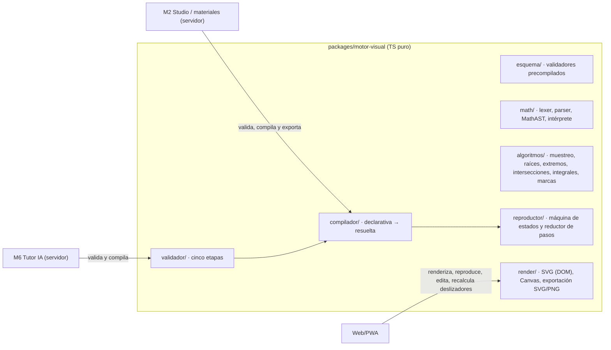

# Motor visual, pizarra interactiva y chat sincronizado — Mentelyx

> **Proyecto:** Mentelyx · **Ubicación:** `docs/03-diseño-de-software/diseño-especializado/03-motor-visual-y-pizarra.md`
> **Componente:** biblioteca determinista `packages/motor-visual` (TypeScript puro, sin E/S), usada por la Web/PWA, M6 (Tutor IA) y M2 (Studio y materiales)
> **Versión:** 1.0 — 17/11/2026 · **Estado:** especificación de diseño propuesta; no implementada.

## 1. Propósito y alcance

El motor visual convierte **descripciones declarativas** de gráficos, construcciones geométricas, fórmulas y animaciones en escenas calculadas, verificables y reproducibles paso a paso. Lo usan:

- el **Tutor IA**: el modelo describe la escena y el motor calcula la geometría;
- la **pizarra manual de Studio**, que no consume créditos de IA (HU-43, HU-61, RF-83);
- la **exportación** a PDF y PPTX.

| Incluye | No incluye |
|---|---|
| Esquema `mentelyx.escena/v1`, diccionario de primitivas, compilador, algoritmos matemáticos y gráficos, validación, animaciones, reproductor por pasos, sincronización con el chat, pizarra manual, accesibilidad | Escenas 3D (`04-visualizaciones-3d.md`), pizarra colaborativa en tiempo real dentro del Aula Live (posterior, sección 13.4) |

**Regla central:** la IA declara *qué* mostrar («la raíz de f», «el máximo de f», «la tangente en x = 1»). El motor calcula *dónde* está, con algoritmos deterministas. Los valores mostrados en etiquetas se obtienen por **enlaces** (`{{y:max}}`), no por números escritos por el modelo.

## 2. Arquitectura



- El **servidor** valida y compila **antes** de entregar una escena. Ninguna escena inválida llega al cliente.
- El **cliente** usa la misma versión del paquete para renderizar y para recalcular de forma local cuando el usuario mueve un deslizador o edita en la pizarra.
- La versión del paquete (`motorVersion`) se guarda con cada escena resuelta. Las pruebas comparan resultados con tolerancia, porque las funciones trascendentes pueden diferir en el último bit entre motores JavaScript.
- No hay `eval`, `new Function` ni compilación de esquemas en tiempo de ejecución. Los validadores se generan en tiempo de construcción.

## 3. Modelo conceptual

| Nivel | Esquema | Quién lo escribe | Contenido |
|---|---|---|---|
| **Escena declarativa** | `mentelyx.escena/v1` | El modelo de IA, el usuario en la pizarra o una plantilla | Objetos con expresiones, construcciones derivadas y pasos. Sin coordenadas calculadas. |
| **Escena resuelta** | `mentelyx.escena-resuelta/v1` | Solo el compilador | Geometría muestreada, valores calculados, marcas de ejes, etiquetas resueltas y línea de tiempo absoluta |

La escena resuelta se puede almacenar en caché por `sha256(declarativa) + motorVersion`, con un límite de 2 MB.

## 4. Lienzo y sistemas de coordenadas

| Propiedad | Valores | Regla |
|---|---|---|
| `sistema` | `cartesiano` (v1); `polar` como trazado sobre el cartesiano | — |
| `vista` | `{xMin, xMax, yMin, yMax}` o `"auto"` | `xMax − xMin ≥ 1e-6`; `\|valores\| ≤ 1e6` |
| `proporcion` | `libre` / `igual` | `igual` amplía el rango menor para que una unidad mida lo mismo en ambos ejes |
| `fondo` | `pizarra`, `blanco`, `cuadricula` | Se adapta al tema claro u oscuro |
| Coordenadas de pantalla | `{ "pantalla": [u, v] }` con u, v ∈ [0, 1] | Para textos y fórmulas fijos. El origen está arriba a la izquierda. |

**Transformación mundo → pantalla** (ancho W y alto H en píxeles):

`sx = (x − xMin) / (xMax − xMin) · W` y `sy = H − (y − yMin) / (yMax − yMin) · H`.

**Vista automática:** se calcula el rectángulo mínimo que contiene los puntos de interés (raíces, extremos, intersecciones y puntos explícitos) con un margen del 15 % y un ancho mínimo de 2 unidades. Si no hay puntos de interés, la vista es [−10, 10] × [−10, 10].

## 5. Diccionario de primitivas

**Propiedades comunes:**

- `id`: patrón `^[a-z][a-z0-9_-]{0,31}$`;
- `tipo`;
- `capa`: `fondo`, `principal` o `anotacion`;
- `estilo`: `color` como *token*, `grosor` de 1 a 8, `trazo` (`solido`, `discontinuo`, `punteado`), `relleno` como *token* y `opacidadRelleno` de 0 a 1;
- `etiqueta`: `{texto ≤ 120 con $LaTeX$ en línea y enlaces, posicion}`;
- `inicial`: visible desde el inicio;
- `descripcion`: texto accesible.

| Tipo | Propiedades específicas | Puede ser derivado | Animaciones admitidas |
|---|---|---|---|
| `ejes` | `x`/`y`: `{etiqueta, marcas: "auto" \| paso}`, `cuadricula` | — | `aparecer` |
| `punto` | `x`, `y` **o** `construccion` | Sí (sección 5.1) | `aparecer`, `desplazar`, `recorrer`, `resaltar` |
| `segmento` | `desde`, `hasta` (referencia a punto o par `[x, y]`) | Por sus extremos | `dibujar`, `aparecer` |
| `recta` | `pasaPor: [p, q]` **o** `pendiente` + `intercepto` **o** `construccion` (`perpendicular`, `paralela`) | Sí | `dibujar` |
| `vector` | `origen` + `componentes: [dx, dy]` **o** `desde` + `hasta` | Por sus puntos | `dibujar`, `desplazar` |
| `poligono` | `vertices` (3 a 64) | Por sus vértices | `dibujar`, `aparecer` |
| `circulo` | `centro`, `radio > 0` | Por el centro | `dibujar` |
| `arco` | `centro`, `radio`, `anguloInicio`, `anguloFin` (grados) | Por el centro | `dibujar` |
| `angulo` | `vertice`, `lado1`, `lado2`, `mostrarValor` | Valor calculado | `dibujar`, `resaltar` |
| `funcion` | `expresion` (gramática restringida, `01-…orquestacion.md` sección 11.2), `variable` (`x`), `dominio?` | — | `dibujar`, `variarParametro` |
| `parametrica` | `x(t)`, `y(t)`, `t: [a, b]` | — | `dibujar` |
| `polar` | `r(theta)`, `theta: [a, b]` | — | `dibujar` |
| `region` | `entre: [idFuncion, idFuncion \| "eje_x"]`, `desde`, `hasta` | Área calculada (`{{valor:id}}`) | `aparecer` |
| `riemann` | `funcion`, `desde`, `hasta`, `n` (1 a 200), `metodo` (`izquierda`, `derecha`, `punto_medio`, `trapecio`) | Suma calculada | `aparecer` (rectángulo a rectángulo) |
| `tangente` | `funcion`, `enX` (número o referencia) | Pendiente calculada | `dibujar`, `recorrer` (tangente móvil) |
| `texto` | `posicion`, `contenido` (≤ 500, Markdown simple), `tamano` | — | `aparecer`, `escribir` |
| `formula` | `posicion`, `latex` (≤ 1000), `tamano` | — | `aparecer`, `escribir` |
| `flecha` | `desde`, `hasta` (mundo o pantalla), `curvatura` | — | `dibujar` |
| `datos` | `puntos: [[x, y]]` (≤ 1000), `modo` (`dispersion` o `linea`) | — | `aparecer` |
| `barras` | `categorias` (≤ 24), `valores` | — | `aparecer` |
| `recta_numerica` | `min`, `max`, `marcas`, `puntos[]`, `intervalos[{desde, hasta, abiertoIzq, abiertoDer}]` | — | `aparecer`, `dibujar` |
| `tabla` | `filas` (≤ 20 × 8 celdas de ≤ 60 caracteres), `posicion` de pantalla | — | `aparecer` |
| `trazo_libre` | `puntos: [[x, y, presion?]]` (≤ 5000), simplificado | — | `dibujar` |
| `imagen` | `assetId` (recurso autorizado de M2), `posicion`, `ancho` | — | `aparecer` |
| `grupo` | `hijos: id[]` (≤ 50) | — | Las de sus hijos |
| `circuito` | `nodos[{id, posicion: [col, fila]}]` (≤ 20, rejilla de 1 a 12 columnas y 1 a 8 filas), `componentes[{id, tipo, valor, unidad, nodos: [a, b]}]` (≤ 30), `tierra`, `analisis: "dc"` | Tensiones, corrientes y potencias calculadas (sección 8.11) | `aparecer`, `dibujar`, `flujo` (corriente convencional) |
| `deslizador` (en `parametros`) | `id`, `min`, `max`, `paso`, `valor` | — | `variarParametro` |

### 5.1. Construcciones derivadas

| Construcción | Forma | Algoritmo (sección 8) | Sin solución |
|---|---|---|---|
| `raiz` | `{ "raiz": idFuncion, "indice": k, "intervalo"?: [a, b] }` | sección 8.4 | `CONSTRUCCION_SIN_SOLUCION` |
| `extremo` | `{ "extremo": idFuncion, "clase": "maximo" \| "minimo", "indice": k, "intervalo"? }` | sección 8.5 | Ídem |
| `interseccion` | `{ "interseccion": [idA, idB], "indice": k }` (funciones, rectas, círculos) | sección 8.6 | Ídem |
| `puntoEnFuncion` | `{ "puntoEnFuncion": idFuncion, "x": número \| referencia }` | Evaluación | Fuera del dominio → error |
| `puntoMedio` | `{ "puntoMedio": [p, q] }` | Promedio | — |
| `proyeccion` | `{ "proyeccion": { "punto": p, "recta": r } }` | sección 8.9 | — |
| `perpendicular` / `paralela` | `{ "perpendicular": { "recta": r, "por": p } }` | sección 8.9 | — |

Los índices `k` se asignan por **x ascendente**. Las referencias forman un grafo acíclico: un ciclo produce `CICLO_DEPENDENCIA`.

### 5.2. Enlaces de valores

Los enlaces se escriben `{{propiedad:id|decimales}}`, con decimales de 0 a 6 (por defecto 4 cifras significativas). Se sustituyen en etiquetas, narración y descripción accesible.

| Propiedad | Aplicable a | Ejemplo |
|---|---|---|
| `x`, `y` | `punto` | `({{x:max}}, {{y:max}})` → `(−1, 2)` |
| `pendiente` | `recta`, `tangente` | `m = {{pendiente:t1|2}}` |
| `valor` | `region`, `riemann`, `angulo` | `Área ≈ {{valor:area|3}}` |
| `longitud` | `segmento`, `vector` | — |
| `param` | `deslizador` | `a = {{param:a|1}}` |
| `corriente`, `tension`, `potencia` | Componente de un `circuito` (forma `{{corriente:circ.R1|2}}`) | `I = {{corriente:circ.R2|2}} A` |
| `tensionNodo` | Nodo de un `circuito` (`{{tensionNodo:circ.n2}}`) | `V = {{tensionNodo:circ.n2}} V` |

**Formato de los números:** coma o punto decimal según la configuración regional (es-PE: punto decimal en contexto matemático, configurable); signo menos tipográfico (U+2212); sin ceros finales.

### 5.3. Tokens de color

`primario`, `secundario`, `acento`, `exito`, `alerta`, `peligro`, `neutro` y `serie1`–`serie6`. Los tokens se resuelven en el tema activo con contraste ≥ 3:1 frente al fondo (WCAG 1.4.11). El modelo de IA **no** puede usar colores hexadecimales. La pizarra manual sí los acepta, con un aviso si el contraste es insuficiente.

### 5.4. Registro de verificación por primitiva

| Primitiva | Unidades | Algoritmo o cálculo | Prueba |
|---|---|---|---|
| `ejes` | Unidades del mundo | Marcas «números agradables» (sección 8.2) | ALG-05 |
| `punto` (literal o construido) | Mundo | sección 5.1 + secciones 8.4–8.6 | VIS-02, ALG-01, ALG-02 |
| `segmento`, `vector`, `recta` | Mundo; ángulos en grados | Geometría analítica (sección 8.9) | PRIM-01: longitud y pendiente frente a valores conocidos |
| `poligono`, `circulo`, `arco`, `angulo` | Mundo; grados | `atan2` y normalización (sección 8.9) | PRIM-02: ángulos internos de un triángulo suman 180° ± 1e-9 |
| `funcion`, `parametrica`, `polar` | Mundo | Muestreo adaptativo y corte de discontinuidades (sección 8.1) | ALG-03 |
| `region`, `riemann` | Unidades² | Simpson adaptativo y sumas (sección 8.8) | ALG-04 |
| `tangente` | Pendiente adimensional | sección 8.7 | PRIM-03: tangente a x² en x = 1 → pendiente 2 |
| `texto`, `formula` | Pantalla o mundo | KaTeX con `throwOnError: true` (sección 9) | INY-06, VIS-04 |
| `datos`, `barras`, `tabla`, `recta_numerica` | Las declaradas | Escalado lineal y marcas | VIS-04 |
| `trazo_libre` | Mundo | Ramer–Douglas–Peucker, ε = 0,5 px (sección 13.1) | PRIM-04: un trazo de 5000 puntos se simplifica sin desplazar los extremos |
| `imagen` | Pantalla | Recurso R2 autorizado por M2 | API-12 |
| `circuito` | Ω, V, A, W | Análisis nodal modificado en corriente continua (sección 8.11) | PRIM-05: EJ-18; balance de potencia y KCL |
| `deslizador` | Las del parámetro | Recalculo de dependientes (≤ 30/s) | VIS-05 |

## 6. JSON Schema `mentelyx.escena/v1`

```json
{
  "$schema": "https://json-schema.org/draft/2020-12/schema",
  "$id": "urn:mentelyx:esquema:escena:v1",
  "title": "Escena declarativa Mentelyx v1",
  "type": "object",
  "additionalProperties": false,
  "required": ["esquema", "lienzo", "objetos", "pasos", "accesibilidad"],
  "properties": {
    "esquema": { "const": "mentelyx.escena/v1" },
    "titulo": { "type": "string", "maxLength": 120 },
    "idioma": { "enum": ["es"] },
    "lienzo": { "$ref": "#/$defs/lienzo" },
    "parametros": { "type": "array", "maxItems": 4, "items": { "$ref": "#/$defs/deslizador" } },
    "objetos": { "type": "array", "minItems": 1, "maxItems": 500, "items": { "$ref": "#/$defs/objeto" } },
    "pasos": { "type": "array", "minItems": 1, "maxItems": 60, "items": { "$ref": "#/$defs/paso" } },
    "accesibilidad": {
      "type": "object", "additionalProperties": false, "required": ["descripcion"],
      "properties": { "descripcion": { "type": "string", "minLength": 10, "maxLength": 1000 } }
    }
  },
  "$defs": {
    "id": { "type": "string", "pattern": "^[a-z][a-z0-9_-]{0,31}$" },
    "numero": { "type": "number", "minimum": -1000000, "maximum": 1000000 },
    "expresion": { "type": "string", "minLength": 1, "maxLength": 500 },
    "latex": { "type": "string", "minLength": 1, "maxLength": 1000 },
    "par": { "type": "array", "prefixItems": [{ "$ref": "#/$defs/numero" }, { "$ref": "#/$defs/numero" }], "minItems": 2, "maxItems": 2 },
    "puntoRef": { "oneOf": [{ "$ref": "#/$defs/id" }, { "$ref": "#/$defs/par" }] },
    "posicion": {
      "oneOf": [
        { "$ref": "#/$defs/puntoRef" },
        { "type": "object", "additionalProperties": false, "required": ["pantalla"],
          "properties": { "pantalla": { "type": "array", "prefixItems": [{ "type": "number", "minimum": 0, "maximum": 1 }, { "type": "number", "minimum": 0, "maximum": 1 }], "minItems": 2, "maxItems": 2 } } }
      ]
    },
    "color": { "enum": ["primario", "secundario", "acento", "exito", "alerta", "peligro", "neutro", "serie1", "serie2", "serie3", "serie4", "serie5", "serie6"] },
    "estilo": {
      "type": "object", "additionalProperties": false,
      "properties": {
        "color": { "$ref": "#/$defs/color" },
        "grosor": { "type": "integer", "minimum": 1, "maximum": 8 },
        "trazo": { "enum": ["solido", "discontinuo", "punteado"] },
        "relleno": { "$ref": "#/$defs/color" },
        "opacidadRelleno": { "type": "number", "minimum": 0, "maximum": 1 }
      }
    },
    "etiqueta": {
      "type": "object", "additionalProperties": false, "required": ["texto"],
      "properties": {
        "texto": { "type": "string", "minLength": 1, "maxLength": 120 },
        "posicion": { "enum": ["auto", "n", "ne", "e", "se", "s", "so", "o", "no"] }
      }
    },
    "vista": {
      "type": "object", "additionalProperties": false, "required": ["xMin", "xMax", "yMin", "yMax"],
      "properties": {
        "xMin": { "$ref": "#/$defs/numero" }, "xMax": { "$ref": "#/$defs/numero" },
        "yMin": { "$ref": "#/$defs/numero" }, "yMax": { "$ref": "#/$defs/numero" }
      }
    },
    "lienzo": {
      "type": "object", "additionalProperties": false, "required": ["sistema", "vista"],
      "properties": {
        "sistema": { "const": "cartesiano" },
        "vista": { "oneOf": [{ "const": "auto" }, { "$ref": "#/$defs/vista" }] },
        "proporcion": { "enum": ["libre", "igual"] },
        "fondo": { "enum": ["pizarra", "blanco", "cuadricula"] }
      }
    },
    "deslizador": {
      "type": "object", "additionalProperties": false, "required": ["id", "min", "max", "valor"],
      "properties": {
        "id": { "type": "string", "pattern": "^[a-z]$" },
        "min": { "$ref": "#/$defs/numero" }, "max": { "$ref": "#/$defs/numero" },
        "paso": { "type": "number", "exclusiveMinimum": 0 }, "valor": { "$ref": "#/$defs/numero" },
        "etiqueta": { "type": "string", "maxLength": 40 }
      }
    },
    "comun": {
      "type": "object", "required": ["id", "tipo"],
      "properties": {
        "id": { "$ref": "#/$defs/id" },
        "tipo": { "type": "string" },
        "capa": { "enum": ["fondo", "principal", "anotacion"] },
        "estilo": { "$ref": "#/$defs/estilo" },
        "etiqueta": { "$ref": "#/$defs/etiqueta" },
        "inicial": { "type": "boolean" },
        "descripcion": { "type": "string", "maxLength": 300 }
      }
    },
    "construccionPunto": {
      "oneOf": [
        { "type": "object", "additionalProperties": false, "required": ["raiz", "indice"],
          "properties": { "raiz": { "$ref": "#/$defs/id" }, "indice": { "type": "integer", "minimum": 0, "maximum": 19 }, "intervalo": { "$ref": "#/$defs/par" } } },
        { "type": "object", "additionalProperties": false, "required": ["extremo", "clase", "indice"],
          "properties": { "extremo": { "$ref": "#/$defs/id" }, "clase": { "enum": ["maximo", "minimo"] }, "indice": { "type": "integer", "minimum": 0, "maximum": 19 }, "intervalo": { "$ref": "#/$defs/par" } } },
        { "type": "object", "additionalProperties": false, "required": ["interseccion", "indice"],
          "properties": { "interseccion": { "type": "array", "items": { "$ref": "#/$defs/id" }, "minItems": 2, "maxItems": 2 }, "indice": { "type": "integer", "minimum": 0, "maximum": 19 } } },
        { "type": "object", "additionalProperties": false, "required": ["puntoEnFuncion", "x"],
          "properties": { "puntoEnFuncion": { "$ref": "#/$defs/id" }, "x": { "oneOf": [{ "$ref": "#/$defs/numero" }, { "$ref": "#/$defs/id" }] } } },
        { "type": "object", "additionalProperties": false, "required": ["puntoMedio"],
          "properties": { "puntoMedio": { "type": "array", "items": { "$ref": "#/$defs/puntoRef" }, "minItems": 2, "maxItems": 2 } } },
        { "type": "object", "additionalProperties": false, "required": ["proyeccion"],
          "properties": { "proyeccion": { "type": "object", "additionalProperties": false, "required": ["punto", "recta"],
            "properties": { "punto": { "$ref": "#/$defs/puntoRef" }, "recta": { "$ref": "#/$defs/id" } } } } }
      ]
    },
    "ejes": { "type": "object", "allOf": [{ "$ref": "#/$defs/comun" }], "unevaluatedProperties": false,
      "properties": { "tipo": { "const": "ejes" },
        "x": { "$ref": "#/$defs/eje" }, "y": { "$ref": "#/$defs/eje" }, "cuadricula": { "type": "boolean" } } },
    "eje": { "type": "object", "additionalProperties": false,
      "properties": { "etiqueta": { "type": "string", "maxLength": 40 }, "marcas": { "oneOf": [{ "const": "auto" }, { "type": "number", "exclusiveMinimum": 0 }] } } },
    "punto": { "type": "object", "allOf": [{ "$ref": "#/$defs/comun" }], "unevaluatedProperties": false,
      "properties": { "tipo": { "const": "punto" }, "x": { "$ref": "#/$defs/numero" }, "y": { "$ref": "#/$defs/numero" },
        "construccion": { "$ref": "#/$defs/construccionPunto" }, "sobre": { "$ref": "#/$defs/id" } },
      "oneOf": [{ "required": ["x", "y"] }, { "required": ["construccion"] }] },
    "segmento": { "type": "object", "allOf": [{ "$ref": "#/$defs/comun" }], "unevaluatedProperties": false, "required": ["desde", "hasta"],
      "properties": { "tipo": { "const": "segmento" }, "desde": { "$ref": "#/$defs/puntoRef" }, "hasta": { "$ref": "#/$defs/puntoRef" } } },
    "recta": { "type": "object", "allOf": [{ "$ref": "#/$defs/comun" }], "unevaluatedProperties": false,
      "properties": { "tipo": { "const": "recta" },
        "pasaPor": { "type": "array", "items": { "$ref": "#/$defs/puntoRef" }, "minItems": 2, "maxItems": 2 },
        "pendiente": { "$ref": "#/$defs/numero" }, "intercepto": { "$ref": "#/$defs/numero" },
        "construccion": { "type": "object", "additionalProperties": false, "minProperties": 1, "maxProperties": 1,
          "properties": {
            "perpendicular": { "$ref": "#/$defs/rectaPor" }, "paralela": { "$ref": "#/$defs/rectaPor" } } } },
      "oneOf": [{ "required": ["pasaPor"] }, { "required": ["pendiente", "intercepto"] }, { "required": ["construccion"] }] },
    "rectaPor": { "type": "object", "additionalProperties": false, "required": ["recta", "por"],
      "properties": { "recta": { "$ref": "#/$defs/id" }, "por": { "$ref": "#/$defs/puntoRef" } } },
    "vector": { "type": "object", "allOf": [{ "$ref": "#/$defs/comun" }], "unevaluatedProperties": false,
      "properties": { "tipo": { "const": "vector" }, "origen": { "$ref": "#/$defs/puntoRef" }, "componentes": { "$ref": "#/$defs/par" },
        "desde": { "$ref": "#/$defs/puntoRef" }, "hasta": { "$ref": "#/$defs/puntoRef" } },
      "oneOf": [{ "required": ["origen", "componentes"] }, { "required": ["desde", "hasta"] }] },
    "poligono": { "type": "object", "allOf": [{ "$ref": "#/$defs/comun" }], "unevaluatedProperties": false, "required": ["vertices"],
      "properties": { "tipo": { "const": "poligono" }, "vertices": { "type": "array", "items": { "$ref": "#/$defs/puntoRef" }, "minItems": 3, "maxItems": 64 } } },
    "circulo": { "type": "object", "allOf": [{ "$ref": "#/$defs/comun" }], "unevaluatedProperties": false, "required": ["centro", "radio"],
      "properties": { "tipo": { "const": "circulo" }, "centro": { "$ref": "#/$defs/puntoRef" }, "radio": { "type": "number", "exclusiveMinimum": 0, "maximum": 1000000 } } },
    "arco": { "type": "object", "allOf": [{ "$ref": "#/$defs/comun" }], "unevaluatedProperties": false, "required": ["centro", "radio", "anguloInicio", "anguloFin"],
      "properties": { "tipo": { "const": "arco" }, "centro": { "$ref": "#/$defs/puntoRef" }, "radio": { "type": "number", "exclusiveMinimum": 0 },
        "anguloInicio": { "type": "number", "minimum": -360, "maximum": 360 }, "anguloFin": { "type": "number", "minimum": -360, "maximum": 360 } } },
    "angulo": { "type": "object", "allOf": [{ "$ref": "#/$defs/comun" }], "unevaluatedProperties": false, "required": ["vertice", "lado1", "lado2"],
      "properties": { "tipo": { "const": "angulo" }, "vertice": { "$ref": "#/$defs/puntoRef" }, "lado1": { "$ref": "#/$defs/puntoRef" },
        "lado2": { "$ref": "#/$defs/puntoRef" }, "mostrarValor": { "type": "boolean" }, "reflejo": { "type": "boolean" } } },
    "funcion": { "type": "object", "allOf": [{ "$ref": "#/$defs/comun" }], "unevaluatedProperties": false, "required": ["expresion"],
      "properties": { "tipo": { "const": "funcion" }, "expresion": { "$ref": "#/$defs/expresion" }, "variable": { "const": "x" }, "dominio": { "$ref": "#/$defs/par" } } },
    "parametrica": { "type": "object", "allOf": [{ "$ref": "#/$defs/comun" }], "unevaluatedProperties": false, "required": ["x", "y", "t"],
      "properties": { "tipo": { "const": "parametrica" }, "x": { "$ref": "#/$defs/expresion" }, "y": { "$ref": "#/$defs/expresion" }, "t": { "$ref": "#/$defs/par" } } },
    "polar": { "type": "object", "allOf": [{ "$ref": "#/$defs/comun" }], "unevaluatedProperties": false, "required": ["r", "theta"],
      "properties": { "tipo": { "const": "polar" }, "r": { "$ref": "#/$defs/expresion" }, "theta": { "$ref": "#/$defs/par" } } },
    "region": { "type": "object", "allOf": [{ "$ref": "#/$defs/comun" }], "unevaluatedProperties": false, "required": ["entre", "desde", "hasta"],
      "properties": { "tipo": { "const": "region" },
        "entre": { "type": "array", "minItems": 2, "maxItems": 2, "items": { "oneOf": [{ "$ref": "#/$defs/id" }, { "const": "eje_x" }] } },
        "desde": { "$ref": "#/$defs/numero" }, "hasta": { "$ref": "#/$defs/numero" } } },
    "riemann": { "type": "object", "allOf": [{ "$ref": "#/$defs/comun" }], "unevaluatedProperties": false, "required": ["funcion", "desde", "hasta", "n", "metodo"],
      "properties": { "tipo": { "const": "riemann" }, "funcion": { "$ref": "#/$defs/id" }, "desde": { "$ref": "#/$defs/numero" }, "hasta": { "$ref": "#/$defs/numero" },
        "n": { "type": "integer", "minimum": 1, "maximum": 200 }, "metodo": { "enum": ["izquierda", "derecha", "punto_medio", "trapecio"] } } },
    "tangente": { "type": "object", "allOf": [{ "$ref": "#/$defs/comun" }], "unevaluatedProperties": false, "required": ["funcion", "enX"],
      "properties": { "tipo": { "const": "tangente" }, "funcion": { "$ref": "#/$defs/id" }, "enX": { "oneOf": [{ "$ref": "#/$defs/numero" }, { "$ref": "#/$defs/id" }] } } },
    "texto": { "type": "object", "allOf": [{ "$ref": "#/$defs/comun" }], "unevaluatedProperties": false, "required": ["posicion", "contenido"],
      "properties": { "tipo": { "const": "texto" }, "posicion": { "$ref": "#/$defs/posicion" }, "contenido": { "type": "string", "minLength": 1, "maxLength": 500 },
        "tamano": { "enum": ["pequeno", "normal", "grande"] } } },
    "formula": { "type": "object", "allOf": [{ "$ref": "#/$defs/comun" }], "unevaluatedProperties": false, "required": ["posicion", "latex"],
      "properties": { "tipo": { "const": "formula" }, "posicion": { "$ref": "#/$defs/posicion" }, "latex": { "$ref": "#/$defs/latex" },
        "tamano": { "enum": ["pequeno", "normal", "grande"] } } },
    "flecha": { "type": "object", "allOf": [{ "$ref": "#/$defs/comun" }], "unevaluatedProperties": false, "required": ["desde", "hasta"],
      "properties": { "tipo": { "const": "flecha" }, "desde": { "$ref": "#/$defs/posicion" }, "hasta": { "$ref": "#/$defs/posicion" },
        "curvatura": { "type": "number", "minimum": -1, "maximum": 1 } } },
    "datos": { "type": "object", "allOf": [{ "$ref": "#/$defs/comun" }], "unevaluatedProperties": false, "required": ["puntos"],
      "properties": { "tipo": { "const": "datos" }, "puntos": { "type": "array", "items": { "$ref": "#/$defs/par" }, "minItems": 1, "maxItems": 1000 },
        "modo": { "enum": ["dispersion", "linea"] } } },
    "barras": { "type": "object", "allOf": [{ "$ref": "#/$defs/comun" }], "unevaluatedProperties": false, "required": ["categorias", "valores"],
      "properties": { "tipo": { "const": "barras" }, "categorias": { "type": "array", "items": { "type": "string", "maxLength": 30 }, "minItems": 1, "maxItems": 24 },
        "valores": { "type": "array", "items": { "$ref": "#/$defs/numero" }, "minItems": 1, "maxItems": 24 } } },
    "rectaNumerica": { "type": "object", "allOf": [{ "$ref": "#/$defs/comun" }], "unevaluatedProperties": false, "required": ["min", "max"],
      "properties": { "tipo": { "const": "recta_numerica" }, "min": { "$ref": "#/$defs/numero" }, "max": { "$ref": "#/$defs/numero" },
        "marcas": { "type": "number", "exclusiveMinimum": 0 }, "puntos": { "type": "array", "items": { "$ref": "#/$defs/numero" }, "maxItems": 20 },
        "intervalos": { "type": "array", "maxItems": 10, "items": { "type": "object", "additionalProperties": false, "required": ["desde", "hasta"],
          "properties": { "desde": { "type": ["number", "string"] }, "hasta": { "type": ["number", "string"] },
            "abiertoIzq": { "type": "boolean" }, "abiertoDer": { "type": "boolean" } } } } } },
    "tabla": { "type": "object", "allOf": [{ "$ref": "#/$defs/comun" }], "unevaluatedProperties": false, "required": ["filas", "posicion"],
      "properties": { "tipo": { "const": "tabla" }, "posicion": { "$ref": "#/$defs/posicion" },
        "filas": { "type": "array", "minItems": 1, "maxItems": 20, "items": { "type": "array", "minItems": 1, "maxItems": 8, "items": { "type": "string", "maxLength": 60 } } } } },
    "trazoLibre": { "type": "object", "allOf": [{ "$ref": "#/$defs/comun" }], "unevaluatedProperties": false, "required": ["puntos"],
      "properties": { "tipo": { "const": "trazo_libre" },
        "puntos": { "type": "array", "minItems": 2, "maxItems": 5000, "items": { "type": "array", "minItems": 2, "maxItems": 3, "items": { "type": "number" } } } } },
    "imagen": { "type": "object", "allOf": [{ "$ref": "#/$defs/comun" }], "unevaluatedProperties": false, "required": ["assetId", "posicion", "ancho"],
      "properties": { "tipo": { "const": "imagen" }, "assetId": { "type": "string", "format": "uuid" }, "posicion": { "$ref": "#/$defs/posicion" },
        "ancho": { "type": "number", "exclusiveMinimum": 0 } } },
    "grupo": { "type": "object", "allOf": [{ "$ref": "#/$defs/comun" }], "unevaluatedProperties": false, "required": ["hijos"],
      "properties": { "tipo": { "const": "grupo" }, "hijos": { "type": "array", "items": { "$ref": "#/$defs/id" }, "minItems": 1, "maxItems": 50 } } },
    "circuito": { "type": "object", "allOf": [{ "$ref": "#/$defs/comun" }], "unevaluatedProperties": false, "required": ["nodos", "componentes", "tierra"],
      "properties": { "tipo": { "const": "circuito" },
        "nodos": { "type": "array", "minItems": 2, "maxItems": 20, "items": { "type": "object", "additionalProperties": false, "required": ["id", "posicion"],
          "properties": { "id": { "$ref": "#/$defs/id" },
            "posicion": { "type": "array", "prefixItems": [{ "type": "integer", "minimum": 1, "maximum": 12 }, { "type": "integer", "minimum": 1, "maximum": 8 }], "minItems": 2, "maxItems": 2 } } } },
        "componentes": { "type": "array", "minItems": 1, "maxItems": 30, "items": { "type": "object", "additionalProperties": false, "required": ["id", "tipo", "nodos"],
          "properties": { "id": { "type": "string", "pattern": "^[A-Z][A-Za-z0-9]{0,7}$" },
            "tipo": { "enum": ["resistencia", "fuente_tension", "fuente_corriente", "interruptor", "bombilla", "amperimetro", "voltimetro", "capacitor", "cable"] },
            "valor": { "type": "number", "minimum": -10000, "maximum": 1000000000 },
            "unidad": { "enum": ["ohm", "V", "A", "F"] },
            "cerrado": { "type": "boolean" },
            "nodos": { "type": "array", "items": { "$ref": "#/$defs/id" }, "minItems": 2, "maxItems": 2 } } } },
        "tierra": { "$ref": "#/$defs/id" },
        "analisis": { "const": "dc" } } },
    "objeto": {
      "oneOf": [
        { "$ref": "#/$defs/ejes" }, { "$ref": "#/$defs/punto" }, { "$ref": "#/$defs/segmento" }, { "$ref": "#/$defs/recta" },
        { "$ref": "#/$defs/vector" }, { "$ref": "#/$defs/poligono" }, { "$ref": "#/$defs/circulo" }, { "$ref": "#/$defs/arco" },
        { "$ref": "#/$defs/angulo" }, { "$ref": "#/$defs/funcion" }, { "$ref": "#/$defs/parametrica" }, { "$ref": "#/$defs/polar" },
        { "$ref": "#/$defs/region" }, { "$ref": "#/$defs/riemann" }, { "$ref": "#/$defs/tangente" }, { "$ref": "#/$defs/texto" },
        { "$ref": "#/$defs/formula" }, { "$ref": "#/$defs/flecha" }, { "$ref": "#/$defs/datos" }, { "$ref": "#/$defs/barras" },
        { "$ref": "#/$defs/rectaNumerica" }, { "$ref": "#/$defs/tabla" }, { "$ref": "#/$defs/trazoLibre" }, { "$ref": "#/$defs/imagen" },
        { "$ref": "#/$defs/grupo" }, { "$ref": "#/$defs/circuito" }
      ]
    },
    "animacion": {
      "type": "object", "additionalProperties": false, "required": ["tipo"],
      "properties": {
        "tipo": { "enum": ["dibujar", "aparecer", "desplazar", "recorrer", "variarParametro", "resaltar", "escribir", "camara", "flujo"] },
        "duracionMs": { "type": "integer", "minimum": 100, "maximum": 10000 },
        "retardoMs": { "type": "integer", "minimum": 0, "maximum": 5000 },
        "suavizado": { "enum": ["lineal", "entrada_salida", "salida"] },
        "sobre": { "$ref": "#/$defs/id" },
        "desdeX": { "$ref": "#/$defs/numero" }, "hastaX": { "$ref": "#/$defs/numero" },
        "rastro": { "type": "boolean" },
        "desplazamiento": { "$ref": "#/$defs/par" },
        "parametro": { "type": "string", "pattern": "^[a-z]$" },
        "desde": { "$ref": "#/$defs/numero" }, "hasta": { "$ref": "#/$defs/numero" },
        "vista": { "$ref": "#/$defs/vista" }
      }
    },
    "accion": {
      "type": "object", "additionalProperties": false, "required": ["accion", "objetivo"],
      "properties": {
        "accion": { "enum": ["mostrar", "ocultar", "resaltar", "animar", "enfocar"] },
        "objetivo": { "oneOf": [{ "$ref": "#/$defs/id" }, { "type": "array", "items": { "$ref": "#/$defs/id" }, "minItems": 1, "maxItems": 20 }] },
        "animacion": { "$ref": "#/$defs/animacion" },
        "simultaneo": { "type": "boolean" }
      }
    },
    "paso": {
      "type": "object", "additionalProperties": false, "required": ["id", "acciones"],
      "properties": {
        "id": { "$ref": "#/$defs/id" },
        "titulo": { "type": "string", "maxLength": 80 },
        "narracion": { "type": "string", "maxLength": 600 },
        "anclaChat": { "type": "string", "pattern": "^s[0-9]{1,3}$" },
        "acciones": { "type": "array", "minItems": 1, "maxItems": 20, "items": { "$ref": "#/$defs/accion" } },
        "pausaMs": { "type": "integer", "minimum": 0, "maximum": 10000 }
      }
    }
  }
}
```

**Notas sobre el esquema:**

- Las condiciones entre campos (por ejemplo, `xMin < xMax`, o que `animacion.parametro` exista) no se expresan en el esquema. Se comprueban en la etapa semántica (sección 7).
- La versión `v1` es inmutable. Cualquier cambio incompatible crea `mentelyx.escena/v2` con un convertidor.

## 7. Validación en cinco etapas

| Etapa | Comprobaciones | Códigos de error |
|---|---|---|
| **1. Sintaxis** | JSON válido, ≤ 256 KB | `JSON_INVALIDO`, `ESCENA_DEMASIADO_GRANDE` |
| **2. Esquema** | Validador precompilado de la sección 6 | `ESQUEMA_INVALIDO` (con la ruta JSON Pointer) |
| **3. Semántica** | `id` únicos; referencias existentes; tipos de referencia compatibles (`raiz` exige `funcion`, `interseccion` exige funciones, rectas o círculos); grafo sin ciclos; `xMin < xMax` y `yMin < yMax`; `desde < hasta`; expresiones analizables con la gramática restringida y solo con variables declaradas (`x`, `t`, `theta` o parámetros); LaTeX analizable por KaTeX con `throwOnError: true`, `trust: false`, `strict: "error"`, `maxExpand: 1000`, `maxSize: 10`; `anclaChat` existente en los segmentos de la respuesta; enlaces `{{…}}` hacia propiedades válidas | `ID_DUPLICADO`, `REFERENCIA_INEXISTENTE`, `REFERENCIA_INCOMPATIBLE`, `CICLO_DEPENDENCIA`, `RANGO_INVALIDO`, `EXPRESION_INVALIDA`, `FUNCION_NO_PERMITIDA`, `VARIABLE_NO_DECLARADA`, `LATEX_INVALIDO`, `ANCLA_INEXISTENTE`, `ENLACE_INVALIDO` |
| **4. Consistencia matemática** | Las construcciones tienen solución (el índice k existe). Un punto con `sobre: f` cumple \|f(x) − y\| ≤ 1e-9 + 1e-7·\|y\|. En escenas del Tutor, un punto **literal** cuya etiqueta mencione `máximo`, `mínimo`, `raíz`, `corte`, `intersección` o `vértice` se rechaza: debe ser una construcción. Las etiquetas no contienen números que contradigan un valor calculado de su objeto. | `CONSTRUCCION_SIN_SOLUCION`, `PUNTO_FUERA_DE_CURVA`, `PUNTO_NOTABLE_LITERAL`, `INCONSISTENCIA_ETIQUETA` |
| **5. Presupuesto de render y tiempo** | Puntos muestreados totales ≤ 20 000; objetos ≤ 500; duración total ≤ 120 s; al menos una acción visible por paso | `PRESUPUESTO_RENDER_EXCEDIDO`, `DURACION_EXCEDIDA`, `PASO_SIN_EFECTO` |

**Reparación:** en el Tutor, los errores se devuelven al modelo en la forma `[{codigo, ruta, mensaje}]` para **una** ronda de reparación. Si la escena sigue inválida, la respuesta continúa solo con texto. El evento SSE `escena.error` lleva el código y la interfaz muestra «No pudimos dibujar esta explicación». En la pizarra manual, los errores se muestran en línea sin bloquear el resto del lienzo.

## 8. Algoritmos matemáticos y gráficos

Todas las funciones se evalúan con un **intérprete de MathAST** (recorrido del árbol con `Math.*` de JavaScript), sin generación de código.

### 8.1. Muestreo adaptativo de funciones

```text
muestrear(f, a, b, vista, W, H):
  xs ← linspace(a, b, 257); trazos ← [[]]
  para cada [x0, x1] consecutivos: refinar(x0, f(x0), x1, f(x1), 0)
  refinar(x0, y0, x1, y1, p):
    xm ← (x0 + x1)/2; ym ← f(xm)
    si no finito(y0) o no finito(y1) o no finito(ym):
      si p < 12: refinar(x0, y0, xm, ym, p+1); refinar(xm, ym, x1, y1, p+1); devolver
      si no: cortarTrazo(); devolver
    si salto(y0, ym, y1) y p ≥ 8: cortarTrazo(); devolver            # asíntota o discontinuidad
    err ← |pantallaY(ym) − (pantallaY(y0) + pantallaY(y1))/2|
    si err > 0,5 px y p < 12: refinar(x0, y0, xm, ym, p+1); refinar(xm, ym, x1, y1, p+1)
    si no: agregar (x1, y1) al trazo actual
  salto(y0, ym, y1) ≡ |y1 − y0| > 2·(yMax − yMin) y ym fuera de [min(y0,y1), max(y0,y1)]
  límite global: 20 000 puntos; los valores y se recortan a [yMin − 2H', yMax + 2H'] para el render
```

Además se cortan los trazos en las **singularidades conocidas** derivadas del árbol: las raíces del denominador de toda división (sección 8.4 aplicado al denominador), `tan` en π/2 + kπ y los bordes de dominio de `ln`, `log` y `sqrt`.

### 8.2. Marcas de ejes («números agradables», Heckbert)

```text
agradable(v, redondear):
  e ← floor(log10(v)); f ← v / 10^e
  si redondear: n ← f < 1,5 ? 1 : f < 3 ? 2 : f < 7 ? 5 : 10
  si no:        n ← f ≤ 1 ? 1 : f ≤ 2 ? 2 : f ≤ 5 ? 5 : 10
  devolver n · 10^e
marcas(min, max, maxMarcas = 7):
  rango ← agradable(max − min, falso)
  paso ← agradable(rango / (maxMarcas − 1), verdadero)
  devolver { k·paso : k ∈ ℤ, min ≤ k·paso ≤ max }
```

**Ejemplo:** [−3, 3] → rango agradable 10 → paso 2 → marcas −2, 0, 2.

### 8.3. Evaluación de derivadas

- **Para mostrar:** la derivada simbólica se obtiene con math.js `derivative` sobre el árbol convertido.
- **Para calcular:** se evalúa la derivada simbólica. Si no está disponible, se usa la diferencia central con `h = 1e-5·max(1, |x|)`.

### 8.4. Raíces

1. Se muestrea en 2000 puntos sobre `dominio ∩ intervalo ∩ vista ampliada ×2` y se detectan los cambios de signo.
2. **Brent** en cada intervalo con cambio de signo: tolerancia `1e-12·max(1, |x|)` y hasta 100 iteraciones.
3. **Raíces tangentes:** mínimos locales de `|f|` con valor < `1e-9·escala`, refinados por sección dorada.
4. Se eliminan duplicados a menos de `1e-8·(b − a)` y se ordenan por x ascendente.

### 8.5. Extremos locales

- Se buscan las raíces de f′ (sección 8.4 sobre f′). Si f′ pasa de + a − es un **máximo**; si pasa de − a + es un **mínimo**. Sin cambio de signo es un punto de inflexión horizontal y no cuenta como extremo.
- Los extremos de un intervalo cerrado se incluyen solo si se indica `intervalo` y `clase` y la construcción lo solicita.

### 8.6. Intersecciones

| Pareja | Método |
|---|---|
| Función–función | Raíces de f − g (sección 8.4) |
| Recta–recta | Regla de Cramer; determinante con \|det\| < 1e-12 → paralelas, sin solución |
| Función–recta | Raíces de f(x) − (m·x + b) |
| Recta–círculo | Ecuación cuadrática de la recta paramétrica |
| Círculo–círculo | Fórmula de la cuerda común: d = \|C₂ − C₁\|; sin solución si d > r₁ + r₂ o d < \|r₁ − r₂\| |

### 8.7. Tangente

m = f′(x₀) (sección 8.3) y la recta es y = f(x₀) + m·(x − x₀). Si f′ no es finita, el error es `CONSTRUCCION_SIN_SOLUCION`.

### 8.8. Áreas, integrales y sumas de Riemann

- **Integral:** Simpson adaptativo con tolerancia 1e-10 y profundidad 20. El valor del enlace `{{valor:region}}` es ∫(f − g).
- **Polígono de la región:** se forma con las muestras de ambas curvas.
- **Riemann:** n rectángulos con altura según el método. El valor es la suma. El compilador agrega `valorIntegral` para la comparación didáctica.

### 8.9. Geometría

- Punto medio, distancia euclidiana y ángulo por `atan2`, normalizado a [0°, 360°). Se usa el ángulo interior ≤ 180° salvo `reflejo`.
- Proyección: P′ = A + ((P − A)·u)·u, con u unitario en la dirección de la recta.
- Perpendicular y paralela por un punto: la dirección se rota 90° o se conserva.

### 8.10. Colocación de etiquetas

- Hay 8 posiciones candidatas a 8 px del ancla.
- **Costo** = área solapada con otras etiquetas + 0,5 × número de muestras de curvas cubiertas + 10 si queda fuera del lienzo.
- La colocación es voraz por prioridad: puntos notables, luego puntos, luego curvas y luego textos.
- Si el costo mínimo es > 0, se agrega una línea guía de 20 px.

### 8.11. Circuitos en corriente continua (análisis nodal modificado)

**Modelo en corriente continua:**

| Componente | Modelo |
|---|---|
| Resistencia y bombilla | Conductancia 1/R |
| Fuente de tensión | Restricción V(a) − V(b) = valor, con una corriente adicional como incógnita |
| Fuente de corriente | Inyección en el vector de términos independientes |
| Capacitor | Circuito abierto (régimen permanente) |
| Interruptor | Abierto: sin elemento. Cerrado: tensión 0 V (como un cable) |
| Amperímetro ideal | Tensión 0 V cuya corriente adicional es la lectura |
| Voltímetro ideal | Abierto; la lectura es V(a) − V(b) |
| Cable | Tensión 0 V |

**Algoritmo:**

```text
analizarDC(circuito):
  nodosNoTierra ← nodos − {tierra}; n ← |nodosNoTierra|; m ← número de restricciones de tensión
  A ← matriz (n+m)×(n+m) de ceros; z ← vector de ceros
  para cada resistencia o bombilla (a, b, R): estampar 1/R en G(a,a), G(b,b) y −1/R en G(a,b), G(b,a)
  para cada fuente de corriente (a, b, I): z(a) −= I; z(b) += I
  para cada restricción de tensión k (a, b, V): A(a, n+k) = A(n+k, a) = 1; A(b, n+k) = A(n+k, b) = −1; z(n+k) = V
  (las filas y columnas de la tierra se omiten)
  resolver A·x = z por eliminación gaussiana con pivoteo parcial
  si |pivote| < 1e-12 → CIRCUITO_MAL_DEFINIDO (nodo flotante, bucle de fuentes ideales o fuente en cortocircuito)
  derivar corrientes, tensiones y potencias de cada componente
  verificar: KCL en cada nodo con |Σ I| ≤ 1e-9·max|I|; Σ potencias de las fuentes = Σ potencias disipadas (±1e-9 relativo)
```

**Dibujo y animación:**

- Símbolos normalizados sobre la rejilla declarada, con un ruteo ortogonal de cables (Manhattan) entre las posiciones de los nodos.
- **Animación `flujo`:** puntos que recorren los cables en el sentido de la **corriente convencional**, con una velocidad proporcional a |I| (acotada).
- Con movimiento reducido, se muestran flechas estáticas con el valor.

**Límites de validación:**

| Magnitud | Rango |
|---|---|
| R | 1e-3 a 1e9 Ω |
| Fuentes de tensión | ±1e4 V |
| Fuentes de corriente | ±1e3 A |

Fuera de rango, el resultado es `FUERA_DE_RANGO`. En la v1 no hay análisis transitorio ni de corriente alterna: se rechazan con `ANALISIS_NO_ADMITIDO`.

## 9. Fórmulas

- **KaTeX** con `output: "htmlAndMathml"`, que da accesibilidad por MathML; `throwOnError: true` en la validación y `false` en la vista; `trust: false`; `maxExpand: 1000`; `maxSize: 10`.
- **En el chat:** `$…$` en línea y `$$…$$` en bloque. Durante el *streaming*, un segmento con un delimitador sin cerrar se muestra como texto plano hasta que se cierra.
- **En exportaciones:** se usa `katex.renderToString` en el servidor. En PPTX, la fórmula se rasteriza a SVG o PNG y conserva el LaTeX en el texto alternativo y en las notas (`05-generacion-de-materiales-educativos.md`).

## 10. Animaciones

| Tipo | Efecto | Estado final que persiste |
|---|---|---|
| `dibujar` | Progreso del trazo de 0 a 1 a lo largo de la longitud | Visible |
| `aparecer` | Opacidad de 0 a 1 | Visible |
| `desplazar` | Traslación por `desplazamiento` | Nueva posición |
| `recorrer` | Un punto o una tangente recorre `sobre` de `desdeX` a `hastaX`, con `rastro` opcional | Posición en `hastaX` |
| `variarParametro` | Un deslizador va de `desde` a `hasta`; las curvas dependientes se recalculan en cada cuadro (máximo 30 recálculos por segundo) | Valor `hasta` |
| `resaltar` | Dos pulsos de grosor y halo, 600 ms por defecto | Ninguno (temporal) |
| `escribir` | Revelado de izquierda a derecha de un texto o una fórmula | Visible |
| `camara` | Interpolación de la vista | Nueva vista |
| `flujo` | Corriente convencional animada en los cables de un `circuito` (sección 8.11) | Ninguno (efecto continuo mientras el paso está activo) |

**Tiempos:**

- Las acciones de un paso se ejecutan **en secuencia**. `simultaneo: true` inicia una acción junto con la anterior.
- Por defecto, `duracionMs` vale 800, `suavizado` vale `entrada_salida` (cúbica) y `retardoMs` vale 0.

**Movimiento reducido:** con `prefers-reduced-motion: reduce`, cada animación se sustituye por su estado final y un resaltado estático de 300 ms.

## 11. Reproducción por pasos

### 11.1. Máquina de estados del reproductor

```text
CARGANDO → LISTO → REPRODUCIENDO ⇄ PAUSADO → FINALIZADO
              ↑         │ (paso siguiente aún no recibido por streaming)
              └── ESPERANDO_PASO ←┘
```

### 11.2. Reductor determinista

```text
estado₀ = { visibles: objetos con inicial = true, parametros: valores iniciales, vista: lienzo.vista }
estadoTrasPaso(k) = aplicar(acciones de pasos[0..k], estado₀), donde aplicar usa solo el estado final de cada acción
saltar(k) ≡ renderizar(estadoTrasPaso(k)) sin animación
reproducir(k) ≡ animar(pasos[k]) partiendo de estadoTrasPaso(k − 1)
```

**Invariante (prueba de propiedades):** para todo k, el estado al terminar `reproducir(0), …, reproducir(k)` es igual a `saltar(k)`.

### 11.3. Controles

| Control | Acción | Teclado |
|---|---|---|
| Inicio | `saltar(−1)` (estado inicial) | `Inicio` |
| Anterior / Siguiente | `saltar(k − 1)` / `reproducir(k + 1)` | `←` / `→` |
| Reproducir / Pausa | Alterna; en modo automático avanza al terminar cada paso más `pausaMs` | `Espacio` |
| Velocidad | 0,5×, 1×, 1,5×, 2× (multiplica las duraciones) | `[` / `]` |
| Ir a paso | Lista de títulos de paso | — |

## 12. Sincronización entre chat y pizarra

1. **Segmentos.** El servidor divide la respuesta en segmentos `s1…sn` (párrafos o pasos de la solución). Cada evento `texto.delta` lleva su `segmentoId`.
2. **Anclas.** Cada paso de la escena declara `anclaChat`. Un segmento puede tener cero o más pasos.
3. **Orden de emisión.** En `RESOLUCION_MATEMATICA`, el orquestador emite por cada paso verificado: `texto.delta` del segmento s_i hasta completarlo y luego `escena.paso` p_i ya validado y compilado. La pizarra avanza al ritmo del texto.
4. **Navegación cruzada:**
   - pulsar un segmento del chat → `saltar(primer paso anclado)`;
   - el paso activo marca su segmento con `aria-current="step"` y un borde lateral;
   - la narración del paso, o el texto del segmento si no hay narración, se anuncia en una región `aria-live="polite"`.
5. **Recepción incompleta.** Si el *stream* se corta, los pasos recibidos siguen siendo navegables. `GET /api/v1/tutor-ia/consultas/{operationKey}` recupera la escena completa si la operación terminó.
6. **Persistencia.** La escena del Tutor se guarda en la conversación (TTL, `01-…orquestacion.md` sección 10.7). «Llevar a Studio» copia la escena declarativa como bloque `visual_scene` de un proyecto del usuario (SC-05), con 0 créditos.

## 13. Pizarra interactiva manual

### 13.1. Herramientas (0 créditos de IA)

| Herramienta | Produce | Detalle |
|---|---|---|
| Seleccionar / mover | — | Selección múltiple, alineación, ajuste a la cuadrícula |
| Lápiz | `trazo_libre` | Simplificación Ramer–Douglas–Peucker con ε = 0,5 px; suavizado Catmull-Rom solo al dibujar; presión opcional |
| Borrador | — | Por objeto o por trazo completo |
| Formas | `punto`, `segmento`, `flecha`, `poligono`, `circulo`, `arco` | Con ajuste a puntos existentes |
| Texto / Fórmula | `texto`, `formula` | Editor LaTeX con vista previa KaTeX y paleta de símbolos |
| Función | `funcion`, `parametrica`, `polar` | Campo de expresión con validación instantánea en la gramática restringida |
| Construcciones | `raiz`, `extremo`, `interseccion`, `tangente`, `region`, `riemann` | Se selecciona la curva y se elige la construcción |
| Ejes y cuadrícula | `ejes` | Vista ajustable por gesto |
| Pasos | `pasos` | «Crear paso con la selección»; ordenar por arrastre |
| Deshacer / Rehacer | — | Pila de comandos de 200 operaciones |
| Exportar | SVG / PNG / bloque de Studio | Determinista |

### 13.2. Guardado y conflictos (RF-69, EQ-23)

| Estado visible | Significado |
|---|---|
| «Cambios locales sin sincronizar» | Guardado en IndexedDB |
| «Sincronizando…» | `PUT /api/v1/studio/proyectos/{id}` con `If-Match: "v{n}"` en curso |
| «Guardado en el servidor (v{n+1})» | Solo tras la confirmación `200` con la nueva versión |
| «Conflicto de versión» | `412`: el usuario elige entre conservar la suya como versión nueva, ver las diferencias o descartar los cambios |

### 13.3. Asistente de pizarra con IA (Studio)

El autor escribe, por ejemplo, «dibuja la parábola y = x² − 4 con sus raíces y su vértice». El sistema:

1. cotiza en créditos Studio (hipótesis: 1 crédito por escena) y pide confirmación;
2. genera la escena declarativa por el orquestador;
3. la valida y la inserta como objetos **editables** en la pizarra.

La edición posterior no consume créditos.

### 13.4. Pizarra en el Aula Live

En el MVP, el docente comparte la pizarra por la compartición de pantalla del SFU. La pizarra colaborativa en tiempo real queda como **posterior**: requiere un ADR específico que evalúe el estado compartido (por ejemplo, objetos con coordinación por sala) sin añadir un módulo de negocio.

## 14. Accesibilidad y rendimiento

| Requisito | Criterio |
|---|---|
| Alternativa textual | `accesibilidad.descripcion` obligatoria, con enlaces resueltos; cada paso expone su narración |
| Fórmulas | MathML generado por KaTeX |
| Contraste | ≥ 3:1 para elementos gráficos y ≥ 4,5:1 para texto (WCAG 2.1 AA) |
| Diferenciación | Series con color **y** patrón de trazo |
| Teclado | Controles de la sección 11.3; foco visible; el lienzo se recorre por objetos con `Tab` y lee su descripción |
| Objetivos táctiles | ≥ 44 × 44 px |
| Movimiento | Respeta `prefers-reduced-motion` |
| Rendimiento (a medir, no prometido) | Primer render ≤ 100 ms con 200 objetos en un móvil de gama media; animaciones ≥ 30 cuadros/s; SVG hasta 2000 elementos y Canvas por encima |
| Fuera de línea | El paquete va en la PWA; las escenas recibidas se guardan en caché local junto a la conversación |

## 15. Ejemplos completos

### EJ-03. Escena declarativa válida y resultado esperado

**Entrada** (producida por la ruta `razonamiento.rapido` en el EJ-01 del orquestador):

```json
{
  "esquema": "mentelyx.escena/v1",
  "titulo": "f(x) = x³ − 3x y su derivada",
  "idioma": "es",
  "lienzo": { "sistema": "cartesiano", "vista": { "xMin": -3, "xMax": 3, "yMin": -4, "yMax": 4 }, "proporcion": "libre", "fondo": "cuadricula" },
  "objetos": [
    { "id": "ejes", "tipo": "ejes", "inicial": true, "x": { "etiqueta": "x", "marcas": "auto" }, "y": { "etiqueta": "y", "marcas": "auto" }, "cuadricula": true },
    { "id": "f", "tipo": "funcion", "expresion": "x^3-3*x", "variable": "x", "estilo": { "color": "serie1", "grosor": 3 }, "etiqueta": { "texto": "$f(x)=x^3-3x$", "posicion": "auto" } },
    { "id": "df", "tipo": "funcion", "expresion": "3*x^2-3", "variable": "x", "estilo": { "color": "serie2", "grosor": 2, "trazo": "discontinuo" }, "etiqueta": { "texto": "$f'(x)=3x^2-3$" } },
    { "id": "r1", "tipo": "punto", "construccion": { "raiz": "df", "indice": 0 }, "estilo": { "color": "serie2" } },
    { "id": "r2", "tipo": "punto", "construccion": { "raiz": "df", "indice": 1 }, "estilo": { "color": "serie2" } },
    { "id": "max", "tipo": "punto", "construccion": { "extremo": "f", "clase": "maximo", "indice": 0 }, "estilo": { "color": "exito" }, "etiqueta": { "texto": "Máximo ({{x:max}}, {{y:max}})" } },
    { "id": "min", "tipo": "punto", "construccion": { "extremo": "f", "clase": "minimo", "indice": 0 }, "estilo": { "color": "peligro" }, "etiqueta": { "texto": "Mínimo ({{x:min}}, {{y:min}})" } },
    { "id": "g1", "tipo": "segmento", "desde": "r1", "hasta": "max", "estilo": { "color": "neutro", "trazo": "punteado" } },
    { "id": "g2", "tipo": "segmento", "desde": "r2", "hasta": "min", "estilo": { "color": "neutro", "trazo": "punteado" } }
  ],
  "pasos": [
    { "id": "p1", "anclaChat": "s1", "titulo": "La función", "acciones": [{ "accion": "mostrar", "objetivo": "f", "animacion": { "tipo": "dibujar", "duracionMs": 1500 } }] },
    { "id": "p2", "anclaChat": "s2", "titulo": "La derivada", "acciones": [{ "accion": "mostrar", "objetivo": "df", "animacion": { "tipo": "dibujar", "duracionMs": 1200 } }] },
    { "id": "p3", "anclaChat": "s3", "titulo": "Puntos críticos", "acciones": [
      { "accion": "mostrar", "objetivo": ["r1", "r2"], "animacion": { "tipo": "aparecer", "duracionMs": 500 } },
      { "accion": "resaltar", "objetivo": ["r1", "r2"] } ] },
    { "id": "p4", "anclaChat": "s4", "titulo": "Extremos de f", "acciones": [
      { "accion": "mostrar", "objetivo": ["g1", "g2"], "animacion": { "tipo": "dibujar", "duracionMs": 600 } },
      { "accion": "mostrar", "objetivo": ["max", "min"], "animacion": { "tipo": "aparecer", "duracionMs": 500 } } ] }
  ],
  "accesibilidad": { "descripcion": "Gráfica de la cúbica f y de su derivada, una parábola que corta el eje x en {{x:r1}} y {{x:r2}}; f tiene un máximo en ({{x:max}}, {{y:max}}) y un mínimo en ({{x:min}}, {{y:min}})." }
}
```

**Resultado esperado del compilador (valores clave de `mentelyx.escena-resuelta/v1`):**

| Elemento | Valor calculado | Tolerancia |
|---|---|---|
| `r1`, `r2` | (−1, 0) y (1, 0) | 1e-10 |
| `max` | (−1, 2) | 1e-10 |
| `min` | (1, −2) | 1e-10 |
| Marcas del eje x | −2, 0, 2 (paso 2) | Exacto |
| Marcas del eje y | −4, −2, 0, 2, 4 (paso 2) | Exacto |
| Etiqueta de `max` | «Máximo (−1, 2)» | Exacto |
| Trazos de `f` | 1 trazo continuo, recortado a la vista ampliada; ≤ 2000 puntos | — |
| Línea de tiempo | p1 0–1500 ms; p2 1500–2700 ms; p3 2700–3800 ms (500 + 600 de `resaltar`); p4 3800–4900 ms | Exacto |
| `saltar(2)` | Visibles: ejes, f, df, r1 y r2 | Exacto |
| Descripción accesible | «…corta el eje x en −1 y 1; f tiene un máximo en (−1, 2) y un mínimo en (1, −2).» | Exacto |

### EJ-04. Escena inválida y errores esperados

**Entrada** (fragmento con `esquema`, `lienzo` y `accesibilidad` válidos; segmentos de la respuesta: s1–s4):

```json
{
  "objetos": [
    { "id": "f", "tipo": "funcion", "expresion": "x^3-3*x" },
    { "id": "max", "tipo": "punto", "x": -1, "y": 3, "etiqueta": { "texto": "Máximo de f" } },
    { "id": "t", "tipo": "tangente", "funcion": "g", "enX": 0 },
    { "id": "h", "tipo": "funcion", "expresion": "eval(x)" }
  ],
  "pasos": [{ "id": "p1", "anclaChat": "s9", "acciones": [{ "accion": "mostrar", "objetivo": "zz" }] }]
}
```

**Errores esperados (etapas 3 y 4):**

```json
[
  { "codigo": "REFERENCIA_INEXISTENTE", "ruta": "/objetos/2/funcion", "mensaje": "No existe el objeto 'g'." },
  { "codigo": "FUNCION_NO_PERMITIDA", "ruta": "/objetos/3/expresion", "mensaje": "La función 'eval' no pertenece a la gramática." },
  { "codigo": "REFERENCIA_INEXISTENTE", "ruta": "/pasos/0/acciones/0/objetivo", "mensaje": "No existe el objeto 'zz'." },
  { "codigo": "ANCLA_INEXISTENTE", "ruta": "/pasos/0/anclaChat", "mensaje": "El segmento 's9' no existe (s1–s4)." },
  { "codigo": "PUNTO_NOTABLE_LITERAL", "ruta": "/objetos/1", "mensaje": "Un máximo debe declararse como construcción {extremo}; f(−1) = 2, no 3." }
]
```

El orquestador envía estos errores en una ronda de reparación. Una segunda falla da `escena.error` y la respuesta continúa solo con texto.

### EJ-17. Función cuadrática

**Entrada:** «Grafica f(x) = x² − 4x + 3 y muestra sus raíces, su vértice y su eje de simetría».

```json
{
  "esquema": "mentelyx.escena/v1",
  "titulo": "Parábola f(x) = x² − 4x + 3",
  "idioma": "es",
  "lienzo": { "sistema": "cartesiano", "vista": { "xMin": -1, "xMax": 5, "yMin": -2, "yMax": 6 }, "proporcion": "libre", "fondo": "cuadricula" },
  "objetos": [
    { "id": "ejes", "tipo": "ejes", "inicial": true, "x": { "etiqueta": "x", "marcas": "auto" }, "y": { "etiqueta": "y", "marcas": "auto" } },
    { "id": "ejex", "tipo": "recta", "pendiente": 0, "intercepto": 0, "capa": "fondo", "estilo": { "color": "neutro", "grosor": 1 } },
    { "id": "f", "tipo": "funcion", "expresion": "x^2-4*x+3", "estilo": { "color": "serie1", "grosor": 3 }, "etiqueta": { "texto": "$f(x)=x^2-4x+3$" } },
    { "id": "r1", "tipo": "punto", "construccion": { "raiz": "f", "indice": 0 }, "etiqueta": { "texto": "({{x:r1}}, 0)" } },
    { "id": "r2", "tipo": "punto", "construccion": { "raiz": "f", "indice": 1 }, "etiqueta": { "texto": "({{x:r2}}, 0)" } },
    { "id": "v", "tipo": "punto", "construccion": { "extremo": "f", "clase": "minimo", "indice": 0 }, "estilo": { "color": "peligro" }, "etiqueta": { "texto": "Vértice ({{x:v}}, {{y:v}})" } },
    { "id": "eje", "tipo": "recta", "construccion": { "perpendicular": { "recta": "ejex", "por": "v" } }, "estilo": { "color": "acento", "trazo": "discontinuo" }, "etiqueta": { "texto": "$x = {{x:v}}$" } },
    { "id": "cy", "tipo": "punto", "construccion": { "puntoEnFuncion": "f", "x": 0 }, "etiqueta": { "texto": "(0, {{y:cy}})" } }
  ],
  "pasos": [
    { "id": "p1", "anclaChat": "s1", "titulo": "La parábola", "acciones": [{ "accion": "mostrar", "objetivo": "f", "animacion": { "tipo": "dibujar", "duracionMs": 1500 } }] },
    { "id": "p2", "anclaChat": "s2", "titulo": "Raíces", "acciones": [{ "accion": "mostrar", "objetivo": ["r1", "r2"], "animacion": { "tipo": "aparecer", "duracionMs": 500 } }] },
    { "id": "p3", "anclaChat": "s3", "titulo": "Vértice y eje", "acciones": [
      { "accion": "mostrar", "objetivo": "v", "animacion": { "tipo": "aparecer", "duracionMs": 500 } },
      { "accion": "mostrar", "objetivo": "eje", "animacion": { "tipo": "dibujar", "duracionMs": 800 } } ] },
    { "id": "p4", "anclaChat": "s4", "titulo": "Corte con el eje y", "acciones": [{ "accion": "mostrar", "objetivo": "cy", "animacion": { "tipo": "aparecer", "duracionMs": 500 } }] }
  ],
  "accesibilidad": { "descripcion": "Parábola que abre hacia arriba con raíces en x = {{x:r1}} y x = {{x:r2}}, vértice en ({{x:v}}, {{y:v}}), eje de simetría x = {{x:v}} y corte con el eje y en (0, {{y:cy}})." }
}
```

**Resultado esperado:**

| Elemento | Valor | Comprobación |
|---|---|---|
| `r1`, `r2` | (1, 0) y (3, 0) | f(1) = 1 − 4 + 3 = 0; f(3) = 9 − 12 + 3 = 0 |
| `v` | (2, −1) | f′(x) = 2x − 4 = 0 → x = 2; f(2) = −1 |
| `eje` | x = 2 (vertical) | Perpendicular a `ejex` por `v` |
| `cy` | (0, 3) | f(0) = 3 |
| Marcas | x: 0, 2, 4 · y: −2, 0, 2, 4, 6 | sección 8.2 con los rangos 6 y 8 |
| Línea de tiempo | p1 0–1500 · p2 1500–2000 · p3 2000–3300 · p4 3300–3800 ms | Acciones en secuencia |

### EJ-18. Circuito mixto en corriente continua

**Entrada:** «Una fuente de 12 V alimenta R1 = 2 Ω en serie con el paralelo de R2 = 6 Ω y R3 = 3 Ω. Calcula las corrientes».

```json
{
  "id": "circ", "tipo": "circuito", "tierra": "n0", "analisis": "dc",
  "nodos": [ { "id": "n0", "posicion": [1, 4] }, { "id": "n1", "posicion": [1, 1] }, { "id": "n2", "posicion": [5, 1] } ],
  "componentes": [
    { "id": "V1", "tipo": "fuente_tension", "valor": 12, "unidad": "V", "nodos": ["n1", "n0"] },
    { "id": "R1", "tipo": "resistencia", "valor": 2, "unidad": "ohm", "nodos": ["n1", "n2"] },
    { "id": "R2", "tipo": "resistencia", "valor": 6, "unidad": "ohm", "nodos": ["n2", "n0"] },
    { "id": "R3", "tipo": "resistencia", "valor": 3, "unidad": "ohm", "nodos": ["n2", "n0"] }
  ],
  "etiqueta": { "texto": "$I_{R2}$ = {{corriente:circ.R2|2}} A · $I_{R3}$ = {{corriente:circ.R3|2}} A" }
}
```

**Resultado esperado del análisis nodal** (verificado de forma independiente con un sistema lineal equivalente):

| Magnitud | Valor | Comprobación |
|---|---|---|
| V(n1), V(n2) | 12 V, 6 V | R2 ∥ R3 = 2 Ω; R total = 4 Ω |
| I(R1) | 3 A | 12 V / 4 Ω |
| I(R2), I(R3) | 1 A, 2 A | 6/6 y 6/3. KCL en n2: 3 − 1 − 2 = 0 |
| P(R1), P(R2), P(R3) | 18 W, 6 W, 12 W | Suma 36 W = 12 V × 3 A (balance de potencia) |
| Paso con `flujo` | Corriente convencional de n1 → R1 → n2 → (R2 ∥ R3) → n0 | Velocidad proporcional a 3, 1 y 2 A |

**Variantes inválidas:**

- Añadir `V2` de 9 V entre n1 y n0, en paralelo con `V1` de 12 V, da dos restricciones contradictorias sobre V(n1). El pivote es nulo → `CIRCUITO_MAL_DEFINIDO`, con el mensaje «Fuentes de tensión ideales en paralelo con valores distintos».
- Un nodo n3 conectado solo a través de un capacitor (abierto en corriente continua) produce una fila nula → `CIRCUITO_MAL_DEFINIDO`, con el mensaje «El nodo n3 no tiene camino a tierra en corriente continua».

## 16. Pendientes

| ID | Pendiente |
|---|---|
| PEND-VIS-01 | Prototipo del renderizador y medición de rendimiento en móviles de gama media |
| PEND-VIS-02 | Prueba de validadores precompilados en Workers (sin generación de código en tiempo de ejecución) |
| PEND-VIS-03 | ADR de la pizarra colaborativa en el Aula Live (posterior) |
| PEND-VIS-04 | Política regional del separador decimal en materiales oficiales |

**Trazabilidad:** HU-05, HU-31, HU-43, HU-47, HU-61; RF-09, RF-42, RF-56, RF-60, RF-69, RF-83; AC-07, AC-09, AC-11; ADR-018, ADR-035, ADR-050; EQ-23, EQ-27.
