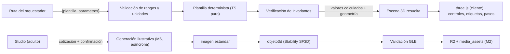

# Visualizaciones 3D: simulaciones verificables y objetos personalizados — Mentelyx

> **Proyecto:** Mentelyx · **Ubicación:** `docs/03-diseño-de-software/diseño-especializado/04-visualizaciones-3d.md`
> **Componentes:** `packages/motor-visual/3d` (plantillas deterministas), three.js en la Web/PWA, M6 (orquestación y generación), M2 (recursos de Studio)
> **Versión:** 1.0 — 17/11/2026 · **Estado:** especificación de diseño propuesta; no implementada.

## 1. Dos clases que nunca se confunden

| Aspecto | **A. Simulación científica verificable** | **B. Objeto 3D personalizado (ilustrativo)** |
|---|---|---|
| Origen de la geometría | Plantillas deterministas con parámetros validados | Proveedor generativo (imagen → 3D o texto → 3D) |
| Papel de la IA | Elegir la plantilla y sus parámetros; explicar | Generar la malla y las texturas |
| Verificación | Invariantes físicas o matemáticas comprobadas en cada ejecución | Solo validación técnica del archivo y moderación; **no** hay verificación científica |
| Etiqueta en la interfaz | «Simulación verificada · modelo: {plantilla} v{n}» | «Modelo ilustrativo generado por IA: no representa medidas ni estructuras reales verificadas» |
| Dónde está disponible | Tutor IA, Studio, lecciones, materiales | **Solo Studio**, cuentas adultas con permiso y créditos |
| Uso en evaluaciones | Permitido como apoyo de un enunciado | **No** se admite como evidencia ni como enunciado de evaluación |
| Costo para el usuario | 0 créditos (determinista) | Créditos Studio según cotización (sección 8.4) |
| Formato | `mentelyx.escena3d/v1` con `clase: SIMULACION_VERIFICABLE` | `mentelyx.escena3d/v1` con `clase: OBJETO_ILUSTRATIVO` + GLB en R2 |

## 2. Arquitectura



- Las plantillas viven en `packages/motor-visual/3d/` y se ejecutan tanto en el servidor (verificación y valores para la explicación) como en el cliente (interacción).
- El render usa **three.js** (MIT) con WebGL. Si el dispositivo no admite WebGL, se muestra una proyección 2D generada por el motor visual y la tabla de valores.

## 3. Esquema `mentelyx.escena3d/v1`

```json
{
  "$schema": "https://json-schema.org/draft/2020-12/schema",
  "$id": "urn:mentelyx:esquema:escena3d:v1",
  "type": "object",
  "additionalProperties": false,
  "required": ["esquema", "clase", "camara", "accesibilidad"],
  "properties": {
    "esquema": { "const": "mentelyx.escena3d/v1" },
    "clase": { "enum": ["SIMULACION_VERIFICABLE", "OBJETO_ILUSTRATIVO"] },
    "titulo": { "type": "string", "maxLength": 120 },
    "plantilla": {
      "type": "object", "additionalProperties": false, "required": ["id", "version", "parametros"],
      "properties": {
        "id": { "enum": ["superficie_z", "solido_revolucion", "poliedro_regular", "vectores_3d", "planos_rectas",
                         "movimiento_proyectil", "orbita_kepler", "pendulo_simple", "onda_estacionaria", "molecula"] },
        "version": { "type": "integer", "minimum": 1 },
        "parametros": { "type": "object" }
      }
    },
    "modelo": {
      "type": "object", "additionalProperties": false, "required": ["assetId", "operationKey"],
      "properties": { "assetId": { "type": "string", "format": "uuid" }, "operationKey": { "type": "string", "maxLength": 120 } }
    },
    "unidades": { "enum": ["m", "cm", "km", "ua", "angstrom", "u"] },
    "camara": {
      "type": "object", "additionalProperties": false, "required": ["posicion", "objetivo"],
      "properties": {
        "posicion": { "type": "array", "items": { "type": "number" }, "minItems": 3, "maxItems": 3 },
        "objetivo": { "type": "array", "items": { "type": "number" }, "minItems": 3, "maxItems": 3 },
        "fov": { "type": "number", "minimum": 20, "maximum": 90 }
      }
    },
    "ejes": { "type": "boolean" },
    "cuadricula": { "type": "boolean" },
    "pasos": { "type": "array", "maxItems": 30, "items": { "$ref": "urn:mentelyx:esquema:escena:v1#/$defs/paso" } },
    "accesibilidad": {
      "type": "object", "additionalProperties": false, "required": ["descripcion"],
      "properties": { "descripcion": { "type": "string", "minLength": 10, "maxLength": 1000 } }
    }
  },
  "allOf": [
    { "if": { "properties": { "clase": { "const": "SIMULACION_VERIFICABLE" } } }, "then": { "required": ["plantilla"], "not": { "required": ["modelo"] } } },
    { "if": { "properties": { "clase": { "const": "OBJETO_ILUSTRATIVO" } } }, "then": { "required": ["modelo"], "not": { "required": ["plantilla"] } } }
  ]
}
```

Los parámetros de cada plantilla tienen su propio esquema (`urn:mentelyx:esquema:plantilla3d:{id}:v{n}`), con los rangos del sección 4. Los pasos reutilizan la definición 2D (acciones `mostrar`, `animar` con `tipo: recorrer | variarParametro | camara`, y `anclaChat`). Los enlaces de valores usan la forma `{{alcance:sim}}`, `{{volumen:sim|3}}`, etc.

## 4. Catálogo de plantillas verificables

| Plantilla | Parámetros (rangos) | Algoritmo | Invariantes verificadas | Valores enlazables |
|---|---|---|---|---|
| `superficie_z` | `expresion` f(x, y) en la gramática restringida con variables `x`, `y`; `x`, `y` ∈ [−100, 100]; resolución 8–128 | Malla regular; normales por diferencias centrales; huecos donde f no es finita | 10 muestras aleatorias: el vértice coincide con f(x, y) dentro de 1e-9 | `zMin`, `zMax` |
| `solido_revolucion` | `expresion` f(x) ≥ 0; `eje`: `x`; intervalo [a, b] con 0 < b − a ≤ 100; `metodo`: `discos` o `arandelas` (con g(x)); segmentos 16–128; divisiones angulares 12–96 | Superficie por revolución + tapas | Volumen por Simpson de π∫(f² − g²) frente al volumen de la malla cerrada (suma de tetraedros con signo): diferencia relativa ≤ 0,5 %. Si hay fase 2, se compara con la integral simbólica. | `volumen` |
| `poliedro_regular` | `tipo`: tetraedro, cubo, octaedro, dodecaedro, icosaedro; `arista` ∈ (0, 100] | Coordenadas canónicas escaladas | V − A + C = 2; todas las aristas iguales dentro de 1e-9 | `vertices`, `aristas`, `caras`, `area`, `volumen` |
| `vectores_3d` | Hasta 6 vectores ∈ [−1e3, 1e3]³; operaciones `suma`, `producto_vectorial`, `proyeccion` | Álgebra lineal | El producto vectorial es ortogonal a ambos (\|u·(u×v)\| ≤ 1e-9·\|u\|²\|v\|) | `norma`, `angulo` |
| `planos_rectas` | Planos `ax + by + cz = d` (≤ 3), rectas paramétricas (≤ 3) | Intersecciones por sistemas lineales (eliminación con pivoteo) | El punto de intersección satisface todas las ecuaciones con un residuo ≤ 1e-9 | `interseccion` |
| `movimiento_proyectil` | `v0` ∈ (0, 1000] m/s; `angulo` ∈ [0°, 90°]; `altura0` ∈ [0, 1000] m; `g` ∈ (0, 30] m/s²; `arrastre`: `ninguno`, `lineal` (k/m ∈ [0, 1] s⁻¹) o `cuadratico` (k/m ∈ [0, 0,1] m⁻¹) | RK4 con Δt = T_est/2000 y aterrizaje por interpolación cuadrática del último paso | Sin arrastre: alcance, altura y tiempo frente a la solución analítica (error ≤ 1e-6 m). Con arrastre: energía mecánica no creciente y alcance < alcance sin arrastre | `alcance`, `alturaMax`, `tiempoVuelo` |
| `orbita_kepler` | `masaCentral` (kg, 1e20–1e31); `r0` (m); `v0` (m/s); órbitas a simular 1–20 | Verlet de velocidades (simpléctico) con Δt = periodo/5000 | Deriva relativa de la energía ≤ 1e-4 y del momento angular ≤ 1e-8 durante la simulación | `periodo`, `excentricidad`, `perihelio`, `afelio` |
| `pendulo_simple` | `longitud` ∈ (0, 100] m; `angulo0` ∈ (0°, 179°]; `g` | RK4 | Deriva de la energía ≤ 1e-6. Con angulo0 ≤ 5°, el periodo dista ≤ 0,1 % de 2π√(L/g) | `periodo` |
| `onda_estacionaria` | `longitud` de la cuerda, `modo` n ∈ 1–10, `amplitud`, `velocidad` | Solución analítica y(x, t) = A·sin(nπx/L)·cos(ωt) | Nodos en x = kL/n (\|y\| ≤ 1e-12) | `frecuencia`, `longitudOnda` |
| `molecula` | `idMolecula` del **catálogo curado** (no hay coordenadas libres) | Coordenadas y enlaces del conjunto de datos curado, con fuente y licencia registradas por la administración | Longitudes y ángulos de enlace guardados frente a los calculados a partir de las coordenadas (≤ 0,01 Å / 0,1°) | `angulos`, `formula` |

**Reglas comunes:**

- El modelo no puede proponer una plantilla que no esté en el catálogo ni parámetros fuera de rango. El resultado es `PARAMETRO_FUERA_DE_RANGO` o `PLANTILLA_INEXISTENTE`.
- Las unidades se declaran explícitamente y se convierten a SI antes de simular.
- Las cifras de la explicación salen de los valores enlazados de la simulación ejecutada, nunca del modelo.
- Si una invariante falla, la simulación **no** se muestra como verificada. El resultado es `SIMULACION_NO_VERIFICADA` y se registra como defecto de la plantilla.

## 5. Flujo en el Tutor IA

1. El orquestador clasifica `SIMULACION_3D` (`01-…orquestacion.md` sección 8).
2. El modelo elige la plantilla y los parámetros usando la herramienta `simulacion_3d`, con una salida JSON estricta.
3. El servidor valida, simula y verifica las invariantes. Los valores calculados vuelven al modelo como resultado de la herramienta.
4. El modelo redacta la explicación usando enlaces y pasos. El servidor valida la escena 3D y la emite con el evento SSE `escena3d`.
5. El cliente recalcula de forma local cuando el usuario cambia un parámetro (por ejemplo, el ángulo con un deslizador), con la misma plantilla. Ese recálculo no cuesta créditos ni consultas.

## 6. Render con three.js

| Aspecto | Decisión |
|---|---|
| Cámara | Perspectiva con control orbital (arrastrar, pellizcar para hacer zoom) y botón «Restablecer vista» |
| Etiquetas | Elementos HTML anclados a puntos 3D, con texto y KaTeX |
| Presupuesto | ≤ 200 000 triángulos, ≤ 4 texturas de 2048² en móvil (4096² en escritorio), ≤ 20 MB por escena |
| Animación | `requestAnimationFrame`; pasos sincronizados con el chat como en 2D; `prefers-reduced-motion` muestra el estado final |
| Accesibilidad | Descripción textual obligatoria, tabla alternativa de valores, cámara por teclado (flechas, `+`/`−`) y foco visible |
| Sin WebGL | Proyección 2D isométrica generada por el motor visual + tabla de datos |

## 7. Ejemplos verificables de simulación

### EJ-08. Proyectil sin arrastre

**Entrada:**

```json
{ "plantilla": { "id": "movimiento_proyectil", "version": 1,
  "parametros": { "v0": 20, "angulo": 45, "altura0": 0, "g": 9.81, "arrastre": "ninguno" } } }
```

**Resultado esperado:**

| Valor | Cálculo analítico | Resultado | Tolerancia |
|---|---|---|---|
| `tiempoVuelo` | 2·v0·sin 45° / g = 28,284271 / 9,81 | 2,883208 s | 1e-6 |
| `alcance` | v0²·sin 90° / g = 400 / 9,81 | 40,774720 m | 1e-6 |
| `alturaMax` | v0²·sin² 45° / (2g) = 200 / 19,62 | 10,193680 m | 1e-6 |

**Invariante:** RK4 con Δt = 2,883208 / 2000 ≈ 0,0014416 s reproduce la parábola. La aceleración constante hace que el error quede en el orden del redondeo. Estado: `VERIFICADA`.

**Variante con arrastre cuadrático** (`k/m = 0,01 m⁻¹`): no hay solución analítica. Se exige que la energía mecánica sea no creciente en cada paso (con una tolerancia de 1e-9 J/kg) y que el alcance sea < 40,774720 m.

### EJ-09. Sólido de revolución

**Entrada:** `{ "id": "solido_revolucion", "parametros": { "expresion": "sqrt(x)", "intervalo": [0, 4], "metodo": "discos", "segmentos": 64, "divisiones": 48 } }`

**Resultado esperado:**

- **Volumen por Simpson:** π·∫₀⁴ x dx = 8π = 25,132741. Simpson es exacto para un integrando lineal.
- **Volumen de la malla:** un 48-ágono inscrito tiene un área de 24·sin(7,5°)·r² = 3,132629·r², frente a π·r² = 3,141593·r² (razón 0,997147). Con 64 troncos entre cortes, el volumen de la malla es 25,056874. La diferencia relativa con 8π es 0,302 %, dentro de la tolerancia del 0,5 %. Estado: `VERIFICADA`.
- Valor enlazable: `{{volumen:sim|3}}` → «25,133».

### EJ-16. Parámetros rechazados

**Entrada:** `movimiento_proyectil` con `v0: 5000` y `angulo: 120`.

**Errores esperados:**

- `PARAMETRO_FUERA_DE_RANGO` en `/parametros/v0` (máximo 1000);
- `PARAMETRO_FUERA_DE_RANGO` en `/parametros/angulo` (rango [0°, 90°]).

El orquestador solicita una reparación. Si persiste, explica el límite al usuario en texto.

## 8. Objetos 3D personalizados (clase B)

### 8.1. Elegibilidad

- Solo en **Studio**, para cuentas adultas con permiso de autoría y un producto que habilite `objetos3dIA` (Studio Plus/Pro, hipótesis).
- Las cuentas de menores quedan bloqueadas (`FUNCION_NO_DISPONIBLE_PARA_CUENTA`).
- El prompt no puede pedir personas reales identificables, marcas registradas ni contenido prohibido. Esto se filtra en la moderación y en la política de uso.

### 8.2. Flujo asíncrono

1. `POST /api/v1/studio/cotizaciones-ia` con `{tipo: "OBJETO_3D", prompt, calidad}` → M5 calcula los créditos con la tarifa versionada. La moderación del prompt ocurre **antes** de cotizar.
2. El usuario confirma con `Idempotency-Key`. M5 debita `STUDIO_AI_OP` una sola vez.
3. Se publica `StudioGenerationRequested` (existente) con `tipo: OBJETO_3D`.
4. El worker de M6:
   - genera una imagen de referencia (`imagen.estandar`, fondo neutro, objeto centrado);
   - la modera;
   - la envía a `objeto3d` (Stability Stable Fast 3D);
   - recibe el GLB.
5. **Validación del GLB (sección 8.3).** Si falla por causa del servicio, se registra `STUDIO_AI_REFUND`.
6. Se guarda en R2 `studio/3d/{ownerId}/{assetId}/modelo.glb`, con las miniaturas bajo el mismo prefijo ([persistencia, sección 9.2](../diseño-externo/01-diseño-de-persistencia-y-datos.md)). La `operationKey` queda en `studio_ai_jobs` y no forma parte de la clave del objeto. M2 registra `media_assets` (`sha256`, `size_bytes`, `status = LISTO`) y crea el bloque `scene3d` (`clase: OBJETO_ILUSTRATIVO`) en un **borrador** del proyecto.
7. La interfaz recibe `StudioGenerationCompleted` por el canal de trabajos de Studio.

**Alternativa:** Meshy texto → 3D (una sola llamada, con el parámetro `moderation: true`), tras su contrato comercial (PEND-04).

### 8.3. Validación técnica del GLB

| Comprobación | Regla |
|---|---|
| Cabecera | `magic = "glTF"` y versión 2 |
| Tamaño | ≤ 20 MB |
| Geometría | ≤ 200 000 triángulos; sin NaN ni infinitos; caja envolvente finita |
| Texturas | ≤ 4096 × 4096; PNG, JPEG o WebP |
| Recursos externos | No se admiten URI externas (todo embebido) |
| Extensiones | Lista blanca (`KHR_materials_unlit`, `KHR_texture_transform` y otras aprobadas); el resto se rechaza |
| Normalización | Escala a una caja de 1 unidad y origen en el centro de la base |
| Miniatura | Render determinista 512 × 512 para la galería |

### 8.4. Costo (hipótesis a calibrar)

| Componente | Costo oficial verificado (17/11/2026) |
|---|---|
| Imagen de referencia `flux-2-klein-9b` | USD 0,015 por el primer megapíxel |
| Stable Fast 3D | 10 créditos de Stability ≈ USD 0,10 |
| **Costo directo estimado** | ≈ USD 0,115 por objeto |

El precio en créditos Studio se fija en la tarifa versionada de M5 (ADR-050) a partir de ese costo, los reintentos medidos y el margen objetivo. Como referencia de producto, el README estima «imagen premium = 20 créditos». El valor para objetos 3D queda **pendiente de calibración**: no se fija aquí.

## 9. Criterios de aceptación específicos

| ID | Criterio |
|---|---|
| 3D-01 | El 100 % de las simulaciones mostradas como verificadas pasan sus invariantes en la ejecución del servidor |
| 3D-02 | Las cifras de la explicación coinciden con los valores enlazados (0 discrepancias en el conjunto de prueba) |
| 3D-03 | Un parámetro fuera de rango nunca llega a la simulación |
| 3D-04 | Un GLB inválido nunca se registra como `LISTO`; la falla imputable reintegra los créditos una sola vez |
| 3D-05 | Los objetos de clase B muestran siempre la etiqueta ilustrativa y no pueden insertarse en evaluaciones |
| 3D-06 | La escena de ≤ 10 MB carga en ≤ 3 s sobre 4G simulado en un móvil de gama media (a medir) |

**Trazabilidad:** HU-31, HU-47, HU-48; RF-42, RF-60, RF-61, RF-83–RF-85; AC-07, AC-10, AC-11; ADR-050, ADR-053.
