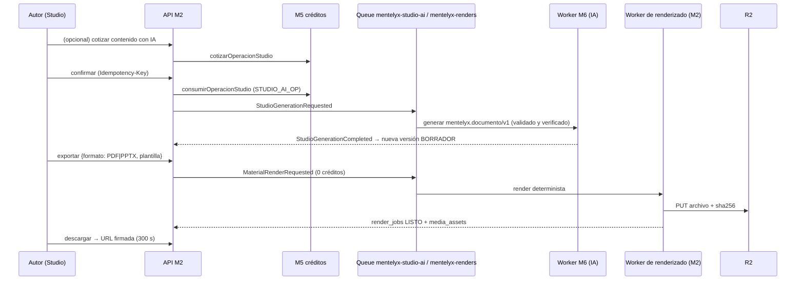

# Generación de PDF, PPTX editable y materiales educativos — Mentelyx

> **Proyecto:** Mentelyx · **Ubicación:** `docs/03-diseño-de-software/diseño-especializado/05-generacion-de-materiales-educativos.md`
> **Módulo propietario:** M2 — Cursos y Contenidos / Studio (M6 genera contenido con IA; M5 gestiona los créditos Studio)
> **Versión:** 1.1 — 17/11/2026 · **Estado:** especificación de diseño propuesta; no implementada.
> **Cambios 1.1:** sincronización CO-02 del [contrato de coordinación](../contrato-coordinacion-datos-seguridad-infraestructura.md): exclusión física de soluciones y notas en la exportación ESTUDIANTE, y `input_hash` con formato, audiencia y política de exclusión (secciones 3, 6, 7 y 8).

## 1. Separación en cinco capas

| Capa | Qué es | Propietario | Almacén | ¿Usa IA? |
|---|---|---|---|---|
| **1. Contenido** | Documento educativo estructurado `mentelyx.documento/v1` (texto, fórmulas, ejercicios, escenas, imágenes, notas) | M2 (proyecto Studio y su versión) | MongoDB `studio_projects` | Solo si el autor lo pide y paga créditos; la edición manual es gratuita |
| **2. Plantillas** | Diseño visual versionado: tipografía, colores, márgenes, disposiciones y patrones de diapositiva | M2 (administración editorial) | MongoDB `plantillas_documento` (SC-05) | No |
| **3. Renderizado** | Conversión determinista contenido + plantilla → PDF / PPTX / SVG / PNG | M2 (adaptadores) | Sin estado | No |
| **4. Almacenamiento** | Archivo resultante con su huella y metadatos | M2 | R2 + `media_assets` + `render_jobs` (SC-06) | No |
| **5. Descarga** | Entrega autorizada mediante una URL firmada de corta duración | M2 (autorización de acceso) + M1 (sesión) | — | No |

**Consecuencias:**

- cambiar una plantilla no altera el contenido;
- regenerar un archivo con la misma entrada produce el mismo resultado (determinismo verificable por `input_hash`);
- descargar no requiere volver a ejecutar IA;
- la exportación de contenido manual **no consume créditos** (RF-83).

## 2. Flujo



## 3. Capa de contenido: `mentelyx.documento/v1`

```json
{
  "$schema": "https://json-schema.org/draft/2020-12/schema",
  "$id": "urn:mentelyx:esquema:documento:v1",
  "type": "object",
  "additionalProperties": false,
  "required": ["esquema", "tipo", "metadatos"],
  "properties": {
    "esquema": { "const": "mentelyx.documento/v1" },
    "tipo": { "enum": ["PRESENTACION", "GUIA", "FICHA_EJERCICIOS", "RESUMEN"] },
    "metadatos": {
      "type": "object", "additionalProperties": false, "required": ["titulo", "nivel", "idioma"],
      "properties": {
        "titulo": { "type": "string", "minLength": 3, "maxLength": 160 },
        "subtitulo": { "type": "string", "maxLength": 200 },
        "nivel": { "enum": ["PRIMARIA", "SECUNDARIA", "PREUNI", "UNIVERSITARIO"] },
        "curso": { "type": "string", "maxLength": 120 },
        "tema": { "type": "string", "maxLength": 160 },
        "objetivos": { "type": "array", "maxItems": 6, "items": { "type": "string", "maxLength": 200 } },
        "idioma": { "const": "es" },
        "generadoConIA": { "type": "boolean" },
        "fuentes": { "type": "array", "maxItems": 30, "items": {
          "type": "object", "additionalProperties": false, "required": ["recursoId", "version", "titulo"],
          "properties": { "recursoId": { "type": "string", "format": "uuid" }, "version": { "type": "integer", "minimum": 1 }, "titulo": { "type": "string", "maxLength": 200 } } } }
      }
    },
    "diapositivas": { "type": "array", "minItems": 1, "maxItems": 40, "items": { "$ref": "#/$defs/diapositiva" } },
    "secciones": { "type": "array", "minItems": 1, "maxItems": 30, "items": { "$ref": "#/$defs/seccion" } }
  },
  "allOf": [
    { "if": { "properties": { "tipo": { "const": "PRESENTACION" } } }, "then": { "required": ["diapositivas"], "not": { "required": ["secciones"] } },
      "else": { "required": ["secciones"], "not": { "required": ["diapositivas"] } } }
  ],
  "$defs": {
    "diapositiva": {
      "type": "object", "additionalProperties": false, "required": ["id", "layout", "bloques"],
      "properties": {
        "id": { "type": "string", "pattern": "^d[0-9]{1,3}$" },
        "layout": { "enum": ["portada", "titulo_contenido", "dos_columnas", "formula_destacada", "ejercicio", "imagen_completa", "cierre"] },
        "titulo": { "type": "string", "maxLength": 120 },
        "bloques": { "type": "array", "maxItems": 6, "items": { "$ref": "#/$defs/bloque" } },
        "notas": { "type": "string", "maxLength": 2000 }
      }
    },
    "seccion": {
      "type": "object", "additionalProperties": false, "required": ["id", "titulo", "bloques"],
      "properties": {
        "id": { "type": "string", "pattern": "^sec[0-9]{1,3}$" },
        "titulo": { "type": "string", "maxLength": 160 },
        "bloques": { "type": "array", "minItems": 1, "maxItems": 60, "items": { "$ref": "#/$defs/bloque" } }
      }
    },
    "bloque": {
      "type": "object", "required": ["tipo"],
      "oneOf": [
        { "properties": { "tipo": { "const": "parrafo" }, "markdown": { "type": "string", "minLength": 1, "maxLength": 3000 } }, "required": ["markdown"], "additionalProperties": false },
        { "properties": { "tipo": { "const": "lista" }, "ordenada": { "type": "boolean" }, "items": { "type": "array", "minItems": 1, "maxItems": 12, "items": { "type": "string", "maxLength": 300 } } }, "required": ["items"], "additionalProperties": false },
        { "properties": { "tipo": { "const": "formula" }, "latex": { "type": "string", "minLength": 1, "maxLength": 1000 }, "descripcion": { "type": "string", "maxLength": 300 } }, "required": ["latex", "descripcion"], "additionalProperties": false },
        { "properties": { "tipo": { "const": "ejercicio" }, "enunciado": { "type": "string", "maxLength": 2000 },
            "opciones": { "type": "array", "maxItems": 6, "items": { "type": "string", "maxLength": 300 } },
            "respuesta": { "type": "string", "maxLength": 500 },
            "solucion": { "type": "object", "description": "mentelyx.solucion/v1 verificada" },
            "mostrarSolucion": { "enum": ["NUNCA", "AL_FINAL", "INMEDIATA"] } },
          "required": ["enunciado", "respuesta", "mostrarSolucion"], "additionalProperties": false },
        { "properties": { "tipo": { "const": "escena" }, "escena": { "$ref": "urn:mentelyx:esquema:escena:v1" }, "pasoParaImpresion": { "type": "integer", "minimum": -1 } }, "required": ["escena"], "additionalProperties": false },
        { "properties": { "tipo": { "const": "escena3d" }, "escena3d": { "$ref": "urn:mentelyx:esquema:escena3d:v1" } }, "required": ["escena3d"], "additionalProperties": false },
        { "properties": { "tipo": { "const": "imagen" }, "assetId": { "type": "string", "format": "uuid" }, "alt": { "type": "string", "minLength": 5, "maxLength": 300 }, "generadaConIA": { "type": "boolean" } }, "required": ["assetId", "alt"], "additionalProperties": false },
        { "properties": { "tipo": { "const": "tabla" }, "encabezados": { "type": "array", "maxItems": 8, "items": { "type": "string", "maxLength": 60 } },
            "filas": { "type": "array", "maxItems": 30, "items": { "type": "array", "maxItems": 8, "items": { "type": "string", "maxLength": 120 } } } }, "required": ["encabezados", "filas"], "additionalProperties": false },
        { "properties": { "tipo": { "const": "grafico_datos" }, "clase": { "enum": ["barras", "lineas", "circular"] },
            "categorias": { "type": "array", "maxItems": 24, "items": { "type": "string", "maxLength": 40 } },
            "series": { "type": "array", "maxItems": 6, "items": { "type": "object", "additionalProperties": false, "required": ["nombre", "valores"],
              "properties": { "nombre": { "type": "string", "maxLength": 40 }, "valores": { "type": "array", "maxItems": 24, "items": { "type": "number" } } } } } },
          "required": ["clase", "categorias", "series"], "additionalProperties": false },
        { "properties": { "tipo": { "const": "nota_docente" }, "markdown": { "type": "string", "maxLength": 2000 } }, "required": ["markdown"], "additionalProperties": false },
        { "properties": { "tipo": { "const": "referencia" }, "recursoId": { "type": "string", "format": "uuid" }, "version": { "type": "integer" }, "texto": { "type": "string", "maxLength": 300 } }, "required": ["recursoId", "version", "texto"], "additionalProperties": false }
      ]
    }
  }
}
```

**Reglas semánticas adicionales:**

- Todo `ejercicio` generado por IA debe incluir `solucion` (`mentelyx.solucion/v1`) con estado `VERIFICADA_*`. Si queda `NO_VERIFICABLE`, el ejercicio se marca para revisión del autor («Revisa este ejercicio antes de publicar»).
- `respuesta` debe coincidir con `solucion.resultadoFinal`, comprobado con el verificador (`01-…orquestacion.md` sección 12.1).
- Las fórmulas pasan la validación KaTeX y las escenas la validación de cinco etapas.
- Se emite una advertencia pedagógica (no bloqueante) si una diapositiva supera 90 palabras o una sección de guía supera 600.
- `nota_docente` va a las notas del orador **solo en la exportación DOCENTE** autorizada. En la exportación ESTUDIANTE se elimina físicamente del archivo, no se oculta (CO-02).

## 4. Generación de contenido con IA

| Entrada | Origen |
|---|---|
| Tipo de material, nivel, tema, objetivos, extensión (diapositivas o páginas) | Formulario de Studio |
| Fuentes de apoyo | Materiales del autor y recursos con licencia que él puede consultar, mediante RAG (`02-diseño-rag.md`), con el ámbito del autor |
| Plantilla | Opcional; solo condiciona la disposición sugerida (`layout`) |

**Proceso:**

1. Moderación del pedido.
2. Cotización en M5 con la tarifa versionada.
3. Débito único.
4. La ruta `explicacion.avanzada` genera el esquema con salida JSON estricta. Si el tema es cuantitativo, las soluciones se producen con `razonamiento.*`.
5. Validación y verificación.
6. Una ronda de reparación ante errores.
7. Se guarda como **borrador** de una nueva versión. Ningún material generado se publica sin acción del autor (RF-35, RC-11).

| Material (hipótesis comerciales del README) | Créditos Studio |
|---|---:|
| Presentación de 12 diapositivas | 5 |
| Lote de 10 ejercicios | 1 |
| PDF educativo de 30 páginas (contenido generado) | 8 |
| Imagen IA estándar / premium | 10 / 20 |

Estos valores **no** son tarifas aprobadas. La exportación posterior es gratuita.

## 5. Capa de plantillas

```json
{
  "_id": "ObjectId('…')",
  "plantillaId": "mentelyx-clasica",
  "version": 3,
  "estado": "PUBLICADA",
  "formatos": ["PDF", "PPTX"],
  "tokens": {
    "fuenteTitulo": "Atkinson Hyperlegible",
    "fuenteTexto": "Atkinson Hyperlegible",
    "colores": { "primario": "#1F4E79", "acento": "#C55A11", "texto": "#1A1A1A", "fondo": "#FFFFFF" },
    "margenesMm": { "superior": 18, "inferior": 18, "izquierdo": 20, "derecho": 20 },
    "tamanoBasePt": 12
  },
  "pdf": { "formato": "A4", "encabezado": "{{titulo}}", "pie": "Página {{pagina}} de {{total}} · {{licencia}}" },
  "pptx": { "tamano": "16:9", "patrones": ["portada", "titulo_contenido", "dos_columnas", "formula_destacada", "ejercicio", "imagen_completa", "cierre"] },
  "accesibilidad": { "contrasteVerificado": true, "fuentesConLicenciaDeIncrustacion": true }
}
```

**Reglas de las plantillas:**

- Las versiones publicadas son inmutables. Cada exportación registra `plantillaId@version`.
- Solo se usan fuentes con licencia que permita incrustarlas. La fuente del ejemplo es un **candidato**, sujeto a la verificación de su licencia antes de adoptarla.
- Los colores cumplen un contraste ≥ 4,5:1 entre texto y fondo.

## 6. Renderizado determinista

### 6.1. PDF

1. **Constructor HTML** (servidor) con escape estricto de todo texto. Solo se convierte un subconjunto de Markdown (negrita, cursiva, listas, enlaces internos), **sin HTML embebido** del autor.
2. **Fórmulas:** `katex.renderToString` con las opciones del motor visual. El CSS de KaTeX y sus fuentes van empaquetados.
3. **Escenas 2D:** SVG estático del `pasoParaImpresion` (por defecto el último paso) generado por `packages/motor-visual`, con su descripción accesible como pie.
4. **Escenas 3D:** una imagen fija (miniatura) más el texto «Versión interactiva disponible en Mentelyx» con un enlace al recurso autorizado.
5. **Imágenes:** se incrustan como `data:` URI después de leerlas de R2 en el servidor. El navegador de renderizado no recibe URL privadas.
6. **Audiencia:** en ESTUDIANTE, el constructor HTML no incluye `nota_docente` ni las soluciones con `mostrarSolucion = NUNCA` (CO-02). Lo que no está en el HTML no puede aparecer en el PDF.
7. **Conversión:** Cloudflare Browser Rendering `/pdf` con `html`, `pdfOptions.format: "a4"`, márgenes de la plantilla y `displayHeaderFooter` con `headerTemplate`/`footerTemplate` (número y total de páginas).
8. **Comprobaciones posteriores:**
   - número de páginas ≤ 60;
   - tamaño ≤ 25 MB;
   - el texto se puede extraer;
   - **no** quedan delimitadores LaTeX sin renderizar (expresión `\$|\\frac|\\int` en el texto extraído → `RENDER_FORMULA_FALLIDO`);
   - no faltan imágenes.

### 6.2. PPTX editable (PptxGenJS)

| Bloque | Objeto PPTX | ¿Editable en PowerPoint? |
|---|---|---|
| Título de diapositiva | Marcador de título del patrón | Sí |
| `parrafo` | Cuadro de texto con formato (negrita y cursiva) | Sí |
| `lista` | Viñetas o numeración nativas | Sí |
| `tabla` | Tabla nativa | Sí |
| `grafico_datos` | Gráfico nativo (barras, líneas o circular) | Sí: los datos se pueden editar |
| `formula` | Imagen SVG (PNG de respaldo) con el LaTeX en el **texto alternativo** y en las notas | Imagen reemplazable; el LaTeX se conserva |
| `escena` con solo `punto`, `segmento`, `flecha`, `circulo`, `texto` | Formas nativas (líneas, elipses, cuadros de texto) en coordenadas de diapositiva | Sí |
| `escena` con curvas, regiones o construcciones | Imagen SVG/PNG + texto alternativo de `accesibilidad.descripcion` | Imagen |
| `imagen` | Imagen con texto alternativo | Imagen |
| `ejercicio` | Enunciado y opciones como texto. Solución con `AL_FINAL`: en una diapositiva siguiente. Con `NUNCA` en audiencia ESTUDIANTE **no se escribe en ninguna parte del archivo** (diapositivas, notas, texto alternativo ni XML); en audiencia DOCENTE va a las notas del orador (CO-02) | Sí |
| `nota_docente` / `diapositiva.notas` | `slide.addNotes(texto)` **solo en audiencia DOCENTE**; en ESTUDIANTE se omite | Sí |

**Dónde se ejecuta:** PptxGenJS declara soporte para Node.js y navegadores; falta verificar su ejecución dentro de Cloudflare Workers (PEND-05).

- Si funciona en Workers, el renderizado corre en un Worker consumidor de la cola `mentelyx-renders`.
- Si no, se ejecuta en un trabajo de **Cloud Run**, ya previsto en el README «solo para tareas pesadas si Workers no basta». Ese trabajo es un adaptador de M2, sin reglas de negocio.

**Comprobaciones posteriores:**

- estructura OOXML válida (`[Content_Types].xml` y `ppt/presentation.xml`);
- número de diapositivas igual al esperado;
- en audiencia ESTUDIANTE, ninguna parte OOXML (`ppt/slides/*`, `ppt/notesSlides/*`, `docProps/*`, texto alternativo) contiene los textos canario de `nota_docente` ni de soluciones `NUNCA`; si alguno aparece, el trabajo pasa a `FALLIDO` y no se publica (CO-02);
- tamaño ≤ 50 MB;
- en la integración continua, apertura con LibreOffice sin interfaz y conversión a PDF sin errores.

### 6.3. Otros formatos

| Formato | Uso | Renderizador |
|---|---|---|
| SVG / PNG de una escena | Insertar en otros documentos o compartir | `packages/motor-visual` |
| PNG de la miniatura 3D | Galería y PDF | Render determinista de three.js en el servidor o en el cliente (por decidir en el prototipo) |

## 7. Almacenamiento

| Elemento | Regla |
|---|---|
| Clave R2 | `materiales/{ownerId}/{projectId}/v{version}/{renderJobId}.{pdf\|pptx}` |
| `media_assets` (existente) | `storage_key`, `size_bytes`, `sha256`, `status = LISTO`, `mime_type` |
| `render_jobs` (SC-06, modificada) | `id`, `owner_id`, `project_id`, `project_version`, `formato`, `audiencia`, `plantilla_id`, `plantilla_version`, `renderer_version`, `input_hash` = SHA-256(documento canónico + versión exacta + plantilla@versión + renderer + **formato + audiencia + política de exclusión de soluciones y notas**), `operation_key` UNIQUE, `estado` (PENDIENTE, EN_CURSO, LISTO, FALLIDO), `error_code`, `media_asset_id`, `creado_en`, `terminado_en`. Esquema normativo: [persistencia, sección 7.2](../diseño-externo/01-diseño-de-persistencia-y-datos.md) |
| Reutilización | Si existe un `render_jobs` `LISTO` con el mismo `input_hash` **del mismo propietario y proyecto**, y el permiso sigue vigente, se devuelve sin volver a renderizar. Un hash igual no concede acceso; no hay reutilización global entre usuarios (CO-02) |
| Retención | Las exportaciones de la versión vigente se conservan mientras exista el proyecto. Las de versiones no vigentes se pueden purgar a los 90 días porque se regeneran a partir de la versión inmutable (hipótesis). La purga elimina el objeto R2 y marca `media_assets.status = PURGADO`. |

## 8. Descarga

1. `GET /api/v1/studio/exportaciones/{renderJobId}`: M1 comprueba la sesión y M2 comprueba que el actor es propietario o consumidor autorizado por la licencia de esa versión (RF-99). M2 revalida también la **audiencia**: un consumidor que no es el autor ni un docente autorizado solo obtiene exportaciones ESTUDIANTE (CO-02).
2. Respuesta `200` con `{ url, expiraEn, nombreArchivo, sha256, tamanoBytes }`. La URL R2 prefirmada dura **300 s**.
3. Cabeceras del objeto: `Content-Disposition: attachment; filename*=UTF-8''{nombre}` y `Content-Type` exacto.
4. Las descargas de materiales comerciales con licencia se registran como evento agregado para la liquidación de contenidos (RF-46), sin guardar datos personales innecesarios.

## 9. Ejemplos completos

### EJ-10. Presentación a PPTX y PDF

**Entrada (fragmento):**

```json
{
  "esquema": "mentelyx.documento/v1",
  "tipo": "PRESENTACION",
  "metadatos": { "titulo": "Derivadas y extremos", "nivel": "SECUNDARIA", "idioma": "es", "generadoConIA": false },
  "diapositivas": [
    { "id": "d1", "layout": "portada", "titulo": "Derivadas y extremos", "bloques": [{ "tipo": "parrafo", "markdown": "5.º de Secundaria · Matemática" }] },
    { "id": "d2", "layout": "formula_destacada", "titulo": "Regla de la potencia",
      "bloques": [{ "tipo": "formula", "latex": "\\frac{d}{dx}x^n = n x^{n-1}", "descripcion": "La derivada de x a la n es n por x a la n menos uno." }],
      "notas": "Recordar el caso n = 0." },
    { "id": "d3", "layout": "imagen_completa", "titulo": "Gráfica de f y f'",
      "bloques": [{ "tipo": "escena", "escena": { "…": "EJ-03 de 03-motor-visual-y-pizarra.md" } }] },
    { "id": "d4", "layout": "ejercicio", "titulo": "Practica",
      "bloques": [{ "tipo": "ejercicio", "enunciado": "Halla los extremos de $g(x)=x^2-4x$.", "respuesta": "Mínimo en (2, −4)", "mostrarSolucion": "AL_FINAL" }] }
  ]
}
```

**PPTX esperado (plantilla `mentelyx-clasica@3`, 16:9, audiencia DOCENTE).** En audiencia ESTUDIANTE la diapositiva 2 no lleva notas del orador. La solución `AL_FINAL` de la diapositiva 5 se conserva porque el autor decidió mostrarla.

| Diapositiva | Contenido | Tipo de objeto |
|---|---|---|
| 1 | Título + subtítulo | Texto nativo |
| 2 | Fórmula centrada | Imagen SVG; texto alternativo = `\frac{d}{dx}x^n = n x^{n-1}`; notas = «Recordar el caso n = 0.» + LaTeX |
| 3 | Gráfica (curvas → imagen) | SVG + texto alternativo con la descripción accesible resuelta |
| 4 | Enunciado del ejercicio | Texto nativo (`$g(x)=x^2-4x$` se renderiza como imagen en línea dentro del cuadro de texto) |
| 5 | «Solución» (generada por `AL_FINAL`) | Texto nativo: «Mínimo en (2, −4)» |

**Verificación del ejercicio:** g′(x) = 2x − 4 = 0 → x = 2; g(2) = 4 − 8 = −4. La afirmación `valor` queda `VERIFICADA_NUMERICA`.

**PDF esperado:** 5 páginas A4 apaisadas (una por diapositiva). El extractor de texto no encuentra `\frac`. Pie de página «Página n de 5».

**`render_jobs`:** el mismo `input_hash`, del mismo propietario y proyecto, devuelve el mismo `media_asset_id` en una segunda solicitud. Las exportaciones DOCENTE y ESTUDIANTE tienen `input_hash` distintos y archivos distintos.

### EJ-11. Créditos Studio con falla imputable y reintegro idempotente

| Momento | Movimiento en `credit_ledger_entries` (pool `STUDIO`) | Saldo |
|---|---|---:|
| Inicial | — | 300 |
| Confirmación de «Presentación de 12 diapositivas» (`Idempotency-Key: 7c1…`) | `operation_key = studio-ai:op_81f`, `delta = −5`, `reason = STUDIO_AI_OP` | 295 |
| Repetición de la confirmación con la misma clave | Sin movimiento (`UNIQUE operation_key`); devuelve el mismo trabajo | 295 |
| Falla: el JSON generado no supera la validación tras la reparación (imputable al servicio) | `operation_key = refund:studio-ai:op_81f`, `delta = +5`, `reason = STUDIO_AI_REFUND` (SC-07) | 300 |
| Entrega duplicada del evento de falla | `UNIQUE` evita un segundo reintegro | 300 |
| Prompt rechazado por moderación **antes** de la cotización | Sin movimiento (no hubo débito) | 300 |

## 10. Criterios de aceptación específicos

| ID | Criterio |
|---|---|
| MAT-01 | Exportar contenido manual consume 0 créditos (0 movimientos en el ledger) |
| MAT-02 | La misma entrada (documento, plantilla y renderer) produce el mismo `sha256` en el PPTX/PDF, salvo los metadatos de fecha. La comparación se hace normalizando esos metadatos. |
| MAT-03 | Ningún PDF contiene delimitadores LaTeX sin renderizar |
| MAT-04 | Todo PPTX se abre en LibreOffice sin interfaz y en PowerPoint (prueba manual del piloto). Los textos de los bloques `parrafo`, `lista` y `tabla` son editables. |
| MAT-05 | Ningún material generado por IA se publica sin acción explícita del autor |
| MAT-06 | Una URL de descarga caduca a los 300 s; un usuario sin licencia recibe `403` |
| MAT-07 | Los ejercicios generados sin verificación quedan marcados para revisión |

## 11. Pendientes

| ID | Pendiente |
|---|---|
| PEND-MAT-01 | Verificar PptxGenJS en Workers; si no funciona, definir el trabajo de Cloud Run (PEND-05 del orquestador) |
| PEND-MAT-02 | Verificar las licencias de las fuentes tipográficas de las plantillas |
| PEND-MAT-03 | Calibrar los créditos de generación con costos medidos (ADR-050) |
| PEND-MAT-04 | Definir la marca de agua o las condiciones de redistribución para materiales comerciales (RF-46) |

**Trazabilidad:** HU-35, HU-43, HU-47, HU-48, HU-53, HU-61, HU-62; RF-35, RF-46, RF-60, RF-61, RF-82–RF-85, RF-99; AC-06, AC-07, AC-10; RC-11, RC-27, RC-31; ADR-009, ADR-035, ADR-050.
