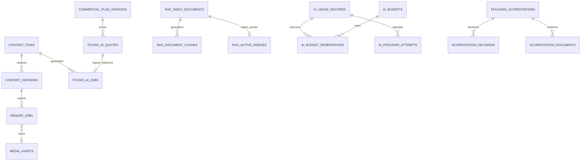
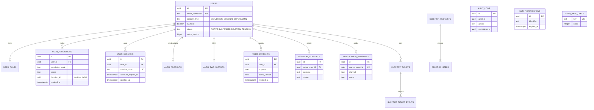
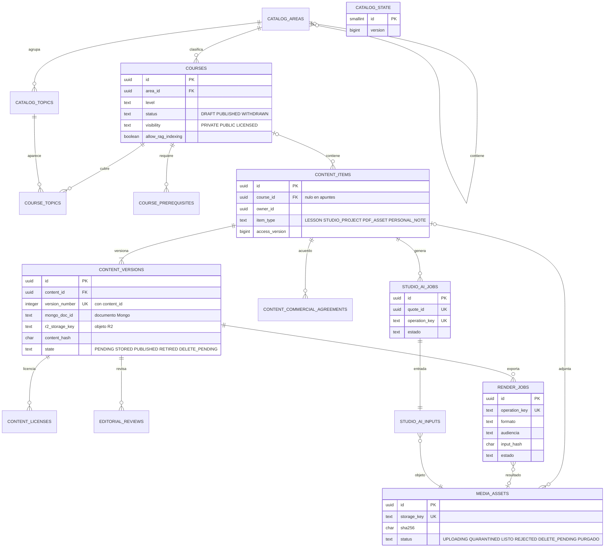
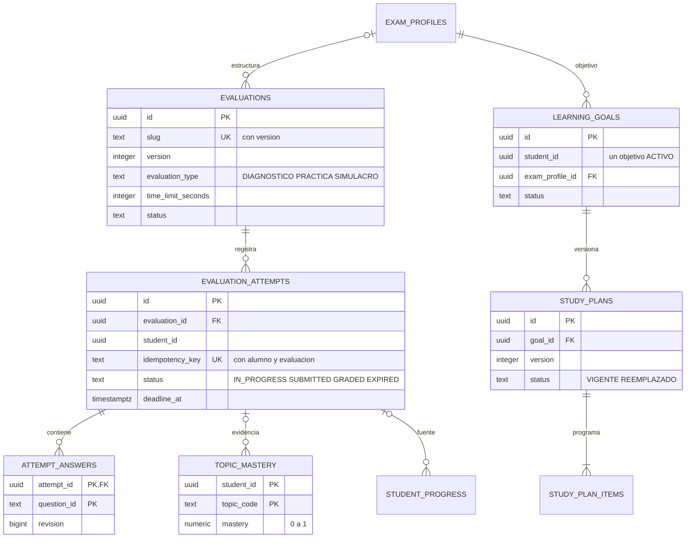
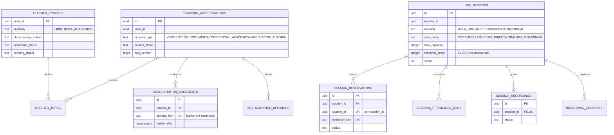
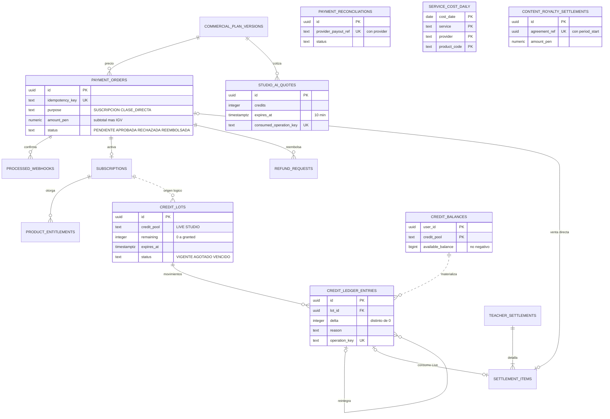
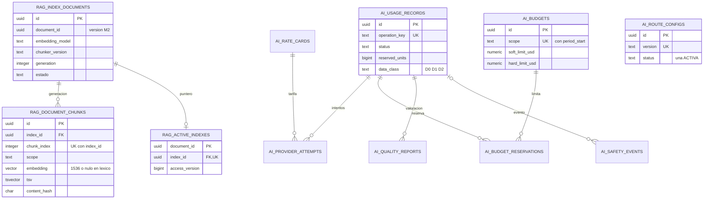
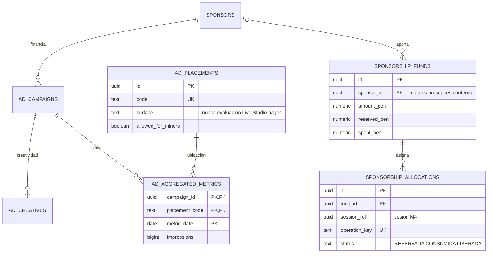
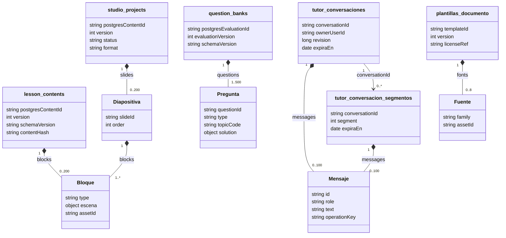

# Diseño de persistencia y modelo de datos — Mentelyx

> **Proyecto:** Mentelyx · **Ubicación:** `docs/03-diseño-de-software/diseño-externo/01-diseño-de-persistencia-y-datos.md`  
> **Motores seleccionados:** Neon PostgreSQL + `pgvector` (relacional/vectorial), MongoDB Atlas (documental), Redis (caché efímera) y Cloudflare R2 (objetos)  
> **Versión:** 2.1 — 17/11/2026 · **Estado:** diseño de datos cerrado para iniciar la construcción; pruebas de runtime, carga, restauración y aprobación de retenciones pendientes. No se han creado ni ejecutado migraciones.
> **Cambios 2.1:** entidades complementarias para cubrir RF-05–RF-99 (sección 7.8), campos añadidos en las secciones 7.3–7.5, estructura y validadores de todas las colecciones (sección 8.3), catálogo consolidado de Redis (sección 9.3), buckets R2 (sección 9.4), matriz de asignación por módulo (sección 13), diseño vectorial definitivo (sección 14) y diagramas ER por módulo y esquema documental (sección 15).

## 1. Propósito y principios de persistencia

Este documento especifica el **diseño externo de datos** de Mentelyx para iniciar la construcción de migraciones SQL, esquemas documentales y adaptadores de almacenamiento, respetando las decisiones arquitectónicas (**ADR-006, ADR-007, ADR-009, ADR-012, ADR-019, ADR-023, ADR-027, ADR-043, ADR-048, ADR-052, ADR-055**).

### Reglas de propiedad y consistencia
1. **Fuente de verdad transaccional (PostgreSQL):** cuentas, roles, habilitaciones docentes, licencias/metadatos de cursos, intentos y calificaciones oficiales, sesiones y reservas de clase, órdenes de pago, suscripciones, ledgers de créditos (**Live** y **Studio** separados), liquidaciones docentes, outbox transaccional, auditoría e índices vectoriales (`pgvector`).
2. **Almacenamiento documental estructurado (MongoDB):** contenido rico y versionado de lecciones, proyectos de **Mentelyx Studio** (diapositivas, bloques interactivos, lienzos) y estructura flexible de bancos de preguntas. Todo documento guarda el `owner_id`, `resource_id` y `version` autorizados en PostgreSQL.
3. **Caché y control efímero (Redis):** límites de velocidad (*rate limiting*), caché de catálogo público y estados efímeros no financieros. **Prohibido** almacenar saldos de créditos, estados definitivos de pago o cupos autoritativos únicamente en Redis.
4. **Objetos binarios y video (Cloudflare R2 / Bunny Stream):** PDFs, imágenes y recursos pesados viven en R2; los videos educativos publicados se sirven mediante Bunny Stream. Las bases de datos solo almacenan referencias (`storage_key`, `checksum`, `mime_type`).
5. **Propiedad modular:** cada tabla o colección pertenece a **un único módulo (M1–M7)**. Ningún módulo ejecuta `JOIN` ni escrituras directas sobre tablas privadas de otro módulo; la coordinación se realiza por contratos internos o casos de uso propietarios.

**Naturaleza de cada dato (cerrada):** **relacional** en PostgreSQL (autoridad de cuentas, permisos, catálogo, versiones, resultados, reservas, dinero, uso y auditoría); **documental** en MongoDB (cuerpo versionado de lecciones, proyectos Studio, bancos de preguntas, plantillas y conversaciones del Tutor); **vectorial** en `pgvector` dentro de PostgreSQL M6 (solo fragmentos RAG autorizados, sección 14); **temporal** en Redis (caché y controles con TTL, nunca autoridad, sección 9.3); **objetos** en R2 (binarios, sección 9.4) y Bunny Stream (video publicado). No existe un sexto almacén ni una base de series temporales: las métricas agregadas viven en tablas SQL. La matriz completa por módulo está en la sección 13.

---

## 2. Diagrama Entidad-Relación en PostgreSQL (Núcleo Transaccional)

```mermaid
erDiagram
  USERS ||--o{ USER_ROLES : "tiene"
  USERS ||--o| TEACHER_PROFILES : "configura (M4)"
  USERS ||--o{ TEACHING_ACCREDITATIONS : "solicita (M4)"
  USERS ||--o{ COURSES : "crea (M2)"
  COURSES ||--o{ CONTENT_ITEMS : "contiene (M2)"
  CONTENT_ITEMS ||--o{ RAG_DOCUMENT_CHUNKS : "indexa (M6)"
  USERS ||--o{ EVALUATION_ATTEMPTS : "rinde (M3)"
  EVALUATIONS ||--o{ EVALUATION_ATTEMPTS : "registra (M3)"
  USERS ||--o{ LIVE_SESSIONS : "dicta (M4)"
  LIVE_SESSIONS ||--o{ SESSION_RESERVATIONS : "reserva cupo (M4)"
  USERS ||--o{ SESSION_RESERVATIONS : "inscribe (M4)"
  CommercialPlans ||--o{ PAYMENT_ORDERS : "cotiza (M5)"
  USERS ||--o{ PAYMENT_ORDERS : "compra (M5)"
  PAYMENT_ORDERS ||--o| SUBSCRIPTIONS : "activa (M5)"
  USERS ||--o{ CREDIT_LEDGER_ENTRIES : "mueve saldo (M5)"
  LIVE_SESSIONS ||--o{ TEACHER_SETTLEMENTS : "liquida (M5)"

  USERS {
    uuid id PK
    varchar email UK
    varchar account_type "ESTUDIANTE | DOCENTE | SUPERADMIN"
    boolean is_minor
    boolean is_university_student
    boolean tutor_enabled "Habilitación explícita p/ enseñar"
    varchar status "ACTIVE | SUSPENDED"
    timestamptz created_at
  }

  TEACHER_PROFILES {
    uuid user_id PK,FK
    varchar modality "LIBRE | NIVEL_ACADEMICO"
    boolean can_charge_classes "Estado separado de cuenta/rol"
    varchar documentary_status "NO_SOLICITADA | PENDIENTE | APROBADA | RECHAZADA"
    varchar academic_status "Resumen; detalle por credencial"
    varchar tutoring_status "Habilitación independiente"
    timestamptz updated_at
  }

  COURSES {
    uuid id PK
    uuid author_id FK
    varchar level "PRIMARIA | SECUNDARIA | PREUNI | UNIVERSITARIO"
    varchar visibility "PRIVATE | PUBLIC | LICENSED"
    boolean allow_rag_indexing
    integer current_version
    timestamptz published_at
  }

  CONTENT_ITEMS {
    uuid id PK
    uuid course_id FK
    varchar item_type "LESSON | STUDIO_PROJECT | PDF_ASSET"
    varchar mongo_document_id "Referencia a MongoDB"
    varchar r2_storage_key "Referencia a Cloudflare R2"
    integer version
    timestamptz created_at
  }

  EVALUATION_ATTEMPTS {
    uuid id PK
    uuid evaluation_id FK
    uuid student_id FK
    varchar idempotency_key UK
    integer evaluation_version
    numeric official_score
    varchar status "IN_PROGRESS | SUBMITTED | GRADED"
    timestamptz submitted_at
  }

  LIVE_SESSIONS {
    uuid id PK
    uuid teacher_id FK
    varchar modality "AULA_GRUPAL | REFORZAMIENTO | INDIVIDUAL"
    integer max_capacity "Diseño base hasta 35"
    integer reserved_seats "Controlado con CHECK reserved <= max"
    integer credit_cost_per_student "1, 2 o 3 créditos Live"
    varchar policy_version
    varchar status "SCHEDULED | IN_PROGRESS | COMPLETED | CANCELLED"
    timestamptz starts_at
  }

  SESSION_RESERVATIONS {
    uuid id PK
    uuid session_id FK
    uuid student_id FK
    varchar operation_key UK "Idempotencia de reserva"
    varchar status "RESERVED | ATTENDED | CANCELLED | REFUNDED"
    timestamptz created_at
  }

  PAYMENT_ORDERS {
    uuid id PK
    uuid user_id FK
    varchar product_code "EST_PLUS | EST_PRO | AULAS_LIVE | STUDIO_PLUS | STUDIO_PRO"
    varchar policy_version "Versión comercial inmutable"
    numeric amount_pen
    varchar idempotency_key UK
    varchar status "PENDIENTE | APROBADA | RECHAZADA | REEMBOLSADA"
    varchar provider_reference
    timestamptz created_at
  }

  CREDIT_LEDGER_ENTRIES {
    uuid id PK
    uuid user_id FK
    varchar credit_Pool "LIVE | STUDIO (No intercambiables)"
    integer delta "Positivo (carga/reverso) o Negativo (consumo)"
    varchar reason "PURCHASE | CLASS_RESERVE | CLASS_REVERT | STUDIO_AI_OP | STUDIO_AI_REFUND"
    varchar operation_key UK "Evita doble descuento o doble abono"
    varchar policy_version
    timestamptz created_at
  }

  TEACHER_SETTLEMENTS {
    uuid id PK
    uuid session_id FK
    uuid teacher_id FK
    integer verified_credits_consumed
    numeric rate_per_credit_pen "Ej. S/8 sujeto a contrato versionado"
    numeric total_payable_pen
    varchar policy_version
    varchar status "PENDING_VALIDATION | APPROVED | PAID | DISPUTED"
    timestamptz settled_at
  }
```



---

## 3. Catálogo de tablas PostgreSQL por módulo (M1–M7)

### 3.1. Módulo 1 — Usuarios y Administración (`schema: m1_users`)
| Tabla | Propósito | Restricciones e índices críticos |
|---|---|---|
| `users` | Datos de cuenta y perfil, tipo de cuenta (`ESTUDIANTE`, `DOCENTE`, `SUPERADMIN`; este último solo interno), indicador de menor de edad (`is_minor`). | `UNIQUE (email)`, `CHECK (account_type IN (...))` |
| `user_sessions` | Sesiones del adaptador Better Auth seleccionado; esquema nativo mapeado según sección 7.1. | `INDEX (user_id, expires_at)`, token único confidencial; no imponer hash incompatible con la biblioteca |
| `user_permissions` | Permisos granulares RBAC/ABAC y habilitación especial (`tutor_universitario_habilitado`). | `UNIQUE (user_id, permission_code, scope)` |
| `parental_consents` | Registro verificable de autorización de adulto responsable para cuentas de menores y uso audiovisual. | `INDEX (minor_user_id, status)` |
| `audit_logs` | Evidencia inmutable de cambios de permisos, moderación y acciones administrativas. | `INDEX (actor_id, created_at)`, solo inserción (`INSERT-only`) |

### 3.2. Módulo 2 — Cursos y Contenidos / Studio (`schema: m2_contents`)
| Tabla | Propósito | Restricciones e índices críticos |
|---|---|---|
| `courses` | Metadatos del curso, nivel académico, autor, estado de publicación y bandera `allow_rag_indexing`. | `INDEX (level, status, visibility)` |
| `content_versions` | Historial inmutable de versiones publicadas y enlace a documentos en MongoDB (`mongo_doc_id`). | `UNIQUE (content_id, version_number)` |
| `content_licenses` | Derechos de uso, prohibición de entrenamiento IA externo y alcance de compartición. | `INDEX (content_id, license_type)` |
| `media_assets` | Registro de archivos en R2 y videos en Bunny Stream (`storage_key`, `size_bytes`, `sha256`, `status`). | `UNIQUE (storage_key)` |

### 3.3. Módulo 3 — Evaluaciones y Aprendizaje (`schema: m3_evaluations`)
| Tabla | Propósito | Restricciones e índices críticos |
|---|---|---|
| `evaluations` | Definición de diagnósticos, prácticas y simulacros, escala de calificación y versión vigente. | `UNIQUE (slug, version)` |
| `evaluation_attempts` | Intentos realizados por el estudiante, nota oficial determinista y sellado temporal. | `UNIQUE (student_id, evaluation_id, idempotency_key)` |
| `student_progress` | Avance consolidado por curso/tema y ruta adaptativa sugerida. | `UNIQUE (student_id, course_id)` |

### 3.4. Módulo 4 — Docentes y Clases (`schema: m4_classes`)
| Tabla | Propósito | Restricciones e índices críticos |
|---|---|---|
| `teacher_profiles` | Modalidad (`LIBRE` vs `NIVEL_ACADEMICO`), estados documental, académico y de tutoría separados; `can_charge_classes` es proyección. | `PRIMARY KEY (user_id)`; detalle sección 7.4 |
| `teaching_accreditations` | Solicitudes documentales, académicas y de habilitación con `request_type` y decisiones independientes (SC-09). | `INDEX (user_id, request_type, review_status)`; detalle sección 7.4 |
| `live_sessions` | Programación de aulas (6–35), reforzamiento (2–5) o individual (1), cupo máximo y asientos reservados. | `CHECK (reserved_seats >= 0 AND reserved_seats <= max_capacity)` |
| `session_reservations` | Inscripción de estudiante a una sesión con estado de asistencia y referencia de crédito. | `UNIQUE (session_id, student_id)`, `UNIQUE (operation_key)` |
| `session_attendance_logs` | Evidencia de prestación efectiva (ingreso/permanencia docente y alumnos) para habilitar liquidación. | `INDEX (session_id, participant_id)` |

### 3.5. Módulo 5 — Suscripciones y Pagos (`schema: m5_billing`)
| Tabla | Propósito | Restricciones e índices críticos |
|---|---|---|
| `commercial_plan_versions` | Catálogo versionado de precios, cuotas de créditos y reglas de liquidación (ADR-055). | `UNIQUE (product_code, policy_version)` |
| `payment_orders` | Órdenes de compra iniciadas y su estado transaccional. | `UNIQUE (idempotency_key)` |
| `processed_webhooks` | Deduplicación persistente de notificaciones de pasarela y colas (Idempotent Receiver). | `UNIQUE (provider, event_id)` |
| `subscriptions` | Suscripciones vigentes por producto (`EST_PLUS`, `EST_PRO`, `AULAS_LIVE`, `STUDIO_PLUS`, `STUDIO_PRO`). | `INDEX (user_id, product_code, status)` |
| `credit_ledger_entries` | Libro mayor inmutable de créditos (`credit_pool = 'LIVE' \| 'STUDIO'`). | `UNIQUE (operation_key)`, `INDEX (user_id, credit_pool)` |
| `credit_balances` | Saldo materializado actualizado en la misma transacción SQL que el ledger para evitar saldo negativo. | `PRIMARY KEY (user_id, credit_pool)`, `CHECK (available_balance >= 0)` |
| `teacher_settlements` | Cálculo y estado de pago a docentes por créditos efectivamente consumidos y validados. | `UNIQUE (session_id, settlement_run_id)` |
| `outbox_events` | Eventos pendientes de publicar a Cloudflare Queues escritos en la misma transacción ACID. | `INDEX (status, next_retry_at)` |

### 3.6. Módulo 6 — Tutor IA y RAG (`schema: m6_ai_tutor`)
| Tabla | Propósito | Restricciones e índices críticos |
|---|---|---|
| `rag_document_chunks` | Fragmentos autorizados, vector(1536) para el modelo seleccionado y metadatos ACL. | `UNIQUE (index_id, chunk_index)` sustituye la unicidad v1 para reindexación coexistente; HNSW separado por modelo/generación (sección 7.6) |
| `ai_usage_records` | Medición auditable de tokens de entrada/salida, modelo invocado, latencia y costo estimado por operación. | `UNIQUE (operation_key)`, `INDEX (user_id, billing_period)` |

### 3.7. Módulo 7 — Publicidad y Patrocinios (`schema: m7_advertising`)
| Tabla | Propósito | Restricciones e índices críticos |
|---|---|---|
| `sponsors` | Entidades patrocinadoras verificadas y convenios de financiamiento de aulas gratuitas. | `UNIQUE (tax_id)` |
| `ad_campaigns` | Campañas aprobadas, presupuesto tope, fechas y superficies permitidas (nunca en exámenes/Live/Studio). | `INDEX (status, starts_at, ends_at)` |
| `ad_aggregated_metrics` | Contadores diarios agregados de impresiones por superficie, **sin** identificadores de menores ni notas. | `UNIQUE (campaign_id, placement_code, metric_date)` |

---

## 4. Diseño documental en MongoDB Atlas

MongoDB almacena estructuras jerárquicas o polimórficas que cambian con el editor visual, manteniendo siempre referencia al registro propietario en PostgreSQL.

### 4.1. Colección `studio_projects` (M2)
```json
{
  "_id": "ObjectId('6718f2a9c4e12a0012345678')",
  "postgresContentId": "550e8400-e29b-41d4-a716-446655440000",
  "ownerUserId": "110e8400-e29b-41d4-a716-446655440111",
  "version": 3,
  "status": "PUBLISHED",
  "format": "SLIDES_INTERACTIVE",
  "slides": [
    {
      "slideId": "s-01",
      "order": 1,
      "blocks": [
        { "type": "heading", "text": "Leyes de Newton" },
        { "type": "diagram_canvas", "elements": [], "generatedByAi": false },
        { "type": "ai_illustration", "r2Key": "studio/assets/img-981.webp", "aiOperationKey": "op-studio-8821" }
      ]
    }
  ],
  "updatedAt": "2026-10-30T22:00:00Z"
}
```

### 4.2. Colección `question_banks` (M3)
```json
{
  "_id": "ObjectId('6718f3b0c4e12a0012345999')",
  "postgresEvaluationId": "770e8400-e29b-41d4-a716-446655440222",
  "evaluationVersion": 2,
  "level": "PREUNI",
  "questions": [
    {
      "questionId": "q-101",
      "type": "MULTIPLE_CHOICE_DETERMINISTIC",
      "stemMarkdown": "Calcule la aceleración del bloque...",
      "options": [
        { "id": "A", "text": "2 m/s²" },
        { "id": "B", "text": "4 m/s²" }
      ],
      "correctOptionId": "B",
      "points": 4.0
    }
  ]
}
```

---

## 5. Diseño de claves en Redis y degradación segura

| Prefijo de clave | Propósito | TTL sugerido | Comportamiento si Redis cae (AC-02 / ADR-054) |
|---|---|---|---|
| `rl:ip:{ip}:{route}` | Rate limiting en endpoints públicos y autenticación | 60 s | Aplicar límite conservador en borde (Cloudflare WAF) sin bloquear toda la plataforma. |
| `cache:m2:catalog:{level}:{page}` | Caché de lectura del catálogo público de cursos | 300 s | *Cache-Aside*: consultar PostgreSQL con paginación estricta y límite de filas. |
| `cache:m3:eval_meta:{evalId}:v{ver}` | Metadatos inmutables de versión de evaluación | 1800 s | Lectura directa desde base de datos autoritativa. |
| `lock:worker:idx:{docId}:v{ver}` | Candado auxiliar para evitar trabajo paralelo innecesario en colas | 120 s | La garantía real reside en el índice `UNIQUE` de PostgreSQL; el candado es solo optimización. |

> **Regla crítica:** ningún saldo de créditos (`LIVE` o `STUDIO`), confirmación de pago ni reserva de cupo se decide en Redis.

## 6. Caracterización, dimensionamiento y elección SQL/NoSQL

### 6.1. Cinco preguntas de diseño

1. **Usuarios y crecimiento.** Hipótesis de planificación H0 piloto: 1 000 cuentas; H1: 5 000; H2: 20 000. Son escalones de capacidad, no pronóstico comercial ni número medido. Se supone DAU = 20 % y actividad durante 10 h/día. Se conservan EQ-01 (100 usuarios) y EQ-03 (200 usuarios) como ensayos iniciales; H2 no se considera validado por superarlos.
2. **Lecturas/escrituras.** Suponer 200 solicitudes API por DAU/día, 80 % lecturas y 20 % mutaciones, pico 10 veces la media del periodo activo. Las lecturas privadas consultan también sesión/permisos SQL; las escrituras incluyen outbox e índices y no equivalen a una sola operación de disco. Autosave, ingesta y evaluaciones se ensayan por separado.
3. **Información crítica.** Cuentas/permisos, consentimientos, respuestas confirmadas, licencias, reservas, pagos y movimientos son SQL duradero. Mongo conserva versiones pedagógicas; su pérdida también afecta al servicio. RAG, cachés y exportaciones regenerables son derivados. R2 contiene originales no regenerables y requiere copia independiente.
4. **Latencia.** Mantener p95 API ≤ 2 s con 100 usuarios y ≤ 3 s con 200 (EQ-01/03), 5xx < 1 %, guardado de evaluaciones ≤ 3 s (EQ-15), bajo región/red y mezcla registradas. Presupuesto interno inicial para consulta SQL individual: 200 ms; transacción crítica: 1 s; acceso documental: 500 ms, hipótesis que se miden y ajustan, no SLO adicionales. IA se mide en primer token/total y audiovisual en reconexión/calidad/minutos-participante.
5. **Costos.** TCO mensual = cómputo API + SQL + Atlas + Redis + almacenamiento y operaciones R2 + backups + colas + observabilidad + navegador/render + video + IA + correo. Separar costos fijos, variables y comerciales (pasarela, impuestos, liquidaciones). No se aprueba presupuesto ni se supone que Free incluye respaldo/HA. Medir costo por DAU, por operación y cuota completa; `ai_rate_cards` conserva tarifas oficiales fechadas y unidad, no precios copiados sin procedencia.

| Hipótesis | Cuentas / DAU | API/día | RPS media / pico | Lecturas / mutaciones por segundo en pico |
|---|---:|---:|---:|---:|
| H0 | 1 000 / 200 | 40 000 | 1,11 / 11,11 | 8,89 / 2,22 |
| H1 | 5 000 / 1 000 | 200 000 | 5,56 / 55,56 | 44,44 / 11,11 |
| H2 | 20 000 / 4 000 | 800 000 | 22,22 / 222,22 | 177,78 / 44,44 |

Fórmula: `RPS = DAU × 200 / (10 × 3600)`; multiplicar por 10 para pico. No confundir cuentas registradas, usuarios concurrentes, solicitudes simultáneas ni conexiones DB. Para 100 usuarios que hacen una petición cada 5 s, la carga ofrecida es 20 RPS; registrar también tiempo de respuesta y espera.

### 6.2. Volumen y cargas independientes

| Componente | Hipótesis H0 y cálculo | Implicación |
|---|---|---|
| Transacciones SQL | 8 000 mutaciones/día × 30 × 2 KB de fila lógica = 480 MB/mes | Multiplicador de planificación ×3 para índices/overhead = 1,44 GB/mes; excluye WAL/backups y vectores. Medir tamaños reales antes de provisionar |
| Versiones Mongo | 1 000 recursos × 5 versiones × 100 KB = 500 MB lógicos | No indexar todos los campos del editor. Escenas grandes se dividen por sección; límite propio 1 MiB por documento |
| RAG | 10 000 chunks × (4 × 1536 + 8 bytes) = 61 520 000 bytes de vectores | Con 2 KB de texto/metadatos por chunk: 81,52 MB antes de índices; reservar inicialmente ×3 = 244,56 MB. H1 100 000 y H2 1 000 000 chunks escalan ×10/×100; medir HNSW |
| R2 | 1 000 originales × 5 MB = 5 GB; 1 000 exportaciones × 2 MB = 2 GB | 7 GB activos hipotéticos, sin video ni copias; lifecycle separado por clase |
| IA | 200 DAU × 2 consultas/día = 400 operaciones/día | Con 6 000 entrada + 2 000 salida: 2,4 M + 0,8 M tokens/día. Reintentos/herramientas/razonamiento se imputan aparte |
| Video en vivo | 4 aulas/día × 36 personas × 60 min = 8 640 participante-min/día | Con 2 aulas simultáneas: 72 conexiones SFU, no 72 flujos en Hono |
| Video grabado | 100 h fuente; reproducción hipotética 200 DAU × 20 min/día | Fuente, transcodificados, almacenamiento y transferencia se cotizan por separado; nunca contar horas como GB sin bitrate |
| PDF/PPTX | 100 trabajos/día × duración medida | Registrar segundos de navegador, CPU, memoria máxima, bytes y reintentos; limitar concurrencia, no extrapolar desde tokens |

Las políticas de retención limitan acumulación; el escenario no supone crecimiento ilimitado ni constituye presupuesto. A 99,5 % en 30 días, el presupuesto de indisponibilidad de referencia es 216 min; restauraciones y fallos de proveedores consumen ese presupuesto.

### 6.3. MongoDB frente a JSONB

| Criterio | PostgreSQL JSONB | MongoDB Atlas | Decisión |
|---|---|---|---|
| Políticas comerciales pequeñas, lectura junto al plan | ACID local, constraints sobre campos, sin salto de red | Duplica autoridad y exige coordinación | `commercial_plan_versions.ai_policy` en JSONB |
| Documentos pedagógicos/Studio inmutables por versión | Viable; índices JSONB y una sola operación administrativa | Agregados documentales, validadores y evolución por tipo; motor ya elegido en ADR-023/035/041 | Conservar Mongo; no justificarlo diciendo que SQL no soporta documentos |
| Permisos, saldos, cupos y resultados | FK, UNIQUE, locks/transacciones locales | No resuelve relaciones ni atomicidad entre motores | SQL como autoridad |
| Costo operativo | Menos proveedores pero compite con OLTP/RAG por recursos | Costos mínimos, backups, conexiones y reconciliación adicionales | Comparar ambos con mismo corpus y workload antes de proponer sustitución mediante ADR |
| Consulta habitual | Buscar metadatos SQL, luego versión exacta por ID | Índice compuesto por recurso/versión; evitar consultas cruzadas remotas | Sin joins SQL–Mongo ni FK entre motores |

Se adopta la persistencia políglota existente; no se afirma superioridad medida. Prueba futura: mismo corpus H0/H1, autosave concurrente, publicación, recuperación y restauración; comparar p95, tamaño/índices, conexiones, costo total y horas de operación. Si Atlas incumple o el costo fijo domina, elevar propuesta JSONB; no migrar silenciosamente. JSONB soporta indexación, pero se indexan solo rutas consultadas ([PostgreSQL, consulta 17/11/2026](https://www.postgresql.org/docs/current/datatype-json.html)).

## 7. Modelo lógico y físico normativo

Las tablas siguientes completan el ER resumido de la sección 2. Notación: `?` nullable; los demás campos son NOT NULL. `id uuid PK`, `created_at timestamptz` y, para entidades mutables, `updated_at timestamptz`, son comunes salvo PK compuesta indicada. IDs los genera el servidor; fechas UTC. `str` = `text` con longitud máxima validada (ID externo 255, clave de operación 200); `money` = `numeric(18,6)` no negativo; importes PEN cobrables se redondean a dos decimales con política versionada; no usar float monetario. Hash = `char(64)` hexadecimal SHA-256. JSONB se valida por esquema versionado y tamaño. Las transiciones se condicionan al estado anterior y versión optimista.

**FK:** se implementan dentro del esquema propietario; referencias a otro módulo son UUID/versión lógica validados por su contrato, sin JOIN a sus tablas privadas. Las líneas entre módulos del ER son cardinalidades de dominio, no instrucciones de crear FK. No hay cascada de borrado entre módulos; el borrado se coordina (sección 10). Las FK locales usan RESTRICT salvo hijos de borrador eliminables expresamente. Todos los índices FK de lectura frecuente se crean explícitamente. IDs externos se validan tanto al crear como antes de usar permisos.

### 7.1. M1: cuenta, sesión y permisos

| Tabla | Campos específicos y relaciones | Invariantes / índices |
|---|---|---|
| `users` | `email text`, `email_normalized text`, `email_verified boolean`, `display_name text`, `account_type text`, `is_minor boolean`, `is_university_student boolean`, `status text`, `authz_version bigint`, `tutor_enabled boolean` (proyección) | UNIQUE(email_normalized); dos tipos públicos, SUPERADMIN solo provisión interna; no normalizar puntos/alias del correo; status ACTIVE/SUSPENDED/DELETION_PENDING; authz_version creciente |
| `user_roles` | `user_id FK users`, `role_code text`, `granted_by uuid`, `revoked_at timestamptz?` | N roles por cuenta; UNIQUE parcial(user_id, role_code) WHERE revoked_at IS NULL; rol no sustituye ABAC |
| `user_permissions` | `user_id FK users`, `permission_code text`, `scope text` no nulo (GLOBAL o recurso canónico), `decision_id uuid?`, `valid_until timestamptz?`, `revoked_at timestamptz?` | UNIQUE parcial(user_id, permission_code, scope) WHERE revoked_at IS NULL; permiso docente ligado a decisión M4 y vigencia |
| `user_sessions` | `user_id FK users`, `session_token text` confidencial, `expires_at timestamptz`, `last_seen_at timestamptz`, `absolute_expires_at timestamptz`, `revoked_at timestamptz?`, `authz_version bigint`, `mfa_verified_at timestamptz?` | Token único, índice(user_id, expires_at); consulta autoritativa SQL por petición. Mapeo nativo de Better Auth sin algoritmo propio; prohibido exponer/loguear token |
| `auth_accounts` | `user_id FK users`, `provider_id text`, `provider_account_id text`, `password_hash text?`, tokens de proveedor cifrados solo si se habilita OAuth | UNIQUE(provider_id, provider_account_id); credenciales gestionadas por biblioteca, no mezclar con perfil |
| `auth_verifications` | `identifier text`, `value text` confidencial según biblioteca, `expires_at timestamptz` | Tokens de verificación/recuperación de un uso; índice(identifier, expires_at); consumo atómico. Revisar esquema generado al fijar versión |
| `auth_two_factors` | `user_id FK users UNIQUE`, `secret_encrypted text`, `backup_codes_protected text`, `enabled boolean` | Protección y formato de la biblioteca; no inventar cifrado. Registro obligatorio para administración |
| `parental_consents` | `minor_user_id FK users`, `guardian_ref uuid`, `purpose text`, `policy_version text`, `evidence_ref text`, `status text`, `granted_at timestamptz?`, `revoked_at timestamptz?` | N consentimientos por menor/finalidad; índice(minor_user_id,purpose,status); datos mínimos del responsable bajo acceso restringido |
| `audit_logs` | `actor_id uuid?`, `action text`, `resource_type text`, `resource_id uuid?`, `decision_id uuid?`, `correlation_id uuid`, `outcome text`, `redacted_metadata jsonb` | INSERT-only para rol aplicativo; (actor_id,created_at), (resource_type,resource_id,created_at). Retención/purga por rol de mantenimiento auditado, no inmutabilidad legal perpetua |
| `deletion_requests` | `subject_id uuid`, `scope text`, `resource_id uuid?`, `requested_at timestamptz`, `status text`, `policy_version text`, `completed_at timestamptz?` | Fuente de tombstones y evidencia de supresión; no almacenar contenido borrado; índice(status,requested_at) |
| `deletion_steps` | `request_id FK deletion_requests`, `owner_module text`, `store text`, `reference_hash char(64)`, `status text`, `attempts integer`, `next_retry_at timestamptz?` | UNIQUE(request_id,owner_module,store,reference_hash); seguimiento idempotente por almacén |

No existe paquete instalado ni esquema generado en este repositorio. Los campos nativos de autenticación se mapean y validan en el prototipo; se corrige la imposición de `session_token_hash` de v1 porque no se ha demostrado soporte nativo. Es secreto de servidor sujeto a mínimo privilegio, cifrado de almacenamiento administrado y restauración con revocación, no un formato de token diseñado por Mentelyx.

### 7.2. M2: catálogo, versiones, archivos y trabajos

| Tabla | Campos específicos / relaciones locales | Constraints e índices |
|---|---|---|
| `courses` | `author_id uuid`, `title text`, `level text`, `status text`, `visibility text`, `allow_rag_indexing boolean`, `current_version integer`, `published_at timestamptz?` | Nivel PRIMARIA/SECUNDARIA/PREUNI/UNIVERSITARIO; visibility PRIVATE/PUBLIC/LICENSED; status DRAFT/PUBLISHED/WITHDRAWN; índice(level,status,visibility,id) |
| `content_items` | `course_id FK courses?` (apunte independiente), `owner_id uuid`, `item_type text`, `current_version integer?`, `access_version bigint`, `status text`, referencias opcionales del ER | Tipos LESSON/STUDIO_PROJECT/PDF_ASSET/PERSONAL_NOTE; referencias actuales son proyecciones de content_versions; índice(owner_id,status,id) |
| `content_versions` | `content_id FK content_items`, `version_number integer`, `mongo_doc_id text?`, `r2_storage_key text?`, `content_hash char(64)`, `schema_version text`, `state text`, `published_at timestamptz?` | UNIQUE(content_id,version_number); version >0; PENDING/STORED/PUBLISHED/RETIRED/DELETE_PENDING; no cambiar payload publicado; al menos una referencia de contenido |
| `content_licenses` | `content_id FK content_items`, `version_number integer`, `grantee_id uuid?`, `license_type text`, `allow_read boolean`, `allow_rag boolean`, `allow_export boolean`, `valid_from timestamptz`, `valid_until timestamptz?`, `revoked_at timestamptz?` | FK compuesta content_versions; vigencia no invertida; índice(content_id,version_number,grantee_id); licencia no concede entrenamiento |
| `media_assets` | `owner_id uuid`, `content_id FK content_items?`, `storage_provider text`, `storage_key text`, `mime_type text`, `size_bytes bigint`, `sha256 char(64)`, `status text`, `delete_after timestamptz?` | UNIQUE(storage_provider,storage_key); size ≥0; UPLOADING/QUARANTINED/LISTO/REJECTED/DELETE_PENDING/PURGADO; índice(status,delete_after) |
| `render_jobs` (SC-06) | `owner_id uuid`, `project_id FK content_items`, `project_version integer`, `formato text`, `audiencia text`, `plantilla_id text`, `plantilla_version integer`, `renderer_version text`, `input_hash char(64)`, `operation_key text`, `estado text`, `error_code text?`, `media_asset_id FK media_assets?`, `terminado_en timestamptz?` | FK(project_id,project_version)→content_versions; UNIQUE(operation_key); índice(owner_id,project_id,input_hash,estado); PDF/PPTX; audiencia ESTUDIANTE/DOCENTE; LISTO requiere asset; campos temporales se mapean a `creadoEn`/`actualizadoEn` del DTO |
| `studio_ai_jobs` (SC-16) | `owner_id uuid`, `project_id FK content_items`, `base_version integer`, `quote_id uuid`, `operation_key text`, `request_hash char(64)`, `estado text`, `generation_ref uuid?`, `result_version integer?`, `error_code text?`, `failure_attribution text?`, `lease_until timestamptz?`, `attempts integer` | UNIQUE(operation_key), UNIQUE(quote_id); FK local versión base; estados del API y subestado interno PAYMENT_PENDING/UNCERTAIN; resultado siempre borrador; índice(estado,lease_until) |
| `studio_ai_inputs` | `job_id FK studio_ai_jobs UNIQUE`, `input_asset_id FK media_assets`, `input_hash char(64)`, `expires_at timestamptz` | Prompt/entrada canónica cifrada y privada en R2 temporal, nunca en outbox ni en cotización M5; autorización M2; purga con trabajo/conversación |

`render_jobs.input_hash` incluye documento canónico, versión exacta, plantilla, renderer, **formato, audiencia y política de exclusión de soluciones/notas**. La reutilización se restringe al propietario/proyecto y permiso vigente; un hash igual no concede acceso. Exportación ESTUDIANTE elimina respuestas ocultas y notas también del XML/notas del PPTX. Se rechaza reutilización global y guardar soluciones ocultas en las notas del archivo del estudiante.

### 7.3. M3: evaluaciones

| Tabla | Campos / relaciones | Invariantes e índices |
|---|---|---|
| `evaluations` | `slug text`, `version integer`, `evaluation_type text`, `exam_profile_id FK exam_profiles?`, `content_ref uuid`, `question_bank_ref text`, `max_score numeric(10,4)`, `time_limit_seconds integer?`, `max_attempts integer?`, `status text`, `scoring_policy_version text` | UNIQUE(slug,version); max_score >0; tipo DIAGNOSTICO/PRACTICA/SIMULACRO; SIMULACRO exige time_limit_seconds >0; status DRAFT/PUBLISHED/RETIRED; versión publicada inmutable |
| `evaluation_attempts` | `evaluation_id FK evaluations`, `student_id uuid`, `evaluation_version integer`, `idempotency_key text`, `official_score numeric(10,4)?`, `status text`, `started_at timestamptz`, `deadline_at timestamptz?`, `submitted_at timestamptz?` | UNIQUE(student_id,evaluation_id,idempotency_key); FK(evaluation_id,evaluation_version)→evaluations(id,version), con UNIQUE de destino; IN_PROGRESS/SUBMITTED/GRADED/EXPIRED; nota solo en GRADED; deadline_at = started_at + límite del simulacro; índice(student_id,status) para `consultarRestriccionesTutor`; escala validada por M3 |
| `attempt_answers` | `attempt_id FK evaluation_attempts`, `question_id text`, `answer jsonb`, `revision bigint`, `request_key text`, `saved_at timestamptz` | PK(attempt_id,question_id); control revision esperado; deduplicación request_key en inbox con hash; no guardar respuesta correcta en DTO del alumno |
| `student_progress` | `student_id uuid`, `course_id uuid`, `completed_count integer`, `mastery numeric(5,4)`, `rule_version text`, `source_attempt_id FK evaluation_attempts?` | UNIQUE(student_id,course_id); mastery entre 0 y 1; proyección recalculable a partir de intentos |

Un banco contiene preguntas 1:N; versión de evaluación fija ese banco. Un intento tiene 0:N respuestas; se confirma autosave únicamente tras commit SQL. No dejar respuestas confirmadas solo en Mongo o navegador. Enviar el examen bloquea actualizaciones posteriores; calcular nota sin LLM usando versión congelada.

### 7.4. M4: tres procesos y clases (SC-09)

| Tabla | Campos / relaciones | Invariantes e índices |
|---|---|---|
| `teacher_profiles` | `user_id uuid PK`, `modality text`, `documentary_status text`, `academic_status text`, `tutoring_status text`, `can_charge_classes boolean`, `last_decision_id uuid?` | 0..1 perfil por Docente; la habilitación de Estudiante universitario vive en expedientes, sin exigir perfil Docente. Flags son proyecciones, no autoridad |
| `teaching_accreditations` | `user_id uuid`, `request_type text`, `review_status text`, `credential_details jsonb?`, `topics jsonb?`, `terms_version text?`, `minor_controls_status text`, `reviewer_id uuid?`, `decision_reason text?`, `decided_at timestamptz?`, `valid_until timestamptz?`, `row_version bigint` | Tipos VERIFICACION_DOCUMENTAL/CREDENCIAL_ACADEMICA/HABILITACION_TUTORIA; estados API sección 4.5 más REVOCADA interno; índice(user_id,request_type,review_status); solo NIVEL_ACADEMICO solicita credencial; tutoría exige adulto y condiciones vigentes |
| `accreditation_documents` | `request_id FK teaching_accreditations`, `storage_key text`, `document_type text`, `sha256 char(64)`, `status text`, `delete_after timestamptz?`, `legal_hold_ref text?` | UNIQUE(storage_key); D3 en bucket separado de M4; 90 días tras decisión es propuesta legal, no hecho aprobado; nunca indexar en RAG |
| `accreditation_decisions` | `request_id FK teaching_accreditations`, `reviewer_id uuid`, `previous_status text`, `new_status text`, `reason text`, `policy_version text`, `valid_until timestamptz?` | INSERT-only; decisión vigente verificable por M1, sin conservar copia de documentos personales en auditoría |
| `live_sessions` | Campos del ER más `title varchar(200)`, `topic_code text`, `sale_mode text`, `price_pen numeric(12,2)?`, `duration_minutes integer`, `ends_at timestamptz`, `published_at timestamptz?`, `provider_room_ref text?`, `funding_allocation_ref uuid?`, `terms_version text`, `row_version bigint` | CHECK 0≤reserved_seats≤max_capacity; modalidades iniciales AULA_GRUPAL/REFORZAMIENTO/INDIVIDUAL; máximo 35/5/1, mínimo de participantes no es aforo reservado obligatorio; sale_mode CREDITOS_LIVE/VENTA_DIRECTA/GRATUITA_FINANCIADA; VENTA_DIRECTA exige price_pen>0; GRATUITA_FINANCIADA exige funding_allocation_ref (M7, RF-81); 0<duration_minutes≤política (60 inicial); ends_at>starts_at; publicar exige habilitación vigente revalidada en M4; índice(status,starts_at), índice(teacher_id,starts_at) |
| `session_reservations` | Campos ER más `credit_operation_key text`, `held_until timestamptz?`, `policy_version text` | UNIQUE(session_id,student_id), UNIQUE(operation_key); FK session_id; estados internos HOLD/PAYMENT_PENDING además de los del ER; índice(status,held_until) |
| `session_attendance_logs` | `session_id FK live_sessions`, `participant_id uuid`, `provider_event_id text`, `joined_at timestamptz`, `left_at timestamptz?`, `source text` | UNIQUE(source,provider_event_id); índice(session_id,participant_id,joined_at); evidencia no equivale automáticamente a prestación liquidable |

Una persona tiene N solicitudes, cada solicitud N documentos/decisiones. Acreditar una credencial no aprueba automáticamente documentos ni tutorías. Una revocación M4 deniega nuevas acciones desde su commit; M1 recibe evento y aumenta authz_version, pero antes de una operación docente se revalida la decisión en M4 para no depender del retraso de la proyección.

### 7.5. M5: economía y cotizaciones

| Tabla | Campos / relaciones | Invariantes e índices |
|---|---|---|
| `commercial_plan_versions` | `product_code text`, `policy_version text`, `price_pen numeric(12,2)`, `live_credits integer`, `studio_credits integer`, `ai_policy jsonb`, `valid_from timestamptz`, `valid_until timestamptz?` | UNIQUE(product_code,policy_version); cantidades ≥0; publicado inmutable; ai_policy validado contra orquestación sección 10.2 con límites no negativos; no GIN sin consulta que lo requiera |
| `payment_orders` | Campos ER más `purpose text`, `reference_id uuid?`, `subtotal_pen numeric(12,2)`, `igv_pen numeric(12,2)`, `tax_policy_version text`, `request_hash char(64)`, `provider text`, `currency char(3)` | FK(product_code,policy_version)→commercial_plan_versions; purpose SUSCRIPCION/CLASE_DIRECTA; CLASE_DIRECTA exige reference_id (reserva M4) y product_code CLASE_DIRECTA; amount_pen = subtotal_pen + igv_pen; UNIQUE(provider,provider_reference) WHERE provider_reference IS NOT NULL; idempotency_key incluye actor/operación; PEN inicial. Sin datos de tarjeta: la pasarela tokeniza y Mentelyx solo guarda referencias |
| `processed_webhooks` | `provider text`, `event_id text`, `payload_hash char(64)`, `order_id FK payment_orders?`, `processing_status text`, `processed_at timestamptz?` | UNIQUE(provider,event_id); no marcar procesado antes de transacción de efectos; guardar payload mínimo redactado si hace falta conciliación |
| `subscriptions` | `user_id uuid`, `order_id FK payment_orders`, `product_code text`, `policy_version text`, `period_start timestamptz`, `period_end timestamptz`, `status text` | UNIQUE(order_id,product_code); FK plan; period_end > period_start; índice(user_id,product_code,status) |
| `product_entitlements` | `subscription_id FK subscriptions?`, `user_id uuid`, `product_code text`, `policy_version text`, `scope text`, `valid_from timestamptz`, `valid_until timestamptz`, `status text`, `revision bigint` | Índice(user_id,product_code,status,valid_until); políticas Free explícitas y versionadas; no confundir saldo y derecho |
| `credit_balances` | `user_id uuid`, `credit_pool text`, `available_balance bigint`, `row_version bigint` | PK(user_id,credit_pool); LIVE/STUDIO; saldo≥0; una fila bloqueada serializa movimientos de esa cuenta/bolsa |
| `credit_ledger_entries` | Campos ER; `credit_pool text` normaliza `credit_Pool`; `lot_id FK credit_lots?`; `original_entry_id FK credit_ledger_entries?` | delta≠0; reason añade LOT_EXPIRATION; operation_key global con namespace; reintegro único por original/tipo mediante índice parcial; STUDIO_AI_REFUND exige original negativo STUDIO_AI_OP y delta opuesto, comprobado bajo lock; todo movimiento LIVE referencia su lote |
| `teacher_settlements` | Campos ER más `settlement_run_id uuid`, `contract_version text`, `payment_reference text?` | UNIQUE(session_id,settlement_run_id); no pagar dos veces la misma evidencia: detalle por settlement_items; campos financieros inmutables al aprobar |
| `settlement_items` | `settlement_id FK teacher_settlements`, `reservation_id uuid`, `consumption_entry_id FK credit_ledger_entries?`, `payment_order_id FK payment_orders?`, `amount_pen numeric(12,2)` | CHECK exactamente uno de consumption_entry_id (Live) o payment_order_id (venta directa); UNIQUE parciales sobre cada uno; N prestaciones por liquidación; ajustarlas por reverso, no sobrescribir |
| `studio_ai_quotes` (SC-17) | `user_id uuid`, `project_id uuid`, `input_ref text`, `input_hash char(64)`, `credits integer`, `product_code text`, `policy_version text`, `expires_at timestamptz`, `status text`, `consumed_operation_key text?` | FK plan; credits≥0; VALID/CONSUMED/EXPIRED/CANCELLED; índice(user_id,status,expires_at); UNIQUE(consumed_operation_key); expires_at=created_at+10 min |

SC-08: JSONB contiene configuración acotada, no contadores de consumo. M5 congela precio, créditos, versión y hash de la entrada; M2 conserva prompt/entrada privada. Consumir cotización bloquea fila, comprueba actor/proyecto/hash/fecha y débito en la misma transacción de M5. UNIQUE(quote_id) en M2 y transición VALID→CONSUMED impiden usar dos claves para pagar/generar dos veces con la misma cotización. Si ya se consumió con la misma clave, devolver el resultado anterior incluso si ahora venció; con otra clave, conflicto. Reembolso SC-07 usa `refund:{operationKey}`, movimiento inverso exacto y transacción con saldo; no emitir abono sin débito previo.

### 7.6. M6: RAG, cuotas y costos

| Tabla | Campos / relaciones | Invariantes e índices |
|---|---|---|
| `rag_index_documents` (SC-02) | `document_id uuid`, `version integer`, `scope text`, `estado text`, `etapa_completada text?`, `intentos integer`, `error_code text?`, `chunker_version text`, `embedding_model text`, `generation integer`, `chunks_total integer?`, `costo_usd money?`, `solicitado_en timestamptz`, `vigente_desde timestamptz?`, `revocado_en timestamptz?`, `access_version bigint` | PK id; UNIQUE(document_id,version,embedding_model,chunker_version,generation); estados SOLICITADO/EXTRAYENDO/FRAGMENTANDO/EMBEDDING/LISTO/ACTIVO/FALLIDO/REVOCADO/REEMPLAZADO/PURGADO (PURGADO conserva solo metadatos tras la purga física, RAG sección 13.2); intentos≥0; índice(estado,solicitado_en) |
| `rag_active_indexes` | `document_id uuid PK`, `index_id FK rag_index_documents UNIQUE`, `access_version bigint` | Un índice activo por documento; cambio atómico de puntero tras completar y revalidar licencia. Integridad de document_id se valida con FK compuesta a UNIQUE(document_id,id) |
| `rag_document_chunks` (SC-01) | `index_id FK rag_index_documents`, `document_id uuid`, `version integer`, `chunk_index integer`, `scope text`, `owner_id uuid?`, `course_id uuid?`, `level text?`, `estado text`, `vigente boolean`, `texto text`, `ancla jsonb`, `titulo varchar(300)`, `tokens integer`, `content_hash char(64)`, `chunker_version text`, `embedding_model text`, `idioma varchar(8)`, `senal_inyeccion boolean`, `embedding vector(1536)?`, `tsv tsvector` generado | UNIQUE(index_id,chunk_index); FK compuesta(index_id,document_id,version,embedding_model,chunker_version) a índice padre con UNIQUE equivalente; tokens/chunk_index≥0; scope PRIVADO exige owner; GIN(tsv), (document_id,vigente,estado), parcial(owner_id) para PRIVADO; HNSW parcial por modelo/generación y vector no nulo |
| `ai_usage_records` (SC-03) | `operation_key text`, `request_hash char(64)`, `user_id uuid`, `billing_period date`, `usage_day date`, `product_code text`, `policy_version text`, `route_id text`, `route_version text`, `provider text?`, `model text?`, `intent text`, `data_class text`, `status text`, `reserved_units bigint`, `units_consumed bigint`, `reserved_budget_usd money`, `actual_cost_usd money?`, `pending_reconciliation boolean`, `input_tokens bigint?`, `output_tokens bigint?`, `latency_ms bigint?`, `first_token_at timestamptz?`, `finished_at timestamptz?`, `result_ref text?` | UNIQUE(operation_key); índice(user_id,billing_period,product_code,status); D0/D1/D2, nunca D3; no texto. Estados orquestador sección 10.3 más RECHAZADA_CUOTA; cantidades≥0; INCIERTA conserva reserva; un resultado purgado no autoriza nueva inferencia |
| `ai_rate_cards` (SC-10) | `provider text`, `model text`, `unit text`, `price_usd money`, `unit_quantity numeric(18,6)`, `valid_from timestamptz`, `valid_until timestamptz?`, `source_url text`, `verified_at timestamptz` | UNIQUE(provider,model,unit,valid_from); cantidad>0; vigencias sin solapamiento por proveedor/modelo/unidad (exclusion temporal o transacción serializada); tarifas históricas no editables |
| `ai_budgets` (SC-11) | `scope text`, `period_start date`, `period_end date`, `soft_limit_usd money`, `hard_limit_usd money`, `reserved_usd money`, `spent_usd money`, `thresholds jsonb`, `policy_version text` | UNIQUE(scope,period_start); hard≥soft; umbrales ordenados 70/90/100 relativos al soft; CHECK reserved+spent≤hard al admitir; exceso real excepcional bloquea nuevas admisiones y se registra, no se oculta costo |
| `ai_budget_reservations` | `usage_id FK ai_usage_records`, `budget_id FK ai_budgets`, `reserved_usd money`, `settled_usd money?`, `status text` | PK(usage_id,budget_id); vincula presupuesto global/proveedor a operación; liquidación exactamente una vez |
| `ai_provider_attempts` | `usage_id FK ai_usage_records`, `attempt_no integer`, `provider text`, `model text`, `rate_card_id FK ai_rate_cards`, `provider_request_id text?`, `status text`, `reserved_usd money`, `actual_cost_usd money?` | UNIQUE(usage_id,attempt_no); tokens/importe por intento; fallback no borra costo anterior ni presupuesto pendiente |
| `ai_quality_reports` (SC-12) | `usage_id FK ai_usage_records`, `reporter_id uuid`, `category text`, `redacted_comment varchar(1000)?`, `status text`, `expires_at timestamptz` | Índice(status,created_at), (expires_at); 12 meses propuestos, no contenido original ni datos de terceros |

**Modelo vectorial:** `gemini-embedding-2`, `output_dimensionality=1536`, elegido como objetivo para datos cuya ruta permita ese proveedor; documentación oficial confirma dimensiones configurables ([Google, 17/11/2026](https://aistudio.google.com/docs/embeddings)). No deducir modelo a partir de una columna anterior. Consultas/contenidos sin autorización para embeddings externos se resuelven por índice léxico con embedding NULL. SC-15 queda diferida a BP-07; cambiar a bge-m3 requeriría índice paralelo `vector(1024)`, reindexación y conmutación, nunca ALTER destructivo ni mezclar espacios del mismo tamaño.

El UNIQUE v1 `(document_id,version,chunk_index)` se **modifica explícitamente**: impide coexistir generaciones/modelos durante migración. Tampoco basta añadir solo modelo porque cambia chunker_version. Índice HNSW debe aislar espacio vectorial; filtrar el modelo después de ANN no convierte vectores distintos en comparables. `tsv = to_tsvector('spanish'::regconfig,texto)` para español; otro idioma requiere configuración explícita.

**Admisión M6:** comprobar derecho vigente M5 mediante contrato; bloquear en orden estable filas de presupuestos global/proveedor, luego candado transaccional por usuario/periodo (cubrir límite diario); deduplicar clave+hash; sumar consumido+reservado sin contar dos veces estados finales; comprobar cuota diaria/mensual, reserva máxima de todos los intentos y presupuesto; insertar operación/reservas y outbox y COMMIT antes de invocar proveedor. ON CONFLICT solo deduplica, no reemplaza locks de presupuesto. Si cambia entitlement, revalidar antes de iniciar; solicitud ya admitida conserva política y cargo pactados. No mantener transacción SQL abierta durante HTTP externo.

Finalizar libera la reserva y registra consumo/costo una vez bajo los mismos locks. Incertidumbre mantiene reserva y bloquea reintento ciego; conciliador usa provider_request_id. Costo real por encima del estimado genera alerta/déficit contable y corta admisiones: la aplicación no garantiza exactitud de una heurística de tokens. Un fallback debe reservar su costo adicional antes de ejecutarse y no puede cambiar la clase de privacidad.

### 7.7. M7 y mensajería transversal

| Tabla / propietario | Campos | Constraints e índices |
|---|---|---|
| `sponsors` / M7 | `legal_name text`, `tax_id text`, `status text`, `agreement_ref text` | UNIQUE(tax_id); datos de patrocinador bajo acceso administrativo |
| `ad_campaigns` / M7 | `sponsor_id FK sponsors`, `status text`, `starts_at timestamptz`, `ends_at timestamptz`, `budget_pen numeric(12,2)`, `placements jsonb`, `policy_version text` | Fechas ordenadas, presupuesto≥0; índice(status,starts_at,ends_at); superficies se validan con política |
| `ad_aggregated_metrics` / M7 | `campaign_id FK ad_campaigns`, `placement_code text`, `metric_date date`, `impressions bigint`, `clicks bigint` | PK(campaign_id,placement_code,metric_date); contadores≥0; sin user_id ni perfiles académicos |
| `outbox_events` / cada productor M1–M7 | `event_type text`, `aggregate_id uuid`, `aggregate_version bigint`, `payload jsonb`, `status text`, `attempts integer`, `next_retry_at timestamptz`, `published_at timestamptz?` | Copia local por esquema productor, no tabla privada de M5 compartida; UNIQUE(aggregate_id,aggregate_version,event_type); índice parcial(next_retry_at) para pendientes |
| `inbox_events` / cada consumidor M1–M7 | `source text`, `event_id uuid`, `payload_hash char(64)`, `status text`, `processed_at timestamptz?` | PK(source,event_id); efecto y marca DONE en misma transacción; repetición con hash distinto alerta |

Modelo conceptual ampliado (editable):



### 7.8. Entidades complementarias para cubrir RF-05–RF-99

La revisión RF por RF del 17/11/2026 detectó datos exigidos por requisitos sin tabla propia. Se añaden aquí con las mismas convenciones de la sección 7. Ninguna introduce módulo, cuenta ni motor nuevos.

| Tabla / módulo | Campos específicos y relaciones | Invariantes, índices y requisito |
|---|---|---|
| `user_consents` / M1 | `user_id FK users`, `purpose text`, `policy_version text`, `channel text`, `granted_at timestamptz`, `revoked_at timestamptz?` | TERMINOS/PRIVACIDAD/COMUNICACIONES; UNIQUE parcial(user_id,purpose,policy_version) WHERE revoked_at IS NULL; registro exige TERMINOS y PRIVACIDAD vigentes; menores además `parental_consents`. RF-01, RF-54, RC-18 |
| `auth_rate_limits` / M1 | Esquema generado por Better Auth para `rateLimit.storage = "database"`: clave, contador y última petición | Una fila por clave de límite; versión ≥1.7.16 corrige la concurrencia en PostgreSQL (seguridad, sección 2). No se usa almacenamiento en memoria (inútil entre isolates) ni `secondaryStorage` |
| `notification_deliveries` / M1 | `user_id uuid`, `channel text`, `template_code text`, `template_version text`, `source_event_id uuid`, `status text`, `provider_message_id text?`, `attempts integer`, `sent_at timestamptz?`, `expires_at timestamptz` | EMAIL/IN_APP; PENDIENTE/ENVIADA/FALLIDA/SUPRIMIDA; UNIQUE(source_event_id,user_id,channel,template_code) evita avisos duplicados; sin cuerpo del mensaje, que se renderiza desde la plantilla. Capacidad transversal de ADR-001 con datos custodiados por M1. RF-30 |
| `support_tickets` / M1 | `requester_id uuid`, `category text`, `subject varchar(200)`, `status text`, `priority text`, `assignee_id uuid?`, `related_ref text?`, `closed_at timestamptz?` | ABIERTA/EN_ATENCION/RESUELTA/CERRADA; índice(status,created_at), índice(requester_id,created_at). RF-32 |
| `support_ticket_events` / M1 | `ticket_id FK support_tickets`, `actor_id uuid`, `event_type text`, `body_redacted varchar(4000)?`, `attachment_key text?` | MENSAJE/CAMBIO_ESTADO/ADJUNTO; INSERT-only; adjuntos en R2 `soporte/` (sección 9.4); sin datos D3 |
| `catalog_areas` / M2 | `code text`, `name text`, `level text`, `parent_id FK catalog_areas?`, `status text` | UNIQUE(code); jerarquía área → carrera/ciclo opcional; RF-05, RF-06, RF-67 |
| `catalog_topics` / M2 | `area_id FK catalog_areas`, `code text`, `name text`, `parent_topic_id FK catalog_topics?`, `status text` | UNIQUE(area_id,code); `topic_code` canónico usado por M3/M4 como referencia lógica |
| `course_topics`, `course_prerequisites` / M2 | `course_id FK courses`, `topic_id FK catalog_topics`, `order_index integer`; `course_id`, `prerequisite_course_id FK courses` | PK(course_id,topic_id); PK(course_id,prerequisite_course_id) con CHECK distintos; `courses` añade `area_id FK catalog_areas`, `career text?`, `cycle smallint?`. RF-05, RF-67 |
| `catalog_state` / M2 | `id smallint`, `version bigint` | PK(id) con CHECK id=1 (fila única); `version` se incrementa en la misma transacción que publica o retira contenido público; autoridad del espacio de nombres de caché de la sección 9.3 |
| `editorial_reviews` / M2 | `content_id`, `version_number integer`, `reviewer_id uuid`, `decision text`, `allow_rag boolean`, `access_scope text`, `license_id FK content_licenses?`, `reason text?`, `decided_at timestamptz` | FK compuesta a content_versions; APROBADA/RECHAZADA/RETIRADA; INSERT-only; la última decisión APROBADA con allow_rag es condición de indexación. RF-41, ADR-026 |
| `content_commercial_agreements` / M2 | `teacher_id uuid`, `content_id FK content_items`, `agreement_version text`, `remuneration_model text`, `terms_ref text`, `valid_from timestamptz`, `valid_until timestamptz?`, `status text` | SIN_REGALIA/REGALIA_POR_USO/PAGO_FIJO; UNIQUE(content_id,agreement_version); vigencias sin solapamiento. RF-46, ADR-029 |
| `content_usage_daily` / M2 | `content_id`, `version_number integer`, `usage_date date`, `usage_type text`, `count bigint` | PK(content_id,version_number,usage_date,usage_type); DESCARGA/VISTA_LICENCIADA; sin user_id. Base de regalías y RF-46 |
| `exam_profiles` / M3 | `code text`, `version integer`, `exam_type text`, `source text`, `source_verified boolean`, `syllabus jsonb`, `structure jsonb`, `duration_minutes integer?`, `scoring_criteria jsonb?`, `status text` | UNIQUE(code,version); ESCOLAR/PREUNIVERSITARIO/ADMISION/UNIVERSITARIO; JSONB validado por esquema `mentelyx.ficha-examen/v1` (temario por área/tema con pesos); publicada inmutable; `source_verified=false` se muestra como referencial. RF-49, RF-51, ADR-030 |
| `learning_goals` / M3 | `student_id uuid`, `exam_profile_id FK exam_profiles`, `exam_profile_version integer`, `target_date date?`, `weekly_minutes integer?`, `status text` | ACTIVO/CUMPLIDO/ABANDONADO; UNIQUE parcial(student_id) WHERE status='ACTIVO' (un objetivo activo); FK compuesta a la versión de ficha. RF-49 |
| `study_plans` / M3 | `goal_id FK learning_goals`, `version integer`, `rule_version text`, `inputs_hash char(64)`, `generated_from jsonb`, `status text` | UNIQUE(goal_id,version); UNIQUE parcial(goal_id) WHERE status='VIGENTE'; VIGENTE/REEMPLAZADO; generación determinista sin LLM (ADR-018). RF-50 |
| `study_plan_items` / M3 | `plan_id FK study_plans`, `item_order integer`, `area_code text`, `topic_code text`, `activity_type text`, `activity_ref uuid?`, `due_date date?`, `estimated_minutes integer`, `status text`, `completed_at timestamptz?` | UNIQUE(plan_id,item_order); LECCION/PRACTICA/SIMULACRO/REPASO; PENDIENTE/COMPLETADA/OMITIDA; índice(plan_id,status). RF-50, RF-52 |
| `topic_mastery` / M3 | `student_id uuid`, `topic_code text`, `mastery numeric(5,4)`, `evidence_count integer`, `last_attempt_id FK evaluation_attempts?`, `rule_version text` | PK(student_id,topic_code); mastery entre 0 y 1; proyección recalculable desde intentos; nunca se comparte con M7 ni con anunciantes. RF-08, RF-52 |
| `teacher_topics` / M4 | `user_id uuid`, `topic_code text`, `declared_experience varchar(1000)?`, `evidence_status text`, `accreditation_id FK teaching_accreditations?` | PK(user_id,topic_code); DECLARADO/ACREDITADO; ACREDITADO exige credencial aprobada; modalidad LIBRE solo DECLARADO. RF-19, RF-20 |
| `session_recordings` / M4 | `session_id FK live_sessions`, `status text`, `consent_policy_version text`, `raw_storage_key text?`, `stream_video_ref text?`, `retention_until timestamptz?`, `approved_by uuid?` | UNIQUE(session_id); SOLICITADA/AUTORIZADA/GRABANDO/EN_REVISION/PUBLICADA/RETIRADA/PURGADA; GRABANDO exige consentimiento de todos los participantes presentes; desactivada por defecto. RF-45, RF-90, ADR-051 |
| `recording_consents` / M4 | `session_id FK live_sessions`, `participant_id uuid`, `granted_at timestamptz?`, `revoked_at timestamptz?`, `guardian_consent_ref uuid?`, `policy_version text` | PK(session_id,participant_id); un menor exige `guardian_consent_ref` (consentimiento parental de M1, referencia lógica) |
| `credit_lots` / M5 | `user_id uuid`, `credit_pool text`, `source_type text`, `source_ref uuid`, `granted integer`, `remaining integer`, `granted_at timestamptz`, `expires_at timestamptz`, `status text` | CHECK 0≤remaining≤granted; VIGENTE/AGOTADO/VENCIDO; UNIQUE(source_type,source_ref,credit_pool); índice(user_id,credit_pool,status,expires_at). Consumo FIFO por expires_at bajo el lock de `credit_balances`; vencer mueve `remaining` a 0 con ledger LOT_EXPIRATION en la misma transacción. Invariante: saldo = Σ remaining de lotes VIGENTES. RF-74, ADR-048 |
| `refund_requests` / M5 | `order_id FK payment_orders`, `requester_id uuid`, `reason text`, `amount_pen numeric(12,2)`, `policy_version text`, `operation_key text`, `status text`, `provider_refund_ref text?`, `decided_by uuid?`, `decided_at timestamptz?` | UNIQUE(operation_key); SOLICITADO/APROBADO/RECHAZADO/EN_PROCESO/REEMBOLSADO/FALLIDO; Σ reembolsos ≤ amount_pen de la orden, comprobado bajo lock de la orden; reversa de créditos por ledger. RF-25 |
| `payment_reconciliations` / M5 | `provider text`, `provider_payout_ref text`, `period_start date`, `period_end date`, `gross_pen`, `fees_pen`, `net_pen` (`numeric(12,2)`), `status text`, `differences jsonb` | UNIQUE(provider,provider_payout_ref); IMPORTADA/CONCILIADA/CON_DIFERENCIAS. RF-86, RF-92, ADR-052 |
| `service_cost_daily` / M5 | `cost_date date`, `service text`, `provider text`, `product_code text`, `units numeric(18,6)`, `unit text`, `cost_usd money?`, `cost_pen money?`, `source text` | PK(cost_date,service,provider,product_code); FACTURA/API_PROVEEDOR/ESTIMADO; alimentada por agregados de M6 y por facturas; sin user_id. RF-44, RF-71, RF-86 |
| `content_royalty_settlements` / M5 | `agreement_ref uuid`, `period_start date`, `period_end date`, `usage_count bigint`, `amount_pen numeric(12,2)`, `status text`, `payment_reference text?` | UNIQUE(agreement_ref,period_start); acuerdo M2 por referencia lógica; inmutable al aprobar. RF-46 |
| `ai_route_configs` / M6 | `version text`, `config jsonb`, `status text`, `approved_by uuid`, `approved_at timestamptz` | UNIQUE(version); UNIQUE parcial(status) WHERE status='ACTIVA' (una sola configuración activa); BORRADOR/ACTIVA/RETIRADA; `config` validado contra `mentelyx.rutas-ia/v1`; activar exige MFA y auditoría; inmutable una vez activada (orquestador, sección 16) |
| `ai_safety_events` / M6 | `user_id uuid`, `usage_id FK ai_usage_records?`, `category text`, `action_taken text`, `is_minor boolean`, `expires_at timestamptz` | MENSAJE_APOYO/RESPUESTA_RETENIDA/BLOQUEO; sin texto ni contexto; índice(category,created_at). Protocolo de riesgo del orquestador, sección 13.3 |
| `ad_placements` / M7 | `code text`, `surface text`, `allowed_plans text[]`, `allowed_for_minors boolean`, `status text` | UNIQUE(code); CHECK surface fuera de EVALUACION/LIVE/STUDIO/PAGOS/LECCION_PAGO; allowed_for_minors falso por defecto. RF-39, RF-40, RF-98 |
| `ad_creatives` / M7 | `campaign_id FK ad_campaigns`, `public_object_key text`, `alt_text varchar(300)`, `target_url text`, `review_status text`, `reviewed_by uuid?` | PENDIENTE/APROBADA/RECHAZADA; solo APROBADA se sirve; target_url HTTPS de dominio aprobado; sin píxeles de terceros. RF-39 |
| `sponsorship_funds` / M7 | `sponsor_id FK sponsors?`, `agreement_ref text`, `amount_pen`, `reserved_pen`, `spent_pen` (`numeric(12,2)`), `valid_from timestamptz`, `valid_until timestamptz`, `status text` | sponsor_id NULL = presupuesto interno autorizado; CHECK reserved_pen + spent_pen ≤ amount_pen. RF-81, ADR-049 |
| `sponsorship_allocations` / M7 | `fund_id FK sponsorship_funds`, `session_ref uuid`, `amount_pen numeric(12,2)`, `operation_key text`, `status text` | UNIQUE(operation_key); RESERVADA/CONSUMIDA/LIBERADA; reserva y saldo del fondo en una transacción M7 mediante los contratos `reservarFinanciamientoAula`/`confirmarFinanciamientoAula`/`liberarFinanciamientoAula` (API, sección 2.8) |

`product_code` admite además `CLASE_DIRECTA`: su versión comercial fija la comisión de plataforma y el reparto, y el precio sale de `live_sessions.price_pen`. No se almacenan datos de tarjeta, cuentas bancarias de docentes ni comprobantes fiscales completos: el pago al docente se registra con `payment_reference` y los comprobantes se emiten fuera del sistema hasta una decisión fiscal posterior.

## 8. Contratos documentales MongoDB

### 8.1. Propiedad, consultas y validadores

UUID se representa como string canónico consistente; fechas reales como BSON Date, no strings de los ejemplos JSON. Validación Mongo `$jsonSchema` con `validationLevel: strict`, `validationAction: error`; payloads especializados se validan además en aplicación con esquemas versionados sin compilación dinámica insegura. El validador de envoltura no sustituye reglas semánticas del motor visual.

| Colección / dueño | Campos obligatorios y tipos BSON | Índices / límite |
|---|---|---|
| `lesson_contents` / M2 | `_id objectId`, `postgresContentId string`, `ownerUserId string`, `version int`, `schemaVersion string`, `blocks array<object>`, `contentHash string`, `createdAt date` | UNIQUE(postgresContentId,version); 1 MiB; versiones publicadas no se actualizan |
| `studio_projects` / M2 | Envoltura anterior, `status string`, `format string`, `slides array?`, `documento object?`, `updatedAt date` | UNIQUE(postgresContentId,version); índice(ownerUserId,updatedAt); SLIDES_INTERACTIVE/WHITEBOARD/DOCUMENTO_EDUCATIVO; acceso siempre autorizado SQL |
| `question_banks` / M3 | `_id objectId`, `postgresEvaluationId string`, `evaluationVersion int`, `ownerUserId string`, `schemaVersion string`, `questions array<object>`, `contentHash string`, `createdAt date` | UNIQUE(postgresEvaluationId,evaluationVersion); opciones/soluciones no se envían completas al alumno |
| `plantillas_documento` / M2 | `_id objectId`, `templateId string`, `version int`, `ownerUserId string`, `schemaVersion string`, `status string`, `layout object`, `fonts array<object>`, `licenseRef string`, `contentHash string`, `createdAt date` | UNIQUE(templateId,version); sin HTML/JS ejecutable; licencia de fuentes y autorización de plantilla |
| `tutor_conversaciones` / M6 | `_id objectId`, `conversationId string`, `ownerUserId string`, `schemaVersion string`, `messages array<object>`, `createdAt date`, `updatedAt date`, `expiraEn date`, `deletedAt date?`, `revision long` | UNIQUE(conversationId); (ownerUserId,updatedAt); TTL(expiraEn, expireAfterSeconds=0); máximo 100 mensajes/1 MiB por segmento |
| `tutor_conversacion_segmentos` / M6 | `_id objectId`, `conversationId string`, `segment int`, `ownerUserId string`, `messages array<object>`, `expiraEn date` | UNIQUE(conversationId,segment); TTL; segmentar antes del límite, no arrays infinitos; borrado por conversationId |

SQL de M2 sigue siendo autoridad de publicación aunque Mongo tenga status PUBLISHED. `visual_scene` referencia esquema `mentelyx.escena/v1`, `scene3d` usa `mentelyx.escena3d/v1`; DOCUMENTO_EDUCATIVO contiene `mentelyx.documento/v1`. SC-05 no introduce cuenta nueva. Guardar una escena Tutor en apuntes crea nueva versión M2, con permiso explícito, procedencia mínima y retención independiente; borrar conversación no borra silenciosamente el apunte conservado conscientemente.

Validador base de una versión de lección (reutilizar envoltura y sustituir propiedades específicas según la tabla; `_id` lo asigna Mongo):

```json
{
  "$jsonSchema": {
    "bsonType": "object",
    "required": ["postgresContentId", "ownerUserId", "version", "schemaVersion", "blocks", "contentHash", "createdAt"],
    "additionalProperties": false,
    "properties": {
      "_id": {"bsonType": "objectId"},
      "postgresContentId": {"bsonType": "string", "pattern": "^[0-9a-f-]{36}$"},
      "ownerUserId": {"bsonType": "string", "pattern": "^[0-9a-f-]{36}$"},
      "version": {"bsonType": "int", "minimum": 1},
      "schemaVersion": {"enum": ["mentelyx.leccion/v1"]},
      "blocks": {"bsonType": "array", "maxItems": 200, "items": {"bsonType": "object", "required": ["type"]}},
      "contentHash": {"bsonType": "string", "pattern": "^[a-f0-9]{64}$"},
      "createdAt": {"bsonType": "date"}
    }
  }
}
```

Validador de conversación (SC-04):

```json
{
  "$jsonSchema": {
    "bsonType": "object",
    "required": ["conversationId", "ownerUserId", "schemaVersion", "messages", "createdAt", "updatedAt", "expiraEn", "revision"],
    "additionalProperties": false,
    "properties": {
      "_id": {"bsonType": "objectId"},
      "conversationId": {"bsonType": "string"},
      "ownerUserId": {"bsonType": "string"},
      "schemaVersion": {"enum": ["mentelyx.conversacion/v1"]},
      "messages": {"bsonType": "array", "maxItems": 100, "items": {
        "bsonType": "object", "required": ["id", "role", "text", "operationKey"],
        "additionalProperties": false,
        "properties": {
          "id": {"bsonType": "string"}, "role": {"enum": ["user", "assistant"]},
          "text": {"bsonType": "string", "maxLength": 24000}, "operationKey": {"bsonType": "string"},
          "scene": {"bsonType": "object"}, "citations": {"bsonType": "array", "maxItems": 16, "items": {"bsonType": "object"}}
        }
      }},
      "createdAt": {"bsonType": "date"}, "updatedAt": {"bsonType": "date"},
      "expiraEn": {"bsonType": "date"}, "deletedAt": {"bsonType": ["date", "null"]},
      "revision": {"bsonType": "long", "minimum": 0}
    }
  }
}
```

Ejemplo JSON de transporte, con fechas convertidas a BSON Date al persistir:

```json
{
  "conversationId": "550e8400-e29b-41d4-a716-446655440001",
  "ownerUserId": "550e8400-e29b-41d4-a716-446655440002",
  "schemaVersion": "mentelyx.conversacion/v1",
  "messages": [{"id": "m1", "role": "user", "text": "Explica la segunda ley de Newton", "operationKey": "tutor:actor:ejemplo-1"}],
  "createdAt": "2026-11-17T15:00:00Z",
  "updatedAt": "2026-11-17T15:00:00Z",
  "expiraEn": "2026-12-17T15:00:00Z",
  "revision": 0
}
```

### 8.2. Retención efectiva

30 días adultos/14 menores desde última actividad, 12 meses reportes, uso sin contenido periodo+24 meses y 90 días documentos de habilitación son **propuestas pendientes de revisión legal**, no políticas certificadas. El historial queda desactivado para usuarios reales hasta aprobarlas. Las pruebas usan datos sintéticos. TTL no es inmediato y no borra R2 ni índices SQL: filtrar `expiraEn > now`, owner y tombstone en toda lectura; DELETE primero revoca acceso y luego agenda purga idempotente de documentos/segmentos/adjuntos/cachés/índices. No renovar la expiración de una conversación ya vencida. Mongo documenta borrado TTL asíncrono ([consulta 17/11/2026](https://www.mongodb.com/docs/manual/core/index-ttl/)).

### 8.3. Embebidos, referencias, versionado y consultas por colección

**Regla de modelado:** se embebe lo que se lee y se versiona junto (bloques, diapositivas, preguntas, mensajes, escenas resueltas, citas). Se referencia por UUID lo que tiene autoridad SQL o vida propia: el contenido (`postgresContentId`), la evaluación, el propietario y los binarios (`assetId` de `media_assets`, nunca una URL). Todas las escrituras de versiones usan `writeConcern: majority`; las lecturas de versiones publicadas, `readConcern: majority`.

| Colección | Embebidos | Referencias | Versionado | Consultas frecuentes → índice |
|---|---|---|---|---|
| `lesson_contents` | `blocks[]` (≤200) con escenas `mentelyx.escena/v1` por valor | `postgresContentId`, `ownerUserId`, `assetId` | Un documento inmutable por versión | Versión exacta por (postgresContentId, version) → UNIQUE |
| `studio_projects` | `slides[].blocks[]`, `lienzo` (pizarra) o `documento` (`mentelyx.documento/v1`) | Ídem; `scene3d.assetId` | Cada `PUT` con `If-Match: "v{n}"` crea la versión n+1 inmutable (STORED); publicar no copia. Se conservan todas las PUBLISHED y las 20 últimas no publicadas por proyecto; el resto se purga | Versión exacta → UNIQUE; mis proyectos recientes → (ownerUserId, updatedAt) |
| `question_banks` | `questions[]` con `options[]`, `correctOptionId` y `solution` | `postgresEvaluationId`, `topicCode` | Inmutable por versión de evaluación | Banco de la versión → UNIQUE. La proyección al alumno excluye `correctOptionId` y `solution` en el servidor |
| `plantillas_documento` | `layout`, `fonts[]` | `licenseRef`, `fonts[].assetId` | Inmutable por versión | Plantilla exacta → UNIQUE(templateId, version); catálogo → filtro `status` (colección pequeña, sin índice adicional) |
| `tutor_conversaciones` | `messages[]` (≤100) con escena resuelta y citas por valor | `ownerUserId`, adjuntos por clave R2 | Mutable con `revision` optimista; `$push` condicionado a `revision` | Mis conversaciones vigentes → (ownerUserId, updatedAt) con filtro `expiraEn > ahora` y `deletedAt` nulo; una conversación → UNIQUE(conversationId) más comprobación de propietario |
| `tutor_conversacion_segmentos` | `messages[]` (≤100) | `conversationId`, `ownerUserId` | Append-only por segmento | Segmento → UNIQUE(conversationId, segment); purga → borrado por conversationId |

Validadores de las colecciones restantes. Las propiedades especializadas (`slides`, `documento`, `solution`, `layout`) se validan además en la aplicación con su esquema `mentelyx.*` precompilado:

```json
{
  "studio_projects": {"$jsonSchema": {
    "bsonType": "object",
    "required": ["postgresContentId", "ownerUserId", "version", "schemaVersion", "status", "format", "contentHash", "createdAt", "updatedAt"],
    "additionalProperties": false,
    "properties": {
      "_id": {"bsonType": "objectId"},
      "postgresContentId": {"bsonType": "string", "pattern": "^[0-9a-f-]{36}$"},
      "ownerUserId": {"bsonType": "string", "pattern": "^[0-9a-f-]{36}$"},
      "version": {"bsonType": "int", "minimum": 1},
      "schemaVersion": {"enum": ["mentelyx.studio/v1"]},
      "status": {"enum": ["STORED", "PUBLISHED", "RETIRED"]},
      "format": {"enum": ["SLIDES_INTERACTIVE", "WHITEBOARD", "DOCUMENTO_EDUCATIVO"]},
      "slides": {"bsonType": "array", "maxItems": 200, "items": {"bsonType": "object", "required": ["slideId", "order", "blocks"]}},
      "lienzo": {"bsonType": "object"},
      "documento": {"bsonType": "object"},
      "contentHash": {"bsonType": "string", "pattern": "^[a-f0-9]{64}$"},
      "createdAt": {"bsonType": "date"},
      "updatedAt": {"bsonType": "date"}
    }
  }},
  "question_banks": {"$jsonSchema": {
    "bsonType": "object",
    "required": ["postgresEvaluationId", "evaluationVersion", "ownerUserId", "schemaVersion", "questions", "contentHash", "createdAt"],
    "additionalProperties": false,
    "properties": {
      "_id": {"bsonType": "objectId"},
      "postgresEvaluationId": {"bsonType": "string", "pattern": "^[0-9a-f-]{36}$"},
      "evaluationVersion": {"bsonType": "int", "minimum": 1},
      "ownerUserId": {"bsonType": "string", "pattern": "^[0-9a-f-]{36}$"},
      "schemaVersion": {"enum": ["mentelyx.banco/v1"]},
      "level": {"enum": ["PRIMARIA", "SECUNDARIA", "PREUNI", "UNIVERSITARIO"]},
      "questions": {"bsonType": "array", "minItems": 1, "maxItems": 500, "items": {
        "bsonType": "object",
        "required": ["questionId", "type", "stemMarkdown", "points"],
        "properties": {
          "questionId": {"bsonType": "string"},
          "type": {"enum": ["MULTIPLE_CHOICE_DETERMINISTIC", "NUMERIC", "SHORT_TEXT_RUBRIC"]},
          "stemMarkdown": {"bsonType": "string", "maxLength": 8000},
          "options": {"bsonType": "array", "maxItems": 10},
          "correctOptionId": {"bsonType": "string"},
          "solution": {"bsonType": "object"},
          "topicCode": {"bsonType": "string"},
          "points": {"bsonType": ["double", "int"], "minimum": 0}
        }
      }},
      "contentHash": {"bsonType": "string", "pattern": "^[a-f0-9]{64}$"},
      "createdAt": {"bsonType": "date"}
    }
  }},
  "plantillas_documento": {"$jsonSchema": {
    "bsonType": "object",
    "required": ["templateId", "version", "ownerUserId", "schemaVersion", "status", "layout", "fonts", "licenseRef", "contentHash", "createdAt"],
    "additionalProperties": false,
    "properties": {
      "_id": {"bsonType": "objectId"},
      "templateId": {"bsonType": "string"},
      "version": {"bsonType": "int", "minimum": 1},
      "ownerUserId": {"bsonType": "string", "pattern": "^[0-9a-f-]{36}$"},
      "schemaVersion": {"enum": ["mentelyx.plantilla/v1"]},
      "status": {"enum": ["DRAFT", "PUBLISHED", "RETIRED"]},
      "layout": {"bsonType": "object"},
      "fonts": {"bsonType": "array", "maxItems": 8, "items": {"bsonType": "object", "required": ["family", "assetId", "licenseRef"]}},
      "licenseRef": {"bsonType": "string"},
      "contentHash": {"bsonType": "string", "pattern": "^[a-f0-9]{64}$"},
      "createdAt": {"bsonType": "date"}
    }
  }},
  "tutor_conversacion_segmentos": {"$jsonSchema": {
    "bsonType": "object",
    "required": ["conversationId", "segment", "ownerUserId", "messages", "expiraEn"],
    "additionalProperties": false,
    "properties": {
      "_id": {"bsonType": "objectId"},
      "conversationId": {"bsonType": "string"},
      "segment": {"bsonType": "int", "minimum": 1},
      "ownerUserId": {"bsonType": "string"},
      "messages": {"bsonType": "array", "maxItems": 100, "items": {"bsonType": "object", "required": ["id", "role", "text", "operationKey"]}},
      "expiraEn": {"bsonType": "date"}
    }
  }}
}
```

Los ejemplos de las secciones 4.1 y 4.2 son de la v1.0: al persistir llevan además `schemaVersion`, `contentHash` y fechas BSON, según estos validadores.

## 9. Redis y objetos privados R2

### 9.1. Claves adicionales y revocación

Todas las claves incluyen entorno/versión de política; hash de actor/IP mediante HMAC de servicio para no exponerlos. TTL indicados son valores iniciales de diseño. Escrituras de rate limit se hacen atómicamente con TTL, nunca GET+SET separados.

| Clave (SC-13) | Valor / TTL | Invalidez / caída |
|---|---|---|
| `rl:ai:{actorHash}:{route}:{window}` | contador / 60 s | Límite de tasa; simultaneidad/cupo real SQL. Si Redis cae, control SQL conservador; sin control fiable denegar nueva IA |
| `cb:ai:{route}:{version}` | fallos, openedAt / 60 s; apertura 30 s | Una sonda; restaurar gradualmente. No llamar masivamente al reiniciar |
| `cache:m6:emb:q:{model}:{dim}:{policy}:{ownerHash}:{queryHmac}` | vector / 600 s | Solo consultas adultas cuya política permita caché; no D2/menores por defecto; sin texto. SHA de pregunta solo no evita diccionario/fuga entre usuarios |
| `ai:budget:{scope}:{period}` | copia de métrica / 30 s | Solo panel; nunca admitir desde esta copia |
| `cache:m2:catalog:{level}:{page}:{version}` | catálogo público / 300 s ±10 % jitter | Invalidar tras commit de publicación/retiro mediante outbox; no incluir recursos privados |
| `cache:m3:eval_meta:{evalId}:v{ver}` | metadatos públicos mínimos / 1800 s | Sin respuestas, notas ni soluciones; permisos se comprueban en SQL |

No hay caché de sesión/permisos válida sin comprobación de revocación. `lock:worker:idx` es optimización, liberada solo con token de dueño; lease SQL/UNIQUE y estado son autoridad ante caducidad del lock Redis. Ante estampida, una carga por clave, espera acotada y límite de acceso a SQL; no servir stale privado.

### 9.2. R2 (SC-14)

| Espacio / prefijo | Propietario y contenido | Ciclo de vida |
|---|---|---|
| Privado general, `tutor/adjuntos/{owner}/{conversation}/` | M6, imágenes de ejercicios saneadas | Igual que conversación; borrar EXIF y temporales; nunca público |
| `rag/extract/{content}/v{version}/` | M6, extracción derivada autorizada | Revocación bloquea lectura inmediata; purga con origen; regenerable |
| `studio/ai/{owner}/{job}/` | M2, entrada temporal y resultado | Entrada expira tras trabajo/conciliación según política aprobada; resultado retenido solo si se convierte en versión |
| `studio/3d/{owner}/{asset}/` | M2, glTF/GLB y miniaturas | Validar referencias, tamaño, licencia; no descargar URLs elegidas por el modelo |
| `materiales/{owner}/{project}/v{version}/{job}` | M2, PDF/PPTX por audiencia | Versión vigente mientras exista proyecto; 90 días versiones antiguas es hipótesis; reconstruir con renderer/versiones conservados |
| Bucket D3 separado, `habilitacion/{request}/{asset}` | M4, documentación personal/académica | Binding/credenciales exclusivas M4; acceso administrativo auditado; retención legal pendiente; M6/render sin acceso |

Subida: registrar intención SQL → PUT temporal limitado → verificar MIME real/tamaño/hash/antimalware → LISTO o cuarentena. Referencias nunca contienen nombre personal. Enlaces firmados 300 s de materiales son capacidades reutilizables hasta caducar; no afirmar revocación inmediata de una URL ya emitida. D3 y recursos con revocación estricta pasan por descarga autenticada, con `private, no-store`; CORS no autoriza por sí mismo. Límites de diseño: adjunto Tutor 10 MiB, original documental 25 MiB, PDF 25 MB/PPTX 50 MB según contrato especializado; exceso requiere flujo explícito, no buffers ilimitados. [R2: URLs prefirmadas, 17/11/2026](https://developers.cloudflare.com/r2/api/s3/presigned-urls/).

### 9.3. Catálogo consolidado de Redis (sustituye la tabla de la sección 5)

**Despliegue:** dos bases Upstash por entorno. `mentelyx-{entorno}-cache` tiene la evicción activada y solo guarda caché. `mentelyx-{entorno}-control` no tiene evicción y guarda límites y circuitos, siempre con TTL. Así una evicción no debilita la protección. El prefijo real incluye el entorno (`{env}:`). Las IP y los actores se representan con HMAC-SHA256 y una clave de servicio rotada. Cliente: `@upstash/redis` por REST, con timeout de 200 ms.

| Clave | Base / tipo | Valor | TTL | Invalidación | Si Redis falla |
|---|---|---|---|---|---|
| `rl:ip:{ipHmac}:{route}:{window}` | control / STRING | contador | 60 s | Expira | Límite del borde (WAF) y límite SQL de Better Auth; AuthN sigue en SQL |
| `rl:ai:{actorHmac}:{route}:{window}` | control / STRING | contador | 60 s | Expira | Simultaneidad y cupo en SQL; sin control fiable no se admite IA nueva |
| `cb:ai:{route}:{version}` | control / HASH | `fallos`, `abiertoEn`, `estado` | 60 s; abierto 30 s | Sonda única al semiabrir | Circuito local por isolate, conservador |
| `lock:worker:idx:{indexId}` | control / STRING | token del dueño | 120 s | `DEL` solo con el token (script) | Lease SQL y UNIQUE siguen siendo la garantía |
| `cache:m2:catalog:v` | cache / STRING | copia de `m2_contents.catalog_state.version` (fila única SQL incrementada en la transacción de publicar o retirar) | 60 s | El consumidor del outbox la sobrescribe; si falta, se lee de SQL. Nunca se reinicia por `INCR`, así una evicción no reutiliza versiones antiguas | Lectura SQL paginada |
| `cache:m2:catalog:{catv}:{level}:{area}:{topic}:{page}` | cache / STRING | JSON de fichas públicas | 300 s ± 10 % | Cambio de `catv`; no se borra por patrón | Ídem |
| `cache:m3:eval_meta:{evalId}:v{ver}` | cache / STRING | JSON de metadatos públicos | 1800 s | Inmutable por versión | Lectura SQL |
| `cache:m6:emb:q:{model}:{dim}:{policy}:{ownerHmac}:{queryHmac}` | cache / STRING | vector float32 en base64 | 600 s | Cambio de modelo, dimensión o política en la clave | Se recalcula el embedding (con costo) o se usa el modo léxico |
| `ai:budget:{scope}:{period}` | cache / HASH | copia de `reserved_usd`/`spent_usd` | 30 s | Expira | El panel lee SQL; nunca admite desde aquí |

Los contadores se incrementan con un script atómico (`INCR` y `PEXPIRE` en el mismo `EVAL`). Nunca se usa `GET` seguido de `SET`. No hay claves de sesión, permisos, saldos, cupos, cotizaciones ni texto de usuarios. Las claves de la sección 5 quedan sustituidas: `rl:ip:{ip}` pasa a HMAC y `lock:worker:idx` se indexa por generación.

### 9.4. Buckets, metadatos, permisos y ciclo de vida de R2

| Bucket | Prefijos (sección 9.2 y nuevos) | Acceso | Ciclo de vida |
|---|---|---|---|
| `mentelyx-{entorno}-privado` | M2: `contenidos/{contentId}/v{version}/{assetId}`, `apuntes/{ownerId}/{noteId}/v{version}/{assetId}`, `studio/ai/`, `studio/3d/`, `materiales/`, `tmp/subidas/{intentId}`. M6: `tutor/adjuntos/`, `rag/extract/`. M1: `soporte/{ticketId}/{assetId}` | Binding solo del Worker de API y de los consumidores de colas; cada adaptador de módulo usa solo su prefijo; descarga por URL prefirmada de 300 s o proxy autenticado; CORS limitado a `app.<dominio>` y PUT/GET | Regla de ciclo de vida: `tmp/subidas/` 24 h. El resto se borra por purga dirigida (`deletion_steps`) o por la retención de su clase |
| `mentelyx-{entorno}-m4-restringido` | M4: `habilitacion/{requestId}/{assetId}` (D3), `grabaciones/{sessionId}/{recordingId}` (original hasta su revisión) | Credencial y binding inyectados solo en el adaptador M4 en la raíz de composición, con regla de lint que prohíbe su importación fuera de M4; sin URL prefirmadas; descarga autenticada auditada, `private, no-store` | Purga dirigida; retención legal pendiente (PEND-02). La grabación aprobada se transfiere a Bunny Stream y su original se purga |
| `mentelyx-{entorno}-publico` | M7: `publicidad/{campaignId}/{assetId}.{ext}` (solo creatividades APROBADAS) | Lectura pública por dominio propio `media.<dominio>`; escritura solo por el adaptador M7 | Borrado al retirar la campaña; claves con hash, `public, max-age=31536000, immutable` |
| `mentelyx-prod-respaldos` | `sql/{fecha}/`, `mongo/{fecha}/`, `r2/{bucket}/{fecha}/` | Credencial propia del trabajo de respaldo (solo escritura) y rol de restauración (solo lectura); sin binding en la API | 30 días (SQL y Mongo lógico) y 35 días (copias R2), según la sección 11 |

**Objetos y metadatos.** Tipos admitidos por prefijo: PDF, PNG, JPEG, WebP, SVG saneado, GLB, PPTX, MP4 o WebM (grabaciones) y JSON (extracciones). El MIME real se verifica antes de pasar a LISTO. Cada objeto lleva los metadatos personalizados `owner-module`, `data-class` (D0–D3), `sha256`, `retention-class` y `schema` (cuando es un documento) y los HTTP `Content-Type` y `Content-Disposition`. Ni nombres personales ni correos en claves ni metadatos.

**Versionado y eliminación.** No se depende del versionado del bucket: la versión forma parte de la clave y ningún objeto se sobrescribe. Una nueva versión crea una clave nueva. Eliminar significa revocar primero en SQL y purgar después la clave con `deletion_steps`, de forma idempotente. Los respaldos vencidos se borran por su regla de ciclo de vida. **Riesgo aceptado:** `mentelyx-prod-respaldos` está en el mismo proveedor que los originales. Se reconsidera y se añade una copia en otro proveedor si una evaluación de riesgos o un contrato exige tolerar la pérdida de la cuenta de Cloudflare (ADR, sección 10).

## 10. Transacciones, consultas y reparación

### 10.1. Protocolos entre almacenes/módulos

| Operación | Orden y atomicidad | Reparación / idempotencia |
|---|---|---|
| Publicar versión M2 | SQL crea PENDING y clave; Mongo inserta versión inmutable con UNIQUE y hash; verificar objetos LISTO; SQL cambia STORED→PUBLISHED, puntero actual, licencia y outbox en una transacción | Si Mongo falla, no publicar. Si falla commit SQL, repetir con misma clave/hash. Barrido de PENDING y huérfanos >24 h; no eliminar versión referenciada |
| Indexar RAG | Consumir outbox; revalidar permiso M2; crear generación SC-02; generar chunks; verificar cantidad/hash; activar puntero y estados en una transacción M6 | Duplicado encuentra generación; generación incompleta no consultable. Revocación invalida M2 inmediatamente y M6 por evento ≤60 s como objetivo; revalidación antes de modelo y entrega |
| Reserva Live | M4 crea HOLD y reserva asiento SQL; M5 debita LIVE con clave; M4 confirma reserva y outbox | Saga duradera por operación; si falla paso final, consultar M5 y confirmar o compensar una vez; expirar HOLD no libera cupo si débito incierto sin reconciliar |
| Generación Studio | M2 guarda entrada/crea job PAYMENT_PENDING; M5 consume quote y crédito atómicamente; M2 marca PENDIENTE y outbox; M6 ejecuta una vez | Caída entre pasos: consultar resultado M5 con misma clave, no volver a cotizar. M6 persiste resultado privado antes de evento; M2 crea borrador y marca LISTO; error imputable reintegra vía M5 |
| PDF/PPTX | Resolver versión y audiencia autorizadas; job+outbox; render a key única; verificar bytes; SQL asset LISTO y job LISTO en commit | Timeout tras PUT: HEAD/hash y misma clave; no publicar objeto incompleto. No tratar cancelación como pérdida de costo ya incurrido |
| Pago/webhook | Firma/cuenta/importe → inbox/estado/ledger/saldo/outbox en transacción M5 | Evento repetido no duplica; incierto sigue pendiente hasta consulta al proveedor; nunca reintento de cobro con nueva clave |
| Borrar/revocar | Módulo dueño deniega acceso y registra tombstone/outbox en SQL; M1 coordina eliminación | Reintentos por store; no declarar eliminación física completada por TTL ni borrar auditabilidad financiera exigida |

Locks y consultas son **diseño**, no pruebas ejecutadas. READ COMMITTED con bloqueos explícitos y UNIQUE para saldo/cupo/cotización; orden determinista evita deadlocks. Reintentar transacción abortada como máximo 3 veces con misma clave; SERIALIZABLE solo donde la invariancia requiera predicados y con reintento de serialization_failure. No bloquear SQL mientras se espera un proveedor.

### 10.2. Consultas de referencia

```sql
-- Cupo local M4: comprobar fila devuelta; crear reserva HOLD en esta misma transacción.
UPDATE m4_classes.live_sessions
SET reserved_seats = reserved_seats + 1, row_version = row_version + 1
WHERE id = :session_id AND status = 'SCHEDULED'
  AND reserved_seats < max_capacity
RETURNING id;

-- Saldo M5: deduplicar operación y bloquear cotización antes; ledger y saldo comparten COMMIT.
UPDATE m5_billing.credit_balances
SET available_balance = available_balance - :credits, row_version = row_version + 1
WHERE user_id = :actor AND credit_pool = 'STUDIO' AND available_balance >= :credits
RETURNING available_balance;

-- Outbox: consumidores coordinados por locks; marca enviada solo después de aceptación de cola.
SELECT id FROM m2_contents.outbox_events
WHERE status = 'PENDING' AND next_retry_at <= now()
ORDER BY next_retry_at FOR UPDATE SKIP LOCKED LIMIT 100;
```

`:credits` debe ser entero no negativo obtenido de cotización, no del cliente. Repetir la reserva sin deduplicar antes del UPDATE duplicaría cupos: UNIQUE de reserva e incremento se ejecutan en la misma transacción y todo rollback revierte ambos.

RAG: obtener conjunto consultable **desde M2**, acotado/paginado por contexto; no aceptar IDs de cliente como autorización. Filtrar puntero activo, versión, modelo y ACL antes de rankear; FTS GIN y HNSW separado, RRF k=60 y revalidación final como especializado sección 10. EXPLAIN ANALYZE con filtros selectivos debe comprobar si se utiliza HNSW; CTE materializada/ventanas pueden forzar scan exacto, por lo que no se promete uso del índice por escribir `ORDER BY`. Si no hay permiso/contexto, `SIN_CONTEXTO`; modo GENERAL no habilitado mientras ADR-058 esté pendiente. Paginación keyset por `(created_at,id)` en listados; parámetros SQL y proyecciones explícitas.

## 11. Migraciones, respaldo y recuperación

**Expand-contract:** añadir tablas/campos opcionales e índices; escribir versión nueva y mantener lector compatible; backfill por lotes con checkpoint/hash; validar NOT NULL/FK; conmutar lectores/punteros; retirar antiguo solo tras ventana de reversión y prueba de restauración. Índices concurrentes fuera de transacción cuando PostgreSQL lo requiera. No cambiar tipo vector en sitio. Mongo lee vN/vN−1 y publica nuevas versiones, sin editar documentos históricos. Rollback aplicativo usa estructura expandida; no deshacer pagos ni ledgers con down migration destructiva.

| Clase | Objetivo de diseño (no medido) | Copia / reconstrucción |
|---|---|---|
| SQL crítico | RPO ≤15 min; RTO ≤2 h | PITR contratado con ventana objetivo 7 días, copia lógica cifrada diaria 30 días en espacio independiente; confirmar capacidades/costo antes de datos reales |
| Mongo contenido confirmado | RPO ≤1 h; RTO ≤4 h | Backup continuo/snapshot con esa frecuencia en plan compatible; copia exportable diaria y versiones inmutables; Free no presume PITR |
| R2 originales | RPO ≤24 h; RTO ≤8 h | Inventario diario y copia independiente de originales/versiones con checksums; no confundir durabilidad administrada con backup frente a borrado |
| RAG/exportaciones derivadas | RPO = versión fuente recuperada; RTO ≤24 h | Reconstrucción limitada por presupuesto, sin reenviar datos prohibidos a proveedor |
| Redis | Sin RPO de negocio; recuperación objetivo ≤30 min | Vaciar/recalentar con límites; sesiones/cuotas/saldos no se recuperan de Redis |

Metas por clase no prometen 99,5 % extremo a extremo; si plan/costo no las cumple, cambiar objetivo mediante decisión explícita antes del piloto. Ninguna copia de producción se restaura en desarrollo.

**Runbook trimestral EQ-21:** congelar escrituras/consumidores; escoger instante SQL/Mongo coherente por manifiesto de publicaciones; restaurar a entorno aislado; aplicar tombstones posteriores desde diario de supresión protegido; revocar sesiones/tokens; cotejar conteos/checksums, FK, ledger=saldos, cupos y versiones/objetos; reconciliar con pasarela antes de reabrir economía; reconstruir derivados; drenar outbox/inbox con deduplicación; comprobar acceso denegado a borrados; apertura gradual autorizada. Registrar timestamps y RTO/RPO observados, pérdidas y excepciones. Restaurar SQL no revierte cobros ya hechos fuera del sistema. Copias vencidas se purgan y las retenciones legales se documentan por clase.

## 12. Trazabilidad y límites de validación

SC-01–SC-17 se resuelven en el [contrato de coordinación](../contrato-coordinacion-datos-seguridad-infraestructura.md). Base: ADR-006/019/023/026/031/035/041/043/048/052/054/055; AC-01/02/03/04/06/10/11; EQ-01/03/04/06/10/11/15/20/21/24/27/29/30/31; RF-42/44/58/59/62/68/74–85/94/96/99. Este documento define estructura e invariantes; no acredita ejecución SQL, validación BSON real, conectividad ni restauraciones. Las condiciones legales y benchmarks se registran en el [avance](../../avance-cierre-arquitectonico-sprint-02.md).

## 13. Matriz de asignación de almacenamiento por módulo

Asignación **decidida**, no recomendación. El módulo propietario es el del encabezado de cada subsección: ningún otro módulo escribe en sus almacenes. Abreviaturas: **R** relacional (PostgreSQL), **D** documental (MongoDB), **V** vectorial (`pgvector`), **T** temporal (Redis), **O** objetos (R2 o Bunny). «Propuesta» en la retención significa que el plazo requiere PEND-02; mientras tanto se aplica el comportamiento seguro de la sección 13.8. El acceso desde otros módulos siempre pasa por la API pública `index.ts` ([API, sección 2.8](02-diseño-de-api-y-contratos.md)) o por eventos con outbox.

### 13.1. M1 — Usuarios y Administración (`m1_users`)

| Entidad / información | Motor | Ubicación física | Modelo de datos | Fuente de verdad | Relaciones y referencias | Justificación | Retención | Acceso desde otros módulos |
|---|---|---|---|---|---|---|---|---|
| Cuentas, roles y permisos | R | `users`, `user_roles`, `user_permissions` | Filas normalizadas; permiso con `scope` y `decision_id` | PostgreSQL M1 | 1:N roles y permisos; `user_id` es referencia lógica en M2–M7 | UNIQUE de correo, `authz_version` y revocación transaccional | Vida de la cuenta; la supresión purga PII y conserva solo registros legales anonimizados (propuesta) | `obtenerUsuarioAutenticado`, `verificarPermiso` |
| Autenticación | R | `user_sessions`, `auth_accounts`, `auth_verifications`, `auth_two_factors`, `auth_rate_limits` | Esquema nativo de Better Auth mapeado (sección 7.1) | PostgreSQL M1 | N:1 con `users` | Sesión revocable consultada en cada petición; sin caché autoritativa | Sesión: hasta su expiración absoluta más 30 días; tokens: hasta consumirse o vencer | Ninguno |
| Consentimientos | R | `user_consents`, `parental_consents` | Fila por finalidad y versión de política | PostgreSQL M1 | N:1 con `users`; M4 referencia el parental de forma lógica | Evidencia de base jurídica (RC-18) | Vida de la cuenta más plazo de prueba (propuesta) | Proyección `esMenor` en el actor; M4 consulta la vigencia por contrato |
| Auditoría y supresión | R | `audit_logs`, `deletion_requests`, `deletion_steps` | INSERT-only; pasos idempotentes por almacén | PostgreSQL M1 | Cada módulo emite `AuditoriaRegistrada` y `SupresionSolicitada` por su outbox; M1 los consume con inbox | Trazabilidad sin acoplar transacciones entre módulos | Auditoría 24 meses (propuesta); evidencia de supresión sin contenido, plazo legal | Escritura solo por eventos; lectura administrativa con MFA |
| Avisos | R | `notification_deliveries` | Registro de entrega sin cuerpo | PostgreSQL M1 | `source_event_id` del outbox productor | Deduplicación y reintento de envío (RF-30) | 90 días (propuesta) | M2–M7 publican eventos; nadie lee la tabla |
| Soporte | R + O | `support_tickets`, `support_ticket_events`; R2 `privado/soporte/` | Ticket y eventos INSERT-only | PostgreSQL M1 | Adjuntos por `attachment_key` | Atención trazable (RF-32) | 24 meses tras el cierre (propuesta) | Ninguno |
| Límite de tasa del borde | T | `rl:ip:*` (control) | Contador con TTL | No autoritativo | — | Absorber abuso antes de SQL | 60 s | Ninguno |

### 13.2. M2 — Cursos y Contenidos / Studio (`m2_contents`)

| Entidad / información | Motor | Ubicación física | Modelo de datos | Fuente de verdad | Relaciones y referencias | Justificación | Retención | Acceso desde otros módulos |
|---|---|---|---|---|---|---|---|---|
| Taxonomía y catálogo | R | `catalog_areas`, `catalog_topics`, `courses`, `course_topics`, `course_prerequisites`, `catalog_state` | Jerarquía normalizada | PostgreSQL M2 | `topic_code` es referencia lógica en M3/M4 | Filtros por nivel, área, curso y tema (RF-05/67) con FK | Permanente con retiro lógico | `consultarTemarioVersionado`; catálogo público |
| Metadatos y estado de versiones | R | `content_items`, `content_versions` | Fila por versión con `content_hash` y estado | **PostgreSQL M2** (publicación) | 1:N versiones; versión → documento Mongo y/o clave R2 | Publicación atómica con outbox (sección 10.1) | Publicadas mientras el contenido o una licencia o intento las referencie; no publicadas: las 20 últimas | `verificarLicenciaYAcceso`, `obtenerFuenteVersionada` |
| Cuerpo pedagógico y Studio | D | `lesson_contents`, `studio_projects` | Documento inmutable por versión con bloques embebidos | **MongoDB M2** (contenido) | `postgresContentId` + `version` | Estructuras polimórficas versionadas (ADR-023/035) | Igual que su versión SQL | Solo a través de M2 |
| Plantillas | D + O | `plantillas_documento`; fuentes en R2 `privado/contenidos/` | Documento por versión | MongoDB M2 | `licenseRef`, `assetId` | Diseño separado del contenido | Mientras haya exportaciones vigentes | `ListarPlantillasUseCase` |
| Licencias, revisión editorial y acuerdos | R | `content_licenses`, `editorial_reviews`, `content_commercial_agreements`, `content_usage_daily` | Vigencias; decisiones INSERT-only; agregados diarios sin usuario | PostgreSQL M2 | FK compuesta a la versión | Permiso RAG ≠ publicación (ADR-026, RF-41/46) | Vigencia más plazo contractual | M6 por `listarRecursosConsultables`; M5 por evento de uso para regalías |
| Archivos, exportaciones y trabajos | R + O | `media_assets`, `render_jobs`, `studio_ai_jobs`, `studio_ai_inputs`; R2 `privado/` (prefijos `contenidos/`, `apuntes/`, `studio/` y `materiales/`) | Registro SQL por objeto; objeto inmutable | PostgreSQL M2 (estado) + R2 (bytes) | Trabajo → versión → asset | Idempotencia y autorización por dueño (SC-06/16) | Exportaciones no vigentes 90 días (hipótesis); entradas IA hasta conciliar, máximo 30 días (propuesta) | `ObtenerDescargaUseCase`; M6 por cola |
| Caché del catálogo | T | `cache:m2:catalog:*` (cache) | JSON con espacio de nombres por versión | No autoritativo | `catalog_state.version` | Reducir lecturas públicas | 300 s | Ninguno |

### 13.3. M3 — Evaluaciones y Aprendizaje (`m3_evaluations`)

| Entidad / información | Motor | Ubicación física | Modelo de datos | Fuente de verdad | Relaciones y referencias | Justificación | Retención | Acceso desde otros módulos |
|---|---|---|---|---|---|---|---|---|
| Evaluaciones y fichas de examen | R | `evaluations`, `exam_profiles` | Versión inmutable; temario y estructura en JSONB validado | PostgreSQL M3 | Evaluación → ficha → banco | Versión, tipo y límites con integridad | Permanente con retiro lógico | `consultarRestriccionesTutor` (M6) |
| Bancos de preguntas | D | `question_banks` | Documento por versión con soluciones | MongoDB M3 | `postgresEvaluationId` + versión | Preguntas polimórficas | Igual que la evaluación | Ninguno; no se vectorizan |
| Intentos y respuestas | R | `evaluation_attempts`, `attempt_answers` | Fila por respuesta con `revision` | **PostgreSQL M3** (RF-96) | Intento → versión de evaluación | Confirmación solo tras commit; nota determinista | Historial académico: vida de la cuenta (propuesta) | `consultarProgresoAutorizado` (M6, resumen) |
| Progreso, dominio y planes | R | `student_progress`, `topic_mastery`, `learning_goals`, `study_plans`, `study_plan_items` | Proyecciones recalculables; plan versionado | PostgreSQL M3 | Objetivo → ficha; ítem → actividad | Reglas deterministas y reproducibles (ADR-018/030) | Vida de la cuenta (propuesta) | M6 lee el resumen; M7 nunca accede |
| Caché de metadatos | T | `cache:m3:eval_meta:*` | JSON por versión | No autoritativo | — | Lectura repetida | 1800 s | Ninguno |

### 13.4. M4 — Docentes y Clases (`m4_classes`)

| Entidad / información | Motor | Ubicación física | Modelo de datos | Fuente de verdad | Relaciones y referencias | Justificación | Retención | Acceso desde otros módulos |
|---|---|---|---|---|---|---|---|---|
| Perfiles y temas | R | `teacher_profiles`, `teacher_topics` | Estados separados; temas declarados o acreditados | PostgreSQL M4 | 1:1 con la cuenta; N temas | Distinguir declarado y acreditado (RF-19/20) | Vida del perfil | Perfil público por API; M1 recibe la proyección |
| Expedientes de habilitación | R + O | `teaching_accreditations`, `accreditation_decisions`, `accreditation_documents`; R2 `m4-restringido/habilitacion/` | Tres procesos separados; decisiones INSERT-only | PostgreSQL M4 | Solicitud → documentos y decisiones | Datos D3 aislados (SC-09/14) | Documentos 90 días tras la decisión (propuesta); decisiones durante la vigencia más plazo legal | M4 comunica cada decisión a M1 (`registrarHabilitacionAprobada` y evento de revocación) y revalida internamente antes de publicar o cobrar; nunca M6 ni render |
| Clases, reservas y asistencia | R | `live_sessions`, `session_reservations`, `session_attendance_logs` | Cupo con CHECK y reservas idempotentes | PostgreSQL M4 | Sesión → reservas; reserva ↔ débito M5 por clave | Sin sobrecupo (RF-75/77) | Plazo de liquidación más plazo legal (propuesta) | M5 por la saga de reserva; M6 por `buscarOfertasTutoria` |
| Grabaciones y consentimientos | R + O | `session_recordings`, `recording_consents`; R2 `m4-restringido/grabaciones/`; Bunny Stream | Estado de grabación y consentimiento por participante | PostgreSQL M4 | Consentimiento parental de M1 por referencia | Desactivadas por defecto (RF-45/90) | Original hasta su revisión; publicada según política (propuesta) | Ninguno |

### 13.5. M5 — Suscripciones y Pagos (`m5_billing`)

| Entidad / información | Motor | Ubicación física | Modelo de datos | Fuente de verdad | Relaciones y referencias | Justificación | Retención | Acceso desde otros módulos |
|---|---|---|---|---|---|---|---|---|
| Catálogo comercial | R | `commercial_plan_versions` | Versión inmutable; `ai_policy` en JSONB | PostgreSQL M5 | Orden, suscripción y cotización → versión | Condiciones históricas intactas (ADR-055); JSONB frente a Mongo, sección 6.3 | Permanente | `consultarDerechoTutorIA`, `consultarDerechoStudio` |
| Pagos, reembolsos y conciliación | R | `payment_orders`, `processed_webhooks`, `refund_requests`, `payment_reconciliations` | Máquina de estados idempotente | **PostgreSQL M5** | Orden → webhooks, reembolsos y suscripción | ACID + UNIQUE + outbox (ADR-043/052) | Plazo legal contable y tributario (propuesta) | Ninguno directo; eventos `PagoAprobado` |
| Derechos de uso | R | `subscriptions`, `product_entitlements` | Vigencias por producto | PostgreSQL M5 | Suscripción → orden y plan | Derechos ≠ saldo (RF-87) | Plazo legal contable | Contratos de derecho |
| Créditos Live y Studio | R | `credit_lots`, `credit_balances`, `credit_ledger_entries`, `studio_ai_quotes` | Ledger inmutable, saldo materializado y lotes FIFO | **PostgreSQL M5** | Movimiento → lote, operación y original | Sin doble gasto ni saldo negativo (ADR-048) | Plazo legal contable | `reservarCreditoLive`/`confirmarConsumoLive`/`revertirCreditoLive`; `cotizarOperacionStudio`/`consumirOperacionStudio`/`reembolsarOperacionStudio` |
| Liquidaciones | R | `teacher_settlements`, `settlement_items`, `content_royalty_settlements` | Inmutables al aprobar | PostgreSQL M5 | Ítem → consumo Live u orden directa | Pago solo por prestación validada (RF-78) | Plazo legal contable | Evento `ClasePrestadaValidada` de M4 |
| Costos por servicio | R | `service_cost_daily` | Agregado diario sin usuario | PostgreSQL M5 | Insumos de M6 y facturas | Reportes RF-44/86 sin una base de series temporales | 24 meses (propuesta) | Panel administrativo |

### 13.6. M6 — Tutor IA y RAG (`m6_ai_tutor`)

| Entidad / información | Motor | Ubicación física | Modelo de datos | Fuente de verdad | Relaciones y referencias | Justificación | Retención | Acceso desde otros módulos |
|---|---|---|---|---|---|---|---|---|
| Índice RAG | V + R | `rag_index_documents`, `rag_active_indexes`, `rag_document_chunks` | Generaciones, puntero activo, `vector(1536)` y `tsvector` | **Derivado**; la fuente es M2 | Fragmento → generación → versión M2 | Filtro ACL y búsqueda en la misma consulta SQL (sección 14) | Mientras la versión esté autorizada; revocación ≤60 s; purga <24 h | Ninguno; M2 solo emite eventos |
| Conversaciones del Tutor | D + O | `tutor_conversaciones`, `tutor_conversacion_segmentos`; R2 `privado/tutor/adjuntos/` | Mensajes embebidos con TTL | MongoDB M6 | `ownerUserId`; guardar en apuntes crea una versión M2 | Lectura conjunta de mensajes y escenas | 30 días adultos / 14 menores (propuesta); historial real desactivado hasta PEND-02 | Ninguno |
| Uso, cuotas, presupuestos y costos | R | `ai_usage_records`, `ai_budgets`, `ai_budget_reservations`, `ai_provider_attempts`, `ai_rate_cards` | Reserva y liquidación una vez; tarifas históricas | **PostgreSQL M6** | Operación → reservas e intentos → tarifa | Admisión atómica (CO-03) | Periodo más 24 meses; tarifas permanentes | Agregados hacia `service_cost_daily` de M5 |
| Calidad, seguridad y rutas | R | `ai_quality_reports`, `ai_safety_events`, `ai_route_configs` | Sin texto original; configuración versionada | PostgreSQL M6 | Reporte o evento → operación | AC-11 y protocolo de riesgo | Reportes y eventos 12 meses (propuesta); configuraciones permanentes | Panel administrativo |
| Extracciones | O | R2 `privado/rag/extract/` | JSON derivado por versión | Derivado de M2 | `content/v{version}` | Evitar extraer de nuevo en cada reindexación | Igual que el índice | Ninguno |
| Controles y caché IA | T | `rl:ai:*`, `cb:ai:*`, `cache:m6:emb:q:*`, `ai:budget:*` | Contador, hash, vector y copia | No autoritativo | — | Latencia y protección | 30–600 s | Ninguno |

### 13.7. M7 — Publicidad y Patrocinios (`m7_advertising`)

| Entidad / información | Motor | Ubicación física | Modelo de datos | Fuente de verdad | Relaciones y referencias | Justificación | Retención | Acceso desde otros módulos |
|---|---|---|---|---|---|---|---|---|
| Patrocinadores y fondos | R | `sponsors`, `sponsorship_funds`, `sponsorship_allocations` | Saldo del fondo con CHECK y asignaciones idempotentes | PostgreSQL M7 | Asignación → sesión M4 por referencia | RF-81 sin doble asignación | Vigencia del convenio más plazo contable | `reservarFinanciamientoAula`/`confirmarFinanciamientoAula`/`liberarFinanciamientoAula` (M4) |
| Campañas, ubicaciones y creatividades | R + O | `ad_campaigns`, `ad_placements`, `ad_creatives`; R2 `publico/publicidad/` | Política de superficie y revisión de creatividades | PostgreSQL M7 | Creatividad → campaña | Superficies prohibidas por CHECK (RF-40/98) | Campaña más 12 meses | `SeleccionarAnuncioUseCase` (público) |
| Métricas agregadas | R | `ad_aggregated_metrics` | Contadores diarios sin usuario | PostgreSQL M7 | Campaña y ubicación | Sin perfilado (RF-98) | 24 meses (propuesta) | Panel administrativo |

### 13.8. Transversal y comportamiento seguro de desarrollo

| Entidad / información | Motor | Ubicación física | Fuente de verdad | Retención | Regla |
|---|---|---|---|---|---|
| Outbox e inbox | R | `outbox_events` e `inbox_events` en el esquema de cada módulo | El productor (outbox) y el consumidor (inbox) | Outbox publicado: 30 días; inbox: 90 días | Efecto y marca DONE en la misma transacción |
| Respaldos | O | `mentelyx-prod-respaldos` | Copia | Sección 11 | Restauración con reaplicación de *tombstones* |

**Mientras PEND-02 no se resuelva, el comportamiento por defecto es:**
- historial del Tutor desactivado para cuentas reales;
- en desarrollo y *staging*, solo datos sintéticos;
- documentos de habilitación solo sintéticos;
- grabación desactivada;
- rutas IA externas desactivadas para menores;
- retenciones «propuesta» aplicadas con su valor propuesto solo en entornos no productivos.

Ninguna funcionalidad depende para construirse de estos plazos: son parámetros versionados en `policy_version`.

## 14. Diseño vectorial definitivo

Los algoritmos de extracción, fragmentación y recuperación están en [RAG](../diseño-especializado/02-diseño-rag.md) y su flujo en la sección 3 de ese documento. Esta sección fija el contrato de datos.

### 14.1. Qué se vectoriza y qué no

| Se vectoriza (todas las condiciones) | No se vectoriza nunca |
|---|---|
| Versiones **publicadas** de lecciones, documentos y PDF de cursos (`CATALOGO`), contenido licenciado (`LICENCIA`) y público (`PUBLICO`), con la última `editorial_reviews` APROBADA, `allow_rag = true` y licencia vigente que permita RAG | Conversaciones y preguntas del Tutor: el embedding de una consulta solo vive en la caché de 600 s y nunca en SQL |
| Apuntes `PRIVADO` de **adultos** que activan «Usar mis apuntes» y que se clasifican D0/D1. Si son D2, se indexan solo de forma léxica (`embedding` nulo) | Bancos de preguntas, soluciones, respuestas, notas, progreso, dominio y planes (M3) |
| Texto extraído de imágenes y PDF que forman parte de esas versiones | Documentos de habilitación (D3), datos financieros, soporte, grabaciones y sus transcripciones, publicidad |
| — | Borradores no publicados de Studio, apuntes de menores (solo léxico) y cualquier dato que la matriz D0–D3 no permita enviar a la ruta `embeddings` |

Las consultas de menores no generan embedding (`SOLO_ZDR`, orquestador sección 4.2): recuperan por la rama léxica sobre el mismo índice.

### 14.2. Modelo, dimensión, métrica e índice

| Elemento | Decisión |
|---|---|
| Modelo | `gemini-embedding-2` vía AI Gateway (ADR-064), solo clases D0/D1 |
| Dimensión | `output_dimensionality = 1536`, columna `vector(1536)` |
| Normalización y perfil | L2 en la aplicación antes de guardar y antes de consultar (inocua si el proveedor ya normaliza). El perfil (modelo, dimensión, normalización y tipo de tarea documento/consulta según la API vigente) se define en la ruta `embeddings` de `ai_route_configs`. Cambiar cualquiera de sus elementos crea un valor nuevo de `embedding_model` (por ejemplo, `gemini-embedding-2@p2`) con su propio índice parcial: nunca se mezclan espacios |
| Métrica | Coseno, operador `<=>`, `vector_cosine_ops` |
| Índice | HNSW parcial por espacio vectorial, `m = 16`, `ef_construction = 64`; consulta con `hnsw.ef_search = 100` e `hnsw.iterative_scan = relaxed_order` (pgvector ≥0.8.0) |
| Texto | `tsvector` generado con `spanish`, GIN; fusión RRF k = 60 y MMR λ = 0,7 (RAG, sección 10) |
| Umbral | τ = 0,40 de partida, registrado en cada consulta; se recalibra con BP-07 sin cambiar el esquema |

### 14.3. Esquema físico

```sql
CREATE EXTENSION IF NOT EXISTS vector;  -- ≥ 0.8.0; comprobar extversion en PR-INF-01

CREATE TABLE m6_ai_tutor.rag_index_documents (
  id               uuid PRIMARY KEY,
  document_id      uuid        NOT NULL,
  version          integer     NOT NULL CHECK (version > 0),
  scope            text        NOT NULL CHECK (scope IN ('CATALOGO','LICENCIA','PRIVADO','PUBLICO')),
  estado           text        NOT NULL CHECK (estado IN ('SOLICITADO','EXTRAYENDO','FRAGMENTANDO','EMBEDDING',
                                 'LISTO','ACTIVO','FALLIDO','REVOCADO','REEMPLAZADO','PURGADO')),
  etapa_completada text,
  intentos         integer     NOT NULL DEFAULT 0 CHECK (intentos >= 0),
  error_code       text,
  chunker_version  text        NOT NULL,
  embedding_model  text        NOT NULL,          -- 'gemini-embedding-2' o 'lexico'
  generation       integer     NOT NULL CHECK (generation > 0),
  chunks_total     integer     CHECK (chunks_total >= 0),
  costo_usd        numeric(18,6) CHECK (costo_usd >= 0),
  access_version   bigint      NOT NULL,
  solicitado_en    timestamptz NOT NULL DEFAULT now(),
  vigente_desde    timestamptz,
  revocado_en      timestamptz,
  created_at       timestamptz NOT NULL DEFAULT now(),
  updated_at       timestamptz NOT NULL DEFAULT now(),
  UNIQUE (document_id, version, embedding_model, chunker_version, generation),
  UNIQUE (document_id, id),
  UNIQUE (id, document_id, version, embedding_model, chunker_version)
);
CREATE INDEX rag_index_estado ON m6_ai_tutor.rag_index_documents (estado, solicitado_en);

CREATE TABLE m6_ai_tutor.rag_active_indexes (
  document_id    uuid PRIMARY KEY,
  index_id       uuid NOT NULL UNIQUE,
  access_version bigint NOT NULL,
  updated_at     timestamptz NOT NULL DEFAULT now(),
  FOREIGN KEY (document_id, index_id) REFERENCES m6_ai_tutor.rag_index_documents (document_id, id)
);

CREATE TABLE m6_ai_tutor.rag_document_chunks (
  id              uuid PRIMARY KEY,
  index_id        uuid NOT NULL,
  document_id     uuid NOT NULL,
  version         integer NOT NULL,
  chunk_index     integer NOT NULL CHECK (chunk_index >= 0),
  scope           text NOT NULL CHECK (scope IN ('CATALOGO','LICENCIA','PRIVADO','PUBLICO')),
  owner_id        uuid,
  course_id       uuid,
  level           text,
  estado          text NOT NULL CHECK (estado IN ('ACTIVO','REEMPLAZADO','REVOCADO')),
  vigente         boolean NOT NULL DEFAULT false,
  texto           text NOT NULL,
  ancla           jsonb NOT NULL,                   -- {bloqueId, pagina, seccion}
  titulo          varchar(300) NOT NULL,
  tokens          integer NOT NULL CHECK (tokens >= 0),
  content_hash    char(64) NOT NULL,
  chunker_version text NOT NULL,
  embedding_model text NOT NULL,
  idioma          varchar(8) NOT NULL DEFAULT 'es',
  senal_inyeccion boolean NOT NULL DEFAULT false,
  embedding       vector(1536),
  tsv             tsvector GENERATED ALWAYS AS (to_tsvector('spanish'::regconfig, texto)) STORED,
  created_at      timestamptz NOT NULL DEFAULT now(),
  UNIQUE (index_id, chunk_index),
  CONSTRAINT privado_con_propietario CHECK (scope <> 'PRIVADO' OR owner_id IS NOT NULL),
  CONSTRAINT vector_segun_modelo CHECK ((embedding_model = 'lexico') = (embedding IS NULL)),
  FOREIGN KEY (index_id, document_id, version, embedding_model, chunker_version)
    REFERENCES m6_ai_tutor.rag_index_documents (id, document_id, version, embedding_model, chunker_version)
);
CREATE INDEX rag_chunks_tsv     ON m6_ai_tutor.rag_document_chunks USING gin (tsv);
CREATE INDEX rag_chunks_doc     ON m6_ai_tutor.rag_document_chunks (document_id, estado);
CREATE INDEX rag_chunks_privado ON m6_ai_tutor.rag_document_chunks (owner_id) WHERE scope = 'PRIVADO';
CREATE INDEX rag_chunks_hnsw_gemini2_1536 ON m6_ai_tutor.rag_document_chunks
  USING hnsw (embedding vector_cosine_ops) WITH (m = 16, ef_construction = 64)
  WHERE embedding_model = 'gemini-embedding-2' AND embedding IS NOT NULL;
```

Es diseño, no una migración ejecutada. Los índices se crean `CONCURRENTLY` en las migraciones sobre tablas con datos (sección 11).

### 14.4. Metadatos, versiones y autorización por recurso

- **Metadatos por fragmento:** ámbito, propietario, curso, nivel, versión, ancla (bloque, página y sección), título, tokens, idioma, `content_hash`, `chunker_version`, `embedding_model` y señal de inyección. `access_version` vive en la generación y en el puntero. Son copias de metadatos de M2: la autoridad sigue en M2.
- **Versiones:** una generación por (documento, versión, modelo, *chunker*, generación). Solo la generación apuntada por `rag_active_indexes` es consultable. Fragmentos con el mismo `content_hash` y modelo reutilizan su embedding.
- **Autorización por recurso:**
  1. M2 entrega el conjunto consultable del actor (`listarRecursosConsultables`, ≤200 identificadores; el cliente nunca los envía).
  2. La consulta filtra en SQL por ámbito, propietario y conjunto antes del ranking.
  3. Antes del modelo y antes de la entrega se revalida cada documento con M2 (`verificarLicenciaYAcceso`) y se compara `access_version`.
  4. Un índice atrasado nunca concede permiso.

### 14.5. Reindexación, revocación y consistencia con el contenido original

| Evento | Efecto en el índice |
|---|---|
| Nueva versión publicada | Nueva generación; al quedar `LISTO` y revalidada, conmutación atómica del puntero; la anterior pasa a `REEMPLAZADO` y se purga a los 7 días |
| Cambio de modelo o *chunker* | Generaciones paralelas y un índice HNSW parcial nuevo antes de conmutar; nunca `ALTER` del tipo vector (SC-15 diferida) |
| Revocación, retiro o pérdida de licencia | `REVOCADO` en ≤60 s desde el commit de M2 por `DocumentoRetiradoDeRAG`; la revalidación protege mientras tanto; purga física de texto y vectores en <24 h; `PURGADO` conserva solo metadatos |
| Apunte desactivado o eliminado | Igual que una revocación, para el propietario |
| Restauración de respaldo | El índice se reconstruye desde las versiones fuente restauradas y se reaplican los *tombstones*; no se restaura un índice como autoridad |

**Conciliación diaria** (cola de mantenimiento):
1. Para cada puntero activo, comprueba en M2 que la versión sigue PUBLISHED y autorizada y que `access_version` coincide.
2. Comprueba que el número de fragmentos es igual a `chunks_total`.
3. Comprueba en una muestra que `content_hash` coincide con el hash del texto normalizado de la fuente.

Cualquier diferencia revoca la generación y encola su reindexación. El costo de la reindexación se reserva contra `ai_budgets` (ámbito ingesta) antes de invocar la ruta `embeddings`.

## 15. Diagramas por módulo y esquema documental

Formato editable del repositorio: Mermaid en Markdown, como los diagramas de las secciones 2 y 7.7, que se conservan. Cada diagrama muestra las claves y los campos que fijan cardinalidades y estados. El detalle completo está en las secciones 7 y 7.8. Las líneas entre módulos no son FK (sección 7). El flujo de vectorización está en [RAG, sección 3](../diseño-especializado/02-diseño-rag.md).

### 15.1. M1 — Usuarios y Administración



### 15.2. M2 — Cursos y Contenidos / Studio



### 15.3. M3 — Evaluaciones y Aprendizaje



### 15.4. M4 — Docentes y Clases



### 15.5. M5 — Suscripciones y Pagos



### 15.6. M6 — Tutor IA y RAG



### 15.7. M7 — Publicidad y Patrocinios



### 15.8. Esquema documental de MongoDB



Las composiciones (`*--`) son documentos embebidos. La flecha une colecciones por referencia. Toda colección referencia su registro SQL propietario por UUID (sección 8.3).

