# Diseño de persistencia y modelo de datos — Mentelyx

> **Proyecto:** Mentelyx · **Ubicación:** `docs/03-diseño-de-software/diseño-externo/01-diseño-de-persistencia-y-datos.md`  
> **Motores seleccionados:** Neon PostgreSQL + `pgvector` (relacional/vectorial), MongoDB Atlas (documental), Redis (caché efímera) y Cloudflare R2 (objetos)  
> **Versión:** 2.4 — 25/11/2026 · **Estado:** diseño de datos como referencia; pruebas de runtime, carga, restauración y aprobación de retenciones pendientes. Hay migraciones versionadas `0000`–`0005` y una `0006` en el árbol de trabajo; esta auditoría no ejecutó migraciones.
> **Corrección integral 2.2 (20/11/2026):** aplica la [instrucción maestra](../../00-gestion-del-proyecto/sprint-02/instruccion-maestra.md): BGE-M3 y `vector(1024)`; Drizzle como autoridad de esquema y migraciones; cuotas comerciales en M5 (recursos de plan) en lugar de créditos Live y Studio; saldo audiovisual de Docente Live y devoluciones; CulqiOnline y comisiones por medio; pagos directos al docente; perfil académico y edad; espacios y fuentes privadas; biblioteca reutilizable; lienzos; evaluaciones personalizadas; grupos privados; BYOK; publicidad recompensada; historial de 90 días. Secciones nuevas 7.9, 8.4, 9.5 y 10.3; secciones 13 a 15 reescritas. Las tablas sustituidas se conservan marcadas.
> **Corrección de auditoría 2.3 (21/11/2026):** modelo físico de M5 unificado antes de I-0. Las definiciones vigentes están en las secciones 3.5, 7.5 y 7.9 y en el ER de la sección 15.5; los créditos Live y Studio, la liquidación por crédito y las órdenes `CLASE_DIRECTA` pasan a historial en la sección 7.5.1. También se alinean el ER de la sección 2 (estados de reserva, `provider_charge_id`, `AJUSTE`) y los medios de pago directo con la IM (Yape, tarjeta o QR). No cambia precios, cuotas ni condiciones comerciales.
> **Corrección de auditoría 2.4 (25/11/2026):** estado de Better Auth, migraciones y MongoDB contrastado con el backend; se documenta el alcance vigente de M3 y las referencias de origen del ledger M5; Bunny Stream queda condicionado por ADR-014/051 y se corrige la afirmación de revocación inmediata de URL firmadas. No se ejecutaron migraciones ni pruebas.
> **Cambios 2.1:** entidades complementarias para cubrir RF-05–RF-99 (sección 7.8), campos añadidos en las secciones 7.3–7.5, estructura y validadores de todas las colecciones (sección 8.3), catálogo consolidado de Redis (sección 9.3), buckets R2 (sección 9.4), matriz de asignación por módulo (sección 13), diseño vectorial definitivo (sección 14) y diagramas ER por módulo y esquema documental (sección 15).

## 1. Propósito y principios de persistencia

Este documento especifica el **diseño externo de datos** de Mentelyx para iniciar la construcción de migraciones SQL, esquemas documentales y adaptadores de almacenamiento, respetando las decisiones arquitectónicas (**ADR-006, ADR-007, ADR-009, ADR-012, ADR-019, ADR-023, ADR-027, ADR-043, ADR-048, ADR-052, ADR-055**).

### Reglas de propiedad y consistencia
1. **Fuente de verdad transaccional (PostgreSQL):** cuentas, roles, habilitaciones docentes, licencias/metadatos de cursos, intentos y calificaciones oficiales, sesiones y reservas de clase, órdenes de pago, suscripciones, recursos de plan y su ledger, saldo audiovisual de Docente Live, pagos directos registrados y comisiones (sección 7.9), outbox transaccional, auditoría e índices vectoriales (`pgvector`).
2. **Almacenamiento documental estructurado (MongoDB):** contenido rico y versionado de lecciones, proyectos de **Mentelyx Studio** (diapositivas, bloques interactivos, lienzos) y estructura flexible de bancos de preguntas. Todo documento guarda el `owner_id`, `resource_id` y `version` autorizados en PostgreSQL.
3. **Caché y control efímero (Redis):** límites de velocidad (*rate limiting*), caché de catálogo público y estados efímeros no financieros. **Prohibido** almacenar saldos de créditos, estados definitivos de pago o cupos autoritativos únicamente en Redis.
4. **Objetos binarios y video (Cloudflare R2 / plataforma de streaming):** PDFs, imágenes y recursos pesados viven en R2. Bunny Stream es la primera opción para video publicado, condicionada a las pruebas en Perú y al contrato según ADR-014. Las bases de datos solo almacenan referencias (`storage_key`, `checksum`, `mime_type`).
5. **Propiedad modular:** cada tabla o colección pertenece a **un único módulo (M1–M7)**. Ningún módulo ejecuta `JOIN` ni escrituras directas sobre tablas privadas de otro módulo; la coordinación se realiza por contratos internos o casos de uso propietarios.

**Naturaleza de cada dato (cerrada):** **relacional** en PostgreSQL (autoridad de cuentas, permisos, catálogo, versiones, resultados, reservas, dinero, uso y auditoría); **documental** en MongoDB (cuerpo versionado de lecciones, proyectos Studio, recursos y plantillas reutilizables, lienzos con sus elementos y anotaciones, bancos de preguntas y conversaciones del Tutor); **vectorial** en `pgvector` dentro de PostgreSQL M6 con BGE-M3 de 1024 dimensiones (solo fragmentos autorizados, sección 14); **temporal** en Redis (caché y controles con TTL, nunca autoridad, sección 9.3); **objetos** en R2 (binarios, sección 9.4); para video publicado, Bunny Stream es la primera opción condicionada a ADR-014, no una integración habilitada. No existe un sexto almacén ni una base de series temporales: las métricas agregadas viven en tablas SQL. **Acceso SQL (ADR-075):** Drizzle ORM y Drizzle Kit definen el esquema y son la única autoridad de migraciones; Kysely se usa solo para consultas especializadas (RAG híbrido, reportes, agregaciones y proyecciones), con tipos derivados del esquema Drizzle. La matriz completa por módulo está en la sección 13.

---

## 2. Diagrama Entidad-Relación en PostgreSQL (Núcleo Transaccional)

Vista conceptual del núcleo, actualizada el 20/11/2026: los créditos y la liquidación por crédito quedan sustituidos por recursos de plan y pagos directos. El detalle vigente por módulo está en la sección 15.

```mermaid
erDiagram
  USERS ||--o{ USER_ROLES : "tiene"
  USERS ||--o| TEACHER_PROFILES : "configura (M4)"
  USERS ||--o{ TEACHING_ACCREDITATIONS : "solicita (M4)"
  USERS ||--o{ COURSES : "crea (M2)"
  COURSES ||--o{ CONTENT_ITEMS : "contiene (M2)"
  CONTENT_ITEMS ||--o{ RAG_DOCUMENT_CHUNKS : "indexa (M6)"
  USERS ||--o{ EVALUATION_ATTEMPTS : "rinde (M3)"
  EVALUATIONS ||--o{ EVALUATION_ATTEMPTS : "registra (M3)"
  USERS ||--o{ LIVE_SESSIONS : "dicta (M4)"
  LIVE_SESSIONS ||--o{ SESSION_RESERVATIONS : "reserva cupo (M4)"
  USERS ||--o{ SESSION_RESERVATIONS : "inscribe (M4)"
  CommercialPlans ||--o{ PAYMENT_ORDERS : "cotiza (M5)"
  USERS ||--o{ PAYMENT_ORDERS : "compra (M5)"
  PAYMENT_ORDERS ||--o| SUBSCRIPTIONS : "activa (M5)"
  USERS ||--o{ RESOURCE_LEDGER_ENTRIES : "consume recursos de plan (M5)"
  LIVE_SESSIONS ||--o{ DIRECT_PAYMENT_RECORDS : "registra pago directo (M5)"

  USERS {
    uuid id PK
    varchar email UK
    varchar account_type "ESTUDIANTE | DOCENTE | SUPERADMIN"
    boolean is_minor "proyección derivada del perfil académico (RF-100)"
    boolean is_university_student
    boolean tutor_enabled "Habilitación explícita p/ enseñar"
    varchar status "ACTIVE | SUSPENDED"
    timestamptz created_at
  }

  TEACHER_PROFILES {
    uuid user_id PK,FK
    varchar modality "LIBRE | NIVEL_ACADEMICO"
    boolean can_charge_classes "Estado separado de cuenta/rol"
    varchar documentary_status "NO_SOLICITADA | PENDIENTE | APROBADA | RECHAZADA"
    varchar academic_status "Resumen; detalle por credencial"
    varchar tutoring_status "Habilitación independiente"
    timestamptz updated_at
  }

  COURSES {
    uuid id PK
    uuid author_id FK
    varchar level "PRIMARIA | SECUNDARIA | PREUNI | UNIVERSITARIO"
    varchar visibility "PRIVATE | PUBLIC | LICENSED"
    boolean allow_rag_indexing
    integer current_version
    timestamptz published_at
  }

  CONTENT_ITEMS {
    uuid id PK
    uuid course_id FK
    varchar item_type "LESSON | STUDIO_PROJECT | PDF_ASSET"
    varchar mongo_document_id "Referencia a MongoDB"
    varchar r2_storage_key "Referencia a Cloudflare R2"
    integer version
    timestamptz created_at
  }

  EVALUATION_ATTEMPTS {
    uuid id PK
    uuid evaluation_id FK
    uuid student_id FK
    varchar idempotency_key UK
    integer evaluation_version
    numeric official_score
    varchar status "IN_PROGRESS | SUBMITTED | GRADED"
    timestamptz submitted_at
  }

  LIVE_SESSIONS {
    uuid id PK
    uuid teacher_id FK
    varchar modality "AULA_GRUPAL | REFORZAMIENTO | INDIVIDUAL"
    integer max_capacity "Diseño base hasta 35"
    integer reserved_seats "Controlado con CHECK reserved <= max"
    numeric hourly_rate_pen "tarifa por hora del docente"
    varchar policy_version
    varchar status "SCHEDULED | IN_PROGRESS | COMPLETED | CANCELLED"
    timestamptz starts_at
  }

  SESSION_RESERVATIONS {
    uuid id PK
    uuid session_id FK
    uuid student_id FK
    varchar operation_key UK "Idempotencia de reserva"
    uuid payment_record_ref "pago directo verificado en M5 (referencia lógica)"
    varchar status "HOLD | PAGO_PENDIENTE | CONFIRMADA | CANCELADA | ASISTIDA"
    timestamptz created_at
  }

  PAYMENT_ORDERS {
    uuid id PK
    uuid user_id FK
    varchar product_code "EST_GRATUITO | EST_ESTANDAR | EST_PLUS | EST_PREMIUM | DOC_INICIAL | DOC_LIVE"
    varchar policy_version "Versión comercial inmutable"
    numeric amount_pen
    varchar idempotency_key UK
    varchar status "PENDIENTE | APROBADA | RECHAZADA | REEMBOLSADA"
    varchar purpose "SUSCRIPCION | RENOVACION | AMPLIACION_AUDIOVISUAL"
    varchar payment_method "TARJETA_NACIONAL | TARJETA_INTERNACIONAL | YAPE | PAGOEFECTIVO | CUOTEALO"
    varchar provider_charge_id "UK con provider (cargo CulqiOnline)"
    timestamptz created_at
  }

  RESOURCE_LEDGER_ENTRIES {
    uuid id PK
    uuid user_id FK
    varchar resource_code "consulta general, técnica, profunda, evaluación, ilustración, documento"
    varchar entry_type "RESERVA | CONFIRMACION | LIBERACION | CONCESION | REINTEGRO | AJUSTE"
    numeric quantity
    varchar operation_key "UK con entry_type: evita doble consumo o doble concesión"
    timestamptz created_at
  }

  DIRECT_PAYMENT_RECORDS {
    uuid id PK
    uuid reservation_ref UK
    uuid teacher_id
    numeric amount_pen
    varchar method "YAPE | TARJETA | QR"
    varchar status "DECLARADO | VERIFICADO | RECHAZADO | CONCILIADO"
    timestamptz paid_at
  }
```

---

## 3. Catálogo de tablas PostgreSQL por módulo (M1–M7)

### 3.1. Módulo 1 — Usuarios y Administración (`schema: m1_users`)
| Tabla | Propósito | Restricciones e índices críticos |
|---|---|---|
| `users` | Datos de cuenta y perfil, tipo de cuenta (`ESTUDIANTE`, `DOCENTE`, `SUPERADMIN`; este último solo interno), indicador de menor de edad (`is_minor`) como proyección derivada del perfil académico (RF-100, sección 7.9). | `UNIQUE (email)`, `CHECK (account_type IN (...))` |
| `user_sessions` | Sesiones del adaptador Better Auth seleccionado; esquema nativo mapeado según sección 7.1. | `INDEX (user_id, expires_at)`, token único confidencial; no imponer hash incompatible con la biblioteca |
| `user_permissions` | Permisos granulares RBAC/ABAC y habilitación especial (`tutor_universitario_habilitado`). | `UNIQUE (user_id, permission_code, scope)` |
| `parental_consents` | Registro verificable de autorización de adulto responsable para cuentas de menores y uso audiovisual. | `INDEX (minor_user_id, status)` |
| `audit_logs` | Evidencia inmutable de cambios de permisos, moderación y acciones administrativas. | `INDEX (actor_id, created_at)`, solo inserción (`INSERT-only`) |

### 3.2. Módulo 2 — Cursos y Contenidos / Studio (`schema: m2_contents`)
| Tabla | Propósito | Restricciones e índices críticos |
|---|---|---|
| `courses` | Metadatos del curso, nivel académico, autor, estado de publicación y bandera `allow_rag_indexing`. | `INDEX (level, status, visibility)` |
| `content_versions` | Historial inmutable de versiones publicadas y enlace a documentos en MongoDB (`mongo_doc_id`). | `UNIQUE (content_id, version_number)` |
| `content_licenses` | Derechos de uso, prohibición de entrenamiento IA externo y alcance de compartición. | `INDEX (content_id, license_type)` |
| `media_assets` | Registro de archivos en R2 y, si ADR-014 se aprueba tras sus pruebas y contrato, referencias a video en Bunny Stream (`storage_key`, `size_bytes`, `sha256`, `status`). | `UNIQUE (storage_key)` |

### 3.3. Módulo 3 — Evaluaciones y Aprendizaje (`schema: m3_evaluations`)
| Tabla | Propósito | Restricciones e índices críticos |
|---|---|---|
| `evaluations` | Definición de diagnósticos, prácticas y simulacros, escala de calificación y versión vigente. | `UNIQUE (slug, version)` |
| `evaluation_attempts` | Intentos realizados por el estudiante, nota oficial determinista y sellado temporal. | `UNIQUE (student_id, evaluation_id, idempotency_key)` |
| `student_progress` | Avance consolidado por curso/tema y ruta adaptativa sugerida. | `UNIQUE (student_id, course_id)` |

### 3.4. Módulo 4 — Docentes y Clases (`schema: m4_classes`)
| Tabla | Propósito | Restricciones e índices críticos |
|---|---|---|
| `teacher_profiles` | Modalidad (`LIBRE` vs `NIVEL_ACADEMICO`), estados documental, académico y de tutoría separados; `can_charge_classes` es proyección. | `PRIMARY KEY (user_id)`; detalle sección 7.4 |
| `teaching_accreditations` | Solicitudes documentales, académicas y de habilitación con `request_type` y decisiones independientes (SC-09). | `INDEX (user_id, request_type, review_status)`; detalle sección 7.4 |
| `live_sessions` | Programación de aulas (6–35), reforzamiento (2–5) o individual (1), cupo máximo y asientos reservados. | `CHECK (reserved_seats >= 0 AND reserved_seats <= max_capacity)` |
| `session_reservations` | Inscripción de estudiante a una sesión con estado (HOLD → CONFIRMADA → ASISTIDA) y referencia al pago directo verificado en M5 (`payment_record_ref`). | `UNIQUE (session_id, student_id)`, `UNIQUE (operation_key)` |
| `session_attendance_logs` | Evidencia de prestación efectiva (ingreso/permanencia docente y alumnos) El uso audiovisual medible se registra aparte en `session_av_usage` (sección 7.9). | `INDEX (session_id, participant_id)` |

### 3.5. Módulo 5 — Suscripciones y Pagos (`schema: m5_billing`)
| Tabla | Propósito | Restricciones e índices críticos |
|---|---|---|
| `commercial_plan_versions` | `product_code text`, `policy_version text`, `price_pen numeric(12,2)`, `plan_features jsonb`, `valid_from timestamptz`, `valid_until timestamptz?` | UNIQUE(product_code,policy_version); productos EST_GRATUITO/EST_ESTANDAR/EST_PLUS/EST_PREMIUM/DOC_INICIAL/DOC_LIVE; publicado inmutable; `plan_features` contiene funciones habilitadas, sin cuotas; las cuotas van en `plan_resource_limits`. |
| `plan_resource_limits` | Matriz mensual por producto, versión y recurso (valores de piloto de la IM, secciones 14 y 15.1). | PK(product_code,policy_version,resource_code); detalle sección 7.9 |
| `payment_orders` | Campos ER más `purpose text`, `payment_method text`, `provider_charge_id text?`, `recurrence_authorization_id FK recurrence_authorizations?`, `reference_id uuid?`, `subtotal_pen numeric(12,2)`, `igv_pen numeric(12,2)`, `tax_policy_version text`, `request_hash char(64)`, `provider text`, `currency char(3)` | FK(product_code,policy_version)→commercial_plan_versions; purpose SUSCRIPCION/RENOVACION/AMPLIACION_AUDIOVISUAL; payment_method TARJETA_NACIONAL/TARJETA_INTERNACIONAL/YAPE/PAGOEFECTIVO/CUOTEALO; amount_pen = subtotal_pen + igv_pen; UNIQUE(provider,provider_charge_id) WHERE provider_charge_id IS NOT NULL; idempotency_key incluye actor y operación. Sin PAN ni CVV: Culqi tokeniza. Las clases se pagan directamente al docente y no generan orden (sección 7.9) |
| `processed_webhooks` | Deduplicación persistente de notificaciones de pasarela y colas (Idempotent Receiver). | `UNIQUE (provider, event_id)` |
| `subscriptions` | Suscripciones vigentes por producto (`EST_GRATUITO`, `EST_ESTANDAR`, `EST_PLUS`, `EST_PREMIUM`, `DOC_INICIAL`, `DOC_LIVE`; los códigos anteriores quedan sustituidos). | `INDEX (user_id, product_code, status)` |
| `resource_balances`, `resource_ledger_entries`, `resource_grants` | Saldo por periodo y recurso de plan; movimientos RESERVA/CONFIRMACION/LIBERACION/CONCESION/REINTEGRO/AJUSTE; concesiones verificadas (recompensas, paquetes, soporte). | CHECK reserved + consumed ≤ limit_quantity + granted_extra; UNIQUE(entry_type,operation_key); detalle sección 7.9 |
| `audiovisual_balances`, `audiovisual_ledger_entries`, `overage_authorizations`, `live_period_closures` | Saldo audiovisual de Docente Live en participante-minutos, ampliaciones autorizadas y cierre del periodo con devolución. | UNIQUE(subscription_id,period_start); CHECK reserved_pm + consumed_pm ≤ capacity_pm + authorized_overage_pm; detalle sección 7.9 |
| `direct_payment_records`, `teacher_commissions` | Pago directo del estudiante al docente (sin custodia de Mentelyx) y comisión devengada. | UNIQUE(reservation_ref); UNIQUE(direct_payment_id); detalle sección 7.9 |
| `payment_fee_schedules`, `payment_fee_records`, `recurrence_authorizations`, `payment_receipts`, `refund_requests` | CulqiOnline: comisiones por medio de pago, recurrencia, comprobantes y devoluciones. | Detalle secciones 7.8 y 7.9 |
| `outbox_events` | Eventos pendientes de publicar a Cloudflare Queues escritos en la misma transacción ACID. | `INDEX (status, next_retry_at)` |

**Sustituidas (historial; no se crean):** `credit_ledger_entries`, `credit_balances`, `credit_lots`, `teacher_settlements` y `settlement_items`. Equivalencias en la sección 7.5.1.

### 3.6. Módulo 6 — Tutor IA y RAG (`schema: m6_ai_tutor`)
| Tabla | Propósito | Restricciones e índices críticos |
|---|---|---|
| `rag_document_chunks` | Fragmentos autorizados, `vector(1024)` de BGE-M3 y metadatos ACL. | `UNIQUE (index_id, chunk_index)` sustituye la unicidad v1 para reindexación coexistente; HNSW separado por modelo/generación (sección 7.6) |
| `ai_usage_records` | Medición auditable de tokens de entrada/salida, modelo invocado, latencia y costo estimado por operación. | `UNIQUE (operation_key)`, `INDEX (user_id, billing_period)` |

### 3.7. Módulo 7 — Publicidad y Patrocinios (`schema: m7_advertising`)
| Tabla | Propósito | Restricciones e índices críticos |
|---|---|---|
| `sponsors` | Entidades patrocinadoras verificadas y convenios de financiamiento de aulas gratuitas. | `UNIQUE (tax_id)` |
| `ad_campaigns` | Campañas aprobadas, presupuesto tope, fechas y superficies permitidas (nunca en exámenes/Live/Studio). | `INDEX (status, starts_at, ends_at)` |
| `ad_aggregated_metrics` | Contadores diarios agregados de impresiones por superficie, **sin** identificadores de menores ni notas. | `UNIQUE (campaign_id, placement_code, metric_date)` |

---

## 4. Diseño documental en MongoDB Atlas

MongoDB almacena estructuras jerárquicas o polimórficas que cambian con el editor visual, manteniendo siempre referencia al registro propietario en PostgreSQL.

### 4.1. Colección `studio_projects` (M2)
```json
{
  "_id": "ObjectId('6718f2a9c4e12a0012345678')",
  "postgresContentId": "550e8400-e29b-41d4-a716-446655440000",
  "ownerUserId": "110e8400-e29b-41d4-a716-446655440111",
  "version": 3,
  "status": "PUBLISHED",
  "format": "SLIDES_INTERACTIVE",
  "slides": [
    {
      "slideId": "s-01",
      "order": 1,
      "blocks": [
        { "type": "heading", "text": "Leyes de Newton" },
        { "type": "diagram_canvas", "elements": [], "generatedByAi": false },
        { "type": "ai_illustration", "r2Key": "studio/assets/img-981.webp", "aiOperationKey": "op-studio-8821" }
      ]
    }
  ],
  "updatedAt": "2026-10-30T22:00:00Z"
}
```

### 4.2. Colección `question_banks` (M3)
```json
{
  "_id": "ObjectId('6718f3b0c4e12a0012345999')",
  "postgresEvaluationId": "770e8400-e29b-41d4-a716-446655440222",
  "evaluationVersion": 2,
  "level": "PREUNI",
  "questions": [
    {
      "questionId": "q-101",
      "type": "MULTIPLE_CHOICE_DETERMINISTIC",
      "stemMarkdown": "Calcule la aceleración del bloque...",
      "options": [
        { "id": "A", "text": "2 m/s²" },
        { "id": "B", "text": "4 m/s²" }
      ],
      "correctOptionId": "B",
      "points": 4.0
    }
  ]
}
```

---

## 5. Diseño de claves en Redis y degradación segura

| Prefijo de clave | Propósito | TTL sugerido | Comportamiento si Redis cae (AC-02 / ADR-054) |
|---|---|---|---|
| `rl:ip:{ip}:{route}` | Rate limiting en endpoints públicos y autenticación | 60 s | Aplicar límite conservador en borde (Cloudflare WAF) sin bloquear toda la plataforma. |
| `cache:m2:catalog:{level}:{page}` | Caché de lectura del catálogo público de cursos | 300 s | *Cache-Aside*: consultar PostgreSQL con paginación estricta y límite de filas. |
| `cache:m3:eval_meta:{evalId}:v{ver}` | Metadatos inmutables de versión de evaluación | 1800 s | Lectura directa desde base de datos autoritativa. |
| `lock:worker:idx:{docId}:v{ver}` | Candado auxiliar para evitar trabajo paralelo innecesario en colas | 120 s | La garantía real reside en el índice `UNIQUE` de PostgreSQL; el candado es solo optimización. |

> **Regla crítica:** ningún recurso de plan, saldo audiovisual, recompensa, confirmación de pago ni reserva de cupo se decide en Redis.

## 6. Caracterización, dimensionamiento y elección SQL/NoSQL

### 6.1. Cinco preguntas de diseño

1. **Usuarios y crecimiento.** Hipótesis de planificación H0 piloto: 1 000 cuentas; H1: 5 000; H2: 20 000. Son escalones de capacidad, no pronóstico comercial ni número medido. Se supone DAU = 20 % y actividad durante 10 h/día. Se conservan EQ-01 (100 usuarios) y EQ-03 (200 usuarios) como ensayos iniciales; H2 no se considera validado por superarlos.
2. **Lecturas/escrituras.** Suponer 200 solicitudes API por DAU/día, 80 % lecturas y 20 % mutaciones, pico 10 veces la media del periodo activo. Las lecturas privadas consultan también sesión/permisos SQL; las escrituras incluyen outbox e índices y no equivalen a una sola operación de disco. Autosave, ingesta y evaluaciones se ensayan por separado.
3. **Información crítica.** Cuentas/permisos, consentimientos, respuestas confirmadas, licencias, reservas, pagos y movimientos son SQL duradero. Mongo conserva versiones pedagógicas; su pérdida también afecta al servicio. RAG, cachés y exportaciones regenerables son derivados. R2 contiene originales no regenerables y requiere copia independiente.
4. **Latencia.** Mantener p95 API ≤ 2 s con 100 usuarios y ≤ 3 s con 200 (EQ-01/03), 5xx < 1 %, guardado de evaluaciones ≤ 3 s (EQ-15), bajo región/red y mezcla registradas. Presupuesto interno inicial para consulta SQL individual: 200 ms; transacción crítica: 1 s; acceso documental: 500 ms, hipótesis que se miden y ajustan, no SLO adicionales. IA se mide en primer token/total y audiovisual en reconexión/calidad/minutos-participante.
5. **Costos.** TCO mensual = cómputo API + SQL + Atlas + Redis + almacenamiento y operaciones R2 + backups + colas + observabilidad + navegador/render + video + IA + correo. Separar costos fijos, variables y comerciales (pasarela, impuestos, liquidaciones). No se aprueba presupuesto ni se supone que Free incluye respaldo/HA. Medir costo por DAU, por operación y cuota completa; `ai_rate_cards` conserva tarifas oficiales fechadas y unidad, no precios copiados sin procedencia.

| Hipótesis | Cuentas / DAU | API/día | RPS media / pico | Lecturas / mutaciones por segundo en pico |
|---|---:|---:|---:|---:|
| H0 | 1 000 / 200 | 40 000 | 1,11 / 11,11 | 8,89 / 2,22 |
| H1 | 5 000 / 1 000 | 200 000 | 5,56 / 55,56 | 44,44 / 11,11 |
| H2 | 20 000 / 4 000 | 800 000 | 22,22 / 222,22 | 177,78 / 44,44 |

Fórmula: `RPS = DAU × 200 / (10 × 3600)`; multiplicar por 10 para pico. No confundir cuentas registradas, usuarios concurrentes, solicitudes simultáneas ni conexiones DB. Para 100 usuarios que hacen una petición cada 5 s, la carga ofrecida es 20 RPS; registrar también tiempo de respuesta y espera.

### 6.2. Volumen y cargas independientes

| Componente | Hipótesis H0 y cálculo | Implicación |
|---|---|---|
| Transacciones SQL | 8 000 mutaciones/día × 30 × 2 KB de fila lógica = 480 MB/mes | Multiplicador de planificación ×3 para índices/overhead = 1,44 GB/mes; excluye WAL/backups y vectores. Medir tamaños reales antes de provisionar |
| Versiones Mongo | 1 000 recursos × 5 versiones × 100 KB = 500 MB lógicos | No indexar todos los campos del editor. Escenas grandes se dividen por sección; límite propio 1 MiB por documento |
| RAG | 10 000 chunks × (4 × 1024 + 8 bytes) = 41 040 000 bytes de vectores BGE-M3 | Con 2 KB de texto/metadatos por chunk: 61,04 MB antes de índices; reservar inicialmente ×3 = 183,12 MB. H1 100 000 y H2 1 000 000 chunks escalan ×10/×100; medir HNSW. Sustituye el cálculo de 1536 dimensiones |
| R2 | 1 000 originales × 5 MB = 5 GB; 1 000 exportaciones × 2 MB = 2 GB | 7 GB activos hipotéticos, sin video ni copias; lifecycle separado por clase |
| IA | 200 DAU × 2 consultas/día = 400 operaciones/día | Con 6 000 entrada + 2 000 salida: 2,4 M + 0,8 M tokens/día. Reintentos/herramientas/razonamiento se imputan aparte |
| Video en vivo | 4 aulas/día × 36 personas × 60 min = 8 640 participante-min/día | Con 2 aulas simultáneas: 72 conexiones SFU, no 72 flujos en Hono |
| Video grabado | 100 h fuente; reproducción hipotética 200 DAU × 20 min/día | Fuente, transcodificados, almacenamiento y transferencia se cotizan por separado; nunca contar horas como GB sin bitrate |
| PDF/PPTX | 100 trabajos/día × duración medida | Registrar segundos de navegador, CPU, memoria máxima, bytes y reintentos; limitar concurrencia, no extrapolar desde tokens |
| Audiovisual docente | 3 750 participante-minutos de capacidad de referencia por docente Live y periodo (IM, sección 15.3) | Se mide por evento del proveedor; la reserva previa a cada clase evita exceder el saldo |
| Fuentes privadas | Almacenamiento por plan: 500 MB, 2 GB, 5 GB y 10 GB (IM, sección 14) | Cuota `ALMACENAMIENTO_BYTES` controlada en M5 al registrar la intención de subida |

Las políticas de retención limitan acumulación; el escenario no supone crecimiento ilimitado ni constituye presupuesto. A 99,5 % en 30 días, el presupuesto de indisponibilidad de referencia es 216 min; restauraciones y fallos de proveedores consumen ese presupuesto.

### 6.3. MongoDB frente a JSONB

| Criterio | PostgreSQL JSONB | MongoDB Atlas | Decisión |
|---|---|---|---|
| Políticas comerciales pequeñas, lectura junto al plan | ACID local, constraints sobre campos, sin salto de red | Duplica autoridad y exige coordinación | `commercial_plan_versions.plan_features` en JSONB; las cuotas van normalizadas en `plan_resource_limits` (sección 7.9) |
| Documentos pedagógicos/Studio inmutables por versión | Viable; índices JSONB y una sola operación administrativa | Agregados documentales, validadores y evolución por tipo; motor ya elegido en ADR-023/035/041 | Conservar Mongo; no justificarlo diciendo que SQL no soporta documentos |
| Permisos, saldos, cupos y resultados | FK, UNIQUE, locks/transacciones locales | No resuelve relaciones ni atomicidad entre motores | SQL como autoridad |
| Costo operativo | Menos proveedores pero compite con OLTP/RAG por recursos | Costos mínimos, backups, conexiones y reconciliación adicionales | Comparar ambos con mismo corpus y workload antes de proponer sustitución mediante ADR |
| Consulta habitual | Buscar metadatos SQL, luego versión exacta por ID | Índice compuesto por recurso/versión; evitar consultas cruzadas remotas | Sin joins SQL–Mongo ni FK entre motores |

Se adopta la persistencia políglota existente; no se afirma superioridad medida. Prueba futura: mismo corpus H0/H1, autosave concurrente, publicación, recuperación y restauración; comparar p95, tamaño/índices, conexiones, costo total y horas de operación. Si Atlas incumple o el costo fijo domina, elevar propuesta JSONB; no migrar silenciosamente. JSONB soporta indexación, pero se indexan solo rutas consultadas ([PostgreSQL, consulta 17/11/2026](https://www.postgresql.org/docs/current/datatype-json.html)).

## 7. Modelo lógico y físico normativo

Las tablas siguientes completan el ER resumido de la sección 2. Notación: `?` nullable; los demás campos son NOT NULL. `id uuid PK`, `created_at timestamptz` y, para entidades mutables, `updated_at timestamptz`, son comunes salvo PK compuesta indicada. IDs los genera el servidor; fechas UTC. `str` = `text` con longitud máxima validada (ID externo 255, clave de operación 200); `money` = `numeric(18,6)` no negativo; importes PEN cobrables se redondean a dos decimales con política versionada; no usar float monetario. Hash = `char(64)` hexadecimal SHA-256. JSONB se valida por esquema versionado y tamaño. Las transiciones se condicionan al estado anterior y versión optimista.

**FK:** se implementan dentro del esquema propietario; referencias a otro módulo son UUID/versión lógica validados por su contrato, sin JOIN a sus tablas privadas. Las líneas entre módulos del ER son cardinalidades de dominio, no instrucciones de crear FK. No hay cascada de borrado entre módulos; el borrado se coordina (sección 10). Las FK locales usan RESTRICT salvo hijos de borrador eliminables expresamente. Todos los índices FK de lectura frecuente se crean explícitamente. IDs externos se validan tanto al crear como antes de usar permisos.

### 7.1. M1: cuenta, sesión y permisos

| Tabla | Campos específicos y relaciones | Invariantes / índices |
|---|---|---|
| `users` | `email text`, `email_normalized text`, `email_verified boolean`, `display_name text`, `account_type text`, `is_minor boolean` (proyección derivada de `user_academic_profiles`, nunca fuente permanente), `is_university_student boolean`, `status text`, `authz_version bigint`, `tutor_enabled boolean` (proyección) | UNIQUE(email_normalized); dos tipos públicos, SUPERADMIN solo provisión interna; no normalizar puntos/alias del correo; status ACTIVE/SUSPENDED/DELETION_PENDING; authz_version creciente |
| `user_roles` | `user_id FK users`, `role_code text`, `granted_by uuid`, `revoked_at timestamptz?` | N roles por cuenta; UNIQUE parcial(user_id, role_code) WHERE revoked_at IS NULL; rol no sustituye ABAC |
| `user_permissions` | `user_id FK users`, `permission_code text`, `scope text` no nulo (GLOBAL o recurso canónico), `decision_id uuid?`, `valid_until timestamptz?`, `revoked_at timestamptz?` | UNIQUE parcial(user_id, permission_code, scope) WHERE revoked_at IS NULL; permiso docente ligado a decisión M4 y vigencia |
| `user_sessions` | `user_id FK users`, `session_token text` confidencial, `expires_at timestamptz`, `last_seen_at timestamptz`, `absolute_expires_at timestamptz`, `revoked_at timestamptz?`, `authz_version bigint`, `mfa_verified_at timestamptz?` | Token único, índice(user_id, expires_at); consulta autoritativa SQL por petición. Mapeo nativo de Better Auth sin algoritmo propio; prohibido exponer/loguear token |
| `auth_accounts` | `user_id FK users`, `provider_id text`, `provider_account_id text`, `password_hash text?`, tokens de proveedor cifrados solo si se habilita OAuth | UNIQUE(provider_id, provider_account_id); credenciales gestionadas por biblioteca, no mezclar con perfil |
| `auth_verifications` | `identifier text`, `value text` confidencial según biblioteca, `expires_at timestamptz` | Tokens de verificación/recuperación de un uso; índice(identifier, expires_at); consumo atómico. Revisar esquema generado al fijar versión |
| `auth_two_factors` | `user_id FK users UNIQUE`, `secret_encrypted text`, `backup_codes_protected text`, `enabled boolean` | Protección y formato de la biblioteca; no inventar cifrado. Registro obligatorio para administración |
| `parental_consents` | `minor_user_id FK users`, `guardian_ref uuid`, `purpose text`, `policy_version text`, `evidence_ref text`, `status text`, `granted_at timestamptz?`, `revoked_at timestamptz?` | N consentimientos por menor/finalidad; índice(minor_user_id,purpose,status); datos mínimos del responsable bajo acceso restringido |
| `audit_logs` | `actor_id uuid?`, `action text`, `resource_type text`, `resource_id uuid?`, `decision_id uuid?`, `correlation_id uuid`, `outcome text`, `redacted_metadata jsonb` | INSERT-only para rol aplicativo; (actor_id,created_at), (resource_type,resource_id,created_at). Retención/purga por rol de mantenimiento auditado, no inmutabilidad legal perpetua |
| `deletion_requests` | `subject_id uuid`, `scope text`, `resource_id uuid?`, `requested_at timestamptz`, `status text`, `policy_version text`, `completed_at timestamptz?` | Fuente de tombstones y evidencia de supresión; no almacenar contenido borrado; índice(status,requested_at) |
| `deletion_steps` | `request_id FK deletion_requests`, `owner_module text`, `store text`, `reference_hash char(64)`, `status text`, `attempts integer`, `next_retry_at timestamptz?` | UNIQUE(request_id,owner_module,store,reference_hash); seguimiento idempotente por almacén |

El backend declara Better Auth 1.7.27 y usa su adaptador Drizzle. El esquema actual define `users`, `user_sessions`, `auth_accounts`, `auth_verifications` y `auth_rate_limits`; no debe describirse como una dependencia ausente. Este esquema sigue siendo parcial frente al modelo objetivo de arriba: tipo de cuenta, perfil académico, roles, permisos, MFA y consentimientos están pendientes de los incrementos indicados en el esquema M1. La compatibilidad del mapeo debe verificarse contra la versión instalada antes de considerar completa la integración. Se mantiene la corrección de v1: no imponer `session_token_hash` sin soporte nativo demostrado. El token es secreto de servidor sujeto a mínimo privilegio; no es un formato diseñado por Mentelyx.

### 7.2. M2: catálogo, versiones, archivos y trabajos

| Tabla | Campos específicos / relaciones locales | Constraints e índices |
|---|---|---|
| `courses` | `author_id uuid`, `title text`, `level text`, `status text`, `visibility text`, `allow_rag_indexing boolean`, `current_version integer`, `published_at timestamptz?` | Nivel PRIMARIA/SECUNDARIA/PREUNI/UNIVERSITARIO; visibility PRIVATE/PUBLIC/LICENSED; status DRAFT/PUBLISHED/WITHDRAWN; índice(level,status,visibility,id) |
| `content_items` | `course_id FK courses?` (apunte independiente), `owner_id uuid`, `item_type text`, `current_version integer?`, `access_version bigint`, `status text`, referencias opcionales del ER | Tipos LESSON/STUDIO_PROJECT/PDF_ASSET/PERSONAL_NOTE; referencias actuales son proyecciones de content_versions; índice(owner_id,status,id) |
| `content_versions` | `content_id FK content_items`, `version_number integer`, `mongo_doc_id text?`, `r2_storage_key text?`, `content_hash char(64)`, `schema_version text`, `state text`, `published_at timestamptz?` | UNIQUE(content_id,version_number); version >0; PENDING/STORED/PUBLISHED/RETIRED/DELETE_PENDING; no cambiar payload publicado; al menos una referencia de contenido |
| `content_licenses` | `content_id FK content_items`, `version_number integer`, `grantee_id uuid?`, `license_type text`, `allow_read boolean`, `allow_rag boolean`, `allow_export boolean`, `valid_from timestamptz`, `valid_until timestamptz?`, `revoked_at timestamptz?` | FK compuesta content_versions; vigencia no invertida; índice(content_id,version_number,grantee_id); licencia no concede entrenamiento |
| `media_assets` | `owner_id uuid`, `content_id FK content_items?`, `storage_provider text`, `storage_key text`, `mime_type text`, `size_bytes bigint`, `sha256 char(64)`, `status text`, `delete_after timestamptz?` | UNIQUE(storage_provider,storage_key); size ≥0; UPLOADING/QUARANTINED/LISTO/REJECTED/DELETE_PENDING/PURGADO; índice(status,delete_after) |
| `render_jobs` (SC-06) | `owner_id uuid`, `project_id FK content_items`, `project_version integer`, `formato text`, `audiencia text`, `plantilla_id text`, `plantilla_version integer`, `renderer_version text`, `input_hash char(64)`, `operation_key text`, `estado text`, `error_code text?`, `media_asset_id FK media_assets?`, `terminado_en timestamptz?` | FK(project_id,project_version)→content_versions; UNIQUE(operation_key); índice(owner_id,project_id,input_hash,estado); PDF/PPTX; audiencia ESTUDIANTE/DOCENTE; LISTO requiere asset; campos temporales se mapean a `creadoEn`/`actualizadoEn` del DTO |
| `studio_ai_jobs` (SC-16) | `owner_id uuid`, `project_id FK content_items`, `base_version integer`, `quote_id uuid`, `operation_key text`, `request_hash char(64)`, `estado text`, `generation_ref uuid?`, `result_version integer?`, `error_code text?`, `failure_attribution text?`, `lease_until timestamptz?`, `attempts integer` | UNIQUE(operation_key), UNIQUE(quote_id); FK local versión base; estados del API y subestado interno PAYMENT_PENDING/UNCERTAIN; resultado siempre borrador; índice(estado,lease_until) |
| `studio_ai_inputs` | `job_id FK studio_ai_jobs UNIQUE`, `input_asset_id FK media_assets`, `input_hash char(64)`, `expires_at timestamptz` | Prompt/entrada canónica cifrada y privada en R2 temporal, nunca en outbox ni en cotización M5; autorización M2; purga con trabajo/conversación |

`render_jobs.input_hash` incluye documento canónico, versión exacta, plantilla, renderer, **formato, audiencia y política de exclusión de soluciones/notas**. La reutilización se restringe al propietario/proyecto y permiso vigente; un hash igual no concede acceso. Exportación ESTUDIANTE elimina respuestas ocultas y notas también del XML/notas del PPTX. Se rechaza reutilización global y guardar soluciones ocultas en las notas del archivo del estudiante.

### 7.3. M3: evaluaciones

| Tabla | Campos / relaciones | Invariantes e índices |
|---|---|---|
| `evaluations` | `slug text`, `version integer`, `evaluation_type text`, `exam_profile_id FK exam_profiles?`, `content_ref uuid`, `question_bank_ref text`, `max_score numeric(10,4)`, `time_limit_seconds integer?`, `max_attempts integer?`, `status text`, `scoring_policy_version text` | UNIQUE(slug,version); max_score >0; tipo DIAGNOSTICO/PRACTICA/SIMULACRO; SIMULACRO exige time_limit_seconds >0; status DRAFT/PUBLISHED/RETIRED; versión publicada inmutable |
| `evaluation_attempts` | `evaluation_id FK evaluations`, `student_id uuid`, `evaluation_version integer`, `idempotency_key text`, `official_score numeric(10,4)?`, `status text`, `started_at timestamptz`, `deadline_at timestamptz?`, `submitted_at timestamptz?` | UNIQUE(student_id,evaluation_id,idempotency_key); FK(evaluation_id,evaluation_version)→evaluations(id,version), con UNIQUE de destino; IN_PROGRESS/SUBMITTED/GRADED/EXPIRED; nota solo en GRADED; deadline_at = started_at + límite del simulacro; índice(student_id,status) para `consultarRestriccionesTutor`; escala validada por M3 |
| `attempt_answers` | `attempt_id FK evaluation_attempts`, `question_id text`, `answer jsonb`, `revision bigint`, `request_key text`, `saved_at timestamptz` | PK(attempt_id,question_id); control revision esperado; deduplicación request_key en inbox con hash; no guardar respuesta correcta en DTO del alumno |
| `student_progress` | `student_id uuid`, `course_id uuid`, `completed_count integer`, `mastery numeric(5,4)`, `rule_version text`, `source_attempt_id FK evaluation_attempts?` | UNIQUE(student_id,course_id); mastery entre 0 y 1; proyección recalculable a partir de intentos |

Un banco contiene preguntas 1:N; versión de evaluación fija ese banco. Un intento tiene 0:N respuestas; se confirma autosave únicamente tras commit SQL. No dejar respuestas confirmadas solo en Mongo o navegador. Enviar el examen bloquea actualizaciones posteriores; calcular nota sin LLM usando versión congelada.

### 7.4. M4: tres procesos y clases (SC-09)

| Tabla | Campos / relaciones | Invariantes e índices |
|---|---|---|
| `teacher_profiles` | `user_id uuid PK`, `modality text`, `documentary_status text`, `academic_status text`, `tutoring_status text`, `can_charge_classes boolean`, `last_decision_id uuid?` | 0..1 perfil por Docente; la habilitación de Estudiante universitario vive en expedientes, sin exigir perfil Docente. Flags son proyecciones, no autoridad |
| `teaching_accreditations` | `user_id uuid`, `request_type text`, `review_status text`, `credential_details jsonb?`, `topics jsonb?`, `terms_version text?`, `minor_controls_status text`, `reviewer_id uuid?`, `decision_reason text?`, `decided_at timestamptz?`, `valid_until timestamptz?`, `row_version bigint` | Tipos VERIFICACION_DOCUMENTAL/CREDENCIAL_ACADEMICA/HABILITACION_TUTORIA; estados API sección 4.5 más REVOCADA interno; índice(user_id,request_type,review_status); solo NIVEL_ACADEMICO solicita credencial; tutoría exige adulto y condiciones vigentes |
| `accreditation_documents` | `request_id FK teaching_accreditations`, `storage_key text`, `document_type text`, `sha256 char(64)`, `status text`, `delete_after timestamptz?`, `legal_hold_ref text?` | UNIQUE(storage_key); D3 en bucket separado de M4; 90 días tras decisión es propuesta legal, no hecho aprobado; nunca indexar en RAG |
| `accreditation_decisions` | `request_id FK teaching_accreditations`, `reviewer_id uuid`, `previous_status text`, `new_status text`, `reason text`, `policy_version text`, `valid_until timestamptz?` | INSERT-only; decisión vigente verificable por M1, sin conservar copia de documentos personales en auditoría |
| `live_sessions` | Campos del ER más `title varchar(200)`, `topic_code text`, `pricing_mode text`, `hourly_rate_pen numeric(12,2)?`, `price_pen numeric(12,2)?`, `duration_minutes integer`, `ends_at timestamptz`, `published_at timestamptz?`, `provider_room_ref text?`, `group_id FK private_groups?`, `av_reservation_ref uuid?`, `funding_allocation_ref uuid?`, `terms_version text`, `row_version bigint` | CHECK 0≤reserved_seats≤max_capacity; modalidades AULA_GRUPAL/REFORZAMIENTO/INDIVIDUAL con máximo 35/5/1; pricing_mode POR_HORA/GRATUITA; POR_HORA exige hourly_rate_pen>0 y price_pen = tarifa × horas; GRATUITA usa la capacidad propia del docente o funding_allocation_ref (M7, RF-81); iniciar exige av_reservation_ref de M5; publicar exige habilitación vigente revalidada en M4. Sustituye `sale_mode` y `credit_cost_per_student` |
| `session_reservations` | Campos ER más `payment_record_ref uuid?`, `held_until timestamptz?`, `policy_version text` | UNIQUE(session_id,student_id), UNIQUE(operation_key); FK session_id; HOLD/PAGO_PENDIENTE/CONFIRMADA/CANCELADA/ASISTIDA; CONFIRMADA exige un pago directo VERIFICADO en M5 (o clase GRATUITA); índice(status,held_until). Sustituye `credit_operation_key` |
| `session_attendance_logs` | `session_id FK live_sessions`, `participant_id uuid`, `provider_event_id text`, `joined_at timestamptz`, `left_at timestamptz?`, `source text` | UNIQUE(source,provider_event_id); índice(session_id,participant_id,joined_at); evidencia no equivale automáticamente a prestación liquidable |

Una persona tiene N solicitudes, cada solicitud N documentos/decisiones. Acreditar una credencial no aprueba automáticamente documentos ni tutorías. Una revocación M4 deniega nuevas acciones desde su commit; M1 recibe evento y aumenta authz_version, pero antes de una operación docente se revalida la decisión en M4 para no depender del retraso de la proyección.

### 7.5. M5: economía y cotizaciones

| Tabla | Campos / relaciones | Invariantes e índices |
|---|---|---|
| `commercial_plan_versions` | `product_code text`, `policy_version text`, `price_pen numeric(12,2)`, `plan_features jsonb`, `valid_from timestamptz`, `valid_until timestamptz?` | UNIQUE(product_code,policy_version); product_code EST_GRATUITO/EST_ESTANDAR/EST_PLUS/EST_PREMIUM/DOC_INICIAL/DOC_LIVE; price_pen ≥0; publicado inmutable; `plan_features` (funciones habilitadas, validado y pequeño) no contiene cuotas ni contadores; las cantidades viven en `plan_resource_limits` (sección 7.9); sin GIN mientras ninguna consulta lo requiera |
| `payment_orders` | Campos ER más `purpose text`, `payment_method text`, `provider_charge_id text?`, `recurrence_authorization_id FK recurrence_authorizations?`, `reference_id uuid?`, `subtotal_pen numeric(12,2)`, `igv_pen numeric(12,2)`, `tax_policy_version text`, `request_hash char(64)`, `provider text`, `currency char(3)` | FK(product_code,policy_version)→commercial_plan_versions; purpose SUSCRIPCION/RENOVACION/AMPLIACION_AUDIOVISUAL; `reference_id` NULL en SUSCRIPCION, suscripción renovada en RENOVACION y `overage_authorizations.id` en AMPLIACION_AUDIOVISUAL; payment_method TARJETA_NACIONAL/TARJETA_INTERNACIONAL/YAPE/PAGOEFECTIVO/CUOTEALO; provider CULQI (adaptador simulado solo en entornos sin datos reales); amount_pen = subtotal_pen + igv_pen; UNIQUE(provider,provider_charge_id) WHERE provider_charge_id IS NOT NULL; idempotency_key incluye actor y operación; PEN inicial. Sin PAN ni CVV: Culqi tokeniza y Mentelyx guarda referencias. Las clases no generan orden: se pagan directamente al docente (`direct_payment_records`) |
| `processed_webhooks` | `provider text`, `event_id text`, `payload_hash char(64)`, `order_id FK payment_orders?`, `processing_status text`, `processed_at timestamptz?` | UNIQUE(provider,event_id); no marcar procesado antes de transacción de efectos; guardar payload mínimo redactado si hace falta conciliación |
| `subscriptions` | `user_id uuid`, `order_id FK payment_orders`, `product_code text`, `policy_version text`, `period_start timestamptz`, `period_end timestamptz`, `status text` | UNIQUE(order_id,product_code); FK plan; period_end > period_start; índice(user_id,product_code,status) |
| `product_entitlements` | `subscription_id FK subscriptions?`, `user_id uuid`, `product_code text`, `policy_version text`, `scope text`, `valid_from timestamptz`, `valid_until timestamptz`, `status text`, `revision bigint` | Índice(user_id,product_code,status,valid_until); EST_GRATUITO explícito y versionado; no confundir recurso de plan (sección 7.9) con derecho |
| `studio_ai_quotes` (SC-17) | `user_id uuid`, `project_id uuid`, `input_ref text`, `input_hash char(64)`, `resource_code text`, `quantity numeric(18,3)`, `product_code text`, `policy_version text`, `expires_at timestamptz`, `status text`, `consumed_operation_key text?` | FK plan; quantity≥0; VALID/CONSUMED/EXPIRED/CANCELLED; índice(user_id,status,expires_at); UNIQUE(consumed_operation_key); expires_at=created_at+10 min. Cotiza en recursos de plan (RF-83); sustituye `credits` |

SC-08 (actualizado el 20/11/2026): `plan_features` contiene configuración acotada, no cuotas ni contadores. Consumir una cotización reserva y confirma su recurso en `resource_balances` con la misma clave. M5 congela precio, recurso de plan (`resource_code`, `quantity`), versión y hash de la entrada; M2 conserva prompt/entrada privada. Consumir cotización bloquea fila, comprueba actor/proyecto/hash/fecha y débito en la misma transacción de M5. UNIQUE(quote_id) en M2 y transición VALID→CONSUMED impiden usar dos claves para pagar/generar dos veces con la misma cotización. Si ya se consumió con la misma clave, devolver el resultado anterior incluso si ahora venció; con otra clave, conflicto. El reintegro SC-07 es un movimiento REINTEGRO de `resource_ledger_entries` con `operation_key = refund:{operationKey}` y `original_entry_id` de la CONFIRMACION, en la misma transacción que `resource_balances`; nunca hay reintegro sin confirmación previa (sustituye `STUDIO_AI_REFUND` sobre `credit_ledger_entries`).

#### 7.5.1. Historial sustituido (no vigente; no se crea)

Definiciones anteriores a la instrucción maestra, conservadas solo como trazabilidad. Ninguna se implementa ni se migra: no existe implementación ni datos que convertir.

| Definición anterior | Contenido sustituido | Sustituida por (sección 7.9) |
|---|---|---|
| `commercial_plan_versions` con cuotas | `live_credits integer`, `studio_credits integer` y `ai_policy jsonb` con límites de IA | `plan_features` (sin cuotas) y `plan_resource_limits` |
| `payment_orders` con venta de clases | purpose SUSCRIPCION/CLASE_DIRECTA; CLASE_DIRECTA exigía `reference_id` de la reserva M4 y `product_code` CLASE_DIRECTA; UNIQUE(provider,provider_reference) | purpose SUSCRIPCION/RENOVACION/AMPLIACION_AUDIOVISUAL; clases por `direct_payment_records`; UNIQUE(provider,provider_charge_id) |
| `credit_balances` | PK(user_id,credit_pool) con bolsas LIVE/STUDIO y `available_balance` | `resource_balances` y `audiovisual_balances` |
| `credit_ledger_entries` | `credit_pool`, `lot_id`, `delta`; reason LOT_EXPIRATION, STUDIO_AI_OP y STUDIO_AI_REFUND | `resource_ledger_entries` (RESERVA/CONFIRMACION/LIBERACION/CONCESION/REINTEGRO/AJUSTE) y `audiovisual_ledger_entries` |
| `credit_lots` (antes en la sección 7.8) | Lotes FIFO con vencimiento, `granted`/`remaining` y ledger LOT_EXPIRATION (RF-74, ADR-048) | `resource_grants` y `audiovisual_balances` |
| `teacher_settlements` | Liquidación por créditos consumidos y validados, `settlement_run_id`, `contract_version` | `direct_payment_records`, `teacher_commissions` y `live_period_closures` |
| `settlement_items` | Partida con `consumption_entry_id` (Live) o `payment_order_id` (venta directa) | `teacher_commissions` |

### 7.6. M6: RAG, cuotas y costos

| Tabla | Campos / relaciones | Invariantes e índices |
|---|---|---|
| `rag_index_documents` (SC-02) | `document_id uuid`, `version integer`, `scope text`, `estado text`, `etapa_completada text?`, `intentos integer`, `error_code text?`, `chunker_version text`, `embedding_model text`, `generation integer`, `chunks_total integer?`, `costo_usd money?`, `solicitado_en timestamptz`, `vigente_desde timestamptz?`, `revocado_en timestamptz?`, `access_version bigint` | PK id; UNIQUE(document_id,version,embedding_model,chunker_version,generation); estados SOLICITADO/EXTRAYENDO/FRAGMENTANDO/EMBEDDING/LISTO/ACTIVO/FALLIDO/REVOCADO/REEMPLAZADO/PURGADO (PURGADO conserva solo metadatos tras la purga física, RAG sección 13.2); intentos≥0; índice(estado,solicitado_en) |
| `rag_active_indexes` | `document_id uuid PK`, `index_id FK rag_index_documents UNIQUE`, `access_version bigint` | Un índice activo por documento; cambio atómico de puntero tras completar y revalidar licencia. Integridad de document_id se valida con FK compuesta a UNIQUE(document_id,id) |
| `rag_document_chunks` (SC-01) | `index_id FK rag_index_documents`, `document_id uuid`, `version integer`, `chunk_index integer`, `scope text`, `owner_id uuid?`, `course_id uuid?`, `level text?`, `estado text`, `vigente boolean`, `texto text`, `ancla jsonb`, `titulo varchar(300)`, `tokens integer`, `content_hash char(64)`, `chunker_version text`, `embedding_model text`, `idioma varchar(8)`, `senal_inyeccion boolean`, `embedding vector(1024)?`, `tsv tsvector` generado | UNIQUE(index_id,chunk_index); FK compuesta(index_id,document_id,version,embedding_model,chunker_version) a índice padre con UNIQUE equivalente; tokens/chunk_index≥0; scope PRIVADO exige owner; GIN(tsv), (document_id,vigente,estado), parcial(owner_id) para PRIVADO; HNSW parcial por modelo/generación y vector no nulo |
| `ai_usage_records` (SC-03) | `operation_key text`, `request_hash char(64)`, `user_id uuid`, `billing_period date`, `usage_day date`, `product_code text`, `policy_version text`, `route_id text`, `route_version text`, `provider text?`, `model text?`, `intent text`, `data_class text`, `status text`, `reserved_units bigint`, `units_consumed bigint`, `reserved_budget_usd money`, `actual_cost_usd money?`, `pending_reconciliation boolean`, `input_tokens bigint?`, `output_tokens bigint?`, `latency_ms bigint?`, `first_token_at timestamptz?`, `finished_at timestamptz?`, `result_ref text?` | UNIQUE(operation_key); índice(user_id,billing_period,product_code,status); D0/D1/D2, nunca D3; no texto. Estados orquestador sección 10.3 más RECHAZADA_CUOTA; cantidades≥0; INCIERTA conserva reserva; un resultado purgado no autoriza nueva inferencia · **Actualización 20/11/2026:** añade `resource_code text`, `resource_reservation_key text` (reserva de M5), `billing_source text` (MENTELYX/BYOK) y `byok_credential_id uuid?`. `reserved_units` y `units_consumed` (UTI) quedan **sustituidos**: la cuota comercial vive en M5 y aquí solo el consumo técnico |
| `ai_rate_cards` (SC-10) | `provider text`, `model text`, `unit text`, `price_usd money`, `unit_quantity numeric(18,6)`, `valid_from timestamptz`, `valid_until timestamptz?`, `source_url text`, `verified_at timestamptz` | UNIQUE(provider,model,unit,valid_from); cantidad>0; vigencias sin solapamiento por proveedor/modelo/unidad (exclusion temporal o transacción serializada); tarifas históricas no editables |
| `ai_budgets` (SC-11) | `scope text`, `period_start date`, `period_end date`, `soft_limit_usd money`, `hard_limit_usd money`, `reserved_usd money`, `spent_usd money`, `thresholds jsonb`, `policy_version text` | UNIQUE(scope,period_start); hard≥soft; umbrales ordenados 70/90/100 relativos al soft; CHECK reserved+spent≤hard al admitir; exceso real excepcional bloquea nuevas admisiones y se registra, no se oculta costo |
| `ai_budget_reservations` | `usage_id FK ai_usage_records`, `budget_id FK ai_budgets`, `reserved_usd money`, `settled_usd money?`, `status text` | PK(usage_id,budget_id); vincula presupuesto global/proveedor a operación; liquidación exactamente una vez |
| `ai_provider_attempts` | `usage_id FK ai_usage_records`, `attempt_no integer`, `provider text`, `model text`, `rate_card_id FK ai_rate_cards`, `provider_request_id text?`, `status text`, `reserved_usd money`, `actual_cost_usd money?` | UNIQUE(usage_id,attempt_no); tokens/importe por intento; fallback no borra costo anterior ni presupuesto pendiente |
| `ai_quality_reports` (SC-12) | `usage_id FK ai_usage_records`, `reporter_id uuid`, `category text`, `redacted_comment varchar(1000)?`, `status text`, `expires_at timestamptz` | Índice(status,created_at), (expires_at); 12 meses propuestos, no contenido original ni datos de terceros |

**Modelo vectorial (ADR-076):** BGE-M3 en Workers AI con `vector(1024)`; el adaptador comprueba la dimensión devuelta antes de escribir. **Sustituye** a `gemini-embedding-2` con 1536 dimensiones y adopta SC-15. Las consultas de menores también pueden recibir embeddings (Workers AI no retiene ni entrena con el contenido), con los bloqueos legales de datos reales vigentes. Cambiar de modelo exige un índice paralelo y reindexación, nunca un `ALTER` destructivo ni mezclar espacios del mismo tamaño.

El UNIQUE v1 `(document_id,version,chunk_index)` se **modifica explícitamente**: impide coexistir generaciones/modelos durante migración. Tampoco basta añadir solo modelo porque cambia chunker_version. Índice HNSW debe aislar espacio vectorial; filtrar el modelo después de ANN no convierte vectores distintos en comparables. `tsv = to_tsvector('spanish'::regconfig,texto)` para español; otro idioma requiere configuración explícita.

**Admisión M6 (actualizada el 20/11/2026):** primero M5 reserva el recurso de plan con `reservarRecursoPlan` (sección 10.3); después M6 comprueba el derecho vigente; bloquear en orden estable filas de presupuestos global/proveedor, luego candado transaccional por usuario/periodo (cubrir límite diario); deduplicar clave+hash; sumar consumido+reservado sin contar dos veces estados finales; comprobar cuota diaria/mensual, reserva máxima de todos los intentos y presupuesto; insertar operación/reservas y outbox y COMMIT antes de invocar proveedor. ON CONFLICT solo deduplica, no reemplaza locks de presupuesto. Si cambia entitlement, revalidar antes de iniciar; solicitud ya admitida conserva política y cargo pactados. No mantener transacción SQL abierta durante HTTP externo.

Finalizar libera la reserva y registra consumo/costo una vez bajo los mismos locks. Incertidumbre mantiene reserva y bloquea reintento ciego; conciliador usa provider_request_id. Costo real por encima del estimado genera alerta/déficit contable y corta admisiones: la aplicación no garantiza exactitud de una heurística de tokens. Un fallback debe reservar su costo adicional antes de ejecutarse y no puede cambiar la clase de privacidad.

### 7.7. M7 y mensajería transversal

| Tabla / propietario | Campos | Constraints e índices |
|---|---|---|
| `sponsors` / M7 | `legal_name text`, `tax_id text`, `status text`, `agreement_ref text` | UNIQUE(tax_id); datos de patrocinador bajo acceso administrativo |
| `ad_campaigns` / M7 | `sponsor_id FK sponsors`, `status text`, `starts_at timestamptz`, `ends_at timestamptz`, `budget_pen numeric(12,2)`, `placements jsonb`, `policy_version text` | Fechas ordenadas, presupuesto≥0; índice(status,starts_at,ends_at); superficies se validan con política |
| `ad_aggregated_metrics` / M7 | `campaign_id FK ad_campaigns`, `placement_code text`, `metric_date date`, `impressions bigint`, `clicks bigint` | PK(campaign_id,placement_code,metric_date); contadores≥0; sin user_id ni perfiles académicos |
| `outbox_events` / cada productor M1–M7 | `event_type text`, `aggregate_id uuid`, `aggregate_version bigint`, `payload jsonb`, `status text`, `attempts integer`, `next_retry_at timestamptz`, `published_at timestamptz?` | Copia local por esquema productor, no tabla privada de M5 compartida; UNIQUE(aggregate_id,aggregate_version,event_type); índice parcial(next_retry_at) para pendientes |
| `inbox_events` / cada consumidor M1–M7 | `source text`, `event_id uuid`, `payload_hash char(64)`, `status text`, `processed_at timestamptz?` | PK(source,event_id); efecto y marca DONE en misma transacción; repetición con hash distinto alerta |

Modelo conceptual ampliado (editable):

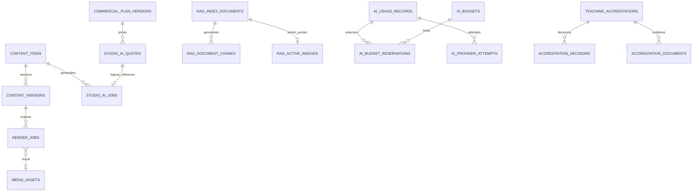

### 7.8. Entidades complementarias para cubrir RF-05–RF-99

La revisión RF por RF del 17/11/2026 detectó datos exigidos por requisitos sin tabla propia. Se añaden aquí con las mismas convenciones de la sección 7. Ninguna introduce módulo, cuenta ni motor nuevos.

| Tabla / módulo | Campos específicos y relaciones | Invariantes, índices y requisito |
|---|---|---|
| `user_consents` / M1 | `user_id FK users`, `purpose text`, `policy_version text`, `channel text`, `granted_at timestamptz`, `revoked_at timestamptz?` | TERMINOS/PRIVACIDAD/COMUNICACIONES; UNIQUE parcial(user_id,purpose,policy_version) WHERE revoked_at IS NULL; registro exige TERMINOS y PRIVACIDAD vigentes; menores además `parental_consents`. RF-01, RF-54, RC-18 |
| `auth_rate_limits` / M1 | Esquema generado por Better Auth para `rateLimit.storage = "database"`: clave, contador y última petición | Una fila por clave de límite; versión ≥1.7.16 corrige la concurrencia en PostgreSQL (seguridad, sección 2). No se usa almacenamiento en memoria (inútil entre isolates) ni `secondaryStorage` |
| `notification_deliveries` / M1 | `user_id uuid`, `channel text`, `template_code text`, `template_version text`, `source_event_id uuid`, `status text`, `provider_message_id text?`, `attempts integer`, `sent_at timestamptz?`, `expires_at timestamptz` | EMAIL/IN_APP; PENDIENTE/ENVIADA/FALLIDA/SUPRIMIDA; UNIQUE(source_event_id,user_id,channel,template_code) evita avisos duplicados; sin cuerpo del mensaje, que se renderiza desde la plantilla. Capacidad transversal de ADR-001 con datos custodiados por M1. RF-30 |
| `support_tickets` / M1 | `requester_id uuid`, `category text`, `subject varchar(200)`, `status text`, `priority text`, `assignee_id uuid?`, `related_ref text?`, `closed_at timestamptz?` | ABIERTA/EN_ATENCION/RESUELTA/CERRADA; índice(status,created_at), índice(requester_id,created_at). RF-32 |
| `support_ticket_events` / M1 | `ticket_id FK support_tickets`, `actor_id uuid`, `event_type text`, `body_redacted varchar(4000)?`, `attachment_key text?` | MENSAJE/CAMBIO_ESTADO/ADJUNTO; INSERT-only; adjuntos en R2 `soporte/` (sección 9.4); sin datos D3 |
| `catalog_areas` / M2 | `code text`, `name text`, `level text`, `parent_id FK catalog_areas?`, `status text` | UNIQUE(code); jerarquía área → carrera/ciclo opcional; RF-05, RF-06, RF-67 |
| `catalog_topics` / M2 | `area_id FK catalog_areas`, `code text`, `name text`, `parent_topic_id FK catalog_topics?`, `status text` | UNIQUE(area_id,code); `topic_code` canónico usado por M3/M4 como referencia lógica |
| `course_topics`, `course_prerequisites` / M2 | `course_id FK courses`, `topic_id FK catalog_topics`, `order_index integer`; `course_id`, `prerequisite_course_id FK courses` | PK(course_id,topic_id); PK(course_id,prerequisite_course_id) con CHECK distintos; `courses` añade `area_id FK catalog_areas`, `career text?`, `cycle smallint?`. RF-05, RF-67 |
| `catalog_state` / M2 | `id smallint`, `version bigint` | PK(id) con CHECK id IN (1,2): 1 = catálogo público, 2 = biblioteca pública; `version` se incrementa en la misma transacción que publica o retira contenido público; autoridad del espacio de nombres de caché de la sección 9.3 |
| `editorial_reviews` / M2 | `content_id`, `version_number integer`, `reviewer_id uuid`, `decision text`, `allow_rag boolean`, `access_scope text`, `license_id FK content_licenses?`, `reason text?`, `decided_at timestamptz` | FK compuesta a content_versions; APROBADA/RECHAZADA/RETIRADA; INSERT-only; la última decisión APROBADA con allow_rag es condición de indexación. RF-41, ADR-026 |
| `content_commercial_agreements` / M2 | `teacher_id uuid`, `content_id FK content_items`, `agreement_version text`, `remuneration_model text`, `terms_ref text`, `valid_from timestamptz`, `valid_until timestamptz?`, `status text` | SIN_REGALIA/REGALIA_POR_USO/PAGO_FIJO; UNIQUE(content_id,agreement_version); vigencias sin solapamiento. RF-46, ADR-029 |
| `content_usage_daily` / M2 | `content_id`, `version_number integer`, `usage_date date`, `usage_type text`, `count bigint` | PK(content_id,version_number,usage_date,usage_type); DESCARGA/VISTA_LICENCIADA; sin user_id. Base de regalías y RF-46 |
| `exam_profiles` / M3 | `code text`, `version integer`, `exam_type text`, `source text`, `source_verified boolean`, `syllabus jsonb`, `structure jsonb`, `duration_minutes integer?`, `scoring_criteria jsonb?`, `status text` | UNIQUE(code,version); ESCOLAR/PREUNIVERSITARIO/ADMISION/UNIVERSITARIO; JSONB validado por esquema `mentelyx.ficha-examen/v1` (temario por área/tema con pesos); publicada inmutable; `source_verified=false` se muestra como referencial. RF-49, RF-51, ADR-030 |
| `learning_goals` / M3 | `student_id uuid`, `goal_source text`, `exam_profile_id FK exam_profiles?`, `exam_profile_version integer?`, `source_refs jsonb?`, `target_date date?`, `weekly_minutes integer?`, `operation_key varchar(100)`, `request_hash text` (SHA-256 hexadecimal), `status text` | goal_source FICHA/PERSONAL/CONVERSACION/FUENTES; FICHA exige ficha y versión; los demás aceptan temas y fuentes propias sin ficha (RF-49); ACTIVO/CUMPLIDO/ABANDONADO; UNIQUE parcial(student_id) WHERE status='ACTIVO'; UNIQUE(student_id,operation_key) para idempotencia. MVP backend actual: PERSONAL/FUENTES |
| `study_plans` / M3 | `goal_id FK learning_goals`, `version integer`, `rule_version text`, `inputs_hash char(64)`, `generated_from jsonb`, `status text` | UNIQUE(goal_id,version); UNIQUE parcial(goal_id) WHERE status='VIGENTE'; VIGENTE/REEMPLAZADO; generación determinista sin LLM (ADR-018). RF-50 |
| `study_plan_items` / M3 | `plan_id FK study_plans`, `item_order integer`, `area_code text`, `topic_code text`, `title varchar(160)`, `activity_type text`, `activity_ref uuid?`, `due_date date?`, `estimated_minutes integer`, `status text`, `completed_at timestamptz?` | UNIQUE(plan_id,item_order); LECCION/PRACTICA/SIMULACRO/REPASO; PENDIENTE/COMPLETADA/OMITIDA; índice(plan_id,status). RF-50, RF-52 |
| `topic_mastery` / M3 | `student_id uuid`, `topic_code text`, `mastery numeric(5,4)`, `evidence_count integer`, `last_attempt_id FK evaluation_attempts?`, `rule_version text` | PK(student_id,topic_code); mastery entre 0 y 1; proyección recalculable desde intentos; nunca se comparte con M7 ni con anunciantes. RF-08, RF-52 |
| `teacher_topics` / M4 | `user_id uuid`, `topic_code text`, `declared_experience varchar(1000)?`, `evidence_status text`, `accreditation_id FK teaching_accreditations?` | PK(user_id,topic_code); DECLARADO/ACREDITADO; ACREDITADO exige credencial aprobada; modalidad LIBRE solo DECLARADO. RF-19, RF-20 |
| `session_recordings` / M4 | `session_id FK live_sessions`, `status text`, `consent_policy_version text`, `raw_storage_key text?`, `stream_video_ref text?`, `retention_until timestamptz?`, `approved_by uuid?` | UNIQUE(session_id); SOLICITADA/AUTORIZADA/GRABANDO/EN_REVISION/PUBLICADA/RETIRADA/PURGADA; GRABANDO exige consentimiento de todos los participantes presentes; desactivada por defecto. RF-45, RF-90, ADR-051 |
| `recording_consents` / M4 | `session_id FK live_sessions`, `participant_id uuid`, `granted_at timestamptz?`, `revoked_at timestamptz?`, `guardian_consent_ref uuid?`, `policy_version text` | PK(session_id,participant_id); un menor exige `guardian_consent_ref` (consentimiento parental de M1, referencia lógica) |
| `refund_requests` / M5 | `order_id FK payment_orders`, `requester_id uuid`, `reason text`, `amount_pen numeric(12,2)`, `policy_version text`, `operation_key text`, `status text`, `provider_refund_ref text?`, `decided_by uuid?`, `decided_at timestamptz?` | UNIQUE(operation_key); SOLICITADO/APROBADO/RECHAZADO/EN_PROCESO/REEMBOLSADO/FALLIDO; Σ reembolsos ≤ amount_pen de la orden, comprobado bajo lock de la orden; los efectos sobre recursos de plan o saldo audiovisual se registran como movimientos (AJUSTE en `resource_ledger_entries` o CIERRE en `audiovisual_ledger_entries`), nunca sobrescribiendo saldos. RF-25 |
| `payment_reconciliations` / M5 | `provider text`, `provider_payout_ref text`, `period_start date`, `period_end date`, `gross_pen`, `fees_pen`, `net_pen` (`numeric(12,2)`), `status text`, `differences jsonb` | UNIQUE(provider,provider_payout_ref); IMPORTADA/CONCILIADA/CON_DIFERENCIAS. RF-86, RF-92, ADR-052 |
| `service_cost_daily` / M5 | `cost_date date`, `service text`, `provider text`, `product_code text`, `units numeric(18,6)`, `unit text`, `cost_usd money?`, `cost_pen money?`, `source text` | PK(cost_date,service,provider,product_code); FACTURA/API_PROVEEDOR/ESTIMADO; alimentada por agregados de M6 y por facturas; sin user_id. RF-44, RF-71, RF-86 |
| `content_royalty_settlements` / M5 | `agreement_ref uuid`, `period_start date`, `period_end date`, `usage_count bigint`, `amount_pen numeric(12,2)`, `status text`, `payment_reference text?` | UNIQUE(agreement_ref,period_start); acuerdo M2 por referencia lógica; inmutable al aprobar. RF-46 |
| `ai_route_configs` / M6 | `version text`, `config jsonb`, `status text`, `approved_by uuid`, `approved_at timestamptz` | UNIQUE(version); UNIQUE parcial(status) WHERE status='ACTIVA' (una sola configuración activa); BORRADOR/ACTIVA/RETIRADA; `config` validado contra `mentelyx.rutas-ia/v1`; activar exige MFA y auditoría; inmutable una vez activada (orquestador, sección 16) |
| `ai_safety_events` / M6 | `user_id uuid`, `usage_id FK ai_usage_records?`, `category text`, `action_taken text`, `is_minor boolean`, `expires_at timestamptz` | MENSAJE_APOYO/RESPUESTA_RETENIDA/BLOQUEO; sin texto ni contexto; índice(category,created_at). Protocolo de riesgo del orquestador, sección 13.3 |
| `ad_placements` / M7 | `code text`, `surface text`, `allowed_plans text[]`, `allowed_for_minors boolean`, `status text` | UNIQUE(code); CHECK surface fuera de EVALUACION/LIVE/STUDIO/PAGOS/LECCION_PAGO; allowed_for_minors falso por defecto. RF-39, RF-40, RF-98 |
| `ad_creatives` / M7 | `campaign_id FK ad_campaigns`, `public_object_key text`, `alt_text varchar(300)`, `target_url text`, `review_status text`, `reviewed_by uuid?` | PENDIENTE/APROBADA/RECHAZADA; solo APROBADA se sirve; target_url HTTPS de dominio aprobado; sin píxeles de terceros. RF-39 |
| `sponsorship_funds` / M7 | `sponsor_id FK sponsors?`, `agreement_ref text`, `amount_pen`, `reserved_pen`, `spent_pen` (`numeric(12,2)`), `valid_from timestamptz`, `valid_until timestamptz`, `status text` | sponsor_id NULL = presupuesto interno autorizado; CHECK reserved_pen + spent_pen ≤ amount_pen. RF-81, ADR-049 |
| `sponsorship_allocations` / M7 | `fund_id FK sponsorship_funds`, `session_ref uuid`, `amount_pen numeric(12,2)`, `operation_key text`, `status text` | UNIQUE(operation_key); RESERVADA/CONSUMIDA/LIBERADA; reserva y saldo del fondo en una transacción M7 mediante los contratos `reservarFinanciamientoAula`/`confirmarFinanciamientoAula`/`liberarFinanciamientoAula` (API, sección 2.8) |

Las clases se pagan directamente al docente (sección 7.9, `direct_payment_records`) y **no** generan `payment_orders`; el código `CLASE_DIRECTA` queda sustituido. No se almacenan datos de tarjeta ni cuentas bancarias de docentes. Los comprobantes se registran en `payment_receipts`, y su emisión depende de la decisión fiscal pendiente.

### 7.9. Entidades de la instrucción maestra (20/11/2026)

Convenciones de la sección 7. Implementación con Drizzle (ADR-075).

**M1 — Perfil académico y edad (RF-100, ADR-089)**

| Tabla | Campos | Invariantes e índices |
|---|---|---|
| `user_academic_profiles` | `user_id uuid PK FK users`, `education_level text`, `birth_date_ciphertext bytea`, `birth_date_iv bytea`, `dek_ciphertext bytea`, `kek_version integer`, `verification_source text`, `verified_at timestamptz?`, `age_condition text`, `condition_changes_at date?`, `recomputed_at timestamptz` | education_level PRIMARIA/SECUNDARIA/PREUNIVERSITARIO/UNIVERSITARIO; verification_source DECLARACION/CONSENTIMIENTO_PARENTAL/DOCUMENTO_VERIFICADO; age_condition MENOR/ADULTO; solo el servicio de edad de M1 lee las columnas cifradas y `condition_changes_at`; `users.is_minor` se proyecta desde `age_condition` en la misma transacción |

**M2 — Espacios, fuentes, biblioteca, cuadernos y lienzos (RF-101, RF-102, RF-106 a RF-111)**

`content_items.item_type` admite además PRIVATE_SOURCE, CANVAS, NOTEBOOK y RESOURCE; se añaden `resource_kind text?` (EJERCICIO_RESUELTO/DIAGRAMA/ILUSTRACION/MODELO_3D/SIMULACION/PLANTILLA/PRESENTACION/DOCUMENTO), `visibility text` (PRIVADO por defecto/COMPARTIDO/PUBLICO/INSTITUCIONAL) y `source_format text?` (PDF/PDF_ESCANEADO/PPTX/DOCX/TXT/MD/IMAGEN).

| Tabla | Campos | Invariantes e índices |
|---|---|---|
| `study_spaces` | `owner_id uuid`, `title varchar(200)`, `education_level text?`, `status text`, `storage_bytes bigint` | ACTIVO/ARCHIVADO/DELETE_PENDING; índice(owner_id,status); storage_bytes ≥0 y controlado contra la cuota `ALMACENAMIENTO_BYTES` de M5 |
| `study_space_sources` | `space_id FK study_spaces`, `content_id FK content_items`, `selected boolean`, `added_at timestamptz` | PK(space_id,content_id); solo contenidos del mismo propietario o compartidos con él |
| `notebooks`, `notebook_items` | `owner_id`, `title`, `status`; `notebook_id FK notebooks`, `content_id FK content_items`, `order_index integer` | Cuadernos como contenedores de lienzos y recursos; PK(notebook_id,content_id) |
| `resource_shares` | `content_id FK content_items`, `grantee_id uuid`, `permission text`, `granted_at timestamptz`, `revoked_at timestamptz?` | LEER/COPIAR; UNIQUE parcial(content_id,grantee_id) WHERE revoked_at IS NULL (BR-06) |
| `resource_publications` | `content_id`, `version_number integer`, `state text`, `provenance jsonb`, `rights_declaration text`, `pii_check text`, `scientific_review text`, `published_by uuid`, `published_at timestamptz`, `withdrawn_at timestamptz?`, `withdraw_reason text?` | FK compuesta a content_versions; PUBLICADO/RETIRADO; pii_check APROBADO para publicar; scientific_review NO_REVISADO/REVISADO (la popularidad no la sustituye); UNIQUE parcial(content_id) WHERE state='PUBLICADO'; prohibido si la versión deriva de fuentes privadas ajenas o de evaluaciones reservadas (BR-12) |
| `resource_rating_votes` | `content_id`, `version_number integer`, `user_id uuid`, `score smallint`, `created_at` | PK(content_id,version_number,user_id); score 1–5 (BR-08) |
| `resource_rating_aggregates` | `content_id`, `version_number`, `votes integer`, `avg_score numeric(4,2)`, `reuse_count bigint`, `adaptation_count bigint`, `refreshed_at` | Proyección recalculable (Kysely); sin datos personales |

`content_usage_daily.usage_type` admite además REUTILIZACION y ADAPTACION.

**M3 — Evaluaciones personalizadas (RF-103 a RF-105, ADR-092)**

`evaluations` añade `origin text` (CATALOGO/PERSONALIZADA/CONVERSACION/FUENTES), `owner_id uuid?`, `mode text` (APRENDIZAJE/EVALUACION), `question_count integer` y `assessment_equivalents integer` = ⌈preguntas/15⌉ según una regla configurable de piloto. `attempt_answers` añade `formative_feedback jsonb?` y `feedback_limitations text?`. La nota oficial solo usa preguntas con `scoring_method` DETERMINISTA o RUBRICA_DOCENTE (sección 8.4).

| Tabla | Campos | Invariantes e índices |
|---|---|---|
| `assessment_generation_requests` | `student_id uuid`, `origin text`, `params jsonb`, `quick boolean`, `operation_key text`, `resource_reservation_key text`, `status text`, `evaluation_id FK evaluations?`, `error_code text?` | UNIQUE(operation_key); quick=true implica al menos 15 preguntas; params validado (cantidad, dificultad, fuentes y temas, tipos, complementos); SOLICITADA/GENERANDO/LISTA/FALLIDA |

**M4 — Tarifas, disponibilidad, declaración Live, grupos y uso audiovisual (RF-21, RF-75, RF-78, RF-115, RF-117)**

| Tabla | Campos | Invariantes e índices |
|---|---|---|
| `teacher_rates` | `user_id uuid`, `modality text`, `hourly_rate_pen numeric(12,2)`, `valid_from timestamptz`, `valid_until timestamptz?` | Tarifa >0; vigencias sin solapamiento por docente y modalidad |
| `teacher_availability_slots` | `user_id uuid`, `starts_at timestamptz`, `ends_at timestamptz`, `recurrence text?`, `timezone text`, `status text` | ends_at > starts_at; índice(user_id,starts_at) |
| `teacher_live_declarations` | `user_id uuid`, `subscription_ref uuid`, `period_start date`, `weekly_hours numeric(5,2)`, `modality text`, `estimated_participants integer`, `schedule jsonb`, `recording_needs text` | UNIQUE(subscription_ref,period_start); datos usados para estimar capacidad, no para cobrar |
| `private_groups` | `owner_teacher_id uuid`, `name varchar(120)`, `description varchar(1000)?`, `max_members integer`, `has_minors boolean`, `status text` | ACTIVO/ARCHIVADO; el propietario debe tener habilitación vigente; has_minors exige controles de menores de M4 |
| `group_members` | `group_id FK private_groups`, `user_id uuid`, `role text`, `joined_at timestamptz`, `removed_at timestamptz?`, `guardian_consent_ref uuid?` | UNIQUE parcial(group_id,user_id) WHERE removed_at IS NULL; MIEMBRO/ASISTENTE; un menor exige guardian_consent_ref |
| `group_invitations` | `group_id FK`, `token_hash char(64)`, `expires_at timestamptz`, `used_at timestamptz?`, `status text` | UNIQUE(token_hash); un solo uso; PENDIENTE/USADA/EXPIRADA/REVOCADA |
| `group_resources` | `group_id FK`, `content_id uuid`, `shared_by uuid`, `shared_at` | PK(group_id,content_id); la lectura exige membresía vigente |
| `session_av_usage` | `session_id FK live_sessions`, `participant_id uuid`, `participant_role text`, `provider_event_id text`, `participant_minutes numeric(12,2)`, `measured_at timestamptz` | UNIQUE(provider_event_id); DOCENTE/ESTUDIANTE (incluye al docente, IM 15.2); origen del evento hacia M5 |

**M5 — Recursos de plan, saldo audiovisual, Culqi, comisiones y pagos directos (RF-14, RF-25, RF-43, RF-74, RF-82, RF-116, RF-118, RF-121, RF-122; ADR-080 a ADR-082)**

| Tabla | Campos | Invariantes e índices |
|---|---|---|
| `plan_resource_limits` | `product_code text`, `policy_version text`, `resource_code text`, `monthly_quantity numeric(18,3)`, `unit text` | PK(product_code,policy_version,resource_code); valores semilla de la IM, secciones 14 y 15.1, como configuración de piloto versionada; resource_code CONSULTA_GENERAL/CONSULTA_TECNICA/RAZONAMIENTO_PROFUNDO/EVALUACION_EQUIVALENTE/ILUSTRACION_ESTANDAR/DOCUMENTO_EQUIVALENTE/ALMACENAMIENTO_BYTES/ALMACENAMIENTO_DOCUMENTAL_BYTES/ALMACENAMIENTO_VIDEO_BYTES/TRANSFERENCIA_AUDIOVISUAL_BYTES |
| `resource_balances` | `user_id uuid`, `period_start date`, `period_end date`, `resource_code text`, `product_code text`, `policy_version text`, `limit_quantity numeric`, `granted_extra numeric`, `reserved numeric`, `consumed numeric`, `row_version bigint` | PK(user_id,period_start,resource_code); CHECK reserved + consumed ≤ limit_quantity + granted_extra y todos ≥0; una fila bloqueada serializa el recurso |
| `resource_ledger_entries` | `user_id`, `period_start`, `resource_code`, `entry_type text`, `quantity numeric`, `operation_key text`, `source_module text`, `source_ref text`, `original_entry_id FK?` | INSERT-only; RESERVA/CONFIRMACION/LIBERACION/CONCESION/REINTEGRO/AJUSTE; UNIQUE(entry_type,operation_key); CONFIRMACION y LIBERACION enlazan la RESERVA original; REINTEGRO enlaza la CONFIRMACION original y usa `operation_key = refund:{operationKey}`. El FK valida existencia; el adaptador valida y asigna el tipo de movimiento esperado. RESERVA, CONFIRMACION y LIBERACION comparten la clave de la operación |
| `resource_grants` | `user_id`, `resource_code`, `quantity numeric`, `source_type text`, `source_ref text`, `period_start date`, `expires_at timestamptz` | UNIQUE(source_type,source_ref,resource_code); RECOMPENSA/PAQUETE/AJUSTE_SOPORTE; se suma a `granted_extra` en la misma transacción |
| `audiovisual_balances` | `subscription_id FK subscriptions`, `teacher_id uuid`, `period_start date`, `period_end date`, `params_version text`, `prepaid_pen numeric(12,2)`, `rate_pen_per_1000_pm numeric(12,4)`, `capacity_pm numeric(14,2)`, `reserved_pm numeric(14,2)`, `consumed_pm numeric(14,2)`, `authorized_overage_pm numeric(14,2)`, `status text`, `row_version bigint` | UNIQUE(subscription_id,period_start); CHECK reserved_pm + consumed_pm ≤ capacity_pm + authorized_overage_pm; VIGENTE/CERRADO/LIQUIDADO; valores de piloto S/45, S/12 y 3 750 (IM 15.3) leídos de la versión de parámetros |
| `audiovisual_ledger_entries` | `balance_id FK`, `entry_type text`, `participant_minutes numeric(14,2)`, `amount_pen numeric(12,4)?`, `session_ref uuid?`, `provider_event_ref text?`, `operation_key text` | INSERT-only; RESERVA_CLASE/LIBERACION/CONSUMO/AMPLIACION/CIERRE; UNIQUE(entry_type,operation_key); avisos al cruzar 70/90/100 % |

**Implementación de M5 (21/11/2026, migración `0002`).** Además de UNIQUE(entry_type, operation_key) y del CHECK de capacidad:

- `rb_periodos_sin_solape_ex`: `EXCLUDE USING gist (user_id WITH =, resource_code WITH =, daterange(period_start, period_end, '[)') WITH &&)` con `btree_gist`. Es la garantía contra periodos superpuestos, también bajo concurrencia; `iniciarPeriodo` la usa como árbitro de `ON CONFLICT` y después comprueba que lo existente sea el mismo periodo (reintento idempotente) o responde `PERIODO_SUPERPUESTO`. No se depende de consultar antes de insertar.
- `rb_coherente_con_libro` y `rle_coherente_con_saldo`: `CONSTRAINT TRIGGER ... DEFERRABLE INITIALLY DEFERRED` que, al COMMIT, exigen reservado = Σ RESERVA − Σ CONFIRMACION − Σ LIBERACION, consumido = Σ CONFIRMACION − Σ REINTEGRO y extra = Σ CONCESION. Una transacción que cambia un saldo sin su movimiento, o al revés, se rechaza entera (SQLSTATE 23000). AJUSTE no tiene efecto definido todavía; cuando lo tenga, la función y `saldoDesdeLibro` cambian juntas.
- Solo el módulo que reservó (`source_module`) puede confirmar, liberar o reintegrar esa clave (`NO_AUTORIZADO` en otro caso).
- Plan Gratuito por defecto: un usuario sin ningún saldo vigente recibe el periodo EST_GRATUITO del mes civil en curso, con el EXCLUDE como árbitro.

**Tablas del MVP del Sprint 03 (migración `0004`).** M2: `study_spaces`, `content_items`, `content_versions` y `study_space_sources` según esta sección; se añaden `content_items.title`, `source_format`, `visibility` y `creation_operation_key` (UNIQUE: idempotencia de la creación) y `content_versions.byte_size`. M6: `rag_index_documents` y `rag_document_chunks` según la sección 14.3, en modo `lexico` (`embedding` nulo); se añade `rag_index_documents.owner_id` (consulta de estado por propietario); `rag_active_indexes` todavía no se crea. `ai_budgets` usa `numeric(18,6)` en lugar de `money`, igual que `costo_usd` en la sección 14.3. `ai_usage_records` implementa el subconjunto vigente (sin `reserved_units` ni `units_consumed`, sustituidos). La migración `0003` crea la extensión `vector` antes de esas tablas.

**Preparación académica M3 (artefactos actuales del árbol de trabajo; no ejecutados).** El esquema Drizzle y la migración `0006` definen `learning_goals`, `study_plans` y `study_plan_items`, con una sola meta `ACTIVO` por estudiante. El `goal_source` implementado se limita a `PERSONAL` y `FUENTES`; las fuentes adicionales representadas en el modelo de diseño y el diagrama no están implementadas en este incremento. Esto describe el estado actual del código y no resuelve la decisión pendiente sobre admitir varias preparaciones. **Actualización 26/11/2026 (migración `0007`, aplicada solo en local):** varias preparaciones con `name` y `subject`; `evaluation_attempts` (por preparación, con versión del banco y proyección), `attempt_answers`, `study_cards` y `card_reviews` en M3; `folders` y `folder_items` en M2; `learning_preferences` en M1. En MongoDB, `question_banks` usa `postgresEvaluationId` = preparación, con validador `$jsonSchema` e índices únicos por versión y operación; el estado de la sesión vive en el mismo documento de `tutor_conversaciones` (misma retención). Sin transacciones distribuidas: el intento guarda la versión del banco con la que se califica.

**Índice HNSW M6 (migración `0005`; no ejecutada en esta auditoría).** La migración añade el índice parcial de pgvector para BGE-M3 descrito en la sección 14.3. Su existencia en el repositorio no acredita que se haya aplicado ni que el plan de consulta use el índice.
| `overage_authorizations` | `balance_id FK`, `requested_pm numeric`, `estimated_pen numeric(12,2)`, `status text`, `authorized_at timestamptz?`, `payment_order_id FK payment_orders?`, `notified_at timestamptz` | SOLICITADA/AUTORIZADA/RECHAZADA/COBRADA; sin AUTORIZADA no se reserva por encima de la capacidad ni se cobra (RF-116) |
| `live_period_closures` | `balance_id FK UNIQUE`, `consumed_pm`, `consumption_pen = consumed_pm × tarifa/1000`, `refund_candidate_pen = máx(0; prepaid_pen − consumption_pen)`, `additional_charge_pen = máx(0; consumption_pen − prepaid_pen)`, `refund_request_id FK refund_requests?`, `status text` | CALCULADO/NOTIFICADO/DEVOLUCION_SOLICITADA/DEVUELTO/SIN_SALDO; sin margen arbitrario sobre la devolución (IM 15.3); el cargo adicional ya autorizado no se vuelve a cobrar |
| `payment_fee_schedules` | `provider text`, `payment_method text`, `currency char(3)`, `operation_type text`, `pct_fee numeric(7,4)`, `fixed_fee numeric(12,4)`, `fixed_fee_currency char(3)`, `min_fee numeric(12,2)?`, `min_fee_threshold numeric(12,2)?`, `tax_treatment text`, `valid_from timestamptz`, `valid_until timestamptz?`, `source_url text`, `verified_at timestamptz`, `contract_ref text?` | Vigencias sin solapamiento por proveedor, medio, operación y moneda; semilla con el tarifario publicado de CulqiOnline (IM 19.1) y la comisión mínima solo en los medios que el contrato confirme |
| `payment_fee_records` | `payment_order_id FK?`, `refund_request_id FK?`, `schedule_id FK payment_fee_schedules`, `estimated_fee_pen numeric(12,4)`, `estimated_fixed_usd numeric(12,4)`, `reconciled_fee_pen numeric(12,4)?`, `reconciliation_id FK payment_reconciliations?` | CHECK exactamente uno de orden o devolución; distingue la comisión estimada de la deducción conciliada (RF-121) |
| `recurrence_authorizations` | `user_id`, `product_code`, `payment_method`, `provider_customer_ref text`, `provider_card_ref text`, `terms_version text`, `authorized_at timestamptz`, `revoked_at timestamptz?`, `status text` | Solo referencias del proveedor, nunca PAN ni CVV; ACTIVA/REVOCADA; renovación automática solo con ACTIVA |
| `payment_receipts` | `payment_order_id FK`, `receipt_type text`, `series_number text?`, `issuer text`, `issued_at timestamptz?`, `storage_key text?`, `status text` | Registro de comprobantes (IM 19.3); la emisión depende de la decisión fiscal pendiente |
| `direct_payment_records` | `reservation_ref uuid`, `session_ref uuid`, `teacher_id uuid`, `payer_id uuid`, `amount_pen numeric(12,2)`, `method text`, `qr_provider text?`, `paid_at timestamptz`, `evidence_key text?`, `status text`, `verified_by uuid?`, `verified_at timestamptz?` | UNIQUE(reservation_ref); method YAPE/TARJETA/QR (IM, sección 15); `qr_provider` identifica el proveedor o medio subyacente de un QR cuando corresponda y CHECK(method = 'QR' OR qr_provider IS NULL); TARJETA solo con integración verificada (sin pagos divididos automáticos de Culqi; bandera `pagosDirectos.tarjetaDocente`); DECLARADO/VERIFICADO/RECHAZADO/CONCILIADO; Mentelyx no custodia el importe (RC-40) |
| `teacher_commissions` | `direct_payment_id FK UNIQUE`, `terms_version text`, `rate_pct numeric(7,4)`, `fixed_pen numeric(12,2)?`, `amount_pen numeric(12,2)`, `status text`, `invoice_ref text?`, `collected_ref text?` | DEVENGADA/FACTURADA/COBRADA/ANULADA; el mecanismo de cobro depende de las condiciones contractuales y fiscales pendientes |

`refund_requests` añade `refund_kind` (TOTAL/PARCIAL), `requested_amount_pen`, `non_recoverable_fee_pen`, `refunded_amount_pen?`, `provider_refund_id?`, `evidence_ref?` y `notified_at?`; no pasa a REEMBOLSADO sin evidencia del proveedor (IM 19.4).

**M6 — BYOK (RF-120, ADR-085)**

| Tabla | Campos | Invariantes e índices |
|---|---|---|
| `byok_providers` | `provider_code text PK`, `status text`, `data_destination text`, `terms_url text`, `verified_at timestamptz` | AUTORIZADO/NO_AUTORIZADO; solo los AUTORIZADOS se ofrecen |
| `byok_credentials` | `user_id uuid`, `provider_code FK byok_providers`, `label varchar(80)`, `key_ciphertext bytea`, `key_iv bytea`, `dek_ciphertext bytea`, `kek_version integer`, `last4 char(4)`, `monthly_budget_usd money?`, `daily_request_limit integer?`, `status text`, `revoked_at timestamptz?` | UNIQUE parcial(user_id,provider_code) WHERE status='ACTIVA'; ACTIVA/REVOCADA; revocar borra `key_ciphertext` y `dek_ciphertext` (borrado criptográfico); exige adulto elegible |

**M7 — Redes publicitarias y recompensas (RF-39, RF-119, ADR-086)**

| Tabla | Campos | Invariantes e índices |
|---|---|---|
| `ad_networks` | `code text PK`, `name text`, `status text`, `supports_server_verification boolean`, `minors_policy text`, `allowed_surfaces text[]`, `contract_ref text?` | EVALUACION/APROBADA/SUSPENDIDA; las recompensas exigen supports_server_verification; minors_policy PROHIBIDO/CONTEXTUAL_COMPATIBLE |
| `ad_reward_offers` | `user_id uuid`, `network_code FK ad_networks`, `surface text`, `nonce_hash char(64)`, `resource_code text`, `quantity numeric`, `expires_at timestamptz`, `status text` | UNIQUE(nonce_hash); OFRECIDA/VERIFICADA/CONCEDIDA/EXPIRADA/RECHAZADA; solo adultos; límites por cuenta y periodo |
| `ad_reward_events` | `network_code`, `network_event_id text`, `offer_id FK ad_reward_offers`, `verification_status text`, `payload_hash char(64)`, `received_at timestamptz` | UNIQUE(network_code,network_event_id); VERIFICADA/RECHAZADA; una VERIFICADA emite `RecompensaVerificada` por outbox hacia M5 |

## 8. Contratos documentales MongoDB

### 8.1. Propiedad, consultas y validadores

UUID se representa como string canónico consistente; fechas reales como BSON Date, no strings de los ejemplos JSON. Validación Mongo `$jsonSchema` con `validationLevel: strict`, `validationAction: error`; payloads especializados se validan además en aplicación con esquemas versionados sin compilación dinámica insegura. El validador de envoltura no sustituye reglas semánticas del motor visual.

**Estado de implementación inspeccionado:** el repositorio M6 consulta `tutor_conversaciones`, filtra por propietario y vigencia, y define índices UNIQUE, de actividad y TTL mediante `asegurarIndicesConversaciones`. No se encontró creación de colecciones con `$jsonSchema` ni implementación de `tutor_conversacion_segmentos`; el módulo M2 tampoco expone un adaptador Mongo en el backend actual. Por tanto, estos validadores y colecciones M2/segmentos son diseño, no implementación verificada.

| Colección / dueño | Campos obligatorios y tipos BSON | Índices / límite |
|---|---|---|
| `lesson_contents` / M2 | `_id objectId`, `postgresContentId string`, `ownerUserId string`, `version int`, `schemaVersion string`, `blocks array<object>`, `contentHash string`, `createdAt date` | UNIQUE(postgresContentId,version); 1 MiB; versiones publicadas no se actualizan |
| `studio_projects` / M2 | Envoltura anterior, `status string`, `format string`, `slides array?`, `documento object?`, `updatedAt date` | UNIQUE(postgresContentId,version); índice(ownerUserId,updatedAt); SLIDES_INTERACTIVE/WHITEBOARD/DOCUMENTO_EDUCATIVO; acceso siempre autorizado SQL |
| `question_banks` / M3 | `_id objectId`, `postgresEvaluationId string`, `evaluationVersion int`, `ownerUserId string`, `schemaVersion string`, `questions array<object>`, `contentHash string`, `createdAt date` | UNIQUE(postgresEvaluationId,evaluationVersion); opciones/soluciones no se envían completas al alumno |
| `plantillas_documento` / M2 | `_id objectId`, `templateId string`, `version int`, `ownerUserId string`, `schemaVersion string`, `status string`, `layout object`, `fonts array<object>`, `licenseRef string`, `contentHash string`, `createdAt date` | UNIQUE(templateId,version); sin HTML/JS ejecutable; licencia de fuentes y autorización de plantilla |
| `tutor_conversaciones` / M6 | `_id objectId`, `conversationId string`, `ownerUserId string`, `schemaVersion string`, `messages array<object>`, `createdAt date`, `updatedAt date`, `expiraEn date`, `deletedAt date?`, `revision long` | UNIQUE(conversationId); (ownerUserId,updatedAt); TTL(expiraEn, expireAfterSeconds=0); máximo 100 mensajes/1 MiB por segmento. El repositorio actual implementa esta colección y sus índices |
| `tutor_conversacion_segmentos` / M6 | `_id objectId`, `conversationId string`, `segment int`, `ownerUserId string`, `messages array<object>`, `expiraEn date` | Diseño para continuación: UNIQUE(conversationId,segment); TTL; segmentar antes del límite, no arrays infinitos; borrado por conversationId. No se encontró implementación actual |

SQL de M2 sigue siendo autoridad de publicación aunque Mongo tenga status PUBLISHED. `visual_scene` referencia esquema `mentelyx.escena/v1`, `scene3d` usa `mentelyx.escena3d/v1`; DOCUMENTO_EDUCATIVO contiene `mentelyx.documento/v1`. SC-05 no introduce cuenta nueva. Guardar una escena Tutor en apuntes crea nueva versión M2, con permiso explícito, procedencia mínima y retención independiente; borrar conversación no borra silenciosamente el apunte conservado conscientemente.

Validador base de una versión de lección (reutilizar envoltura y sustituir propiedades específicas según la tabla; `_id` lo asigna Mongo):

```json
{
  "$jsonSchema": {
    "bsonType": "object",
    "required": ["postgresContentId", "ownerUserId", "version", "schemaVersion", "blocks", "contentHash", "createdAt"],
    "additionalProperties": false,
    "properties": {
      "_id": {"bsonType": "objectId"},
      "postgresContentId": {"bsonType": "string", "pattern": "^[0-9a-f-]{36}$"},
      "ownerUserId": {"bsonType": "string", "pattern": "^[0-9a-f-]{36}$"},
      "version": {"bsonType": "int", "minimum": 1},
      "schemaVersion": {"enum": ["mentelyx.leccion/v1"]},
      "blocks": {"bsonType": "array", "maxItems": 200, "items": {"bsonType": "object", "required": ["type"]}},
      "contentHash": {"bsonType": "string", "pattern": "^[a-f0-9]{64}$"},
      "createdAt": {"bsonType": "date"}
    }
  }
}
```

Validador de conversación (SC-04):

```json
{
  "$jsonSchema": {
    "bsonType": "object",
    "required": ["conversationId", "ownerUserId", "schemaVersion", "messages", "createdAt", "updatedAt", "expiraEn", "revision"],
    "additionalProperties": false,
    "properties": {
      "_id": {"bsonType": "objectId"},
      "conversationId": {"bsonType": "string"},
      "ownerUserId": {"bsonType": "string"},
      "schemaVersion": {"enum": ["mentelyx.conversacion/v1"]},
      "messages": {"bsonType": "array", "maxItems": 100, "items": {
        "bsonType": "object", "required": ["id", "role", "text", "operationKey"],
        "additionalProperties": false,
        "properties": {
          "id": {"bsonType": "string"}, "role": {"enum": ["user", "assistant"]},
          "text": {"bsonType": "string", "maxLength": 24000}, "operationKey": {"bsonType": "string"},
          "scene": {"bsonType": "object"}, "citations": {"bsonType": "array", "maxItems": 16, "items": {"bsonType": "object"}}
        }
      }},
      "createdAt": {"bsonType": "date"}, "updatedAt": {"bsonType": "date"},
      "expiraEn": {"bsonType": "date"}, "deletedAt": {"bsonType": ["date", "null"]},
      "revision": {"bsonType": "long", "minimum": 0}
    }
  }
}
```

Ejemplo JSON de transporte, con fechas convertidas a BSON Date al persistir:

```json
{
  "conversationId": "550e8400-e29b-41d4-a716-446655440001",
  "ownerUserId": "550e8400-e29b-41d4-a716-446655440002",
  "schemaVersion": "mentelyx.conversacion/v1",
  "messages": [{"id": "m1", "role": "user", "text": "Explica la segunda ley de Newton", "operationKey": "tutor:actor:ejemplo-1"}],
  "createdAt": "2026-11-17T15:00:00Z",
  "updatedAt": "2026-11-17T15:00:00Z",
  "expiraEn": "2026-12-17T15:00:00Z",
  "revision": 0
}
```

### 8.2. Retención efectiva

**Retención vigente (ADR-079):** las conversaciones se conservan 90 días desde la última actividad, con aviso 7 días antes (parámetros de piloto, IM, sección 11). El historial no se aplica a pagos ni calificaciones. Siguen como propuestas pendientes de revisión legal: 12 meses para reportes, el periodo más 24 meses para el uso sin contenido y 90 días para los documentos de habilitación. Los 30/14 días anteriores quedan **sustituidos**. El tratamiento de datos reales sigue sujeto a las condiciones legales; las pruebas usan datos sintéticos. TTL no es inmediato y no borra R2 ni índices SQL: filtrar `expiraEn > now`, owner y tombstone en toda lectura; DELETE primero revoca acceso y luego agenda purga idempotente de documentos/segmentos/adjuntos/cachés/índices. No renovar la expiración de una conversación ya vencida. Mongo documenta borrado TTL asíncrono ([consulta 17/11/2026](https://www.mongodb.com/docs/manual/core/index-ttl/)).

### 8.3. Embebidos, referencias, versionado y consultas por colección

**Regla de modelado:** se embebe lo que se lee y se versiona junto (bloques, diapositivas, preguntas, mensajes, escenas resueltas, citas). Se referencia por UUID lo que tiene autoridad SQL o vida propia: el contenido (`postgresContentId`), la evaluación, el propietario y los binarios (`assetId` de `media_assets`, nunca una URL). Todas las escrituras de versiones usan `writeConcern: majority`; las lecturas de versiones publicadas, `readConcern: majority`.

| Colección | Embebidos | Referencias | Versionado | Consultas frecuentes → índice |
|---|---|---|---|---|
| `lesson_contents` | `blocks[]` (≤200) con escenas `mentelyx.escena/v1` por valor | `postgresContentId`, `ownerUserId`, `assetId` | Un documento inmutable por versión | Versión exacta por (postgresContentId, version) → UNIQUE |
| `studio_projects` | `slides[].blocks[]`, `lienzo` (pizarra) o `documento` (`mentelyx.documento/v1`) | Ídem; `scene3d.assetId` | Cada `PUT` con `If-Match: "v{n}"` crea la versión n+1 inmutable (STORED); publicar no copia. Se conservan todas las PUBLISHED y las 20 últimas no publicadas por proyecto; el resto se purga | Versión exacta → UNIQUE; mis proyectos recientes → (ownerUserId, updatedAt) |
| `question_banks` | `questions[]` con `options[]`, `correctOptionId` y `solution` | `postgresEvaluationId`, `topicCode` | Inmutable por versión de evaluación | Banco de la versión → UNIQUE. La proyección al alumno excluye `correctOptionId` y `solution` en el servidor |
| `plantillas_documento` | `layout`, `fonts[]` | `licenseRef`, `fonts[].assetId` | Inmutable por versión | Plantilla exacta → UNIQUE(templateId, version); catálogo → filtro `status` (colección pequeña, sin índice adicional) |
| `tutor_conversaciones` | `messages[]` (≤100) con escena resuelta y citas por valor | `ownerUserId`, adjuntos por clave R2 | Mutable con `revision` optimista; `$push` condicionado a `revision` | Mis conversaciones vigentes → (ownerUserId, updatedAt) con filtro `expiraEn > ahora` y `deletedAt` nulo; una conversación → UNIQUE(conversationId) más comprobación de propietario |
| `tutor_conversacion_segmentos` | `messages[]` (≤100) | `conversationId`, `ownerUserId` | Append-only por segmento | Segmento → UNIQUE(conversationId, segment); purga → borrado por conversationId |

Validadores de las colecciones restantes. Las propiedades especializadas (`slides`, `documento`, `solution`, `layout`) se validan además en la aplicación con su esquema `mentelyx.*` precompilado:

```json
{
  "studio_projects": {"$jsonSchema": {
    "bsonType": "object",
    "required": ["postgresContentId", "ownerUserId", "version", "schemaVersion", "status", "format", "contentHash", "createdAt", "updatedAt"],
    "additionalProperties": false,
    "properties": {
      "_id": {"bsonType": "objectId"},
      "postgresContentId": {"bsonType": "string", "pattern": "^[0-9a-f-]{36}$"},
      "ownerUserId": {"bsonType": "string", "pattern": "^[0-9a-f-]{36}$"},
      "version": {"bsonType": "int", "minimum": 1},
      "schemaVersion": {"enum": ["mentelyx.studio/v1"]},
      "status": {"enum": ["STORED", "PUBLISHED", "RETIRED"]},
      "format": {"enum": ["SLIDES_INTERACTIVE", "WHITEBOARD", "DOCUMENTO_EDUCATIVO"]},
      "slides": {"bsonType": "array", "maxItems": 200, "items": {"bsonType": "object", "required": ["slideId", "order", "blocks"]}},
      "lienzo": {"bsonType": "object"},
      "documento": {"bsonType": "object"},
      "contentHash": {"bsonType": "string", "pattern": "^[a-f0-9]{64}$"},
      "createdAt": {"bsonType": "date"},
      "updatedAt": {"bsonType": "date"}
    }
  }},
  "question_banks": {"$jsonSchema": {
    "bsonType": "object",
    "required": ["postgresEvaluationId", "evaluationVersion", "ownerUserId", "schemaVersion", "questions", "contentHash", "createdAt"],
    "additionalProperties": false,
    "properties": {
      "_id": {"bsonType": "objectId"},
      "postgresEvaluationId": {"bsonType": "string", "pattern": "^[0-9a-f-]{36}$"},
      "evaluationVersion": {"bsonType": "int", "minimum": 1},
      "ownerUserId": {"bsonType": "string", "pattern": "^[0-9a-f-]{36}$"},
      "schemaVersion": {"enum": ["mentelyx.banco/v1"]},
      "level": {"enum": ["PRIMARIA", "SECUNDARIA", "PREUNI", "UNIVERSITARIO"]},
      "questions": {"bsonType": "array", "minItems": 1, "maxItems": 500, "items": {
        "bsonType": "object",
        "required": ["questionId", "type", "stemMarkdown", "points"],
        "properties": {
          "questionId": {"bsonType": "string"},
          "type": {"enum": ["MULTIPLE_CHOICE_DETERMINISTIC", "NUMERIC", "SHORT_TEXT_RUBRIC", "DEFINICION", "ABIERTA", "COMPLETAR", "RELACIONAR", "VERDADERO_FALSO", "PROBLEMA"]},
          "scoringMethod": {"enum": ["DETERMINISTA", "RUBRICA_DOCENTE", "FORMATIVA_IA"]},
          "stemMarkdown": {"bsonType": "string", "maxLength": 8000},
          "options": {"bsonType": "array", "maxItems": 10},
          "correctOptionId": {"bsonType": "string"},
          "solution": {"bsonType": "object"},
          "topicCode": {"bsonType": "string"},
          "points": {"bsonType": ["double", "int"], "minimum": 0}
        }
      }},
      "contentHash": {"bsonType": "string", "pattern": "^[a-f0-9]{64}$"},
      "createdAt": {"bsonType": "date"}
    }
  }},
  "plantillas_documento": {"$jsonSchema": {
    "bsonType": "object",
    "required": ["templateId", "version", "ownerUserId", "schemaVersion", "status", "layout", "fonts", "licenseRef", "contentHash", "createdAt"],
    "additionalProperties": false,
    "properties": {
      "_id": {"bsonType": "objectId"},
      "templateId": {"bsonType": "string"},
      "version": {"bsonType": "int", "minimum": 1},
      "ownerUserId": {"bsonType": "string", "pattern": "^[0-9a-f-]{36}$"},
      "schemaVersion": {"enum": ["mentelyx.plantilla/v1"]},
      "status": {"enum": ["DRAFT", "PUBLISHED", "RETIRED"]},
      "layout": {"bsonType": "object"},
      "fonts": {"bsonType": "array", "maxItems": 8, "items": {"bsonType": "object", "required": ["family", "assetId", "licenseRef"]}},
      "licenseRef": {"bsonType": "string"},
      "contentHash": {"bsonType": "string", "pattern": "^[a-f0-9]{64}$"},
      "createdAt": {"bsonType": "date"}
    }
  }},
  "tutor_conversacion_segmentos": {"$jsonSchema": {
    "bsonType": "object",
    "required": ["conversationId", "segment", "ownerUserId", "messages", "expiraEn"],
    "additionalProperties": false,
    "properties": {
      "_id": {"bsonType": "objectId"},
      "conversationId": {"bsonType": "string"},
      "segment": {"bsonType": "int", "minimum": 1},
      "ownerUserId": {"bsonType": "string"},
      "messages": {"bsonType": "array", "maxItems": 100, "items": {"bsonType": "object", "required": ["id", "role", "text", "operationKey"]}},
      "expiraEn": {"bsonType": "date"}
    }
  }}
}
```

Los ejemplos de las secciones 4.1 y 4.2 son de la v1.0: al persistir llevan además `schemaVersion`, `contentHash` y fechas BSON, según estos validadores.

### 8.4. Colecciones de la instrucción maestra (lienzos y biblioteca)

| Colección / dueño | Campos obligatorios | Índices / límites |
|---|---|---|
| `lienzos` / M2 | `canvasId string` (= `content_items.id`), `ownerUserId`, `schemaVersion: mentelyx.lienzo/v1`, `background` (PUNTOS/CUADRICULA), `layers[]` ({layerId, kind ORIGINAL/USUARIO/IA, locked}), `frames[]` (páginas o marcos opcionales), `revision long`, `createdAt`, `updatedAt` | UNIQUE(canvasId); documento ligero; los elementos van aparte |
| `lienzo_elementos` / M2 | `canvasId`, `elementId`, `layerId`, `kind` (TRAZO/RESALTADO/FLECHA/CONECTOR/TEXTO/FORMULA/IMAGEN/ESCENA/MODELO_3D/EJERCICIO/ANOTACION), `bbox` {x, y, w, h} en coordenadas de mundo independientes del zoom, `center [x, y]`, `payload` (escena `mentelyx.escena/v1`, puntos de trazo comprimidos o referencia a asset), `authorKind` (ORIGINAL/USUARIO/IA), `revision long`, `deleted boolean`, `updatedAt` | UNIQUE(canvasId,elementId); índice `2d` sobre `center` para cargar por región y resolver selecciones; ≤1 MiB por elemento; la IA solo escribe en la capa IA |
| `lienzo_operaciones` / M2 | `canvasId`, `seq long`, `opId` (UUID del cliente), `actorId`, `type` (CREAR/MODIFICAR/MOVER/BORRAR/AGRUPAR), `elementIds[]`, `baseRevision`, `patch`, `createdAt` | UNIQUE(canvasId,seq), UNIQUE(canvasId,opId) para idempotencia; base de deshacer, rehacer y recuperación; retención configurable (500 operaciones o 30 días como valor de piloto) |
| `recursos_biblioteca` / M2 | `resourceId` (= `content_items.id`), `version int`, `schemaVersion: mentelyx.recurso/v1`, `kind`, `body`, `parameters` (esquema de una plantilla paramétrica), `explanation`, `contentHash`, `createdAt` | UNIQUE(resourceId,version); inmutable por versión; una plantilla determinista se reparametriza sin invocar un modelo |

`question_banks` añade `origin` (CATALOGO/PERSONALIZADA/CONVERSACION/FUENTES), `generatedFrom` (referencias a fuentes o conversación) y `scoringMethod` por pregunta. `tutor_conversaciones` calcula `expiraEn` = última actividad + 90 días y `avisoEn` = `expiraEn` − 7 días.

## 9. Redis y objetos privados R2

### 9.1. Claves adicionales y revocación

Todas las claves incluyen entorno/versión de política; hash de actor/IP mediante HMAC de servicio para no exponerlos. TTL indicados son valores iniciales de diseño. Escrituras de rate limit se hacen atómicamente con TTL, nunca GET+SET separados.

| Clave (SC-13) | Valor / TTL | Invalidez / caída |
|---|---|---|
| `rl:ai:{actorHash}:{route}:{window}` | contador / 60 s | Límite de tasa; simultaneidad/cupo real SQL. Si Redis cae, control SQL conservador; sin control fiable denegar nueva IA |
| `cb:ai:{route}:{version}` | fallos, openedAt / 60 s; apertura 30 s | Una sonda; restaurar gradualmente. No llamar masivamente al reiniciar |
| `cache:m6:emb:q:{model}:{dim}:{policy}:{ownerHash}:{queryHmac}` | vector / 600 s | Solo consultas adultas cuya política permita caché; no D2/menores por defecto; sin texto. SHA de pregunta solo no evita diccionario/fuga entre usuarios |
| `ai:budget:{scope}:{period}` | copia de métrica / 30 s | Solo panel; nunca admitir desde esta copia |
| `cache:m2:catalog:{level}:{page}:{version}` | catálogo público / 300 s ±10 % jitter | Invalidar tras commit de publicación/retiro mediante outbox; no incluir recursos privados |
| `cache:m3:eval_meta:{evalId}:v{ver}` | metadatos públicos mínimos / 1800 s | Sin respuestas, notas ni soluciones; permisos se comprueban en SQL |

No hay caché de sesión/permisos válida sin comprobación de revocación. `lock:worker:idx` es optimización, liberada solo con token de dueño; lease SQL/UNIQUE y estado son autoridad ante caducidad del lock Redis. Ante estampida, una carga por clave, espera acotada y límite de acceso a SQL; no servir stale privado.

### 9.2. R2 (SC-14)

| Espacio / prefijo | Propietario y contenido | Ciclo de vida |
|---|---|---|
| Privado general, `tutor/adjuntos/{owner}/{conversation}/` | M6, imágenes de ejercicios saneadas | Igual que conversación; borrar EXIF y temporales; nunca público |
| `rag/extract/{content}/v{version}/` | M6, extracción derivada autorizada | Revocación bloquea lectura inmediata; purga con origen; regenerable |
| `studio/ai/{owner}/{job}/` | M2, entrada temporal y resultado | Entrada expira tras trabajo/conciliación según política aprobada; resultado retenido solo si se convierte en versión |
| `studio/3d/{owner}/{asset}/` | M2, glTF/GLB y miniaturas | Validar referencias, tamaño, licencia; no descargar URLs elegidas por el modelo |
| `materiales/{owner}/{project}/v{version}/{job}` | M2, PDF/PPTX por audiencia | Versión vigente mientras exista proyecto; 90 días versiones antiguas es hipótesis; reconstruir con renderer/versiones conservados |
| Bucket D3 separado, `habilitacion/{request}/{asset}` | M4, documentación personal/académica | Binding/credenciales exclusivas M4; acceso administrativo auditado; retención legal pendiente; M6/render sin acceso |

Subida: registrar intención SQL → PUT temporal limitado → verificar MIME real/tamaño/hash/antimalware → LISTO o cuarentena. Referencias nunca contienen nombre personal. Enlaces firmados 300 s de materiales son capacidades reutilizables hasta caducar; no afirmar revocación inmediata de una URL ya emitida. D3 y recursos con revocación estricta pasan por descarga autenticada, con `private, no-store`; CORS no autoriza por sí mismo. Límites de diseño: adjunto Tutor 10 MiB, original documental 25 MiB, PDF 25 MB/PPTX 50 MB según contrato especializado; exceso requiere flujo explícito, no buffers ilimitados. [R2: URLs prefirmadas, 17/11/2026](https://developers.cloudflare.com/r2/api/s3/presigned-urls/).

### 9.3. Catálogo consolidado de Redis (sustituye la tabla de la sección 5)

**Despliegue:** dos bases Upstash por entorno. `mentelyx-{entorno}-cache` tiene la evicción activada y solo guarda caché. `mentelyx-{entorno}-control` no tiene evicción y guarda límites y circuitos, siempre con TTL. Así una evicción no debilita la protección. El prefijo real incluye el entorno (`{env}:`). Las IP y los actores se representan con HMAC-SHA256 y una clave de servicio rotada. Cliente: `@upstash/redis` por REST, con timeout de 200 ms.

| Clave | Base / tipo | Valor | TTL | Invalidación | Si Redis falla |
|---|---|---|---|---|---|
| `rl:ip:{ipHmac}:{route}:{window}` | control / STRING | contador | 60 s | Expira | Límite del borde (WAF) y límite SQL de Better Auth; AuthN sigue en SQL |
| `rl:ai:{actorHmac}:{route}:{window}` | control / STRING | contador | 60 s | Expira | Simultaneidad y cupo en SQL; sin control fiable no se admite IA nueva |
| `cb:ai:{route}:{version}` | control / HASH | `fallos`, `abiertoEn`, `estado` | 60 s; abierto 30 s | Sonda única al semiabrir | Circuito local por isolate, conservador |
| `lock:worker:idx:{indexId}` | control / STRING | token del dueño | 120 s | `DEL` solo con el token (script) | Lease SQL y UNIQUE siguen siendo la garantía |
| `cache:m2:catalog:v` | cache / STRING | copia de `m2_contents.catalog_state.version` (fila única SQL incrementada en la transacción de publicar o retirar) | 60 s | El consumidor del outbox la sobrescribe; si falta, se lee de SQL. Nunca se reinicia por `INCR`, así una evicción no reutiliza versiones antiguas | Lectura SQL paginada |
| `cache:m2:catalog:{catv}:{level}:{area}:{topic}:{page}` | cache / STRING | JSON de fichas públicas | 300 s ± 10 % | Cambio de `catv`; no se borra por patrón | Ídem |
| `cache:m3:eval_meta:{evalId}:v{ver}` | cache / STRING | JSON de metadatos públicos | 1800 s | Inmutable por versión | Lectura SQL |
| `cache:m6:emb:q:{model}:{dim}:{policy}:{ownerHmac}:{queryHmac}` | cache / STRING | vector float32 en base64 | 600 s | Cambio de modelo, dimensión o política en la clave | Se recalcula el embedding (con costo) o se usa el modo léxico |
| `ai:budget:{scope}:{period}` | cache / HASH | copia de `reserved_usd`/`spent_usd` | 30 s | Expira | El panel lee SQL; nunca admite desde aquí |

Los contadores se incrementan con un script atómico (`INCR` y `PEXPIRE` en el mismo `EVAL`). Nunca se usa `GET` seguido de `SET`. No hay claves de sesión, permisos, saldos, cupos, cotizaciones ni texto de usuarios. Las claves de la sección 5 quedan sustituidas: `rl:ip:{ip}` pasa a HMAC y `lock:worker:idx` se indexa por generación.

### 9.4. Buckets, metadatos, permisos y ciclo de vida de R2

| Bucket | Prefijos (sección 9.2 y nuevos) | Acceso | Ciclo de vida |
|---|---|---|---|
| `mentelyx-{entorno}-privado` | M2: `contenidos/{contentId}/v{version}/{assetId}`, `apuntes/{ownerId}/{noteId}/v{version}/{assetId}`, `studio/ai/`, `studio/3d/`, `materiales/`, `tmp/subidas/{intentId}`. M6: `tutor/adjuntos/`, `rag/extract/`. M1: `soporte/{ticketId}/{assetId}` | Binding solo del Worker de API y de los consumidores de colas; cada adaptador de módulo usa solo su prefijo; descarga por URL prefirmada de 300 s o proxy autenticado; CORS limitado a `app.<dominio>` y PUT/GET | Regla de ciclo de vida: `tmp/subidas/` 24 h. El resto se borra por purga dirigida (`deletion_steps`) o por la retención de su clase |
| `mentelyx-{entorno}-m4-restringido` | M4: `habilitacion/{requestId}/{assetId}` (D3), `grabaciones/{sessionId}/{recordingId}` (original hasta su revisión) | Credencial y binding inyectados solo en el adaptador M4 en la raíz de composición, con regla de lint que prohíbe su importación fuera de M4; sin URL prefirmadas; descarga autenticada auditada, `private, no-store` | Purga dirigida; retención legal pendiente (PEND-02). La transferencia de una grabación aprobada a Bunny Stream solo procede si se satisfacen las condiciones de ADR-014 y ADR-051; de lo contrario no se presupone publicación ni purga del original |
| `mentelyx-{entorno}-publico` | M7: `publicidad/{campaignId}/{assetId}.{ext}` (solo creatividades APROBADAS) | Lectura pública por dominio propio `media.<dominio>`; escritura solo por el adaptador M7 | Borrado al retirar la campaña; claves con hash, `public, max-age=31536000, immutable` |
| `mentelyx-prod-respaldos` | `sql/{fecha}/`, `mongo/{fecha}/`, `r2/{bucket}/{fecha}/` | Credencial propia del trabajo de respaldo (solo escritura) y rol de restauración (solo lectura); sin binding en la API | 30 días (SQL y Mongo lógico) y 35 días (copias R2), según la sección 11 |

**Objetos y metadatos.** Tipos admitidos por prefijo: PDF, PNG, JPEG, WebP, SVG saneado, GLB, PPTX, MP4 o WebM (grabaciones) y JSON (extracciones). El MIME real se verifica antes de pasar a LISTO. Cada objeto lleva los metadatos personalizados `owner-module`, `data-class` (D0–D3), `sha256`, `retention-class` y `schema` (cuando es un documento) y los HTTP `Content-Type` y `Content-Disposition`. Ni nombres personales ni correos en claves ni metadatos.

**Versionado y eliminación.** No se depende del versionado del bucket: la versión forma parte de la clave y ningún objeto se sobrescribe. Una nueva versión crea una clave nueva. Eliminar significa revocar primero en SQL y purgar después la clave con `deletion_steps`, de forma idempotente. Los respaldos vencidos se borran por su regla de ciclo de vida. **Riesgo aceptado:** `mentelyx-prod-respaldos` está en el mismo proveedor que los originales. Se reconsidera y se añade una copia en otro proveedor si una evaluación de riesgos o un contrato exige tolerar la pérdida de la cuenta de Cloudflare (ADR, sección 10).

### 9.5. Prefijos y claves añadidos por la instrucción maestra

| Almacén | Clave o prefijo | Dueño y regla |
|---|---|---|
| R2 privado | `fuentes/{ownerId}/{spaceId}/{contentId}/v{version}/{assetId}` | M2; originales de fuentes privadas; extracción y OCR en `rag/extract/` |
| R2 privado | `lienzos/{ownerId}/{canvasId}/assets/{assetId}` y `lienzos/{ownerId}/{canvasId}/exportaciones/{jobId}.pdf` | M2; recortes e imágenes del lienzo; exportación de regiones a PDF |
| R2 privado | `biblioteca/{resourceId}/v{version}/{assetId}` | M2; los recursos públicos se sirven con URL firmada de 300 s. El retiro impide emitir nuevas URL; las ya emitidas siguen siendo válidas hasta expirar, como se indica en §9.2 |
| R2 privado | `pagos/comprobantes/{orderId}/{receiptId}` y `pagos/evidencias/{directPaymentId}/{assetId}` | M5; acceso auditado; sin datos de tarjeta |
| Redis control | `rl:reward:{actorHmac}:{window}` | M7; límite de ofertas recompensadas por cuenta |
| Redis cache | `cache:m2:biblioteca:{libv}:{kind}:{level}:{page}` | M2; solo recursos PUBLICADOS; `libv` es la copia de `catalog_state` id 2 |

## 10. Transacciones, consultas y reparación

### 10.1. Protocolos entre almacenes/módulos

| Operación | Orden y atomicidad | Reparación / idempotencia |
|---|---|---|
| Publicar versión M2 | SQL crea PENDING y clave; Mongo inserta versión inmutable con UNIQUE y hash; verificar objetos LISTO; SQL cambia STORED→PUBLISHED, puntero actual, licencia y outbox en una transacción | Si Mongo falla, no publicar. Si falla commit SQL, repetir con misma clave/hash. Barrido de PENDING y huérfanos >24 h; no eliminar versión referenciada |
| Indexar RAG | Consumir outbox; revalidar permiso M2; crear generación SC-02; generar chunks; verificar cantidad/hash; activar puntero y estados en una transacción M6 | Duplicado encuentra generación; generación incompleta no consultable. Revocación invalida M2 inmediatamente y M6 por evento ≤60 s como objetivo; revalidación antes de modelo y entrega |
| Reserva de clase y capacidad | M4 crea HOLD y reserva el asiento en SQL; el pago directo se registra y verifica en M5; antes de iniciar, M5 reserva la capacidad audiovisual con `reservarCapacidadAudiovisual`; M4 confirma la reserva y emite outbox | Saga por operación; si falla el paso final, se consulta M5 y se confirma o libera una sola vez; sustituye el débito de créditos LIVE |
| Generación Studio | M2 guarda la entrada y crea el trabajo PAYMENT_PENDING; M5 consume la cotización y reserva el recurso de plan; M2 marca PENDIENTE y emite outbox; M6 ejecuta una vez | Una caída entre pasos se resuelve consultando M5 con la misma clave, sin cotizar de nuevo. M6 persiste el resultado privado antes del evento; M2 crea el borrador; una falla imputable genera un REINTEGRO del recurso |
| PDF/PPTX | Resolver versión y audiencia autorizadas; job+outbox; render a key única; verificar bytes; SQL asset LISTO y job LISTO en commit | Timeout tras PUT: HEAD/hash y misma clave; no publicar objeto incompleto. No tratar cancelación como pérdida de costo ya incurrido |
| Pago/webhook (CulqiOnline) | Cargo creado en el servidor con token de Culqi → consulta del estado real del cargo → inbox, estado, `payment_fee_records`, derechos, `resource_balances` o `audiovisual_balances` y outbox en una transacción M5 | Evento repetido no duplica; incierto sigue pendiente hasta consultar al proveedor; nunca se reintenta el cobro con clave nueva |
| Borrar/revocar | Módulo dueño deniega acceso y registra tombstone/outbox en SQL; M1 coordina eliminación | Reintentos por store; no declarar eliminación física completada por TTL ni borrar auditabilidad financiera exigida |

Locks y consultas son **diseño**, no pruebas ejecutadas. READ COMMITTED con bloqueos explícitos y UNIQUE para saldo/cupo/cotización; orden determinista evita deadlocks. Reintentar transacción abortada como máximo 3 veces con misma clave; SERIALIZABLE solo donde la invariancia requiera predicados y con reintento de serialization_failure. No bloquear SQL mientras se espera un proveedor.

### 10.2. Consultas de referencia

```sql
-- Cupo local M4: comprobar fila devuelta; crear reserva HOLD en esta misma transacción.
UPDATE m4_classes.live_sessions
SET reserved_seats = reserved_seats + 1, row_version = row_version + 1
WHERE id = :session_id AND status = 'SCHEDULED'
  AND reserved_seats < max_capacity
RETURNING id;

-- Recurso de plan M5: deduplicar la operación antes; ledger (RESERVA) y saldo comparten COMMIT.
UPDATE m5_billing.resource_balances
SET reserved = reserved + :cantidad, row_version = row_version + 1
WHERE user_id = :actor AND period_start = :periodo AND resource_code = :recurso
  AND reserved + consumed + :cantidad <= limit_quantity + granted_extra
RETURNING reserved;

-- Outbox: consumidores coordinados por locks; marca enviada solo después de aceptación de cola.
SELECT id FROM m2_contents.outbox_events
WHERE status = 'PENDING' AND next_retry_at <= now()
ORDER BY next_retry_at FOR UPDATE SKIP LOCKED LIMIT 100;
```

`:cantidad` debe ser no negativa y venir de la cotización o de la regla de la operación, nunca del cliente. Repetir la reserva sin deduplicar antes del UPDATE duplicaría cupos: UNIQUE de reserva e incremento se ejecutan en la misma transacción y todo rollback revierte ambos.

RAG: obtener conjunto consultable **desde M2**, acotado/paginado por contexto; no aceptar IDs de cliente como autorización. Filtrar puntero activo, versión, modelo y ACL antes de rankear; FTS GIN y HNSW separado, RRF k=60 y revalidación final como especializado sección 10. EXPLAIN ANALYZE con filtros selectivos debe comprobar si se utiliza HNSW; CTE materializada/ventanas pueden forzar scan exacto, por lo que no se promete uso del índice por escribir `ORDER BY`. Si falla el permiso, `503`; sin fragmentos, el orquestador decide GENERAL o MIXTA y solo devuelve `SIN_CONTEXTO` con fuentes exclusivas (ADR-078; la redacción «GENERAL no habilitado» queda sustituida). Paginación keyset por `(created_at,id)` en listados; parámetros SQL y proyecciones explícitas.

### 10.3. Protocolos de la instrucción maestra

| Operación | Orden y atomicidad | Reparación / idempotencia |
|---|---|---|
| Consumo de recurso de plan (Tutor, evaluación, ilustración, documento) | M6, M3 o M2 llaman a `reservarRecursoPlan(actor, recurso, cantidad, operationKey)`: M5 bloquea la fila de `resource_balances`, inserta RESERVA y hace COMMIT. Después M6 admite contra `ai_budgets` y ejecuta. Al terminar llama a `confirmarRecursoPlan` o a `liberarRecursoPlan` | Misma clave, mismo efecto; un resultado incierto mantiene la reserva hasta conciliar; una falla imputable genera REINTEGRO; la clave también enlaza `ai_usage_records` |
| Concesión de recompensa | M7 verifica el evento con la red, guarda `ad_reward_events` VERIFICADA y emite `RecompensaVerificada` por outbox; M5 (inbox) inserta `resource_grants`, CONCESION y actualiza `granted_extra` en una transacción | UNIQUE(source_type,source_ref,resource_code) impide la doble concesión; un evento no verificado no concede nada |
| Docente Live | Pago verificado → `audiovisual_balances` VIGENTE. Antes de cada clase, RESERVA_CLASE por la estimación. Los eventos del SFU entran en `session_av_usage` (M4) y se emiten por outbox. M5 registra CONSUMO, libera la reserva sobrante y avisa al 70/90/100 %. El exceso solo se reserva con `overage_authorizations` AUTORIZADA. Al cerrar el periodo, `live_period_closures` calcula la devolución y M5 solicita la devolución parcial a Culqi | Eventos deduplicados por `provider_event_id`; una devolución queda SOLICITADA hasta la evidencia del proveedor; no hay doble cobro de capacidad financiada |
| Renovación | Recurrente: un trabajo por periodo cobra con la autorización ACTIVA y la misma clave de periodo. Manual: aviso y orden nueva | Una sola orden por periodo y producto; sin autorización ACTIVA no hay cargo automático |
| Pago directo al docente | M4 crea el HOLD → el estudiante declara el pago y el docente lo confirma → M5 guarda `direct_payment_records` VERIFICADO → M4 confirma la reserva → M5 devenga `teacher_commissions` | UNIQUE(reservation_ref); conciliación periódica; sin custodia de dinero |
| Publicación y retiro de recurso | M2 comprueba derechos, PII y BR-12; inserta `resource_publications` PUBLICADO, incrementa `catalog_state` 2 y emite `RecursoPublicado`; M6 indexa con ámbito PUBLICO. El retiro pasa a RETIRADO y emite `RecursoRetirado`; M6 revoca en ≤60 s y purga | Sin publicación sin acción explícita del propietario; el retiro invalida cachés y embeddings |
| Guardado del lienzo | El cliente envía operaciones con `opId` y `baseRevision`; M2 aplica por elemento con control de `revision` y añade a `lienzo_operaciones` | Un conflicto devuelve el estado del servidor (`409`); las contribuciones de IA nunca modifican la capa USUARIO |
| Eliminación por 90 días | Un trabajo diario avisa al llegar a `avisoEn`; al vencer `expiraEn` se revoca el acceso y se crean `deletion_steps` para segmentos, adjuntos, cachés y escenas transitorias | Los recursos, lienzos y evaluaciones guardados expresamente tienen finalidad independiente y se conservan |

## 11. Migraciones, respaldo y recuperación

**Expand-contract con Drizzle Kit (ADR-075):** las migraciones se generan y versionan con Drizzle Kit y se ejecutan desde un trabajo de CI; añadir tablas/campos opcionales e índices; escribir versión nueva y mantener lector compatible; backfill por lotes con checkpoint/hash; validar NOT NULL/FK; conmutar lectores/punteros; retirar antiguo solo tras ventana de reversión y prueba de restauración. Índices concurrentes fuera de transacción cuando PostgreSQL lo requiera. No cambiar tipo vector en sitio. Mongo lee vN/vN−1 y publica nuevas versiones, sin editar documentos históricos. Rollback aplicativo usa estructura expandida; no deshacer pagos ni ledgers con down migration destructiva.

| Clase | Objetivo de diseño (no medido) | Copia / reconstrucción |
|---|---|---|
| SQL crítico | RPO ≤15 min; RTO ≤2 h | PITR contratado con ventana objetivo 7 días, copia lógica cifrada diaria 30 días en espacio independiente; confirmar capacidades/costo antes de datos reales |
| Mongo contenido confirmado | RPO ≤1 h; RTO ≤4 h | Backup continuo/snapshot con esa frecuencia en plan compatible; copia exportable diaria y versiones inmutables; Free no presume PITR |
| R2 originales | RPO ≤24 h; RTO ≤8 h | Inventario diario y copia independiente de originales/versiones con checksums; no confundir durabilidad administrada con backup frente a borrado |
| RAG/exportaciones derivadas | RPO = versión fuente recuperada; RTO ≤24 h | Reconstrucción limitada por presupuesto, sin reenviar datos prohibidos a proveedor |
| Redis | Sin RPO de negocio; recuperación objetivo ≤30 min | Vaciar/recalentar con límites; sesiones/cuotas/saldos no se recuperan de Redis |

Metas por clase no prometen 99,5 % extremo a extremo; si plan/costo no las cumple, cambiar objetivo mediante decisión explícita antes del piloto. Ninguna copia de producción se restaura en desarrollo.

**Runbook trimestral EQ-21:** congelar escrituras/consumidores; escoger instante SQL/Mongo coherente por manifiesto de publicaciones; restaurar a entorno aislado; aplicar tombstones posteriores desde diario de supresión protegido; revocar sesiones/tokens; cotejar conteos/checksums, FK, ledger=saldos, cupos y versiones/objetos; reconciliar con pasarela antes de reabrir economía; reconstruir derivados; drenar outbox/inbox con deduplicación; comprobar acceso denegado a borrados; apertura gradual autorizada. Registrar timestamps y RTO/RPO observados, pérdidas y excepciones. Restaurar SQL no revierte cobros ya hechos fuera del sistema. Copias vencidas se purgan y las retenciones legales se documentan por clase.

## 12. Trazabilidad y límites de validación

SC-01–SC-17 se resuelven en el [contrato de coordinación](../contrato-coordinacion-datos-seguridad-infraestructura.md). Base: ADR-006/019/023/026/031/035/041/043/048/052/054/055; AC-01/02/03/04/06/10/11; EQ-01/03/04/06/10/11/15/20/21/24/27/29/30/31; RF-42/44/58/59/62/68/74–85/94/96/99. Este documento define estructura e invariantes; no acredita ejecución SQL, validación BSON real, conectividad ni restauraciones. Las condiciones legales y benchmarks se registran en el [avance](../../00-gestion-del-proyecto/sprint-02/avance-cierre-arquitectonico-sprint-02.md).

## 13. Matriz de asignación de almacenamiento por módulo

Asignación **decidida**, no recomendación, actualizada a la instrucción maestra del 20/11/2026 (IM, sección 5.3). El módulo propietario es el del encabezado de cada subsección: ningún otro módulo escribe en sus almacenes. Abreviaturas: **R** relacional (PostgreSQL con Drizzle), **D** documental (MongoDB), **V** vectorial (`pgvector`, BGE-M3 de 1024 dimensiones), **T** temporal (Redis), **O** objetos (R2; el streaming de video usa Bunny Stream como primera opción condicionada por ADR-014). «Propuesta» en la retención significa que el plazo sigue sujeto a revisión legal (sección 13.8). El acceso desde otros módulos siempre pasa por la API pública `index.ts` ([API, sección 2.8](02-diseño-de-api-y-contratos.md)) o por eventos con outbox.

### 13.1. M1 — Usuarios y Administración (`m1_users`)

| Entidad / información | Motor | Ubicación física | Modelo de datos | Fuente de verdad | Relaciones y referencias | Justificación | Retención | Acceso desde otros módulos |
|---|---|---|---|---|---|---|---|---|
| Cuentas, roles y permisos | R | `users`, `user_roles`, `user_permissions` | Filas normalizadas; permiso con `scope` y `decision_id` | PostgreSQL M1 | 1:N roles y permisos; `user_id` es referencia lógica en M2–M7 | UNIQUE de correo, `authz_version` y revocación transaccional | Vida de la cuenta; la supresión purga PII y conserva solo registros legales anonimizados (propuesta) | `obtenerUsuarioAutenticado`, `verificarPermiso` |
| Perfil académico y edad | R | `user_academic_profiles` | Nivel educativo; fecha de nacimiento cifrada; condición derivada | PostgreSQL M1 | 1:1 con `users`; `is_minor` es una proyección | RF-100, ADR-089: condición actualizable y fecha nunca pública | Vida de la cuenta | Solo la condición MENOR/ADULTO y el nivel educativo, por contrato |
| Autenticación | R | `user_sessions`, `auth_accounts`, `auth_verifications`, `auth_two_factors`, `auth_rate_limits` | Esquema de Better Auth integrado en Drizzle | PostgreSQL M1 | N:1 con `users` | Sesión revocable consultada en cada petición | Sesión: hasta su expiración absoluta más 30 días | Ninguno |
| Consentimientos | R | `user_consents`, `parental_consents` | Fila por finalidad y versión | PostgreSQL M1 | M4 referencia el parental de forma lógica | Evidencia de base jurídica | Vida de la cuenta más plazo de prueba (propuesta) | M4 consulta la vigencia por contrato |
| Auditoría y supresión | R | `audit_logs`, `deletion_requests`, `deletion_steps` | INSERT-only; pasos idempotentes | PostgreSQL M1 | Eventos `AuditoriaRegistrada` y `SupresionSolicitada` | Trazabilidad sin transacciones entre módulos | Auditoría 24 meses (propuesta) | Solo por eventos |
| Avisos | R | `notification_deliveries` | Registro de entrega sin cuerpo | PostgreSQL M1 | `source_event_id` | Deduplicación (RF-30): avisos de 90 días, 70/90/100 % y devoluciones | 90 días (propuesta) | M2–M7 publican eventos |
| Soporte | R + O | `support_tickets`, `support_ticket_events`; R2 `privado/soporte/` | Ticket y eventos INSERT-only | PostgreSQL M1 | Adjuntos por clave | RF-32 | 24 meses tras el cierre (propuesta) | Ninguno |
| Límite de tasa del borde | T | `rl:ip:*` | Contador con TTL | No autoritativo | — | Absorber abuso | 60 s | Ninguno |

### 13.2. M2 — Cursos y Contenidos / Studio (`m2_contents`)

| Entidad / información | Motor | Ubicación física | Modelo de datos | Fuente de verdad | Relaciones y referencias | Justificación | Retención | Acceso desde otros módulos |
|---|---|---|---|---|---|---|---|---|
| Taxonomía y catálogo | R | `catalog_areas`, `catalog_topics`, `courses`, `course_topics`, `course_prerequisites`, `catalog_state` | Jerarquía normalizada | PostgreSQL M2 | `topic_code` lógico en M3/M4 | RF-05/67 | Permanente con retiro lógico | `consultarTemarioVersionado` |
| Metadatos y versiones | R | `content_items`, `content_versions` | Versión con `content_hash`, estado y visibilidad | **PostgreSQL M2** | Versión → documento Mongo y/o R2 | Publicación atómica (sección 10.1) | Publicadas mientras se referencien; no publicadas: las 20 últimas | `verificarLicenciaYAcceso`, `obtenerFuenteVersionada` |
| Espacios y fuentes privadas | R + O | `study_spaces`, `study_space_sources`, `content_items` PRIVATE_SOURCE; R2 `privado/fuentes/` | Espacio → fuentes seleccionadas | PostgreSQL M2 (permisos) + R2 (bytes) | M6 indexa por generación | RF-101/102, ADR-090 | Hasta que el usuario las elimine; almacenamiento por plan | `listarRecursosConsultables`, `obtenerFuenteParaIndexar` |
| Biblioteca reutilizable | R + D + O | `content_items` RESOURCE, `resource_publications`, `resource_shares`, `resource_rating_votes`, `resource_rating_aggregates`; Mongo `recursos_biblioteca`; R2 `privado/biblioteca/` | Recurso versionado con visibilidad y procedencia | PostgreSQL M2 (estado) + MongoDB (cuerpo) | M6 busca, recupera y adapta | BR-01–BR-12, ADR-084 | Ciclo propio, independiente del historial (BR-10); retiro con revocación | `buscarRecursosBiblioteca`, `obtenerRecursoAutorizado` |
| Lienzos y cuadernos | D + R + O | `content_items` CANVAS y NOTEBOOK, `notebooks`, `notebook_items`; Mongo `lienzos`, `lienzo_elementos`, `lienzo_operaciones`; R2 `privado/lienzos/` | Elementos por capa con coordenadas de mundo y revisión | MongoDB M2 (contenido) + PostgreSQL M2 (propiedad) | Lienzo ↔ conversación solo por referencia | RF-106–RF-108, ADR-083 | Ciclo propio, independiente del chat | `obtenerSeleccionLienzo` (M6, solo lo seleccionado) |
| Cuerpo pedagógico y Studio | D | `lesson_contents`, `studio_projects`, `plantillas_documento` | Documento inmutable por versión | **MongoDB M2** | `postgresContentId` + `version` | ADR-023/035 | Igual que su versión SQL | Solo a través de M2 |
| Licencias, revisión editorial y acuerdos | R | `content_licenses`, `editorial_reviews`, `content_commercial_agreements`, `content_usage_daily` | Vigencias y decisiones INSERT-only | PostgreSQL M2 | FK compuesta a la versión | ADR-026, RF-41/46 | Vigencia más plazo contractual | M6 y M5 por contrato o evento |
| Archivos, exportaciones y trabajos | R + O | `media_assets`, `render_jobs`, `studio_ai_jobs`, `studio_ai_inputs`; R2 `privado/` (`contenidos/`, `apuntes/`, `studio/`, `materiales/`) | Registro SQL por objeto inmutable | PostgreSQL M2 + R2 | Trabajo → versión → asset | Idempotencia (SC-06/16) | Exportaciones no vigentes 90 días (hipótesis) | `ObtenerDescargaUseCase`; M6 por cola |
| Caché de catálogo y biblioteca pública | T | `cache:m2:catalog:*`, `cache:m2:biblioteca:*` | JSON por versión | No autoritativo | `catalog_state` 1 y 2 | Lecturas públicas | 300 s | Ninguno |

### 13.3. M3 — Evaluaciones y Aprendizaje (`m3_evaluations`)

| Entidad / información | Motor | Ubicación física | Modelo de datos | Fuente de verdad | Relaciones y referencias | Justificación | Retención | Acceso desde otros módulos |
|---|---|---|---|---|---|---|---|---|
| Evaluaciones y fichas | R | `evaluations`, `exam_profiles` | Versión inmutable; origen, modo y equivalentes | PostgreSQL M3 | Evaluación → ficha opcional → banco | ADR-030/092; RF-49 sin ficha obligatoria | Permanente; las personales siguen la cuenta | `consultarRestriccionesTutor` (M6) |
| Generación de evaluaciones | R | `assessment_generation_requests` | Solicitud idempotente con parámetros | PostgreSQL M3 | → M6 por cola; → evaluación | RF-103/104 | Vida de la cuenta | M6 por cola `mentelyx-evaluaciones` |
| Bancos de preguntas | D | `question_banks` | Preguntas versionadas con tipo y método de calificación | MongoDB M3 | `postgresEvaluationId` + versión | Siete tipos (RF-105) | Igual que la evaluación | Ninguno; no se vectorizan los reservados |
| Intentos y respuestas | R | `evaluation_attempts`, `attempt_answers` | Respuesta con `revision` y retroalimentación formativa | **PostgreSQL M3** (RF-96) | Intento → versión | Nota oficial reproducible | Historial académico, vida de la cuenta (propuesta) | `consultarProgresoAutorizado` |
| Progreso, dominio y planes | R | `student_progress`, `topic_mastery`, `learning_goals`, `study_plans`, `study_plan_items` | Proyecciones; objetivo con o sin ficha | PostgreSQL M3 | Objetivo → ficha o fuentes | ADR-018/030 | Vida de la cuenta (propuesta) | M6 lee el resumen; M7 nunca |

### 13.4. M4 — Docentes y Clases (`m4_classes`)

| Entidad / información | Motor | Ubicación física | Modelo de datos | Fuente de verdad | Relaciones y referencias | Justificación | Retención | Acceso desde otros módulos |
|---|---|---|---|---|---|---|---|---|
| Perfiles, temas, tarifas y disponibilidad | R | `teacher_profiles`, `teacher_topics`, `teacher_rates`, `teacher_availability_slots` | Tarifa por hora versionada | PostgreSQL M4 | 1:1 con la cuenta | RF-19–RF-21 | Vida del perfil | Perfil público por API |
| Expedientes de habilitación | R + O | `teaching_accreditations`, `accreditation_decisions`, `accreditation_documents`; R2 `m4-restringido/habilitacion/` | Tres procesos separados | PostgreSQL M4 | Solicitud → documentos y decisiones | Datos D3 aislados | Documentos 90 días tras la decisión (propuesta) | M4 comunica decisiones a M1; nunca M6 |
| Clases, reservas y asistencia | R | `live_sessions`, `session_reservations`, `session_attendance_logs` | Cupo con CHECK; precio por hora | PostgreSQL M4 | Reserva ↔ pago directo M5; sesión ↔ reserva de capacidad M5 | RF-22–RF-24, RF-75–RF-77 | Plazo contable (propuesta) | M5 por saga; M6 por `buscarOfertasTutoria` |
| Declaración Live y uso audiovisual | R | `teacher_live_declarations`, `session_av_usage` | Participante-minutos por evento del proveedor | PostgreSQL M4 (medición) | → M5 por cola `mentelyx-audiovisual` | RF-78/115 | Periodo más plazo contable | Eventos hacia M5 |
| Grupos privados | R | `private_groups`, `group_members`, `group_invitations`, `group_resources` | Membresía con roles | PostgreSQL M4 | Grupo → sesiones y recursos | RF-117, ADR-087 | Vida del grupo; la salida revoca el acceso | `verificarMembresiaGrupo` (M2, M6) |
| Grabaciones y consentimientos | R + O | `session_recordings`, `recording_consents`; R2 `m4-restringido/grabaciones/`; Bunny Stream solo si se habilita conforme a ADR-014/051 | Consentimiento por participante | PostgreSQL M4 | Consentimiento parental de M1 | RF-45/90 | Según política (propuesta) | Ninguno |

### 13.5. M5 — Suscripciones y Pagos (`m5_billing`)

| Entidad / información | Motor | Ubicación física | Modelo de datos | Fuente de verdad | Relaciones y referencias | Justificación | Retención | Acceso desde otros módulos |
|---|---|---|---|---|---|---|---|---|
| Catálogo comercial y límites | R | `commercial_plan_versions`, `plan_resource_limits` | Versión inmutable y matriz normalizada | PostgreSQL M5 | Suscripción → versión → límites | ADR-080: matriz aprobada (IM 14 y 15) como configuración de piloto | Permanente | `consultarDerechosPlan` |
| Recursos de plan | R | `resource_balances`, `resource_ledger_entries`, `resource_grants`, `studio_ai_quotes` | Saldo por periodo y recurso; ledger INSERT-only | **PostgreSQL M5** | Movimiento ↔ operación de M2, M3 o M6 por clave | Cuota comercial separada del consumo técnico (IM 6) | Plazo contable | `reservarRecursoPlan`, `confirmarRecursoPlan`, `liberarRecursoPlan`, `reintegrarRecursoPlan` |
| Saldo audiovisual docente | R | `audiovisual_balances`, `audiovisual_ledger_entries`, `overage_authorizations`, `live_period_closures` | Capacidad en participante-minutos; cierre con fórmula de devolución | **PostgreSQL M5** | Balance → suscripción DOC_LIVE; consumo ← M4 | ADR-081 (IM 15.2 y 15.3) | Plazo contable | `reservarCapacidadAudiovisual`, `liberarCapacidadAudiovisual` (M4) |
| Pagos CulqiOnline | R | `payment_orders`, `processed_webhooks`, `recurrence_authorizations`, `payment_fee_schedules`, `payment_fee_records`, `payment_receipts`, `refund_requests`, `payment_reconciliations` | Máquina de estados idempotente; comisiones versionadas | **PostgreSQL M5** | Orden → webhooks, comisiones, comprobantes y devoluciones | ADR-082 (IM 19) | Plazo legal contable y tributario (propuesta) | Eventos `PagoAprobado` y `DevolucionCompletada` |
| Pagos directos y comisiones | R + O | `direct_payment_records`, `teacher_commissions`, `content_royalty_settlements`; R2 `privado/pagos/evidencias/` | Registro verificado sin custodia | PostgreSQL M5 | Pago ↔ reserva M4 | ADR-081 (IM 15; P-09) | Plazo contable | `registrarPagoDirecto` (M4) |
| Derechos y costos | R | `subscriptions`, `product_entitlements`, `service_cost_daily` | Vigencias; agregados sin usuario | PostgreSQL M5 | — | RF-13, RF-44 | Plazo contable / 24 meses (propuesta) | Contratos de derecho; panel |

**Sustituidas, no se crean:** `credit_lots`, `credit_balances`, `credit_ledger_entries`, `teacher_settlements` y `settlement_items` (créditos Live y Studio y liquidación por crédito).

### 13.6. M6 — Tutor IA y RAG (`m6_ai_tutor`)

| Entidad / información | Motor | Ubicación física | Modelo de datos | Fuente de verdad | Relaciones y referencias | Justificación | Retención | Acceso desde otros módulos |
|---|---|---|---|---|---|---|---|---|
| Índice RAG | V + R | `rag_index_documents`, `rag_active_indexes`, `rag_document_chunks` | Generaciones, puntero activo, `vector(1024)` y `tsvector` | **Derivado**; la fuente es M2 | Fragmento → generación → versión M2 | Filtro ACL y búsqueda en la misma consulta (sección 14) | Mientras la versión esté autorizada; revocación ≤60 s; purga <24 h | Ninguno |
| Conversaciones del Tutor | D + O | `tutor_conversaciones` (actual); `tutor_conversacion_segmentos` (diseño futuro); R2 `privado/tutor/adjuntos/` | Mensajes embebidos, máximo 100 por conversación en el repositorio actual; TTL | MongoDB M6 | Referencias a lienzos y recursos, sin copiarlos | Lectura conjunta | **90 días desde la última actividad, con aviso 7 días antes** (ADR-079) | Ninguno |
| Consumo técnico, presupuestos y costos | R | `ai_usage_records`, `ai_budgets`, `ai_budget_reservations`, `ai_provider_attempts`, `ai_rate_cards` | Consumo por intento; tarifas históricas | **PostgreSQL M6** | Operación ↔ reserva de M5 por clave | Separación de cuotas M5 y consumo M6 | Periodo más 24 meses | Agregados hacia M5 |
| BYOK | R | `byok_providers`, `byok_credentials` | Credencial cifrada en sobre | PostgreSQL M6 | Credencial → usuario adulto elegible | ADR-085 | Hasta la revocación (borrado criptográfico) | Ninguno; nunca se devuelve la clave |
| Calidad, seguridad y rutas | R | `ai_quality_reports`, `ai_safety_events`, `ai_route_configs` | Sin texto original | PostgreSQL M6 | Reporte o evento → operación | AC-11 | 12 meses (propuesta); configuraciones permanentes | Panel |
| Extracciones y OCR | O | R2 `privado/rag/extract/` | JSON derivado por versión | Derivado de M2 | `content/v{version}` | Evita extraer de nuevo | Igual que el índice | Ninguno |
| Controles y caché IA | T | `rl:ai:*`, `cb:ai:*`, `cache:m6:emb:q:*`, `ai:budget:*` | Contador, hash, vector y copia | No autoritativo | — | Latencia y protección | 30–600 s | Ninguno |

### 13.7. M7 — Publicidad y Patrocinios (`m7_advertising`)

| Entidad / información | Motor | Ubicación física | Modelo de datos | Fuente de verdad | Relaciones y referencias | Justificación | Retención | Acceso desde otros módulos |
|---|---|---|---|---|---|---|---|---|
| Redes y recompensas | R | `ad_networks`, `ad_reward_offers`, `ad_reward_events` | Oferta con *nonce*; evento verificado | PostgreSQL M7 | Evento verificado → concesión en M5 | ADR-086; IM 16 | Plazo contable de la recompensa (propuesta) | Evento `RecompensaVerificada` hacia M5 |
| Patrocinadores y fondos | R | `sponsors`, `sponsorship_funds`, `sponsorship_allocations` | Saldo con CHECK | PostgreSQL M7 | Asignación → sesión M4 | Patrocinio opcional (RF-81) | Vigencia más plazo contable | Contratos de financiamiento (M4) |
| Campañas, ubicaciones y creatividades | R + O | `ad_campaigns`, `ad_placements`, `ad_creatives`; R2 `publico/publicidad/` | Superficies prohibidas por CHECK | PostgreSQL M7 | Creatividad → campaña | RF-40/98 | Campaña más 12 meses | `SeleccionarAnuncioUseCase` |
| Métricas agregadas | R | `ad_aggregated_metrics` | Contadores diarios sin usuario | PostgreSQL M7 | Campaña y ubicación | Sin perfilado (RF-98) | 24 meses (propuesta) | Panel |

### 13.8. Transversal y comportamiento seguro de desarrollo

| Entidad / información | Motor | Ubicación física | Fuente de verdad | Retención | Regla |
|---|---|---|---|---|---|
| Outbox e inbox | R | `outbox_events` e `inbox_events` en el esquema de cada módulo | Productor y consumidor | Outbox publicado: 30 días; inbox: 90 días | Efecto y marca DONE en la misma transacción |
| Respaldos | O | `mentelyx-prod-respaldos` | Copia | Sección 11 | Restauración con reaplicación de *tombstones* |

Hasta satisfacer las condiciones legales y contractuales, se aplican las banderas de la [ADR, sección 10.4](../../01-analisis-de-sistema/07-decisiones-arquitectonicas.md):
- desarrollo y *staging* solo con datos sintéticos;
- historial con la política de 90 días;
- documentos de habilitación sintéticos y grabación desactivada;
- rutas externas desactivadas y BYOK simulado;
- anuncios recompensados desactivados para menores;
- pagos y devoluciones en el sandbox de Culqi o con el adaptador simulado.

Las retenciones marcadas como «propuesta» son parámetros versionados en `policy_version`.

## 14. Diseño vectorial definitivo (BGE-M3, 1024 dimensiones)

Los algoritmos de extracción, fragmentación y recuperación están en [RAG](../diseño-especializado/02-diseño-rag.md) y su flujo en la sección 3 de ese documento. Esta sección fija el contrato de datos (ADR-076, IM 7). **Sustituye** el diseño anterior con `gemini-embedding-2` y `vector(1536)`.

### 14.1. Qué se vectoriza y qué no (IM, sección 7.2)

| Se vectoriza, dentro de sus permisos | No se vectoriza |
|---|---|
| Lecciones autorizadas | Bancos privados de evaluación |
| Libros y documentos cuyo tratamiento esté permitido | Soluciones de exámenes activos |
| Ejercicios de práctica publicados y ejercicios resueltos autorizados | Credenciales, incluidas las BYOK |
| Materiales educativos de Studio | Datos financieros |
| Transcripciones preparadas y autorizadas | Información sensible no autorizada y documentos D3 |
| Metadatos y explicaciones de recursos reutilizables de la biblioteca | Conversaciones personales completas |
| Fuentes privadas del estudiante, en su ámbito PRIVADO | — |

Las consultas pueden generar embeddings temporales (caché de 600 s) sin incorporarse a ninguna biblioteca. La recuperación semántica está diseñada para adultos y menores, porque Workers AI no retiene ni entrena con el contenido; el tratamiento real de datos de menores sigue bloqueado hasta cumplir las condiciones legales y contractuales. Almacenamiento, uso privado, publicación, indexación RAG y entrenamiento son derechos separados.

### 14.2. Modelo, dimensión, métrica e índice

| Elemento | Decisión |
|---|---|
| Modelo | BGE-M3 en Workers AI (ADR-076); identificador exacto comprobado en PR-INF-01 |
| Dimensión | 1024; columna `vector(1024)`. El adaptador rechaza cualquier vector de otra dimensión |
| Normalización y perfil | L2 en la aplicación; el perfil se define en la ruta `embeddings` de `ai_route_configs`. Un cambio de perfil crea un `embedding_model` nuevo con su propio índice parcial |
| Métrica | Coseno, operador `<=>`, `vector_cosine_ops` |
| Índice | HNSW parcial por espacio vectorial, `m = 16`, `ef_construction = 64`; consulta con `hnsw.ef_search = 100` e `hnsw.iterative_scan = relaxed_order` (pgvector ≥0.8.0) |
| Texto | `tsvector` con configuración `spanish` e índice GIN; fusión RRF k = 60 y MMR λ = 0,7 |
| Umbral | τ = 0,40 de partida, **experimental**, no validado; se recalibra con BP-07 |

### 14.3. Esquema físico (diseño; definido en Drizzle y consultado con Kysely)

```sql
CREATE EXTENSION IF NOT EXISTS vector;  -- ≥ 0.8.0; comprobar extversion en PR-INF-01

CREATE TABLE m6_ai_tutor.rag_index_documents (
  id               uuid PRIMARY KEY,
  document_id      uuid        NOT NULL,
  version          integer     NOT NULL CHECK (version > 0),
  scope            text        NOT NULL CHECK (scope IN ('CATALOGO','LICENCIA','PRIVADO','COMPARTIDO','PUBLICO')),
  estado           text        NOT NULL CHECK (estado IN ('SOLICITADO','EXTRAYENDO','FRAGMENTANDO','EMBEDDING',
                                 'LISTO','ACTIVO','FALLIDO','REVOCADO','REEMPLAZADO','PURGADO')),
  etapa_completada text,
  intentos         integer     NOT NULL DEFAULT 0 CHECK (intentos >= 0),
  error_code       text,
  chunker_version  text        NOT NULL,
  embedding_model  text        NOT NULL,          -- 'bge-m3' o 'lexico'
  generation       integer     NOT NULL CHECK (generation > 0),
  chunks_total     integer     CHECK (chunks_total >= 0),
  costo_usd        numeric(18,6) CHECK (costo_usd >= 0),
  access_version   bigint      NOT NULL,
  solicitado_en    timestamptz NOT NULL DEFAULT now(),
  vigente_desde    timestamptz,
  revocado_en      timestamptz,
  created_at       timestamptz NOT NULL DEFAULT now(),
  updated_at       timestamptz NOT NULL DEFAULT now(),
  UNIQUE (document_id, version, embedding_model, chunker_version, generation),
  UNIQUE (document_id, id),
  UNIQUE (id, document_id, version, embedding_model, chunker_version)
);
CREATE INDEX rag_index_estado ON m6_ai_tutor.rag_index_documents (estado, solicitado_en);

CREATE TABLE m6_ai_tutor.rag_active_indexes (
  document_id    uuid PRIMARY KEY,
  index_id       uuid NOT NULL UNIQUE,
  access_version bigint NOT NULL,
  updated_at     timestamptz NOT NULL DEFAULT now(),
  FOREIGN KEY (document_id, index_id) REFERENCES m6_ai_tutor.rag_index_documents (document_id, id)
);

CREATE TABLE m6_ai_tutor.rag_document_chunks (
  id              uuid PRIMARY KEY,
  index_id        uuid NOT NULL,
  document_id     uuid NOT NULL,
  version         integer NOT NULL,
  chunk_index     integer NOT NULL CHECK (chunk_index >= 0),
  scope           text NOT NULL CHECK (scope IN ('CATALOGO','LICENCIA','PRIVADO','COMPARTIDO','PUBLICO')),
  owner_id        uuid,
  course_id       uuid,
  level           text,
  estado          text NOT NULL CHECK (estado IN ('ACTIVO','REEMPLAZADO','REVOCADO')),
  vigente         boolean NOT NULL DEFAULT false,
  texto           text NOT NULL,
  ancla           jsonb NOT NULL,                   -- {bloqueId, pagina, diapositiva, seccion}
  titulo          varchar(300) NOT NULL,
  tokens          integer NOT NULL CHECK (tokens >= 0),
  content_hash    char(64) NOT NULL,
  chunker_version text NOT NULL,
  embedding_model text NOT NULL,
  idioma          varchar(8) NOT NULL DEFAULT 'es',
  senal_inyeccion boolean NOT NULL DEFAULT false,
  embedding       vector(1024),
  tsv             tsvector GENERATED ALWAYS AS (to_tsvector('spanish'::regconfig, texto)) STORED,
  created_at      timestamptz NOT NULL DEFAULT now(),
  UNIQUE (index_id, chunk_index),
  CONSTRAINT privado_con_propietario CHECK (scope <> 'PRIVADO' OR owner_id IS NOT NULL),
  CONSTRAINT vector_segun_modelo CHECK ((embedding_model = 'lexico') = (embedding IS NULL)),
  FOREIGN KEY (index_id, document_id, version, embedding_model, chunker_version)
    REFERENCES m6_ai_tutor.rag_index_documents (id, document_id, version, embedding_model, chunker_version)
);
CREATE INDEX rag_chunks_tsv     ON m6_ai_tutor.rag_document_chunks USING gin (tsv);
CREATE INDEX rag_chunks_doc     ON m6_ai_tutor.rag_document_chunks (document_id, estado);
CREATE INDEX rag_chunks_privado ON m6_ai_tutor.rag_document_chunks (owner_id) WHERE scope = 'PRIVADO';
CREATE INDEX rag_chunks_hnsw_bgem3_1024 ON m6_ai_tutor.rag_document_chunks
  USING hnsw (embedding vector_cosine_ops) WITH (m = 16, ef_construction = 64)
  WHERE embedding_model = 'bge-m3' AND embedding IS NOT NULL;
```

Es diseño, no una migración ejecutada. En Drizzle se declara con el tipo `vector({ dimensions: 1024 })` y los índices se crean `CONCURRENTLY` en migraciones de Drizzle Kit sobre tablas con datos.

### 14.4. Metadatos, versiones, acceso directo y autorización

- **Metadatos por fragmento:** ámbito, propietario, curso, nivel, versión, ancla (bloque, página, diapositiva y sección), título, tokens, idioma, `content_hash`, `chunker_version`, `embedding_model` y señal de inyección. Son copias de metadatos de M2, que sigue siendo la autoridad.
- **Acceso directo:** una página, diapositiva o fragmento seleccionado se recupera por `ancla` y versión dentro del conjunto autorizado, sin búsqueda semántica (RF-102).
- **Autorización:**
  1. M2 entrega el conjunto consultable (fuentes propias, recursos compartidos con el actor, catálogo y biblioteca pública, materiales de grupos de los que es miembro).
  2. El filtro SQL se aplica antes del ranking.
  3. Antes del modelo y antes de la entrega se revalida cada documento con M2 y se compara `access_version`.
  4. Un índice atrasado nunca concede permiso.

### 14.5. Reindexación, revocación y consistencia

| Evento | Efecto en el índice |
|---|---|
| Nueva versión publicada o fuente actualizada | Nueva generación; conmutación atómica del puntero tras revalidar; la anterior pasa a `REEMPLAZADO` y se purga a los 7 días |
| Cambio de modelo o de *chunker* | Generaciones paralelas con su propio índice HNSW parcial; nunca `ALTER` del tipo vector |
| Revocación, retiro de un recurso de la biblioteca, salida de un grupo o pérdida de licencia | `REVOCADO` en ≤60 s; la revalidación protege mientras tanto; purga física en <24 h; `PURGADO` conserva metadatos |
| Fuente privada eliminada | Igual que una revocación, para su propietario |
| Restauración | El índice se reconstruye desde las versiones restauradas y se reaplican los *tombstones* |

La conciliación diaria comprueba cada puntero activo contra M2 (estado, `access_version`, número de fragmentos y una muestra de `content_hash`). El costo de reindexación se reserva antes de invocar BGE-M3.

## 15. Diagramas por módulo y esquema documental

Formato editable del repositorio: Mermaid. Reflejan el modelo vigente al 20/11/2026; las entidades sustituidas (créditos y liquidación por crédito) ya no aparecen. Las líneas entre módulos no son FK (sección 7). El flujo de vectorización está en [RAG, sección 3](../diseño-especializado/02-diseño-rag.md) y las secuencias de pagos, recompensas, BYOK, evaluaciones, grupos y consumo audiovisual en [API, sección 10](02-diseño-de-api-y-contratos.md).

### 15.1. M1 — Usuarios y Administración

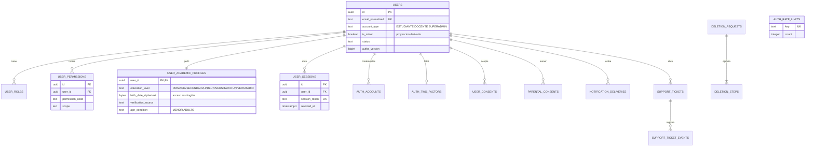

### 15.2. M2 — Cursos y Contenidos / Studio

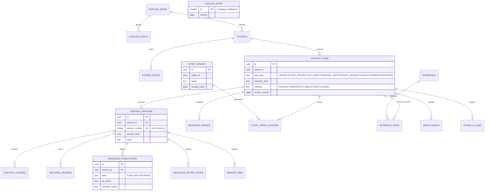

### 15.3. M3 — Evaluaciones y Aprendizaje

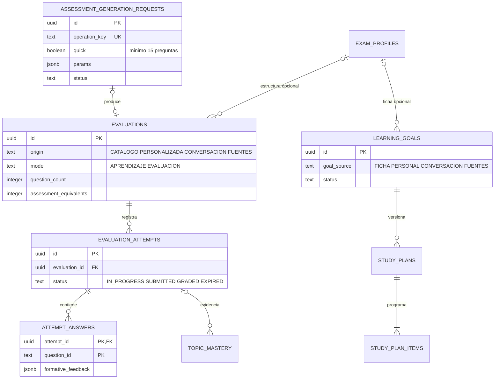

### 15.4. M4 — Docentes y Clases

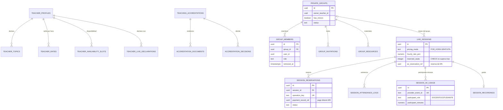

### 15.5. M5 — Suscripciones y Pagos

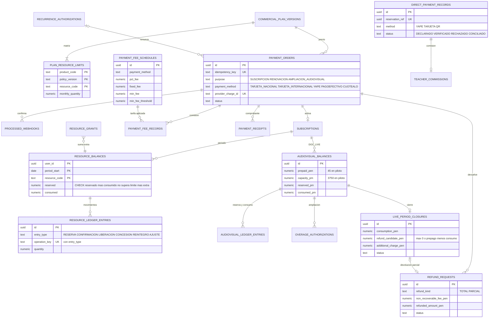

### 15.6. M6 — Tutor IA y RAG

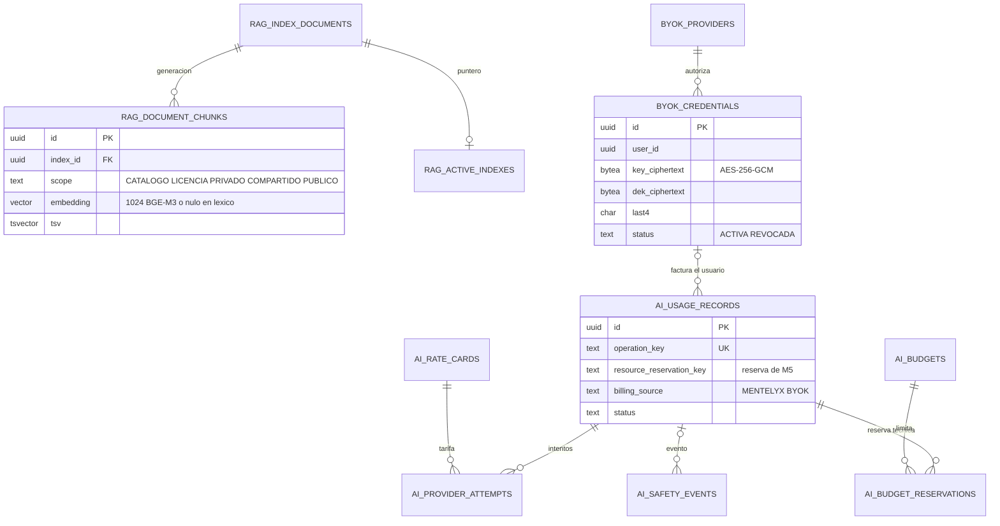

### 15.7. M7 — Publicidad y Patrocinios

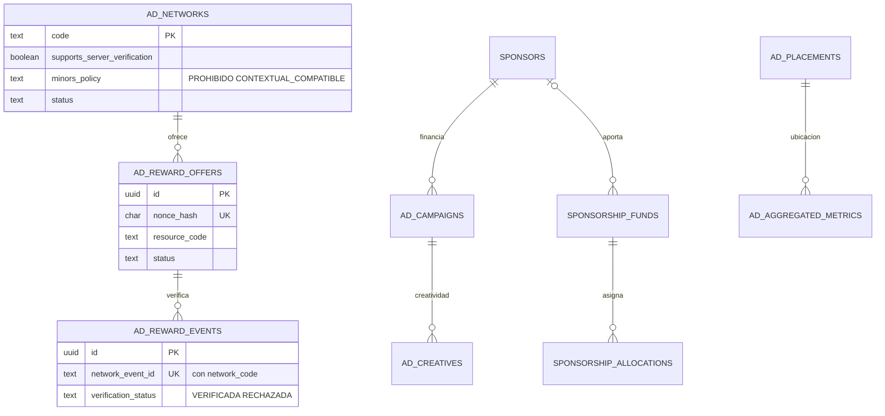

### 15.8. Esquema documental de MongoDB

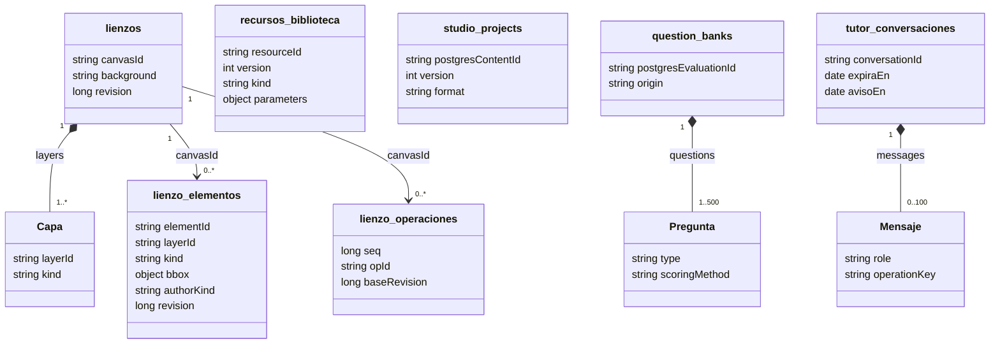

Las composiciones (`*--`) son documentos embebidos y las flechas, referencias entre colecciones. `lesson_contents`, `plantillas_documento` y `tutor_conversacion_segmentos` conservan la estructura de la sección 8.3.

### 15.9. Ciclo de vida de un recurso de la biblioteca

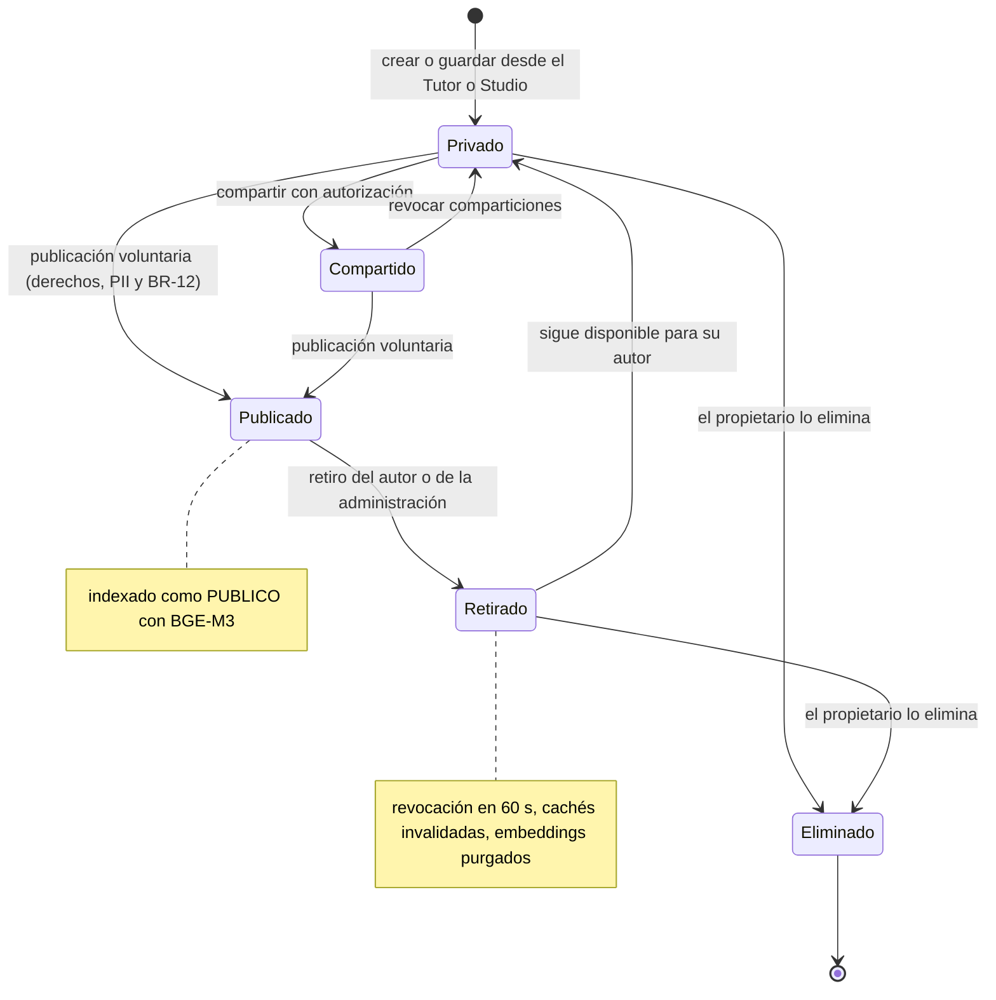

## 16. Análisis de comportamiento de las bases de datos: Sprint 2 (27/11/2026)

Las consultas son reproducibles en DBeaver y Compass:
- [consultas-dbeaver.sql](../../05-evaluacion-arquitectonica/evidencias/sql/consultas-dbeaver.sql);
- [procedimientos-compass.md](../../05-evaluacion-arquitectonica/evidencias/mongodb/procedimientos-compass.md).

Los planes reales están en `explain-postgres.json` y `explain-mongodb.json`, en la misma carpeta de evidencias.

**Asignación de datos (diseño aprobado, sección 13, y ADR de persistencia políglota):**
- **PostgreSQL** guarda lo que exige transacciones, restricciones e integridad referencial:
  - cuentas y sesiones;
  - libro de recursos de M5 (triggers de solo inserción, saldo = libro al hacer COMMIT, `EXCLUDE` contra periodos superpuestos);
  - preparaciones, planes, intentos, respuestas y nota oficial;
  - carpetas (índice único funcional por hermanas);
  - el índice RAG con pgvector.
- **MongoDB** guarda documentos de forma variable y anidada, que se leen completos:
  - la conversación con sus mensajes, citas, bloques educativos y estado de la sesión, con retención TTL de 90 días;
  - el banco de preguntas: 10 tipos con estructuras distintas (opciones, pares, casos con subpreguntas, objetos 3D), versionado e inmutable por versión.
- No se duplican datos entre motores: el intento (PostgreSQL) guarda solo la **versión** del banco (MongoDB) con la que se califica, sin transacción distribuida.

**Comportamiento observado:**
- **Índices:** las consultas frecuentes usan índice en ambos motores (detalle en los planes).
- **Integridad:**
  - en la base de carga, tras las pruebas k6, hay 0 intentos calificados sin nota y 0 intentos ligados a la preparación de otro estudiante (consultas 8 y 9 del archivo SQL);
  - la conciliación de M5 (consulta 10) no encuentra diferencias.
- **Concurrencia:** las entregas concurrentes producen una sola calificación (`update … where status = 'EN_CURSO'`). Los periodos superpuestos se rechazan con SQLSTATE 23P01 (suite P0).
- ***Pooling* (hallazgo de la prueba de carga):**
  - Cada petición del Worker abre su conexión a PostgreSQL (WebSocket del driver de Neon, a través de wsproxy en local) y a MongoDB. No se reutilizan entre peticiones.
  - Con 100 usuarios virtuales en un único `workerd` local aparecen errores «Network connection lost» y `MongoServerSelectionError`.
  - La táctica prevista, sin implementar, es Cloudflare Hyperdrive para PostgreSQL y la conexión pooled de Neon en el despliegue. Para MongoDB, reducir las conexiones por petición o usar un servicio intermedio.
  - Se registra como restricción y escenario no cumplido (evaluación, sección 6), no como capacidad.
- **Local frente a Neon y Atlas:**
  - Neon (PostgreSQL 18.7, us-east-2) tiene las mismas 8 migraciones y los mismos objetos de integridad (verificado el 27/11).
  - Desde Lima, cada petición de la aplicación tardó de 3 a 28 s por paso en los flujos E2E con servicios externos. La latencia de red y el TLS se suman a cada conexión nueva.
  - No se ejecutó carga contra Neon ni contra Atlas: falta autorización y hay que proteger la cuota gratuita.
