# Diseño de persistencia y modelo de datos — Mentelyx

> **Proyecto:** Mentelyx · **Ubicación:** `docs/03-diseño-de-software/diseño-externo/01-diseño-de-persistencia-y-datos.md`  
> **Motores seleccionados:** Neon PostgreSQL + `pgvector` (relacional/vectorial), MongoDB Atlas (documental), Redis (caché efímera) y Cloudflare R2 (objetos)  
> **Versión:** 1.0 · **Estado:** diseño objetivo listo para migraciones iniciales; sujeto a pruebas de conectividad desde Cloudflare Workers.

## 1. Propósito y principios de persistencia

Este documento especifica el **diseño externo de datos** de Mentelyx para iniciar la construcción de migraciones SQL, esquemas documentales y adaptadores de almacenamiento, respetando las decisiones arquitectónicas (**ADR-006, ADR-007, ADR-009, ADR-012, ADR-019, ADR-023, ADR-027, ADR-043, ADR-048, ADR-052, ADR-055**).

### Reglas de propiedad y consistencia
1. **Fuente de verdad transaccional (PostgreSQL):** cuentas, roles, habilitaciones docentes, licencias/metadatos de cursos, intentos y calificaciones oficiales, sesiones y reservas de clase, órdenes de pago, suscripciones, ledgers de créditos (**Live** y **Studio** separados), liquidaciones docentes, outbox transaccional, auditoría e índices vectoriales (`pgvector`).
2. **Almacenamiento documental estructurado (MongoDB):** contenido rico y versionado de lecciones, proyectos de **Mentelyx Studio** (diapositivas, bloques interactivos, lienzos) y estructura flexible de bancos de preguntas. Todo documento guarda el `owner_id`, `resource_id` y `version` autorizados en PostgreSQL.
3. **Caché y control efímero (Redis):** límites de velocidad (*rate limiting*), caché de catálogo público y estados efímeros no financieros. **Prohibido** almacenar saldos de créditos, estados definitivos de pago o cupos autoritativos únicamente en Redis.
4. **Objetos binarios y video (Cloudflare R2 / Bunny Stream):** PDFs, imágenes y recursos pesados viven en R2; los videos educativos publicados se sirven mediante Bunny Stream. Las bases de datos solo almacenan referencias (`storage_key`, `checksum`, `mime_type`).
5. **Propiedad modular:** cada tabla o colección pertenece a **un único módulo (M1–M7)**. Ningún módulo ejecuta `JOIN` ni escrituras directas sobre tablas privadas de otro módulo; la coordinación se realiza por contratos internos o casos de uso propietarios.

---

## 2. Diagrama Entidad-Relación en PostgreSQL (Núcleo Transaccional)

```mermaid
erDiagram
  USERS ||--o{ USER_ROLES : "tiene"
  USERS ||--o| TEACHER_PROFILES : "configura (M4)"
  USERS ||--o{ TEACHING_ACCREDITATIONS : "solicita (M4)"
  USERS ||--o{ COURSES : "crea (M2)"
  COURSES ||--o{ CONTENT_ITEMS : "contiene (M2)"
  CONTENT_ITEMS ||--o{ RAG_DOCUMENT_CHUNKS : "indexa (M6)"
  USERS ||--o{ EVALUATION_ATTEMPTS : "rinde (M3)"
  EVALUATIONS ||--o{ EVALUATION_ATTEMPTS : "registra (M3)"
  USERS ||--o{ LIVE_SESSIONS : "dicta (M4)"
  LIVE_SESSIONS ||--o{ SESSION_RESERVATIONS : "reserva cupo (M4)"
  USERS ||--o{ SESSION_RESERVATIONS : "inscribe (M4)"
  CommercialPlans ||--o{ PAYMENT_ORDERS : "cotiza (M5)"
  USERS ||--o{ PAYMENT_ORDERS : "compra (M5)"
  PAYMENT_ORDERS ||--o| SUBSCRIPTIONS : "activa (M5)"
  USERS ||--o{ CREDIT_LEDGER_ENTRIES : "mueve saldo (M5)"
  LIVE_SESSIONS ||--o{ TEACHER_SETTLEMENTS : "liquida (M5)"

  USERS {
    uuid id PK
    varchar email UK
    varchar account_type "ESTUDIANTE | CREADOR | DOCENTE | SUPERADMIN"
    boolean is_minor
    boolean is_university_student
    boolean tutor_enabled "Habilitación explícita p/ enseñar"
    varchar status "ACTIVE | SUSPENDED"
    timestamptz created_at
  }

  TEACHER_PROFILES {
    uuid user_id PK,FK
    varchar modality "LIBRE | NIVEL_ACADEMICO"
    boolean can_charge_classes "Estado separado de cuenta/rol"
    varchar verification_status "UNVERIFIED | PENDING | VERIFIED"
    timestamptz updated_at
  }

  COURSES {
    uuid id PK
    uuid author_id FK
    varchar level "PRIMARIA | SECUNDARIA | PREUNI | UNIVERSITARIO"
    varchar visibility "PRIVATE | PUBLIC | LICENSED"
    boolean allow_rag_indexing
    integer current_version
    timestamptz published_at
  }

  CONTENT_ITEMS {
    uuid id PK
    uuid course_id FK
    varchar item_type "LESSON | STUDIO_PROJECT | PDF_ASSET"
    varchar mongo_document_id "Referencia a MongoDB"
    varchar r2_storage_key "Referencia a Cloudflare R2"
    integer version
    timestamptz created_at
  }

  EVALUATION_ATTEMPTS {
    uuid id PK
    uuid evaluation_id FK
    uuid student_id FK
    varchar idempotency_key UK
    integer evaluation_version
    numeric official_score
    varchar status "IN_PROGRESS | SUBMITTED | GRADED"
    timestamptz submitted_at
  }

  LIVE_SESSIONS {
    uuid id PK
    uuid teacher_id FK
    varchar modality "AULA_GRUPAL | REFORZAMIENTO | INDIVIDUAL"
    integer max_capacity "Diseño base hasta 35"
    integer reserved_seats "Controlado con CHECK reserved <= max"
    integer credit_cost_per_student "1, 2 o 3 créditos Live"
    varchar policy_version
    varchar status "SCHEDULED | IN_PROGRESS | COMPLETED | CANCELLED"
    timestamptz starts_at
  }

  SESSION_RESERVATIONS {
    uuid id PK
    uuid session_id FK
    uuid student_id FK
    varchar operation_key UK "Idempotencia de reserva"
    varchar status "RESERVED | ATTENDED | CANCELLED | REFUNDED"
    timestamptz created_at
  }

  PAYMENT_ORDERS {
    uuid id PK
    uuid user_id FK
    varchar product_code "EST_PLUS | EST_PRO | AULAS_LIVE | STUDIO_PLUS | STUDIO_PRO"
    varchar policy_version "Versión comercial inmutable"
    numeric amount_pen
    varchar idempotency_key UK
    varchar status "PENDIENTE | APROBADA | RECHAZADA | REEMBOLSADA"
    varchar provider_reference
    timestamptz created_at
  }

  CREDIT_LEDGER_ENTRIES {
    uuid id PK
    uuid user_id FK
    varchar credit_Pool "LIVE | STUDIO (No intercambiables)"
    integer delta "Positivo (carga/reverso) o Negativo (consumo)"
    varchar reason "PURCHASE | CLASS_RESERVE | CLASS_REVERT | STUDIO_AI_OP"
    varchar operation_key UK "Evita doble descuento o doble abono"
    varchar policy_version
    timestamptz created_at
  }

  TEACHER_SETTLEMENTS {
    uuid id PK
    uuid session_id FK
    uuid teacher_id FK
    integer verified_credits_consumed
    numeric rate_per_credit_pen "Ej. S/8 sujeto a contrato versionado"
    numeric total_payable_pen
    varchar policy_version
    varchar status "PENDING_VALIDATION | APPROVED | PAID | DISPUTED"
    timestamptz settled_at
  }
```



---

## 3. Catálogo de tablas PostgreSQL por módulo (M1–M7)

### 3.1. Módulo 1 — Usuarios y Administración (`schema: m1_users`)
| Tabla | Propósito | Restricciones e índices críticos |
|---|---|---|
| `users` | Identidad base, tipo de cuenta (`ESTUDIANTE`, `CREADOR`, `DOCENTE`, `SUPERADMIN`), indicador de menor de edad (`is_minor`). | `UNIQUE (email)`, `CHECK (account_type IN (...))` |
| `user_sessions` | Sesiones activas gestionadas por el adaptador de autenticación (Better Auth candidato). | `INDEX (user_id, expires_at)`, `UNIQUE (session_token_hash)` |
| `user_permissions` | Permisos granulares RBAC/ABAC y habilitación especial (`tutor_universitario_habilitado`). | `UNIQUE (user_id, permission_code, scope)` |
| `parental_consents` | Registro verificable de autorización de adulto responsable para cuentas de menores y uso audiovisual. | `INDEX (minor_user_id, status)` |
| `audit_logs` | Evidencia inmutable de cambios de permisos, moderación y acciones administrativas. | `INDEX (actor_id, created_at)`, solo inserción (`INSERT-only`) |

### 3.2. Módulo 2 — Cursos y Contenidos / Studio (`schema: m2_contents`)
| Tabla | Propósito | Restricciones e índices críticos |
|---|---|---|
| `courses` | Metadatos del curso, nivel académico, autor, estado de publicación y bandera `allow_rag_indexing`. | `INDEX (level, status, visibility)` |
| `content_versions` | Historial inmutable de versiones publicadas y enlace a documentos en MongoDB (`mongo_doc_id`). | `UNIQUE (content_id, version_number)` |
| `content_licenses` | Derechos de uso, prohibición de entrenamiento IA externo y alcance de compartición. | `INDEX (content_id, license_type)` |
| `media_assets` | Registro de archivos en R2 y videos en Bunny Stream (`storage_key`, `size_bytes`, `sha256`, `status`). | `UNIQUE (storage_key)` |

### 3.3. Módulo 3 — Evaluaciones y Aprendizaje (`schema: m3_evaluations`)
| Tabla | Propósito | Restricciones e índices críticos |
|---|---|---|
| `evaluations` | Definición de diagnósticos, prácticas y simulacros, escala de calificación y versión vigente. | `UNIQUE (slug, version)` |
| `evaluation_attempts` | Intentos realizados por el estudiante, nota oficial determinista y sellado temporal. | `UNIQUE (student_id, evaluation_id, idempotency_key)` |
| `student_progress` | Avance consolidado por curso/tema y ruta adaptativa sugerida. | `UNIQUE (student_id, course_id)` |

### 3.4. Módulo 4 — Docentes y Clases (`schema: m4_classes`)
| Tabla | Propósito | Restricciones e índices críticos |
|---|---|---|
| `teacher_profiles` | Modalidad (`LIBRE` vs `NIVEL_ACADEMICO`), estado de verificación y bandera `can_charge_classes`. | `PRIMARY KEY (user_id)` |
| `teaching_accreditations` | Expedientes de grados/títulos o validación universitaria revisados antes de acreditar insignia o cobro. | `INDEX (user_id, review_status)` |
| `live_sessions` | Programación de aulas (6–35), reforzamiento (2–5) o individual (1), cupo máximo y asientos reservados. | `CHECK (reserved_seats >= 0 AND reserved_seats <= max_capacity)` |
| `session_reservations` | Inscripción de estudiante a una sesión con estado de asistencia y referencia de crédito. | `UNIQUE (session_id, student_id)`, `UNIQUE (operation_key)` |
| `session_attendance_logs` | Evidencia de prestación efectiva (ingreso/permanencia docente y alumnos) para habilitar liquidación. | `INDEX (session_id, participant_id)` |

### 3.5. Módulo 5 — Suscripciones y Pagos (`schema: m5_billing`)
| Tabla | Propósito | Restricciones e índices críticos |
|---|---|---|
| `commercial_plan_versions` | Catálogo versionado de precios, cuotas de créditos y reglas de liquidación (ADR-055). | `UNIQUE (product_code, policy_version)` |
| `payment_orders` | Órdenes de compra iniciadas y su estado transaccional. | `UNIQUE (idempotency_key)` |
| `processed_webhooks` | Deduplicación persistente de notificaciones de pasarela y colas (Idempotent Receiver). | `UNIQUE (provider, event_id)` |
| `subscriptions` | Suscripciones vigentes por producto (`EST_PLUS`, `EST_PRO`, `AULAS_LIVE`, `STUDIO_PLUS`, `STUDIO_PRO`). | `INDEX (user_id, product_code, status)` |
| `credit_ledger_entries` | Libro mayor inmutable de créditos (`credit_pool = 'LIVE' \| 'STUDIO'`). | `UNIQUE (operation_key)`, `INDEX (user_id, credit_pool)` |
| `credit_balances` | Saldo materializado actualizado en la misma transacción SQL que el ledger para evitar saldo negativo. | `PRIMARY KEY (user_id, credit_pool)`, `CHECK (available_balance >= 0)` |
| `teacher_settlements` | Cálculo y estado de pago a docentes por créditos efectivamente consumidos y validados. | `UNIQUE (session_id, settlement_run_id)` |
| `outbox_events` | Eventos pendientes de publicar a Cloudflare Queues escritos en la misma transacción ACID. | `INDEX (status, next_retry_at)` |

### 3.6. Módulo 6 — Tutor IA y RAG (`schema: m6_ai_tutor`)
| Tabla | Propósito | Restricciones e índices críticos |
|---|---|---|
| `rag_document_chunks` | Fragmentos autorizados con su embedding vectorial (`vector(1536)`) y metadatos de acceso ACL. | `UNIQUE (document_id, version, chunk_index)`, índice HNSW en `embedding` |
| `ai_usage_records` | Medición auditable de tokens de entrada/salida, modelo invocado, latencia y costo estimado por operación. | `UNIQUE (operation_key)`, `INDEX (user_id, billing_period)` |

### 3.7. Módulo 7 — Publicidad y Patrocinios (`schema: m7_advertising`)
| Tabla | Propósito | Restricciones e índices críticos |
|---|---|---|
| `sponsors` | Entidades patrocinadoras verificadas y convenios de financiamiento de aulas gratuitas. | `UNIQUE (tax_id)` |
| `ad_campaigns` | Campañas aprobadas, presupuesto tope, fechas y superficies permitidas (nunca en exámenes/Live/Studio). | `INDEX (status, starts_at, ends_at)` |
| `ad_aggregated_metrics` | Contadores diarios agregados de impresiones por superficie, **sin** identificadores de menores ni notas. | `UNIQUE (campaign_id, placement_code, metric_date)` |

---

## 4. Diseño documental en MongoDB Atlas

MongoDB almacena estructuras jerárquicas o polimórficas que cambian con el editor visual, manteniendo siempre referencia al registro propietario en PostgreSQL.

### 4.1. Colección `studio_projects` (M2)
```json
{
  "_id": "ObjectId('6718f2a9c4e12a0012345678')",
  "postgresContentId": "550e8400-e29b-41d4-a716-446655440000",
  "ownerUserId": "110e8400-e29b-41d4-a716-446655440111",
  "version": 3,
  "status": "PUBLISHED",
  "format": "SLIDES_INTERACTIVE",
  "slides": [
    {
      "slideId": "s-01",
      "order": 1,
      "blocks": [
        { "type": "heading", "text": "Leyes de Newton" },
        { "type": "diagram_canvas", "elements": [], "generatedByAi": false },
        { "type": "ai_illustration", "r2Key": "studio/assets/img-981.webp", "aiOperationKey": "op-studio-8821" }
      ]
    }
  ],
  "updatedAt": "2026-10-30T22:00:00Z"
}
```

### 4.2. Colección `question_banks` (M3)
```json
{
  "_id": "ObjectId('6718f3b0c4e12a0012345999')",
  "postgresEvaluationId": "770e8400-e29b-41d4-a716-446655440222",
  "evaluationVersion": 2,
  "level": "PREUNI",
  "questions": [
    {
      "questionId": "q-101",
      "type": "MULTIPLE_CHOICE_DETERMINISTIC",
      "stemMarkdown": "Calcule la aceleración del bloque...",
      "options": [
        { "id": "A", "text": "2 m/s²" },
        { "id": "B", "text": "4 m/s²" }
      ],
      "correctOptionId": "B",
      "points": 4.0
    }
  ]
}
```

---

## 5. Diseño de claves en Redis y degradación segura

| Prefijo de clave | Propósito | TTL sugerido | Comportamiento si Redis cae (AC-02 / ADR-054) |
|---|---|---|---|
| `rl:ip:{ip}:{route}` | Rate limiting en endpoints públicos y autenticación | 60 s | Aplicar límite conservador en borde (Cloudflare WAF) sin bloquear toda la plataforma. |
| `cache:m2:catalog:{level}:{page}` | Caché de lectura del catálogo público de cursos | 300 s | *Cache-Aside*: consultar PostgreSQL con paginación estricta y límite de filas. |
| `cache:m3:eval_meta:{evalId}:v{ver}` | Metadatos inmutables de versión de evaluación | 1800 s | Lectura directa desde base de datos autoritativa. |
| `lock:worker:idx:{docId}:v{ver}` | Candado auxiliar para evitar trabajo paralelo innecesario en colas | 120 s | La garantía real reside en el índice `UNIQUE` de PostgreSQL; el candado es solo optimización. |

> **Regla crítica:** ningún saldo de créditos (`LIVE` o `STUDIO`), confirmación de pago ni reserva de cupo se decide en Redis.

