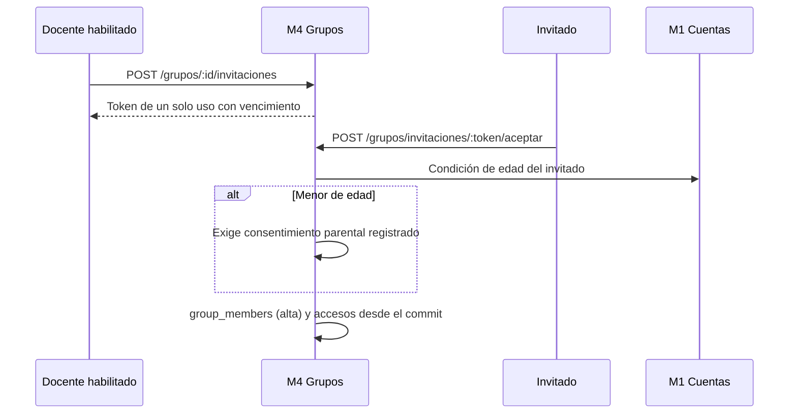

# Diseño de API REST y contratos de integración — Mentelyx

> **Proyecto:** Mentelyx · **Ubicación:** `docs/03-diseño-de-software/diseño-externo/02-diseño-de-api-y-contratos.md`  
> **Framework Backend:** Hono + TypeScript sobre Cloudflare Workers · **Prefijo base:** `/api/v1`  
> **Versión:** 2.1 — 17/11/2026 · **Estado:** especificación de contratos externos e internos para desarrollo; contratos propuestos, no implementados.
>
> **Cambios de la versión 2.2 (20/11/2026):** aplica la [instrucción maestra](../../00-gestion-del-proyecto/sprint-02/instruccion-maestra.md). Recursos de plan en lugar de créditos Live, Studio y UTI. Endpoints nuevos de perfil académico, espacios y fuentes privadas, biblioteca, lienzos, cuadernos, evaluaciones personalizadas, tarifas y disponibilidad, grupos privados, pagos directos, CulqiOnline, saldo audiovisual, BYOK y recompensas. Contratos internos de M5 para reservar recursos y capacidad. Modo `GENERAL` y `MIXTA` emitidos por el orquestador. Errores nuevos y sección 10 de secuencias. Las filas y contratos sustituidos se marcan.
>
> **Cambios de la versión 2.1:** sincronización con el [contrato de coordinación](../contrato-coordinacion-datos-seguridad-infraestructura.md). CO-02: claves de render y audiencia (secciones 3.1 y 4.4). CO-04: la ejecución del Tutor queda separada del SSE (secciones 3.1 y 5.3). CO-05: modo `GENERAL` reservado (sección 4.3). INF-01: cola de mantenimiento (sección 3.1). SC-16: `202` solo tras un trabajo durable (sección 6). Cierre de datos (persistencia v2.1): endpoints de soporte (RF-32) y de reembolsos (RF-25), contratos de financiamiento de aulas M4→M7 (RF-81), cola transversal de auditoría, supresión y avisos (sección 3.1), y el caso de uso del catálogo alineado con el diseño interno (`ConsultarCatalogoUseCase`). Las rutas públicas existentes no cambian.
>
> **Cambios de la versión 2.0:** se conservan los contratos de la 1.0. Se añaden las convenciones 6 a 13 de la sección 1, los endpoints nuevos de cada módulo (sección 2), los contratos internos entre módulos (sección 2.8), los eventos nuevos de cola (sección 3.1), los DTO (sección 4), el *streaming* SSE (sección 5), los trabajos asíncronos (sección 6), el catálogo de errores (sección 7), la matriz de autorización (sección 8) y las pruebas de contrato (sección 9). También se resuelven los pendientes del informe de auditoría terminológica sobre `/docentes/acreditaciones` y el método del endpoint de permisos. Las especificaciones de IA están en `../diseño-especializado/`.

## 1. Convenciones generales de la API HTTP

1. **Formato y transporte:** HTTPS obligatorio (TLS 1.3 en Cloudflare Edge), cuerpo JSON en UTF-8 (`application/json`), excepto en webhooks de pasarela donde se lee el cuerpo crudo (`Uint8Array`) para verificar la firma criptográfica.
2. **Autenticación y sesiones:** gestión de sesión mediante cookies seguras (`HttpOnly`, `Secure`, `SameSite=Lax`) o token Bearer emitido por el adaptador de autenticación (Better Auth candidato).
3. **Autenticación (AuthN) y autorización (AuthZ) diferenciadas (ADR-004, ADR-034):**
   - **Middleware HTTP:** autentica mediante una sesión válida y aplica controles iniciales de acceso según el estado de cuenta y el rol base; una sesión autenticada no concede todos los permisos.
   - **Caso de uso / Política de dominio:** autoriza la operación verificando propiedad del recurso y los permisos aplicables; comprueba por separado, cuando corresponda, vigencia de suscripción, recursos de plan disponibles (por categoría, en M5), saldo audiovisual del docente, mayoría de edad y habilitación docente (`can_charge_classes`).
4. **Idempotencia en operaciones mutables:** las peticiones de creación de órdenes, reserva de clases, envío de evaluaciones, consumo de recursos de plan, pagos, devoluciones, recompensas y operaciones de lienzo aceptan la cabecera `Idempotency-Key: <uuid-v4>`.
5. **Estructura estándar de respuesta y error:**

```jsonc
// Respuesta exitosa estándar (ilustrativa: `{ ... }` abrevia el contenido)
{
  "ok": true,
  "data": { ... },
  "meta": {
    "requestId": "req_01jc8x9p2m",
    "timestamp": "2026-11-03T15:00:00Z"
  }
}

// Respuesta de error estándar (sin filtrar trazas ni secretos)
{
  "ok": false,
  "error": {
    "code": "CUOTA_AGOTADA",
    "message": "Ya usaste las consultas técnicas de tu plan este mes.",
    "details": { "recurso": "CONSULTA_TECNICA", "requeridas": 1, "disponibles": 0 }
  },
  "meta": {
    "requestId": "req_01jc8x9p2m"
  }
}
```

6. **Versionado y compatibilidad:**
   - el prefijo `/api/v1` cambia solo ante cambios incompatibles;
   - añadir campos opcionales o códigos de error nuevos es compatible; los clientes deben ignorar los campos desconocidos;
   - un endpoint retirado responde `410 RECURSO_RETIRADO` durante 90 días antes de eliminarse;
   - la especificación OpenAPI 3.1 se genera desde los mismos esquemas de validación del backend (ADR-003).
7. **Validación de entrada:**
   - cada endpoint valida cuerpo, parámetros y cabeceras con esquemas estrictos que rechazan propiedades desconocidas;
   - las cadenas se recortan y se normalizan a Unicode NFC; los identificadores son UUID v4 salvo que se indique otra cosa;
   - se usan validadores que no generan código en tiempo de ejecución, porque Cloudflare Workers restringe esa técnica (por confirmar en el prototipo);
   - tamaño máximo del cuerpo JSON: 256 KB. Los binarios se suben siempre a R2 mediante URL prefirmada, nunca por la API.
8. **Paginación y filtros:**
   - paginación por cursor opaco: `?limite=20&cursor=…`, con `limite` de 1 a 100;
   - la respuesta incluye `meta.paginacion.siguienteCursor` (o `null`);
   - los filtros se pasan como parámetros de consulta en español (`nivel`, `estado`, `desde`, `hasta`);
   - el orden por defecto es el más reciente primero.
9. **Concurrencia optimista:** los recursos editables (proyectos Studio, configuración de rutas IA, presupuestos) devuelven `ETag: "v{n}"`. Las modificaciones exigen `If-Match` y responden `412 CONFLICTO_VERSION` si la versión cambió.
10. **Idempotencia detallada** (amplía el punto 4):
    - la clave es obligatoria en las operaciones que crean efectos económicos, académicos o de costo IA: órdenes, reservas, cancelaciones, entregas de evaluación, consultas al Tutor, cotizaciones confirmadas y exportaciones;
    - el ámbito de la clave es `actor + ruta`; se guarda el hash del cuerpo normalizado durante al menos 24 h (en el Tutor, durante la retención de la conversación);
    - si la clave ya existe con el mismo cuerpo, se devuelve el resultado original. Si sigue en curso → `409 OPERACION_EN_CURSO`. Si el cuerpo es distinto → `422 CLAVE_IDEMPOTENCIA_REUTILIZADA`.
11. **Límites de tasa:**
    - las respuestas incluyen `RateLimit-Limit`, `RateLimit-Remaining` y `RateLimit-Reset`;
    - un `429` incluye `Retry-After`;
    - los límites del Tutor IA están en `../diseño-especializado/01-tutor-ia-multiproveedor-y-orquestacion.md` sección 10.5.
12. **Respuestas largas y trabajos:**
    - el Tutor IA admite `Accept: text/event-stream` (sección 5);
    - las operaciones lentas (generación IA de Studio, exportaciones, reindexación) responden `202 Accepted` con un recurso de trabajo (sección 6).
13. **Códigos de error:**
    - se escriben en español con MAYÚSCULAS_SNAKE (sección 7);
    - el campo nuevo `error.recuperable` (booleano) indica si el cliente puede reintentar;
    - el código del ejemplo anterior, `INSUFFICIENT_LIVE_CREDITS`, se normaliza como `CREDITOS_LIVE_INSUFICIENTES` y se acepta como alias durante la v1.

---

## 2. Catálogo de Endpoints REST por Módulo (M1–M7)

### 2.1. Módulo 1 — Usuarios y Administración (`/api/v1/auth` y `/api/v1/usuarios`)

| Método | Ruta | Actor / Permiso | Caso de uso conectado | Descripción |
|---|---|---|---|---|
| `POST` | `/api/v1/auth/registro` | Público | `RegistrarCuentaUseCase` | Registra cuenta (`ESTUDIANTE`, `DOCENTE`) sin exigir correo institucional. Si es Docente, define modalidad `LIBRE` o `NIVEL_ACADEMICO`. |
| `POST` | `/api/v1/auth/login` | Público | `IniciarSesionUseCase` | Autentica credenciales y establece sesión segura. |
| `POST` | `/api/v1/auth/logout` | Autenticado | `CerrarSesionUseCase` | Revoca la sesión activa. |
| `GET` | `/api/v1/usuarios/me` | Autenticado | `ConsultarPermisosUseCase` | Devuelve perfil, tipo de cuenta, modalidad docente, estado de habilitación y banderas de protección de menor. |
| `PATCH` | `/api/v1/admin/usuarios/:id/permisos` | Superadministrador (MFA) | `GestionarPermisosUseCase` | Modifica permisos o suspensiones dejando registro obligatorio en `audit_logs`. *(v2.0: método unificado a `PATCH`, igual que la secuencia M1; antes figuraba `POST`. Cuerpo: `{agregar: Permiso[], revocar: Permiso[], motivo}`.)* |

**Endpoints añadidos en la v2.0 (M1):**

| Método | Ruta | Actor / Permiso | Caso de uso | Descripción |
|---|---|---|---|---|
| `POST` | `/api/v1/auth/correo/verificar` | Público (con token) | `VerificarCorreoUseCase` | Confirma el correo con un token de un solo uso (RF-02) |
| `POST` | `/api/v1/auth/recuperacion` | Público | `SolicitarRecuperacionUseCase` | Siempre responde `202`, sin revelar si el correo existe |
| `POST` | `/api/v1/auth/recuperacion/confirmar` | Público (con token) | `ConfirmarRecuperacionUseCase` | Nueva contraseña; revoca las demás sesiones |
| `PATCH` | `/api/v1/usuarios/me` | Autenticado | `ActualizarPerfilPropioUseCase` | Datos de perfil editables. No cambia el tipo de cuenta ni la modalidad (que tiene su propio procedimiento) |
| `POST` | `/api/v1/usuarios/me/consentimientos-parentales` | Cuenta de menor | `SolicitarConsentimientoParentalUseCase` | Envía una invitación al adulto responsable (`parental_consents`) |
| `POST` | `/api/v1/consentimientos-parentales/:token/decision` | Adulto responsable (con token) | `RegistrarDecisionConsentimientoUseCase` | Otorga o rechaza los consentimientos por finalidad (uso de la plataforma, audiovisual, Tutor IA) |
| `GET` | `/api/v1/admin/auditoria` | Superadministrador (MFA) | `ConsultarAuditoriaUseCase` | Filtros por actor, operación y fechas; paginado (RF-31) |
| `POST` | `/api/v1/soporte/incidencias` | Autenticado; `Idempotency-Key` | `RegistrarIncidenciaUseCase` | `{categoria, asunto, mensaje, referencia?}` → `201`; mensaje redactado, sin datos D3 (`support_tickets`, RF-32) |
| `GET` | `/api/v1/soporte/incidencias/me` | Autenticado | `ListarIncidenciasPropiasUseCase` | Paginado por `(created_at, id)` |
| `GET` | `/api/v1/admin/soporte/incidencias` | Superadministrador o permiso `atender_soporte` | `ListarIncidenciasUseCase` | Filtros por estado y prioridad |
| `PATCH` | `/api/v1/admin/soporte/incidencias/:id` | Ídem | `AtenderIncidenciaUseCase` | Cambio de estado o respuesta; `If-Match` con la versión; evento INSERT-only |
| `GET` / `PUT` | `/api/v1/usuarios/me/perfil-academico` | Autenticado | `GestionarPerfilAcademicoUseCase` | Nivel educativo y condición de edad; la fecha de nacimiento solo se escribe y nunca se devuelve (RF-100) |
| `POST` | `/api/v1/usuarios/me/perfil-academico/verificacion` | Autenticado | `VerificarEdadUseCase` | Registra la fuente de verificación de la edad; recalcula la condición |

### 2.2. Módulo 2 — Cursos, Contenidos y Mentelyx Studio (`/api/v1/cursos` y `/api/v1/studio`)

| Método | Ruta | Actor / Permiso | Caso de uso conectado | Descripción |
|---|---|---|---|---|
| `GET` | `/api/v1/cursos` | Público / Estudiante | `ConsultarCatalogoUseCase` | Lista cursos publicados por nivel (`PRIMARIA`, `SECUNDARIA`, `PREUNI`, `UNIVERSITARIO`) con filtros `area`, `tema` y `pagina` (RF-05) y caché Redis. Se llamaba `ListarCatalogoUseCase` en la v2.0 y se alinea con el diseño interno |
| `POST` | `/api/v1/studio/proyectos` | Estudiante / Docente con permiso de Studio | `CrearProyectoStudioUseCase` | Crea o guarda edición manual en Studio (**0 recursos IA consumidos**). |
| `POST` | `/api/v1/studio/proyectos/:id/archivos/url-subida` | Propietario del proyecto | `EmitirUrlSubidaR2UseCase` | Genera URL pre-firmada temporal hacia Cloudflare R2 y registra metadatos en PostgreSQL. |
| `POST` | `/api/v1/studio/proyectos/:id/publicar` | Estudiante / Docente con autorización editorial | `PublicarVersionContenidoUseCase` | Sella una versión inmutable en MongoDB/PostgreSQL y encola indexación RAG si la licencia lo permite. |
| `POST` | `/api/v1/studio/proyectos/:id/generar-ia` | Usuario con recursos de plan | `SolicitarGeneracionStudioUseCase` | Exige `cotizacionId` vigente: consume la cotización y reserva el recurso de plan en M5 (`DOCUMENTO_EQUIVALENTE` o `ILUSTRACION_ESTANDAR`) antes de llamar al proveedor. `202` con el trabajo. Sustituye los créditos Studio |

**Endpoints añadidos en la v2.0 (M2):**

| Método | Ruta | Actor / Permiso | Caso de uso | Descripción |
|---|---|---|---|---|
| `GET` | `/api/v1/cursos/:cursoId` | Público / Estudiante | `ObtenerCursoUseCase` | Ficha del curso y temario publicado |
| `GET` | `/api/v1/cursos/:cursoId/lecciones/:leccionId` | Según licencia, plan y nivel | `ObtenerLeccionUseCase` | `?version=` opcional; por defecto la vigente. Responde con `ETag` |
| `GET` | `/api/v1/studio/proyectos` | Propietario | `ListarProyectosStudioUseCase` | Paginado |
| `GET` | `/api/v1/studio/proyectos/:id` | Propietario | `ObtenerProyectoStudioUseCase` | Documento completo + `ETag: "v{n}"` |
| `PUT` | `/api/v1/studio/proyectos/:id` | Propietario; `If-Match` | `GuardarProyectoStudioUseCase` | Guarda una nueva versión manual (**0 recursos IA**); `412` ante un conflicto de versión |
| `PUT` | `/api/v1/studio/proyectos/:id/versiones/:version/permisos` | Propietario con permiso editorial | `ConfigurarPermisosVersionUseCase` | Permisos **separados**: `publicar`, `comercializar`, `indexarRAG`, `entrenamiento` (este último siempre `false` para menores) (HU-53, RC-11, RC-12) |
| `POST` | `/api/v1/studio/cotizaciones-ia` | Usuario con permiso Studio IA | `CotizarGeneracionStudioUseCase` | Modera el pedido y devuelve el recurso de plan y la cantidad que consumirá, el saldo disponible y la vigencia (10 min) (RF-83) |
| `GET` | `/api/v1/studio/trabajos/:id` | Propietario | `ConsultarTrabajoStudioUseCase` | Estado del trabajo (sección 6) |
| `GET` | `/api/v1/studio/trabajos/:id/eventos` | Propietario | — | Progreso por SSE (sección 6) |
| `POST` | `/api/v1/studio/proyectos/:id/exportaciones` | Propietario | `SolicitarExportacionUseCase` | `{formato: PDF\|PPTX, plantilla, audiencia}` → `202` con el trabajo; **0 recursos IA** |
| `GET` | `/api/v1/studio/exportaciones/:id` | Propietario o licenciatario | `ObtenerDescargaUseCase` | URL R2 firmada de 300 s (`05-generacion-de-materiales-educativos.md` sección 8) |
| `GET` | `/api/v1/studio/plantillas` | Usuario con Studio | `ListarPlantillasUseCase` | Plantillas publicadas con su versión |
| `POST` | `/api/v1/escenas/validar` | Usuario autenticado | `ValidarEscenaUseCase` | Valida y compila `mentelyx.escena/v1` de forma determinista (0 recursos) |
| `POST` | `/api/v1/apuntes` | Estudiante / Docente | `SubirApunteUseCase` | Crea el apunte y devuelve la URL de subida R2 (RF-55, HU-42) |
| `GET` | `/api/v1/apuntes` | Propietario | `ListarApuntesUseCase` | Paginado |
| `PUT` | `/api/v1/apuntes/:id/tutor` | Propietario | `ActivarApunteParaTutorUseCase` | `{activo: boolean}` → emite `ApunteActivadoParaTutor` / `ApunteDesactivadoParaTutor` |
| `DELETE` | `/api/v1/apuntes/:id` | Propietario | `EliminarApunteUseCase` | Elimina el documento y purga su índice |
| `POST` / `GET` | `/api/v1/espacios` | Estudiante / Docente | `CrearEspacioUseCase` / `ListarEspaciosUseCase` | Espacios privados de estudio (RF-101) |
| `POST` | `/api/v1/espacios/:id/fuentes/url-subida` | Propietario; `Idempotency-Key` | `EmitirUrlFuenteUseCase` | Reserva almacenamiento (`ALMACENAMIENTO_BYTES`) y emite una URL R2 prefirmada para PDF, PDF escaneado, PPTX, DOCX, TXT, MD o imagen |
| `POST` | `/api/v1/espacios/:id/fuentes` | Propietario | `RegistrarFuenteUseCase` | Verifica el objeto y encola extracción, OCR e indexación (`202`) |
| `PATCH` / `DELETE` | `/api/v1/espacios/:id/fuentes/:contentId` | Propietario | `SeleccionarFuenteUseCase` / `EliminarFuenteUseCase` | Selección para el Tutor; eliminar revoca la indexación |
| `GET` | `/api/v1/biblioteca` | Autenticado | `BuscarRecursosBibliotecaUseCase` | Búsqueda autorizada (BGE-M3 y texto) en recursos propios, compartidos y públicos; filtros por tipo, nivel y tema (BR-02/03) |
| `GET` | `/api/v1/biblioteca/recursos/:id` | Según visibilidad | `ObtenerRecursoUseCase` | Recurso versionado con procedencia y valoraciones agregadas |
| `POST` | `/api/v1/recursos` | Autenticado | `GuardarRecursoUseCase` | Guarda como recurso privado un contenido propio o un resultado del Tutor (BR-05/06) |
| `POST` | `/api/v1/recursos/:id/compartir` | Propietario | `CompartirRecursoUseCase` | Comparte con usuarios concretos (LEER/COPIAR) |
| `POST` | `/api/v1/recursos/:id/publicar` | Propietario; `Idempotency-Key` | `PublicarRecursoUseCase` | Publicación voluntaria tras comprobar derechos, PII y BR-12 (`409 PUBLICACION_NO_PERMITIDA`) |
| `POST` | `/api/v1/recursos/:id/retirar` | Propietario / Superadministrador | `RetirarRecursoUseCase` | Retira la publicación: revoca, invalida cachés y purga embeddings (BR-11) |
| `POST` | `/api/v1/recursos/:id/valoracion` | Usuario que lo usó | `ValorarRecursoUseCase` | Voto 1–5; solo se exponen agregados (BR-08) |
| `POST` / `GET` | `/api/v1/lienzos` y `/api/v1/lienzos/:id?region=x,y,w,h` | Propietario o compartido | `CrearLienzoUseCase` / `ObtenerLienzoUseCase` | Lienzo extensible; carga por región en coordenadas de mundo (RF-106) |
| `POST` | `/api/v1/lienzos/:id/operaciones` | Propietario; operaciones con `opId` | `AplicarOperacionesLienzoUseCase` | Lote de operaciones con `baseRevision`; `409 CONFLICTO_LIENZO` con el estado del servidor; nunca modifica la capa USUARIO desde la IA (RF-108) |
| `POST` | `/api/v1/lienzos/:id/exportaciones` | Propietario | `ExportarRegionLienzoUseCase` | Exportación de una región o del contenido organizado a PDF (`202`) |
| `POST` / `GET` | `/api/v1/cuadernos` | Autenticado | `GestionarCuadernoUseCase` | Cuadernos que organizan lienzos y recursos |

### 2.3. Módulo 3 — Evaluaciones y Aprendizaje (`/api/v1/evaluaciones`)

| Método | Ruta | Actor / Permiso | Caso de uso conectado | Descripción |
|---|---|---|---|---|
| `POST` | `/api/v1/evaluaciones/:id/intentos` | Estudiante | `IniciarIntentoEvaluacionUseCase` | Abre un intento asociado a la versión exacta de la evaluación. |
| `POST` | `/api/v1/evaluaciones/:id/intentos/:intentoId/entregar` | Estudiante propietario | `EntregarYCalificarEvaluacionUseCase` | Califica de forma determinista y reproducible, guarda nota oficial en PostgreSQL y actualiza ruta de estudio. |
| `GET` | `/api/v1/evaluaciones/progreso/me` | Estudiante | `ConsultarProgresoUseCase` | Devuelve historial de diagnósticos, simulacros y áreas a reforzar. |

**Endpoints añadidos en la v2.0 (M3):**

| Método | Ruta | Actor / Permiso | Caso de uso | Descripción |
|---|---|---|---|---|
| `GET` | `/api/v1/evaluaciones/:id` | Estudiante con acceso | `ObtenerEvaluacionUseCase` | Metadatos y estructura sin soluciones |
| `PUT` | `/api/v1/evaluaciones/:id/intentos/:intentoId/respuestas` | Estudiante propietario; `If-Match` | `GuardarRespuestasParcialesUseCase` | Guardado parcial remoto; la PWA indica «guardado local» frente a «confirmado» |
| `POST` | `/api/v1/preparacion/objetivos` | Estudiante; `Idempotency-Key` | `DefinirObjetivoExamenUseCase` | `{fuente: PERSONAL \| FUENTES, temas: [{areaCodigo, temaCodigo, titulo}], fuentes?: [contentId], fechaObjetivo?: YYYY-MM-DD, minutosSemanales}`. M2 confirma que cada fuente pertenece al actor y está seleccionada. Reemplaza el objetivo activo y persiste objetivo + plan en una transacción; `201` nuevo / `200` repetido (RF-49). |
| `GET` | `/api/v1/preparacion/plan` | Estudiante propietario | `ConsultarPlanPreparacionUseCase` | Plan determinista vigente y actividades; `null` si no existe (RF-50) |
| `POST` | `/api/v1/preparacion/plan/actividades/{actividadId}/completar` | Estudiante propietario | `CompletarActividadPreparacionUseCase` | Marca una actividad completada; idempotente y `404` para actividades ajenas/no disponibles. No infiere dominio académico. |
| `GET` | `/api/v1/preparacion/seguimiento` | Estudiante propietario | `ConsultarSeguimientoUseCase` | Conteo y porcentaje de actividades completadas por área; avance observado, no predicción ni calificación (RF-52, RC-17) |
| `POST` | `/api/v1/evaluaciones/generaciones` | Estudiante; `Idempotency-Key` | `SolicitarGeneracionEvaluacionUseCase` | `{origen, cantidad?, dificultad?, fuentes?, temas?, tipos?, complementar?, rapida?}`; sin parámetros genera al menos 15 preguntas variadas; reserva `EVALUACION_EQUIVALENTE` en M5; `202` (RF-103/104) |
| `GET` | `/api/v1/evaluaciones/generaciones/:id` | Propietario | `ConsultarGeneracionEvaluacionUseCase` | Estado y, al terminar, la evaluación versionada lista para intentar |

**Contrato de preparación:** `POST /preparacion/objetivos` responde `{preparacion: {objetivo, plan: {actividades}}, repetida}`; cada actividad incluye `id`, área/tema, tipo, fecha límite nullable, minutos estimados y estado. La fecha objetivo debe ser futura; si se omite, el plan no inventa fechas límite. `GET /preparacion/plan` responde el mismo objeto o `null`; `GET /preparacion/seguimiento` devuelve `{objetivo, total, completadas, porcentaje, areas[]}`. Las respuestas son privadas (`Cache-Control: private, no-store`). Errores: 400 `ENTRADA_INVALIDA`, 401 `NO_AUTENTICADO`, 403 por los controles CSRF/origen de la frontera API, 404 `RECURSO_NO_ENCONTRADO` para fuentes o actividades no accesibles, 422 `CLAVE_IDEMPOTENCIA_REUTILIZADA`.

**Alcance funcional backend (25/11/2026):** está implementada la preparación determinista con objetivo personal o basado en fuentes privadas, plan y seguimiento de actividades. Requiere sesión; M3 solo consulta fuentes mediante el contrato público de M2 y no accede a sus tablas. Esta entrega no implementa todavía catálogo/calificación de evaluaciones, fichas oficiales de examen ni generación asíncrona. Las actividades iniciales (`LECCION` y `PRACTICA`) son una estructura de preparación, no contenido docente ni una predicción de resultados.

### 2.4. Módulo 4 — Docentes y Clases (`/api/v1/docentes` y `/api/v1/clases`)

| Método | Ruta | Actor / Permiso | Caso de uso conectado | Descripción |
|---|---|---|---|---|
| `POST` | `/api/v1/docentes/acreditaciones` | Docente / Est. Universitario adulto | `SolicitarHabilitacionDocenteUseCase` | Envía una solicitud de habilitación docente con verificación documental del solicitante; la validación de credenciales académicas se tramita por separado y solo corresponde al perfil Docente por nivel académico. No se acredita un título por aprobar la habilitación. |
| `POST` | `/api/v1/clases/sesiones` | Docente / Tutor habilitado | `ProgramarSesionLiveUseCase` | Crea una sesión grupal (6–35), de reforzamiento (2–5) o individual (1) con `pricing_mode` POR_HORA (tarifa vigente del docente) o GRATUITA (capacidad propia o financiamiento M7). Iniciarla exige reservar capacidad audiovisual en M5. Sustituye el costo en créditos |
| `POST` | `/api/v1/clases/sesiones/:id/reservar` | Estudiante; `Idempotency-Key` | `ReservarClaseUseCase` | Crea la reserva HOLD con control de cupo SQL; queda CONFIRMADA cuando el pago directo se verifica (o si la clase es gratuita). Ya no descuenta créditos Live |
| `POST` | `/api/v1/clases/sesiones/:id/ingresar` | Estudiante con reserva / Docente | `EmitirCredencialAulaUseCase` | Verifica permiso y consentimiento audiovisual (menores) y devuelve token efímero para conectarse directo al SFU/WebRTC. |
| `POST` | `/api/v1/clases/sesiones/:id/cerrar-asistencia` | Docente / Sistema | `ConfirmarPrestacionClaseUseCase` | Registra asistencia efectiva y emite evento `ClasePrestadaValidada` hacia M5 para habilitar liquidación. |

**Contrato pendiente de revisión:** la ruta propuesta `/api/v1/docentes/acreditaciones` y el caso `SolicitarHabilitacionDocenteUseCase` nombran procesos distintos. Deben definirse contratos diferenciados para verificación documental, validación de credenciales académicas y habilitación docente antes de implementarlos. Se conserva la ruta como propuesta pendiente, sin asumir un contrato público ya desplegado.

**Resolución (v2.0):** la ruta `/api/v1/docentes/acreditaciones` **no se implementa**. Se sustituye por tres solicitudes con estados separados bajo el prefijo neutro `/api/v1/habilitacion`. El prefijo es neutro porque un Estudiante universitario adulto también puede solicitar la habilitación sin ser Docente. La implementación exige la solicitud de cambio SC-09 sobre `teaching_accreditations`.

| Método | Ruta | Actor / Permiso | Caso de uso | Descripción |
|---|---|---|---|---|
| `GET` | `/api/v1/habilitacion/me` | Docente / Estudiante | `ConsultarEstadosHabilitacionUseCase` | Devuelve **tres estados independientes**: verificación documental, credenciales académicas (lista vacía para modalidad libre y para Estudiante) y habilitación para tutorías |
| `POST` | `/api/v1/habilitacion/documentos/url-subida` | Solicitante | `EmitirUrlDocumentoHabilitacionUseCase` | URL R2 prefirmada en un espacio privado. Los documentos son datos D3: **nunca** se envían a proveedores de IA |
| `POST` | `/api/v1/habilitacion/verificaciones-documentales` | Docente ≥ 18 o Estudiante universitario ≥ 18 | `SolicitarVerificacionDocumentalUseCase` | Verificación documental del solicitante. No valida títulos |
| `POST` | `/api/v1/habilitacion/credenciales-academicas` | **Solo** Docente con modalidad `NIVEL_ACADEMICO` | `SolicitarValidacionCredencialUseCase` | Validación de una credencial académica; para otra modalidad responde `409 MODALIDAD_NO_ADMITE_CREDENCIALES` (RF-59) |
| `POST` | `/api/v1/habilitacion/solicitudes-tutoria` | Docente (cualquier modalidad) o Estudiante universitario ≥ 18 | `SolicitarHabilitacionTutoriaUseCase` | Habilitación para impartir tutorías remuneradas sobre los temas declarados. Se aprueba solo con la verificación documental `APROBADA` (RF-58, RF-88) |
| `GET` | `/api/v1/admin/habilitacion/:cola` | Superadministrador (MFA) | `ListarSolicitudesHabilitacionUseCase` | `cola` ∈ {`verificaciones-documentales`, `credenciales-academicas`, `solicitudes-tutoria`}; filtro `?estado=` |
| `POST` | `/api/v1/admin/habilitacion/:cola/:id/decision` | Superadministrador (MFA) | `DecidirSolicitudHabilitacionUseCase` | `{decision: APROBAR\|RECHAZAR\|SOLICITAR_SUBSANACION, motivo}`. Si se aprueba una tutoría, M4 invoca `registrarHabilitacionAprobada` de M1. Cada decisión queda en `audit_logs` |

**Otros endpoints añadidos en la v2.0 (M4):**

| Método | Ruta | Actor / Permiso | Caso de uso | Descripción |
|---|---|---|---|---|
| `PUT` | `/api/v1/docentes/me/perfil` | Docente | `ConfigurarPerfilDocenteUseCase` | El DTO depende de la modalidad: `LIBRE` (temas, experiencia) o `NIVEL_ACADEMICO` (niveles, asignaturas, formación declarada) (RF-19, RF-57) |
| `GET` | `/api/v1/docentes/:id` | Público | `ConsultarPerfilPublicoUseCase` | Muestra credenciales **solo** si están `APROBADA` (RF-20) |
| `GET` | `/api/v1/clases/sesiones` | Público / Estudiante | `ListarSesionesUseCase` | Filtros `tema`, `nivel`, `modalidad`, `desde`; también lo usa el contrato `buscarOfertasTutoria` del Tutor IA |
| `GET` | `/api/v1/clases/reservas/me` | Estudiante | `ListarReservasPropiasUseCase` | — |
| `POST` | `/api/v1/clases/reservas/:id/cancelar` | Estudiante propietario; `Idempotency-Key` | `CancelarReservaUseCase` | Restitución según la versión comercial (HU-56) |
| `POST` | `/api/v1/clases/sesiones/:id/grabacion` | Docente habilitado de la sesión | `AutorizarGrabacionUseCase` | Desactivada por defecto; exige consentimientos (RF-45, RC-13) |
| `PUT` | `/api/v1/docentes/me/tarifas` | Docente habilitado | `ConfigurarTarifasUseCase` | Tarifa por hora por modalidad, con vigencia (RF-21) |
| `PUT` | `/api/v1/docentes/me/disponibilidad` | Docente | `ConfigurarDisponibilidadUseCase` | Franjas de disponibilidad |
| `PUT` | `/api/v1/docentes/me/declaracion-live` | Docente Live | `DeclararUsoLiveUseCase` | Horas por semana, modalidad, participantes estimados, horarios y grabación (RF-115) |
| `POST` / `GET` | `/api/v1/grupos` | Docente habilitado | `CrearGrupoUseCase` / `ListarGruposUseCase` | Grupos privados (RF-117) |
| `POST` | `/api/v1/grupos/:id/invitaciones` | Propietario del grupo | `InvitarAGrupoUseCase` | Invitación de un solo uso con vencimiento; un menor exige consentimiento parental |
| `POST` | `/api/v1/grupos/invitaciones/:token/aceptar` | Invitado autenticado | `AceptarInvitacionUseCase` | Alta como miembro |
| `DELETE` | `/api/v1/grupos/:id/miembros/:userId` | Propietario / el propio miembro | `RetirarMiembroUseCase` | Salida o expulsión con efecto inmediato |
| `POST` / `GET` | `/api/v1/grupos/:id/recursos` | Propietario / miembros | `CompartirEnGrupoUseCase` / `ListarRecursosGrupoUseCase` | Materiales del grupo; la lectura exige membresía vigente |
| `POST` | `/api/v1/clases/reservas/:id/pago-directo` | Estudiante (pagador) | `DeclararPagoDirectoUseCase` | Declara importe, medio (Yape, tarjeta o QR, con el proveedor subyacente del QR cuando corresponda), fecha y evidencia opcional (RF-118). Culqi no divide pagos automáticamente; el cobro con tarjeta al docente requiere una integración verificada |
| `POST` | `/api/v1/clases/reservas/:id/pago-directo/confirmar` | Docente de la sesión | `ConfirmarPagoDirectoUseCase` | Verifica la recepción; M5 marca VERIFICADO, devenga la comisión y M4 confirma la reserva |

### 2.5. Módulo 5 — Suscripciones, Pagos y Recursos de plan (`/api/v1/pagos` y `/api/v1/suscripciones`)

| Método | Ruta | Actor / Permiso | Caso de uso conectado | Descripción |
|---|---|---|---|---|
| `POST` | `/api/v1/pagos/ordenes` | Usuario autenticado; `Idempotency-Key` | `ComprarPlanUseCase` | `{producto, medioPago, tokenCulqi?, autorizarRenovacion?}`; productos EST_ESTANDAR/EST_PLUS/EST_PREMIUM/DOC_INICIAL/DOC_LIVE. Crea la orden PENDIENTE con la `policy_version`, crea el cargo en CulqiOnline desde el servidor y consulta su estado real; registra la comisión estimada del medio |
| `POST` | `/api/v1/pagos/webhook` | CulqiOnline | `ConfirmarPagoWebhookUseCase` | Verifica la autenticidad, deduplica `(provider, eventId)` y **siempre** consulta el estado real del cargo o devolución antes de aplicar efectos (activar derechos, iniciar `resource_balances` o `audiovisual_balances`, cerrar devoluciones) |
| `GET` | `/api/v1/suscripciones/me/derechos` | Usuario autenticado | `ConsultarEntitlementsUseCase` | Suscripción activa, recursos del periodo por categoría (límite, extra concedido, reservado, consumido) y, para Docente Live, el saldo audiovisual |
| `GET` | `/api/v1/pagos/liquidaciones/me` | Docente / Tutor habilitado | `ConsultarEstadoCuentaDocenteUseCase` | Estado de cuenta: pagos directos verificados, comisiones devengadas, consumo audiovisual y devoluciones (RF-28/29). Sustituye la liquidación por créditos |

**Endpoints añadidos en la v2.0 (M5):**

| Método | Ruta | Actor / Permiso | Caso de uso | Descripción |
|---|---|---|---|---|
| `GET` | `/api/v1/planes` | Público | `ListarPlanesUseCase` | Versión vigente de Gratuito, Estándar, Plus, Premium, Docente Inicial y Docente Live con precios y recursos en lenguaje claro (IM, secciones 14 y 15) |
| `GET` | `/api/v1/suscripciones/me/movimientos` | Autenticado | `ConsultarMovimientosUseCase` | `?recurso=` obligatorio (o `AUDIOVISUAL`); historial de reservas, consumos, concesiones y reintegros sin mezclar categorías |
| `POST` | `/api/v1/suscripciones/:id/cancelar` | Titular; `Idempotency-Key` | `CancelarSuscripcionUseCase` | Cancelación al final del periodo según la versión comercial (RF-13) |
| `POST` | `/api/v1/pagos/ordenes/:id/reembolso` | Titular; `Idempotency-Key` | `SolicitarReembolsoUseCase` | Crea `refund_requests` en SOLICITADO si la política versionada lo admite (RF-25). Cancelar una reserva o una suscripción usa el mismo caso de uso cuando corresponde reembolsar |
| `POST` | `/api/v1/admin/pagos/reembolsos/:id/decision` | Superadministrador (MFA) | `DecidirReembolsoUseCase` | Aprueba o rechaza; el reembolso aprobado se ejecuta por `PaymentPort` y revierte los derechos y los recursos o el saldo audiovisual por el ledger, una sola vez |
| `POST` / `DELETE` | `/api/v1/suscripciones/:id/renovacion-automatica` | Titular; reautenticación | `AutorizarRenovacionUseCase` / `RevocarRenovacionUseCase` | Solo en medios con recurrencia; registra la versión de términos (`422 MEDIO_SIN_RECURRENCIA`) |
| `GET` | `/api/v1/docentes/me/saldo-audiovisual` | Docente Live | `ConsultarSaldoAudiovisualUseCase` | Capacidad, reservado, consumido, umbrales 70/90/100 % y estimación de devolución |
| `POST` | `/api/v1/docentes/me/ampliaciones` | Docente Live; `Idempotency-Key` | `AutorizarAmpliacionUseCase` | Autoriza explícitamente una ampliación o un cobro adicional; sin ella no se reserva por encima de la capacidad (RF-116) |
| `GET` | `/api/v1/pagos/devoluciones/me` | Titular | `ConsultarDevolucionesUseCase` | Estado de las devoluciones con importe solicitado, comisión no recuperable e importe devuelto |

### 2.6. Módulo 6 — Tutor IA y RAG (`/api/v1/tutor-ia`)

| Método | Ruta | Actor / Permiso | Caso de uso conectado | Descripción |
|---|---|---|---|---|
| `POST` | `/api/v1/tutor-ia/consultas` | Estudiante con cuota | `ResponderConsultaUseCase` | Verifica cuota en M5, filtra fragmentos en `pgvector` según ACL/licencia de M2, genera respuesta pedagógica con citas y registra tokens/costo. |
| `GET` | `/api/v1/tutor-ia/consumo/me` | Autenticado | `ConsultarUsoIaUseCase` | Muestra el consumo acumulado de consultas IA del periodo frente al límite del plan. |

*(v2.0: `POST /api/v1/tutor-ia/consultas` exige `Idempotency-Key` y admite `Accept: text/event-stream`. Su DTO está en la sección 4.3 y sus eventos en la sección 5. Orquestación: `../diseño-especializado/01-tutor-ia-multiproveedor-y-orquestacion.md`.)*

**Endpoints añadidos en la v2.0 (M6):**

| Método | Ruta | Actor / Permiso | Caso de uso | Descripción |
|---|---|---|---|---|
| `POST` | `/api/v1/tutor-ia/conversaciones` | Usuario con derecho Tutor IA | `CrearConversacionUseCase` | Contexto: superficie, recurso, ejercicio o curso; `usarApuntes` |
| `GET` | `/api/v1/tutor-ia/conversaciones` | Propietario | `ListarConversacionesUseCase` | Solo las vigentes dentro de la retención de 90 días desde la última actividad, con su fecha de eliminación (ADR-079; sustituye 30/14 días) |
| `GET` | `/api/v1/tutor-ia/conversaciones/:id` | Propietario | `ObtenerConversacionUseCase` | Mensajes, escenas y citas (las citas a materiales retirados muestran «no disponible») |
| `DELETE` | `/api/v1/tutor-ia/conversaciones/:id` | Propietario | `EliminarConversacionUseCase` | Borrado inmediato de los mensajes y adjuntos |
| `GET` | `/api/v1/tutor-ia/consultas/:operationKey` | Propietario | `ConsultarOperacionTutorUseCase` | Estado o resultado tras un corte del *stream*; nunca dispara una nueva inferencia |
| `POST` | `/api/v1/tutor-ia/consultas/:operationKey/cancelar` | Propietario | `CancelarConsultaUseCase` | Aborta la inferencia en curso y deja la operación `CANCELADA`. Consumo: se libera el recurso de plan si no se había emitido ningún token; se confirma si la respuesta ya había comenzado. Idempotente; sobre una operación terminada responde `200` con su estado final |
| `POST` | `/api/v1/tutor-ia/consultas/:operationKey/valoracion` | Propietario | `ValorarRespuestaUseCase` | `{util: boolean, categoria?: INCORRECTA\|CONFUSA\|INADECUADA\|OTRA, comentario?}` → `ai_quality_reports` (SC-12) |
| `POST` | `/api/v1/tutor-ia/adjuntos/url-subida` | Usuario con la función de visión | `EmitirUrlAdjuntoUseCase` | JPEG/PNG/WebP ≤ 8 MB; se elimina junto con la conversación |
| `POST` | `/api/v1/tutor-ia/transcripciones` | Usuario con la función de visión; `Idempotency-Key` | `TranscribirImagenUseCase` | Imagen → `{latex, texto, confianza}` para que el usuario confirme antes de resolver (consume `CONSULTA_TECNICA`) |
| `GET` | `/api/v1/admin/rag/documentos` | Superadministrador (MFA) | `ListarIndexacionesUseCase` | Estados de `rag_index_documents`; filtros `estado`, `scope` |
| `POST` | `/api/v1/admin/rag/documentos/:contentId/reindexar` | Superadministrador (MFA); `Idempotency-Key` | `SolicitarReindexacionUseCase` | `202` con el trabajo |
| `POST` | `/api/v1/admin/rag/documentos/:contentId/retirar` | Superadministrador (MFA) | `RetirarDeRagUseCase` | Retiro de emergencia (`REVOCADO`) con motivo; informa a M2 |
| `GET` | `/api/v1/admin/ia/estado` | Superadministrador (MFA) | `ConsultarEstadoIaUseCase` | Rutas, circuitos, latencia, errores y costo del periodo (RF-71) |
| `GET` / `PUT` | `/api/v1/admin/ia/rutas` | Superadministrador (MFA); `If-Match` | `GestionarRutasIaUseCase` | Configuración `mentelyx.rutas-ia/v1`, prospectiva y auditada |
| `GET` / `PUT` | `/api/v1/admin/ia/presupuestos` | Superadministrador (MFA); `If-Match` | `GestionarPresupuestosIaUseCase` | Presupuestos y umbrales 70/90/100 % (SC-11) |
| `GET` | `/api/v1/admin/ia/reportes-calidad` | Superadministrador (MFA) | `ListarReportesCalidadUseCase` | Cola de revisión de respuestas valoradas negativamente |
| `PATCH` | `/api/v1/admin/ia/reportes-calidad/:id` | Superadministrador (MFA) | `ResolverReporteCalidadUseCase` | `{estado: CONFIRMADO\|DESCARTADO, accion}` |
| `GET` / `POST` | `/api/v1/tutor-ia/byok` | Adulto elegible | `ListarCredencialesByokUseCase` / `RegistrarCredencialByokUseCase` | Conecta una API key de un proveedor autorizado; la respuesta solo devuelve proveedor, etiqueta y últimos 4 caracteres (RF-120) |
| `DELETE` | `/api/v1/tutor-ia/byok/:id` | Propietario | `RevocarCredencialByokUseCase` | Borrado criptográfico inmediato |

### 2.7. Módulo 7 — Publicidad y Patrocinios (`/api/v1/publicidad`)

| Método | Ruta | Actor / Permiso | Caso de uso conectado | Descripción |
|---|---|---|---|---|
| `GET` | `/api/v1/publicidad/espacios/:ubicacion` | Público / Plan Gratuito | `SeleccionarAnuncioUseCase` | Devuelve patrocinio permitido solo en superficies autorizadas (nunca en evaluaciones, clases Live, Studio ni cobros, y sin perfilar menores). |
| `POST` | `/api/v1/publicidad/campanias` | Superadministrador | `CrearCampaniaUseCase` | Registra campaña o patrocinio de aula gratuita con presupuesto verificado. |
| `GET` | `/api/v1/publicidad/recompensas/oferta?superficie=` | Adulto autenticado | `ObtenerOfertaRecompensaUseCase` | Oferta con *nonce* de un solo uso, recurso y cantidad; nunca para menores (RF-119) |
| `POST` | `/api/v1/publicidad/recompensas/verificacion` | Red publicitaria (servidor a servidor) | `VerificarRecompensaUseCase` | Verifica la firma o el mecanismo de la red y el *nonce*; emite `RecompensaVerificada` hacia M5; un evento del navegador no concede nada |

*(v2.0: las superficies del Tutor IA, la pizarra, las escenas 3D, el editor de Studio y la descarga de materiales se añaden a las ubicaciones excluidas: `SeleccionarAnuncioUseCase` responde `403 UBICACION_NO_PERMITIDA`.)*

### 2.8. Contratos internos entre módulos (API pública `index.ts`)

Estas son llamadas TypeScript dentro del monolito modular (`diseño-interno-de-modulos.md` sección 10.1), no endpoints HTTP. Las marcadas **nuevo** se añaden en la v2.0 para el Tutor IA, el RAG y Studio.

```ts
// M1 — Usuarios y Administración
obtenerUsuarioAutenticado(c: Credenciales): Promise<{ id: string; tipoCuenta: 'ESTUDIANTE' | 'DOCENTE' | 'SUPERADMIN';
  esMenor: boolean; nivel?: Nivel; modalidadDocente?: 'LIBRE' | 'NIVEL_ACADEMICO'; estado: 'ACTIVE' | 'SUSPENDED' }>;
verificarPermiso(actorId: string, accion: AccionProtegida, recursoId?: string): Promise<boolean>;
registrarHabilitacionAprobada(cmd: { usuarioId: string; temas: TemaHabilitado[]; vigenteHasta?: string;
  decisionId: string }): Promise<void>;                                                     // consumidor: M4

// M2 — Cursos y Contenidos
consultarTemarioVersionado(cursoId: string, version?: number): Promise<Temario>;           // M3
consultarMaterialEvaluable(recursoId: string, version: number): Promise<MaterialEvaluable>; // M3
verificarLicenciaYAcceso(actorId: string, recursoId: string, version?: number): Promise<boolean>; // M6
obtenerFuenteVersionada(actorId: string, recursoId: string): Promise<FuenteAutorizada>;   // M6
listarRecursosConsultables(actorId: string, ctx: ContextoConsulta): Promise<string[]>;    // M6 (nuevo, ≤ 200)
obtenerFuenteParaIndexar(contentId: string, version: number): Promise<FuenteIndexable>;   // M6 (nuevo; solo versiones con RAG autorizado)

// M3 — Evaluaciones y Aprendizaje
consultarProgresoAutorizado(actorId: string, alcance: AlcanceProgreso): Promise<ResumenProgreso>; // M6
consultarRestriccionesTutor(actorId: string, recursoId?: string, ejercicioId?: string):
  Promise<{ bloqueado: boolean; motivo?: 'EVALUACION_EN_CURSO' | 'SIMULACRO_EN_CURSO'; modoPista: boolean;
            nivelPistaMax: 1 | 2 | 3 | 4 }>;                                                // M6 (nuevo)

// M2 — añadidos el 20/11/2026
buscarRecursosBiblioteca(actorId: string, q: ConsultaBiblioteca): Promise<RecursoResumen[]>;   // M6 (BR-02; solo autorizados)
obtenerRecursoAutorizado(actorId: string, resourceId: string, version?: number): Promise<RecursoAutorizado>; // M6
obtenerSeleccionLienzo(actorId: string, lienzoId: string, sel: Seleccion): Promise<SeleccionMinima>;        // M6 (solo objetos y recorte seleccionados)

// M4 — Docentes y Clases
buscarOfertasTutoria(f: { tema: string; nivel: Nivel; limite: number }):
  Promise<Array<{ sesionId: string; titulo: string; modalidad: string; tarifaHoraPen: string; inicio: string }>>; // M6 (solo lectura)
verificarMembresiaGrupo(actorId: string, grupoId: string): Promise<boolean>;                // M2, M6

// M5 — Suscripciones y Pagos
// Sustituidos el 20/11/2026: reservarCreditoLive, confirmarConsumoLive, revertirCreditoLive, consultarDerechoTutorIA y consultarDerechoStudio
consultarDerechosPlan(actorId: string): Promise<{ producto: string; policyVersion: string; funciones: string[];
  recursos: Array<{ recurso: CodigoRecurso; limite: number; extra: number; reservado: number; consumido: number }> }>; // M2, M3, M6
reservarRecursoPlan(cmd: { actorId: string; recurso: CodigoRecurso; cantidad: number; operationKey: string }):
  Promise<{ estado: 'RESERVADO' | 'SIN_CUOTA'; disponibles: number }>;                    // M2, M3, M6 (idempotente)
confirmarRecursoPlan(operationKey: string, cantidadReal: number): Promise<void>;          // M2, M3, M6
liberarRecursoPlan(operationKey: string, motivo: 'RECHAZADA' | 'CANCELADA' | 'SIN_EJECUCION'): Promise<void>;
reintegrarRecursoPlan(operationKey: string, motivo: 'FALLA_IMPUTABLE_SERVICIO'): Promise<void>; // REINTEGRO único
reservarCapacidadAudiovisual(cmd: { docenteId: string; sesionId: string; participanteMinutos: number;
  operationKey: string }): Promise<{ estado: 'RESERVADA' | 'CAPACIDAD_INSUFICIENTE' }>; // M4
liberarCapacidadAudiovisual(operationKey: string): Promise<void>;                          // M4
registrarPagoDirecto(cmd: PagoDirecto): Promise<{ pagoId: string; estado: 'DECLARADO' | 'VERIFICADO' }>; // M4
evaluarViabilidadClase(cmd: ViabilidadClase): Promise<ResultadoViabilidad>;                // M4
cotizarOperacionStudio(actorId: string, op: OperacionStudio): Promise<Cotizacion>;         // M2 (en recursos de plan)
consumirOperacionStudio(actorId: string, cotizacionId: string, operationKey: string):
  Promise<{ movimientoId: string; disponibles: number }>;                                    // M2 (consume la cotización y reserva el recurso)
reembolsarOperacionStudio(operationKey: string, motivo: 'FALLA_IMPUTABLE_SERVICIO'):
  Promise<{ reintegrado: boolean; saldo: number }>;                                         // M2 / M6 (nuevo; idempotente por refund:{operationKey})

// M7 — Publicidad y Patrocinios (RF-81)
reservarFinanciamientoAula(cmd: { sesionId: string; montoPen: string; operationKey: string }):
  Promise<{ asignacionId: string; estado: 'RESERVADA' | 'SIN_FONDOS' }>;                   // M4 (nuevo)
confirmarFinanciamientoAula(asignacionId: string): Promise<void>;                          // M4 (nuevo; al validar la prestación)
liberarFinanciamientoAula(asignacionId: string, motivo: 'CANCELADA' | 'NO_PUBLICADA'): Promise<void>; // M4 (nuevo; idempotente)
```

**Regla:** ningún contrato expone tablas, repositorios ni DTO de base de datos. Los nuevos contratos se prueban con pruebas de contrato del módulo consumidor (sección 9).

**Implementación (21/11/2026, cambios aditivos).** `reservarRecursoPlan` conserva `estado: 'RESERVADO' | 'SIN_CUOTA'` y, cuando es `RESERVADO`, añade `situacion: 'PENDIENTE' | 'CONFIRMADA' | 'LIBERADA'` y `repetida: boolean`. Un reintento con la misma clave nunca crea otro efecto: devuelve `RESERVADO`, `repetida: true` y la situación vigente, para que el productor no repita un trabajo ya confirmado ni use una reserva liberada. La misma clave con otros datos u otro módulo de origen → `CLAVE_IDEMPOTENCIA_REUTILIZADA`. `confirmarRecursoPlan`, `liberarRecursoPlan` y `reintegrarRecursoPlan` devuelven `{estado: 'APLICADO' | 'YA_APLICADO'}`; una confirmación repetida con otra cantidad → `CLAVE_IDEMPOTENCIA_REUTILIZADA`, y la operación de otro módulo → `NO_AUTORIZADO`. Variantes del MVP del Sprint 03: `POST /api/v1/espacios/:id/fuentes` acepta TXT y MD en el cuerpo (≤ 200 KB, `Idempotency-Key`, `202`); la URL prefirmada de R2 y OCR siguen para I-1. `POST /api/v1/tutor-ia/consultas` responde JSON (SSE en I-2) con un proveedor simulado. Toda petición con efectos que llegue con un `Origin` no permitido → `403 NO_AUTORIZADO` (seguridad, sección 8.6).

**Implementación del Tutor (21/11/2026, cambios aditivos).**
- `POST /api/v1/tutor-ia/consultas` usa Workers AI en el entorno de demostración (`explicacion.general` con Gemma 4; `explicacion.tecnica` con DeepSeek V4.1 Flash solo si se activa, y si no, Gemma con aviso) y el proveedor simulado en local y CI.
- `uso.ruta` añade `modelo` (opcional). Las citas solo incluyen los pasajes que el modelo citó con `[[cN]]`, y su `id` coincide con el `[N]` del texto.
- `modoFuentes`:
  - `GENERAL`: sin fuentes autorizadas.
  - `MIXTA`: con fuentes que el modelo no citó.
  - `SIN_CONTEXTO`: con `fuentes.exclusivas` y sin fragmentos, sin inferencia y con `uso.consumido = 0`.
- `estado = PARCIAL` cuando la salida llega al tope de tokens.
- Errores nuevos:
  - `429 LIMITE_TASA` con `Retry-After`: 6 consultas por minuto o 1 simultánea.
  - `503 PROVEEDOR_NO_DISPONIBLE`, añadido al catálogo.
  - `503 SERVICIO_NO_DISPONIBLE` si no se pueden verificar las fuentes.
- `Idempotency-Key` queda documentada como cabecera obligatoria en `/api/v1/openapi.json`. Una clave ausente o inválida → `400 CLAVE_IDEMPOTENCIA_REQUERIDA`.
- Una prueba comprueba que las rutas implementadas coinciden con las documentadas.

---

## 3. Contratos de Mensajería Asíncrona (Cloudflare Queues + Outbox)

Todos los mensajes publicados a **Cloudflare Queues** transportan únicamente identificadores y metadatos ligeros (nunca archivos binarios ni secretos) y son procesados por consumidores que implementan **Idempotent Receiver**.

| Cola / Tópico | Evento (`type`) | Productor | Consumidor | Clave de idempotencia | Acción en fallo agudo (DLQ) |
|---|---|---|---|---|---|
| `mentelyx-billing-events` | `PagoConfirmado` | Outbox M5 | Worker Notificaciones / Conciliación | `outbox_event_id` | Enviar a `mentelyx-billing-dlq` + alerta administrativa. |
| `mentelyx-rag-indexing` | `DocumentoPublicadoParaRAG` | Outbox M2 | `queue-indexer.worker.ts` (M6) | `docId + version + stage` | Reintento con backoff exponencial (máx. 3) → `mentelyx-rag-dlq`. |
| `mentelyx-studio-ai` | `StudioGenerationRequested` | Aplicación M2/M5 | Worker Generación IA (M6) | `studio_operation_key` | Si falla antes de inferencia, liberar el recurso de plan reservado en M5. |
| `mentelyx-settlements` | `ClasePrestadaValidada` | Outbox M4 | Liquidador M5 | `session_id + settlement_type` | Conservar en DLQ para conciliación financiera sin duplicar pagos. |

### Ejemplo de payload JSON en Cloudflare Queues (`DocumentoPublicadoParaRAG`)
```json
{
  "messageId": "msg_992817263",
  "eventType": "DocumentoPublicadoParaRAG",
  "occurredAt": "2026-11-03T15:10:00Z",
  "idempotencyKey": "rag-idx:550e8400-e29b-41d4-a716-446655440000:v3",
  "payload": {
    "contentId": "550e8400-e29b-41d4-a716-446655440000",
    "version": 3,
    "courseId": "440e8400-e29b-41d4-a716-446655440999",
    "r2StorageKey": "courses/440e/v3/material.pdf",
    "licenseAllowsRag": true
  }
}
```

### 3.1. Eventos y colas añadidos en la v2.0

| Cola | Evento (`type`) | Productor | Consumidor | Clave de idempotencia | Fallo agudo (DLQ) |
|---|---|---|---|---|---|
| `mentelyx-rag-indexing` | `DocumentoRetiradoDeRAG` | Outbox M2 (despublicación, revocación de licencia o retiro del permiso RAG) | Indexador M6 | `rag-ret:{contentId}:v{version}` | `mentelyx-rag-dlq` + alerta **crítica** (la revalidación con M2 sigue protegiendo mientras tanto) |
| `mentelyx-rag-indexing` | `ApunteActivadoParaTutor` / `ApunteDesactivadoParaTutor` | Outbox M2 | Indexador M6 | `apunte:{id}:v{version}:{estado}` | `mentelyx-rag-dlq` |
| `mentelyx-rag-indexing` | `ReindexacionSolicitada` | M6 (administración o cambio de modelo o *chunker*) | Indexador M6 | `reidx:{contentId}:{embeddingModel}:{chunker}` | `mentelyx-rag-dlq` |
| `mentelyx-studio-ai` | `StudioGenerationRequested` (amplía la 1.0 con `tipo`: `DOCUMENTO`, `ESCENA`, `IMAGEN`, `OBJETO_3D`) | Aplicación M2 tras la reserva del recurso de plan en M5 | Worker M6 | `studio_operation_key` | REINTEGRO idempotente del recurso de plan (`refund:{operationKey}`) si la falla es imputable |
| `mentelyx-studio-ai-resultados` (nueva) | `StudioGenerationCompleted` / `StudioGenerationFailed` | Worker M6 | M2 (guarda el borrador o registra la falla) | `studio_operation_key + estado` | `mentelyx-studio-ai-dlq` + alerta |
| `mentelyx-renders` (nueva) | `MaterialRenderRequested` | Outbox M2 | Worker de renderizado M2 | `render:{renderJobId}`. El `input_hash` incluye formato, audiencia y política de exclusión; la reutilización se limita al mismo propietario y proyecto (CO-02) | `mentelyx-renders-dlq`; el trabajo pasa a `FALLIDO` con un código |
| `mentelyx-mantenimiento` (nueva, programada) | `PurgaConversacionesTutor`, `PurgaIndicesRevocados`, `PurgaExportacionesNoVigentes`, `PurgaDocumentosHabilitacion` | Cron Trigger cada 15 min, borrado a petición y barrido diario | Dueño M2 / M4 / M6 | `purga:{tipo}:{fecha}:{cursor}` (INF-01) | `mentelyx-mantenimiento-dlq` + alerta; la denegación de acceso no espera a la purga |
| `mentelyx-tutor-execution` (nueva, CO-04) | `ConsultaTutorAdmitida` | Outbox M6 tras la admisión | Ejecutor M6 con *lease* SQL | `operationKey` | `mentelyx-tutor-execution-dlq`; la operación queda `INCIERTA` y se concilia, nunca se reinvoca al proveedor a ciegas |
| `mentelyx-transversal` (nueva) | `AuditoriaRegistrada`, `SupresionSolicitada`, `AvisoSolicitado` | Outbox de M1–M7 | M1 (`audit_logs`, `deletion_requests`, `notification_deliveries`) | `eventId` del productor | `mentelyx-transversal-dlq` + alerta; un aviso fallido no revierte la operación de negocio |
| `mentelyx-evaluaciones` (nueva) | `EvaluacionSolicitada` / `EvaluacionGenerada` | Outbox M3 / Worker M6 | Worker M6 / M3 | `operationKey` | `mentelyx-evaluaciones-dlq`; libera o reintegra el recurso |
| `mentelyx-audiovisual` (nueva) | `UsoAudiovisualRegistrado` | Outbox M4 | M5 | `provider_event_id` | `mentelyx-audiovisual-dlq` + alerta |
| `mentelyx-recompensas` (nueva) | `RecompensaVerificada` | Outbox M7 | M5 | `rewardEventId` | `mentelyx-recompensas-dlq`; nunca se concede dos veces |
| `mentelyx-devoluciones` (nueva) | `DevolucionSolicitada` / `DevolucionCompletada` | Outbox M5 / adaptador Culqi | Adaptador Culqi / M5 | `refundRequestId` | `mentelyx-devoluciones-dlq`; SOLICITADA hasta la evidencia |
| `mentelyx-rag-indexing` | `RecursoPublicado` / `RecursoRetirado` | Outbox M2 | Indexador M6 | `recurso:{id}:v{version}:{estado}` | `mentelyx-rag-dlq`; el retiro tiene prioridad |

**Mensajes:** solo identificadores, versiones y metadatos de acceso; nunca contenido de usuarios, prompts ni archivos (se conserva la regla de la sección 3).

---

## 4. DTO principales

### 4.1. Envoltorio común

```ts
export type Meta = {
  requestId: string; timestamp: string;
  paginacion?: { siguienteCursor: string | null; limite: number };
};
export type Exito<T> = { ok: true; data: T; meta: Meta };
export type Fallo = {
  ok: false;
  error: { code: CodigoError; message: string; recuperable: boolean; details?: Record<string, unknown> };
  meta: Meta;
};
```

### 4.2. Registro de cuenta (M1)

```ts
export type RegistroRequest =
  | { tipoCuenta: 'ESTUDIANTE'; correo: string; contrasena: string; nombres: string; fechaNacimiento: string /* AAAA-MM-DD */;
      nivel: 'PRIMARIA' | 'SECUNDARIA' | 'PREUNI' | 'UNIVERSITARIO'; aceptaTerminos: { version: string };
      correoAdultoResponsable?: string /* obligatorio si es menor de 18 */ }
  | { tipoCuenta: 'DOCENTE'; correo: string; contrasena: string; nombres: string; fechaNacimiento: string;
      modalidad: 'LIBRE' | 'NIVEL_ACADEMICO'; aceptaTerminos: { version: string } };
```

| Validación | Error |
|---|---|
| `tipoCuenta` distinto de `ESTUDIANTE` o `DOCENTE` (incluido `SUPERADMIN`) | `400 TIPO_CUENTA_NO_PERMITIDO` |
| Docente menor de 18 años | `422 EDAD_INSUFICIENTE_DOCENTE` |
| Estudiante menor sin `correoAdultoResponsable` | `422 CONSENTIMIENTO_PARENTAL_REQUERIDO` |
| Contraseña fuera de la política de la biblioteca de autenticación (mínimo propuesto: 10 caracteres) | `400 ENTRADA_INVALIDA` |
| Correo ya registrado | **`202`** igual que un alta nueva; el aviso llega por correo (evita la enumeración) |

### 4.3. Tutor IA (M6)

```ts
export type CrearConversacionRequest = {
  contexto: { superficie: 'TUTOR' | 'LECCION' | 'EJERCICIO'; cursoId?: string; recursoId?: string; version?: number; ejercicioId?: string };
  usarApuntes?: boolean;
};

export type ConsultaTutorRequest = {               // POST /api/v1/tutor-ia/consultas  (Idempotency-Key obligatoria)
  conversacionId: string;
  pregunta: string;                               // 1–4000 caracteres
  fuentes?: { espacioId?: string; contentIds?: string[]; exclusivas?: boolean }; // exclusivas = «solo mis fuentes» (RF-42)
  seleccion?: { lienzoId: string; elementIds?: string[]; region?: { x: number; y: number; w: number; h: number } }; // RF-107
  byokCredentialId?: string;                      // solo adultos elegibles; sin fallback facturado (RF-120)
  adjuntos?: Array<{ tipo: 'IMAGEN'; assetId: string }>;               // ≤ 1 en v1
  transcripcionConfirmada?: { latex: string; origenOperationKey: string };
  modo?: 'AUTO' | 'PISTA';
  preferencias?: { modalidades?: Array<'TEXTO' | 'PIZARRA' | 'ESCENA_3D'>; nivelDetalle?: 'BREVE' | 'NORMAL' | 'DETALLADO' };
};

export type EstadoVerificacion = 'VERIFICADA_SIMBOLICA' | 'VERIFICADA_NUMERICA' | 'NO_VERIFICABLE' | 'DISCREPANCIA';

export type Cita = {
  id: string; chunkId: string; recursoId: string; version: number; titulo: string; seccion?: string;
  enlace: string; fragmento: string; tipoFuente: 'CATALOGO' | 'LICENCIA' | 'PRIVADO' | 'COMPARTIDO' | 'PUBLICO'; oficial?: boolean | null;
  pagina?: number; diapositiva?: number;
};

export type RespuestaTutor = {                     // cuerpo con Accept: application/json, o resultado de GET /consultas/:operationKey
  operationKey: string; conversacionId: string; mensajeId: string;
  estado: 'RESPONDIDA' | 'SIN_CONTEXTO' | 'PARCIAL';
  intencion: string; modoFuentes: 'FUNDAMENTADA' | 'MIXTA' | 'GENERAL';   // lo decide el orquestador (ADR-078); MIXTA = fuentes + complemento general
  segmentos: Array<{ id: string; markdown: string }>;
  escena?: unknown /* mentelyx.escena-resuelta/v1 */; escena3d?: unknown /* mentelyx.escena3d/v1 */;
  verificacion?: { estado: EstadoVerificacion; pasos: Array<{ pasoId: string; estado: EstadoVerificacion }> };
  citas: Cita[];
  sugerencias: Array<{ tipo: 'TUTORIA_HUMANA' | 'EJERCICIO' | 'LECCION'; titulo: string; enlace: string }>;
  uso: { recurso: CodigoRecurso; consumido: number; restantesPeriodo: number; facturacion: 'MENTELYX' | 'BYOK'; ruta: { etiqueta: string; proveedor: string } };
  contribucionesLienzo?: Array<{ lienzoId: string; elementIds: string[] }>; // siempre en la capa IA
  avisos: string[];                                // p. ej. «Explicación general: no proviene de materiales del curso»
};

export type TranscripcionResponse = { operationKey: string; latex: string; texto: string; confianza: number; ilegible: boolean };
```

### 4.4. Studio: cotización, generación, trabajos y exportación (M2)

```ts
export type CotizacionIARequest = {
  proyectoId: string;
  tipo: 'PRESENTACION' | 'GUIA' | 'FICHA_EJERCICIOS' | 'RESUMEN' | 'ESCENA' | 'IMAGEN' | 'OBJETO_3D';
  prompt: string;                                  // 1–2000; moderado antes de cotizar
  parametros?: { nivel?: string; extension?: number; calidad?: 'ESTANDAR' | 'PREMIUM'; usarFuentesPropias?: boolean };
};
export type Cotizacion = {
  cotizacionId: string; recurso: CodigoRecurso; cantidad: number; disponibles: number; disponiblesTras: number;
  policyVersion: string; expiraEn: string; desglose: Array<{ concepto: string; cantidad: number }>;
};
export type GenerarIARequest = { cotizacionId: string };          // + Idempotency-Key → 202 TrabajoStudio
export type ExportacionRequest = {
  formato: 'PDF' | 'PPTX'; plantilla: { id: string; version?: number };
  audiencia: 'ESTUDIANTE' | 'DOCENTE'; version?: number;           // DOCENTE incluye notas docentes y soluciones NUNCA;
                                                                   // ESTUDIANTE las elimina físicamente del archivo (CO-02)
};
export type TrabajoStudio = {
  id: string; tipo: 'GENERACION_IA' | 'EXPORTACION';
  estado: 'PENDIENTE' | 'EN_CURSO' | 'LISTO' | 'FALLIDO' | 'CANCELADO';
  progreso?: { fase: string; porcentaje?: number };
  resultado?: { proyectoId: string; version: number } | { exportacionId: string };
  error?: { code: string; imputableAlServicio: boolean; recursoReintegrado?: boolean };
  creadoEn: string; actualizadoEn: string;
};
export type Descarga = { url: string; expiraEn: string; nombreArchivo: string; sha256: string; tamanoBytes: number };
```

### 4.5. Habilitación (M4)

```ts
export type SolicitudVerificacionDocumental = {
  documentos: Array<{ tipoDocumento: string /* catálogo configurado por la administración */; assetId: string }>;
  declaracionVeracidad: true;
};
export type SolicitudCredencialAcademica = {                      // solo Docente NIVEL_ACADEMICO
  grado: 'BACHILLER' | 'LICENCIATURA' | 'MAESTRIA' | 'DOCTORADO' | 'OTRO';
  denominacion: string; institucion: string; pais: string; anio: number; documentos: Array<{ assetId: string }>;
};
export type SolicitudHabilitacionTutoria = {
  temas: Array<{ area: string; tema: string; nivel: 'PRIMARIA' | 'SECUNDARIA' | 'PREUNI' | 'UNIVERSITARIO' }>; // 1–10
  experienciaDeclarada: string;                                   // ≤ 1000
  atenderaMenores: boolean;                                       // activa los controles adicionales
  aceptaCondiciones: { version: string };
};
type EstadoSolicitud = 'NO_SOLICITADA' | 'PENDIENTE' | 'SUBSANACION' | 'APROBADA' | 'RECHAZADA' | 'VENCIDA';
export type EstadosHabilitacion = {
  verificacionDocumental: { estado: EstadoSolicitud; actualizadoEn?: string };
  credencialesAcademicas: Array<{ id: string; grado: string; denominacion: string; estado: EstadoSolicitud }>;
  habilitacionTutoria: { estado: EstadoSolicitud; temas: string[]; vigenteHasta?: string;
                         controlesMenores: 'NO_APLICA' | 'PENDIENTE' | 'APROBADO' };
};
```

Los documentos de habilitación se guardan en un espacio R2 privado. Se eliminan **90 días después de la decisión final**, salvo una obligación legal de conservarlos (propuesta sujeta a revisión legal). La decisión, su motivo y la auditoría se conservan.

---

### 4.6. DTO de la instrucción maestra

```ts
export type CodigoRecurso = 'CONSULTA_GENERAL' | 'CONSULTA_TECNICA' | 'RAZONAMIENTO_PROFUNDO' | 'EVALUACION_EQUIVALENTE'
  | 'ILUSTRACION_ESTANDAR' | 'DOCUMENTO_EQUIVALENTE' | 'ALMACENAMIENTO_BYTES';
export type PerfilAcademico = { nivelEducativo: 'PRIMARIA' | 'SECUNDARIA' | 'PREUNIVERSITARIO' | 'UNIVERSITARIO';
  condicionEdad: 'MENOR' | 'ADULTO'; verificada: boolean };          // la fecha de nacimiento nunca se devuelve
export type GeneracionEvaluacionRequest = { origen: 'CATALOGO' | 'PERSONALIZADA' | 'CONVERSACION' | 'FUENTES';
  rapida?: boolean; cantidad?: number /* mínimo 15 si rapida */; dificultad?: 'ADAPTADA' | 'BASICA' | 'INTERMEDIA' | 'AVANZADA';
  fuentes?: string[]; temas?: string[]; complementar?: boolean;
  tipos?: Array<'SELECCION_MULTIPLE' | 'DEFINICION' | 'ABIERTA' | 'COMPLETAR' | 'RELACIONAR' | 'VERDADERO_FALSO' | 'PROBLEMA'> };
export type OperacionLienzo = { opId: string; tipo: 'CREAR' | 'MODIFICAR' | 'MOVER' | 'BORRAR' | 'AGRUPAR';
  elementos: unknown[] /* mentelyx.lienzo/v1 */; baseRevision: number; capa: 'USUARIO' | 'IA' };
export type PublicarRecursoRequest = { version: number; declaracionDerechos: true; procedencia: { fuentes: string[] } };
export type PagoDirecto = { reservaId: string; importePen: string; medio: 'YAPE' | 'TARJETA' | 'QR';
  proveedorQr?: string; // solo con medio QR: proveedor o medio subyacente, cuando corresponda
  pagadoEn: string; evidenciaAssetId?: string };
export type OrdenPagoRequest = { producto: 'EST_ESTANDAR' | 'EST_PLUS' | 'EST_PREMIUM' | 'DOC_INICIAL' | 'DOC_LIVE';
  medioPago: 'TARJETA_NACIONAL' | 'TARJETA_INTERNACIONAL' | 'YAPE' | 'PAGOEFECTIVO' | 'CUOTEALO';
  tokenCulqi?: string;                        // token del checkout; nunca PAN ni CVV
  autorizarRenovacion?: boolean };            // solo con medios recurrentes
export type SaldoAudiovisual = { periodo: { inicio: string; fin: string }; capacidadPm: number; reservadoPm: number;
  consumidoPm: number; umbral: 0 | 70 | 90 | 100; devolucionEstimadaPen: string; parametros: string };
export type CredencialByok = { id: string; proveedor: string; etiqueta: string; ultimos4: string;
  estado: 'ACTIVA' | 'REVOCADA'; presupuestoMensualUsd?: string };
export type OfertaRecompensa = { ofertaId: string; nonce: string; recurso: CodigoRecurso; cantidad: number; expiraEn: string };
```

## 5. *Streaming* del Tutor IA (SSE)

### 5.1. Protocolo

- **Solicitud:** `POST /api/v1/tutor-ia/consultas` con `Accept: text/event-stream` e `Idempotency-Key`.
- **Respuesta:** `200` con `Content-Type: text/event-stream`. Cada evento lleva `event:`, `id:` incremental y `data:` en JSON.
- Se envía un comentario `: ping` cada 15 s para mantener viva la conexión.
- **Errores previos al flujo:** los de autorización, validación, cuota o bloqueo se devuelven como una respuesta JSON `Fallo` normal, sin abrir el flujo.

### 5.2. Eventos

| Evento | Datos | Orden |
|---|---|---|
| `meta` | `{operationKey, conversacionId, mensajeId, intencion, modoFuentes, ruta: {etiqueta, proveedor}}` | Siempre el primero |
| `estado` | `{fase: CLASIFICANDO \| RECUPERANDO \| RAZONANDO \| VERIFICANDO \| DIBUJANDO \| REDACTANDO}` | Cualquier momento |
| `texto.delta` | `{segmentoId, delta}` (Markdown + LaTeX) | — |
| `texto.segmento_fin` | `{segmentoId}` | Tras el último delta del segmento |
| `escena.inicio` | `{escenaId, lienzo, titulo}` | Antes del primer `escena.paso` |
| `escena.paso` | `{escenaId, paso}` (paso **ya validado y compilado**, con su `anclaChat`) | Tras completar el segmento anclado |
| `escena.fin` | `{escenaId, accesibilidad}` | — |
| `escena.error` | `{codigo}` | La respuesta continúa solo con texto |
| `escena3d` | `{escena3d}` (`mentelyx.escena3d/v1`, ya verificada) | — |
| `verificacion` | `{pasoId?, estado, detalle?}` | Tras cada paso verificable o al final |
| `citas` | `{citas: Cita[]}` | Antes de `uso` |
| `sugerencia` | `{tipo, titulo, enlace}` | — |
| `uso` | `{utiConsumidas, utiRestantesPeriodo}` | Justo antes de `fin` |
| `error` | `{code, message, recuperable}` | Termina el flujo |
| `fin` | `{estado: RESPONDIDA \| SIN_CONTEXTO \| PARCIAL}` | Siempre el último, salvo que el flujo termine con `error`. Solo se emite **después** de persistir el mensaje y el uso |

### 5.3. Corte y reconexión

El servidor no reanuda un flujo interrumpido. El cliente:

- conserva lo recibido;
- consulta `GET /api/v1/tutor-ia/consultas/{operationKey}`;
  - si está `COMPLETADA` → recibe el `RespuestaTutor` completo;
  - si está `EN_CURSO` → reintenta la consulta de estado con `Retry-After`;
  - si está `INCIERTA` o `FALLIDA` → muestra un error recuperable y **no** reenvía la pregunta con otra clave sin la acción del usuario.

**Corte frente a cancelación:**

- Una pérdida de conexión **no** cancela la operación. La ejecución no depende de la vida de la conexión SSE (CO-04). Tras la admisión, la ejecuta un consumidor de la cola `mentelyx-tutor-execution` con *lease* SQL. El SSE es un *relay* efímero por operación, sin historial ni autoridad ([infraestructura, sección 4](../../02-arquitectura-software/infraestructura-escalabilidad-y-recuperacion.md)). El resultado y el consumo se persisten, y el usuario de una red móvil inestable los recupera con `GET` sin nueva inferencia. `waitUntil` no se usa como garantía de completar.
- Si el ejecutor cae o vence su *lease*, la operación se concilia con el proveedor antes de volver a invocarlo. Mientras tanto `GET` devuelve `EN_CURSO` o `INCIERTA`.
- Si el resultado ya expiró por retención, `GET` devuelve el estado sin contenido y no cobra de nuevo. Un reintento voluntario requiere una operación nueva.
- Solo `POST /api/v1/tutor-ia/consultas/{operationKey}/cancelar` (botón «Detener») aborta la inferencia. El estado pasa a `CANCELADA` con las reglas de consumo de la sección 2.6.
- Tiempos máximos por ruta: `../diseño-especializado/01-tutor-ia-multiproveedor-y-orquestacion.md` sección 13.1.

### 5.4. Ejemplo completo (EJ-15)

**Solicitud:**

```http
POST /api/v1/tutor-ia/consultas
Accept: text/event-stream
Content-Type: application/json
Idempotency-Key: <identificador-unico>

{"conversacionId":"9a0c5f8e-2b1d-4e7a-8c3f-61d2e4b7a990",
 "pregunta":"¿Por qué la derivada de x^2 es 2x?",
 "preferencias":{"modalidades":["TEXTO","PIZARRA"]}}
```

**Contexto:** adulto con plan Plus. La conversación está vinculada a la lección «Derivadas» v2 (licencia RAG vigente).

**Clasificación:**

- `m` = 0,25 (`^`) + 0,30 («derivada» contiene «deriva») = 0,55;
- `c` = 0,40 («por qué»);
- la diferencia es 0,15, que no es menor que el umbral → `RESOLUCION_MATEMATICA`;
- modalidad `PIZARRA` por preferencia; ruta `razonamiento.rapido`.

**Flujo esperado (resumido):**

```text
event: meta
id: 1
data: {"operationKey":"tutor:u_51:3f2b9c1e-…","conversacionId":"9a0c…","mensajeId":"m_88","intencion":"RESOLUCION_MATEMATICA","modoFuentes":"FUNDAMENTADA","ruta":{"etiqueta":"Razonamiento matemático rápido","proveedor":"DeepSeek vía Cloudflare Workers AI"}}

event: estado
id: 2
data: {"fase":"RECUPERANDO"}

event: estado
id: 3
data: {"fase":"VERIFICANDO"}

event: texto.delta
id: 4
data: {"segmentoId":"s1","delta":"Usamos la definición de derivada: $f'(x)=\\lim_{h\\to 0}\\frac{(x+h)^2-x^2}{h}$ [1]."}

event: texto.segmento_fin
id: 5
data: {"segmentoId":"s1"}

event: escena.inicio
id: 6
data: {"escenaId":"e1","titulo":"Recta tangente a y = x²","lienzo":{"sistema":"cartesiano","vista":{"xMin":-1,"xMax":3,"yMin":-1,"yMax":5}}}

event: escena.paso
id: 7
data: {"escenaId":"e1","paso":{"id":"p1","anclaChat":"s1","inicioMs":0,"finMs":1500,"acciones":["…compiladas…"]}}

event: verificacion
id: 8
data: {"pasoId":"p2","estado":"VERIFICADA_NUMERICA"}

event: texto.delta
id: 9
data: {"segmentoId":"s2","delta":"Al desarrollar, $(x+h)^2-x^2=2xh+h^2$, de modo que el cociente es $2x+h$; cuando $h\\to 0$ queda $2x$."}

event: escena.paso
id: 10
data: {"escenaId":"e1","paso":{"id":"p2","anclaChat":"s2","inicioMs":1500,"finMs":2700,"acciones":["…tangente en x = 1, pendiente 2…"]}}

event: escena.fin
id: 11
data: {"escenaId":"e1","accesibilidad":{"descripcion":"Parábola y = x² con su recta tangente en x = 1, de pendiente 2."}}

event: citas
id: 12
data: {"citas":[{"id":"c1","recursoId":"550e…","version":2,"titulo":"Derivadas","seccion":"Definición por límite","enlace":"/estudiante/cursos/440e…/lecciones/550e…?v=2#b-04","tipoFuente":"CATALOGO"}]}

event: uso
id: 13
data: {"utiConsumidas":1,"utiRestantesPeriodo":211}

event: fin
id: 14
data: {"estado":"RESPONDIDA"}
```

**Afirmaciones verificadas:**

- `igualdad(((x+h)^2-x^2)/h, 2*x+h)` sobre 12 muestras con h ≠ 0 → `VERIFICADA_NUMERICA`;
- `limite(2*x+h, h→0) = 2*x` → `VERIFICADA_NUMERICA`.

**Repetición:** la misma solicitud con la misma clave devuelve el `RespuestaTutor` guardado, sin inferencia y sin un segundo consumo.

---

## 6. Trabajos asíncronos

| Aspecto | Contrato |
|---|---|
| Creación | `202 Accepted` + `Location: /api/v1/studio/trabajos/{id}` + cuerpo `TrabajoStudio` en estado `PENDIENTE`. El `202` se emite **solo después** de confirmar en SQL el trabajo y su *outbox* (SC-16), no tras un envío a la cola sin *outbox*. Los subestados internos `PAYMENT_PENDING` y `UNCERTAIN` ([persistencia, sección 7.2](01-diseño-de-persistencia-y-datos.md)) no se exponen y se muestran como `PENDIENTE` o `EN_CURSO` |
| Estados | `PENDIENTE → EN_CURSO → LISTO` · `EN_CURSO → FALLIDO` · `PENDIENTE → CANCELADO` (solo antes de empezar; libera el recurso reservado) |
| Sondeo | `GET /api/v1/studio/trabajos/{id}` con `Retry-After` (2–10 s) mientras no termina |
| Progreso | `GET /api/v1/studio/trabajos/{id}/eventos` (SSE: `progreso`, `listo`, `fallido`) |
| Idempotencia | Crear con la misma `Idempotency-Key` devuelve el mismo trabajo |
| Resultado | Generación IA → `{proyectoId, version}` (borrador). Exportación → `{exportacionId}` para la descarga |
| Falla | `error.imputableAlServicio` determina el REINTEGRO del recurso de plan (`reintegrarRecursoPlan`, idempotente por `refund:{operationKey}`) |
| Retención del registro | Trabajos terminados visibles 30 días. Los resultados (versiones y archivos) siguen sus propias reglas |
| Administración | La reindexación RAG usa el mismo modelo en `/api/v1/admin/rag/trabajos/{id}` |

---

## 7. Catálogo de errores

| Código | HTTP | Recuperable | Significado |
|---|---|---|---|
| `ENTRADA_INVALIDA` | 400 | No | El cuerpo, los parámetros o las cabeceras no cumplen el esquema (`details.campos`) |
| `CLAVE_IDEMPOTENCIA_REQUERIDA` | 400 | No | Falta `Idempotency-Key` en una operación que la exige |
| `TIPO_CUENTA_NO_PERMITIDO` | 400 | No | Tipo de cuenta distinto de Estudiante o Docente en el registro |
| `NO_AUTENTICADO` | 401 | No | Sin sesión válida |
| `MFA_REQUERIDO` | 401 | No | Operación administrativa sin MFA reciente |
| `FIRMA_WEBHOOK_INVALIDA` | 401 | No | Notificación de la pasarela no verificable |
| `PAGO_NO_VERIFICADO` | 402 | Sí | El pago aún no se confirma con el proveedor o el docente |
| `AMPLIACION_NO_AUTORIZADA` | 402 | No | Se requiere autorizar una ampliación o cobro adicional |
| `CAPACIDAD_AUDIOVISUAL_INSUFICIENTE` | 409 | No | El saldo audiovisual no cubre la reserva de la clase |
| `NO_AUTORIZADO` | 403 | No | Sin permiso sobre el recurso |
| `SIN_DERECHO_IA` | 403 | No | El producto vigente no incluye el Tutor IA |
| `FUNCION_NO_DISPONIBLE_PARA_CUENTA` | 403 | No | Función bloqueada por edad o producto (imágenes o 3D para menores) |
| `LICENCIA_INSUFICIENTE` | 403 | No | La licencia no permite la operación (leer, exportar, indexar) |
| `CONSENTIMIENTO_PARENTAL_REQUERIDO` | 403 / 422 | No | Falta el consentimiento del adulto responsable |
| `CONSENTIMIENTO_AUDIOVISUAL_REQUERIDO` | 403 | No | Ingreso a sala o grabación sin consentimiento |
| `HABILITACION_REQUERIDA` | 403 | No | Publicar u ofrecer una tutoría sin habilitación vigente |
| `UBICACION_NO_PERMITIDA` | 403 | No | Publicidad solicitada en una superficie excluida |
| `RECURSO_NO_ENCONTRADO` | 404 | No | — |
| `OPERACION_EN_CURSO` | 409 | Sí | La misma clave sigue en proceso |
| `NOMBRE_DUPLICADO` | 409 | No | Carpeta con el mismo nombre (sin distinguir mayúsculas) entre hermanas (12.1; 26/11/2026) |
| `INTENTO_CERRADO` | 409 | No | El intento ya se entregó, su plazo del servidor terminó o la pregunta ya se comprobó en práctica (12.9; 26/11/2026) |
| `MODALIDAD_NO_ADMITE_CREDENCIALES` | 409 | No | Docente libre o Estudiante que solicita una validación de credenciales académicas |
| `VERIFICACION_DOCUMENTAL_REQUERIDA` | 409 | No | Aprobación de una tutoría sin la verificación documental aprobada |
| `CUPO_AGOTADO` / `RESERVA_DUPLICADA` | 409 | No | Aforo o unicidad de la reserva |
| `COTIZACION_EXPIRADA` | 410 | No | La cotización Studio superó los 10 min |
| `RECURSO_RETIRADO` | 410 | No | Endpoint o versión retirados |
| `CONFLICTO_VERSION` | 412 | No | `If-Match` no coincide |
| `ARCHIVO_DEMASIADO_GRANDE` / `TIPO_ARCHIVO_NO_PERMITIDO` | 413 / 415 | No | Límites de carga |
| `CLAVE_IDEMPOTENCIA_REUTILIZADA` | 422 | No | Misma clave con otro cuerpo |
| `EDAD_INSUFICIENTE_DOCENTE` / `EDAD_INSUFICIENTE_TUTORIA` / `NO_ES_UNIVERSITARIO` | 422 | No | Reglas RF-54 y RF-88 |
| `DATOS_NO_PERMITIDOS` | 422 | No | Contenido D3 dirigido a la IA |
| `ESCENA_INVALIDA` / `DOCUMENTO_INVALIDO` | 422 | No | Errores de validación (`details.errores[]` con `codigo`, `ruta`, `mensaje`) |
| `TRANSCRIPCION_ILEGIBLE` | 422 | No | La imagen no permite una transcripción confiable |
| `TUTOR_BLOQUEADO_EVALUACION` | 423 | No | Evaluación o simulacro en curso sobre el recurso |
| `CUOTA_AGOTADA` (alias interno `SIN_CUOTA`) | 429 | No (hasta el siguiente periodo, una recompensa o BYOK) | Recurso de plan agotado (`details`: recurso, requeridas y disponibles); sustituye «UTI agotadas» |
| `PRESUPUESTO_OPERACION_EXCEDIDO` | 429 | No | El costo estimado supera el máximo por operación incluso degradado |
| `LIMITE_TASA` | 429 | Sí (`Retry-After`) | Demasiadas solicitudes |
| `ERROR_INTERNO` | 500 | Sí | Falla no controlada; sin trazas |
| `PROVEEDOR_NO_DISPONIBLE` | 503 | Sí | Ninguna ruta elegible disponible (circuitos abiertos o presupuesto) |
| `SERVICIO_NO_DISPONIBLE` | 503 | Sí | Dependencia crítica caída (p. ej., PostgreSQL); no se confirma nada |
| `RESPUESTA_RETENIDA` | — (evento SSE `error`) | No | La moderación de salida cortó la respuesta |
| `BYOK_NO_PERMITIDO` / `BYOK_CREDENCIAL_INVALIDA` | 403 / 422 | No | Cuenta no elegible o clave rechazada por el proveedor; sin fallback facturado |
| `RECOMPENSA_NO_VERIFICADA` | 422 | No | La red no confirmó el evento o el *nonce* no es válido |
| `PUBLICACION_NO_PERMITIDA` | 409 | No | Derechos, PII o BR-12 impiden publicar |
| `CONFLICTO_LIENZO` | 409 | Sí | `baseRevision` superada; se devuelve el estado del servidor |
| `MEDIO_SIN_RECURRENCIA` | 422 | No | El medio de pago no admite renovación automática |
| `NO_MIEMBRO_GRUPO` | 403 | No | Sin membresía vigente en el grupo |

`SIN_CONTEXTO` no es un error: es un estado válido de la respuesta del Tutor.

---

## 8. Matriz de autorización (resumen)

| Grupo de endpoints | Público | Estudiante | Estudiante menor | Est. universitario habilitado | Docente | Docente habilitado | Superadmin (MFA) |
|---|---|---|---|---|---|---|---|
| Registro y sesión | ✔ | ✔ | ✔ (con consentimiento) | ✔ | ✔ | ✔ | Interno |
| Catálogo y lecciones | Publicado | Según plan | Según plan | Según plan | Según plan | Según plan | Gestión |
| Tutor IA (consultas y conversaciones) | — | Según el derecho M5 | Rutas ZDR; sin imágenes IA | ✔ | Según el derecho | Según el derecho | Supervisión agregada (sin contenido) |
| Studio manual y exportación | — | Según permisos y edad | Según permisos | ✔ | ✔ | ✔ | Gestión |
| Studio IA (cotizar y generar) | — | Recursos del plan | Recursos del plan; ilustraciones y 3D externos según bloqueos de menores | Recursos del plan | Recursos del plan | Recursos del plan | Gestión |
| Espacios, fuentes, lienzos y biblioteca | Biblioteca pública (lectura) | Propios y compartidos | Propios y compartidos (sin publicar sin controles de menores) | ✔ | ✔ | ✔ | Retiro y moderación |
| Grupos privados | — | Como miembro | Como miembro (con consentimiento) | Como miembro | Como miembro | Crear y administrar | Supervisión |
| BYOK y anuncios recompensados | — | Adulto elegible | **No** | Adulto elegible | Adulto elegible | Adulto elegible | Configurar |
| Habilitación: verificación documental y tutoría | — | — | — | ✔ (≥ 18, universitario) | ✔ | ✔ | Decide |
| Habilitación: credenciales académicas | — | — | — | — | Solo `NIVEL_ACADEMICO` | Solo `NIVEL_ACADEMICO` | Decide |
| Programar clases | — | — | — | ✔ | Borrador privado | ✔ | Supervisión |
| Reservas e ingreso a aula | — | ✔ | ✔ (consentimiento audiovisual) | ✔ | — | Como docente de su sesión | Supervisión |
| Pagos y suscripciones | Planes | Propios | Propios (con adulto responsable según la política comercial) | Propios | Propios | Propios + estado de cuenta y saldo audiovisual | Conciliación y devoluciones |
| Administración (IA, RAG, auditoría, habilitación) | — | — | — | — | — | — | ✔ |

El backend comprueba siempre el permiso concreto en el caso de uso (RF-70). Esta matriz no sustituye a `verificarPermiso`.

---

## 9. Pruebas de contrato y trazabilidad

- Cada endpoint tiene un esquema de solicitud, de respuesta y de errores. La especificación OpenAPI 3.1 se genera desde ellos.
- Las pruebas de contrato (API-01 a API-18 de `../diseño-especializado/06-calidad-ia-criterios-y-pruebas.md` sección 9) se ejecutan en cada *commit*, sin proveedores reales.
- Los contratos internos de la sección 2.8 se prueban desde el módulo consumidor con dobles del módulo propietario. Además se hace una prueba de integración real por contrato en cada *pull request*.
- **Trazabilidad:** RF-01–RF-04, RF-09, RF-13, RF-18–RF-20, RF-31, RF-35, RF-41, RF-42, RF-45, RF-49–RF-61, RF-69, RF-70, RF-82–RF-85, RF-88, RF-99, RF-100–RF-122; ADR-003, ADR-004, ADR-019, ADR-026, ADR-034, ADR-050, ADR-053, ADR-078, ADR-080–ADR-092; EQ-32–EQ-45.

## 10. Secuencias de la instrucción maestra

Diagramas editables (Mermaid). Son diseño: ninguna integración se ha ejecutado.

### 10.1. Pago y renovación con CulqiOnline

```mermaid
sequenceDiagram
  participant U as Usuario (PWA)
  participant C as Checkout Culqi
  participant API as Hono M5
  participant CU as CulqiOnline API
  participant PG as PostgreSQL M5
  U->>C: Datos de tarjeta o Yape (nunca llegan a Mentelyx)
  C-->>U: Token
  U->>API: POST /pagos/ordenes {producto, medioPago, token, autorizarRenovacion?}
  API->>PG: Orden PENDIENTE + comisión estimada (payment_fee_schedules)
  API->>CU: Crear cargo (idempotente)
  CU-->>API: Respuesta
  API->>CU: Consultar estado real del cargo
  API->>PG: Transacción: APROBADA, suscripción, resource_balances o audiovisual_balances, outbox
  CU-->>API: Webhook (posible duplicado)
  API->>PG: Deduplicar evento, consultar estado y no repetir efectos
  Note over API,PG: Renovación automática solo con recurrence_authorizations ACTIVA; en los demás medios, aviso y orden manual
```

### 10.2. Consumo audiovisual y devolución de Docente Live

```mermaid
sequenceDiagram
  participant D as Docente
  participant M4 as M4 Clases
  participant M5 as M5 Pagos
  participant SFU as RealtimeKit
  participant CU as CulqiOnline
  D->>M4: Iniciar clase
  M4->>M5: reservarCapacidadAudiovisual(estimación)
  alt Capacidad suficiente
    M5-->>M4: RESERVADA
    M4->>SFU: Crear sala y credenciales
  else Supera la capacidad
    M5-->>D: Aviso y solicitud de autorización (AMPLIACION_NO_AUTORIZADA)
  end
  SFU-->>M4: Eventos de uso (participante-minutos, incluido el docente)
  M4->>M5: UsoAudiovisualRegistrado (outbox, deduplicado)
  M5->>M5: CONSUMO; avisos al 70, 90 y 100 %
  Note over M5: Cierre del periodo: consumo = pm × 0,012; devolución = máx(0; 45 − consumo)
  M5->>CU: Devolución parcial del saldo no usado
  CU-->>M5: Evidencia y comisión no recuperable
  M5-->>D: Notificación con el importe efectivamente devuelto
```

### 10.3. Anuncio recompensado

```mermaid
sequenceDiagram
  participant U as Estudiante adulto
  participant M7 as M7 Publicidad
  participant RED as Red publicitaria
  participant M5 as M5 Recursos
  U->>M7: GET oferta (superficie permitida)
  M7-->>U: Oferta con nonce de un solo uso
  U->>RED: Ver anuncio en iframe aislado
  RED->>M7: Verificación servidor a servidor (firma y nonce)
  M7->>M7: ad_reward_events VERIFICADA
  M7->>M5: RecompensaVerificada (outbox)
  M5->>M5: resource_grants único y granted_extra en una transacción
  Note over U,M5: Un evento del navegador por sí solo no concede nada; menores sin ofertas
```

### 10.4. Consulta del Tutor con BYOK y recursos de plan

```mermaid
sequenceDiagram
  participant U as Usuario
  participant M6 as M6 Tutor
  participant M5 as M5 Recursos
  participant WAI as Workers AI
  participant P as Proveedor BYOK
  U->>M6: POST /tutor-ia/consultas
  alt Sin BYOK
    M6->>M5: reservarRecursoPlan(recurso, 1, operationKey)
    M5-->>M6: RESERVADO
    M6->>WAI: Inferencia (DeepSeek o Gemma)
    M6->>M5: confirmarRecursoPlan
  else Con BYOK (adulto elegible)
    M6->>M6: Descifrar la clave en memoria (AES-256-GCM)
    M6->>P: Inferencia facturada al usuario
    Note over M6,P: Si falla, error recuperable; nunca fallback facturado por Mentelyx
  end
  M6-->>U: SSE con resultado, citas y uso
```

### 10.5. Generación de una evaluación personalizada o rápida

```mermaid
sequenceDiagram
  participant E as Estudiante
  participant M3 as M3 Evaluaciones
  participant M5 as M5 Recursos
  participant M6 as M6 Generación
  E->>M3: POST /evaluaciones/generaciones {rapida o parámetros}
  M3->>M5: reservarRecursoPlan(EVALUACION_EQUIVALENTE, ⌈n/15⌉)
  M3->>M6: EvaluacionSolicitada (cola)
  M6->>M6: Generar con fuentes autorizadas, verificar y moderar
  M6->>M3: EvaluacionGenerada
  M3->>M3: Versionar preguntas (MongoDB) y evaluación (PostgreSQL)
  M3->>M5: confirmarRecursoPlan (o liberar si falla)
  E->>M3: Intentar; la nota oficial solo usa métodos reproducibles
```

### 10.6. Invitación a un grupo privado




## 11. Protección de las rutas implementadas (25/11/2026)

Antes de POST/PUT/PATCH/DELETE, el cliente obtiene `GET /api/v1/auth/csrf` con sus cookies. La respuesta estándar contiene `data.token` y `Cache-Control: private, no-store`; puede establecer la cookie anónima previa al login. Envía el token como `X-CSRF-Token`, conserva las cookies y declara un Origin permitido. Origin ausente/ajeno/opaco, Fetch Metadata cross-site y token ausente/alterado/de otra sesión producen 403 `NO_AUTORIZADO` antes de efectos. Los GET de negocio no mutan; el GET auxiliar CSRF solo establece la protección anónima. No se almacena el token en URL ni localStorage.

Registro y login comparten el límite por correo de seguridad §9: 30 intentos/60 s, 429 `LIMITE_TASA` con `Retry-After`; 503 `SERVICIO_NO_DISPONIBLE` si no puede comprobarse. Se aplica antes de llamar a Better Auth. `GET /auth/csrf` y las respuestas de rechazo de autenticación forman parte del OpenAPI generado. Los futuros webhooks necesitarán una frontera explícita con firma/verificación propia; no deben eludir globalmente estos controles por no provenir del navegador.

## 12. Contratos que requiere el frontend de Mentelyx V1 (25/11/2026)

**Origen:** [ADR-093](../../01-analisis-de-sistema/07-decisiones-arquitectonicas.md) (alcance de V1). Nacieron como contratos **propuestos por el frontend**. **Actualización 26/11/2026:** el backend implementa 12.1, 12.2, 12.4, 12.5, 12.7 (vía intentos de M3), 12.9 y 12.10 salvo lo que la matriz 12.11 marca como pendiente; los ajustes al contrato propuesto se indican en cada sección. El frontend los consume con tipos propios (`frontend/src/features/carpetas/tipos.ts`) y los detecta: si la API responde `404 RECURSO_NO_ENCONTRADO` a la colección, la interfaz muestra que la función no está disponible, sin datos simulados ni `localStorage`.

### 12.1. Carpetas independientes por módulo

Organización personal. No mezcla módulos: una carpeta pertenece a `APRENDIZAJE` o a `EXAMENES`, y sus elementos solo pueden ser del mismo módulo. Propietario propuesto: M2 (organización y permisos). Los elementos referencian recursos de su propietario: temas y sesiones (M2 y M6) o preparaciones (M3).

| Operación | Método y ruta | Entrada | Respuesta |
|---|---|---|---|
| Listar | `GET /carpetas?modulo=APRENDIZAJE\|EXAMENES&estado=ACTIVA\|ARCHIVADA` | — | `Carpeta[]` (árbol plano con `padreId`) |
| Crear | `POST /carpetas` + `Idempotency-Key` | `{ modulo, nombre (1–80), padreId? }` | `201 Carpeta` |
| Renombrar, mover o archivar | `PATCH /carpetas/{id}` | `{ nombre?, padreId?, estado? }` | `Carpeta` |
| Eliminar | `DELETE /carpetas/{id}` | — | `200 {}` (envoltorio común; el cliente actual lee siempre JSON); subcarpetas y elementos pasan a la raíz del módulo, no se borran (si un nombre choca en la raíz, se añade « (2)») |
| Elementos | `GET /carpetas/{id}/elementos` | — | `Elemento[]` |
| Mover un elemento | `PUT /carpetas/{id}/elementos/{elementoId}` | `{ tipo }` | `Elemento` |

`Carpeta = { id, modulo, nombre, padreId: string \| null, estado: 'ACTIVA' \| 'ARCHIVADA', elementos: number, actualizadaEn }`.

`Elemento = { id, tipo: 'TEMA' \| 'SESION' \| 'PREPARACION', titulo, carpetaId: string \| null, actualizadoEn }`.

Reglas:
- solo el propietario ve y modifica sus carpetas (404 a otros usuarios);
- profundidad máxima de 3 niveles; no se permiten ciclos al mover;
- el nombre es único entre hermanas, sin distinguir mayúsculas (`409 NOMBRE_DUPLICADO`);
- búsqueda y orden se resuelven en el cliente hasta 500 carpetas por módulo.

### 12.2. Varias preparaciones de examen

**Conflicto:** el backend en curso define una sola preparación vigente por cuenta (`POST /preparacion/objetivos`, `GET /preparacion/plan`). El frontend usa ese backend mientras tanto y detecta `/preparaciones` cuando exista (estado actual en la sección 12.9).

**Propuesta compatible:** conservar el objetivo y el plan determinista, pero identificados por preparación.

| Operación | Método y ruta | Notas |
|---|---|---|
| Listar | `GET /preparaciones` | `{ id, nombre, asignatura, fechaExamen?, carpetaId?, estado, avance: { completadas, total } }[]` |
| Crear | `POST /preparaciones` + `Idempotency-Key` | `{ nombre, asignatura, fechaExamen?, temas[], fuentes[], minutosSemanales, carpetaId? }`; reutiliza `DefinirObjetivoRequest` para los temas, las fuentes y los minutos |
| Detalle y plan | `GET /preparaciones/{id}` y `GET /preparaciones/{id}/plan` | El plan actual pasa a depender de la preparación |
| Seguimiento | `GET /preparaciones/{id}/seguimiento` | Avance observable, no predicción (mismo criterio que hoy) |

Las rutas actuales `/preparacion/*` pueden mantenerse como alias de la preparación más reciente durante la transición.

### 12.3. Autenticación

| Necesidad | Estado | Contrato requerido |
|---|---|---|
| Recuperar y restablecer la contraseña | No disponible: Better Auth tiene `emailAndPassword` sin `sendResetPassword` ni proveedor de correo | `POST /auth/contrasena/solicitud { correo }` → `202` siempre, sin revelar si la cuenta existe; `POST /auth/contrasena/restablecimiento { token, contrasena }`; proveedor de correo y plantillas |
| Verificar el correo | No disponible | `POST /auth/verificacion/reenvio` y el enlace de verificación; `GET /auth/sesion` debería incluir `correoVerificado` |
| Datos de la cuenta | `GET /auth/sesion` devuelve `usuarioId` y `expiraEn` | Añadir `nombre` y `correo` (o `GET /cuenta/me`) para la cabecera y la configuración |
| Intención de entrada | Se resuelve en el frontend con `?objetivo=aprendizaje\|examen` y `?siguiente=` validado (solo rutas internas en una lista permitida) | No requiere backend; no se guarda como atributo del usuario |

### 12.4. Bloques y acciones desde el Tutor (núcleo educativo, 25/11/2026)

**Estado:** el Tutor devuelve `segmentos` en Markdown y `citas` (JSON; SSE en I-2). El frontend ya convierte cada respuesta en un bloque `texto` del esquema `mentelyx.bloque/v1` (`frontend/src/features/bloques`). Para que el Tutor proponga además representaciones (gráficos, procedimientos, modelos o páginas de un documento), se proponen dos campos **opcionales** en `RespuestaTutor`, independientes del transporte:

| Campo | Contenido | Validación en el cliente |
|---|---|---|
| `bloques?: Bloque[]` (máx. 12) | Bloques `mentelyx.bloque/v1`: `formula`, `pasos`, `grafico`, `vectores`, `tabla`, `linea-tiempo`, `codigo`, `comparacion`, `ejercicio`, `obra`, `modelo-3d`, `pdf` | Esquema estricto (sin campos extra), semántica (identificadores únicos `^[a-z][a-z0-9_-]{0,31}$`, referencias existentes, rangos, expresiones con la gramática restringida y solo con variables declaradas, colores por token, recursos del catálogo del mismo origen) y 256 KB por bloque. Un tipo o una versión desconocidos, o un bloque inválido, se muestran como alternativa segura, sin su contenido |
| `acciones?: Accion[]` (máx. 40) | `crear-bloque`, `actualizar-bloque`, `enfocar-bloque`, `resaltar`, `revelar-paso`, `seleccionar-estructura`, `modificar-parametro`, `mostrar-referencia`, `cambiar-vista` | Unión discriminada estricta y reductor determinista: una acción inválida no cambia el estado y se informa; nunca se ejecuta HTML, JavaScript ni código del modelo |

- En SSE, los mismos objetos viajan como eventos `bloque` y `accion` antes de `fin`; el adaptador del frontend (`deRespuesta`) no cambia.
- Los números que se muestran (raíces, pendientes, resultantes) los calcula el cliente con código determinista a partir de la declaración del bloque: el modelo no los escribe (motor visual, secciones 6 y 7).
- `anclaChat` de `mentelyx.escena/v1` se corresponde con el `id` de un paso: el Tutor señala un paso sin reescribirlo.

### 12.5. Guardado del estado de una sesión

**Estado:** se guarda la conversación (preguntas y respuestas con sus citas, 90 días; ADR-079). Los bloques se reconstruyen desde esos mensajes. **No** se guardan la interacción con los bloques (pasos revelados, parámetros, vistas), los resaltados y notas sobre documentos u obras, ni las respuestas a actividades: la interfaz lo dice en cada lugar.

| Operación | Método y ruta | Notas |
|---|---|---|
| Leer el estado | `GET /tutor-ia/conversaciones/{id}/estado` | `{ version, interaccion: Record<bloqueId, Interaccion>, anotaciones: Anotacion[] }` |
| Guardar el estado | `PUT /tutor-ia/conversaciones/{id}/estado` + `If-Match: version` | Último estado completo, ≤ 64 KB; `412 CONFLICTO_VERSION` (catálogo, sección 7) si otra pestaña guardó antes; sin `If-Match`, 400. La respuesta lleva `ETag` |
| Bloques propios | Campo `bloquesPropios` del mismo `PUT …/estado` (≤ 20) | Implementado así (no como ruta aparte): validados con el mismo esquema y marcados `origen: persona` por el servidor |

`Anotacion = { id, bloqueId, tipo: 'RESALTADO' | 'NOTA', pagina?, rects?: Array<{x, y, w, h}>, region?, texto (≤ 500), creadaEn }` (coordenadas normalizadas de 0 a 1). Retención: la de la conversación. Propietario: M6, junto a las conversaciones.

### 12.6. Documentos PDF como fuentes

**Estado:** las fuentes del Tutor solo admiten TXT y MD. El visor PDF abre los documentos del catálogo propio (`/documentos/*.pdf`) y archivos que la persona elige en su equipo, que **no se suben**.

| Necesidad | Contrato requerido |
|---|---|
| Subir un PDF como fuente | `POST /espacios/{id}/fuentes` con `formato: PDF` (≤ 50 MB), almacenamiento en R2 y extracción del texto por página en M5 |
| Citas con página | `Cita.pagina?: number` para que una cita abra el documento en su página (`mostrar-referencia`) |
| Páginas sin texto | `estadoLectura` por página o aviso `PAGINAS_SIN_TEXTO`: sin OCR no se indexan (el visor ya lo avisa) |
| Lectura del original | `GET /fuentes/{contentId}/original` con URL firmada de corta duración, del mismo propietario |

### 12.7. Actividades y progreso

**Estado:** las actividades se comprueban en el cliente (analizador seguro, sin `eval` ni `Function`) y su resultado no se guarda.

| Operación | Método y ruta | Notas |
|---|---|---|
| Registrar un intento | `POST /aprendizaje/intentos` + `Idempotency-Key` | `{ conversacionId, bloqueId, correcta, intentos, pistaUsada }`; sin guardar la respuesta escrita |
| Progreso de un tema | `GET /espacios/{id}/progreso` | Actividades intentadas y resueltas por sesión; sin puntajes ni comparaciones con otras personas |

El módulo de exámenes reutilizará los mismos bloques (`ejercicio`, `pasos`, `grafico`, `pdf`); su backend es el de la sección 12.2.

### 12.8. Reafirmación: varias preparaciones por cuenta

El núcleo educativo no cambia la necesidad de la sección 12.2: una persona prepara a la vez exámenes de varias asignaturas. El frontend de Exámenes sigue mostrando que el servicio no está disponible hasta que exista `GET /preparaciones`.

### 12.9. Preparación de exámenes: estado real y contratos pendientes (26/11/2026)

**Backend real (M3, `evaluaciones-aprendizaje`, sin publicar todavía):** `POST /preparacion/objetivos`, `GET /preparacion/plan`, `POST /preparacion/plan/actividades/{id}/completar` y `GET /preparacion/seguimiento`. El frontend ya los usa. Sus límites:

| Límite | Efecto en la interfaz |
|---|---|
| Una preparación vigente por cuenta: crear otra marca la anterior como `ABANDONADO` | Aviso permanente y confirmación antes de reemplazar. La lista sigue preparada para varias (sección 12.2) |
| Sin `nombre` ni `asignatura` | La asignatura viaja en `areaCodigo` (código sin tildes) y el nombre no se conserva; la interfaz lo dice |
| Hasta 10 temas, sin subtemas, prioridades ni referencias | Temario de hasta 10 temas; cambiarlo rehace el plan (con confirmación) |
| `minutosSemanales` obligatorio (15–1680) | Si la persona no lo sabe, se envían 180 min y se rotula como referencia |
| El plan no devuelve las fuentes elegidas | Solo se indica «con tus fuentes» o «sin documentos» |
| Completar una actividad no se deshace | La interfaz lo avisa |

**Contratos que faltan** (propietario sugerido: M3; el frontend ya tiene tipos y estados para ellos):

| Necesidad | Contrato propuesto |
|---|---|
| Varias preparaciones con nombre y asignatura | Sección 12.2 (`/preparaciones`) |
| Temario editable | `PUT /preparaciones/{id}/temario { temas: [{ id?, titulo, padreId?, prioridad?: 1–3, origen: PERSONA\|FUENTES\|TUTOR, referencias?: contentId[] }] }`, sin rehacer el avance de los temas que se conservan |
| Banco de preguntas | `GET/POST /preparaciones/{id}/preguntas` con preguntas `mentelyx.pregunta/v1` (opción única o múltiple, verdadero o falso, abierta, numérica, expresión, identificación, ordenamiento, relación y caso), validadas en el servidor con el mismo esquema que el cliente; `procedencia` solo si es verificable |
| Intentos de práctica y simulacro | `POST /preparaciones/{id}/intentos { modo, preguntas, inicio }` y `PUT /intentos/{id}/respuestas`; `POST /intentos/{id}/entrega` con la hora del servidor (el límite de tiempo hoy lo mide el navegador) |
| Corrección | Determinista en el servidor para los tipos cerrados y numéricos; las abiertas quedan `PENDIENTE` hasta una evaluación humana o del Tutor marcada como orientativa, con criterios e incertidumbre |
| Resultados y progreso | `GET /preparaciones/{id}/resultados` por intento y por tema. El «dominio estimado» solo con evidencia guardada y con el modelo documentado |
| Tarjetas | `GET/POST /preparaciones/{id}/tarjetas` y `POST /tarjetas/{id}/revisiones { calificacion }`. La repetición espaciada se declara solo si el servidor la calcula |
| Contexto del Tutor | `contexto.preparacionId` y `temaId` en `CrearConversacionRequest`, para vincular las sesiones a la preparación (hoy viajan como texto en la pregunta) |
| Diagnóstico inicial | Un intento con `modo: DIAGNOSTICO` sobre el mismo banco; no está implementado en el frontend porque necesita preguntas reales de la preparación |

**Implementación (26/11/2026; OpenAPI en `/api/v1/openapi.json`, probado en `backend/src/tests/v1-full-stack.integration.test.ts`):** `GET/POST /preparaciones`, `GET/PATCH /preparaciones/{id}`, `GET …/plan`, `PUT …/temario`, `POST …/plan/actividades/{actividadId}/completar`, `GET …/seguimiento`, `GET …/resultados`, `GET/POST …/preguntas`, `GET/POST …/intentos`, `GET /intentos/{id}`, `PUT /intentos/{id}/respuestas/{preguntaId}` (`comprobar` solo revela en práctica y bloquea la respuesta), `POST /intentos/{id}/entrega` (idempotente; un solo resultado aunque haya entregas concurrentes), `GET/POST …/tarjetas` y `POST /tarjetas/{id}/revisiones`. Ajustes al contrato propuesto: la proyección de una pregunta omite `correcta`, `correctas`, `respuesta`, `tolerancia`, `orden`, `explicacion` y `respuestaModelo`; en las de relación, las «derechas» se permutan y el servidor traduce la respuesta al calificar. El servidor fija `origen: persona` y descarta `procedencia` (no verificable) en lo que llega por la API. Una pregunta abierta queda `PENDIENTE` y no entra en el máximo.

### 12.10. Perfil, preferencias y seguridad de la cuenta

**Real hoy:** `GET /auth/sesion` (`usuarioId`, `expiraEn`) y `POST /auth/logout`. Better Auth tiene solo correo y contraseña.

| Necesidad | Contrato propuesto |
|---|---|
| Ver y editar nombre y correo | `GET/PATCH /cuenta/me { nombre }`; el cambio de correo exige verificación |
| Cambiar la contraseña con la sesión iniciada | `POST /auth/contrasena/cambio { actual, nueva }`, que revoca las otras sesiones |
| Recuperar, restablecer y verificar | Sección 12.3 |
| Sesiones activas | `GET /auth/sesiones` y `DELETE /auth/sesiones/{id}` |
| Eliminar la cuenta | `DELETE /cuenta/me` con reautenticación y un periodo de gracia documentado |
| Preferencias de aprendizaje | `GET/PUT /cuenta/me/preferencias { profundidad, herramientasVisuales[], idioma: 'es' }`: valores por omisión, nunca un nivel fijo |

La apariencia (tema y movimiento) es una preferencia de presentación del dispositivo: se guarda en el navegador y no necesita contrato.

### 12.11. Matriz de integración del frontend (26/11/2026)

Para cada dependencia pendiente: quién la consume, qué servicio del frontend la llama, qué hace hoy la interfaz sin soporte y cómo se acepta. **Comportamiento sin soporte:** el frontend detecta `404` en la colección (o la ausencia del campo) y muestra un estado honesto, sin datos simulados ni almacenamiento local. Todas las rutas de archivo son relativas a la raíz del repositorio.

| Capacidad | Consumidor (componente) | Servicio frontend | Backend responsable · ruta y contrato | Estado | Sin soporte, la interfaz… | Aceptación |
|---|---|---|---|---|---|---|
| Carpetas por módulo | `frontend/src/features/carpetas/components/explorador.tsx` en `/aprendizaje` y `/examenes` | `frontend/src/features/carpetas/api.ts` | **M2** · 12.1: `GET/POST/PATCH/DELETE /carpetas`, elementos | **Implementado y verificado** (integración, flujo A); interfaz conectada sin cambios | Dice «Las carpetas no están disponibles en este momento» y ofrece reintentar | Crear, mover (≤ 3 niveles, sin ciclos), archivar y eliminar; una carpeta de Exámenes nunca aparece en Aprendizaje |
| Varias preparaciones | `frontend/src/features/examenes/components/preparaciones.tsx`, `frontend/src/features/examenes/components/nueva-preparacion.tsx` | `frontend/src/features/examenes/servicios/api.ts` (`cargarPreparaciones`, `crearPreparacion`) y `frontend/src/features/examenes/servicios/servidor.ts` | **M3** · 12.2: `/preparaciones`, `/preparaciones/{id}`, `/plan`, `/seguimiento` | **Implementado y verificado** (flujo B); `/preparacion/*` queda como alias de la más reciente y ya no abandona otras | Aviso permanente y confirmación antes de reemplazar la vigente | Dos preparaciones conviven con nombre y asignatura; el aviso desaparece solo; ninguna se abandona al crear otra |
| Temario editable | `frontend/src/features/examenes/components/temario-editor.tsx`, sección Temario | `crearPreparacion` (rehace el plan) | **M3** · 12.9: `PUT /preparaciones/{id}/temario` | **Implementado y verificado**: versión nueva del plan que conserva el avance de los temas que siguen; interfaz conectada | Cambiar temas rehace el plan con confirmación; sin subtemas ni prioridades | Editar un tema conserva el avance de los demás |
| Bloques y acciones del Tutor | `frontend/src/features/estudio/components/espacio-estudio.tsx` | `frontend/src/features/bloques/tutor.ts` (`deRespuesta`), `frontend/src/features/estudio/tutor-api.ts` | **M6** · 12.4: `bloques?` y `acciones?` en `RespuestaTutor` (o eventos SSE `bloque` y `accion`) | **Implementado y verificado con un modelo real** (27/11/2026): Kimi K3.1 Pro por NVIDIA (ADR-094) generó un bloque `pasos` y una acción `revelar-paso` que el servidor validó y guardó; Gemma en Workers AI pendiente del subdominio workers.dev | Las respuestas son bloques de texto con citas | Un gráfico propuesto por el Tutor se dibuja; uno inválido se muestra como alternativa segura |
| Estado de la sesión y anotaciones | `frontend/src/features/estudio/components/espacio-estudio.tsx`, `frontend/src/features/visor-pdf/components/visor-pdf.tsx`, `frontend/src/features/bloques/components/obra.tsx` | — | **M6** · 12.5: `GET/PUT /tutor-ia/conversaciones/{id}/estado` | **Implementado y verificado** para pasos, parámetros, selección y vistas (interfaz conectada); las anotaciones de PDF y obras aún no se envían desde los visores | Rótulos «no se guarda» y «se pierden al salir» | Pasos, parámetros y resaltados vuelven tras recargar |
| PDF como fuentes y citas con página | `frontend/src/features/espacios/components/espacios.tsx`, `visor-pdf` | — | **M2 y M6** · 12.6: `formato: PDF`, `Cita.pagina`, original firmado | **Implementado y verificado (27/11/2026)**: el navegador extrae el texto por página con PDF.js y lo envía como `formato: PDF`, que M6 indexa y cita con los mismos permisos (integración). Pendiente: `Cita.pagina`, el original firmado y OCR | Solo TXT y MD; el PDF del equipo se abre sin subirse | Una cita abre el PDF en su página; páginas escaneadas avisadas sin OCR |
| Catálogo de recursos (modelos, documentos, obras) | `frontend/src/features/bloques/catalogo.ts`, `frontend/public/modelos`, `frontend/public/documentos` y `frontend/public/recursos/obras` | — | Sin contrato: catálogo propio en el frontend | Funcional localmente | Solo recursos propios o de licencia verificada | Agregar un recurso exige autor, licencia y validación |
| Banco de preguntas | `frontend/src/features/examenes/components/evaluacion.tsx`, `frontend/src/features/examenes/components/pregunta-vista.tsx` | — (hoy solo `frontend/src/features/examenes/ejemplo/datos.ts`) | **M3** · 12.9: `GET/POST /preparaciones/{id}/preguntas` (`mentelyx.pregunta/v1`) | **Implementado y verificado**: banco versionado en MongoDB (`question_banks`), validado con `mentelyx.pregunta/v1` en el servidor y servido sin soluciones; alta de opción única en la interfaz y siembra de demostración por la API | En una preparación real: «Todavía no hay un banco de preguntas», con ejercicios del Tutor como alternativa | La práctica de una preparación real usa sus preguntas; las del material indican su procedencia |
| Intentos, simulacros y entrega | `frontend/src/features/examenes/components/evaluacion.tsx` (`Practica`, `Simulacro`) | — | **M3** · 12.9: `/intentos`, respuestas y entrega con la hora del servidor | **Implementado y verificado**: intento, respuestas y entrega con la hora del servidor; un intento en curso se recupera | Avisos «no se guardan» y aviso al salir de un simulacro | Un intento abandonado se recupera; el límite de tiempo lo garantiza el servidor |
| Corrección | `frontend/src/features/examenes/preguntas/corregir.ts` | — | **M3** · 12.9: corrección en el servidor; abiertas `PENDIENTE` con criterios | **Implementado y verificado**: el servidor califica con el mismo `corregir` (paquete compartido); entrega única e idempotente | Abiertas «pendientes de evaluación»; ayuda del Tutor orientativa | El servidor y el cliente dan el mismo resultado en los tipos cerrados |
| Resultados | `ResultadosVista` (`frontend/src/features/examenes/components/evaluacion.tsx`) | — | **M3** · 12.9: `GET /preparaciones/{id}/resultados` | **Implementado y verificado**: historial persistente por intento y rendimiento por tema | «Por ahora no se guardan al salir» | Los resultados de ayer siguen disponibles |
| Diagnóstico | — | — | **M3** · 12.9: intento `modo: DIAGNOSTICO` | **Servidor implementado** (`modo: DIAGNOSTICO`, cobertura de temas); sin interfaz propia todavía | No se ofrece ni se anuncia | Diagnóstico opcional con rendimiento observado, sin porcentaje de dominio inventado |
| Progreso y dominio estimado | `frontend/src/features/examenes/components/espacio-preparacion.tsx` (Resumen) | `cargarSeguimiento` | **M3** · 12.7 y 12.9 | **Implementado**: rendimiento observado y persistente por tema (`/seguimiento`, `/resultados`); el dominio estimado sigue sin calcularse: no hay modelo documentado | Explica por qué no hay dominio estimado | Rendimiento por tema persistente; dominio solo con evidencia y modelo documentado |
| Tarjetas | `frontend/src/features/examenes/components/tarjetas-vista.tsx` | — | **M3** · 12.9: `/tarjetas` y revisiones | **Implementado y verificado** (SM-2 `sm2-mentelyx-v1` en el servidor); interfaz conectada (27/11/2026): crea, repasa y muestra los pendientes de hoy | «No se guardan» y «no es repetición espaciada» | Las revisiones se guardan y el servidor programa la siguiente |
| Contexto del Tutor por preparación | `frontend/src/features/examenes/components/estudio-tema.tsx` | `frontend/src/features/estudio/tutor-api.ts` | **M6 y M3** · 12.9: `contexto.preparacionId` y `temaId` | **Implementado**: `contexto.preparacionId` y `temaId` verificados por M3 y filtro `?preparacionId=`; Exámenes aún no lista esas sesiones | Las sesiones quedan en Aprendizaje → Sesiones | Las sesiones de un tema de examen aparecen en su preparación |
| Perfil | `app/(aprendizaje)/configuracion/page.tsx` | `frontend/src/lib/api-servidor.ts` (`sesionActual`) | **M1** · 12.3 y 12.10: `nombre` y `correo` en la sesión o `GET/PATCH /cuenta/me` | **Implementado y verificado**; interfaz conectada | Dice que el servidor no los devuelve; no los inventa | Nombre y correo visibles; el nombre se edita |
| Seguridad de la cuenta | `app/(aprendizaje)/configuracion/page.tsx` | — | **M1** · 12.3 y 12.10: contraseña, verificación, sesiones y eliminación | **Parcial**: cambio de contraseña (revoca las demás sesiones), sesiones activas y cierre remoto implementados y verificados; recuperación y verificación por correo y eliminación de la cuenta pendientes | Lista lo no disponible sin botones | Cada operación con confirmación y reautenticación cuando corresponde |
| Preferencias de aprendizaje | `app/(aprendizaje)/configuracion/page.tsx`, `frontend/src/features/aprendizaje/primera-pregunta.ts` | — | **M1** · 12.10: `GET/PUT /cuenta/me/preferencias` | **Implementado y verificado** (se guardan en la cuenta); aplicarlas por omisión al empezar un tema queda pendiente | Lo explica sin formulario | Los valores por omisión se aplican al empezar y se pueden cambiar en cada tema |
| Apariencia (tema y movimiento) | `frontend/src/features/cuenta/components/ajustes-apariencia.tsx` | `frontend/src/features/cuenta/apariencia.ts` | No requiere backend (preferencia del dispositivo) | Funcional localmente | — | Se aplica antes de pintar y se recuerda en el navegador |

**Riesgos para el backend:**
- Validar en el servidor los mismos esquemas (`mentelyx.bloque/v1` y `mentelyx.pregunta/v1`) que valida el cliente.
- Autorización por recurso en cada colección nueva (404 a otros usuarios, como hoy en temas y sesiones).
- Hora del servidor para los límites de tiempo.
- No devolver en las preguntas la respuesta correcta antes de la entrega si el modo es simulacro.
- **Proveedor simulado del Tutor:**
  - `backend/src/app.ts` define `IA_PROVEEDOR` con `simulado` por omisión y no impide usarlo con `ENTORNO=staging|produccion`. En `backend/wrangler.jsonc` solo el entorno `demostracion` fija `workers-ai`.
  - Si un entorno de producción omite la variable, los textos de `backend/src/modules/tutor-ia-rag/infraestructura/proveedor-simulado.adapter.ts` (como «En el entorno de demostración no hay un modelo…») llegarían a usuarios reales como respuestas.
  - Propuesta para M6: fallar al iniciar si `ENTORNO` es `staging` o `produccion` y el proveedor no es `workers-ai` (sin valor por omisión en esos entornos). **Resuelto el 26/11/2026** (`configIa` en `backend/src/app.ts`): sin valor por omisión fuera de `desarrollo`/`ci`; el simulado falla al iniciar en staging o producción; `IA_PROVEEDOR=deshabilitado` apaga el Tutor con 503 sin reservar cuota. Pruebas en `backend/src/modules/tutor-ia-rag/tests/estructura-y-proveedor.unit.test.ts`.
  - Propuesta para M6: guardar `ruta` (`proveedor`, `etiqueta`) en cada `MensajeConversacion`, para que el frontend rotule también las sesiones reconstruidas. **Resuelto el 26/11/2026**: `MensajeConversacion.ruta` y `avisos`.
  - El frontend ya rotula la respuesta en vivo («Respondió: Demostración (sin IA real)»). No oculta nada.
- **Recursos de plan sin función:** razonamiento profundo, evaluaciones de 15 preguntas e ilustraciones no tienen consumidor en ningún módulo.
  - La interfaz los muestra con su límite aprobado y la marca «aún no disponible»: `RECURSOS_AUN_NO_DISPONIBLES` en `frontend/src/features/planes/planes.ts`, usado en `frontend/src/app/(public)/planes/page.tsx` y `frontend/src/app/(aprendizaje)/configuracion/page.tsx`.
  - Al integrar cada función (M3 para evaluaciones, M6 para razonamiento e ilustraciones), se quita de esa lista; la prueba `frontend/src/features/planes/tests/planes.unit.test.ts` protege precios y límites.

### 12.12. Pizarra educativa: lo que usa y el contrato que falta (27/11/2026)

**Qué usa la pizarra hoy, sin rutas nuevas:**

| Necesidad | Contrato vigente |
|---|---|
| Respuestas del Tutor como bloques | `POST /tutor-ia/consultas` (12.4), con `modo: PISTA` para pista, siguiente paso, resolver juntos y revisar el intento; `AUTO` para el resto |
| Papel de cada respuesta (pista, revisión, resolución completa…) | Rótulo al inicio de la pregunta guardada («Pista: …»); se recupera al reconstruir la sesión desde los mensajes |
| Ejercicio, ecuación, gráfico, tabla, modelo 3D y documento propios | `bloquesPropios` (≤ 20) del `PUT /tutor-ia/conversaciones/{id}/estado` (12.5), validados con `mentelyx.bloque/v1` |
| Interacción con los bloques | `interaccion` del mismo `PUT …/estado` |
| Cancelar la espera | El cliente aborta la petición y conserva la `Idempotency-Key`: si el servidor terminó, reenviar la misma pregunta devuelve esa respuesta sin otro descuento |

**Contrato que falta: capa de trabajo.** Los trazos a mano, las formas, los textos y expresiones escritos sobre la pizarra y las imágenes locales **no se guardan**. `Anotacion` (12.5) solo admite resaltados y notas rectangulares ancladas a un bloque. La interfaz lo dice: «Trazos: solo en esta pantalla». Esa capa se conserva en la memoria de la pestaña (nunca en `localStorage`) hasta recargar o cerrar sesión.

**Propuesta para M6** (aditiva y compatible):
- campo opcional `trabajo` en `GuardarEstadoSesionRequest`, hasta 1 000 elementos:
  ```ts
  Elemento =
    | { id, tipo: 'trazo', pincel: 'lapiz'|'plumon'|'resaltador', puntos: number[] /* x,y,presión·100 enteros */, estilo, ancla? }
    | { id, tipo: 'linea'|'flecha'|'rectangulo'|'circulo', desde: [x,y], hasta: [x,y], estilo, ancla? }
    | { id, tipo: 'texto', en: [x,y], texto (≤ 400), expresion: boolean, tamano, etiqueta: /^L\d{1,3}$/, estilo, ancla? }
  estilo = { color: token de la paleta funcional, grosor 1–40, opacidad 0,1–1 }
  ancla = id de bloque
  ```
  Con `ancla`, las coordenadas son relativas al bloque.
- **Tamaño:**
  - el límite de 64 KB no alcanza para una sesión con escritura a mano, que ocupa entre 0,5 y 2 KB por trazo después de simplificarlo;
  - se propone 512 KB solo para `trabajo`, o una ruta propia `PUT /tutor-ia/conversaciones/{id}/trabajo` con el mismo `If-Match`.
- **Imágenes:** necesitan almacenamiento en R2, con dueño, límite y retención propios. Quedan fuera de V1.
- **Prueba de aceptación:** dibujar, recargar y recuperar los mismos elementos; otra cuenta recibe 404; un estado mayor que el límite responde 400.

**Riesgos:**
- El Tutor no lee la escritura a mano. Solo recibe el texto escrito con el teclado (L1, L2…) y el número de trazos, y la interfaz lo dice.
- Las marcas «El Tutor comentó L2» se basan en las menciones de la respuesta. No juzgan si la línea está bien o mal, y no se guardan.
