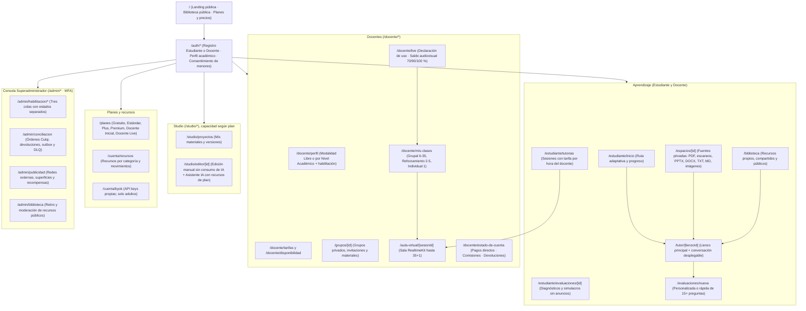

# Diseño de interfaces, experiencia de usuario y flujos Web/PWA — Mentelyx

> **Proyecto:** Mentelyx · **Ubicación:** `docs/03-diseño-de-software/diseño-externo/03-diseño-de-interfaces-y-flujos.md`  
> **Tecnología Cliente:** Next.js + React + TypeScript · **Enfoque:** *Mobile-First* e instalable como PWA  
> **Versión:** 2.3 — 25/11/2026 · **Estado:** diseño externo de vistas, navegación y salvaguardas de interfaz. Implementado en parte: rutas públicas, acceso, espacios y Tutor (sección 4).
>
> **Cambios de la versión 2.3:** la sección 4 pasa de estructura propuesta a la estructura vigente del frontend, organizada por funcionalidades (`features/`) con aprobación del propietario. Incluye las reglas de importación, las carpetas previstas y la correspondencia con la propuesta anterior. Recoge también la dirección de interfaz (sección 1.1) y la identidad de marca (sección 1.2).
>
> **Cambios de la versión 2.2:** aplica la [instrucción maestra](../../00-gestion-del-proyecto/sprint-02/instruccion-maestra.md). El lienzo extensible es la superficie principal y la conversación un panel secundario desplegable; se sustituye la distribución 40/60 (sección 8). Selección por lazo, región y objeto; capas separadas. Recursos de plan por categoría en lugar de créditos Live y Studio; planes Gratuito, Estándar, Plus y Premium, Docente Inicial y Docente Live. Conversaciones de 90 días. Rutas y recorridos de espacios y fuentes, biblioteca, evaluaciones personalizadas, grupos, pagos directos, CulqiOnline, saldo audiovisual, BYOK y anuncios recompensados. Las redacciones sustituidas se resumen en la sección 13.
>
> **Cambios de la versión 2.1:** sincronización CO-06 del [contrato de coordinación](../contrato-coordinacion-datos-seguridad-infraestructura.md): eliminación como revocación inmediata más purga verificable, y PWA sin caché offline de conversaciones ni de recursos con revocación estricta (secciones 8.4, 11 y 12).
>
> **Cambios de la versión 2.0:** se conservan las secciones 1 a 4. Se añaden:
>
> - la resolución de las rutas de habilitación (sección 5) y las rutas nuevas (sección 6);
> - los recorridos completos de Estudiante, Docente y Superadministrador, con Studio y tutorías humanas (sección 7);
> - el diseño del Tutor IA con chat y pizarra sincronizados (sección 8) y del editor de Studio (sección 9);
> - los estados y mensajes de interfaz (sección 10), la accesibilidad y PWA (sección 11) y los criterios de aceptación de UI (sección 12).

## 1. Principios de diseño de interfaz en Mentelyx

1. **Separación clara de cuentas y estados (DA-01, ADR-034):** la interfaz distingue explícitamente las **dos cuentas públicas** (**Estudiante** y **Docente**) y la cuenta interna (**Superadministrador**). En el perfil Docente se muestra con claridad si opera bajo modalidad **independiente/libre** o **por nivel académico** (la formación y su estado de validación se muestran únicamente en la modalidad por nivel académico).
2. **Transparencia de recursos de plan (RC-23, ADR-080):** la interfaz muestra los recursos del periodo por categoría y en lenguaje claro (consultas generales, consultas técnicas, razonamiento profundo, evaluaciones equivalentes, ilustraciones nuevas y almacenamiento) y nunca los mezcla con el saldo audiovisual de Docente Live. Antes de una acción que consuma recursos de Studio o de evaluaciones, muestra la categoría y la cantidad y pide confirmación. Las consultas del Tutor muestran el contador de su categoría.
3. **Herramientas manuales sin consumo de IA (ADR-053):** las herramientas manuales del lienzo y de Studio (texto, lápices, formas, fórmulas, diagramación determinista y simulaciones) llevan el distintivo **«Manual · sin consumo de IA»**.
4. **Protección de menores y zonas sin publicidad (RC-07, ADR-020, ADR-086):** no hay publicidad dentro de las explicaciones del Tutor, en evaluaciones y simulacros, clases en vivo, lecciones pagadas, el editor de materiales ni en operaciones financieras. Los planes de pago no muestran publicidad obligatoria; el plan Gratuito puede mostrarla fuera de esas zonas. Los anuncios recompensados son voluntarios y no se ofrecen a menores.
5. **Lienzo como superficie principal (ADR-083, RF-106):** el aprendizaje ocurre sobre un lienzo 2D extensible; la conversación es secundaria y desplegable. Las páginas, marcos o secciones son una organización opcional del lienzo, no un cuaderno A4 rígido.
6. **Fuentes y modalidad visibles sin pedir modos (ADR-078):** el usuario no elige un modo antes de preguntar. La respuesta indica si se basa en sus fuentes, si las complementa con conocimiento general o si es una explicación general.
7. **Proveedor visible con BYOK (ADR-085):** cuando una consulta usa la API key del usuario, la interfaz indica qué proveedor recibe los datos y que la facturación es del usuario; nunca muestra la clave completa.

### 1.1. Dirección oficial de la interfaz (22/11/2026)

La interfaz se presenta como producto real. Prioriza la calidad visual y la coherencia con la marca.

No muestra textos de avance del desarrollo:
- sprints, incrementos, «demostración» o «datos ficticios»;
- «próximamente», «estará disponible» o listas de funciones futuras.

Lo que no existe no aparece. El avance del proyecto se informa en la documentación, no en pantalla.

Se mantienen los hechos que el producto debe declarar:
- estados vacíos reales;
- errores y límites;
- plazos de retención;
- la etiqueta del proveedor que generó cada respuesta del Tutor.

Esta dirección sustituye a la indicación anterior del encargo de rediseño, que pedía mostrar como tales las funciones pendientes.

### 1.2. Identidad visual de la marca (confirmada el 21/11/2026)

**Paleta oficial, tal cual:**

| Color | Valor | Uso en la interfaz |
|---|---|---|
| Azul marino | `#0A1F44` | Texto principal, barra lateral, portada, panel de acceso y foco sobre superficies claras |
| Verde limón | `#84CC16` | Acción principal (con texto azul marino) y referencias de cita. Nunca como texto sobre blanco (1,98:1) |
| Gris | `#969BA3` | Texto secundario sobre azul marino (5,8:1). Sobre blanco no alcanza el contraste de texto (2,8:1) |
| Blanco | `#FFFFFF` | Superficie principal y placa de los logotipos |
| Negro | `#000000` | Auxiliar |

Los tonos intermedios (superficies, bordes y estados) se derivan de esta paleta en `frontend/src/app/tokens.css`. No la sustituyen.

**Logotipos oficiales:** los originales están en `marca/`:
- `mentelyx_buho.*`, el símbolo;
- `mentelyx_logo_completo.*`, el símbolo con el nombre.

Formatos: `.png`, `.webp`, `.ico` y `.svg`; los `.svg` contienen el PNG incrustado, no vectores. Los derivados web están en `frontend/public/marca/`.

Reglas:
- Los logotipos no se recolorean, no se redibujan y no se generan variantes. Solo se recorta el margen transparente y se cambia el tamaño.
- El búho acompaña al nombre en la navegación. El logotipo completo aparece en el acceso y el registro.
- Sobre azul marino o en modo oscuro, el logotipo va sobre una placa blanca, porque sus partes azules se perderían.
- El favicon es el `.ico` oficial. Los iconos de la PWA ponen el búho sobre blanco.
- Los píxeles de los archivos actuales usan tonos cercanos pero no idénticos a la paleta (`#001828`, `#70B800`, `#686868`). Para que coincidan exactamente, deben exportarse de nuevo desde el original vectorial.

**Tipografía:**
- Lexend para la interfaz y los títulos.
- Source Serif 4 para el material de estudio: explicaciones del Tutor y pasajes citados.
- Ambas autoalojadas con `next/font`.
- Se eligieron en el rediseño del 21/11/2026, a falta de una tipografía de marca documentada.

---

## 2. Mapa de navegación y rutas del Frontend (Next.js App Router)



---

El acceso a Studio depende de permisos, edad y plan, no de un tipo de cuenta adicional. Las pantallas administrativas deben distinguir documentación personal verificada, credenciales académicas validadas y habilitación docente aprobada. El nombre propuesto `/admin/acreditaciones` no unifica esos estados; su organización definitiva debe resolverse junto con los contratos de M4.

## 3. Especificación de vistas críticas por módulo

| Vista / Pantalla | Módulo backend | Componentes clave de UI | Salvaguardas y validaciones en cliente y servidor |
|---|---|---|---|
| **Registro y Selección de Cuenta** (`/auth/registro`) | M1 | Selector de cuenta (`Estudiante`, `Docente`); selector de modalidad docente (`Libre` / `Por nivel académico`); formulario de consentimiento parental para menores. | No exige dominio de colegio. Aclara que declarar un título académico requiere verificación posterior antes de mostrar insignia acreditada. |
| **Lección + Tutor IA** (`/estudiante/cursos/[id]`) | M2, M6 | Contenido versionado; el Tutor se abre sobre el lienzo de la lección con referencias clicables a la misma versión y el contador de la categoría consumida. | Si el proveedor falla o se agota el recurso, el estudiante sigue leyendo la lección, su lienzo y sus apuntes (**degradación elegante**). |
| **Entorno de Evaluación / Simulacro** (`/estudiante/evaluaciones/[id]`) | M3 | Temporizador sincronizado, navegador de preguntas, guardado local preventivo en PWA y botón de entrega idempotente. | **Cero publicidad**. El botón de envío deshabilita dobles clics y envía la misma `Idempotency-Key` si hay reconexión de red. |
| **Reserva y sala de tutorías** (`/estudiante/tutorias` y `/aula-virtual/[id]`) | M4, M5 | Filtro por modalidad (grupal 6–35, reforzamiento 2–5, individual 1), tarifa por hora del docente, contador de cupos y sala audiovisual. | El pago es directo al docente (Yape, tarjeta o QR) y la reserva se confirma al verificarse. El cliente se conecta al SFU con token efímero. Un menor necesita consentimiento verificable para cámara, micrófono o grabación. |
| **Editor de Studio** (`/studio/editor/[id]`) | M2, M5, M6 | Herramientas manuales y panel de generación IA que muestra antes los recursos reutilizables de la biblioteca y la cotización en recursos de plan. | Sin recursos o sin IA disponible, todas las herramientas manuales funcionan. |
| **Planes y pago** (`/planes`) | M5 | Matriz de planes estudiantiles (Gratuito S/0, Estándar S/39,90, Plus S/59,90, Premium S/89,90) y docentes (Docente Inicial S/55, Docente Live S/100 inicial mensual) con sus recursos en lenguaje claro; checkout de CulqiOnline. | Los planes superiores amplían capacidad sin quitar funciones al Gratuito. Las clases humanas no están incluidas. El plan se activa solo tras la confirmación del cargo consultada en el servidor. La renovación automática solo se ofrece con medios que la admiten y con autorización expresa. |

---

## 4. Estructura de carpetas del Frontend (`frontend/`)

El frontend se organiza por funcionalidades (*feature-based*). La adoptó el propietario el 25/11/2026. Cada funcionalidad agrupa en `src/features/<nombre>/` sus componentes y, cuando los tenga, sus peticiones HTTP, hooks, tipos y escenas 3D. Expone su API pública en `index.ts`. `src/app/` es el enrutador de Next.js: contiene rutas, layouts y el CSS global. El layout raíz cumple el papel de `App.tsx`; Next.js no usa `main.tsx`. Lo marcado como «prevista» se crea cuando llega su primer contenido; no se dejan carpetas vacías.

```text
frontend/
├── public/
│   ├── manifest.webmanifest          # PWA instalable (mobile-first)
│   ├── favicon.ico
│   ├── marca/                        # Logotipos oficiales, íconos de la PWA y el búho del hero
│   ├── capturas/                     # Capturas reales del producto para la portada
│   ├── models/                       # (prevista) Modelos 3D .glb y .gltf
│   └── textures/                     # (prevista) Texturas, HDRI y mapas de entorno
├── src/
│   ├── app/                          # Rutas Next.js (App Router), layouts y CSS global
│   │   ├── layout.tsx                # Layout raíz: fuentes, metadatos y CSS global
│   │   ├── globals.css               # Estilos de la aplicación (importa tokens.css y base.css)
│   │   ├── tokens.css                # Paleta oficial, tipografía, espaciados y modo oscuro
│   │   ├── (public)/                 # Landing, /planes y /biblioteca
│   │   ├── (auth)/                   # /auth/ingresar y /auth/registro
│   │   ├── (aprendizaje)/            # /espacios, /espacios/[id], /tutor y /tutor/[id]
│   │   ├── api/v1/[...ruta]/         # Reenvía /api/v1 al Worker de la API
│   │   └── (estudiante)/, (docente)/, (studio)/, aula-virtual/, admin/   # (previstas, sección 2)
│   ├── middleware.ts                 # Envía al ingreso a quien entra sin sesión a /espacios o /tutor
│   ├── features/
│   │   ├── auth/                     # M1: registro e ingreso, estado de la sesión y salida
│   │   ├── espacios/                 # M2: crear espacios, agregar y elegir fuentes
│   │   ├── tutor/                    # M6: panel del Tutor y respuestas con citas
│   │   ├── lienzo/                   # Motor visual: resaltados, notas, región, lazo e hilos de cita
│   │   ├── navegacion/               # Marco de la app (barra lateral y superior, buscador) y cabecera y pie públicos
│   │   └── planes/                   # M5: catálogo de planes y precios
│   ├── components/
│   │   ├── ui/                       # Genéricos: íconos, marca (logotipo) y movimiento
│   │   └── 3d/                       # (prevista) Componentes 3D reutilizables
│   ├── hooks/                        # Hooks globales (useHidratado)
│   └── lib/                          # Clientes HTTP hacia Hono: api-cliente.ts (navegador, Idempotency-Key) y api-servidor.ts
├── next.config.ts                    # Next.js híbrido (SSR, ISR y estático) y alias /dashboard, /login y /registro
├── open-next.config.ts               # Adaptador OpenNext para Cloudflare Workers (ADR-074)
└── wrangler.jsonc                    # Worker del frontend
```

**Forma de cada funcionalidad:**

```text
features/<nombre>/
├── components/   # Componentes propios
├── api/          # (prevista) Peticiones HTTP propias
├── hooks/        # (prevista) Hooks propios
├── types/        # (prevista) Tipos propios
├── scene/        # (prevista, si aplica) Escenas, mallas o animaciones 3D propias
└── index.ts      # API pública: lo único que importan las rutas y las demás funcionalidades
```

**Reglas de importación:**

1. Las rutas de `app/` y las demás funcionalidades importan una funcionalidad solo por su `index.ts`, con el alias `@/` (por ejemplo, `@/features/tutor`). Nunca importan su interior.
2. Dentro de una funcionalidad se usan rutas relativas.
3. `components/ui`, `hooks` y `lib` no importan funcionalidades.
4. Dependencias vigentes, sin ciclos:
   - `tutor` → `lienzo` y `espacios`;
   - `navegacion` → `auth`;
   - `auth` → `lienzo`, porque al cerrar la sesión borra el cuaderno local.

**Pendiente de aprobación:**
- separar las llamadas HTTP de los componentes en `features/*/api/`;
- incorporar Three.js o React Three Fiber para el 3D.

Las carpetas `config/`, `stores/`, `types/`, `utils/` y `assets/` de `src/` se crean cuando haga falta. Los DTO compartidos con el backend vienen del paquete `@mentelyx/contratos`.

**Correspondencia con la propuesta de la versión 2.2:**

| Propuesta 2.2 | Estructura vigente |
|---|---|
| `components/ui/` | `components/ui/` |
| `components/lienzo/` | `features/lienzo/` |
| `components/studio-canvas/`, `live-classroom/`, `plan-resources/` | Futuras `features/studio/`, `features/aula-virtual/` y `features/recursos-plan/` |
| `lib/api-client.ts` | `lib/api-cliente.ts` (navegador) y `lib/api-servidor.ts` (servidor) |
| `lib/auth-session.ts` | `features/auth/` y `middleware.ts` |
| `types/` | `@mentelyx/contratos`; `types/` se crea si aparecen tipos globales propios |
| `public/manifest.json`, `public/icons/` | `public/manifest.webmanifest`, `public/marca/` |


---

## 5. Resolución de pendientes de navegación

| Antes (v1.0) | Ahora (v2.0) | Motivo |
|---|---|---|
| `/admin/acreditaciones` | Tres colas separadas: `/admin/habilitacion/verificaciones-documentales`, `/admin/habilitacion/credenciales-academicas` y `/admin/habilitacion/solicitudes-tutoria` | Verificación documental, validación de credenciales académicas y habilitación docente son procesos con estados independientes (RF-18, RF-58, RF-59; contrato sección 2.4 del documento de API) |
| `/estudiante/mi-habilitacion-tutor` | `/habilitacion` (común a Docente y a Estudiante universitario ≥ 18) | El Estudiante tutor conserva su cuenta; la pantalla muestra solo las solicitudes que le corresponden |
| Panel del Tutor dentro de `/estudiante/cursos/[id]` | Se conserva y se añade `/tutor` como espacio propio de conversaciones | Preguntas generales sin una lección abierta |

El mapa de la sección 2 sigue vigente. Las rutas de esta sección lo complementan.

## 6. Rutas añadidas

| Ruta | Actor | Módulo | Propósito |
|---|---|---|---|
| `/tutor` y `/tutor/[lienzoId]` | Estudiante / Docente | M2, M6 | Lienzo principal con la conversación desplegable (sección 8); lista de conversaciones con su fecha de eliminación automática (90 días) |
| `/estudiante/cursos/[id]/lecciones/[leccionId]` | Estudiante | M2, M6 | Lección versionada con el panel del Tutor contextual (citas a la propia lección) |
| `/estudiante/ejercicios/[id]` | Estudiante | M3, M6 | Práctica con pistas graduadas (sin la respuesta final antes de entregar) |
| `/estudiante/preparacion` | Estudiante | M3 | Objetivo de examen, plan y seguimiento (RF-49–RF-52) |
| `/apuntes` | Estudiante / Docente | M2, M6 | Apuntes propios dentro de un espacio; interruptor «Usar en mi Tutor» |
| `/espacios` y `/espacios/[id]` | Estudiante / Docente | M2, M6 | Espacios privados, carga de fuentes, estado de lectura y selección para el Tutor (RF-101, RF-102) |
| `/cuadernos` y `/lienzos/[id]` | Estudiante / Docente | M2 | Cuadernos y lienzos guardados con ciclo de vida propio |
| `/biblioteca` y `/biblioteca/[recursoId]` | Público (lectura) / autenticado | M2, M6 | Búsqueda, reutilización, valoración, publicación y retiro (BR-01 a BR-12) |
| `/evaluaciones/nueva` | Estudiante | M3, M6 | Evaluación personalizada o rápida (RF-103, RF-104) |
| `/grupos` y `/grupos/[id]` | Docente habilitado / miembros | M4 | Grupos privados, invitaciones y materiales (RF-117) |
| `/invitacion/[token]` | Invitado | M4 | Aceptar una invitación a un grupo |
| `/docente/tarifas` y `/docente/disponibilidad` | Docente habilitado | M4 | Tarifa por hora por modalidad y franjas |
| `/docente/live` | Docente Live | M4, M5 | Declaración de uso, saldo audiovisual, avisos y ampliaciones |
| `/docente/estado-de-cuenta` | Docente | M5 | Pagos directos, comisiones, consumo audiovisual y devoluciones |
| `/planes` y `/cuenta/recursos` | Público / autenticado | M5 | Planes y recursos por categoría con sus movimientos |
| `/cuenta/perfil-academico` | Autenticado | M1 | Nivel educativo y condición de edad; la fecha de nacimiento no se muestra |
| `/cuenta/byok` | Adulto elegible | M6 | API keys propias: proveedor, etiqueta, últimos 4 caracteres, presupuesto y revocación |
| `/estudiante/tutorias` | Estudiante | M4 | Reservas propias, cancelación y acceso al aula |
| `/habilitacion` | Docente / Estudiante universitario ≥ 18 | M4 | Tres tarjetas de estado separadas y sus formularios |
| `/studio/editor/[id]` (existente) | Usuario con Studio | M2, M5, M6 | Paneles añadidos: Pizarra, Asistente IA, Versiones y permisos, Exportar |
| `/studio/trabajos` | Usuario con Studio | M2 | Historial de generaciones y exportaciones con su estado y los recursos reintegrados |
| `/consentimiento/[token]` | Adulto responsable (sin cuenta) | M1 | Decisión de consentimiento por finalidad |
| `/admin/habilitacion/*` | Superadministrador (MFA) | M4 | Colas de la sección 5 |
| `/admin/rag` | Superadministrador (MFA) | M2, M6 | Revisión editorial de material para RAG, estado de indexación, retiro de emergencia |
| `/admin/ia` | Superadministrador (MFA) | M6 | Estado de rutas, circuitos, costos, presupuestos y configuración versionada |
| `/admin/ia/calidad` | Superadministrador (MFA) | M6 | Cola de respuestas reportadas |
| `/admin/auditoria` | Superadministrador (MFA) | M1 | Consulta de `audit_logs` |
| `/admin/publicidad` | Superadministrador (MFA) | M7 | Redes externas, superficies permitidas y recompensas verificadas, sin datos educativos |
| `/admin/biblioteca` | Superadministrador (MFA) | M2 | Retiro de emergencia y moderación de recursos públicos |
| `/admin/pagos` | Superadministrador (MFA) | M5 | Conciliación con CulqiOnline, devoluciones y comisiones |

**Zonas sin publicidad (amplía el principio 4):** las explicaciones del Tutor y el lienzo mientras hay una consulta, `/estudiante/evaluaciones/*`, `/aula-virtual/*`, las lecciones pagadas, `/studio/*`, `/planes` durante el pago, `/docente/estado-de-cuenta`, `/habilitacion`, `/consentimiento/*` y las descargas de materiales. Los planes de pago no muestran publicidad obligatoria.

## 7. Recorridos completos

**Convención de las tablas:** *Pantalla* → *Acción del usuario* → *Llamada API* → *Resultado y salvaguardas*. Los estados de error usan los mensajes de la sección 10.

### 7.1. Estudiante

#### E1. Registro (incluye menores)

| Paso | Pantalla | Acción | API | Resultado y salvaguardas |
|---|---|---|---|---|
| 1 | `/auth/registro` | Elige «Estudiante», nivel educativo y fecha de nacimiento | — | La fecha se usa solo para la condición de edad y nunca se muestra en el perfil (ADR-089). Si es menor de 18, aparece el campo obligatorio «Correo del adulto responsable» |
| 2 | Ídem | Envía | `POST /auth/registro` | Siempre `202` «Revisa tu correo» (no revela correos existentes) |
| 3 | Correo → `/auth/verificar` | Abre el enlace | `POST /auth/correo/verificar` | Cuenta activa. Un menor queda en el estado «Esperando consentimiento» y solo ve el catálogo público |
| 4 | `/consentimiento/[token]` (adulto) | Acepta por finalidad: uso de la plataforma, Tutor IA, audiovisual | `POST /consentimientos-parentales/:token/decision` | Cada finalidad se habilita por separado. El Tutor IA del menor usa las rutas permitidas para menores. La generación de ilustraciones nuevas y de 3D externo sigue bloqueada; los visores 3D, las simulaciones y la biblioteca están disponibles (RF-113). Sin anuncios recompensados ni BYOK |

#### E2. Diagnóstico y ruta

| Paso | Pantalla | Acción | API | Resultado |
|---|---|---|---|---|
| 1 | `/estudiante/inicio` | «Haz tu diagnóstico» | `POST /evaluaciones/:id/intentos` | Intento ligado a la versión |
| 2 | `/estudiante/evaluaciones/[id]` | Responde (guardado local y remoto) | `PUT …/respuestas` (`If-Match`) | Indicador «Guardado en tu dispositivo» / «Guardado en el servidor» (RF-69). **Tutor bloqueado** y sin anuncios |
| 3 | Ídem | Entrega | `POST …/entregar` (`Idempotency-Key`) | Calificación determinista (M3); el botón se desactiva durante el envío |
| 4 | `/estudiante/inicio` | Ve su ruta | `GET /evaluaciones/progreso/me` | Recomendaciones reproducibles; ninguna generada por el LLM |

#### E3. Lección con el Tutor y fuentes

| Paso | Pantalla | Acción | API | Resultado |
|---|---|---|---|---|
| 1 | Lección v2 | Abre el Tutor | `POST /tutor-ia/conversaciones` (contexto: lección) | Contador de la categoría; aviso «Esta conversación se elimina 90 días después de tu última actividad; te avisaremos antes» |
| 2 | Panel | Pregunta | `POST /tutor-ia/consultas` (SSE) | Texto por segmentos; referencias `[1]` que abren el bloque citado de la **misma versión** |
| 3 | Panel | Valora con 👍/👎 | `POST …/valoracion` | Al segundo 👎 en el mismo tema aparece «¿Quieres ayuda de un docente?» (E8) |
| 4 | Panel | «Guardar como recurso» o «Fijar en mi lienzo» | `POST /recursos` o `POST /lienzos/:id/operaciones` | Copia bajo su control con ciclo de vida propio, privada por defecto (BR-05, BR-06) |

#### E4. Resolver con la pizarra (matemática)

| Paso | Pantalla | Acción | API | Resultado |
|---|---|---|---|---|
| 1 | `/tutor/[lienzoId]` | Escribe en la barra flotante «Deriva f(x)=x³−3x y grafica f y f′» (sin elegir modo) | `POST /tutor-ia/consultas` | Estado «Razonando…», luego «Verificando…» |
| 2 | Lienzo + conversación | Observa | Eventos `texto.delta` + `escena.paso` | La escena se coloca en la capa IA junto a la consulta; cada paso aparece cuando su segmento termina y el verificado lleva «✓ verificado» |
| 3 | Lienzo | Usa ◀ ▶, cambia la velocidad o toca un párrafo de la conversación | — (local) | Salto determinista al paso; el párrafo activo se resalta |
| 4 | Lienzo | «Llevar a Studio» | `POST /studio/proyectos` con el bloque `visual_scene` | Sin consumo de IA; escena editable |
| 5 | Chat | Pulsa «Detener» durante la generación | Cierre del flujo + `POST /tutor-ia/consultas/:op/cancelar` | Se conserva lo recibido; el consumo se ajusta a lo medido (sección 10) |

#### E5. Foto de un ejercicio

| Paso | Pantalla | Acción | API | Resultado |
|---|---|---|---|---|
| 1 | `/tutor` | 📷, elige una foto | `POST /tutor-ia/adjuntos/url-subida` → PUT R2 | La imagen se comprime en el cliente (lado mayor ≤ 2048 px) antes de subirla |
| 2 | Ídem | Espera | `POST /tutor-ia/transcripciones` | Se muestra «¿Es esto lo que dice tu ejercicio?» con la fórmula renderizada y editable |
| 3 | Ídem | Corrige o confirma | `POST /tutor-ia/consultas` con `transcripcionConfirmada` | Resolución verificada. Si es `TRANSCRIPCION_ILEGIBLE`: «Toma otra foto con más luz» |

#### E6. Práctica con pistas

| Paso | Pantalla | Acción | Resultado |
|---|---|---|---|
| 1 | `/estudiante/ejercicios/[id]` | «Necesito una pista» | Pista de nivel 1 (concepto). El contador «Pista 1 de 4» es visible |
| 2 | Ídem | Pide más pistas | Niveles 2 (estrategia), 3 (siguiente paso) y 4 (ejemplo análogo). **Nunca** la respuesta del ejercicio |
| 3 | Ídem | Entrega | M3 corrige. Después, «Ver solución explicada» se habilita en el Tutor |

#### E7. Simulacro

Durante el simulacro, el botón del Tutor desaparece. Si se abre un enlace directo, se muestra «El Tutor no está disponible durante tu simulacro» (`TUTOR_BLOQUEADO_EVALUACION`). Al entregar se habilita el repaso con el Tutor sobre las preguntas falladas.

#### E8. Del Tutor a una tutoría humana con pago directo

| Paso | Pantalla | Acción | API | Resultado |
|---|---|---|---|---|
| 1 | Panel del Tutor | Ve la tarjeta «Ayuda de un docente» (hasta 3 ofertas, sin anuncios) | Evento `sugerencia` (M4 `buscarOfertasTutoria`) | Cada oferta muestra la modalidad y la tarifa por hora del docente |
| 2 | `/estudiante/tutorias` | Elige una sesión | `GET /clases/sesiones?tema=…` | Perfil del docente: credenciales con insignia **solo** si están validadas |
| 3 | Confirmación | Revisa el importe en soles, el medio de pago directo (Yape, tarjeta o QR) y las reglas de cancelación | — | Texto: «Pagas directamente al docente; Mentelyx no custodia este pago» (RF-118) |
| 4 | Ídem | Reserva | `POST /clases/sesiones/:id/reservar` (`Idempotency-Key`) | Reserva en espera. `409 CUPO_AGOTADO` → muestra otras sesiones |
| 4b | Ídem | Declara su pago | `POST /clases/reservas/:id/pago-directo` | «Esperando la confirmación del docente»; al confirmarse, la reserva pasa a CONFIRMADA. Una clase gratuita se confirma sin pago |
| 5 | `/aula-virtual/[sesionId]` | Ingresa | `POST /clases/sesiones/:id/ingresar` | Token SFU efímero. Un menor necesita el consentimiento audiovisual vigente |

#### E9. Fuentes privadas en un espacio

Subir un PDF, un escaneo, un PPTX, un DOCX, un TXT, un Markdown o una imagen a `/espacios/[id]` y activar «Usar en mi Tutor» indexa el documento en el ámbito privado (RF-101, RF-102). La tarjeta muestra el estado («Preparando», «Leyendo el escaneo», «Listo» o «No se pudo leer») y el almacenamiento usado. Las citas abren la página, diapositiva o sección. El interruptor «Responder solo con mis fuentes» se respeta en la consulta (`fuentes.exclusivas`). Para cuentas de menores, el tratamiento de datos reales sigue los bloqueos vigentes ([diseño RAG](../diseño-especializado/02-diseño-rag.md)).

#### E10. Estudiante universitario adulto que solicita habilitación de tutoría

| Paso | Pantalla | Acción | API | Resultado |
|---|---|---|---|---|
| 1 | `/habilitacion` | Ve dos tarjetas: «Verificación documental» y «Habilitación para tutorías». **No** ve «Credenciales académicas» | `GET /habilitacion/me` | Texto: «Seguirás siendo Estudiante; te presentaremos como estudiante tutor autorizado» |
| 2 | Ídem | Sube los documentos | `POST /habilitacion/documentos/url-subida` + `POST /habilitacion/verificaciones-documentales` | Estado «Pendiente». Aviso: los documentos no se procesan con IA y se eliminan 90 días después de la decisión |
| 3 | Ídem | Solicita la tutoría sobre los temas que domina | `POST /habilitacion/solicitudes-tutoria` | La aprobación espera a la verificación documental aprobada |

#### E11. Pregunta sobre una región de una ilustración (selección por lazo)

| Paso | Pantalla | Acción | API | Resultado y salvaguardas |
|---|---|---|---|---|
| 1 | `/tutor/[lienzoId]` | Elige «Lazo» y encierra la turbina de un diagrama de motor turbofán | — (local) | La región se resalta; la barra muestra «Región seleccionada · 1 imagen, 2 objetos» |
| 2 | Ídem | Dibuja una flecha y escribe «¿Qué hace esta parte?» | Operaciones en la capa USUARIO | La flecha y el texto son del estudiante y nunca los modifica la IA |
| 3 | Ídem | Envía | `POST /tutor-ia/consultas` con `seleccion {lienzoId, elementIds, region}` | M2 entrega a M6 solo los objetos seleccionados y un recorte mínimo de la imagen (`obtenerSeleccionLienzo`) |
| 4 | Lienzo | Ve la explicación | `contribucionesLienzo` | Nota y conectores en la capa IA junto a la región; puede ocultarlos, borrarlos o fijarlos |

#### E12. Evaluación personalizada o rápida

| Paso | Pantalla | Acción | API | Resultado y salvaguardas |
|---|---|---|---|---|
| 1 | `/evaluaciones/nueva` (o «Ponme a prueba» en el Tutor) | Elige «Rápida» o personaliza cantidad, dificultad, fuentes, temas, tipos y complemento general | — | No se pide una ficha del catálogo (RF-49). «Rápida» propone al menos 15 preguntas variadas |
| 2 | Ídem | Ve la cotización | — | «Usará {n} evaluaciones equivalentes de tu plan (quedan {m})» |
| 3 | Ídem | Genera | `POST /evaluaciones/generaciones` (`Idempotency-Key`) | Progreso; si falla por el servicio, el recurso se libera |
| 4 | `/estudiante/evaluaciones/[id]` | Responde | Flujo de E2 | Sin Tutor ni anuncios; la calificación oficial usa métodos reproducibles; las abiertas reciben retroalimentación formativa con rúbrica y sus limitaciones |

#### E13. Biblioteca: reutilizar antes de generar

| Paso | Pantalla | Acción | API | Resultado y salvaguardas |
|---|---|---|---|---|
| 1 | Tutor o `/biblioteca` | Pide «un modelo 3D de motor turbofán» | `GET /biblioteca?q=…` | Primero se muestran recursos existentes autorizados con su procedencia y valoración (BR-02, BR-03) |
| 2 | Ídem | Elige «Usar» o «Adaptar» | `POST /lienzos/:id/operaciones` | Una plantilla determinista cambia sus parámetros sin invocar un modelo |
| 3 | Ídem | Si nada sirve: «Generar uno nuevo» | Cotización y generación | Solo entonces se consume un recurso |
| 4 | Recurso propio | «Publicar» | `POST /recursos/:id/publicar` | Declaración de derechos; se rechaza con conversaciones, datos personales, fuentes privadas o evaluaciones reservadas (BR-12) |
| 5 | Ídem | «Retirar» | `POST /recursos/:id/retirar` | Deja de mostrarse y de recuperarse (BR-11) |

#### E14. Anuncio recompensado (adulto, plan Gratuito)

| Paso | Pantalla | Acción | API | Resultado y salvaguardas |
|---|---|---|---|---|
| 1 | Aviso de `CUOTA_AGOTADA` | Ve «Obtén 1 consulta técnica viendo un anuncio» | `GET /publicidad/recompensas/oferta` | Solo fuera de las zonas sin publicidad; nunca a menores |
| 2 | Reproductor aislado | Ve el anuncio | Verificación servidor a servidor de la red | El navegador no puede conceder la recompensa |
| 3 | Aviso | «Recibiste 1 consulta técnica» | `RecompensaVerificada` → M5 | Concesión única; si no hay anuncios disponibles, el acceso educativo esencial sigue igual |

#### E15. BYOK

| Paso | Pantalla | Acción | API | Resultado y salvaguardas |
|---|---|---|---|---|
| 1 | `/cuenta/byok` | Conecta una API key de un proveedor autorizado y fija un presupuesto mensual | `POST /tutor-ia/byok` | Aviso: «Tus consultas con esta clave se envían a {proveedor} y te las factura ese proveedor. No es tu suscripción de chat.» Solo se muestran los últimos 4 caracteres |
| 2 | Tutor | Pregunta con la clave activa | `POST /tutor-ia/consultas` con `byokCredentialId` | Etiqueta «Usando tu clave de {proveedor}»; no consume consultas del plan |
| 3 | Ídem | La clave falla | `BYOK_CREDENCIAL_INVALIDA` | «Tu proveedor rechazó la clave. No usamos la capacidad de Mentelyx en su lugar.» |

#### E16. Suscripción con CulqiOnline

| Paso | Pantalla | Acción | API | Resultado y salvaguardas |
|---|---|---|---|---|
| 1 | `/planes` | Elige un plan y un medio (tarjeta, Yape, PagoEfectivo o Cuotéalo) | — | Precio en soles y recursos del plan; la renovación automática solo aparece en medios que la admiten |
| 2 | Checkout de Culqi | Paga | `POST /pagos/ordenes` con el token | Los datos de la tarjeta no pasan por Mentelyx |
| 3 | `/cuenta/recursos` | Espera | Consulta del estado real en el servidor | «Pago confirmado» solo tras la verificación; un webhook repetido no duplica el plan |

### 7.2. Docente

#### D1. Registro y modalidad

`/auth/registro` → «Docente» → selector de modalidad con su explicación:

- **Independiente:** «Muestras temas y experiencia. No se piden títulos.»
- **Por nivel académico:** «Indicas niveles y asignaturas; podrás validar tus títulos.»

Las personas menores de 18 años reciben `EDAD_INSUFICIENTE_DOCENTE`. Studio manual queda disponible al verificar el correo. Docente Inicial (S/55) da capacidades profesionales y de materiales sin clases en vivo; Docente Live (S/100 inicial mensual) permite impartirlas tras la habilitación. Pagar no acredita al docente.

#### D2. Perfil y habilitación

| Modalidad | Tarjetas en `/habilitacion` | Perfil público |
|---|---|---|
| `LIBRE` | Verificación documental · Habilitación para tutorías | Temas y experiencia; **sin** campos ni insignias de títulos |
| `NIVEL_ACADEMICO` | Verificación documental · Credenciales académicas (una por título) · Habilitación para tutorías | Niveles y asignaturas. La insignia «Título validado» solo aparece si la credencial está `APROBADA` |

Sin habilitación, `/docente/mis-clases` permite borradores privados. «Publicar» queda desactivado con la explicación «Necesitas la habilitación para tutorías».

#### D3. Studio manual: presentación y pizarra (sin consumo de IA)

| Paso | Pantalla | Acción | Resultado |
|---|---|---|---|
| 1 | `/studio/proyectos` | «Nuevo proyecto» | Proyecto privado v1 |
| 2 | `/studio/editor/[id]` | Agrega diapositivas, texto, fórmulas (editor LaTeX con vista previa) y una pizarra con función, raíces y pasos | Las herramientas llevan el distintivo «Manual · sin consumo de IA» |
| 3 | Ídem | Edita sin conexión | «Cambios locales sin sincronizar» |
| 4 | Ídem | Recupera la conexión | `PUT /studio/proyectos/:id` con `If-Match`. Ante un conflicto: «Otra versión se guardó antes. ¿Guardar la tuya como versión nueva, ver diferencias o descartar?» |

#### D4. Studio con IA: generar, revisar y exportar

| Paso | Pantalla | Acción | API | Resultado y salvaguardas |
|---|---|---|---|---|
| 1 | Panel «Asistente IA» | Describe: «Presentación de 12 diapositivas sobre derivadas para 5.º de Secundaria» | `GET /biblioteca` y `POST /studio/cotizaciones-ia` | Primero muestra presentaciones reutilizables. Confirmación: «Usará **{n} documentos equivalentes** de tu plan (quedan {m}). Se reintegran si la generación falla por nuestra causa.» |
| 2 | Ídem | Confirma | `POST /studio/proyectos/:id/generar-ia` (`Idempotency-Key`) | Trabajo en `/studio/trabajos` con su progreso. Se puede seguir editando |
| 3 | Aviso | «Tu presentación está lista como **borrador v2**» | `StudioGenerationCompleted` | Los ejercicios no verificados llevan la marca «Revisa antes de publicar» |
| 4 | Editor | Corrige manualmente | `PUT /studio/proyectos/:id` | Sin consumo de IA |
| 5 | «Exportar» | Elige PPTX o PDF, la plantilla y la audiencia (estudiantes o docente con notas) | `POST /studio/proyectos/:id/exportaciones` | Sin consumo de IA. El PPTX estudiantil no lleva soluciones en notas, metadatos ni diapositivas ocultas. Al terminar, «Descargar» genera una URL de 5 min |
| 6 | Falla | La generación falla por causa del servicio | `StudioGenerationFailed` | «No pudimos generar tu presentación. Reintegramos el recurso a tu plan.» Visible en `/studio/trabajos` |

#### D5. Publicar con permisos separados

El panel «Versiones y permisos» tiene **cuatro interruptores independientes**, cada uno con su explicación:

- **Publicar:** visible para los destinatarios elegidos o, con la declaración de derechos, en la biblioteca pública (BR-07).
- **Comercializar:** requiere contrato (RF-46).
- **Usar en el Tutor IA de Mentelyx (RAG):** las respuestas del Tutor pueden citar este material.
- **Entrenamiento de modelos:** desactivado por defecto. No disponible para cuentas de menores (RC-12, RC-18).

Desactivar RAG muestra: «Dejará de usarse en el Tutor en menos de un minuto».

#### D6. Programar y dictar una clase

`/docente/mis-clases` → elegir la modalidad (grupal de 6–35, reforzamiento de 2–5 o individual) y la tarifa vigente o «gratuita» → la viabilidad de M5 se muestra **antes** de publicar (RF-79, EQ-28). Al iniciar, M5 reserva la capacidad audiovisual estimada; si no alcanza, la sala pide autorizar una ampliación y no se inicia sin ella. Una clase en curso no se interrumpe por el saldo. En la sala `/aula-virtual/[sesionId]`, el docente comparte la pizarra de Studio mediante la compartición de pantalla del SFU (MVP). La pizarra colaborativa es posterior (`03-motor-visual-y-pizarra.md` sección 13.4).

#### D7. Asistencia y estado de cuenta

`/docente/estado-de-cuenta` muestra por sesión la asistencia, los pagos directos declarados y verificados con su medio, las comisiones de Mentelyx devengadas según las condiciones comerciales vigentes, el consumo audiovisual y las devoluciones. No presenta custodia de dinero ni reparto automático.

#### D8. Grupo privado

| Paso | Pantalla | Acción | API | Resultado y salvaguardas |
|---|---|---|---|---|
| 1 | `/grupos` | «Nuevo grupo» | `POST /grupos` | Grupo privado; no aparece en búsquedas |
| 2 | `/grupos/[id]` | Invita por correo | `POST /grupos/:id/invitaciones` | Enlace de un solo uso con vencimiento |
| 3 | `/invitacion/[token]` | El invitado acepta | `POST /grupos/invitaciones/:token/aceptar` | Un menor necesita consentimiento parental |
| 4 | `/grupos/[id]` | Comparte un material | `POST /grupos/:id/recursos` | Solo los miembros vigentes lo leen; al retirar a alguien, pierde el acceso al instante |

#### D9. Docente Live: declaración, avisos y devolución

| Paso | Pantalla | Acción | API | Resultado y salvaguardas |
|---|---|---|---|---|
| 1 | `/docente/live` | Declara horas por semana, modalidad, participantes estimados, horarios y grabación | `PUT /docentes/me/declaracion-live` | Estimación de participante-minutos frente a la capacidad del periodo (parámetros de piloto) |
| 2 | Ídem | Ve el saldo | `GET /docentes/me/saldo-audiovisual` | Barra con capacidad, reservado y consumido; avisos al 70, 90 y 100 % |
| 3 | Aviso del 100 % | Autoriza o no una ampliación | `POST /docentes/me/ampliaciones` | Sin autorización no hay cargos adicionales |
| 4 | Cierre del periodo | Recibe el resumen | Notificación de M5 | «Usaste {pm} participante-minutos; te devolveremos S/{importe} por CulqiOnline», con la comisión no recuperable aparte. Los valores son de piloto |

### 7.3. Superadministrador

| ID | Recorrido | Pantalla | Pasos clave | Salvaguardas |
|---|---|---|---|---|
| A1 | Acceso | `/admin` | Inicio de sesión + MFA; panel de disponibilidad, errores, costos de IA y presupuesto (RF-71) | MFA reciente para cada acción sensible; auditoría de las vistas de datos |
| A2 | Habilitación | `/admin/habilitacion/*` | Tres colas separadas; cada solicitud con sus documentos en un visor privado; decisión `APROBAR`, `RECHAZAR` o `SOLICITAR_SUBSANACION` con motivo | La aprobación de una tutoría exige la verificación documental aprobada; los documentos no se envían a la IA |
| A3 | Material para RAG | `/admin/rag` | Revisa el origen, la calidad y la licencia (HU-30); aprueba → estado `PENDIENTE` → `VIGENTE`; ve los fragmentos marcados con señal de inyección | Retiro de emergencia con motivo (efecto inmediato) |
| A4 | Rutas y presupuestos de IA | `/admin/ia` | Edita `mentelyx.rutas-ia/v1` y los presupuestos con `If-Match`; ve las diferencias antes de guardar | Cambio prospectivo, MFA y auditoría; una ruta sin benchmark aprobado no se puede activar (puerta de liberación) |
| A5 | Alerta de costo | `/admin/ia` | Alerta del 90 % → ve la degradación automática aplicada; puede elevar el presupuesto o mantenerla | Lecciones y edición manual nunca se detienen |
| A6 | Calidad de la IA | `/admin/ia/calidad` | Revisa las respuestas reportadas (contenido visible solo si sigue dentro de la retención y con acceso auditado); confirma o descarta; asigna una acción (ajustar instrucciones, corregir material, bloquear un tema) | Sin exportación masiva de conversaciones |
| A7 | Conciliación e incidencias | `/admin/conciliacion` y `/admin/pagos` | Órdenes y devoluciones de CulqiOnline frente al estado consultado; comisiones registradas por medio; DLQ | MFA; los importes se corrigen por movimientos compensatorios, nunca editándolos |
| A8 | Publicidad | `/admin/publicidad` | Redes externas, superficies permitidas y estado de las recompensas | Sin segmentación con datos académicos ni privados; bloqueada para menores |
| A9 | Biblioteca | `/admin/biblioteca` | Revisión de reportes; retiro de emergencia | El retiro revoca el acceso, invalida cachés y purga embeddings |

## 8. Tutor IA sobre la pizarra inteligente

La superficie principal es un lienzo 2D extensible; la conversación es un panel secundario desplegable (IM, sección 9; ADR-083; RF-106 a RF-108). Sustituye la distribución obligatoria de chat al 40 % y pizarra al 60 % de la versión 2.1 (sección 13). El motor visual declarativo, sus esquemas y sus algoritmos se conservan ([motor visual](../diseño-especializado/03-motor-visual-y-pizarra.md)).

### 8.1. Disposición

**Escritorio (≥ 1024 px):** lienzo a pantalla completa con fondo de puntos; herramientas flotantes a la izquierda; barra de consulta flotante abajo; panel de conversación desplegable a la derecha, de ancho ajustable y que puede cerrarse; zoom y minimapa abajo a la derecha.

```text
┌──────────────────────────────────────────────────────────────────────────────┐
│ Espacio: Cálculo I · 2 fuentes elegidas   Consultas técnicas: 72 de 100  [⋯] │
├────┬──────────────────────────────────────────────────────┬──────────────────┤
│ ▣  │ ·   ·   ·   ·   ·   ·   ·   ·   ·   ·   ·   ·   ·   · │ CONVERSACIÓN  [×]│
│ ◌  │ ·   ┌──────────────────┐  ·   ·   ·   ·   ·   ·   · │ Tú: ¿por qué la  │
│ ✎  │ ·   │ y = x²     ╱ m=2 │ ◄── «¿por qué 2?» (tuyo) · │ pendiente es 2?  │
│ ▤  │ ·   │         •╱       │  ·   ·   ·   ·   ·   ·   · │ Tutor · Según tus│
│ →  │ ·   └──────────────────┘  ┌─ IA ─────────────────┐ · │ fuentes [1]      │
│ T  │ ·   ·   ·   ·   ·   ·   · │ s1 Derivada en x=1 ✓ │ · │ s1 … ✓ verificado│
│ ∑  │ ·   ·   ·   ·   ·   ·   · │ [⏮][◀][▶] Paso 1/2  │ · │ Complemento      │
│ ⧉  │ ·   ·   ·   ·   ·   ·   · └──────────────────────┘ · │ general: …       │
│ ↶↷ │ ·   ·   ·   ·   ·   ·   ·   ·   ·   ·   ·   ·   ·   · │ [1] Sílabo, p. 4 │
├────┴──────────── ╭──────────────────────────────────────╮ ───┴──────────────┤
│                  │ Pregunta sobre la selección…  📷  ➤ │     [−] 100 % [+] │
│                  ╰──────────────────────────────────────╯                   │
└──────────────────────────────────────────────────────────────────────────────┘
```

**Tableta:** igual, con la conversación como hoja lateral superpuesta. El lápiz dibuja y el dedo desplaza; el usuario puede cambiar esa asignación.

**Móvil (primero):** lienzo a pantalla completa; herramientas compactas abajo; barra de consulta flotante sobre ellas; conversación en una hoja inferior con tres alturas (oculta, media y completa). El lazo se activa con su herramienta o con una pulsación larga. Una escena paso a paso conserva su minirreproductor de 64 px anclado al objeto; tocar un párrafo de la conversación lleva el lienzo a ese objeto y a ese paso.

Las páginas, marcos y secciones son organizaciones opcionales del lienzo. El lienzo guardado tiene un ciclo de vida independiente de la conversación.

### 8.2. Selección contextual (RF-107)

| Modo | Gesto | Lo que se envía al Tutor |
|---|---|---|
| Objeto | Toque o clic | `elementIds` del objeto con sus parámetros (función, figura, fórmula) |
| Región | Rectángulo | `region` en coordenadas de mundo y los objetos que interseca |
| Lazo | Trazo libre cerrado | La caja envolvente del lazo, los objetos que contiene y, para imágenes, un recorte mínimo que prepara M2 en el servidor |

La barra de consulta muestra lo seleccionado («Región · 1 imagen, 2 objetos»). Sin selección, la consulta usa el contexto visible del lienzo y las fuentes elegidas.

### 8.3. Capas y contribuciones

| Capa | Contenido | Regla |
|---|---|---|
| Original | Objetos importados, recursos de la biblioteca y fragmentos autorizados | Se conservan su procedencia y versión |
| Usuario | Trazos, resaltados, flechas, textos y objetos del estudiante | La IA nunca los modifica ni los borra |
| IA | Explicaciones, escenas y conectores propuestos por el Tutor | Se pueden ocultar, borrar o fijar; editar uno crea una copia en la capa del usuario |

Cada capa se puede mostrar u ocultar. Las operaciones usan coordenadas de mundo independientes del zoom, `opId` y `baseRevision`; deshacer y rehacer son locales y se sincronizan como operaciones.

### 8.4. Componentes

| Componente | Responsabilidad | Accesibilidad |
|---|---|---|
| `EncabezadoEspacio` | Espacio, fuentes elegidas, contador de la categoría, indicador BYOK y menú (eliminar conversación, ver la retención) | El contador se anuncia al cambiar |
| `LienzoExtensible` | Desplazamiento, zoom, cuadrícula, carga por región y capas | Lista alternativa de objetos navegable por teclado |
| `BarraHerramientas` | Seleccionar, lazo, región, lápices, resaltador, flecha y conector, texto, fórmula, imagen, 3D, deshacer y rehacer | Atajos de teclado y nombres accesibles |
| `BarraConsulta` | Texto (0/4000), adjunto, resumen de la selección, Enviar/Detener | «Enviar» / «Detener respuesta» |
| `PanelConversacion` | Mensajes segmentados (Markdown + KaTeX), referencias, verificación y valoración | `aria-live="polite"` por **segmento completo** |
| `IndicadorFuentes` | «Según tus fuentes», «Tus fuentes + complemento general» (con los párrafos complementarios marcados) o «Explicación general» | Texto, no solo color |
| `EtiquetaRuta` | «Razonamiento técnico · DeepSeek vía Workers AI», «Explicación general · Gemma vía Workers AI» o «Tu clave de {proveedor}» | Texto |
| `InsigniaVerificacion` | ✓ verificado · ⚠ no verificado · ✕ no pudimos verificar este paso | Texto alternativo explícito |
| `ReproductorEscena` y `Visor3D` | Pasos, velocidad, saltos; modelos GLB/glTF y simulaciones | Controles por teclado y descripción accesible |
| `TarjetaTutoriaHumana` | Hasta 3 ofertas de M4 con la tarifa por hora | Sin publicidad |

### 8.5. Estados

- **Conversación:** `VACIA` → `ENVIANDO` → `RECIBIENDO` (texto y pasos) → `VERIFICANDO` → `COMPLETA` | `PARCIAL` | `ERROR`. «Detener» la deja en `CANCELADA` conservando lo recibido; sin red pasa a `RECONECTANDO` y consulta `GET /tutor-ia/consultas/{operationKey}`.
- **Lienzo:** `SINCRONIZADO` → `CAMBIOS_LOCALES` → `GUARDANDO` → `SINCRONIZADO` | `CONFLICTO`. Ante `409 CONFLICTO_LIENZO` se aplican las operaciones del servidor y las propias que no chocan; si dos cambian la misma propiedad, el usuario elige.

### 8.6. Retención y eliminación visibles

- Cada conversación muestra «Se elimina automáticamente el {fecha}»: 90 días desde la última actividad, con aviso 7 días antes (parámetros de piloto, ADR-079).
- «Eliminar conversación» confirma una vez y **retira el acceso de inmediato**; la purga de mensajes, escenas, adjuntos y derivados privados se completa de forma asíncrona y verificable (CO-06). El texto no promete el borrado instantáneo de respaldos ni de archivos descargados.
- Los lienzos, cuadernos, apuntes y recursos guardados no se eliminan con la conversación. No se conservan resúmenes automáticos de la conversación eliminada.
- El tratamiento de datos reales queda sujeto a las condiciones legales (ADR-079); los recorridos se prueban con datos sintéticos.
- Al cerrar sesión, cambiar de cuenta o expirar la conversación se borra el estado local del dispositivo.

## 9. Diseño del editor de Studio (ampliación)

| Zona | Contenido | Reglas |
|---|---|---|
| Barra superior | Título, estado de guardado, versión, «Versiones y permisos», «Exportar» | El estado de guardado sigue RF-69 |
| Barra de herramientas manuales | Texto, fórmula, formas, función, construcciones, lápiz, pasos, plantillas profesionales | Distintivo «Manual · sin consumo de IA» |
| Panel «Asistente IA» | Tipo de material, audiencia, nivel, extensión, «Usar mis fuentes», recursos reutilizables de la biblioteca, cotización en recursos de plan con desglose | Sin recursos ofrece ver planes, una recompensa (adultos) o BYOK, sin bloquear la edición manual (EQ-30) |
| Progreso de la generación | Los 10 pasos del proceso de Studio (objetivo, fuentes, plan, dirección visual, plantilla, estructura, fórmulas y figuras, render, revisión, edición) | Los controles de calidad visual y de contenido se muestran como avisos editables |
| Bandeja de trabajos | Generaciones y exportaciones en curso, listas o fallidas, con los recursos reintegrados | Notificación al terminar; se puede cerrar el editor |
| Diálogo «Exportar» | Formato (PDF / PPTX), plantilla con vista previa, audiencia (Estudiantes / Docente con notas) | Texto: «Exportar no consume recursos de IA» |
| Cuentas de menores | Ocultas la generación de ilustraciones nuevas y la de 3D externo; visores 3D, simulaciones y biblioteca disponibles; el interruptor de entrenamiento está desactivado | Mensaje: «Esta función no está disponible para tu cuenta» |

## 10. Estados y mensajes de interfaz

| Situación | Código | Mensaje propuesto | Acción ofrecida |
|---|---|---|---|
| Recurso del periodo agotado | `CUOTA_AGOTADA` | «Usaste tus {recurso} de este mes. Tus lecciones, lienzos y apuntes siguen disponibles.» | Ver planes · Ver un anuncio (adultos, si hay oferta) · Usar mi clave · Fecha de renovación |
| Proveedor no disponible | `PROVEEDOR_NO_DISPONIBLE` | «El Tutor no está disponible en este momento. No se descontó ninguna consulta. Puedes seguir con las herramientas del lienzo y la biblioteca.» | Reintentar más tarde |
| Nada en las fuentes exclusivas | Estado `SIN_CONTEXTO` | «No encontramos esto en las fuentes que elegiste.» | Responder con una explicación general · Elegir otras fuentes · Ver docentes |
| Respuesta general | `modoFuentes = GENERAL` | «Explicación general: no proviene de tus fuentes.» | — |
| Respuesta mixta | `modoFuentes = MIXTA` | «Esta parte complementa tus fuentes con conocimiento general.» (en cada párrafo complementario) | — |
| Paso no verificado | `DISCREPANCIA` | «No pudimos verificar este paso; no lo tomes como resultado final.» | Ayuda de un docente |
| Escena fallida | `escena.error` | «No pudimos dibujar esta explicación; aquí tienes la versión en texto.» | — |
| Tutor bloqueado | `TUTOR_BLOQUEADO_EVALUACION` | «El Tutor no está disponible durante tu evaluación.» | Volver a la evaluación |
| Función no disponible | `FUNCION_NO_DISPONIBLE_PARA_CUENTA` | «Esta función no está disponible para tu cuenta.» | Biblioteca de ilustraciones aprobadas |
| Transcripción ilegible | `TRANSCRIPCION_ILEGIBLE` | «No pudimos leer la foto. Prueba con más luz y el ejercicio centrado.» | Tomar otra foto · Escribir el ejercicio |
| Respuesta detenida | `CANCELADA` | «Detuviste la respuesta. Si ya había comenzado, cuenta como una consulta usada; si no, no se descontó nada.» | Continuar con una nueva pregunta |
| Sin conexión | — | «Sin conexión. Tus cambios se guardan en este dispositivo.» | — |
| Generación fallida con reintegro | `StudioGenerationFailed` | «No pudimos completar la generación. Reintegramos el recurso a tu plan.» | Reintentar (nueva cotización) |
| Conflicto del lienzo | `CONFLICTO_LIENZO` | «Este lienzo cambió en otro dispositivo. Unimos los cambios; revisa los marcados.» | Ver cambios |
| Clave BYOK rechazada | `BYOK_CREDENCIAL_INVALIDA` | «Tu proveedor rechazó la clave. No usamos la capacidad de Mentelyx en su lugar.» | Revisar la clave · Usar mi plan |
| Recompensa no verificada | `RECOMPENSA_NO_VERIFICADA` | «No pudimos confirmar el anuncio; no se agregó la recompensa.» | — |
| Pago en verificación | `PAGO_NO_VERIFICADO` | «Estamos confirmando tu pago con el proveedor.» | Actualizar |
| Medio sin recurrencia | `MEDIO_SIN_RECURRENCIA` | «Este medio no permite renovación automática; te avisaremos antes del vencimiento.» | Elegir otro medio |
| Publicación rechazada | `PUBLICACION_NO_PERMITIDA` | «No podemos publicar este recurso: contiene {motivo}.» | Editar · Mantener privado |
| Saldo audiovisual | Avisos 70, 90 y 100 % / `CAPACIDAD_AUDIOVISUAL_INSUFICIENTE` | «Usaste el {n} % de tu capacidad audiovisual.» / «Tu capacidad no alcanza para esta clase.» | Ver saldo · Autorizar ampliación |
| Conversación por eliminarse | Aviso 7 días antes | «Esta conversación se eliminará el {fecha}.» | Guardar como recurso · Fijar en el lienzo |
| Conversación vacía | — | «Pregunta lo que quieras. Puedo explicarte paso a paso y dibujarlo en tu lienzo.» | Sugerencias según el espacio o la lección |

Los mensajes son propuestas de redacción. La revisión final de microcopia se hará con usuarios del piloto.

## 11. Accesibilidad, rendimiento y PWA

| Requisito | Criterio |
|---|---|
| Norma | WCAG 2.1 AA en los recorridos de la sección 7 |
| *Streaming* accesible | Anuncios por segmento completo; un botón «Pausar lectura» detiene los anuncios sin detener la respuesta |
| Fórmulas | MathML de KaTeX; LaTeX copiable |
| Pizarra y lienzo | Descripción accesible obligatoria, lista de objetos navegable por teclado, navegación de pasos y tabla de valores alternativa |
| Entrada | Ratón, teclado, pantalla táctil y lápiz digital (Pointer Events con presión y rechazo de la palma) |
| Movimiento | `prefers-reduced-motion` respetado en las animaciones de la pizarra y de 3D |
| Tamaño de texto | Escala hasta el 200 % sin pérdida de funciones |
| Objetivos táctiles | ≥ 44 × 44 px |
| Rendimiento (metas a medir) | Primer render de la conversación ≤ 1 s tras el primer evento SSE; lienzo en móvil según EQ-34 y `03-motor-visual-y-pizarra.md` sección 14 |
| PWA sin conexión | Caché de lecciones públicas o cuya licencia autorice el uso sin conexión, de las operaciones pendientes de los lienzos propios y de los borradores Studio propios (IndexedDB, separados por cuenta y con consentimiento en dispositivo compartido). **No** se guardan sin conexión las conversaciones del Tutor, sesiones, pagos, documentos D3 ni resultados privados. Los recursos que exigen revocación inmediata no se habilitan sin conexión ([seguridad, sección 6](../../02-arquitectura-software/seguridad-y-autenticacion.md); CO-06). Purga al cerrar sesión, cambiar de cuenta o expirar |

## 12. Criterios de aceptación de interfaz

| ID | Criterio | Prueba |
|---|---|---|
| UI-01 | Ningún anuncio en las zonas de las secciones 1 y 6; ningún anuncio obligatorio en planes de pago | E2E (EQ-12) |
| UI-02 | Los recursos de plan se muestran por categoría y nunca se mezclan con el saldo audiovisual | E2E + revisión visual |
| UI-03 | Todo consumo de recursos de IA de Studio y de evaluaciones se muestra antes de confirmar; la edición manual muestra «Sin consumo de IA» | E2E (EQ-27) |
| UI-04 | La conversación y los objetos del lienzo siguen sincronizados en los saltos de paso y los toques de segmento | VIS-06 |
| UI-05 | La retención de 90 días es visible en cada conversación; la eliminación revoca el acceso de inmediato y su purga queda registrada (CO-06) | E2E + API-14 + RET-01 |
| UI-06 | El Tutor no aparece durante evaluaciones ni simulacros | E2E (INY-02) |
| UI-07 | Las cuentas de menores no ven generación de ilustraciones nuevas ni de 3D externo, pero sí visores 3D, simulaciones y biblioteca | MEN-02 + EDA-02 |
| UI-08 | La pantalla `/habilitacion` muestra solo las tarjetas que corresponden a la cuenta y su modalidad | E2E por perfil |
| UI-09 | Los recorridos de la sección 7 superan axe-core sin violaciones serias en móvil y escritorio | VIS-07 |
| UI-10 | El lienzo es la superficie principal y la conversación se puede plegar en todos los tamaños | PIZ-01 (EQ-34) |
| UI-11 | Una selección por lazo envía solo los objetos y el recorte de la región | PIZ-02 (EQ-35) |
| UI-12 | Ninguna respuesta del Tutor modifica la capa del usuario | PIZ-03 |
| UI-13 | La biblioteca se ofrece antes de generar un recurso nuevo | BIB-01 (EQ-36) |
| UI-14 | La generación rápida propone al menos 15 preguntas | EVA-01 (EQ-37) |
| UI-15 | BYOK muestra el proveedor receptor y nunca la clave completa | BYK-01 (EQ-38) |
| UI-16 | El anuncio recompensado es voluntario, solo para adultos y no concede nada sin verificación del servidor | PUB-01 (EQ-39) |
| UI-17 | El docente ve su saldo audiovisual y los avisos 70/90/100 %, y la clase en curso no se interrumpe por el saldo | AUD-01 (EQ-41) |
**Trazabilidad:** HU-01, HU-02, HU-05, HU-10, HU-11, HU-13, HU-14, HU-20, HU-26, HU-28, HU-30, HU-31, HU-33, HU-41–HU-49, HU-53, HU-56, HU-58, HU-61, HU-62, HU-64; RF-01, RF-18–RF-20, RF-35, RF-40–RF-42, RF-45, RF-54–RF-59, RF-61, RF-69, RF-76, RF-83, RF-85, RF-88, RF-98, RF-100–RF-122; HU-71–HU-90; ADR-078–ADR-089, ADR-091, ADR-092; AC-04, AC-07, AC-11; EQ-12, EQ-23, EQ-27, EQ-28, EQ-30, EQ-32–EQ-45.

## 13. Redacciones sustituidas (20/11/2026)

Se conservan como referencia; no son decisiones vigentes. Fuente de la sustitución: la [instrucción maestra](../../00-gestion-del-proyecto/sprint-02/instruccion-maestra.md).

- Sección 1, principios 2 a 4 (v2.1): créditos Live y Studio separados en una billetera; distintivo «Manual · 0 créditos IA»; zonas sin publicidad de Evaluaciones, Aulas Live, Studio y Checkout.
- Sección 2, mapa de navegación (v2.1): Aulas Live con 1, 2 o 3 créditos; `/docente/liquidaciones` con créditos consumidos; Studio con «Lienzo manual 0 créditos»; `/planes-y-creditos` con Plus, Pro, Aulas Live y Studio Plus/Pro; `/admin/patrocinios`.
- Sección 3, vistas críticas (v2.1): Aulas Live de 1, 2 y 3 créditos; cotización Studio en créditos («12 diapositivas = 5 cr»); billetera con Plus/Pro, Aulas Live de 4 créditos y Studio Plus 300 / Pro 900 con saldos Live y Studio.
- Recorrido E3, paso 1 (v2.1): retención de 30 días (14 para menores).
- Recorrido E4 (v2.1): pizarra activada con un interruptor junto al chat; «Llevar a Studio» con 0 créditos.
- Recorrido E8 (v2.1): ofertas y reserva en créditos Live (1, 2 o 3), error `CREDITOS_LIVE_INSUFICIENTES`.
- Recorrido E9 (v2.1): apuntes con indexación léxica para menores y lectura de escaneos cobrada en consultas («usará 2 consultas»).
- Recorrido D4 (v2.1): «Usará 5 créditos Studio. Saldo: 300 → 295».
- Recorrido D7 (v2.1): `/docente/liquidaciones` con créditos consumidos y estados `PENDING_VALIDATION`, `APPROVED`, `PAID` y `DISPUTED`.
- Sección 8 (v2.1): «Diseño del Tutor IA: chat y pizarra sincronizados», con el chat al 40 % y la pizarra al 60 % en escritorio, pestañas Chat/Pizarra en móvil, retención de 30 días (14 para menores) e historial desactivado mientras ADR-069 estuviera diferida.
- Sección 9 (v2.1): distintivo «Manual · 0 créditos IA»; saldo Studio y oferta de planes Studio.
- Sección 10 (v2.1): `SIN_CONTEXTO` como única salida sin fuentes y aviso de explicación general solo para materiales del curso.
- Sección 12 (v2.1): UI-02 «créditos Live y Studio nunca en el mismo contador»; UI-03 «edición manual con 0 créditos»; UI-05 sin los 90 días; UI-07 sin imágenes ni 3D para menores.
