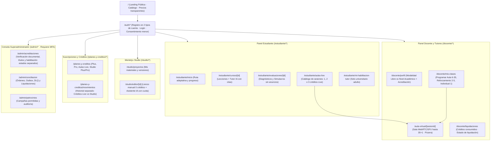

# Diseño de interfaces, experiencia de usuario y flujos Web/PWA — Mentelyx

> **Proyecto:** Mentelyx · **Ubicación:** `docs/03-diseño-de-software/diseño-externo/03-diseño-de-interfaces-y-flujos.md`  
> **Tecnología Cliente:** Next.js + React + TypeScript · **Enfoque:** *Mobile-First* e instalable como PWA  
> **Versión:** 2.1 — 17/11/2026 · **Estado:** diseño externo de vistas, navegación y salvaguardas de interfaz; no implementado.
>
> **Cambios de la versión 2.1:** sincronización CO-06 del [contrato de coordinación](../contrato-coordinacion-datos-seguridad-infraestructura.md): eliminación como revocación inmediata más purga verificable, y PWA sin caché offline de conversaciones ni de recursos con revocación estricta (secciones 8.4, 11 y 12).
>
> **Cambios de la versión 2.0:** se conservan las secciones 1 a 4. Se añaden:
>
> - la resolución de las rutas de habilitación (sección 5) y las rutas nuevas (sección 6);
> - los recorridos completos de Estudiante, Docente y Superadministrador, con Studio y tutorías humanas (sección 7);
> - el diseño del Tutor IA con chat y pizarra sincronizados (sección 8) y del editor de Studio (sección 9);
> - los estados y mensajes de interfaz (sección 10), la accesibilidad y PWA (sección 11) y los criterios de aceptación de UI (sección 12).

## 1. Principios de diseño de interfaz en Mentelyx

1. **Separación clara de cuentas y estados (DA-01, ADR-034):** la interfaz distingue explícitamente las **dos cuentas públicas** (**Estudiante** y **Docente**) y la cuenta interna (**Superadministrador**). En el perfil Docente se muestra con claridad si opera bajo modalidad **independiente/libre** o **por nivel académico** (la formación y su estado de validación se muestran únicamente en la modalidad por nivel académico).
2. **Transparencia de créditos y productos (RC-23, ADR-047, ADR-050):** la billetera visual del usuario nunca mezcla **créditos Live** (inscripción a clases en vivo) con **créditos Studio** (operaciones generativas de IA). Antes de ejecutar cualquier acción generativa en Studio o reservar un aula Live, la interfaz muestra el costo exacto en créditos y solicita confirmación explícita.
3. **Herramientas manuales sin cobro de IA en Studio (ADR-053):** en **Mentelyx Studio**, los botones de texto manual, pizarra, figuras geométricas y diagramación determinista llevan el distintivo **"Manual · 0 créditos IA"**, diferenciándolos de los asistentes generativos.
4. **Protección de menores y zonas libres de publicidad (RC-07, ADR-020, ADR-025):** las pantallas de **Evaluaciones/Simulacros**, **Sala de Aulas Live**, **Mentelyx Studio** y **Checkout/Pagos** tienen prohibida cualquier inserción publicitaria por diseño de layout.

---

## 2. Mapa de navegación y rutas del Frontend (Next.js App Router)



---

El acceso a Studio depende de permisos, edad y plan, no de un tipo de cuenta adicional. Las pantallas administrativas deben distinguir documentación personal verificada, credenciales académicas validadas y habilitación docente aprobada. El nombre propuesto `/admin/acreditaciones` no unifica esos estados; su organización definitiva debe resolverse junto con los contratos de M4.

## 3. Especificación de vistas críticas por módulo

| Vista / Pantalla | Módulo backend | Componentes clave de UI | Salvaguardas y validaciones en cliente y servidor |
|---|---|---|---|
| **Registro y Selección de Cuenta** (`/auth/registro`) | M1 | Selector de cuenta (`Estudiante`, `Docente`); selector de modalidad docente (`Libre` / `Por nivel académico`); formulario de consentimiento parental para menores. | No exige dominio de colegio. Aclara que declarar un título académico requiere verificación posterior antes de mostrar insignia acreditada. |
| **Visor de Lección + Tutor IA** (`/estudiante/cursos/[id]`) | M2, M6 | Reproductor de contenido versionado, panel lateral de **Tutor IA** con referencias clicables a los fragmentos oficiales del curso e indicador de cuota IA restante. | Si el proveedor LLM falla o se agota la cuota, el estudiante sigue leyendo la lección y sus apuntes sin bloqueo (**degradación elegante**). |
| **Entorno de Evaluación / Simulacro** (`/estudiante/evaluaciones/[id]`) | M3 | Temporizador sincronizado, navegador de preguntas, guardado local preventivo en PWA y botón de entrega idempotente. | **Cero publicidad**. El botón de envío deshabilita dobles clics y envía la misma `Idempotency-Key` si hay reconexión de red. |
| **Reserva y Sala de Aulas Live** (`/estudiante/aulas-live` y `/aula-virtual/[id]`) | M4, M5 | Filtro por modalidad (`Aula 6–35 = 1 cr`, `Reforzamiento 2–5 = 2 cr`, `Individual = 1 a 1 = 3 cr`), contador de cupos en tiempo real y sala audiovisual WebRTC. | El cliente se conecta directamente al SFU con token efímero. En cuentas de menores, exige consentimiento verificable para activar cámara/micrófono o grabación. |
| **Editor Mentelyx Studio** (`/studio/editor/[id]`) | M2, M5, M6 | Barra de herramientas manuales (texto, formas, fórmulas, pizarra) y panel de generación IA con previsualización de costo en **créditos Studio** (ej. *Presentación 12 diapos = 5 cr*). | Si el servicio de IA no está disponible o el usuario tiene `Studio Free` sin créditos, todas las herramientas manuales funcionan al 100 %. |
| **Billetera y Checkout** (`/planes-y-creditos`) | M5 | Tarjetas diferenciadas para **Planes Estudiante (Plus/Pro)**, **Aulas Live (4 créditos/mes)** y **Studio (Plus 300 cr / Pro 900 cr)**; dos contadores separados (`Saldo Live` y `Saldo Studio`). | Informa claramente que los créditos **no son intercambiables ni dinero electrónico** y que el pago solo se activa tras confirmación verificada de la pasarela. |

---

## 4. Estructura de carpetas propuesta para el Frontend (`frontend/`)

```text
frontend/
├── public/
│   ├── manifest.json                 # Configuración PWA instalable (mobile-first)
│   └── icons/
├── src/
│   ├── app/                          # Rutas Next.js (App Router)
│   │   ├── (public)/                 # Landing, catálogo público, precios
│   │   ├── (auth)/                   # Login, registro de 2 tipos de cuenta, verificación de correo
│   │   ├── (estudiante)/             # Cursos, diagnósticos, simulacros, reservas Live
│   │   ├── (docente)/                # Perfil, programación de clases, liquidaciones
│   │   ├── (studio)/                 # Editor Mentelyx Studio y gestión de recursos
│   │   ├── aula-virtual/[sesionId]/  # Cliente WebRTC/SFU aislado y sin anuncios
│   │   └── admin/                    # Consola interna protegida con MFA
│   ├── components/
│   │   ├── ui/                       # Sistema de diseño base accesible
│   │   ├── studio-canvas/            # Herramientas manuales (0 créditos IA)
│   │   ├── live-classroom/           # Controles WebRTC, pizarra y participantes
│   │   └── billing-badges/           # Indicadores separados de Créditos Live y Studio
│   ├── lib/
│   │   ├── api-client.ts             # Cliente HTTP tipado hacia Hono (/api/v1) con Idempotency-Key
│   │   └── auth-session.ts           # Estado de sesión y guardas de navegación
│   └── types/                        # DTOs compartidos con los contratos públicos del backend
└── next.config.ts                    # Validación de salida compatible con Cloudflare Pages
```


---

## 5. Resolución de pendientes de navegación

| Antes (v1.0) | Ahora (v2.0) | Motivo |
|---|---|---|
| `/admin/acreditaciones` | Tres colas separadas: `/admin/habilitacion/verificaciones-documentales`, `/admin/habilitacion/credenciales-academicas` y `/admin/habilitacion/solicitudes-tutoria` | Verificación documental, validación de credenciales académicas y habilitación docente son procesos con estados independientes (RF-18, RF-58, RF-59; contrato sección 2.4 del documento de API) |
| `/estudiante/mi-habilitacion-tutor` | `/habilitacion` (común a Docente y a Estudiante universitario ≥ 18) | El Estudiante tutor conserva su cuenta; la pantalla muestra solo las solicitudes que le corresponden |
| Panel del Tutor dentro de `/estudiante/cursos/[id]` | Se conserva y se añade `/tutor` como espacio propio de conversaciones | Preguntas generales sin una lección abierta |

El mapa de la sección 2 sigue vigente. Las rutas de esta sección lo complementan.

## 6. Rutas añadidas

| Ruta | Actor | Módulo | Propósito |
|---|---|---|---|
| `/tutor` y `/tutor/[conversacionId]` | Estudiante / Docente con derecho Tutor IA | M6 | Chat con la pizarra sincronizada; lista de conversaciones vigentes con su fecha de eliminación automática |
| `/estudiante/cursos/[id]/lecciones/[leccionId]` | Estudiante | M2, M6 | Lección versionada con el panel del Tutor contextual (citas a la propia lección) |
| `/estudiante/ejercicios/[id]` | Estudiante | M3, M6 | Práctica con pistas graduadas (sin la respuesta final antes de entregar) |
| `/estudiante/preparacion` | Estudiante | M3 | Objetivo de examen, plan y seguimiento (RF-49–RF-52) |
| `/apuntes` | Estudiante / Docente | M2, M6 | Apuntes propios; interruptor «Usar en mi Tutor» |
| `/estudiante/tutorias` | Estudiante | M4 | Reservas propias, cancelación y acceso al aula |
| `/habilitacion` | Docente / Estudiante universitario ≥ 18 | M4 | Tres tarjetas de estado separadas y sus formularios |
| `/studio/editor/[id]` (existente) | Usuario con Studio | M2, M5, M6 | Paneles añadidos: Pizarra, Asistente IA, Versiones y permisos, Exportar |
| `/studio/trabajos` | Usuario con Studio | M2 | Historial de generaciones y exportaciones con su estado y reintegros |
| `/consentimiento/[token]` | Adulto responsable (sin cuenta) | M1 | Decisión de consentimiento por finalidad |
| `/admin/habilitacion/*` | Superadministrador (MFA) | M4 | Colas de la sección 5 |
| `/admin/rag` | Superadministrador (MFA) | M2, M6 | Revisión editorial de material para RAG, estado de indexación, retiro de emergencia |
| `/admin/ia` | Superadministrador (MFA) | M6 | Estado de rutas, circuitos, costos, presupuestos y configuración versionada |
| `/admin/ia/calidad` | Superadministrador (MFA) | M6 | Cola de respuestas reportadas |
| `/admin/auditoria` | Superadministrador (MFA) | M1 | Consulta de `audit_logs` |

**Zonas sin publicidad (amplía el principio 4):** `/tutor`, la pizarra, las escenas 3D, `/studio/*`, `/habilitacion`, `/consentimiento/*` y las descargas de materiales.

## 7. Recorridos completos

**Convención de las tablas:** *Pantalla* → *Acción del usuario* → *Llamada API* → *Resultado y salvaguardas*. Los estados de error usan los mensajes de la sección 10.

### 7.1. Estudiante

#### E1. Registro (incluye menores)

| Paso | Pantalla | Acción | API | Resultado y salvaguardas |
|---|---|---|---|---|
| 1 | `/auth/registro` | Elige «Estudiante», nivel y fecha de nacimiento | — | Si es menor de 18, aparece el campo obligatorio «Correo del adulto responsable» |
| 2 | Ídem | Envía | `POST /auth/registro` | Siempre `202` «Revisa tu correo» (no revela correos existentes) |
| 3 | Correo → `/auth/verificar` | Abre el enlace | `POST /auth/correo/verificar` | Cuenta activa. Un menor queda en el estado «Esperando consentimiento» y solo ve el catálogo público |
| 4 | `/consentimiento/[token]` (adulto) | Acepta por finalidad: uso de la plataforma, Tutor IA, audiovisual | `POST /consentimientos-parentales/:token/decision` | Cada finalidad se habilita por separado. El Tutor IA del menor usa rutas ZDR. Las imágenes y el 3D generativo quedan desactivados |

#### E2. Diagnóstico y ruta

| Paso | Pantalla | Acción | API | Resultado |
|---|---|---|---|---|
| 1 | `/estudiante/inicio` | «Haz tu diagnóstico» | `POST /evaluaciones/:id/intentos` | Intento ligado a la versión |
| 2 | `/estudiante/evaluaciones/[id]` | Responde (guardado local y remoto) | `PUT …/respuestas` (`If-Match`) | Indicador «Guardado en tu dispositivo» / «Guardado en el servidor» (RF-69). **Tutor bloqueado** y sin anuncios |
| 3 | Ídem | Entrega | `POST …/entregar` (`Idempotency-Key`) | Calificación determinista (M3); el botón se desactiva durante el envío |
| 4 | `/estudiante/inicio` | Ve su ruta | `GET /evaluaciones/progreso/me` | Recomendaciones reproducibles; ninguna generada por el LLM |

#### E3. Lección con el Tutor y fuentes

| Paso | Pantalla | Acción | API | Resultado |
|---|---|---|---|---|
| 1 | Lección v2 | Abre el panel «Tutor» | `POST /tutor-ia/conversaciones` (contexto: lección) | Indicador de consultas restantes; aviso de retención «Esta conversación se elimina en 30 días (14 si eres menor)» |
| 2 | Panel | Pregunta | `POST /tutor-ia/consultas` (SSE) | Texto por segmentos; referencias `[1]` que abren el bloque citado de la **misma versión** |
| 3 | Panel | Valora con 👍/👎 | `POST …/valoracion` | Al segundo 👎 en el mismo tema aparece «¿Quieres ayuda de un docente?» (E8) |
| 4 | Panel | «Guardar en mis apuntes» | `POST /apuntes` | Copia bajo su control; deja de depender de la retención del chat |

#### E4. Resolver con la pizarra (matemática)

| Paso | Pantalla | Acción | API | Resultado |
|---|---|---|---|---|
| 1 | `/tutor` | Escribe «Deriva f(x)=x³−3x y grafica f y f′» con «Pizarra» activada | `POST /tutor-ia/consultas` | Estado «Razonando…», luego «Verificando…» |
| 2 | Chat + pizarra | Observa | Eventos `texto.delta` + `escena.paso` | Cada paso aparece cuando su segmento termina; cada paso verificado lleva la insignia «✓ verificado» |
| 3 | Pizarra | Usa ◀ ▶, cambia la velocidad o toca un párrafo del chat | — (local) | Salto determinista al paso; el párrafo activo se resalta |
| 4 | Pizarra | «Llevar a Studio» (si tiene Studio) | `POST /studio/proyectos` con el bloque `visual_scene` | 0 créditos; escena editable |
| 5 | Chat | Pulsa «Detener» durante la generación | Cierre del flujo + `POST /tutor-ia/consultas/:op/cancelar` | Se conserva lo recibido; el consumo se ajusta a lo medido (sección 10) |

#### E5. Foto de un ejercicio

| Paso | Pantalla | Acción | API | Resultado |
|---|---|---|---|---|
| 1 | `/tutor` | 📷, elige una foto | `POST /tutor-ia/adjuntos/url-subida` → PUT R2 | La imagen se comprime en el cliente (lado mayor ≤ 2048 px) antes de subirla |
| 2 | Ídem | Espera | `POST /tutor-ia/transcripciones` | Se muestra «¿Es esto lo que dice tu ejercicio?» con la fórmula renderizada y editable |
| 3 | Ídem | Corrige o confirma | `POST /tutor-ia/consultas` con `transcripcionConfirmada` | Resolución verificada. Si es `TRANSCRIPCION_ILEGIBLE`: «Toma otra foto con más luz» |

#### E6. Práctica con pistas

| Paso | Pantalla | Acción | Resultado |
|---|---|---|---|
| 1 | `/estudiante/ejercicios/[id]` | «Necesito una pista» | Pista de nivel 1 (concepto). El contador «Pista 1 de 4» es visible |
| 2 | Ídem | Pide más pistas | Niveles 2 (estrategia), 3 (siguiente paso) y 4 (ejemplo análogo). **Nunca** la respuesta del ejercicio |
| 3 | Ídem | Entrega | M3 corrige. Después, «Ver solución explicada» se habilita en el Tutor |

#### E7. Simulacro

Durante el simulacro, el botón del Tutor desaparece. Si se abre un enlace directo, se muestra «El Tutor no está disponible durante tu simulacro» (`TUTOR_BLOQUEADO_EVALUACION`). Al entregar se habilita el repaso con el Tutor sobre las preguntas falladas.

#### E8. Del Tutor a una tutoría humana y al Aula Live

| Paso | Pantalla | Acción | API | Resultado |
|---|---|---|---|---|
| 1 | Panel del Tutor | Ve la tarjeta «Ayuda de un docente» (hasta 3 ofertas, sin anuncios) | Evento `sugerencia` (M4 `buscarOfertasTutoria`) | Cada oferta muestra la modalidad y los **créditos Live** necesarios (1, 2 o 3) |
| 2 | `/estudiante/aulas-live` | Elige una sesión | `GET /clases/sesiones?tema=…` | Perfil del docente: credenciales con insignia **solo** si están validadas |
| 3 | Confirmación | Revisa el costo en créditos Live y las reglas de cancelación | — | Separación visual entre créditos Live y créditos Studio (RC-34) |
| 4 | Ídem | Reserva | `POST /clases/sesiones/:id/reservar` (`Idempotency-Key`) | `409 CUPO_AGOTADO` → muestra otras sesiones. `402 CREDITOS_LIVE_INSUFICIENTES` → enlace a planes |
| 5 | `/aula-virtual/[sesionId]` | Ingresa | `POST /clases/sesiones/:id/ingresar` | Token SFU efímero. Un menor necesita el consentimiento audiovisual vigente |

#### E9. Apuntes en el Tutor

Subir un PDF a `/apuntes` y activar «Usar en mi Tutor» indexa el documento en el ámbito privado. La tarjeta muestra el estado: «Preparando», «Listo» o «No se pudo leer». En una cuenta de menor, el texto se indexa en modo léxico. Si el documento es un escaneo, se muestra antes el costo en consultas: «Leer este escaneo usará 2 consultas».

#### E10. Estudiante universitario adulto que solicita habilitación de tutoría

| Paso | Pantalla | Acción | API | Resultado |
|---|---|---|---|---|
| 1 | `/habilitacion` | Ve dos tarjetas: «Verificación documental» y «Habilitación para tutorías». **No** ve «Credenciales académicas» | `GET /habilitacion/me` | Texto: «Seguirás siendo Estudiante; te presentaremos como estudiante tutor autorizado» |
| 2 | Ídem | Sube los documentos | `POST /habilitacion/documentos/url-subida` + `POST /habilitacion/verificaciones-documentales` | Estado «Pendiente». Aviso: los documentos no se procesan con IA y se eliminan 90 días después de la decisión |
| 3 | Ídem | Solicita la tutoría sobre los temas que domina | `POST /habilitacion/solicitudes-tutoria` | La aprobación espera a la verificación documental aprobada |

### 7.2. Docente

#### D1. Registro y modalidad

`/auth/registro` → «Docente» → selector de modalidad con su explicación:

- **Independiente:** «Muestras temas y experiencia. No se piden títulos.»
- **Por nivel académico:** «Indicas niveles y asignaturas; podrás validar tus títulos.»

Las personas menores de 18 años reciben `EDAD_INSUFICIENTE_DOCENTE`. Studio manual queda disponible al verificar el correo.

#### D2. Perfil y habilitación

| Modalidad | Tarjetas en `/habilitacion` | Perfil público |
|---|---|---|
| `LIBRE` | Verificación documental · Habilitación para tutorías | Temas y experiencia; **sin** campos ni insignias de títulos |
| `NIVEL_ACADEMICO` | Verificación documental · Credenciales académicas (una por título) · Habilitación para tutorías | Niveles y asignaturas. La insignia «Título validado» solo aparece si la credencial está `APROBADA` |

Sin habilitación, `/docente/mis-clases` permite borradores privados. «Publicar» queda desactivado con la explicación «Necesitas la habilitación para tutorías».

#### D3. Studio manual: presentación y pizarra (0 créditos)

| Paso | Pantalla | Acción | Resultado |
|---|---|---|---|
| 1 | `/studio/proyectos` | «Nuevo proyecto» | Proyecto privado v1 |
| 2 | `/studio/editor/[id]` | Agrega diapositivas, texto, fórmulas (editor LaTeX con vista previa) y una pizarra con función, raíces y pasos | Las herramientas llevan el distintivo «Manual · 0 créditos IA» |
| 3 | Ídem | Edita sin conexión | «Cambios locales sin sincronizar» |
| 4 | Ídem | Recupera la conexión | `PUT /studio/proyectos/:id` con `If-Match`. Ante un conflicto: «Otra versión se guardó antes. ¿Guardar la tuya como versión nueva, ver diferencias o descartar?» |

#### D4. Studio con IA: generar, revisar y exportar

| Paso | Pantalla | Acción | API | Resultado y salvaguardas |
|---|---|---|---|---|
| 1 | Panel «Asistente IA» | Describe: «Presentación de 12 diapositivas sobre derivadas para 5.º de Secundaria» | `POST /studio/cotizaciones-ia` | Ventana de confirmación: «Usará **5 créditos Studio**. Saldo: 300 → 295. Los créditos se devuelven si la generación falla por nuestra causa.» |
| 2 | Ídem | Confirma | `POST /studio/proyectos/:id/generar-ia` (`Idempotency-Key`) | Trabajo en `/studio/trabajos` con su progreso. Se puede seguir editando |
| 3 | Aviso | «Tu presentación está lista como **borrador v2**» | `StudioGenerationCompleted` | Los ejercicios no verificados llevan la marca «Revisa antes de publicar» |
| 4 | Editor | Corrige manualmente | `PUT /studio/proyectos/:id` | 0 créditos |
| 5 | «Exportar» | Elige PPTX o PDF, la plantilla y la audiencia (estudiantes o docente con notas) | `POST /studio/proyectos/:id/exportaciones` | 0 créditos. Al terminar, «Descargar» genera una URL de 5 min |
| 6 | Falla | La generación falla por causa del servicio | `StudioGenerationFailed` | «No pudimos generar tu presentación. Te devolvimos 5 créditos.» Visible en el historial Studio |

#### D5. Publicar con permisos separados

El panel «Versiones y permisos» tiene **cuatro interruptores independientes**, cada uno con su explicación:

- **Publicar:** visible para los destinatarios elegidos.
- **Comercializar:** requiere contrato (RF-46).
- **Usar en el Tutor IA de Mentelyx (RAG):** las respuestas del Tutor pueden citar este material.
- **Entrenamiento de modelos:** desactivado por defecto. No disponible para cuentas de menores (RC-12, RC-18).

Desactivar RAG muestra: «Dejará de usarse en el Tutor en menos de un minuto».

#### D6. Programar y dictar una clase

`/docente/mis-clases` → elegir la modalidad (aula de 6–35, reforzamiento de 2–5 o individual) → la viabilidad de M5 se muestra **antes** de publicar (RF-79, EQ-28). En la sala `/aula-virtual/[sesionId]`, el docente comparte la pizarra de Studio mediante la compartición de pantalla del SFU (MVP). La pizarra colaborativa es posterior (`03-motor-visual-y-pizarra.md` sección 13.4).

#### D7. Asistencia y liquidaciones

`/docente/liquidaciones` muestra los créditos válidos consumidos por sesión, la tarifa versionada aplicada y el estado (`PENDING_VALIDATION`, `APPROVED`, `PAID`, `DISPUTED`) sin mezclar créditos Studio.

### 7.3. Superadministrador

| ID | Recorrido | Pantalla | Pasos clave | Salvaguardas |
|---|---|---|---|---|
| A1 | Acceso | `/admin` | Inicio de sesión + MFA; panel de disponibilidad, errores, costos de IA y presupuesto (RF-71) | MFA reciente para cada acción sensible; auditoría de las vistas de datos |
| A2 | Habilitación | `/admin/habilitacion/*` | Tres colas separadas; cada solicitud con sus documentos en un visor privado; decisión `APROBAR`, `RECHAZAR` o `SOLICITAR_SUBSANACION` con motivo | La aprobación de una tutoría exige la verificación documental aprobada; los documentos no se envían a la IA |
| A3 | Material para RAG | `/admin/rag` | Revisa el origen, la calidad y la licencia (HU-30); aprueba → estado `PENDIENTE` → `VIGENTE`; ve los fragmentos marcados con señal de inyección | Retiro de emergencia con motivo (efecto inmediato) |
| A4 | Rutas y presupuestos de IA | `/admin/ia` | Edita `mentelyx.rutas-ia/v1` y los presupuestos con `If-Match`; ve las diferencias antes de guardar | Cambio prospectivo, MFA y auditoría; una ruta sin benchmark aprobado no se puede activar (puerta de liberación) |
| A5 | Alerta de costo | `/admin/ia` | Alerta del 90 % → ve la degradación automática aplicada; puede elevar el presupuesto o mantenerla | Lecciones y edición manual nunca se detienen |
| A6 | Calidad de la IA | `/admin/ia/calidad` | Revisa las respuestas reportadas (contenido visible solo si sigue dentro de la retención y con acceso auditado); confirma o descarta; asigna una acción (ajustar instrucciones, corregir material, bloquear un tema) | Sin exportación masiva de conversaciones |
| A7 | Conciliación e incidencias | `/admin/conciliacion` (existente) | Sin cambios de la v1.0 | — |

## 8. Diseño del Tutor IA: chat y pizarra sincronizados

### 8.1. Disposición

**Escritorio (≥ 1024 px):** dividido, con el chat al 40 % y la pizarra al 60 %.

```text
┌────────────────────────────────────────────────────────────────────────────┐
│ Derivadas · lección v2          Consultas: 211 de 300 · Plus     [⋯]       │
├──────────────────────────────────┬─────────────────────────────────────────┤
│ CHAT                             │ PIZARRA                                 │
│ Tú: ¿Por qué la derivada de x²…  │   y                                     │
│ Tutor · Razonamiento matemático  │   │        ╱ tangente  m = 2            │
│   (DeepSeek vía Cloudflare)      │   │     •╱                              │
│ ▌s1 Usamos la definición… [1]    │   │   ╱                                 │
│  s2 Al desarrollar… ✓ verificado │   └──────────────── x                   │
│ Referencias: [1] Derivadas, v2   │                                         │
│ [👍] [👎] [Guardar en apuntes]    │ [⏮][◀][▶][▶|] 1×   Paso 2 de 2         │
│ ¿Ayuda de un docente? →          │ Descripción: Parábola y = x² con…       │
├──────────────────────────────────┴─────────────────────────────────────────┤
│ [ Escribe tu pregunta…                     ] [📷] [Pizarra ☑] [Enviar]     │
└────────────────────────────────────────────────────────────────────────────┘
```

**Móvil (primero):** pestañas «Chat» y «Pizarra (2 pasos)». Mientras se lee el chat queda acoplado un **minirreproductor** de 64 px con la miniatura de la escena, ◀ ▶ y el número de paso. Tocar un párrafo con paso anclado cambia a la pestaña Pizarra en ese paso.

### 8.2. Componentes

| Componente | Responsabilidad | Accesibilidad |
|---|---|---|
| `EncabezadoTutor` | Contexto (lección y versión), consultas restantes, menú (eliminar conversación, ver la política de retención) | El contador se anuncia al cambiar |
| `MensajeSegmentado` | Renderiza los segmentos Markdown + KaTeX; marca el segmento activo | `aria-live="polite"` por **segmento completo**, no por token |
| `EtiquetaRuta` | «Razonamiento matemático · DeepSeek vía Cloudflare» o «Explicación general: no proviene de materiales del curso» | Texto, no solo icono |
| `InsigniaVerificacion` | ✓ verificado · ⚠ no verificado · ✕ no pudimos verificar este paso | Texto alternativo explícito |
| `ListaReferencias` | Referencias numeradas con título, sección y versión; abre el material en el bloque citado | Enlaces descriptivos |
| `Lienzo` + `Reproductor` | Motor visual: render, pasos, velocidad, saltos | Controles por teclado (`03-motor-visual-y-pizarra.md` sección 11.3) y descripción accesible |
| `TarjetaTutoriaHumana` | Hasta 3 ofertas de M4 con créditos Live | Sin publicidad |
| `BarraEntrada` | Texto (contador 0/4000), adjunto de imagen, interruptor de pizarra, Enviar/Detener | El botón cambia de nombre accesible: «Enviar» / «Detener respuesta» |

### 8.3. Estados de la conversación

`VACIA` → `ENVIANDO` → `RECIBIENDO` (texto y pasos) → `VERIFICANDO` → `COMPLETA` | `PARCIAL` | `ERROR`

- Al pulsar «Detener» el estado pasa a `CANCELADA`, conservando lo recibido.
- Al perder la red el estado pasa a `RECONECTANDO` y la interfaz consulta `GET /tutor-ia/consultas/{operationKey}`.

### 8.4. Retención y eliminación visibles

- Cada conversación muestra «Se elimina automáticamente el {fecha}» (30 días desde la última actividad; 14 para menores).
- «Eliminar conversación» confirma una vez y **retira el acceso de inmediato**: la conversación deja de mostrarse y de servirse. La purga física de mensajes, escenas y adjuntos se completa de forma asíncrona y verificable (CO-06). El texto de confirmación no promete el borrado instantáneo de copias de respaldo ni de archivos ya descargados.
- Mientras la retención no tenga aprobación legal (PEND-02, ADR-069 diferida), el historial está desactivado para usuarios reales y los recorridos se prueban con datos sintéticos.
- Al cerrar sesión, cambiar de cuenta o expirar la conversación se borra cualquier estado local del dispositivo, que puede ser compartido.
- «Guardar en mis apuntes» es la única forma de conservar el contenido más allá de la retención, y queda bajo el control del usuario.

## 9. Diseño del editor de Studio (ampliación)

| Zona | Contenido | Reglas |
|---|---|---|
| Barra superior | Título, estado de guardado, versión, «Versiones y permisos», «Exportar» | El estado de guardado sigue RF-69 |
| Barra de herramientas manuales | Texto, fórmula, formas, función, construcciones, lápiz, pasos | Distintivo «Manual · 0 créditos IA» |
| Panel «Asistente IA» | Tipo de material, nivel, extensión, «Usar mis fuentes», cotización con desglose, saldo **Studio** | Nunca muestra créditos Live; con saldo insuficiente ofrece planes Studio, sin bloquear la edición manual (EQ-30) |
| Bandeja de trabajos | Generaciones y exportaciones en curso, listas o fallidas, con reintegros | Notificación al terminar; se puede cerrar el editor |
| Diálogo «Exportar» | Formato (PDF / PPTX), plantilla con vista previa, audiencia (Estudiantes / Docente con notas) | Texto: «Exportar no consume créditos» |
| Cuentas de menores | Ocultos: generación de imágenes y de objetos 3D; el interruptor de entrenamiento está desactivado | Mensaje: «Esta función no está disponible para tu cuenta» |

## 10. Estados y mensajes de interfaz

| Situación | Código | Mensaje propuesto | Acción ofrecida |
|---|---|---|---|
| Consultas del periodo agotadas | `CUOTA_AGOTADA` | «Usaste tus consultas de este mes. Tus lecciones y apuntes siguen disponibles.» | Ver planes · Fecha de renovación |
| Proveedor no disponible | `PROVEEDOR_NO_DISPONIBLE` | «El Tutor no está disponible en este momento. No se descontó ninguna consulta.» | Reintentar más tarde |
| Sin fuentes del curso | Estado `SIN_CONTEXTO` | «No encontramos esta información en tu lección. Puedes hacer la pregunta fuera de la lección o consultar a un docente.» | Preguntar en `/tutor` · Ver docentes |
| Respuesta general | Aviso | «Explicación general: no proviene de materiales del curso.» | — |
| Paso no verificado | `DISCREPANCIA` | «No pudimos verificar este paso; no lo tomes como resultado final.» | Ayuda de un docente |
| Escena fallida | `escena.error` | «No pudimos dibujar esta explicación; aquí tienes la versión en texto.» | — |
| Tutor bloqueado | `TUTOR_BLOQUEADO_EVALUACION` | «El Tutor no está disponible durante tu evaluación.» | Volver a la evaluación |
| Función no disponible | `FUNCION_NO_DISPONIBLE_PARA_CUENTA` | «Esta función no está disponible para tu cuenta.» | Biblioteca de ilustraciones aprobadas |
| Transcripción ilegible | `TRANSCRIPCION_ILEGIBLE` | «No pudimos leer la foto. Prueba con más luz y el ejercicio centrado.» | Tomar otra foto · Escribir el ejercicio |
| Respuesta detenida | `CANCELADA` | «Detuviste la respuesta. Si ya había comenzado, cuenta como una consulta usada; si no, no se descontó nada.» | Continuar con una nueva pregunta |
| Sin conexión | — | «Sin conexión. Tus cambios se guardan en este dispositivo.» | — |
| Generación fallida con reintegro | `StudioGenerationFailed` | «No pudimos completar la generación. Te devolvimos {n} créditos Studio.» | Reintentar (nueva cotización) |
| Conversación vacía | — | «Pregunta lo que quieras sobre tu curso. Puedo explicarte paso a paso y dibujarlo en la pizarra.» | Sugerencias de preguntas según la lección |

Los mensajes son propuestas de redacción. La revisión final de microcopia se hará con usuarios del piloto.

## 11. Accesibilidad, rendimiento y PWA

| Requisito | Criterio |
|---|---|
| Norma | WCAG 2.1 AA en los recorridos de la sección 7 |
| *Streaming* accesible | Anuncios por segmento completo; un botón «Pausar lectura» detiene los anuncios sin detener la respuesta |
| Fórmulas | MathML de KaTeX; LaTeX copiable |
| Pizarra | Descripción accesible obligatoria, navegación de pasos por teclado y tabla de valores alternativa |
| Movimiento | `prefers-reduced-motion` respetado en las animaciones de la pizarra y de 3D |
| Tamaño de texto | Escala hasta el 200 % sin pérdida de funciones |
| Objetivos táctiles | ≥ 44 × 44 px |
| Rendimiento (metas a medir) | Primer render del chat ≤ 1 s tras el primer evento SSE; pizarra según `03-motor-visual-y-pizarra.md` sección 14 |
| PWA sin conexión | Caché de lecciones públicas o cuya licencia autorice el uso sin conexión, de la pizarra manual y de los borradores Studio propios (IndexedDB, separados por cuenta y con consentimiento en dispositivo compartido). **No** se guardan sin conexión las conversaciones del Tutor, sesiones, pagos, documentos D3 ni resultados privados. Los recursos que exigen revocación inmediata no se habilitan sin conexión ([seguridad, sección 6](../../02-arquitectura-software/seguridad-y-autenticacion.md); CO-06). Purga al cerrar sesión, cambiar de cuenta o expirar |

## 12. Criterios de aceptación de interfaz

| ID | Criterio | Prueba |
|---|---|---|
| UI-01 | Ningún anuncio en las zonas de las secciones 1 y 6 | E2E (EQ-12) |
| UI-02 | Créditos Live y Studio nunca aparecen en el mismo contador | E2E + revisión visual |
| UI-03 | Todo costo IA se muestra antes de confirmar; la edición manual muestra «0 créditos» | E2E (EQ-27) |
| UI-04 | La pizarra y el chat siguen sincronizados en los saltos de paso y los toques de segmento | VIS-06 |
| UI-05 | La política de retención es visible en cada conversación; la eliminación revoca el acceso de inmediato y su purga física queda registrada y verificable (CO-06) | E2E + API-14 + prueba de eliminación de seguridad, sección 7 |
| UI-06 | El Tutor no aparece durante evaluaciones ni simulacros | E2E (INY-02) |
| UI-07 | Las cuentas de menores no ven la generación de imágenes ni de 3D | MEN-02 |
| UI-08 | La pantalla `/habilitacion` muestra solo las tarjetas que corresponden a la cuenta y su modalidad | E2E por perfil |
| UI-09 | Los recorridos de la sección 7 superan axe-core sin violaciones serias en móvil y escritorio | VIS-07 |

**Trazabilidad:** HU-01, HU-02, HU-05, HU-10, HU-11, HU-13, HU-14, HU-20, HU-26, HU-28, HU-30, HU-31, HU-33, HU-41–HU-49, HU-53, HU-56, HU-58, HU-61, HU-62, HU-64; RF-01, RF-18–RF-20, RF-35, RF-40–RF-42, RF-45, RF-54–RF-59, RF-61, RF-69, RF-76, RF-83, RF-85, RF-88, RF-98; AC-04, AC-07, AC-11; EQ-12, EQ-23, EQ-27, EQ-28, EQ-30.
