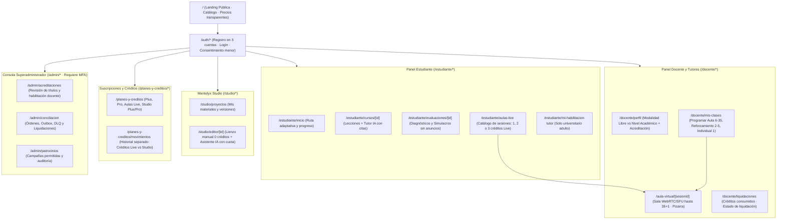

# Diseño de interfaces, experiencia de usuario y flujos Web/PWA — Mentelyx

> **Proyecto:** Mentelyx · **Ubicación:** `docs/03-diseño-de-software/diseño-externo/03-diseño-de-interfaces-y-flujos.md`  
> **Tecnología Cliente:** Next.js + React + TypeScript · **Enfoque:** *Mobile-First* e instalable como PWA  
> **Versión:** 1.0 · **Estado:** diseño externo de vistas, navegación y salvaguardas de interfaz.

## 1. Principios de diseño de interfaz en Mentelyx

1. **Separación clara de cuentas y estados (DA-01, ADR-034):** la interfaz distingue explícitamente las **tres cuentas públicas** (**Estudiante**, **Creador educativo**, **Docente**) y la cuenta interna (**Superadministrador**). En el perfil Docente se muestra con claridad si opera bajo modalidad **independiente/libre** o **por nivel académico** (indicando si su formación está *Verificada* o *Pendiente de verificación*).
2. **Transparencia de créditos y productos (RC-23, ADR-047, ADR-050):** la billetera visual del usuario nunca mezcla **créditos Live** (inscripción a clases en vivo) con **créditos Studio** (operaciones generativas de IA). Antes de ejecutar cualquier acción generativa en Studio o reservar un aula Live, la interfaz muestra el costo exacto en créditos y solicita confirmación explícita.
3. **Herramientas manuales sin cobro de IA en Studio (ADR-053):** en **Mentelyx Studio**, los botones de texto manual, pizarra, figuras geométricas y diagramación determinista llevan el distintivo **"Manual · 0 créditos IA"**, diferenciándolos de los asistentes generativos.
4. **Protección de menores y zonas libres de publicidad (RC-07, ADR-020, ADR-025):** las pantallas de **Evaluaciones/Simulacros**, **Sala de Aulas Live**, **Mentelyx Studio** y **Checkout/Pagos** tienen prohibida cualquier inserción publicitaria por diseño de layout.

---

## 2. Mapa de navegación y rutas del Frontend (Next.js App Router)



---

## 3. Especificación de vistas críticas por módulo

| Vista / Pantalla | Módulo backend | Componentes clave de UI | Salvaguardas y validaciones en cliente y servidor |
|---|---|---|---|
| **Registro y Selección de Cuenta** (`/auth/registro`) | M1 | Selector de cuenta (`Estudiante`, `Creador educativo`, `Docente`); selector de modalidad docente (`Libre` / `Por nivel académico`); formulario de consentimiento parental para menores. | No exige dominio de colegio. Aclara que declarar un título académico requiere verificación posterior antes de mostrar insignia acreditada. |
| **Visor de Lección + Tutor IA** (`/estudiante/cursos/[id]`) | M2, M6 | Reproductor de contenido versionado, panel lateral de **Tutor IA** con referencias clicables a los fragmentos oficiales del curso e indicador de cuota IA restante. | Si el proveedor LLM falla o se agota la cuota, el estudiante sigue leyendo la lección y sus apuntes sin bloqueo (**degradación elegante**). |
| **Entorno de Evaluación / Simulacro** (`/estudiante/evaluaciones/[id]`) | M3 | Temporizador sincronizado, navegador de preguntas, guardado local preventivo en PWA y botón de entrega idempotente. | **Cero publicidad**. El botón de envío deshabilita dobles clics y envía la misma `Idempotency-Key` si hay reconexión de red. |
| **Reserva y Sala de Aulas Live** (`/estudiante/aulas-live` y `/aula-virtual/[id]`) | M4, M5 | Filtro por modalidad (`Aula 6–35 = 1 cr`, `Reforzamiento 2–5 = 2 cr`, `Individual = 1 a 1 = 3 cr`), contador de cupos en tiempo real y sala audiovisual WebRTC. | El cliente se conecta directamente al SFU con token efímero. En cuentas de menores, exige consentimiento verificable para activar cámara/micrófono o grabación. |
| **Editor Mentelyx Studio** (`/studio/editor/[id]`) | M2, M5, M6 | Barra de herramientas manuales (texto, formas, fórmulas, pizarra) y panel de generación IA con previsualización de costo en **créditos Studio** (ej. *Presentación 12 diapos = 5 cr*). | Si el servicio de IA no está disponible o el usuario tiene `Studio Free` sin créditos, todas las herramientas manuales funcionan al 100 %. |
| **Billetera y Checkout** (`/planes-y-creditos`) | M5 | Tarjetas diferenciadas para **Planes Estudiante (Plus/Pro)**, **Aulas Live (4 créditos/mes)** y **Studio (Plus 300 cr / Pro 900 cr)**; dos contadores separados (`Saldo Live` y `Saldo Studio`). | Informa claramente que los créditos **no son intercambiables ni dinero electrónico** y que el pago solo se activa tras confirmación verificada de la pasarela. |

---

## 4. Estructura de carpetas propuesta para el Frontend (`frontend/`)

```text
frontend/
├── public/
│   ├── manifest.json                 # Configuración PWA instalable (mobile-first)
│   └── icons/
├── src/
│   ├── app/                          # Rutas Next.js (App Router)
│   │   ├── (public)/                 # Landing, catálogo público, precios
│   │   ├── (auth)/                   # Login, registro de 3 cuentas, verificación
│   │   ├── (estudiante)/             # Cursos, diagnósticos, simulacros, reservas Live
│   │   ├── (docente)/                # Perfil, programación de clases, liquidaciones
│   │   ├── (studio)/                 # Editor Mentelyx Studio y gestión de recursos
│   │   ├── aula-virtual/[sesionId]/  # Cliente WebRTC/SFU aislado y sin anuncios
│   │   └── admin/                    # Consola interna protegida con MFA
│   ├── components/
│   │   ├── ui/                       # Sistema de diseño base accesible
│   │   ├── studio-canvas/            # Herramientas manuales (0 créditos IA)
│   │   ├── live-classroom/           # Controles WebRTC, pizarra y participantes
│   │   └── billing-badges/           # Indicadores separados de Créditos Live y Studio
│   ├── lib/
│   │   ├── api-client.ts             # Cliente HTTP tipado hacia Hono (/api/v1) con Idempotency-Key
│   │   └── auth-session.ts           # Estado de sesión y guardas de navegación
│   └── types/                        # DTOs compartidos con los contratos públicos del backend
└── next.config.ts                    # Validación de salida compatible con Cloudflare Pages
```

