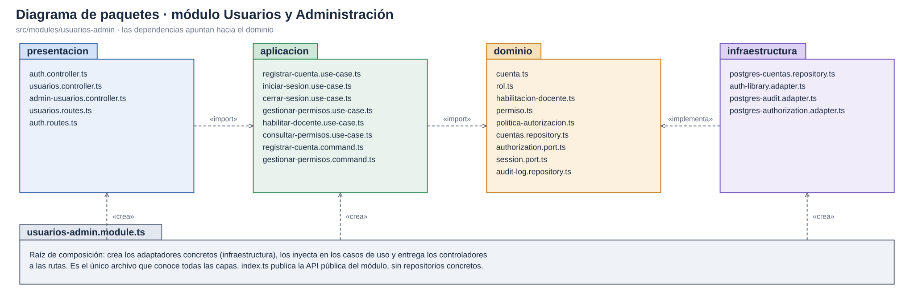
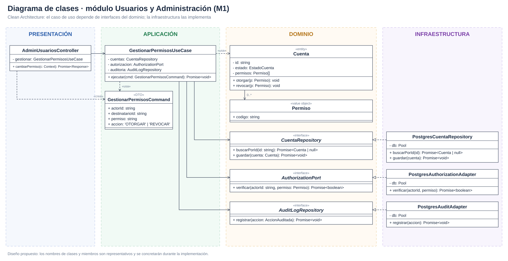
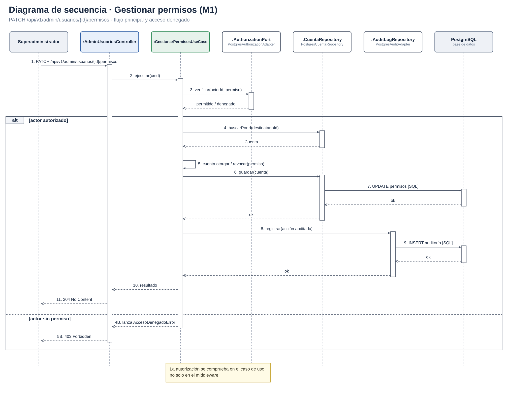
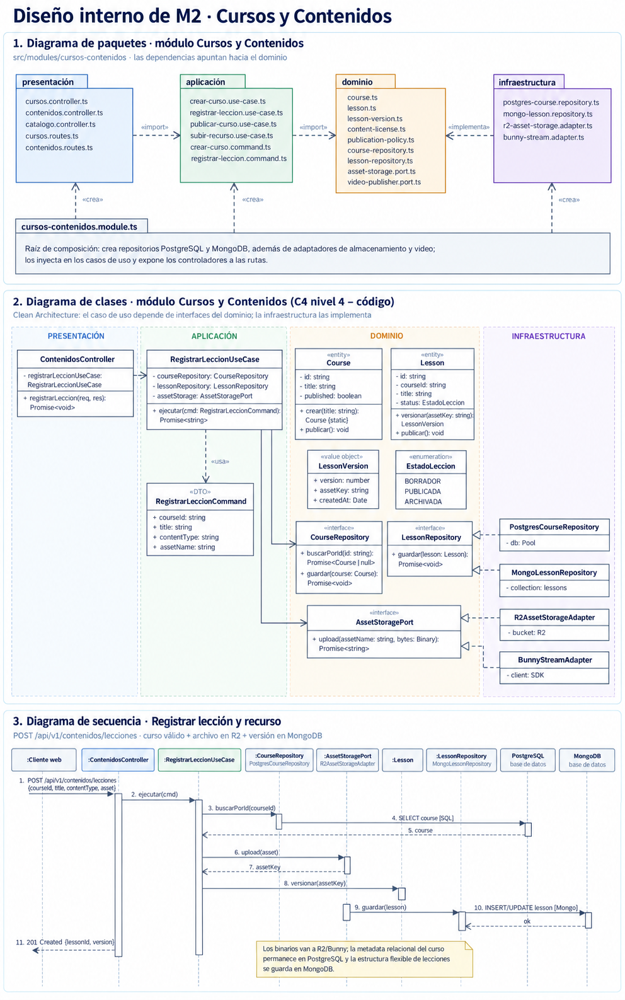
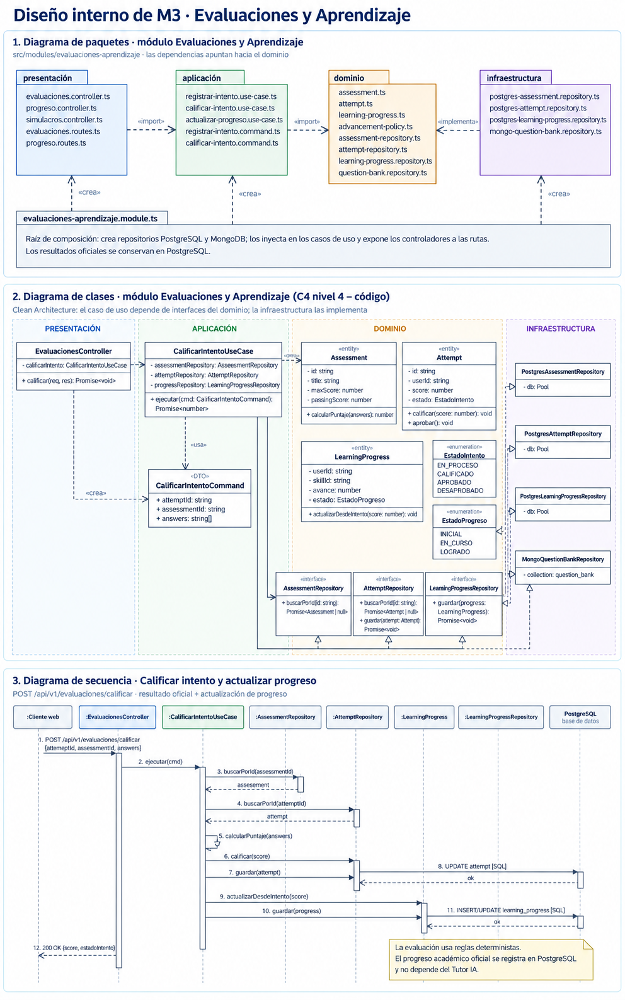
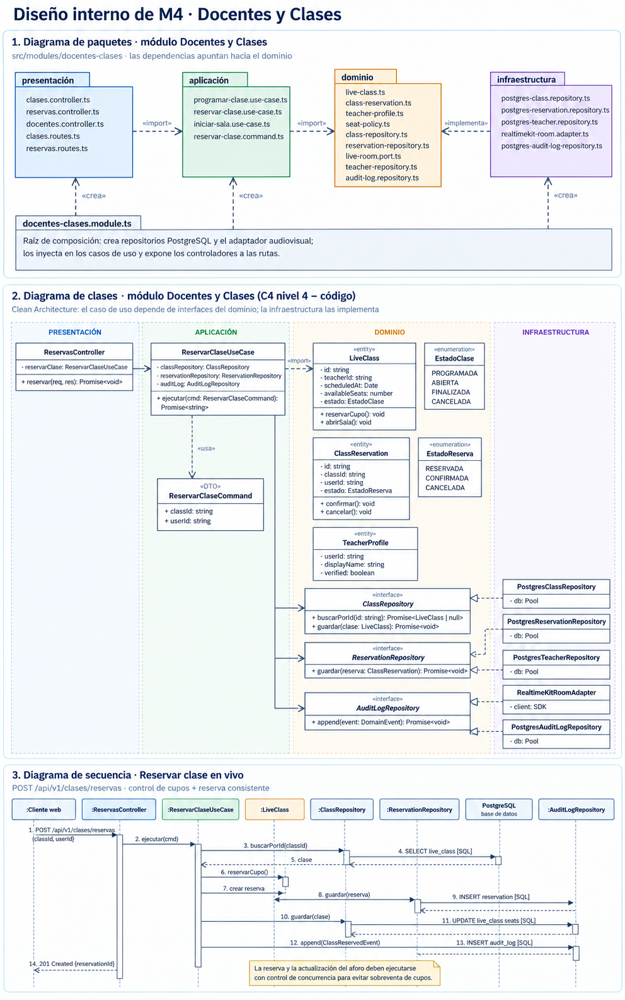
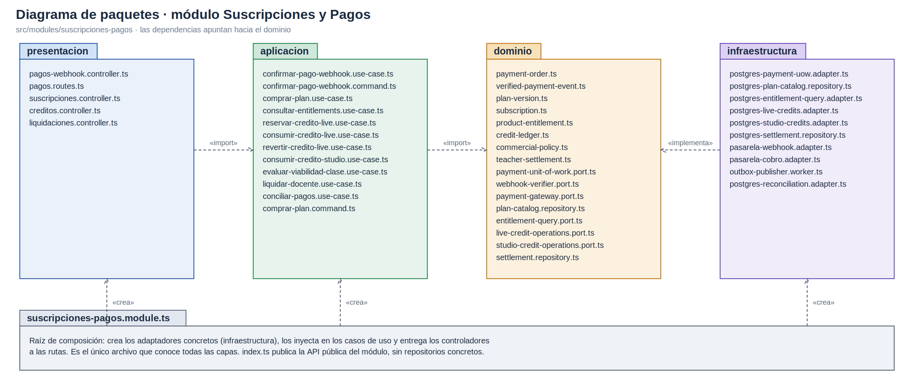
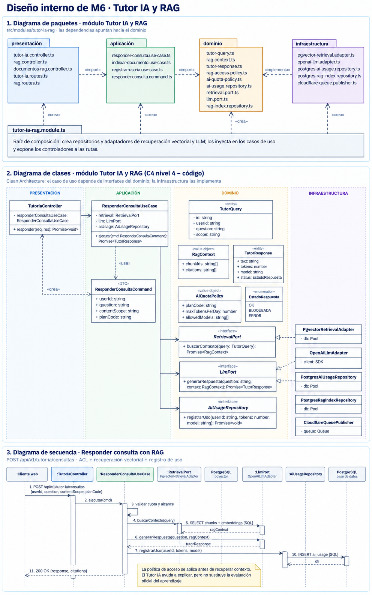
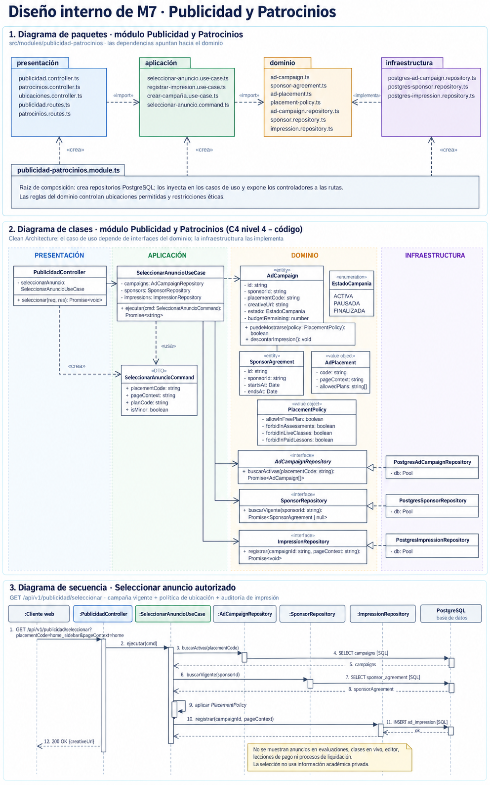

# Diseño interno de módulos — Mentelyx

> **Proyecto:** Mentelyx · **Backend propuesto:** Hono + TypeScript sobre Cloudflare Workers  
> **Estilo de construcción:** monolito modular · **Enfoque dentro de cada módulo:** Clean Architecture  
> **Cobertura de estructuras:** M1–M7 · **Referencia principal para UML detallado y código:** M6 — Tutor IA y RAG · **Ejemplo complementario transaccional:** M5 — Suscripciones y Pagos\
> **Nivel de detalle:** diseño de código (vistas de paquetes M1–M7 y UML detallado de M6 y M5)\
> **Versión:** 3.1 · **Estado:** diseño objetivo; archivos, clases y rutas aún no implementados.

> **Revisión terminológica:** 10/11/2026. Ajustes de lenguaje y nombres de contratos de diseño; no implica cambios en código ejecutable.

## 1. Propósito

Este documento define **cómo se organizará el código dentro de los módulos del backend** de Mentelyx. Tiene tres objetivos:

- especificar los archivos, responsabilidades y contratos de los siete módulos como base del sprint de implementación;
- mantener las reglas educativas y comerciales independientes de Hono, bases de datos y proveedores;
- demostrar, mediante diagramas UML y código TypeScript de referencia, **qué responsabilidad cumple cada elemento y de qué puede depender**.

El alcance es **diseño interno**, no descripción del negocio ni despliegue. El mapa de contexto, atributos de calidad, ADR, componentes C4 de mayor nivel y patrones generales están documentados en sus propios archivos y **no se reproducen aquí**.

Como en el ejemplo de la Guía 004, se profundiza en un **módulo de referencia**. Para Mentelyx se elige **M6 — Tutor IA y RAG**, porque representa el proceso educativo asistido por IA: comprender una consulta, recuperar fuentes autorizadas y ofrecer explicaciones, orientación progresiva o retroalimentación. La finalidad de Mentelyx es facilitar el aprendizaje y la enseñanza con tecnología educativa, inteligencia artificial y acompañamiento humano. **M5 — Suscripciones y Pagos** permanece como ejemplo técnico complementario de una operación comercial crítica, con sus invariantes de autenticidad de notificaciones, transacciones, idempotencia, derechos de acceso y movimientos de créditos. M1–M7 conservan su inventario detallado de archivos, responsabilidades, contratos y pruebas; M6 y M5 incluyen UML y código TypeScript de referencia para explicar la inyección de dependencias. Este énfasis educativo no concentra en M6 las responsabilidades de los demás módulos.

## 2. Convenciones generales y estructura global

Esta sección es el **inventario propuesto de implementación de los siete módulos**, no únicamente un ejemplo. Cada entrada `*.ts` tiene una responsabilidad definida para que pueda transformarse en historias, tareas y archivos del repositorio durante los sprints. No supone que el código ya exista.

**Convención común:** `dominio/` reúne entidades, invariantes y puertos independientes de proveedores; `aplicacion/` implementa casos de uso y comandos; `infraestructura/` contiene adaptadores concretos; `presentacion/` expone controladores y rutas de Hono; `*.module.ts` construye e inyecta dependencias, e `index.ts` limita la API pública que otros módulos pueden importar. Las pruebas por módulo viven junto al código en `tests/` y las pruebas de contratos públicos se ejecutan también desde la integración. Los archivos `index.ts` **no** deben exportar repositorios concretos de infraestructura.

```text
src/
├── modules/
│   ├── usuarios-admin/              # M1: cuentas, sesiones y administración
│   ├── cursos-contenidos/           # M2: catálogo, documentos, licencias y Studio
│   ├── evaluaciones-aprendizaje/    # M3: diagnósticos, simulacros y progreso
│   ├── docentes-clases/             # M4: habilitación docente, reservas y aulas Live
│   ├── suscripciones-pagos/         # M5: órdenes, derechos, créditos y liquidaciones
│   ├── tutor-ia-rag/                # M6: explicaciones, RAG y consumo IA
│   └── publicidad-patrocinios/     # M7: campañas, emplazamientos y patrocinios
├── shared/                         # Errores, IDs, fechas, correlación y contratos técnicos puros
├── workers/                        # Entradas de ejecución auxiliares (no octavo módulo)
└── app.ts                           # Composición general y montaje de los siete módulos
```

> **Reglas del inventario:** (1) los nombres son propuestas verificables en la fase de programación; (2) `index.ts` publica casos de uso de consulta o fachadas, no modelos de BD; (3) los permisos se comprueban en el caso de uso y no se delegan solamente al middleware; (4) `POSTERIOR` señala una capacidad prevista pero no comprometida en el primer lanzamiento; (5) no se crean carpetas duplicadas para cada suscripción, nivel académico o modalidad de clase.

**Organización de lectura:** cada módulo M1–M7 reúne consecutivamente su estructura de carpetas, paquetes y dependencias, diagrama de clases, flujo de secuencia y código de referencia. No hay bloques globales que agrupen las siete imágenes del mismo tipo.

**Imágenes:** cada vínculo `../../img/*.png` representa un archivo gráfico **independiente**. Los nombres de las figuras de clases/secuencia de M1–M4 y M7 son rutas convencionales que se pueden sustituir por los nombres reales de tus archivos, sin modificar el orden de las secciones.

**Cobertura del material original:** M5 y M6 incluyen diagramas UML desarrollados, cuadros de secuencia y código TypeScript de referencia. Para M1–M4 y M7, el documento recibido contiene inventarios y contratos pero no fragmentos de código equivalentes; se muestran las ubicaciones por capa sin atribuirles implementaciones inexistentes.

---

## 3. M1 — Usuarios y Administración

### 3.1. Estructura de carpetas y responsabilidades

**Responsable de:** cuenta, sesión, rol, permisos y auditoría administrativa. **No es responsable de:** cobros, créditos, calendario de clases ni acreditación pedagógica de un docente (esta se tramita en M4). Tener rol `Docente` no implica autorización automática para ofrecer servicios.

```text
src/modules/usuarios-admin/
├── dominio/
│   ├── cuenta.ts                        # Identificador de cuenta, estado y datos básicos del perfil
│   ├── rol.ts                           # Roles y modalidades de cuenta permitidos
│   ├── habilitacion-docente.ts          # Referencia al permiso de servicio; no acredita títulos
│   ├── permiso.ts                       # Identificador de capacidad autorizable
│   ├── politica-autorizacion.ts         # Validación RBAC/ABAC y acceso por recurso
│   ├── cuentas.repository.ts          # Puerto de persistencia de cuentas
│   ├── authorization.port.ts            # Puerto de autorización para operaciones protegidas
│   ├── session.port.ts                  # Puerto de sesiones y revocación
│   └── audit-log.repository.ts          # Puerto de auditoría de acciones sensibles
├── aplicacion/
│   ├── registrar-cuenta.use-case.ts      # Registrar cuenta personal sin colegio obligatorio
│   ├── iniciar-sesion.use-case.ts        # Autenticar y emitir sesión
│   ├── cerrar-sesion.use-case.ts         # Revocar sesión
│   ├── gestionar-permisos.use-case.ts    # Cambiar permisos autorizados con auditoría
│   ├── habilitar-docente.use-case.ts     # Actualizar permiso tras decisión emitida por M4
│   ├── consultar-permisos.use-case.ts    # Consultar autorización por recurso
│   ├── registrar-cuenta.command.ts      # Datos de alta validados
│   └── gestionar-permisos.command.ts    # Actor, destinatario y cambio solicitado
├── infraestructura/
│   ├── postgres-cuentas.repository.ts # Adaptador PostgreSQL de cuentas
│   ├── auth-library.adapter.ts          # Biblioteca de autenticación candidata (Better Auth)
│   ├── postgres-audit.adapter.ts         # Auditoría persistente
│   └── postgres-authorization.adapter.ts # Lectura de permisos desde PostgreSQL
├── presentacion/
│   ├── auth.controller.ts               # Alta, sesión y revocación HTTP
│   ├── usuarios.controller.ts           # Consultar y editar perfil propio
│   ├── admin-usuarios.controller.ts     # Operaciones administrativas auditadas
│   ├── usuarios.routes.ts               # Rutas de cuenta y perfil
│   └── auth.routes.ts                   # Rutas de autenticación
├── tests/
│   ├── autorizacion.unit.test.ts         # Denegación y permisos por recurso
│   ├── registro.unit.test.ts             # Registro sin afiliación institucional
│   └── sesiones.contract.test.ts         # Sesión, revocación y adaptador elegido
├── usuarios-admin.module.ts            # Inyección de puertos y adaptadores
└── index.ts                             # API pública: consultar cuenta autenticada y comprobar permisos
```

| Archivo / contrato clave | Responsabilidad comprobable | Colabora con |
|---|---|---|
| `cuenta.ts`, `rol.ts`, `politica-autorizacion.ts` | Evitar privilegios implícitos y acceso a cuentas de terceros | Dominio M1 |
| `gestionar-permisos.use-case.ts` | Comprobar que el actor puede modificar el permiso, persistirlo y auditarlo | `authorization.port.ts`, `audit-log.repository.ts` |
| `habilitar-docente.use-case.ts` | Recibir un evento/orden de habilitación tras validación de M4; no inferir acreditación por un formulario | Evento de M4 (sin importar su infraestructura) |
| `session.port.ts` / `auth-library.adapter.ts` | Aislar sesiones de la biblioteca concreta | Candidato Better Auth, sujeto a prueba en Workers |
| `index.ts` | Exponer `obtenerActor`, `verificarPermiso` y consulta mínima de rol por contrato | M2, M3, M4, M5, M6 |

**Pruebas de salida del sprint:** registro sin correo institucional; prohibición de consultar/modificar recursos ajenos; revocación de sesión; rol Docente sin habilitación de servicio; cambios administrativos auditados. **Referencias:** ADR-004, ADR-010, ADR-034, ADR-044.

### 3.2. Capas del módulo y regla de dependencia



M1 se encarga de la gestión de cuentas, autenticación, sesiones y control de acceso; administra perfiles, roles y permisos de habilitación para tutorías comunicados por M4. **Una cuenta, su rol, su habilitación para enseñar y su suscripción son conceptos distintos**.

La regla es que **el código de negocio no dependa de detalles externos**. El módulo de composición es la excepción explícita: necesita conocer los adaptadores concretos para conectarlos. La flecha en un diagrama de paquetes indica **dependencia del código**, no una petición de red.

| Capa | Contiene | Responsabilidad | Puede depender de | No debe depender de |
|---|---|---|---|---|
| **Dominio** | Entidades, políticas, estados, puertos | Proteger invariantes de negocio | Tipos internos puros | Hono, PostgreSQL, MongoDB, Cloudflare, SDK externos |
| **Aplicación** | Casos de uso, comandos | Coordinar reglas, autorización y operaciones | Dominio | Controladores, adaptadores concretos, SQL |
| **Infraestructura** | Repositorios y adaptadores | Implementar persistencia y conexiones externas | Interfaces del dominio y bibliotecas técnicas | Controladores, lógica de otros módulos |
| **Presentación** | Controladores y rutas HTTP | Validar estructura de entrada y traducir respuestas | Aplicación, framework HTTP | SQL, pasarelas concretas, reglas contables |
| **Composición** | `*.module.ts` | Elegir e inyectar implementaciones | Todas, de manera explícita | — |

### 3.3. Diagrama de clases



La imagen de clases corresponde exclusivamente a **M1 — Usuarios y Administración**. `CuentaRepository` persiste cuentas mediante `cuentas.repository.ts`; `PostgresCuentaRepository` implementa ese contrato en `postgres-cuentas.repository.ts`. `AuthorizationPort` comprueba permisos. Los nombres corresponden a las fuentes editables de clases y secuencia y al inventario de 3.1.

#### 3.3.1. Notación UML utilizada

| Notación | Significado |
|---|---|
| `«interface»` | Contrato que define las operaciones requeridas |
| Flecha discontinua con triángulo hueco | Realización de una interfaz |
| Línea continua con flecha | Asociación o referencia entre clases |
| `+` / `-` | Miembro público / privado |

### 3.4. Flujo de ejecución y diagrama de secuencia



**Flujo de referencia:** gestión de permisos mediante `GestionarPermisosUseCase`. Con el actor obtenido de la sesión autenticada, se comprueba su autorización mediante `AuthorizationPort`; después se consulta y guarda la cuenta destinataria mediante `CuentaRepository` y se registra la auditoría. El diagrama muestra la alternativa de acceso denegado.

### 3.5. Código de referencia

El material original identifica los archivos de este módulo, sus responsabilidades y contratos, pero **no contiene fragmentos TypeScript desarrollados** para sus cinco capas. Se conserva la correspondencia con las rutas previstas sin presentar código ficticio como implementado.

#### 3.5.1. Dominio · entidades e interfaces

**Archivos previstos:** `cuenta.ts`, `rol.ts`, `habilitacion-docente.ts`.

#### 3.5.2. Aplicación · casos de uso

**Archivos previstos:** `registrar-cuenta.use-case.ts`, `iniciar-sesion.use-case.ts`, `cerrar-sesion.use-case.ts`.

#### 3.5.3. Infraestructura · adaptadores

**Archivos previstos:** `postgres-cuentas.repository.ts`, `auth-library.adapter.ts`, `postgres-audit.adapter.ts`.

#### 3.5.4. Presentación · controladores y rutas

**Archivos previstos:** `auth.controller.ts`, `usuarios.controller.ts`, `admin-usuarios.controller.ts`.

#### 3.5.5. Raíz de composición y API pública

**Archivos previstos:** `usuarios-admin.module.ts`, `index.ts`.

---

## 4. M2 — Cursos y Contenidos

### 4.1. Estructura de carpetas y responsabilidades

**Responsable de:** catálogo, niveles educativos, lecciones, versiones, licencias y documentos/proyectos **Mentelyx Studio**. **No es responsable de:** notas oficiales, cuotas ni saldo de créditos de Studio (M5). Los archivos binarios están en R2; las referencias/editorialidad críticas están en PostgreSQL y los documentos flexibles versionados en MongoDB.

```text
src/modules/cursos-contenidos/
├── dominio/
│   ├── curso.ts                         # Curso y publicación autorizada
│   ├── leccion-version.ts               # Versión inmutable de lección/material
│   ├── licencia-contenido.ts            # Derechos de uso, distribución e indexación RAG
│   ├── politica-publicacion.ts          # Requisitos de licencia/revisión antes de publicar
│   ├── proyecto-studio.ts               # Proyecto de autoría y versiones editables
│   ├── recurso-digital.ts               # Referencia y tipo de archivo, nunca bytes SQL
│   ├── course.repository.ts             # Puerto SQL de catálogo y metadatos
│   ├── contenido.repository.ts          # Puerto documental MongoDB de lecciones
│   ├── studio.repository.ts             # Puerto documental de proyectos Studio
│   ├── document-storage.port.ts         # Puerto de objetos privados (R2)
│   ├── video-stream.port.ts             # Puerto de carga y reproducción de videos
│   ├── catalogo-lectura.port.ts         # Contrato de contenidos publicados/autorizados
│   └── eventos-contenido.port.ts        # Solicitud de indexar/desindexar por versión
├── aplicacion/
│   ├── crear-curso.use-case.ts           # Crear ficha y nivel curricular
│   ├── publicar-leccion.use-case.ts      # Publicar versión tras validar licencia
│   ├── versionar-documento.use-case.ts   # Guardar nueva versión sin borrar historial
│   ├── subir-recurso.use-case.ts         # Autorizar y registrar recursos privados
│   ├── consultar-catalogo.use-case.ts    # Filtrar cursos/niveles y paginar
│   ├── validar-acceso-contenido.use-case.ts # Acceso por licencia/titularidad/derechos
│   ├── crear-proyecto-studio.use-case.ts # Iniciar proyecto manual de Studio
│   ├── guardar-proyecto-studio.use-case.ts # Versionar edición manual gratuita autorizada
│   ├── solicitar-ia-studio.use-case.ts    # Orquestar derecho M5 y generación M6
│   ├── publicar-leccion.command.ts       # IDs, versión y licencia elegida
│   └── guardar-proyecto-studio.command.ts # Documento y versión esperada
├── infraestructura/
│   ├── postgres-course.repository.ts    # Fichas, dueños y licencias en SQL
│   ├── mongo-contenido.repository.ts    # Estructura/versiones pedagógicas MongoDB
│   ├── mongo-studio.repository.ts       # Documentos de proyectos Studio
│   ├── r2-storage.adapter.ts            # Objetos privados y URLs temporales
│   ├── bunny-stream.adapter.ts          # Video bajo permisos, proveedor condicionado
│   ├── m5-studio-credits.adapter.ts      # Consume solo API pública de M5
│   ├── queue-studio-ai.adapter.ts        # Envía trabajo Studio; M6 lo consume por evento
│   └── queue-content-events.adapter.ts  # Trabajos por ID/versión, sin enviar binarios
├── presentacion/
│   ├── catalogo.controller.ts          # Búsquedas/paginación HTTP
│   ├── contenidos.controller.ts        # Lecciones y recursos
│   ├── studio.controller.ts            # Proyectos y solicitudes de IA
│   ├── contenidos.routes.ts            # Endpoints editoriales y materiales
│   └── studio.routes.ts                # Endpoints de proyectos Studio
├── tests/
│   ├── publicacion.unit.test.ts         # Licencias y versiones válidas
│   ├── permisos-contenido.unit.test.ts  # Solo recursos autorizados
│   └── studio-versionado.contract.test.ts # Consistencia documental y archivos R2
├── cursos-contenidos.module.ts         # Raíz de composición M2
└── index.ts                            # API: catálogo, referencias y acceso autorizado
```

| Archivo / contrato clave | Responsabilidad comprobable | Colabora con |
|---|---|---|
| `licencia-contenido.ts`, `politica-publicacion.ts` | Diferenciar permiso de publicar, distribuir e indexar; respetar cada versión | PostgreSQL / M6 mediante evento |
| `contenido.repository.ts`, `studio.repository.ts` | Leer/escribir documentos con identificador y versión; no mantener derechos financieros | MongoDB |
| `document-storage.port.ts`, `video-stream.port.ts` | Obtener acceso firmado/temporal a binarios y reproducción | R2; Bunny Stream como candidato |
| `solicitar-ia-studio.use-case.ts` | No generar ni cobrar sin derecho y presupuesto autorizado | API M5 + trabajo dirigido a M6 por cola |
| `index.ts` | Exponer `consultarTemario`, `obtenerFuenteAutorizada`, `verificarLicencia` | M3 y M6 |

**Pruebas de salida del sprint:** publicación sin licencia rechazada; documento previo recuperable; lectura privada denegada; edición manual Studio sin descontar créditos; fallo MongoDB/R2 sin declarar operación completa. **Referencias:** ADR-009, ADR-014, ADR-023, ADR-026, ADR-035, ADR-050.

### 4.2. Capas del módulo y regla de dependencia



M2 conserva el catálogo, versiones, licencias, archivos y proyectos Studio. No calcula notas oficiales ni es dueño del ledger de créditos.

La regla es que **el código de negocio no dependa de detalles externos**. El módulo de composición es la excepción explícita: necesita conocer los adaptadores concretos para conectarlos. La flecha en un diagrama de paquetes indica **dependencia del código**, no una petición de red.

| Capa | Contiene | Responsabilidad | Puede depender de | No debe depender de |
|---|---|---|---|---|
| **Dominio** | Entidades, políticas, estados, puertos | Proteger invariantes de negocio | Tipos internos puros | Hono, PostgreSQL, MongoDB, Cloudflare, SDK externos |
| **Aplicación** | Casos de uso, comandos | Coordinar reglas, autorización y operaciones | Dominio | Controladores, adaptadores concretos, SQL |
| **Infraestructura** | Repositorios y adaptadores | Implementar persistencia y conexiones externas | Interfaces del dominio y bibliotecas técnicas | Controladores, lógica de otros módulos |
| **Presentación** | Controladores y rutas HTTP | Validar estructura de entrada y traducir respuestas | Aplicación, framework HTTP | SQL, pasarelas concretas, reglas contables |
| **Composición** | `*.module.ts` | Elegir e inyectar implementaciones | Todas, de manera explícita | — |

### 4.3. Diagrama de clases


La imagen de clases corresponde exclusivamente a **M2 — Cursos y Contenidos**. Sus clases e interfaces deben contrastarse con el inventario definido en 4.1; aquí no se inventan diagramas ni relaciones adicionales que no aparezcan en los archivos de origen.

#### 4.3.1. Notación UML utilizada

| Notación | Significado |
|---|---|
| `«interface»` | Contrato que define las operaciones requeridas |
| Flecha discontinua con triángulo hueco | Realización de una interfaz |
| Línea continua con flecha | Asociación o referencia entre clases |
| `+` / `-` | Miembro público / privado |

### 4.4. Flujo de ejecución y diagrama de secuencia


**Flujo de referencia:** publicación de lección. El detalle de mensajes y alternativas debe leerse en la imagen independiente de M2; el Markdown original no describe una tabla de pasos para este módulo.

### 4.5. Código de referencia

El material original identifica los archivos de este módulo, sus responsabilidades y contratos, pero **no contiene fragmentos TypeScript desarrollados** para sus cinco capas. Se conserva la correspondencia con las rutas previstas sin presentar código ficticio como implementado.

#### 4.5.1. Dominio · entidades e interfaces

**Archivos previstos:** `curso.ts`, `leccion-version.ts`, `licencia-contenido.ts`.

#### 4.5.2. Aplicación · casos de uso

**Archivos previstos:** `crear-curso.use-case.ts`, `publicar-leccion.use-case.ts`, `versionar-documento.use-case.ts`.

#### 4.5.3. Infraestructura · adaptadores

**Archivos previstos:** `postgres-course.repository.ts`, `mongo-contenido.repository.ts`, `mongo-studio.repository.ts`.

#### 4.5.4. Presentación · controladores y rutas

**Archivos previstos:** `catalogo.controller.ts`, `contenidos.controller.ts`, `studio.controller.ts`.

#### 4.5.5. Raíz de composición y API pública

**Archivos previstos:** `cursos-contenidos.module.ts`, `index.ts`.

---

## 5. M3 — Evaluaciones y Aprendizaje

### 5.1. Estructura de carpetas y responsabilidades

**Responsable de:** diagnósticos, pruebas, simulacros, objetivos de preparación, intentos, notas oficiales, reglas de avance y recomendaciones deterministas. **No delega calificaciones al LLM de M6.** El banco flexible de preguntas puede usar MongoDB, pero el resultado oficial y el historial de intentos viven en PostgreSQL.

```text
src/modules/evaluaciones-aprendizaje/
├── dominio/
│   ├── evaluacion.ts                    # Evaluación y rúbrica versionada
│   ├── intento.ts                       # Intento y máquina de estados
│   ├── progreso.ts                      # Progreso por habilidad/objetivo
│   ├── regla-avance.ts                  # Prerrequisitos y criterios reproducibles
│   ├── objetivo-examen.ts               # Meta de convocatoria/simulacro
│   ├── plan-estudio.ts                  # Plan determinista de preparación
│   ├── evaluacion.repository.ts         # Puerto de configuración oficial
│   ├── intento.repository.ts            # Puerto SQL de intentos y resultados
│   ├── progreso.repository.ts           # Puerto SQL de progreso
│   ├── question-bank.port.ts            # Puerto a preguntas versionadas
│   ├── recommendation.port.ts           # Puerto a motor de recomendación sin LLM obligatorio
│   └── academic-unit-of-work.port.ts    # Transacción de intento y progreso
├── aplicacion/
│   ├── iniciar-intento.use-case.ts       # Autorizar e iniciar evaluación
│   ├── calificar-intento.use-case.ts     # Corregir y persistir nota oficial
│   ├── actualizar-progreso.use-case.ts   # Aplicar reglas de avance
│   ├── generar-plan-estudio.use-case.ts  # Planificación a partir de diagnóstico
│   ├── presentar-simulacro.use-case.ts   # Ejecutar simulacro y preservar versión
│   ├── consultar-recomendacion.use-case.ts # Siguiente actividad determinista
│   ├── calificar-intento.command.ts      # Respuestas e identificador de intento
│   └── iniciar-intento.command.ts        # Objetivo, estudiante y versión
├── infraestructura/
│   ├── postgres-evaluacion.repository.ts # Versiones y requisitos oficiales
│   ├── postgres-intento.repository.ts    # Resultados transaccionales
│   ├── postgres-progreso.repository.ts   # Dominio/avance de habilidades
│   ├── postgres-academic-uow.adapter.ts  # Transacción intento + resultado + progreso
│   ├── mongo-question-bank.adapter.ts   # Preguntas flexibles con versión
│   ├── rules-recommendation.adapter.ts   # Motor local verificable; no LLM
│   └── m2-catalogo.adapter.ts           # Consulta temarios por API pública de M2
├── presentacion/
│   ├── evaluaciones.controller.ts       # Pruebas e intentos
│   ├── progreso.controller.ts           # Progreso académico autorizado
│   ├── simulacros.controller.ts         # Objetivos y simulacros
│   ├── evaluaciones.routes.ts           # Endpoints de evaluaciones
│   └── progreso.routes.ts              # Endpoints de progreso
├── tests/
│   ├── correccion.unit.test.ts          # Corrección y estados deterministas
│   ├── intento-concurrente.integration.test.ts # Intento único y control temporal
│   └── progreso-atomico.integration.test.ts # Nota y progreso consistentes
├── evaluaciones-aprendizaje.module.ts   # Raíz de composición M3
└── index.ts                             # API: progreso/resumen con autorización
```

| Archivo / contrato clave | Responsabilidad comprobable | Colabora con |
|---|---|---|
| `calificar-intento.use-case.ts` | Validar intentos y reglas; no confiar en una nota enviada por el cliente | `academic-unit-of-work.port.ts` |
| `question-bank.port.ts`, `m2-catalogo.adapter.ts` | Consultar preguntas/versiones y fuentes sin acceder a tablas privadas de M2 | M2 por contrato |
| `regla-avance.ts`, `rules-recommendation.adapter.ts` | Criterios verificables e independientes de IA generativa | Dominio M3 |
| `objetivo-examen.ts`, `plan-estudio.ts` | Preparación preuniversitaria y otras convocatorias sin nuevo módulo | Fuentes validadas / M2 |
| `index.ts` | Exponer `consultarProgresoAutorizado` y evidencia resumida | M6, M1 autorizado |

**Pruebas de salida del sprint:** reintento de calificación sin doble registro; nota no alterable por usuario; notas y progreso actualizados de forma coherente; recomendación reproducible; reglas de convocatorias versionadas. **Referencias:** ADR-006, ADR-018, ADR-023, ADR-030, ADR-040.

### 5.2. Capas del módulo y regla de dependencia



M3 administra intentos, corrección y progreso mediante reglas reproducibles. Las explicaciones del Tutor IA no sustituyen la calificación oficial.

La regla es que **el código de negocio no dependa de detalles externos**. El módulo de composición es la excepción explícita: necesita conocer los adaptadores concretos para conectarlos. La flecha en un diagrama de paquetes indica **dependencia del código**, no una petición de red.

| Capa | Contiene | Responsabilidad | Puede depender de | No debe depender de |
|---|---|---|---|---|
| **Dominio** | Entidades, políticas, estados, puertos | Proteger invariantes de negocio | Tipos internos puros | Hono, PostgreSQL, MongoDB, Cloudflare, SDK externos |
| **Aplicación** | Casos de uso, comandos | Coordinar reglas, autorización y operaciones | Dominio | Controladores, adaptadores concretos, SQL |
| **Infraestructura** | Repositorios y adaptadores | Implementar persistencia y conexiones externas | Interfaces del dominio y bibliotecas técnicas | Controladores, lógica de otros módulos |
| **Presentación** | Controladores y rutas HTTP | Validar estructura de entrada y traducir respuestas | Aplicación, framework HTTP | SQL, pasarelas concretas, reglas contables |
| **Composición** | `*.module.ts` | Elegir e inyectar implementaciones | Todas, de manera explícita | — |

### 5.3. Diagrama de clases


La imagen de clases corresponde exclusivamente a **M3 — Evaluaciones y Aprendizaje**. Sus clases e interfaces deben contrastarse con el inventario definido en 5.1; aquí no se inventan diagramas ni relaciones adicionales que no aparezcan en los archivos de origen.

#### 5.3.1. Notación UML utilizada

| Notación | Significado |
|---|---|
| `«interface»` | Contrato que define las operaciones requeridas |
| Flecha discontinua con triángulo hueco | Realización de una interfaz |
| Línea continua con flecha | Asociación o referencia entre clases |
| `+` / `-` | Miembro público / privado |

### 5.4. Flujo de ejecución y diagrama de secuencia


**Flujo de referencia:** evaluación e intento. El detalle de mensajes y alternativas debe leerse en la imagen independiente de M3; el Markdown original no describe una tabla de pasos para este módulo.

### 5.5. Código de referencia

El material original identifica los archivos de este módulo, sus responsabilidades y contratos, pero **no contiene fragmentos TypeScript desarrollados** para sus cinco capas. Se conserva la correspondencia con las rutas previstas sin presentar código ficticio como implementado.

#### 5.5.1. Dominio · entidades e interfaces

**Archivos previstos:** `evaluacion.ts`, `intento.ts`, `progreso.ts`.

#### 5.5.2. Aplicación · casos de uso

**Archivos previstos:** `iniciar-intento.use-case.ts`, `calificar-intento.use-case.ts`, `actualizar-progreso.use-case.ts`.

#### 5.5.3. Infraestructura · adaptadores

**Archivos previstos:** `postgres-evaluacion.repository.ts`, `postgres-intento.repository.ts`, `postgres-progreso.repository.ts`.

#### 5.5.4. Presentación · controladores y rutas

**Archivos previstos:** `evaluaciones.controller.ts`, `progreso.controller.ts`, `simulacros.controller.ts`.

#### 5.5.5. Raíz de composición y API pública

**Archivos previstos:** `evaluaciones-aprendizaje.module.ts`, `index.ts`.

---

## 6. M4 — Docentes y Clases

### 6.1. Estructura de carpetas y responsabilidades

**Responsable de:** perfiles, acreditación/habilitación de servicios docentes, programación, reservas, aforo, participación en aulas Live, tutorías y evidencia de asistencia. **No es dueño del ledger Live ni de las liquidaciones** (M5). Se propone separar reserva provisional y confirmación para resolver correctamente fallos entre cupos y derechos de crédito.

```text
src/modules/docentes-clases/
├── dominio/
│   ├── docente.ts                       # Perfil y acreditación del prestador
│   ├── expediente-habilitacion-tutor.ts          # Solicitud y estado de habilitación; comprobación personal y acreditación por separado
│   ├── clase-live.ts                    # Sala, aforo y estados de clase
│   ├── reserva.ts                       # Reserva provisional/confirmada/cancelada
│   ├── asistencia.ts                    # Evidencia de participación
│   ├── politica-aforo.ts                # Aforo por modalidad; no constante arbitraria
│   ├── politica-grabacion.ts            # Grabación por consentimiento, desactivada por defecto
│   ├── reservation.repository.ts        # Puerto de reservas
│   ├── class.repository.ts              # Puerto SQL de programación/cupos
│   ├── teacher.repository.ts            # Puerto SQL de docentes
│   ├── reservation-unit-of-work.port.ts # Transacción local de reserva y aforo
│   ├── live-room.port.ts                # Puerto de sala audiovisual SFU
│   └── credits.port.ts                  # Operaciones idempotentes de crédito Live de M5
├── aplicacion/
│   ├── solicitar-verificacion.use-case.ts # Enviar expediente de docente
│   ├── aprobar-habilitacion-tutor.use-case.ts       # Verificar autorización antes de habilitar
│   ├── publicar-clase.use-case.ts        # Validar docente, modalidad y viabilidad
│   ├── reservar-cupo.use-case.ts         # Reserva sin sobreventa + derecho Live
│   ├── confirmar-reserva.use-case.ts     # Consolidar/compensar crédito reservado
│   ├── cancelar-reserva.use-case.ts      # Reverso conforme a versión comercial
│   ├── emitir-acceso.use-case.ts         # Token temporal y rol SFU autorizado
│   ├── registrar-asistencia.use-case.ts  # Evidencia para remuneración posterior
│   ├── autorizar-grabacion.use-case.ts   # Validar consentimiento y retención
│   └── reservar-cupo.command.ts         # Sesión y actor autenticado
├── infraestructura/
│   ├── postgres-class.repository.ts     # Cupos y sesiones programadas
│   ├── postgres-reservation.repository.ts # Reservas y unicidad por alumno/sesión
│   ├── postgres-teacher.repository.ts   # Perfil y acreditación
│   ├── postgres-reservation-uow.adapter.ts # Bloqueo/UPDATE condicional y transacción
│   ├── sfu-room.adapter.ts             # RealtimeKit candidato; audio/video fuera de Hono
│   ├── m1-permissions.adapter.ts       # Consulta y actualiza permiso aprobado por API M1
│   ├── m5-live-credits.adapter.ts      # Reserva/consume/revierte a través de API M5
│   ├── m5-class-viability.adapter.ts   # Consulta viabilidad y política comercial M5
│   └── r2-recording.adapter.ts        # Acceso privado a grabación autorizada
├── presentacion/
│   ├── docentes.controller.ts         # Perfil y expediente
│   ├── clases.controller.ts           # Gestión y publicación de aulas
│   ├── reservas.controller.ts         # Reservas, cancelaciones y acceso
│   ├── live.routes.ts                 # Entradas del producto Aulas Live
│   └── docentes.routes.ts             # Entradas de docente
├── tests/
│   ├── habilitacion-tutor.unit.test.ts # Rol no equivale a autorización
│   ├── aforo-concurrente.integration.test.ts # Último cupo atómico
│   └── reserva-credito.contract.test.ts  # Reintentos y compensaciones con M5
├── docentes-clases.module.ts          # Raíz de composición M4
└── index.ts                           # API: habilitación, consulta y estado de clases
```

| Archivo / contrato clave | Responsabilidad comprobable | Colabora con |
|---|---|---|
| `expediente-habilitacion-tutor.ts`, `aprobar-habilitacion-tutor.use-case.ts` | Distinguir tipo de cuenta, verificación documental del solicitante, validación de credenciales académicas y habilitación para impartir tutorías | API pública M1 |
| `reservation-unit-of-work.port.ts` | Impedir reserva doble y sobreventa de cupos por transacción SQL | PostgreSQL |
| `credits.port.ts` | Solicitar reserva/reverso idempotente a M5; no escribir su ledger | API pública M5 |
| `confirmar-reserva.use-case.ts` | Finalizar reserva tras validar crédito; reintentar o compensar operaciones pendientes | M4/M5 sin acceso cruzado a tablas |
| `live-room.port.ts` | Crear sala/tokens por rol; el audio/video se transporta por SFU | Proveedor SFU candidato |
| `politica-grabacion.ts` | Bloquear grabación hasta permiso y consentimiento pertinentes | Política de privacidad |

**Importante:** llamar dos módulos dentro del mismo backend **no hace automáticamente atómicas** dos transacciones independientes. Si no se acuerda un `Unit of Work` conjunto mediante contratos, M4 manejará reserva **provisional → confirmada** y compensaciones idempotentes de crédito en M5. Este es un contrato pendiente de prueba de integración, no una garantía inventada.

**Pruebas de salida del sprint:** dos alumnos por último cupo → solo uno confirmado; pérdida de respuesta M5 → reintento seguro; acceso a sala sin reserva → denegado; permiso docente revocado → no se publica; grabación desactivada por defecto. **Referencias:** ADR-015, ADR-016, ADR-024, ADR-045, ADR-046, ADR-048, ADR-051.

### 6.2. Capas del módulo y regla de dependencia



M4 administra sesiones, autorizaciones, reservas y aforo. El servicio SFU gestiona medios audiovisuales; **los créditos pertenecen a M5** y se consultan mediante un contrato.

La regla es que **el código de negocio no dependa de detalles externos**. El módulo de composición es la excepción explícita: necesita conocer los adaptadores concretos para conectarlos. La flecha en un diagrama de paquetes indica **dependencia del código**, no una petición de red.

| Capa | Contiene | Responsabilidad | Puede depender de | No debe depender de |
|---|---|---|---|---|
| **Dominio** | Entidades, políticas, estados, puertos | Proteger invariantes de negocio | Tipos internos puros | Hono, PostgreSQL, MongoDB, Cloudflare, SDK externos |
| **Aplicación** | Casos de uso, comandos | Coordinar reglas, autorización y operaciones | Dominio | Controladores, adaptadores concretos, SQL |
| **Infraestructura** | Repositorios y adaptadores | Implementar persistencia y conexiones externas | Interfaces del dominio y bibliotecas técnicas | Controladores, lógica de otros módulos |
| **Presentación** | Controladores y rutas HTTP | Validar estructura de entrada y traducir respuestas | Aplicación, framework HTTP | SQL, pasarelas concretas, reglas contables |
| **Composición** | `*.module.ts` | Elegir e inyectar implementaciones | Todas, de manera explícita | — |

### 6.3. Diagrama de clases


La imagen de clases corresponde exclusivamente a **M4 — Docentes y Clases**. Sus clases e interfaces deben contrastarse con el inventario definido en 6.1; aquí no se inventan diagramas ni relaciones adicionales que no aparezcan en los archivos de origen.

#### 6.3.1. Notación UML utilizada

| Notación | Significado |
|---|---|
| `«interface»` | Contrato que define las operaciones requeridas |
| Flecha discontinua con triángulo hueco | Realización de una interfaz |
| Línea continua con flecha | Asociación o referencia entre clases |
| `+` / `-` | Miembro público / privado |

### 6.4. Flujo de ejecución y diagrama de secuencia


**Flujo de referencia:** reserva de clase. El detalle de mensajes y alternativas debe leerse en la imagen independiente de M4; el Markdown original no describe una tabla de pasos para este módulo.

### 6.5. Código de referencia

El material original identifica los archivos de este módulo, sus responsabilidades y contratos, pero **no contiene fragmentos TypeScript desarrollados** para sus cinco capas. Se conserva la correspondencia con las rutas previstas sin presentar código ficticio como implementado.

#### 6.5.1. Dominio · entidades e interfaces

**Archivos previstos:** `docente.ts`, `expediente-habilitacion-tutor.ts`, `clase-live.ts`.

#### 6.5.2. Aplicación · casos de uso

**Archivos previstos:** `solicitar-verificacion.use-case.ts`, `aprobar-habilitacion-tutor.use-case.ts`, `publicar-clase.use-case.ts`.

#### 6.5.3. Infraestructura · adaptadores

**Archivos previstos:** `postgres-class.repository.ts`, `postgres-reservation.repository.ts`, `postgres-teacher.repository.ts`.

#### 6.5.4. Presentación · controladores y rutas

**Archivos previstos:** `docentes.controller.ts`, `clases.controller.ts`, `reservas.controller.ts`.

#### 6.5.5. Raíz de composición y API pública

**Archivos previstos:** `docentes-clases.module.ts`, `index.ts`.

---

## 7. M5 — Suscripciones y Pagos

### 7.1. Estructura de carpetas y responsabilidades

**Responsable de:** órdenes de pago, versiones comerciales, derechos (`entitlements`), suscripciones estudiantiles, créditos **Live** y **Studio** independientes, comisiones, liquidaciones, conciliación y outbox. **No** guarda saldos autoritativos en Redis, no administra la reserva de asiento de M4 ni decide los resultados académicos.

```text
src/modules/suscripciones-pagos/
├── dominio/
│   ├── payment-order.ts                   # Entidad y transiciones de orden
│   ├── verified-payment-event.ts          # Evento auténtico y normalizado del proveedor
│   ├── plan-version.ts                    # Condiciones/beneficios históricos por producto
│   ├── subscription.ts                    # Vigencia de producto contratado
│   ├── product-entitlement.ts             # Derecho habilitado con fecha/versión
│   ├── credit-ledger.ts                   # Movimiento inmutable Live o Studio (no mezclarlos)
│   ├── commercial-policy.ts               # Condiciones y tarifas versionadas
│   ├── teacher-settlement.ts              # Obligación y estado de liquidación
│   ├── payment-unit-of-work.port.ts       # Contrato de transacción financiera local
│   ├── webhook-verifier.port.ts           # Verificación oficial de notificación
│   ├── payment-gateway.port.ts            # Solicitud/estado de cobro externo
│   ├── plan-catalog.repository.ts         # Consulta de planes/precios aprobados
│   ├── entitlement-query.port.ts          # Consulta pública de derechos por producto
│   ├── live-credit-operations.port.ts     # Reservar/consumir/revertir saldo Live
│   ├── studio-credit-operations.port.ts   # Reservar/consumir/revertir saldo Studio
│   └── settlement.repository.ts           # Obligaciones de remuneración contractual
├── aplicacion/
│   ├── confirmar-pago-webhook.use-case.ts  # Verificar, deduplicar y aplicar efectos ACID
│   ├── confirmar-pago-webhook.command.ts   # Cuerpo crudo y cabeceras originales
│   ├── comprar-plan.use-case.ts           # Iniciar pago con versión comercial fija
│   ├── consultar-entitlements.use-case.ts  # Derechos del producto sin saldos inventados
│   ├── reservar-credito-live.use-case.ts   # Reserva idempotente de saldo Live
│   ├── consumir-credito-live.use-case.ts   # Consumo válido al confirmar prestación
│   ├── revertir-credito-live.use-case.ts   # Reverso según cancelación/versiones
│   ├── consumir-credito-studio.use-case.ts # Descuento IA medido e idempotente
│   ├── evaluar-viabilidad-clase.use-case.ts # Margen/aforo/costo antes de publicar
│   ├── liquidar-docente.use-case.ts        # Liquidación separada de cobro confirmado
│   ├── conciliar-pagos.use-case.ts         # Eventos fuera de orden/estado incierto
│   └── comprar-plan.command.ts           # Producto y actor, sin precio del cliente
├── infraestructura/
│   ├── postgres-payment-uow.adapter.ts    # Transacciones, UNIQUE, ledger y outbox SQL
│   ├── postgres-plan-catalog.repository.ts # Precio, política y vigencia aprobada
│   ├── postgres-entitlement-query.adapter.ts # Lectura autoritativa de derechos
│   ├── postgres-live-credits.adapter.ts   # Ledger de créditos Live
│   ├── postgres-studio-credits.adapter.ts # Ledger de créditos IA Studio
│   ├── postgres-settlement.repository.ts  # Liquidaciones/versión de tarifa docente
│   ├── pasarela-webhook.adapter.ts        # Verificación según pasarela elegida
│   ├── pasarela-cobro.adapter.ts          # Crear pago/consultar estado proveedor
│   ├── outbox-publisher.worker.ts        # Publicación diferida a Queues
│   └── postgres-reconciliation.adapter.ts # Conciliación de eventos y cobros
├── presentacion/
│   ├── pagos-webhook.controller.ts        # Traduce HTTP a comando; no confía en approved
│   ├── pagos.routes.ts                   # Rutas Hono de pago y notificación
│   ├── suscripciones.controller.ts       # Derechos, vigencia y gestión de producto
│   ├── creditos.controller.ts            # Consulta autorizada de movimientos
│   └── liquidaciones.controller.ts       # Acceso protegido de liquidaciones
├── tests/
│   ├── webhook-idempotente.integration.test.ts # Eventos repetidos y concurrentes
│   ├── creditos-concurrentes.integration.test.ts # No doble gasto ni saldo negativo
│   ├── outbox-atomico.integration.test.ts # COMMIT, rollback y publicación posterior
│   └── liquidacion-versionada.unit.test.ts # No reescribir tarifas históricas
├── suscripciones-pagos.module.ts         # Raíz de composición
└── index.ts                              # API: derechos, créditos y viabilidad
```

| Archivo / contrato clave | Responsabilidad comprobable | Colabora con |
|---|---|---|
| `payment-unit-of-work.port.ts` | Guardar evento, orden, derechos, movimientos y outbox en una transacción local | PostgreSQL SQL ACID |
| `webhook-verifier.port.ts`, `pasarela-webhook.adapter.ts` | Verificar notificación real antes de modificar estado financiero | Pasarela elegida, actualmente condicionada |
| `entitlement-query.port.ts`, `index.ts` | Permitir consultas de derechos sin exponer tablas | M2, M4, M6 |
| `live-credit-operations.port.ts` / `studio-credit-operations.port.ts` | Mantener ledgers distintos, claves de operación y reversos | M4 / M2-M6 respectivamente |
| `evaluar-viabilidad-clase.use-case.ts` | Comprobar precio, costos y tarifa vigente; no aprobar pérdidas inadvertidas | M4 y políticas versionadas |
| `liquidar-docente.use-case.ts`, `settlement.repository.ts` | Separar pago de cliente de transferencia contractual al docente | Evidencias autorizadas de M4 |

**POSTERIOR, no parte de la implementación inicial:** convenios con colegios/academias, descuentos acordados y vigencia de beneficios institucionales dentro de M5, sin crear cuenta/panel institucional ni modificar cuentas de M1. Cuando se active, añadir `convenio.ts`, `beneficio-convenio.ts`, `gestionar-convenio.use-case.ts` y su repositorio, con una ADR de detalle y pruebas propias.

**Pruebas de salida del sprint:** evento repetido diez veces → un único efecto; diferentes eventos de la misma orden no duplican derecho/crédito; rollback no publica beneficios; crédito Live distinto de Studio; liquidación solo tras prestación y con tarifa versionada. **Referencias:** ADR-005, ADR-007, ADR-027, ADR-039, ADR-043, ADR-047, ADR-048, ADR-049, ADR-050, ADR-052, ADR-055.

### 7.2. Capas del módulo y regla de dependencia

**Referencia complementaria de diseño transaccional.** M6 desarrolla el caso educativo principal en su propia sección.



M5 es responsable de las órdenes, derechos, créditos Live/Studio, conciliación, contratos comerciales y outbox. **No** se usa Redis como libro mayor ni se presume que todos los planes otorguen créditos Live.

La regla es que **el código de negocio no dependa de detalles externos**. El módulo de composición es la excepción explícita: necesita conocer los adaptadores concretos para conectarlos. La flecha en un diagrama de paquetes indica **dependencia del código**, no una petición de red.

| Capa | Contiene | Responsabilidad | Puede depender de | No debe depender de |
|---|---|---|---|---|
| **Dominio** | Entidades, políticas, estados, puertos | Proteger invariantes de negocio | Tipos internos puros | Hono, PostgreSQL, MongoDB, Cloudflare, SDK externos |
| **Aplicación** | Casos de uso, comandos | Coordinar reglas, autorización y operaciones | Dominio | Controladores, adaptadores concretos, SQL |
| **Infraestructura** | Repositorios y adaptadores | Implementar persistencia y conexiones externas | Interfaces del dominio y bibliotecas técnicas | Controladores, lógica de otros módulos |
| **Presentación** | Controladores y rutas HTTP | Validar estructura de entrada y traducir respuestas | Aplicación, framework HTTP | SQL, pasarelas concretas, reglas contables |
| **Composición** | `*.module.ts` | Elegir e inyectar implementaciones | Todas, de manera explícita | — |

### 7.3. Diagrama de clases

Se detalla el **caso de uso `ConfirmarPagoWebhook` de M5**, por ser un ejemplo concreto de cómo las clases de aplicación dependen de interfaces y no de implementaciones.


**Figura M5-C.** Diagrama de clases UML del flujo `ConfirmarPagoWebhook` en **M5 — Suscripciones y Pagos**.

#### 7.3.1. Notación UML utilizada

| Símbolo | Significado | Aplicación a Mentelyx |
|---|---|---|
| Línea continua con flecha | Asociación o referencia | `ConfirmarPagoWebhookUseCase` utiliza un puerto |
| Línea discontinua con flecha | Dependencia temporal | El caso de uso utiliza la entidad `PaymentOrder` |
| Línea discontinua con triángulo hueco | Realización de interfaz | `PostgresPaymentUowAdapter` implementa `PaymentUnitOfWorkPort` |
| `«interface»` | Contrato independiente del proveedor | `WebhookVerifierPort` |
| `«entidad»` | Entidad con identificador estable y reglas de integridad | `PaymentOrder` |
| `+` / `-` | Miembro público / privado | `+ aprobar()` / `- status` |

#### 7.3.2. Reglas expresadas por las clases

- `PagosWebhookController` recibe **cuerpo crudo y cabeceras**; no acepta un campo `approved` como confirmación confiable del cobro.
- `WebhookVerifierPort` exige validar la notificación según el protocolo de la pasarela seleccionada, incluso una consulta a la API del proveedor si su contrato lo exige.
- `PaymentOrder` conserva transiciones válidas de la orden y la versión de condiciones comerciales asociada.
- `PaymentUnitOfWorkPort` representa el límite de una **única transacción local PostgreSQL**. Es necesario combinar deduplicación persistente, estado de orden, derechos, movimientos aplicables y outbox.
- `PostgresPaymentUowAdapter` implementa ese contrato sin que la aplicación importe el driver SQL.

Los movimientos de **Live** y **Studio** no se confunden; el producto **Plus/Pro** utiliza sus propias cuotas IA y puede no requerir crédito Live. Los importes y cantidades finales quedan condicionados a la política comercial aprobada.

### 7.4. Flujo de ejecución y diagrama de secuencia

El flujo educativo principal de M6 se añade en **5.1**. El título, la figura 9 y el desarrollo transaccional siguiente de M5 se mantienen para conservar las referencias existentes.


**Figura M5-S.** Diagrama de secuencia UML de confirmación idempotente de webhook de pago en **M5 — Suscripciones y Pagos**.

**Escenario:** una pasarela envía una notificación de pago de una orden creada previamente en Mentelyx. La ruta es ilustrativa: `POST /api/v1/pagos/webhook`. El flujo describe la confirmación **asíncrona** y no la creación del pago.

| Paso | Origen → destino | Acción | Capa |
|---|---|---|---|
| 1 | Pasarela → controlador | Enviar notificación HTTPS con cuerpo y cabeceras originales | Externo → Presentación |
| 2 | Controlador → caso de uso | `ejecutar({rawBody, headers})` | Presentación → Aplicación |
| 3 | Caso de uso → `WebhookVerifierPort` | Comprobar firma/origen y, si corresponde, consultar estado real en proveedor | Aplicación → Dominio (puerto) |
| 4 | Verificador → caso de uso | Retornar evento normalizado y **verificado**: proveedor, ID, orden, referencia y estado | Infraestructura → Aplicación |
| 5 | Caso de uso → `PaymentUnitOfWorkPort` | Abrir transacción PostgreSQL | Aplicación → Dominio (puerto) |
| 6 | Adaptador SQL → PostgreSQL | Registrar `(proveedor, eventoId)` con restricción `UNIQUE` | Infraestructura → BD |
| 7A | PostgreSQL → caso de uso | Si el evento ya fue procesado, omitir efectos nuevos | Infraestructura → Aplicación |
| 8A | Caso de uso → controlador | Cerrar de forma segura y responder `200 OK` | Aplicación → Presentación |
| 7B | PostgreSQL → caso de uso | Si el evento es nuevo, bloquear/leer la orden y validar transición | Infraestructura → Aplicación |
| 8B | Caso de uso → dominio | Aplicar estado de la orden y versión comercial registrada | Aplicación → Dominio |
| 9B | Caso de uso → transacción | Activar **derechos por producto**, sin inventar beneficios | Aplicación → BD mediante puerto |
| 10B | Caso de uso → transacción | Registrar **créditos solo si corresponden**; clave única por operación | Aplicación → BD mediante puerto |
| 11B | Caso de uso → transacción | Guardar evento outbox y finalizar estado de la notificación | Aplicación → BD mediante puerto |
| 12B | Transacción → PostgreSQL | `COMMIT` atómico; si hay error, `ROLLBACK` | Infraestructura → BD |
| 13B | Caso de uso → controlador | Responder `200 OK` después de una confirmación durable | Aplicación → Presentación |
| Posterior | Publicador outbox → Queues | Publicación diferida y reintentos; consumidor idempotente | Infraestructura |

**Alternativas que no deben ocultarse en el diagrama:** firma inválida → rechazar la notificación sin modificar la orden; orden inexistente o evento contradictorio → guardar evidencia/reconciliar o reintentar según causa, sin conceder beneficios; error de base de datos → **no responder éxito como si el cobro ya estuviera aplicado**. Un reembolso es otro evento de negocio y no equivale a una duplicación de la confirmación.

**Garantía técnica exigida:** `INSERT ... ON CONFLICT` o una operación equivalente **dentro de una transacción**, más restricciones de unicidad de negocio sobre el derecho/movimiento. Consultar primero con un `SELECT` sin `UNIQUE` no basta ante dos webhooks concurrentes. No existe una transacción distribuida entre PostgreSQL y la pasarela: ante estados inciertos se necesita conciliación.

### 7.5. Código de referencia

Los ejemplos expresan **contratos y organización**, como en la guía docente. Son fragmentos de diseño para revisar antes de programar, no una implementación desplegada. Se omiten migraciones completas, autenticación administrativa, logs, instrumentación y configuración del proveedor porque corresponden a sus archivos especializados.

#### 7.5.1. Dominio: entidad y contratos

```ts
// dominio/payment-order.ts
export type EstadoOrden = 'PENDIENTE' | 'APROBADA' | 'RECHAZADA';

export class PaymentOrder {
  private status: EstadoOrden;
  private referenciaCobro?: string;

  constructor(
    readonly id: string,
    readonly userId: string,
    readonly productCode: string,
    readonly policyVersion: string,
    status: EstadoOrden,
  ) {
    this.status = status;
  }

  get estado(): EstadoOrden { return this.status; }

  aprobar(referencia: string): void {
    if (this.status !== 'PENDIENTE' || !referencia) {
      throw new Error('Transición de pago inválida');
    }
    this.status = 'APROBADA';
    this.referenciaCobro = referencia;
  }

  rechazar(): void {
    if (this.status !== 'PENDIENTE') {
      throw new Error('Solo puede rechazarse una orden pendiente');
    }
    this.status = 'RECHAZADA';
  }
}
```

```ts
// dominio/verified-payment-event.ts
export type VerifiedPaymentEvent = {
  provider: string;
  eventId: string;
  orderId: string;
  reference: string;
  status: 'APROBADO' | 'RECHAZADO';
};
```

```ts
// dominio/webhook-verifier.port.ts
import type { VerifiedPaymentEvent } from './verified-payment-event';

export interface WebhookVerifierPort {
  verificar(
    rawBody: Uint8Array,
    headers: Record<string, string>,
  ): Promise<VerifiedPaymentEvent>;
}
```

```ts
// dominio/payment-unit-of-work.port.ts
import type { PaymentOrder } from './payment-order';

export interface PaymentTransactionPort {
  registrarEventoSiNuevo(provider: string, eventId: string): Promise<boolean>;
  buscarOrdenBloqueada(orderId: string): Promise<PaymentOrder | null>;
  guardarOrden(order: PaymentOrder): Promise<void>;
  activarDerechosDeOrden(order: PaymentOrder): Promise<void>;
  registrarCreditoInicialSiCorresponde(order: PaymentOrder): Promise<void>;
  agregarOutbox(tipo: string, orderId: string): Promise<void>;
}

export interface PaymentUnitOfWorkPort {
  transaccion<T>(fn: (tx: PaymentTransactionPort) => Promise<T>): Promise<T>;
}
```

Los métodos `activarDerechosDeOrden` y `registrarCreditoInicialSiCorresponde` **no son escrituras sin controles**: su implementación debe consultar la versión comercial vinculada a la orden y aplicar `UNIQUE` por operación. Una suscripción Plus/Pro no se interpreta automáticamente como saldo Live.

#### 7.5.2. Aplicación: caso de uso

```ts
// aplicacion/confirmar-pago-webhook.command.ts
export type ConfirmarPagoWebhookCommand = {
  rawBody: Uint8Array;
  headers: Record<string, string>;
};
```

```ts
// aplicacion/confirmar-pago-webhook.use-case.ts
import type { WebhookVerifierPort } from '../dominio/webhook-verifier.port';
import type { PaymentUnitOfWorkPort } from '../dominio/payment-unit-of-work.port';
import type { ConfirmarPagoWebhookCommand } from './confirmar-pago-webhook.command';

export class ConfirmarPagoWebhookUseCase {
  constructor(
    private readonly verifier: WebhookVerifierPort,
    private readonly uow: PaymentUnitOfWorkPort,
  ) {}

  async ejecutar(cmd: ConfirmarPagoWebhookCommand): Promise<'procesado' | 'duplicado' | 'sin_cambios'> {
    // El adaptador debe validar la firma y, si aplica, verificar con el proveedor.
    const event = await this.verifier.verificar(cmd.rawBody, cmd.headers);

    return this.uow.transaccion(async (tx) => {
      const nuevo = await tx.registrarEventoSiNuevo(event.provider, event.eventId);
      if (!nuevo) return 'duplicado';

      const order = await tx.buscarOrdenBloqueada(event.orderId);
      if (!order) throw new Error('Orden no encontrada; requiere conciliación');

      // Distintos eventos de la misma operación NO deben repetir sus efectos.
      if (order.estado !== 'PENDIENTE') return 'sin_cambios';

      if (event.status === 'RECHAZADO') {
        order.rechazar();
        await tx.guardarOrden(order);
        await tx.agregarOutbox('PagoRechazado', order.id);
        return 'procesado';
      }

      order.aprobar(event.reference);
      await tx.guardarOrden(order);
      await tx.activarDerechosDeOrden(order);
      await tx.registrarCreditoInicialSiCorresponde(order);
      await tx.agregarOutbox('PagoConfirmado', order.id);
      return 'procesado';
    }); // Se confirma todo, o se revierte todo.
  }
}
```

**Condición previa:** `registrarEventoSiNuevo` debe distinguir un evento **ya completado** de uno pendiente o fallido; el registro y los efectos de negocio se hacen en la misma transacción. La API real de la pasarela puede exigir estados adicionales y reglas de conciliación. El caso anterior es el flujo conceptual mínimo, no una máquina de estados financiera completa.

#### 7.5.3. Infraestructura: adaptadores

Un adaptador implementa la interfaz sin trasladar el SDK al dominio. La verificación real de firma, timestamp y consulta al proveedor se implementará **solo cuando se seleccione y valide la pasarela**; no se simula una verificación insegura para aparentar que está terminada.

```ts
// infraestructura/pasarela-webhook.adapter.ts
import type { VerifiedPaymentEvent } from '../dominio/verified-payment-event';
import type { WebhookVerifierPort } from '../dominio/webhook-verifier.port';

export type VerificacionOficial = (
  body: Uint8Array,
  headers: Record<string, string>,
) => Promise<VerifiedPaymentEvent>;

export class PasarelaWebhookAdapter implements WebhookVerifierPort {
  constructor(private readonly verificarConProveedor: VerificacionOficial) {}

  verificar(body: Uint8Array, headers: Record<string, string>) {
    return this.verificarConProveedor(body, headers);
  }
}
```

```ts
// infraestructura/postgres-payment-uow.adapter.ts
import type {
  PaymentTransactionPort, PaymentUnitOfWorkPort,
} from '../dominio/payment-unit-of-work.port';

// Se conecta mediante un cliente de transacciones compatible con Workers.
// El driver concreto se decidirá en la prueba técnica de conectividad.
export interface SqlTransactionClient {
  transaction<T>(run: (session: unknown) => Promise<T>): Promise<T>;
}

export type PaymentTransactionFactory = (session: unknown) => PaymentTransactionPort;

export class PostgresPaymentUowAdapter implements PaymentUnitOfWorkPort {
  constructor(
    private readonly sql: SqlTransactionClient,
    private readonly makeTx: PaymentTransactionFactory,
  ) {}

  transaccion<T>(fn: (tx: PaymentTransactionPort) => Promise<T>): Promise<T> {
    return this.sql.transaction((session) => fn(this.makeTx(session)));
  }
}
```

**Implementación posterior imprescindible:** `PaymentTransactionFactory` construirá los repositorios transaccionales concretos que comparten **la misma sesión y el mismo COMMIT**. Debe implementar índices `UNIQUE`, bloqueos apropiados, outbox y ledger por producto. El fragmento no pretende sustituir ese código ni garantizar por sí solo la seguridad.

#### 7.5.4. Presentación: controlador Hono

```ts
// presentacion/pagos-webhook.controller.ts
import type { Context } from 'hono';
import { ConfirmarPagoWebhookUseCase } from '../aplicacion/confirmar-pago-webhook.use-case';

export class PagosWebhookController {
  constructor(private readonly confirmarPago: ConfirmarPagoWebhookUseCase) {}

  recibir = async (c: Context): Promise<Response> => {
    const rawBody = new Uint8Array(await c.req.arrayBuffer());
    const headers = Object.fromEntries(c.req.raw.headers.entries());
    const resultado = await this.confirmarPago.ejecutar({ rawBody, headers });
    return c.json({ recibido: true, resultado }, 200);
  };
}
```

La ruta se monta mediante Hono bajo el prefijo de la API, por ejemplo `app.route('/api/v1/pagos', modulo.routes)`. Los errores de firma, validación o persistencia se traducen por el manejo global de errores; **no** deben producir un `200 OK` ficticio. La respuesta HTTP se ajustará al contrato de la pasarela escogida.

#### 7.5.5. Raíz de composición

```ts
// suscripciones-pagos.module.ts
import { Hono } from 'hono';
import { ConfirmarPagoWebhookUseCase } from './aplicacion/confirmar-pago-webhook.use-case';
import { PagosWebhookController } from './presentacion/pagos-webhook.controller';
import {
  PasarelaWebhookAdapter, type VerificacionOficial,
} from './infraestructura/pasarela-webhook.adapter';
import {
  PostgresPaymentUowAdapter,
  type SqlTransactionClient,
  type PaymentTransactionFactory,
} from './infraestructura/postgres-payment-uow.adapter';

export function crearModuloSuscripcionesPagos(deps: {
  verificarConProveedor: VerificacionOficial;
  sql: SqlTransactionClient;
  makeTx: PaymentTransactionFactory;
}) {
  const verifier = new PasarelaWebhookAdapter(deps.verificarConProveedor);
  const uow = new PostgresPaymentUowAdapter(deps.sql, deps.makeTx);
  const useCase = new ConfirmarPagoWebhookUseCase(verifier, uow);
  const controller = new PagosWebhookController(useCase);

  const routes = new Hono();
  routes.post('/webhook', (c) => controller.recibir(c));
  return { routes };
}
```

Este archivo es el **punto de ensamblaje**: conoce la infraestructura y las clases de aplicación, mientras `ConfirmarPagoWebhookUseCase` depende exclusivamente de puertos. El `index.ts` solo debe exportar lo necesario para el ensamblaje global y los **contratos internos autorizados**, no tablas ni repositorios concretos.

---

## 8. M6 — Tutor IA y RAG

### 8.1. Estructura de carpetas y responsabilidades

**Responsable de:** consulta pedagógica, recuperación de fragmentos por ACL/licencia/versión, embeddings, indexación/desindexación, inferencia y medición de consumo/costo IA. **No** decide notas académicas ni es dueño del ledger Studio o de los permisos originales del contenido.

```text
src/modules/tutor-ia-rag/
├── dominio/
│   ├── consulta-ia.ts                    # Pregunta y contexto educativo permitido
│   ├── rag-context.ts                    # Fragmentos, versión y referencias de fuente
│   ├── respuesta-ia.ts                   # Respuesta, citas y estado
│   ├── rag-acl.policy.ts                 # Restricciones por cuenta autorizada, licencia y recurso
│   ├── quota.policy.ts                   # Límites de consumo por producto aprobado
│   ├── indexacion-documento.ts           # Estado/documento/versión de indexación
│   ├── retrieval.port.ts                 # Recuperación vectorial filtrada
│   ├── llm.port.ts                       # Inferencia intercambiable del LLM
│   ├── embeddings.port.ts                # Generación de embeddings
│   ├── authorization.port.ts             # Cuenta autenticada y permisos de acceso por contrato M1
│   ├── content-access.port.ts            # Consulta de licencia/autorización a M2
│   ├── ai-entitlements.port.ts           # Consulta de derechos/cuota a M5
│   ├── usage.repository.ts               # Medición y atribución de uso
│   └── rag-index.repository.ts           # Estado/versión de chunks indexados
├── aplicacion/
│   ├── responder-consulta.use-case.ts    # Recuperar fuentes permitidas + generar respuesta
│   ├── indexar-documento.use-case.ts     # Extracción y embeddings por versión
│   ├── desindexar-documento.use-case.ts  # Retirar fuentes al revocar licencia
│   ├── registrar-uso-ia.use-case.ts      # Registrar costo/tokens de operación
│   ├── generar-recurso-studio.use-case.ts # Generación IA por contrato con M2 y M5
│   ├── responder-consulta.command.ts    # Pregunta, recurso y actor autenticado
│   └── indexar-documento.command.ts     # IDs y versión; no binarios en cola
├── infraestructura/
│   ├── pgvector-retrieval.adapter.ts     # Búsqueda pgvector con filtros ACL SQL
│   ├── llm-provider.adapter.ts          # SDK/HTTPS del proveedor LLM elegido
│   ├── embeddings-provider.adapter.ts   # Embeddings externos o alternativos
│   ├── postgres-usage.repository.ts     # Contadores/costo de operaciones IA
│   ├── postgres-rag-index.repository.ts # Chunks/versión y estado de indexación
│   ├── m1-authorization.adapter.ts      # Consume únicamente la API pública de M1
│   ├── m2-content-access.adapter.ts     # Consulta contenido/licencia vía API M2
│   ├── m5-ai-entitlements.adapter.ts    # Consulta/cuota/crédito vía API M5
│   ├── queue-indexer.worker.ts          # Consumidor idempotente, reintentos y DLQ
│   └── r2-document-reader.adapter.ts    # Lectura privada autorizada de archivos
├── presentacion/
│   ├── tutor.controller.ts              # Solicitud y respuesta IA
│   ├── rag.controller.ts                # Estado de indexación autorizado
│   ├── tutor.routes.ts                  # Rutas Hono de tutoría IA
│   └── rag.routes.ts                    # Rutas de gestión de indexación
├── tests/
│   ├── rag-acl.unit.test.ts             # Deniega fragmentos fuera de licencia/usuario
│   ├── reindexacion-idempotente.test.ts  # No duplica indexaciones por versión
│   └── ia-cuotas.contract.test.ts       # Fallos proveedor y consumo coherente M5
├── tutor-ia-rag.module.ts              # Raíz de composición M6
└── index.ts                            # API: explicación y generación autorizada
```

| Archivo / contrato clave | Responsabilidad comprobable | Colabora con |
|---|---|---|
| `content-access.port.ts`, `rag-acl.policy.ts` | Excluir siempre fragmentos con licencia o permiso caducado/revocado | M2 y M1 vía contratos |
| `indexar-documento.use-case.ts`, `queue-indexer.worker.ts` | Indexar por `(documento, versión, etapa)` con retry/DLQ y deduplicación | Queues, R2, pgvector |
| `ai-entitlements.port.ts`, `m5-ai-entitlements.adapter.ts` | No confiar en el plan declarado por cliente ni otorgar generaciones ilimitadas | M5 |
| `usage.repository.ts`, `registrar-uso-ia.use-case.ts` | Medir tokens, costo y resultado; no ser el libro mayor financiero | PostgreSQL |
| `llm.port.ts` | Sustituir proveedor sin contaminar reglas o permisos | Proveedor de IA aún sujeto a ensayo |
| `authorization.port.ts`, `m1-authorization.adapter.ts` | Obtener el usuario desde la sesión autenticada y comprobar permisos en el caso de uso; no confiar en un identificador de usuario proporcionado por el cliente | API pública M1 |
| `consulta-ia.ts`, `rag-context.ts`, `respuesta-ia.ts` | Representar pregunta, contexto permitido y referencias verificables; una explicación no constituye una calificación oficial | Dominio M6; fuentes de M2 |
| `responder-consulta.use-case.ts`, `tutor.controller.ts`, `tutor-ia-rag.module.ts` | Orquestar el flujo educativo, traducir HTTP y ensamblar puertos en responsabilidades separadas | Secciones 4.3, 5.1 y 6.6 |

**Pruebas de salida del sprint:** recuperar sin licencia → cero fragmentos; documento despublicado → acceso denegado incluso con índice desactualizado; cola duplicada → una versión lógica; fallas LLM → respuesta controlada y consumo conciliable; usuario sin cuota → no genera. **Referencias:** ADR-018, ADR-019, ADR-026, ADR-042, ADR-050, ADR-053, ADR-054.

#### 8.1.1. Caso principal: consulta educativa con fuentes autorizadas

El escenario de referencia es un estudiante que pide una explicación o ayuda para comprender un ejercicio. Se corresponde con **HU-31 y RF-42**; el apoyo mediante pistas y retroalimentación de **HU-05/RF-09** no traslada a M6 los intentos, resultados ni reglas de avance de M3. El ejemplo parte de un recurso educativo versionado de M2, sin exigir leer el historial académico. Si posteriormente se incorpora progreso para personalizar, se consultará `consultarProgresoAutorizado` de M3, con autorización y datos mínimos.

| Paso del flujo | Responsabilidad y frontera | Trazabilidad existente |
|---|---|---|
| 1. Recibir pregunta o solicitud de ayuda | `tutor.controller.ts` valida la estructura; `consulta-ia.ts` representa la consulta. El actor procede de la sesión, nunca de un `userId` enviado por el estudiante | HU-31; RF-04, RF-42, RF-70 |
| 2. Autorizar y comprobar cuota | M1 valida la sesión y comprueba los permisos; M5 aporta el derecho Tutor IA vigente. M6 aplica los límites autorizados antes de operaciones costosas, sin crear planes ni consumir créditos Live/Studio | RF-14, RF-43, RF-87; contratos de 2.8 |
| 3. Identificar contexto educativo | M2 verifica acceso, licencia y versión del recurso y proporciona su contexto autorizado; el cliente no decide qué corpus puede consultar | RF-41, RF-42, RF-99 |
| 4. Recuperar fragmentos RAG | `retrieval.port.ts` busca en el índice propio de M6 con filtros de recurso/versión/ACL; se revalida con M2 antes de preparar contexto, incluso si el índice está desactualizado | RF-41; ADR-019, ADR-026 |
| 5. Preparar el contexto del modelo | `rag-context.ts` reúne únicamente fragmentos permitidos y referencias; el adaptador LLM separa instrucciones pedagógicas de los textos recuperados | RF-42; AC-11 |
| 6. Generar orientación pedagógica | `llm.port.ts` recibe pregunta y contexto para explicación, pistas progresivas o retroalimentación. No dispone de herramientas para cambiar notas, permisos, cursos, reservas o pagos | RF-42; ADR-018 |
| 7. Entregar respuesta y referencias | `respuesta-ia.ts` vincula las citas a las fuentes/versiones autorizadas; sin contexto suficiente se informa de esa limitación, sin inventar fuentes | HU-31; RF-42; AC-11, EQ-11 |
| 8. Registrar efectos propios de M6 | `usage.repository.ts` registra operación, estado, modelo, tokens/unidades, latencia y costo conocido/pendiente de conciliación. Se confirma el registro necesario antes de declarar éxito HTTP | RF-44, RF-84; ADR-053, ADR-054 |

**Límites del caso:** M2 conserva contenidos/licencias; M3, evaluaciones/progreso; M4, clases y acompañamiento humano; M1, cuentas/autenticación/autorización; M5, derechos y cuotas comerciales; M7, publicidad/patrocinios. Las llamadas son contratos públicos internos del **monolito modular**. M6 solo persiste su índice y mediciones; no consulta tablas privadas ajenas. El registro de uso no equivale a un historial de conversaciones: preguntas y respuestas no se almacenan de forma permanente en este ejemplo, pues su esquema y retención aún no están definidos.

**Fuentes consultadas:** [requisitos funcionales](../../01-analisis-de-sistema/03-requisitos-funcionales.md), [historias de usuario](../../01-analisis-de-sistema/02-historias-del-usuario.md), [API y contratos, secciones 1 y 2.6](../diseño-externo/02-diseño-de-api-y-contratos.md), [persistencia, sección 3.6](../diseño-externo/01-diseño-de-persistencia-y-datos.md) y [principios de diseño, sección 5.6](principios-de-diseño.md). Se consultan sin modificarlos.

#### 8.1.2. Precisión de contratos y aspectos pendientes

- La API externa ya prevé `POST /api/v1/tutor-ia/consultas` → `ResponderConsultaUseCase` y `GET /api/v1/tutor-ia/consumo/me` → `ConsultarUsoIaUseCase`. No fija sus DTO ni códigos de error específicos. Las firmas y tipos de 6.6 son **propuestas internas de diseño**, pendientes de pruebas de contrato; no amplían aquí la API externa.
- Para Tutor IA, M5 solo publica `consultarDerechoTutorIA` en 2.8. No existe todavía un contrato público de reserva, confirmación o liberación de esa cuota. No se extrapolan los créditos Live/Studio. El control concurrente de operaciones y la conciliación descritos en el código de referencia de M6 son obligaciones propuestas para la medición local M6, con límites recibidos de M5; su persistencia y coordinación deben verificarse antes de implementación.
- Los inventarios M1/M2 y la tabla 2.8 usan nombres alternativos para gestión de cuentas y control de acceso; 6.6 toma como referencia la tabla 2.8. Asimismo, `SemanticSearchPort`/`answer-with-rag` en principios de diseño corresponden conceptualmente a `retrieval.port.ts`/`responder-consulta.use-case.ts`. Son diferencias documentales existentes, no APIs ya implementadas ni motivo para renombrar otros documentos.
- El README y el documento C4 de nivel 4 describen todavía el detalle UML/TypeScript de M5. Se deja constancia de que no recogen esta ampliación educativa; permanecen sin cambios por estar fuera del alcance.

### 8.2. Capas del módulo y regla de dependencia



M6 ejecuta recuperación con control de permisos, llamadas al proveedor de IA y registro de consumo. Solo puede recuperar fragmentos autorizados por usuario, licencia y versión.

**Caso principal de estudio educativo:** las clases, secuencia y código aparecen a continuación, en 8.3, 8.4 y 8.5.

La regla es que **el código de negocio no dependa de detalles externos**. El módulo de composición es la excepción explícita: necesita conocer los adaptadores concretos para conectarlos. La flecha en un diagrama de paquetes indica **dependencia del código**, no una petición de red.

| Capa | Contiene | Responsabilidad | Puede depender de | No debe depender de |
|---|---|---|---|---|
| **Dominio** | Entidades, políticas, estados, puertos | Proteger invariantes de negocio | Tipos internos puros | Hono, PostgreSQL, MongoDB, Cloudflare, SDK externos |
| **Aplicación** | Casos de uso, comandos | Coordinar reglas, autorización y operaciones | Dominio | Controladores, adaptadores concretos, SQL |
| **Infraestructura** | Repositorios y adaptadores | Implementar persistencia y conexiones externas | Interfaces del dominio y bibliotecas técnicas | Controladores, lógica de otros módulos |
| **Presentación** | Controladores y rutas HTTP | Validar estructura de entrada y traducir respuestas | Aplicación, framework HTTP | SQL, pasarelas concretas, reglas contables |
| **Composición** | `*.module.ts` | Elegir e inyectar implementaciones | Todas, de manera explícita | — |

### 8.3. Diagrama de clases

Se detalla `ResponderConsultaUseCase` del inventario de M6. Los nombres y las firmas internas se concretan como propuesta en el apartado de código de referencia de M6. Los puertos pertenecen a M6; los adaptadores M1/M2/M5 traducen únicamente sus API públicas. Ninguna flecha desde la aplicación apunta a un SDK o repositorio concreto.


**Figura M6-C.** Diagrama de clases UML de la consulta educativa de **M6 — Tutor IA y RAG**. 

**Reglas expresadas:** `ConsultaIA`, el contexto RAG y `RespuestaIA` son tipos de dominio sin framework. La aplicación orquesta autorización, contexto y generación mediante puertos; no administra cuentas de usuario, contenidos ni cobros. La recuperación aplica filtros del acceso autorizado y la aplicación revalida permisos/versiones antes de enviar texto al modelo. Las citas se comprueban contra los fragmentos permitidos. `UsageRepository` conserva mediciones propias y estado de operación, no un ledger comercial. `ComposicionM6` representa el archivo `tutor-ia-rag.module.ts`, que puede conocer adaptadores concretos; el dominio no los importa.

`PostgresUsageRepository` representa el adaptador previsto en `postgres-usage.repository.ts`; su implementación SQL no se incluye en el código de referencia. La composición recibe esa dependencia a través de `UsageRepository`. `Referencia` resume en la figura los campos de cada cita de `RespuestaIA` (fragmento, recurso, versión y título); no exige una clase adicional.

### 8.4. Flujo de ejecución y diagrama de secuencia

El flujo corresponde a `POST /api/v1/tutor-ia/consultas`. Los participantes M1/M2/M5 son API públicas internas invocadas por adaptadores; pgvector consulta el índice de M6. Las comprobaciones de dominio siguen vigentes aunque el middleware haya autenticado la entrada.


**Figura M6-S.** Diagrama de secuencia UML del caso educativo principal de **M6 — Tutor IA y RAG**. El orden de registro se ajusta para no declarar éxito antes de persistir la medición necesaria; no existe una transacción ACID global entre PostgreSQL y el proveedor IA.

| Alternativa / punto de fallo | Comportamiento exigido al diseño |
|---|---|
| M1 deniega, M5 no habilita o M2 rechaza licencia/acceso | Detener el caso sin invocar el LLM ni exponer contenido restringido |
| Índice desactualizado o fuente revocada durante la consulta | Rechazar fragmentos de otra versión y revalidar autorización antes del modelo y de la entrega; no devolver texto generado con una fuente ya revocada |
| Recuperación o embeddings fallidos | Registrar el fallo y el uso conocido; un componente externo puede haber consumido aunque no entregue resultado. No interpretar desconocido como cero |
| LLM indisponible, timeout o citas ajenas al contexto | Respuesta controlada y registro de consumo/estado para conciliación; sin modificar resultados M3 ni bloquear el catálogo M2 |
| Error al registrar inicio o resultado | No devolver éxito ficticio. Mantener una operación pendiente identificable para recuperación; no volver a generar ciegamente |
| Reintento concurrente o operación incierta | Usar clave única de operación y admisión local atómica; reconciliar antes de liberar presupuesto o repetir llamadas. El protocolo HTTP de reintento Tutor aún debe acordarse |

La figura muestra el recorrido normal y las alternativas principales. Cualquier fallo de revalidación, recuperación o persistencia interrumpe el recorrido de éxito según esta tabla y el apartado de código de referencia de M6. Ni una llamada interna a M5 ni un contador Redis constituyen por sí mismos una reserva comercial atómica. Las mediciones corresponden a M6; las políticas de derecho y cuota siguen perteneciendo a M5.

### 8.5. Código de referencia

El ejemplo recorre una **consulta sobre un recurso educativo autorizado**; no implementa todo el Tutor ni reemplaza el ejemplo transaccional de M5. Los archivos y firmas siguientes son **propuestas de diseño interno**, no componentes funcionando. `POST /api/v1/tutor-ia/consultas` y `ResponderConsultaUseCase` ya están previstos en el contrato externo; el cuerpo, los DTO, los estados internos y la normalización de las respuestas de M1/M2/M5 todavía requieren acordarse. Se toman los nombres públicos de §2.8, sin añadir operaciones públicas de reserva o descuento de cuota Tutor IA en M5.

#### 8.5.1. Dominio: consulta, fuentes, respuesta y puertos

```ts
// dominio/consulta-ia.ts
export class ErrorTutor extends Error {
  constructor(readonly codigo: string) { super(codigo); }
}
export class ConsultaIA {
  constructor(readonly pregunta: string, readonly recursoId: string) {
    if (!pregunta.trim() || !recursoId.trim()) throw new ErrorTutor('ENTRADA_INVALIDA');
  }
}
```

```ts
// dominio/rag-context.ts
export type FuenteAutorizada = {
  recursoId: string; version: number; titulo: string; nivel: string; tema: string;
};
export type FragmentoRag = {
  chunkId: string; recursoId: string; version: number; texto: string;
};
```

```ts
// dominio/respuesta-ia.ts
export type RespuestaIA = {
  estado: 'RESPONDIDA' | 'SIN_CONTEXTO'; texto: string;
  citas: Array<{ chunkId: string; recursoId: string; version: number; titulo: string }>;
};
```

```ts
// dominio/authorization.port.ts
export type Credenciales = { authorization: string | null; cookie: string | null };
export interface AuthorizationPort {
  autorizar(credenciales: Credenciales, recursoId: string): Promise<string>;
}
```

```ts
// dominio/content-access.port.ts
import type { FuenteAutorizada } from './rag-context';
export interface ContentAccessPort {
  obtenerFuenteAutorizada(actorId: string, recursoId: string): Promise<FuenteAutorizada>;
  revalidar(actorId: string, fuente: FuenteAutorizada): Promise<void>;
}
```

```ts
// dominio/ai-entitlements.port.ts
export type DerechoTutorIA = {
  habilitado: boolean; producto: string; periodo: string; policyVersion: string;
  cuota: { unidad: string; limite: number; presupuestoOperacion: number };
  maxTokensEntrada: number; maxTokensSalida: number;
};
export interface AiEntitlementsPort {
  consultarDerechoTutorIA(actorId: string): Promise<DerechoTutorIA>;
}
```

```ts
// dominio/usage.repository.ts
import type { DerechoTutorIA } from './ai-entitlements.port';
export type MedicionIA = {
  proveedor: string; modelo: string; referenciaProveedor: string | null;
  tokensEntrada: number | null; tokensSalida: number | null; latenciaMs: number;
  costoEstimado: { importe: number; moneda: string } | null;
};
export interface UsageRepository {
  iniciar(operationKey: string, actorId: string, derecho: DerechoTutorIA): Promise<void>;
  registrarInferenciaIniciada(operationKey: string): Promise<void>;
  finalizar(operationKey: string, resultado: {
    estado: 'RESPONDIDA' | 'SIN_CONTEXTO' | 'FALLIDA' | 'INCIERTA';
    mediciones: MedicionIA[]; pendienteConciliacion: boolean;
  }): Promise<void>;
}
```

```ts
// dominio/retrieval.port.ts
import type { FuenteAutorizada, FragmentoRag } from './rag-context';
import type { MedicionIA } from './usage.repository';
export interface RetrievalPort {
  recuperar(entrada: {
    pregunta: string; actorId: string; fuente: FuenteAutorizada;
    maxTokensEntrada: number; operationKey: string;
  }): Promise<{ fragmentos: FragmentoRag[]; mediciones: MedicionIA[]; pendienteConciliacion: boolean }>;
}
```

```ts
// dominio/llm.port.ts
import type { ConsultaIA } from './consulta-ia';
import type { FuenteAutorizada, FragmentoRag } from './rag-context';
import type { MedicionIA } from './usage.repository';
export interface LlmPort {
  generar(entrada: {
    consulta: ConsultaIA; fuente: FuenteAutorizada; fragmentos: FragmentoRag[];
    maxTokensEntrada: number; maxTokensSalida: number; operationKey: string;
    orientacion: 'explicacion_y_pistas_sin_calificacion_oficial';
  }): Promise<{ texto: string; citasChunkIds: string[]; medicion: MedicionIA; pendienteConciliacion: boolean }>;
}
```

`DerechoTutorIA` es una **proyección interna propuesta** del derecho consultado a M5: no define cifras, unidad comercial ni equivalencias con Studio/Live. La unidad, el presupuesto máximo por operación y su conversión desde mediciones reales deben derivarse de una política aprobada y versionada; si faltan, la admisión se rechaza. El límite de entrada/contexto y el de salida deben aplicarse antes de enviar trabajo al proveedor. El tipo no representa una garantía de que M5 publique ya esos campos.

`UsageRepository.iniciar` propone una **admisión atómica local de M6**, previa a cualquier costo de embeddings o inferencia: deduplica `operationKey`, vincula actor/producto/período/política y comprueba uso confirmado más presupuestos pendientes. Una repetición no inicia otra llamada; una operación incierta conserva su presupuesto hasta conciliación. `finalizar` registra mediciones y ajusta ese presupuesto con la política autorizada, sin escribir derechos ni ledgers de M5. Esto profundiza el puerto existente, pero exige implementación SQL y pruebas de concurrencia todavía pendientes; no basta una consulta de saldo seguida de una escritura independiente. Tampoco una transacción local hace atómica la llamada al proveedor.

La agregación de consumo respeta el ámbito de cuota aprobado por M5: cambiar `policyVersion` no reinicia el uso acumulado del período ni crea un presupuesto adicional. La versión identifica las condiciones aplicadas a la operación.

#### 8.5.2. Aplicación: orquestación educativa

```ts
// aplicacion/responder-consulta.command.ts
import type { Credenciales } from '../dominio/authorization.port';
export type ResponderConsultaCommand = {
  operationKey: string; credenciales: Credenciales; pregunta: string; recursoId: string;
};
```

```ts
// aplicacion/responder-consulta.use-case.ts
import { ConsultaIA, ErrorTutor } from '../dominio/consulta-ia';
import type { AuthorizationPort } from '../dominio/authorization.port';
import type { ContentAccessPort } from '../dominio/content-access.port';
import type { AiEntitlementsPort } from '../dominio/ai-entitlements.port';
import type { RetrievalPort } from '../dominio/retrieval.port';
import type { LlmPort } from '../dominio/llm.port';
import type { UsageRepository, MedicionIA } from '../dominio/usage.repository';
import type { RespuestaIA } from '../dominio/respuesta-ia';
import type { ResponderConsultaCommand } from './responder-consulta.command';

export class ResponderConsultaUseCase {
  constructor(
    private readonly auth: AuthorizationPort, private readonly contenido: ContentAccessPort,
    private readonly derechos: AiEntitlementsPort, private readonly retrieval: RetrievalPort,
    private readonly llm: LlmPort, private readonly uso: UsageRepository,
  ) {}
  async ejecutar(cmd: ResponderConsultaCommand): Promise<RespuestaIA> {
    const consulta = new ConsultaIA(cmd.pregunta, cmd.recursoId);
    const actorId = await this.auth.autorizar(cmd.credenciales, consulta.recursoId);
    const derecho = await this.derechos.consultarDerechoTutorIA(actorId);
    if (!derecho.habilitado) throw new ErrorTutor('SIN_CUOTA');
    const fuente = await this.contenido.obtenerFuenteAutorizada(actorId, consulta.recursoId);
    await this.uso.iniciar(cmd.operationKey, actorId, derecho);
    const mediciones: MedicionIA[] = [];
    let invocacionIncierta = false;
    let medicionesIncompletas = false;
    const incompleta = (m: MedicionIA) => m.tokensEntrada === null ||
      m.tokensSalida === null || m.costoEstimado === null;
    let respuesta: RespuestaIA;
    try {
      // Recuperar puede generar embeddings facturables: una excepción no significa costo cero.
      invocacionIncierta = true;
      const recuperacion = await this.retrieval.recuperar({ pregunta: consulta.pregunta,
        actorId, fuente, maxTokensEntrada: derecho.maxTokensEntrada, operationKey: cmd.operationKey });
      mediciones.push(...recuperacion.mediciones);
      medicionesIncompletas ||= recuperacion.pendienteConciliacion || recuperacion.mediciones.some(incompleta);
      invocacionIncierta = false;
      await this.contenido.revalidar(actorId, fuente);
      const fragmentos = recuperacion.fragmentos.filter(f =>
        f.recursoId === fuente.recursoId && f.version === fuente.version);
      if (!fragmentos.length) {
        respuesta = { estado: 'SIN_CONTEXTO', texto: 'No hay fuentes autorizadas suficientes para orientar esta consulta.', citas: [] };
      } else {
        await this.uso.registrarInferenciaIniciada(cmd.operationKey);
        invocacionIncierta = true;
        const generacion = await this.llm.generar({ consulta, fuente, fragmentos,
          maxTokensEntrada: derecho.maxTokensEntrada, maxTokensSalida: derecho.maxTokensSalida, operationKey: cmd.operationKey,
          orientacion: 'explicacion_y_pistas_sin_calificacion_oficial' });
        mediciones.push(generacion.medicion);
        medicionesIncompletas ||= generacion.pendienteConciliacion || incompleta(generacion.medicion);
        invocacionIncierta = false;
        const ids = [...new Set(generacion.citasChunkIds)];
        if (!generacion.texto.trim() || !ids.length || ids.some(id => !fragmentos.some(f => f.chunkId === id))) {
          throw new ErrorTutor('RESPUESTA_INVALIDA');
        }
        // Revalidación antes de entregar: el permiso pudo cambiar durante la inferencia.
        await this.contenido.revalidar(actorId, fuente);
        respuesta = { estado: 'RESPONDIDA', texto: generacion.texto,
          citas: ids.map(chunkId => ({ chunkId, recursoId: fuente.recursoId,
            version: fuente.version, titulo: fuente.titulo })) };
      }
    } catch (error) {
      const pendienteConciliacion = invocacionIncierta || medicionesIncompletas;
      await this.uso.finalizar(cmd.operationKey, {
        estado: pendienteConciliacion ? 'INCIERTA' : 'FALLIDA', mediciones, pendienteConciliacion,
      });
      throw error;
    }
    // Fuera del catch: un fallo de confirmación no debe sobrescribirse como éxito o costo cero.
    await this.uso.finalizar(cmd.operationKey, {
      estado: respuesta.estado, mediciones, pendienteConciliacion: medicionesIncompletas,
    });
    return respuesta;
  }
}
```

El contexto educativo procede de la versión autorizada de M2; la pregunta del alumno se trata como entrada, no como autoridad para cambiar permisos. El adaptador LLM separará instrucciones pedagógicas de pregunta y documentos, que son datos no confiables, y limitará tokens de entrada/salida. El código verifica que las **referencias** pertenecen a los fragmentos autorizados; la corrección pedagógica, la fidelidad de cada afirmación y la seguridad de la salida requieren evaluaciones propias, no quedan demostradas por esa comprobación. Si se incorporase progreso personalizado, se consultaría M3 por su contrato autorizado; este caso no calcula ni persiste notas.

#### 8.5.3. Infraestructura: fronteras de módulos y proveedores

Los tipos `M1Publica`, `M2Publica` y `M5Publica` expresan la **forma esperada para el ejemplo**, usando los nombres de §2.8. La implementación futura importará exclusivamente las APIs públicas de esos módulos y adaptará sus DTO definitivos; no podrá leer sus repositorios o tablas privadas.

```ts
// infraestructura/m1-authorization.adapter.ts
import { ErrorTutor } from '../dominio/consulta-ia';
import type { AuthorizationPort, Credenciales } from '../dominio/authorization.port';
export type M1Publica = {
  obtenerUsuarioAutenticado(c: Credenciales): Promise<{ id: string }>;
  verificarPermiso(actorId: string, accion: 'consultar_tutor_ia', recursoId: string): Promise<boolean>;
};
export class M1AuthorizationAdapter implements AuthorizationPort {
  constructor(private readonly api: M1Publica) {}
  async autorizar(c: Credenciales, recursoId: string): Promise<string> {
    const actor = await this.api.obtenerUsuarioAutenticado(c);
    if (!await this.api.verificarPermiso(actor.id, 'consultar_tutor_ia', recursoId)) throw new ErrorTutor('NO_AUTORIZADO');
    return actor.id;
  }
}
```

```ts
// infraestructura/m2-content-access.adapter.ts
import { ErrorTutor } from '../dominio/consulta-ia';
import type { ContentAccessPort } from '../dominio/content-access.port';
import type { FuenteAutorizada } from '../dominio/rag-context';
export type M2Publica = {
  verificarLicenciaYAcceso(actorId: string, recursoId: string, version?: number): Promise<boolean>;
  obtenerFuenteVersionada(actorId: string, recursoId: string): Promise<FuenteAutorizada>;
};
export class M2ContentAccessAdapter implements ContentAccessPort {
  constructor(private readonly api: M2Publica) {}
  async obtenerFuenteAutorizada(actorId: string, recursoId: string): Promise<FuenteAutorizada> {
    if (!await this.api.verificarLicenciaYAcceso(actorId, recursoId)) throw new ErrorTutor('NO_AUTORIZADO');
    const fuente = await this.api.obtenerFuenteVersionada(actorId, recursoId);
    if (fuente.recursoId !== recursoId) throw new ErrorTutor('NO_AUTORIZADO');
    await this.revalidar(actorId, fuente);
    return fuente;
  }
  async revalidar(actorId: string, fuente: FuenteAutorizada): Promise<void> {
    if (!await this.api.verificarLicenciaYAcceso(actorId, fuente.recursoId, fuente.version)) {
      throw new ErrorTutor('NO_AUTORIZADO');
    }
  }
}
```

```ts
// infraestructura/m5-ai-entitlements.adapter.ts
import type { AiEntitlementsPort } from '../dominio/ai-entitlements.port';
export type M5Publica = Pick<AiEntitlementsPort, 'consultarDerechoTutorIA'>;
export class M5AiEntitlementsAdapter implements AiEntitlementsPort {
  constructor(private readonly api: M5Publica) {}
  consultarDerechoTutorIA(actorId: string) { return this.api.consultarDerechoTutorIA(actorId); }
}
```

```ts
// infraestructura/pgvector-retrieval.adapter.ts
import type { RetrievalPort } from '../dominio/retrieval.port';
export type BuscarVectorial = RetrievalPort['recuperar'];
export class PgvectorRetrievalAdapter implements RetrievalPort {
  constructor(private readonly buscar: BuscarVectorial) {}
  recuperar(...args: Parameters<BuscarVectorial>) { return this.buscar(...args); }
}
```

```ts
// infraestructura/llm-provider.adapter.ts
import type { LlmPort } from '../dominio/llm.port';
export type InvocarModelo = LlmPort['generar'];
export class LlmProviderAdapter implements LlmPort {
  constructor(private readonly invocar: InvocarModelo) {}
  generar(...args: Parameters<InvocarModelo>) { return this.invocar(...args); }
}
```

**Implementación posterior imprescindible:** `BuscarVectorial` aplicará filtros de recurso, versión, ACL y licencia **en la búsqueda**, límites de contexto y medición de embeddings; la comprobación posterior del caso de uso es adicional. `InvocarModelo` aplicará límites, timeout, formato de salida y medición real del proveedor seleccionado, sin convertir un error en una respuesta pedagógica exitosa. El adaptador `postgres-usage.repository.ts` implementará admisión, unicidad y registro durable en M6; las transiciones y el almacenamiento de presupuestos pendientes deben validarse contra el esquema definitivo, que hoy solo documenta `ai_usage_records` y `UNIQUE(operation_key)`. Una caída tras invocar al proveedor requiere recuperar evidencia y conciliar; no autoriza regenerar automáticamente ni liberar presupuesto suponiendo costo cero. No se implementan aquí SQL, SDK, tareas de conciliación ni un historial de conversaciones inexistente en el contrato actual.

#### 8.5.4. Presentación, composición y API pública

El controlador usa `Request`/`Response`, compatibles con Workers. La ruta Hono prevista podrá delegar `c.req.raw` en él al montar `POST /api/v1/tutor-ia/consultas`; el ejemplo no añade rutas ni dependencias al repositorio.

```ts
// presentacion/tutor.controller.ts
import { ErrorTutor } from '../dominio/consulta-ia';
import type { ResponderConsultaUseCase } from '../aplicacion/responder-consulta.use-case';
export class TutorController {
  constructor(private readonly responder: ResponderConsultaUseCase) {}
  async consultar(req: Request): Promise<Response> {
    const requestId = crypto.randomUUID();
    const meta = { requestId, timestamp: new Date().toISOString() };
    try {
      const body: unknown = await req.json().catch(() => { throw new ErrorTutor('ENTRADA_INVALIDA'); });
      if (typeof body !== 'object' || body === null || !('pregunta' in body) ||
          !('recursoId' in body) || typeof body.pregunta !== 'string' || typeof body.recursoId !== 'string') {
        throw new ErrorTutor('ENTRADA_INVALIDA');
      }
      const data = await this.responder.ejecutar({ operationKey: requestId,
        pregunta: body.pregunta, recursoId: body.recursoId,
        credenciales: { authorization: req.headers.get('authorization'), cookie: req.headers.get('cookie') } });
      return Response.json({ ok: true, data, meta });
    } catch (error) {
      const code = error instanceof ErrorTutor ? error.codigo : 'TUTOR_NO_DISPONIBLE';
      const estados: Record<string, number> = { ENTRADA_INVALIDA: 400, NO_AUTENTICADO: 401,
        NO_AUTORIZADO: 403, SIN_CUOTA: 429, OPERACION_EXISTENTE: 409 };
      return Response.json({ ok: false, error: { code, message: 'No se pudo completar la consulta.' }, meta },
        { status: estados[code] ?? 503 });
    }
  }
}
```

#### 8.5.5. Raíz de composición y API pública

```ts
// tutor-ia-rag.module.ts
import { ResponderConsultaUseCase } from './aplicacion/responder-consulta.use-case';
import { TutorController } from './presentacion/tutor.controller';
import { M1AuthorizationAdapter, type M1Publica } from './infraestructura/m1-authorization.adapter';
import { M2ContentAccessAdapter, type M2Publica } from './infraestructura/m2-content-access.adapter';
import { M5AiEntitlementsAdapter, type M5Publica } from './infraestructura/m5-ai-entitlements.adapter';
import { PgvectorRetrievalAdapter, type BuscarVectorial } from './infraestructura/pgvector-retrieval.adapter';
import { LlmProviderAdapter, type InvocarModelo } from './infraestructura/llm-provider.adapter';
import type { UsageRepository } from './dominio/usage.repository';
import type { ResponderConsultaCommand } from './aplicacion/responder-consulta.command';
export function crearModuloTutorIA(deps: {
  m1: M1Publica; m2: M2Publica; m5: M5Publica; buscar: BuscarVectorial;
  invocar: InvocarModelo; uso: UsageRepository;
}) {
  const caso = new ResponderConsultaUseCase(new M1AuthorizationAdapter(deps.m1),
    new M2ContentAccessAdapter(deps.m2), new M5AiEntitlementsAdapter(deps.m5),
    new PgvectorRetrievalAdapter(deps.buscar), new LlmProviderAdapter(deps.invocar), deps.uso);
  return { controller: new TutorController(caso),
    responderConsulta: (cmd: ResponderConsultaCommand) => caso.ejecutar(cmd) };
}
```

```ts
// index.ts
export { crearModuloTutorIA } from './tutor-ia-rag.module';
export type { ResponderConsultaCommand } from './aplicacion/responder-consulta.command';
export type { RespuestaIA } from './dominio/respuesta-ia';
```

La composición recibe el adaptador durable de uso y conecta implementaciones; el caso de uso solo conoce puertos. La autenticación y autorización M1 se ejecutan dentro del caso de uso, además del middleware HTTP previsto; no se acepta un `actorId`, plan ni permiso del cuerpo JSON. M1 deberá comprobar sesión vigente, cuenta activa y capacidad de consultar el Tutor sobre ese recurso, incluidas las salvaguardas aplicables.

El formato `{ok,data/error,meta}` conserva la convención externa, pero **estos campos de entrada, códigos y traducciones HTTP son propuestas**, no un contrato publicado. `operationKey` se genera en el servidor y permanece estable en la operación interna; la API actual no define idempotencia HTTP del Tutor ni recuperación de su respuesta. Por ello no se afirma que repetir una petición HTTP sea gratuito o seguro: antes de implementar reintentos del cliente deben acordarse su clave, vínculo con actor/cuerpo y política de recuperación, sin modificar aquí el contrato externo.

**Verificaciones requeridas para implementar:** denegación antes de costos; revocación con índice atrasado; cita ajena rechazada; ausencia de contexto sin inferencia; admisión concurrente sin superar presupuesto; operación duplicada sin nueva invocación; fallos de RAG/LLM con consumo desconocido conciliable; fallo al registrar uso sin `200 OK`; mantenimiento de disponibilidad del contenido ordinario cuando falla el Tutor. Son criterios de aceptación del diseño, no resultados de pruebas de un backend existente.

---

## 9. M7 — Publicidad y Patrocinios

### 9.1. Estructura de carpetas y responsabilidades

**Responsable de:** patrocinadores, campañas, ubicaciones autorizadas y estadísticas agregadas. **No** utiliza datos académicos privados ni personalización basada en calificaciones; no inserta anuncios durante evaluaciones, clases Live, editor Studio, lecciones pagadas ni liquidaciones.

```text
src/modules/publicidad-patrocinios/
├── dominio/
│   ├── campania.ts                      # Campaña, presupuesto y estado
│   ├── convenio-patrocinio.ts           # Acuerdo comercial con patrocinador
│   ├── ubicacion.ts                     # Superficies autorizadas para mostrar anuncios
│   ├── placement.policy.ts             # Restricción por contexto, edad y producto
│   ├── estadistica-impresion.ts          # Evento minimizado y métricas agregadas
│   ├── campaign.repository.ts           # Puerto de campañas
│   ├── sponsor.repository.ts            # Puerto de patrocinadores/acuerdos
│   └── impression.repository.ts         # Puerto de métricas agregadas
├── aplicacion/
│   ├── crear-campania.use-case.ts        # Definir campaña con permisos administrativos
│   ├── seleccionar-anuncio.use-case.ts   # Elegir sólo en contexto permitido
│   ├── validar-ubicacion.use-case.ts     # Denegar rutas y vistas restringidas
│   ├── registrar-impresion.use-case.ts   # Registro mínimo/agregado
│   └── seleccionar-anuncio.command.ts   # Contexto, plan elegible y señal de edad segura
├── infraestructura/
│   ├── postgres-campaign.repository.ts  # Campañas y acuerdos
│   ├── postgres-sponsor.repository.ts   # Patrocinadores
│   ├── postgres-impression.repository.ts # Métricas sin historial académico
│   └── m1-authorization.adapter.ts      # Rol autorizado para campañas
├── presentacion/
│   ├── campanias.controller.ts         # Administración protegida
│   ├── patrocinios.controller.ts       # Acuerdos/ubicaciones
│   ├── anuncios.controller.ts          # Selección contextual pública
│   └── publicidad.routes.ts            # Rutas Hono de anuncios
├── tests/
│   ├── placement.unit.test.ts          # Prohibiciones por pantalla y menor
│   ├── datos-privados.unit.test.ts     # No uso de notas/perfil académico
│   └── presupuestos.integration.test.ts # No superar presupuesto de campaña
├── publicidad-patrocinios.module.ts   # Raíz de composición M7
└── index.ts                            # API pública mínima: anuncio permitido
```

| Archivo / contrato clave | Responsabilidad comprobable | Colabora con |
|---|---|---|
| `placement.policy.ts`, `validar-ubicacion.use-case.ts` | Rechazar ubicaciones excluidas incluso si el frontend las solicita | Contexto declarado y validado |
| `seleccionar-anuncio.use-case.ts` | Seleccionar campañas activas y planes/contextos elegibles | `campaign.repository.ts` |
| `registrar-impresion.use-case.ts` | Medición sin exponer información identificable del estudiante ni su rendimiento académico | `impression.repository.ts` |
| `m1-authorization.adapter.ts` | Proteger administración de campañas | API pública M1 |
| `index.ts` | Responder a los espacios aprobados desde Web/PWA | Aplicación web |

**Pruebas de salida del sprint:** ninguna publicidad en evaluación/Live/Studio o cobros; no usar notas ni rutas privadas; campañas expiradas no se seleccionan; métricas sin identificadores innecesarios. **Referencias:** ADR-004, ADR-020, ADR-025.

### 9.2. Capas del módulo y regla de dependencia



M7 aplica políticas de ubicación y público permitido sin usar datos académicos privados ni mostrar anuncios dentro de evaluaciones, clases Live, editor o procesos comerciales sensibles.

**Comprobación en código:** si `src/modules/suscripciones-pagos/dominio/` importa `hono`, un SDK de pagos, un cliente PostgreSQL o archivos de `infraestructura/`, la regla se ha roto. Del mismo modo, ningún módulo debe consultar directamente las tablas privadas de otro: la colaboración debe pasar por la API pública interna correspondiente.

La regla es que **el código de negocio no dependa de detalles externos**. El módulo de composición es la excepción explícita: necesita conocer los adaptadores concretos para conectarlos. La flecha en un diagrama de paquetes indica **dependencia del código**, no una petición de red.

| Capa | Contiene | Responsabilidad | Puede depender de | No debe depender de |
|---|---|---|---|---|
| **Dominio** | Entidades, políticas, estados, puertos | Proteger invariantes de negocio | Tipos internos puros | Hono, PostgreSQL, MongoDB, Cloudflare, SDK externos |
| **Aplicación** | Casos de uso, comandos | Coordinar reglas, autorización y operaciones | Dominio | Controladores, adaptadores concretos, SQL |
| **Infraestructura** | Repositorios y adaptadores | Implementar persistencia y conexiones externas | Interfaces del dominio y bibliotecas técnicas | Controladores, lógica de otros módulos |
| **Presentación** | Controladores y rutas HTTP | Validar estructura de entrada y traducir respuestas | Aplicación, framework HTTP | SQL, pasarelas concretas, reglas contables |
| **Composición** | `*.module.ts` | Elegir e inyectar implementaciones | Todas, de manera explícita | — |

### 9.3. Diagrama de clases


La imagen de clases corresponde exclusivamente a **M7 — Publicidad y Patrocinios**. Sus clases e interfaces deben contrastarse con el inventario definido en 9.1; aquí no se inventan diagramas ni relaciones adicionales que no aparezcan en los archivos de origen.

#### 9.3.1. Notación UML utilizada

| Notación | Significado |
|---|---|
| `«interface»` | Contrato que define las operaciones requeridas |
| Flecha discontinua con triángulo hueco | Realización de una interfaz |
| Línea continua con flecha | Asociación o referencia entre clases |
| `+` / `-` | Miembro público / privado |

### 9.4. Flujo de ejecución y diagrama de secuencia


**Flujo de referencia:** validación de campaña. El detalle de mensajes y alternativas debe leerse en la imagen independiente de M7; el Markdown original no describe una tabla de pasos para este módulo.

### 9.5. Código de referencia

El material original identifica los archivos de este módulo, sus responsabilidades y contratos, pero **no contiene fragmentos TypeScript desarrollados** para sus cinco capas. Se conserva la correspondencia con las rutas previstas sin presentar código ficticio como implementado.

#### 9.5.1. Dominio · entidades e interfaces

**Archivos previstos:** `campania.ts`, `convenio-patrocinio.ts`, `ubicacion.ts`.

#### 9.5.2. Aplicación · casos de uso

**Archivos previstos:** `crear-campania.use-case.ts`, `seleccionar-anuncio.use-case.ts`, `validar-ubicacion.use-case.ts`.

#### 9.5.3. Infraestructura · adaptadores

**Archivos previstos:** `postgres-campaign.repository.ts`, `postgres-sponsor.repository.ts`, `postgres-impression.repository.ts`.

#### 9.5.4. Presentación · controladores y rutas

**Archivos previstos:** `campanias.controller.ts`, `patrocinios.controller.ts`, `anuncios.controller.ts`.

#### 9.5.5. Raíz de composición y API pública

**Archivos previstos:** `publicidad-patrocinios.module.ts`, `index.ts`.

---

## 10. Contratos y criterios transversales

### 10.1. Contratos permitidos entre módulos

Las colaboraciones siguientes son **llamadas internas TypeScript** dentro del monolito modular, expuestas por `index.ts`, no peticiones HTTP entre microservicios ni consultas directas a tablas privadas. Cada adaptador consumidor se declara en su `infraestructura/` y traduce la interfaz que necesita el caso de uso.

| Módulo consumidor | Módulo propietario | Contrato público previsto | Regla de frontera |
|---|---|---|---|
| M2 / M3 / M4 / M5 / M6 / M7 | **M1** | `obtenerUsuarioAutenticado`, `verificarPermiso` | No importan tablas de usuarios o sesiones |
| M3 | **M2** | `consultarTemarioVersionado`, `consultarMaterialEvaluable` | No importa repositorios Mongo ajenos |
| M6 | **M2** | `verificarLicenciaYAcceso`, `obtenerFuenteVersionada` | RAG verifica autorización en cada recuperación |
| M4 | **M5** | `reservarCreditoLive`, `confirmarConsumoLive`, `revertirCreditoLive`, `evaluarViabilidadClase` | M4 no escribe ledger de M5 |
| M2 / M6 | **M5** | `consultarDerechoStudio`, `consumirOperacionStudio` | Una solicitud IA no descuenta dos veces |
| M6 | **M5** | `consultarDerechoTutorIA` | Plus/Pro y Studio no comparten cuota implícita |
| M4 → evento de prestación | **M5** | `ClasePrestadaValidada` con referencia verificable y deduplicación | M5 registra evidencia sin importar implementaciones M4 |
| M2 → cola de trabajos | **M6** | Evento `StudioGenerationRequested` con ID, versión y derecho verificado | M6 procesa asíncronamente; M2 no importa implementación M6 |
| M4 | **M1** | `registrarHabilitacionAprobada` tras verificar el expediente | M1 no lee expedientes privados de M4 |

**Sin ciclos de importación:** M4 llama la API pública de M1 y M5; M6 consulta M2 y M5. El regreso funcional desde M4 a M5 (asistencia validada) y desde M6 a M2 (resultado Studio) se integra por **eventos de negocio**, no por referencias TypeScript circulares. El grafo de importaciones deberá pasar una comprobación automática de ciclos antes de programar; los contratos de puertos se inyectan en las raíces de composición.

### 10.2. Criterios de preparación de los siete módulos para los sprints de implementación

| Comprobación | Criterio de aceptación del diseño |
|---|---|
| Inventario | M1–M7 tienen `dominio/`, `aplicacion/`, `infraestructura/`, `presentacion/`, `*.module.ts`, `index.ts` y pruebas previstas |
| Responsabilidad | Cada archivo del árbol explica para qué existe; funciones de otros módulos se consumen por contrato |
| Estado de decisiones | Proveedores condicionados siguen marcados como candidatos; no se codifica precio/cuota hipotética en dominio |
| Flujo crítico | Registro, publicación, evaluación, reserva, pago, RAG y anuncio tienen operación principal identificable |
| Integridad | Transacciones SQL para notas/pagos/cupos; idempotencia para eventos, crédito e indexación |
| Seguridad | Autenticación de entrada **y** autorización por recurso dentro del caso de uso |
| Implementación gradual | Los archivos muestran el **diseño objetivo**; su existencia en esta lista no equivale a tarea implementada |
| Extensiones | Convenios institucionales permanecen `POSTERIOR`; no se fuerza a crear código de una función aplazada |

**Nota de consistencia con las figuras de paquetes de cada módulo:** los siete diagramas `m1-interno.png` a `m7-interno.png` son **vistas resumidas de los paquetes principales**. La lista **detallada y normativa de archivos propuestos** es la de cada módulo. Una figura no debe interpretarse como inventario exhaustivo de todos los archivos del módulo.

---

**Documentos relacionados (sin duplicarlos aquí):** `componentes-arquitectonicos.md` (C4 nivel 3), `enfoque-arquitectonico.md` (Clean Architecture), `07-decisiones-arquitectonicas.md` (ADR), `patrones-de-diseno.md` (mecanismos compartidos) y los requisitos/atributos de calidad en `01-analisis-de-sistema/`.

**Referencias metodológicas:** [Ejemplo de la docente — `diseño-interno-de-modulos.md`](https://github.com/devlizbethjaico/Marketplace-arquitSoft-02/blob/main/docs/03-dise%C3%B1o-de-software/dise%C3%B1o-interno/dise%C3%B1o-interno-de-modulos.md) · [Clean Architecture — Robert C. Martin](https://blog.cleancoder.com/uncle-bob/2012/08/13/the-clean-architecture.html) · [C4 Model — Code diagrams](https://c4model.com/diagrams/code).
