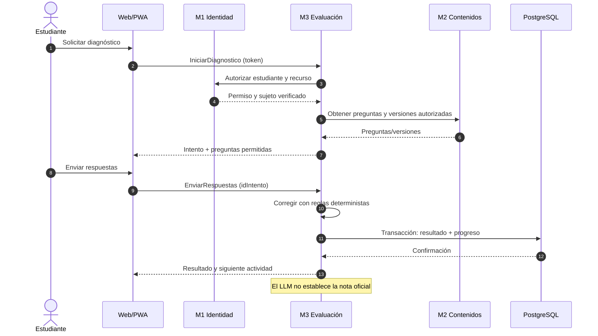
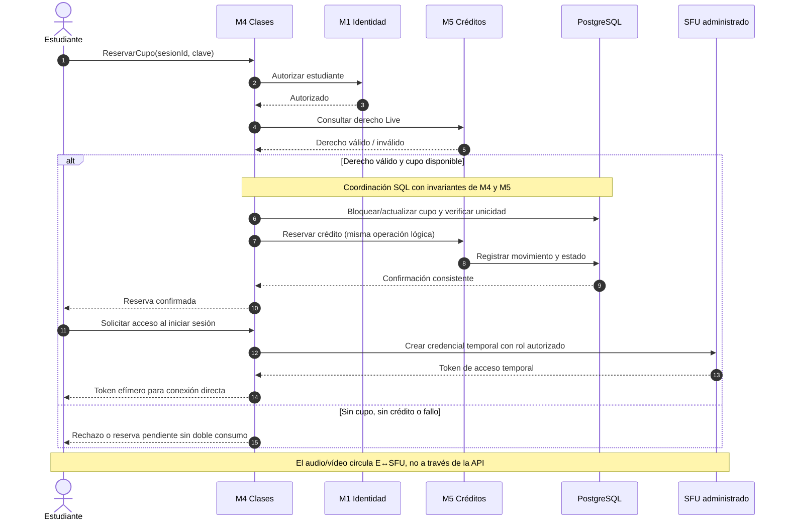
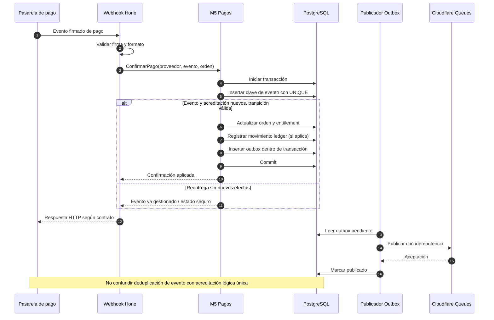
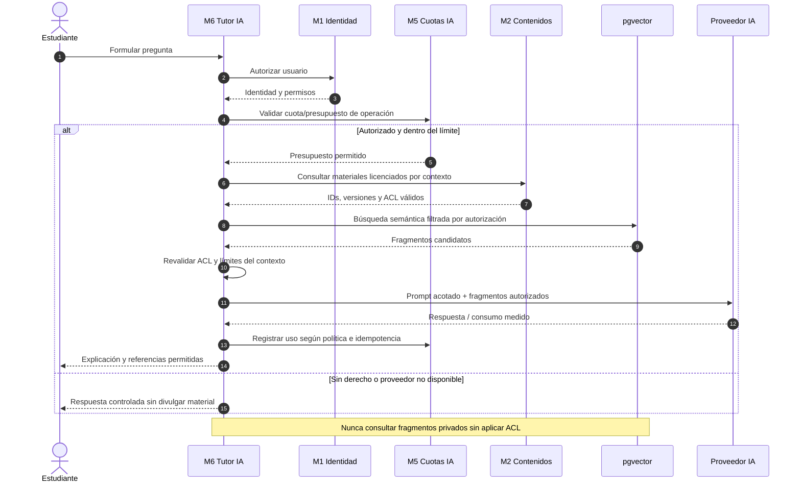
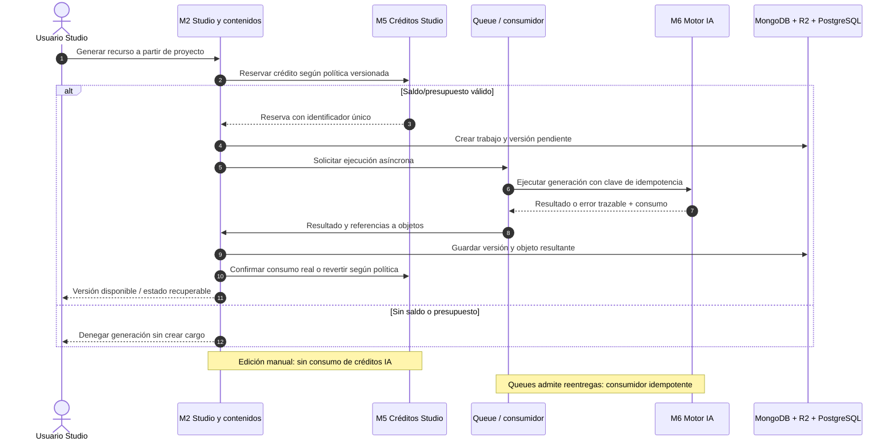

# Diseño interno de módulos — Mentelyx


## 1. Propósito y alcance

Este documento descompone **internamente los siete módulos de negocio de Mentelyx**, identifica sus responsabilidades, casos de uso, reglas, interfaces, adaptadores, dependencias y datos; además, ilustra las colaboraciones que requieren controles arquitectónicos especiales. Sirve como base para la implementación posterior y para explicar de qué decisiones arquitectónicas proviene cada componente.

El **Marketplace de productos para mascotas (GoPet)** de la Guía 004 es solamente un **caso de referencia para organizar la documentación**: los actores, módulos y diagramas de Mentelyx responden a un negocio educativo distinto. No se copian `Sellers`, carrito, pedidos ni otras funciones de ese Marketplace.

**Decisiones ya adoptadas para el diseño:**

- **Estilo general:** cliente-servidor y **monolito modular**, con un backend lógico distribuido internamente en **M1 a M7**, no en siete microservicios desplegados por separado (ADR-001).
- **Enfoque interno:** Clean Architecture, con dominio, aplicación, adaptadores de entrada/salida y composición de dependencias por módulo (ADR-002).
- **Cliente:** Next.js, React y TypeScript para Web/PWA. El alcance de exportación estática y SSR se comprobará por separado (ADR-003).
- **Backend objetivo:** Hono y TypeScript sobre Cloudflare Workers; API REST/HTTPS documentada mediante OpenAPI. Se debe validar compatibilidad del runtime y de las integraciones antes de producción (ADR-003, ADR-013).
- **Almacenamiento:** PostgreSQL local / Neon PostgreSQL en producción para operaciones transaccionales y `pgvector` para embeddings; MongoDB local / Atlas para contenido pedagógico y proyectos Studio; Cloudflare R2 para objetos; Bunny Stream para vídeo grabado cuando se valide; Redis para caché y controles efímeros (ADR-006, ADR-009, ADR-012, ADR-023, ADR-041).
- **Procesamiento asíncrono:** Cloudflare Queues, consumidores idempotentes y DLQ. Las operaciones económicas conservan su registro autoritativo en PostgreSQL, nunca en una cola o caché (ADR-042, ADR-043).

**Regla de interpretación:** las imágenes de este documento son **vistas del diseño objetivo**, no capturas de software ejecutado. Los nombres de interfaces y clases son **orientativos** hasta la implementación. Los proveedores marcados como candidatos y las capacidades sujetas a pruebas no se presentan como contratados ni plenamente operativos.

## 2. Vistas, notación e inventario visual

Los diagramas **1 a 10** se entregan como archivos PNG y SVG dentro de `./imagenes/`, acompañados de su fuente DOT para poder corregirlos sin redibujar desde cero. Los diagramas **11 a 15** se expresan como **Mermaid**, que GitHub muestra directamente en el Markdown.

| Figura | Vista | Propósito |
|---|---|---|
| 1 | Mapa modular | Delimitar el backend y los siete módulos. |
| 2 | Clean Architecture por módulo | Explicar dirección de dependencias, no el orden de ejecución. |
| 3 | Propiedad de datos | Distinguir información persistente, multimedia y temporal. |
| 4–10 | Diseño interno M1–M7 | Detallar reglas, casos de uso, puertos y adaptadores por módulo. |
| 11 | Diagnóstico | Comprender la colaboración entre evaluaciones, contenido y personalización. |
| 12 | Reserva de clase Live | Proteger cupos y créditos ante concurrencia. |
| 13 | Confirmación de pago | Verificar idempotencia, ledger y outbox. |
| 14 | Tutor IA con RAG | Autorizar fuentes, cuota y costo antes de responder. |
| 15 | Generación de Studio | Distinguir proyecto, consumo de créditos y ejecución de IA. |

**Convenciones:** las flechas continuas entre código indican quién **depende de** quién; la línea discontinua de infraestructura a puerto significa «implementa una interfaz». En los diagramas de secuencia, las flechas representan **mensajes en tiempo de ejecución**. Una llamada entre módulos del mismo backend representa un **contrato interno**, no una llamada HTTP ni un microservicio nuevo.

## 3. Descomposición general de la aplicación


*Figura 1. Un backend con siete módulos lógicos. Las integraciones y almacenes se alcanzan mediante adaptadores; la API frontal no debe exponer directamente las bases de datos.*

| ID | Módulo de negocio | Responsabilidad principal | Ejemplos de capacidades |
|---|---|---|---|
| **M1** | Usuarios y Administración | Identidad, sesiones, roles, autorizaciones y auditoría. | Registro; perfiles; control de acceso; habilitación docente. |
| **M2** | Cursos y Contenidos | Catálogo académico, lecciones, archivos, versiones, derechos editoriales y proyectos Studio. | Cursos por nivel; recursos; videos; publicación; editor Studio. |
| **M3** | Evaluaciones y Aprendizaje | Diagnósticos, ejercicios, calificación reproducible, progreso y recomendaciones deterministas. | Simulacros; planes de estudio; habilidades y prerrequisitos. |
| **M4** | Docentes y Clases | Perfiles docentes habilitados, programación, cupos, reservas y acceso a aulas Live. | Tutorías; videoclases; salas moderadas; grabaciones autorizadas. |
| **M5** | Suscripciones y Pagos | Catálogo de planes, derechos de uso, cobros, créditos, devoluciones y liquidaciones. | Free/Plus/Pro; Live; Studio; ledger y webhooks. |
| **M6** | Tutor IA y RAG | Asistencia académica IA, búsqueda autorizada, generación de respuestas y medición de consumo. | Tutor conversacional; recuperación semántica; explicaciones. |
| **M7** | Publicidad y Patrocinios | Campañas contextuales y ubicaciones aprobadas sin explotar información académica privada. | Patrocinios; campañas; métricas agregadas. |

**Capacidades transversales**, sin crear un octavo módulo de negocio: notificaciones y colas, observabilidad, políticas comunes de seguridad, configuración, gestión de errores, correlación de solicitudes y contratos compartidos. Sus implementaciones viven en bibliotecas de soporte y adaptadores, mientras cada módulo conserva la responsabilidad sobre el evento o acción que origina una notificación.

La oferta de educación **primaria, secundaria, preuniversitaria y universitaria** se modela en **M2 y M3** como niveles, programas y evaluaciones; no exige un módulo distinto por nivel. Los **convenios institucionales** son una evolución comercial posterior: no crean, por defecto, paneles institucionales ni acceso a información privada de estudiantes (ADR-010, ADR-039, ADR-040).

### 3.1. Esqueleto lógico común


*Figura 2. La aplicación depende del dominio y de sus interfaces; los adaptadores concretos implementan los puertos. La infraestructura nunca dicta las reglas educativas o comerciales.*

| Capa / pieza | Responsabilidad | No debe hacer |
|---|---|---|
| **Entrada** (`http`, `consumers`, `handlers`) | Validar formato y autenticación inicial; convertir una solicitud en un comando; transformar errores en respuestas HTTP o de cola. | Introducir reglas financieras, académicas o permisos basados solo en la interfaz. |
| **Aplicación** (`use-cases`, `ports`) | Coordinar un caso de uso, verificar autorización por recurso, aplicar políticas y trabajar con contratos públicos internos. | Crear SDK de proveedor, ejecutar SQL en controladores o depender de un repositorio concreto. |
| **Dominio** (`entities`, `value-objects`, `policies`) | Expresar invariantes, estados y reglas que deben seguir funcionando al sustituir proveedor o framework. | Importar Hono, Next.js, Prisma/ORM, Redis, servicios de IA o interfaces de nube. |
| **Salida** (`adapters`, `repositories`) | Implementar puertos hacia PostgreSQL, MongoDB, R2, pasarela de pago, SFU, vídeo e IA. | Autorizar operaciones sensibles usando solo valores que provienen del navegador. |
| **Composición** (`bootstrap`) | Construir e inyectar implementaciones por módulo, montar rutas y consumidores. | Convertirse en un módulo de negocio centralizado con todas las reglas. |

**Dos restricciones esenciales:** (a) un módulo solo accede a **sus propias tablas/colecciones o datos externos a través de su adaptador**; para obtener información de otro módulo utiliza su contrato público; (b) los roles y permisos se comprueban **de nuevo en el backend** en cada caso de uso o recurso privado. Una interfaz Web/PWA que oculta un botón no constituye un control de seguridad.

### 3.2. Propiedad y persistencia de datos


*Figura 3. PostgreSQL constituye la fuente de verdad de identidades, notas oficiales, créditos, pagos y reservas; MongoDB almacena documentos versionables; R2/Bunny, archivos y vídeo; Redis/Queues, datos y trabajo temporal.*

| Datos | Dueño lógico | Tecnología objetivo | Restricción |
|---|---|---|---|
| Cuentas, permisos, verificaciones, auditorías | M1 | PostgreSQL | No confundir tipo de cuenta, rol, habilitación y título acreditado. |
| Catálogo, derechos de publicación, licencias y metadatos | M2 | PostgreSQL | La licencia de publicar no implica permiso para RAG, entrenamiento o explotación distinta. |
| Lecciones estructuradas, ejercicios y versiones Studio | M2 | MongoDB | Usar identificadores/versiones estables; un documento no es prueba de derecho comercial. |
| PDFs, imágenes y adjuntos privados; vídeo grabado | M2/M4 según propiedad del recurso | R2; Bunny Stream si es aplicable | Autorización antes de emitir URL temporal; no exponer URL de almacenamiento como permiso permanente. |
| Intentos, resultados oficiales, perfiles de progreso | M3 | PostgreSQL | Resultados reproducibles; trazabilidad de versión del ejercicio. |
| Agenda, cupos, reservas, asistencia y sesiones Live | M4 | PostgreSQL | Cambios de cupo y reserva deben ser atómicos. |
| Órdenes, suscripciones, derechos, créditos y liquidaciones | M5 | PostgreSQL | ACID, restricciones `UNIQUE`, idempotencia, ledger y políticas versionadas. |
| Índice semántico y metadatos autorizados | M6, tomando fuentes de M2 | PostgreSQL + `pgvector` | Validar ACL al recuperar; desindexar materiales revocados o sustituidos. |
| Campañas, ubicaciones permitidas y agregados de campañas | M7 | PostgreSQL | No almacenar perfiles pedagógicos individuales para publicidad. |
| Cachés, límites temporales y trabajos asíncronos | Transversal, con responsables por mensaje | Redis / Queues / DLQ | No son fuente de verdad de saldos, notas oficiales ni permisos. |

Los enlaces entre documentos de MongoDB y registros de PostgreSQL **no forman una transacción distribuida automática**. Deben existir estados explícitos, claves de operación, procesos de reintento/conciliación y limpieza para cambios que crucen almacenes (ADR-022, ADR-023, ADR-035).

## 4. M1 — Usuarios y Administración


*Figura 4. M1 concentra el control autoritativo de cuentas y permisos.*

**Responsabilidad:** administrar identidad, sesiones, perfiles, roles, autorización por recurso, habilitaciones docentes y registros de auditoría. Un estudiante puede usar funcionalidades comerciales bajo los derechos de M5 sin cambiar automáticamente su **tipo de cuenta**. Una persona con permiso para publicar o tutorizar no es, por ese solo hecho, profesional titulado o verificado.

| Elemento | Diseño propuesto |
|---|---|
| **Casos de uso** | `RegistrarCuenta`, `IniciarSesion`, `GestionarPerfil`, `ResolverPermisos`, `HabilitarDocente`, `RegistrarAuditoria`. |
| **Reglas / entidades** | `Cuenta`, `Rol`, `Permiso`, `HabilitacionDocente`, `EventoAuditoria`; prohibir exposición de recursos de otra cuenta. |
| **Contratos publicados** | `IdentityQueryPort`, `AuthorizationPort`, `TeacherEligibilityPort`: devuelven identidad mínima y decisiones de permiso verificables por los demás módulos. |
| **Puertos de salida** | `IdentityRepository`, `AuditRepository`, `AuthSessionPort`. |
| **Adaptadores previstos** | PostgreSQL; biblioteca de autenticación evaluada (Better Auth como candidato); validadores y auditoría persistente. |
| **Dependencias legítimas** | Ninguna dependencia de lógica de M2–M7 para determinar la identidad; M4 pide una habilitación por contrato a M1. |
| **Restricción importante** | El middleware autentica, pero cada caso de uso aplica autorización de **objeto**: estudiante, documento, aula, resultado o pago. |

**Trazabilidad:** ADR-004, ADR-010, ADR-033, ADR-034 y ADR-044.

## 5. M2 — Cursos y Contenidos


*Figura 5. M2 administra material educativo y Studio, pero no es propietario de los saldos de IA ni de las notas oficiales.*

**Responsabilidad:** crear y publicar cursos, unidades, lecciones y ejercicios; conservar versiones del material y sus permisos; organizar recursos PDF/imagen/video; administrar derechos editoriales, licencia para RAG y proyectos de **Mentelyx Studio**. Incluye todos los niveles educativos acordados.

| Elemento | Diseño propuesto |
|---|---|
| **Casos de uso** | `CrearCurso`, `PublicarVersion`, `ConsultarCatalogo`, `VerificarAccesoAContenido`, `RegistrarLicencia`, `CrearProyectoStudio`, `GuardarVersionStudio`. |
| **Reglas / entidades** | `Curso`, `Unidad`, `ContenidoVersionado`, `Licencia`, `DerechoEditorial`, `ProyectoStudio`; publicación y indexación son permisos distintos. |
| **Contratos publicados** | `ContentCatalogPort`, `ContentVersionPort`, `LicensedDocumentPort` para M3 y M6. |
| **Puertos de salida** | `CourseRepository`, `PedagogicalDocumentRepository`, `ObjectStoragePort`, `VideoCatalogPort`; para Studio, `StudioGenerationPort` (implementado por adaptación al procesamiento de M6). |
| **Adaptadores previstos** | PostgreSQL (catálogo/licencias), MongoDB (lecciones y proyectos Studio versionados), R2 (binarios), Bunny Stream (video grabado cuando se valide). |
| **Dependencias legítimas** | M1 autoriza autor/editor; M5 comprueba derechos y créditos; M6 procesa solicitudes de IA mediante contrato. |
| **Restricción importante** | `R2` y `Bunny` nunca determinan por sí solos la autorización: el backend emite accesos limitados según la política vigente. |

**Pipeline de material para RAG:** M2 registra versión, propietario, licencia y permiso de indexación; después publica una referencia a un trabajo asíncrono. M6 recibe esa referencia, verifica nuevamente que sea indexable, extrae texto y mantiene índice por **documento + versión**. Si se revoca una licencia, se desencadena desindexación idempotente. No se asume que publicar un documento autorice entrenar un modelo.

**Studio:** las ediciones manuales no consumen créditos IA; los trabajos de generación con costo deben solicitar una **autorización/reserva de créditos M5**, registrar uso real y manejar fallos parciales. Los costos y cantidades de créditos son hipótesis comerciales por validar, no cifras fijadas por este diseño.

**Trazabilidad:** ADR-009, ADR-014, ADR-023, ADR-026, ADR-035, ADR-042 y ADR-050.

## 6. M3 — Evaluaciones y Aprendizaje


*Figura 6. M3 califica de forma determinista y almacena los resultados oficiales.*

**Responsabilidad:** diagnósticos iniciales, intentos, respuestas, criterios de corrección, historial académico, habilidades y prerrequisitos, avance, planes de estudio y **preparación para exámenes** (temarios, simulacros y seguimiento). La recomendación y planificación iniciales se basan en reglas y datos verificables; el modelo de lenguaje no decide unilateralmente la nota.

| Elemento | Diseño propuesto |
|---|---|
| **Casos de uso** | `IniciarDiagnostico`, `EnviarRespuestas`, `CalificarIntento`, `ActualizarPerfilAprendizaje`, `ProponerSiguienteActividad`, `GenerarPlanPreparacion`. |
| **Reglas / entidades** | `Evaluacion`, `Intento`, `Respuesta`, `Resultado`, `Habilidad`, `Prerrequisito`, `PerfilAprendizaje`; una calificación queda vinculada a la versión exacta del ejercicio. |
| **Contratos publicados** | `LearningProgressPort`, `AssessmentSummaryPort` con acceso restringido para el propio estudiante y operaciones autorizadas. |
| **Puertos de salida** | `AttemptRepository`, `ProgressRepository`, `ContentCatalogPort` (M2), `RecommendationPort` (motor determinista/adaptativo reemplazable). |
| **Adaptadores previstos** | PostgreSQL transaccional; consulta a preguntas/versiones por interfaz de M2; motor de reglas con pruebas unitarias. |
| **Dependencias legítimas** | M1 permisos; M2 preguntas y recursos autorizados; M5 derechos para funciones de pago; M6 solo explicaciones opcionales, no calificaciones oficiales. |
| **Restricción importante** | Nunca aceptar del navegador una nota, resultado final o estado de prerrequisitos como fuente autoritativa. |

**Trazabilidad:** ADR-006, ADR-018 y ADR-030.

## 7. M4 — Docentes y Clases


*Figura 7. M4 administra reservas y aulas Live; el audio/vídeo fluye por el proveedor SFU, no a través de Hono.*

**Responsabilidad:** gestionar las ofertas y horarios docentes, autorizar su publicación según habilitación, reservar cupos, registrar asistencia, crear salas moderadas, autorizar entrada temporal y conservar el estado de grabaciones consentidas. La **liquidación económica** de tutores pertenece a M5.

| Elemento | Diseño propuesto |
|---|---|
| **Casos de uso** | `PublicarClase`, `ReservarCupo`, `CancelarReserva`, `EmitirAccesoLive`, `RegistrarAsistencia`, `SolicitarGrabacionAutorizada`. |
| **Reglas / entidades** | `Clase`, `Sesion`, `Aforo`, `Reserva`, `Asistencia`, `EstadoGrabacion`; transiciones de reserva explícitas y no repetibles. |
| **Contratos publicados** | `ClassBookingPort`, `ClassAttendancePort`, `ClassAvailabilityPort`, `TeacherSessionPort`. |
| **Puertos de salida** | `ClassRepository`, `ReservationUnitOfWork`, `TeacherEligibilityPort` (M1), `CreditEntitlementPort` (M5), `LiveRoomPort`, `RecordingPort`. |
| **Adaptadores previstos** | PostgreSQL; SFU/WebRTC administrado (**RealtimeKit, candidato**); R2/servicio de grabación autorizado. |
| **Dependencias legítimas** | M1 verifica docencia; M5 valida acceso a Live y créditos; M2 puede ofrecer recursos de refuerzo. |
| **Restricción importante** | Aforo inicial **35 estudiantes + 1 docente** es meta de diseño por probar, no un rendimiento garantizado. No se exige que 36 cámaras estén abiertas. |

La reserva del último cupo requiere **control de concurrencia SQL** (bloqueo/actualización condicional y claves únicas). Para una reserva que además consume créditos, los módulos colaboran mediante **contratos internos** y una coordinación transaccional explícita cuando comparten PostgreSQL. Si el método de integración elegido no permite atomicidad conjunta, se documentan estados de reserva provisional, expiración y compensación idempotente antes de declararlo listo.

**Trazabilidad:** ADR-015, ADR-016, ADR-024, ADR-045, ADR-046, ADR-048 y ADR-051.

## 8. M5 — Suscripciones y Pagos


*Figura 8. M5 es dueño de los derechos de acceso, créditos, pagos, políticas versionadas y liquidaciones; jamás usa Redis como libro contable.*

**Responsabilidad:** administrar planes Free/Plus/Pro, productos Live y Studio, cobros y reembolsos, emisión de derechos (*entitlements*), movimientos de créditos, consumo de cupos comerciales, conciliación con pasarelas y liquidaciones contractuales de docentes.

| Elemento | Diseño propuesto |
|---|---|
| **Casos de uso** | `CrearOrden`, `SolicitarCobro`, `ConfirmarPago`, `ActivarEntitlement`, `ReservarCredito`, `ConsumirCredito`, `RevertirCredito`, `ConciliarPago`, `CalcularLiquidacion`. |
| **Reglas / entidades** | `PlanVersionado`, `OrdenPago`, `Suscripcion`, `Entitlement`, `MovimientoLedger`, `CreditoLive`, `CreditoStudio`, `TarifaDocente`, `Liquidacion`. |
| **Contratos publicados** | `EntitlementQueryPort`, `CreditReservationPort`, `PaymentStatusPort`, `SettlementQueryPort`. |
| **Puertos de salida** | `PaymentPort`, `PaymentRepository`, `CreditLedgerRepository`, `UnitOfWork`, `OutboxRepository`, `PricingPolicyPort`. |
| **Adaptadores previstos** | PostgreSQL/Neon + índices y transacciones; pasarela peruana **por seleccionar**; webhooks firmados; Outbox + Queues. |
| **Dependencias legítimas** | M1 identidad; M4 confirma/solicita reserva de clase; M2 y M6 consumen derechos y presupuesto IA según producto. |
| **Restricción importante** | Un mismo pago, una reentrega de webhook o un reintento de generación **no** acreditan o descuentan dos veces la misma operación lógica. |

**Invariantes contables que se deben implementar y probar:**

1. Toda orden y sus eventos externos usan identificadores estables; verificar firma y validez del emisor del webhook.
2. La deduplicación necesita restricción `UNIQUE` persistente, asociada al proveedor/evento **y** a la operación de negocio que se pretende acreditar; un `SELECT` previo sin restricción no es suficiente.
3. La activación de un derecho, el movimiento de ledger y el evento Outbox deben quedar en la **misma transacción PostgreSQL** cuando pertenecen al mismo efecto de negocio.
4. Los productos Live y Studio mantienen **ledgers separados**; la cuota del Tutor IA Plus/Pro se controla con su propia política de uso, sin intercambiar créditos automáticamente.
5. El valor y la versión de una regla comercial aplicable quedan asociados al contrato, reserva o liquidación histórica. Los cambios posteriores no alteran operaciones anteriores.
6. El pago confirmado por pasarela **no equivale** a transferencia realizada a un docente; conciliación y liquidación son estados separados.

**Trazabilidad:** ADR-005, ADR-007, ADR-027, ADR-028, ADR-043 y ADR-047–055.

## 9. M6 — Tutor IA y RAG


*Figura 9. M6 verifica autorización y presupuesto, recupera solo material válido y mide cada llamada de IA.*

**Responsabilidad:** generar apoyo conversacional contextualizado, recuperar fragmentos académicos autorizados mediante RAG, consumir cuotas según plan, registrar consumo técnico y económico, y administrar procesos de embeddings/indexación/versionado. La evaluación oficial permanece en M3.

| Elemento | Diseño propuesto |
|---|---|
| **Casos de uso** | `ResponderConsulta`, `RecuperarContextoAutorizado`, `IndexarVersionDocumento`, `DesindexarDocumento`, `RegistrarUsoIA`. |
| **Reglas / entidades** | `SolicitudTutor`, `ContextoAutorizado`, `IndiceVersionado`, `PoliticaCuotaIA`, `ConsumoIA`; no utilizar documentos sin licencia vigente ni datos de terceros. |
| **Contratos publicados** | `TutorExplanationPort`, `AuthorizedSearchPort`, `AIGenerationPort`, `IndexingRequestPort`. |
| **Puertos de salida** | `LLMPort`, `EmbeddingPort`, `AuthorizedRetrieverPort`, `LearningContextPort` (M3), `LicensedDocumentPort` (M2), `UsageAndQuotaPort` (M5). |
| **Adaptadores previstos** | `pgvector`/PostgreSQL; proveedores de embeddings/LLM por seleccionar; Cloudflare Queues/DLQ para indexación. |
| **Dependencias legítimas** | M1 identidad; M2 licencia/versiones; M3 evidencia y progreso autorizado; M5 derecho de plan y límite de costo/uso. |
| **Restricción importante** | Filtrar ACL **antes y durante la recuperación**, no solo ocultar una fuente después de que el LLM la haya visto. |

Cuando falle IA, la plataforma debe **degradar con seguridad**: mantener accesible el contenido autorizado que no dependa de generación y mostrar un mensaje controlado; no aprobar una nota ni gastar créditos por un resultado no verificable. Los timeouts, reintentos y costos reales deben probarse contra los contratos del proveedor (ADR-019, ADR-026, ADR-053, ADR-054).

**Trazabilidad:** ADR-018, ADR-019, ADR-026, ADR-042, ADR-053 y ADR-054.

## 10. M7 — Publicidad y Patrocinios


*Figura 10. M7 mantiene independientes las campañas de la información privada sobre aprendizaje.*

**Responsabilidad:** gestionar ubicaciones de anuncios aprobadas, reglas por plan/contexto/edad, campañas, vigencias y métricas agregadas, sin emplear notas, historial de estudios, conversaciones del tutor IA ni información sensible de menores para segmentación.

| Elemento | Diseño propuesto |
|---|---|
| **Casos de uso** | `ConfigurarCampana`, `EvaluarUbicacion`, `ObtenerPatrocinioContextual`, `RegistrarImpresionAgregada`. |
| **Reglas / entidades** | `Campana`, `Ubicacion`, `PoliticaPublicidad`, `MetricaAgregada`; permitir solo ubicaciones autorizadas. |
| **Contratos publicados** | `AdPlacementQueryPort`, que solo entrega piezas aptas para el contexto declarado. |
| **Puertos de salida** | `CampaignRepository`, `PlacementPolicyPort`, `AggregatedMetricsPort`. |
| **Adaptadores previstos** | PostgreSQL; entrega contextual propia; proveedor externo únicamente si sus condiciones de privacidad se validan. |
| **Dependencias legítimas** | M1 confirma edad/permisos pertinentes sin divulgar datos sensibles; M5 informa derecho del plan sin compartir pagos detallados. |
| **Restricción importante** | No mostrar publicidad dentro de exámenes, clases Live, editor Studio, contenido de pago ni procesos de liquidación. |

**Trazabilidad:** ADR-025. Las medidas de consentimiento, tratamiento de información de menores y cumplimiento legal necesitan validación específica antes de activar campañas.

## 11. Dependencias y contratos entre módulos

La matriz indica **quién consume el contrato** y **quién lo ofrece**. No deben crearse llamadas directas a repositorios privados ni a esquemas de la base de datos de otro módulo.

| Consumidor | Proveedor | Contrato interno propuesto | Datos mínimos / razón |
|---|---|---|---|
| M2 | M1 | `AuthorizationPort` | Autor/autorización para publicar o editar. |
| M2 | M5 | `EntitlementQueryPort` / `CreditReservationPort` | Acceso a contenido de pago y consumos Studio. |
| M3 | M2 | `ContentCatalogPort` | Ejercicio y versión autorizada que se evalúan. |
| M3 | M5 | `EntitlementQueryPort` | Derecho a una evaluación o simulacro premium. |
| M4 | M1 | `TeacherEligibilityPort` | Habilitación para impartir la actividad. |
| M4 | M5 | `CreditReservationPort` | Reservar/consumir derecho a una clase Live. |
| M6 | M1 | `AuthorizationPort` | Identidad y políticas por recurso. |
| M6 | M2 | `LicensedDocumentPort` | Material autorizado, licencia y versión. |
| M6 | M3 | `LearningProgressPort` | Progreso autorizado necesario para contextualizar. |
| M6 | M5 | `EntitlementQueryPort` / `UsageAndQuotaPort` | Cuotas, autorización de consumo y presupuesto IA. |
| M7 | M1, M5 | `AuthorizationPort` / `EntitlementQueryPort` | Solo condiciones mínimas de contexto/plan, sin perfil académico. |
| M5 | M4 | `ClassAttendancePort` | Evidencia autorizada cuando se liquida una clase bajo contrato. |

**Regla contra dependencias circulares:** cuando dos módulos necesitan colaborar en ambos sentidos (por ejemplo, M4↔M5), se separan **interfaces de lectura y comandos**, el coordinador de caso de uso queda definido y los tipos compartidos se reducen a DTO de contrato. No se permite `import` de repositorios o entidades internas de otro módulo. Los diagramas de dependencias se verifican con una herramienta de análisis estático en CI.

## 12. Flujos dinámicos críticos

### 12.1. Diagnóstico académico (figura 11)



**Condición de aceptación:** una solicitud reintentada no genera dos resultados oficiales para el mismo intento; el resultado apunta a la **versión** de los ítems evaluados. La recomendación puede explicarse sin depender de un LLM.

### 12.2. Reserva de aula Live con créditos (figura 12)



**Condición de aceptación:** dos usuarios no pueden confirmar el mismo último cupo, y un reintento no puede consumir crédito dos veces. El mecanismo de transacción compartida o compensación debe definirse y verificarse antes de habilitar venta de clases.

### 12.3. Webhook de pago e idempotencia (figura 13)



**Condición de aceptación:** entregar diez veces el mismo webhook (incluso concurrentemente) no cambia más de una vez el derecho lógico ni repite el movimiento. Un fallo al publicar Queues **después** del commit deja el evento en Outbox para reintento. Reembolsos son eventos distintos y requieren transición válida; no se eliminan como si fueran duplicados.

### 12.4. Consulta de Tutor IA con RAG (figura 14)



**Condición de aceptación:** un usuario no obtiene material de otro estudiante, de contenido sin licencia o de una versión revocada; el costo se registra según resultado del proveedor, evitando consumo duplicado por reintento.

### 12.5. Generación de recurso Studio (figura 15)



**Condición de aceptación:** repetir una solicitud con la misma clave lógica no duplica generación ni débito; un error parcial permite reconciliar costo y estado antes de reversar, sin asumir que un timeout no tuvo gasto real.

## 13. Interfaces públicas internas: ejemplos de contratos

El siguiente fragmento TypeScript es **pseudocódigo de diseño**, no implementación existente. Muestra contratos pequeños que ocultan los adaptadores y permiten pruebas con dobles (*mocks/fakes*).

```ts
// Contratos ilustrativos: NO representan código ya desarrollado.
type ResourceRef = { kind: string; id: string };

type AuthorizationPort = {
  canAccess(input: {
    subjectId: string;
    action: string;
    resource: ResourceRef;
  }): Promise<boolean>;
};

type ContentVersionPort = {
  getAuthorizedVersion(input: {
    subjectId: string;
    contentId: string;
    versionId: string;
  }): Promise<{ id: string; versionId: string } | null>;
};

type CreditReservationPort = {
  reserve(input: {
    ownerId: string;
    product: 'LIVE' | 'STUDIO';
    operationId: string; // clave estable de operación lógica
    policyVersion: string;
  }): Promise<{ reservationId: string; status: 'RESERVED' | 'REJECTED' }>;
};

type PaymentPort = {
  createPayment(input: {
    orderId: string;
    amountMinorUnits: number;
    currency: string;
    idempotencyKey: string;
  }): Promise<{ providerPaymentId: string; state: string }>;
};
```

Estos tipos ilustran los **límites** de responsabilidad. Antes de publicar los contratos finales se deben fijar **DTO, códigos de error, permisos de invocación, invariantes, claves idempotentes, control de transacciones y compatibilidad de versiones**. Las cantidades de dinero en unidades menores evitan representar importes contables con números flotantes sin política de redondeo.

## 14. Organización referencial del código

**Estructura objetivo** (no supone que estas carpetas existan todavía):

```text
tecnologia/
└── backend/
    └── src/
        ├── app/
        │   ├── http/                  # Hono: rutas, auth inicial y errores
        │   ├── bootstrap/             # Composición e inyección de dependencias
        │   └── workers/               # Consumidores de Queues / jobs
        ├── modules/
        │   ├── m1-usuarios/
        │   ├── m2-contenidos/
        │   ├── m3-aprendizaje/
        │   ├── m4-clases/
        │   ├── m5-pagos/
        │   ├── m6-tutor-ia/
        │   └── m7-publicidad/
        └── shared/
            ├── contracts/             # DTO compartidos mínimos
            ├── infrastructure/        # Configuración técnica reutilizable
            └── observability/         # Trazabilidad sin datos sensibles
```

Dentro de **cada módulo**, se propone una estructura proporcional a su complejidad:

```text
m5-pagos/                          # Ejemplo de módulo, no todo el backend
├── domain/                        # Entidades, políticas, invariantes
├── application/
│   ├── use-cases/                 # ConfirmarPago, ReservarCredito...
│   └── ports/                     # PaymentPort, UnitOfWork...
├── adapters/
│   ├── inbound/                   # Rutas, handlers de webhook
│   └── outbound/                  # Repositorios SQL, pasarela, outbox
├── public/                        # Contratos que otros módulos pueden importar
└── tests/                         # Pruebas de dominio, contratos y concurrencia
```

La estructura de carpetas **no basta** para aplicar Clean Architecture: importaciones, pruebas, propiedad de datos y ensamblaje deben cumplir la regla de dependencias. Se evitan jerarquías de clases innecesarias para módulos sencillos.

## 15. Verificación del diseño y criterios de aceptación

| Prueba de arquitectura / comportamiento | Resultado exigido antes de implementar la función en producción | Responsable |
|---|---|---|
| Dependencias estáticas | Dominio sin importaciones de SDK, Hono, ORM o código interno de otro módulo. | M1–M7 |
| Autorización por recurso | Intentar consultar resultados, proyectos, clases o pagos ajenos devuelve rechazo sin filtrar información. | M1 y consumidores |
| Reproducibilidad del diagnóstico | Mismo intento/versión/criterio da resultado consistente; auditoría de revisiones cuando aplique. | M3 + M2 |
| Último cupo Live | Reservas simultáneas no exceden el aforo ni crean consumos duplicados. | M4 + M5 |
| Reentrega de pago | Repetir webhooks no duplica entitlements, movimientos ni liquidaciones. | M5 |
| Falla entre SQL y cola | El evento Outbox pendiente vuelve a publicarse; consumidores idempotentes. | M5 + transversal |
| ACL en RAG | Fragmentos privados, revocados o no licenciados nunca se entregan al LLM. | M6 + M2 + M1 |
| Fallo de proveedor IA | Mantener contenido no generativo autorizado; no acreditar un resultado ni cobrar sin registrar el estado real. | M6 + M5 |
| Generación Studio duplicada | Reintentos con la misma clave no duplican el costo ni crean versiones conflictivas. | M2 + M5 + M6 |
| Anuncios restringidos | No renderizar campañas en exámenes, clases Live, Studio, lecciones de pago o liquidaciones. | M7 |
| Resiliencia de Redis | Falla de caché no autoriza acceso, cambia una nota ni modifica un saldo. | Transversal |
| Proveedores externos | Pruebas de contrato, costos, latencia y disponibilidad real en Perú antes de afirmaciones de capacidad. | M2, M4, M5, M6 |

**No se declaran cumplidas** estas pruebas: son condiciones verificables para el desarrollo del primer y sucesivos sprints.

## 16. Riesgos y decisiones pendientes

| Tema | Decisión que ya existe | Lo pendiente de demostrar |
|---|---|---|
| Runtime Hono/Workers | Objetivo de backend serverless con TypeScript. | Compatibilidad y conexión segura a Neon/Atlas, límites de tiempo, subidas y consumo. |
| PostgreSQL + MongoDB | Responsabilidades separadas por dominio. | Reconciliación entre almacenes, migraciones y restauración conjunta de referencias. |
| Pagos | `PaymentPort`, ledger SQL, webhook, Outbox e idempotencia. | Proveedor final y garantías de firma, reembolso, consulta de estado e idempotencia. |
| Live | WebRTC SFU gestionado, aulas moderadas (35+1 como referencia). | Aforo real, rendimiento, grabaciones, reconexión, minutos-participante y costo. |
| RAG | `pgvector`, indexación asíncrona y verificación de ACL. | Calidad pedagógica, desindexación, latencia, costo por uso y privacidad. |
| Studio | Proyectos versionados en MongoDB; binarios en R2; consumo en ledger M5. | Política final de créditos y conciliación por resultado/timeout. |
| Seguridad y menores | Autorización backend; publicidad contextual sin segmentación académica. | Políticas de privacidad, consentimiento y tratamiento de datos antes de lanzar. |
| Disponibilidad | Timeouts, degradación, respaldo y recuperación. | RTO/RPO y pruebas reales; Workers no garantiza por sí solo HA de Neon, Atlas o proveedores. |

## 17. Relación con requisitos, atributos y ADR

| Driver / decisión | Módulos afectados | Evidencia en este documento |
|---|---|---|
| **ADR-001 / ADR-002**: monolito modular y Clean Architecture | M1–M7 | Figuras 1–2, contratos y estructura de carpetas. |
| **ADR-004 / ADR-034**: permisos, roles y habilitación | M1, M4, M6 | Figura 4; verificaciones previas a Live/RAG. |
| **ADR-006 / ADR-023**: consistencia SQL y contenido documental | M1–M6 | Figura 3, tabla de propiedad y puertos de datos. |
| **ADR-018 / ADR-030**: evaluación reproducible y preparación | M2, M3 | Figura 6 y secuencia 11. |
| **ADR-015 / ADR-045–046**: aulas Live | M4, M5 | Figura 7 y secuencia 12. |
| **ADR-007 / ADR-043 / ADR-048 / ADR-052**: transacciones e idempotencia | M5 | Figura 8 y secuencia 13. |
| **ADR-019 / ADR-026 / ADR-053–054**: tutor RAG y costos | M2, M5, M6 | Figura 9 y secuencia 14. |
| **ADR-035 / ADR-050**: Studio versionado y créditos | M2, M5, M6 | Figuras 5/8/9 y secuencia 15. |
| **ADR-025**: anuncios contextuales | M7 | Figura 10 y pruebas de ubicaciones permitidas. |

Para sostener la **trazabilidad completa a RF, atributos AC y drivers DA** frente al docente, debe cotejarse esta tabla con las versiones finales de `03-requisitos-funcionales.md`, `04-atributos-de-calidad.md`, `06-drivers-arquitectonicos.md` y `07-decisiones-arquitectonicas.md`. No se asignan códigos RF nuevos ni números de exigencia no confirmados aquí.

## 18. Fuentes y documentos relacionados

**Fuentes de arquitectura y notación:**

- Martin, R. C. (2017). *Clean Architecture: A Craftsman's Guide to Software Structure and Design*. Prentice Hall.
- Cervantes Maceda, H., Velasco-Elizondo, P., y Castro Careaga, L. (2016). *Arquitectura de software: conceptos y ciclo de desarrollo*. Cengage Learning. Capítulos 3 y 4: diseño, interfaces y documentación mediante vistas.
- [Simon Brown — C4 model](https://c4model.com/): descomposición del sistema en niveles de abstracción complementarios.
- [Hono — documentación oficial](https://hono.dev/docs/getting-started/cloudflare-workers): API y ejecución sobre Cloudflare Workers.
- [GitHub — Mermaid en archivos Markdown](https://docs.github.com/en/get-started/writing-on-github/working-with-advanced-formatting/creating-diagrams): renderizado y edición versionable de diagramas.
- [Repositorio académico de referencia (Marketplace, Guía 004)](https://github.com/devlizbethjaico/Marketplace-arquitSoft-02): modelo de organización documental; el diseño de Mentelyx es original.

**Documentación interna de Mentelyx:** `07-decisiones-arquitectonicas.md`, `enfoque-arquitectonico.md`, `estilo-arquitectonico.md`, `componentes-arquitectonicos.md`, `principios-de-diseno.md`, `patrones-de-diseno.md`. La Guía 004 exige guardar texto e imágenes con rutas correctas y exponer la documentación versionada del proyecto en su repositorio.

---

**Conclusión arquitectónica:** Mentelyx mantiene **siete módulos de negocio claramente delimitados** en un monolito modular, aplica Clean Architecture dentro de cada uno y separa la propiedad de datos y los contratos. Las operaciones de **evaluación, reservas, pagos, créditos, contenido privado e IA** poseen mecanismos explícitos para evitar duplicidades, accesos indebidos y dependencias ocultas. Este documento describe el diseño a implementar y las pruebas necesarias para validarlo, no un producto ya construido.
