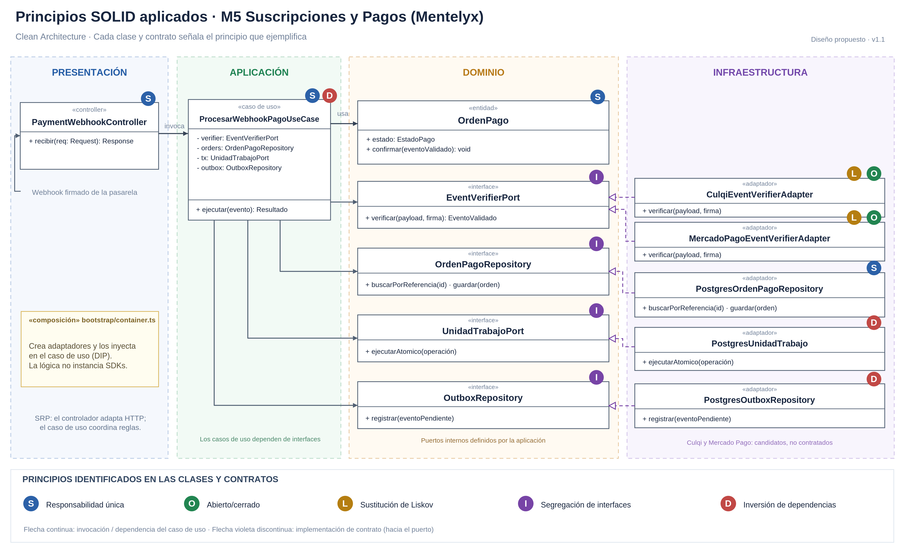

# Principios de diseño (SOLID) — Mentelyx

> **Documento:** `principios-de-diseno.md`  
> **Alcance:** los siete módulos del backend de Mentelyx (M1–M7).  
> **Estado:** propuesta arquitectónica previa a la implementación; las clases, interfaces, archivos y pruebas indicados son **diseños previstos**, no componentes ya desarrollados.  
> **Referencia:** decisiones arquitectónicas de Mentelyx (ADR), estilo monolito modular y enfoque Clean Architecture.

## 1. Objetivo

Definir **cómo se aplicarán y comprobarán los cinco principios SOLID en cada uno de los siete módulos de Mentelyx**, para mantener separados los procesos educativos, las políticas comerciales y los detalles tecnológicos. El propósito no es declarar SOLID de forma genérica, sino establecer responsabilidades, contratos y criterios que orienten la futura implementación con Hono y TypeScript.

En particular, se busca impedir que los controladores contengan reglas de negocio, que los casos de uso dependan de proveedores concretos y que un módulo acceda directamente a las tablas o implementaciones privadas de otro. **SOLID facilita la evolución y las pruebas, pero no sustituye los controles transaccionales, la idempotencia, la seguridad ni las pruebas de infraestructura.**

## 2. Contexto arquitectónico

| Elemento | Decisión aplicada a Mentelyx |
|---|---|
| **Estilo arquitectónico** | **Monolito modular en capas**: una API principal con siete módulos de negocio. |
| **Enfoque interno** | **Clean Architecture**: Presentación, Aplicación, Dominio e Infraestructura, con dependencias orientadas a políticas y contratos internos. |
| **Cliente** | Web/PWA con Next.js, React y TypeScript. |
| **Backend** | Hono + TypeScript sobre Cloudflare Workers (arquitectura objetivo; compatibilidad de integraciones pendiente de prueba). |
| **Datos** | PostgreSQL local / Neon PostgreSQL + pgvector en producción; MongoDB local / MongoDB Atlas en producción; Redis para caché y estados temporales. |
| **Archivos y tareas** | Cloudflare R2, Cloudflare Queues y consumidores con DLQ. |
| **Servicios integrados** | Proveedor de modelos LLM y embeddings; WebRTC/SFU administrado (RealtimeKit candidato); Bunny Stream; pasarela de pagos externa aún por seleccionar. |
| **Identidad** | Biblioteca de autenticación candidata (Better Auth); reglas propias de autorización RBAC/ABAC y acceso por recurso. |
| **Tipos de cuenta públicos** | Estudiante, Creador educativo y Docente; Superadministrador como actor interno. Docente independiente o por nivel académico son modalidades del mismo actor. |
| **Productos** | Suscripciones estudiantiles, Aulas Live y Studio; límites, precios y remuneraciones sujetos a validación. |

La elección de un **monolito modular** no implica que los módulos deban compartir lógica indiscriminadamente. Cada módulo es dueño de sus casos de uso y persistencia; otros módulos colaboran mediante **contratos públicos internos**. Los módulos tampoco son microservicios independientes.

## 3. Significado práctico de los principios SOLID

| Principio | Criterio que utilizaremos en Mentelyx | Error que debemos evitar |
|---|---|---|
| **S — Single Responsibility Principle (SRP)** | Una clase o función cohesiva tiene **una razón principal para cambiar**; se separan transporte HTTP, reglas, persistencia e integración. | Un `*.service.ts` gigante que valida, cobra, consulta SQL, envía correos y genera reportes. |
| **O — Open/Closed Principle (OCP)** | Permitir nuevas variantes **cuando exista un punto de extensión justificado**, sin editar innecesariamente los casos de uso estables. | Crear interfaces y fábricas sin una variación real o prometer que nunca cambiará ningún contrato. |
| **L — Liskov Substitution Principle (LSP)** | Las implementaciones de un puerto cumplen la **semántica**, precondiciones, poscondiciones, efectos y errores pactados. | Considerar intercambiables dos proveedores solo porque TypeScript acepta el mismo tipo de retorno. |
| **I — Interface Segregation Principle (ISP)** | Contratos pequeños, específicos para las necesidades de sus consumidores. | Forzar a un adaptador de IA a implementar almacenamiento, pagos y correo, o a una pasarela sin reembolsos a fingir que los soporta. |
| **D — Dependency Inversion Principle (DIP)** | Los casos de uso conocen **puertos propios**, no SDKs ni repositorios concretos; el Composition Root ensambla implementaciones. | Importar Neon, MongoDB, Cloudflare, Better Auth o el SDK de un proveedor directamente desde el dominio. |

**Nota sobre las interfaces:** los contratos que expresan necesidades de los casos de uso normalmente pueden vivir en `application/ports/`; los contratos que representan abstracciones genuinas del dominio pueden vivir en `domain/`. No es necesario ubicar todas las interfaces dentro del dominio. Las dependencias deben justificarse por responsabilidad, no por el nombre de una carpeta.

## 4. Representación gráfica de referencia



**Figura 1.** Diagrama UML representativo de SOLID en **M5 — Suscripciones y Pagos**. Se muestran las cuatro responsabilidades de Clean Architecture y las relaciones entre controladores, casos de uso, entidades, puertos y adaptadores. Las letras S, O, L, I y D identifican ejemplos de principios en clases y contratos. **La figura corresponde a un módulo ilustrativo; SOLID se define para M1–M7 en las secciones siguientes.** Fuente: elaboración propia basada en el formato académico compartido por la docente.


> El diagrama es conceptual: la ubicación visual de los puertos junto al dominio no obliga a ubicar sus archivos en `domain/`; los puertos de casos de uso se definirán preferentemente en `application/ports/`. Los adaptadores externos **implementan** esos puertos; el dominio no importa los adaptadores.

## 5. Aplicación de SOLID por módulo

Los nombres de clases y rutas son **propuestas de implementación TypeScript**, que se validarán cuando diseñemos contratos y persistencia. Cada tabla identifica cómo se aplicará **cada uno de los cinco principios**, no solo el módulo de Pagos.

### 5.1. M1 — Usuarios y Administración

**Responsabilidad:** registro y perfiles, tipos de cuenta, modalidad docente, autenticación integrada, autorizaciones, acreditaciones y operaciones del Superadministrador. La solicitud de tutorías de un universitario adulto autorizado no cambia por sí misma el tipo de cuenta Estudiante.

| SOLID | Aplicación concreta en M1 | Elementos de código previstos |
|---|---|---|
| **S** | Separar registro, edición de perfiles, solicitud de habilitación, verificación de títulos y autorización de recursos. El controlador no valida títulos ni ejecuta consultas SQL. | `register-user.use-case.ts`, `update-profile.use-case.ts`, `approve-teaching-permission.use-case.ts`, `users.controller.ts` |
| **O** | Permitir incorporar un mecanismo compatible de verificación de credenciales o correo mediante adaptadores, sin modificar las reglas de autorización del usuario. | `CredentialVerificationPort`, `MailPort`, `verification.adapter.ts` |
| **L** | Un repositorio PostgreSQL y un doble de prueba deben respetar las mismas reglas sobre usuario inexistente, identificadores y unicidad; el adaptador de identidad debe preservar identidad y estados verificados. | `UserRepository`, `PostgresUserRepository`, `user-repository.contract.spec.ts` |
| **I** | Separar `UserRepository`, `IdentitySessionPort`, `CredentialVerificationPort` y `MailPort`; quien consulta permisos no debe depender del servicio de correo ni de recuperación de contraseña. | `application/ports/*.port.ts` |
| **D** | Casos de uso dependen de puertos y políticas internas; adaptadores PostgreSQL, correo y biblioteca de autenticación se conectan en composición. | `check-resource-access.use-case.ts`, `bootstrap/container.ts` |

**Reglas que deben permanecer protegidas:** una cuenta Docente puede registrar una modalidad libre o académica; declarar una licenciatura o doctorado **no equivale a una acreditación verificada**; ofrecer tutorías remuneradas exige habilitación; el Superadministrador no obtiene acceso indiscriminado a información sensible fuera de políticas auditables.

**Pruebas necesarias:** impedir elevación de privilegios, impedir suplantación de recurso y evitar que cambios de modalidad otorguen automáticamente insignias o permisos; verificar que un Estudiante habilitado conserva el tipo de cuenta inicial. Una suite de contratos debe validar repositorios reales y dobles de prueba.

### 5.2. M2 — Cursos y Contenidos (Mentelyx Studio)

**Responsabilidad:** cursos, lecciones, materiales, estructura de presentaciones y recursos interactivos; publicación, versionado, archivos, derechos de acceso y gestión de contenido de Studio.

| SOLID | Aplicación concreta en M2 | Elementos de código previstos |
|---|---|---|
| **S** | Diferenciar editar material, publicar una versión, comprobar derechos, guardar metadatos y subir archivos; generar una imagen con IA es un caso de uso distinto de editar manualmente. | `edit-material.use-case.ts`, `publish-material.use-case.ts`, `generate-studio-asset.use-case.ts` |
| **O** | Nuevos tipos de exportación o almacenamiento podrán incorporarse por adaptadores cuando estén definidos los formatos soportados, sin cambiar reglas de publicación. | `FileStoragePort`, `MaterialExporterPort`, `R2StorageAdapter` |
| **L** | Cualquier exportador debe devolver un resultado válido para el formato declarado o un error explícito; ningún adaptador debe devolver archivos corruptos simulando éxito. | `MaterialExporterPort`, `exporter.contract.spec.ts` |
| **I** | Separar lectura/edición documental, carga de archivos, exportación y publicación de videos. No convertir `ContentRepository` en una interfaz que gestione todos los servicios. | `ContentRepository`, `FileStoragePort`, `VideoCatalogPort`, `MaterialExporterPort` |
| **D** | El editor y los casos de uso no deben importar el driver MongoDB, R2 ni Bunny Stream: se comunican mediante puertos. | `MongoContentRepository`, `R2StorageAdapter`, `BunnyVideoAdapter` |

**Reglas protegidas:** solo el autor o un usuario autorizado puede editar y publicar; los materiales conservan versión y política de acceso; **la edición manual no consume créditos de IA**; los materiales no se incorporan automáticamente a conjuntos de entrenamiento de proveedores ni a RAG sin autorización válida.

**Pruebas necesarias:** un usuario no edita materiales ajenos; una publicación no altera accidentalmente versiones anteriores; falla de R2 no produce una publicación confirmada con un archivo inexistente; un trabajo de IA reintentado no aplica múltiples descuentos por la misma operación lógica.

**Alcance 3D:** un futuro editor 3D se evaluará por separado. Tinkercad es una referencia de experiencia de usuario, no un SDK, proveedor ni tecnología elegida; no se introducen aquí clases de modelado 3D que todavía no tengan requisitos aprobados.

### 5.3. M3 — Evaluaciones y Aprendizaje

**Responsabilidad:** diagnósticos, ejercicios, simulacros, calificaciones, evidencias y progreso académico. La evaluación oficial debe ser reproducible y no depender de una respuesta generativa no verificable.

| SOLID | Aplicación concreta en M3 | Elementos de código previstos |
|---|---|---|
| **S** | Separar entrega de evaluación, corrección, registro de resultado y actualización de progreso; el controlador no calcula notas. | `submit-evaluation.use-case.ts`, `grade-evaluation.use-case.ts`, `record-progress.use-case.ts` |
| **O** | Si existen criterios de corrección realmente diferentes (opción múltiple, rúbrica, etc.), usar estrategias tipadas para añadir una nueva sin reescribir el flujo común. | `GradingPolicy`, `MultipleChoiceGrader`, `RubricGrader` (condicionados al alcance) |
| **L** | Cada corrector aplicable respeta un contrato de entrada, escala, redondeo y errores; no sustituir silenciosamente una corrección determinista por un LLM. | `GradingPolicy`, `grading-policy.contract.spec.ts` |
| **I** | Separar consulta de bancos de preguntas, persistencia de resultados y seguimiento de progreso, evitando interfaces que mezclen lectura y escritura no relacionadas. | `QuestionBankPort`, `EvaluationResultRepository`, `ProgressRepository` |
| **D** | Los casos de uso reciben repositorios y políticas como contratos; el almacenamiento concreto PostgreSQL o MongoDB queda fuera del dominio. | `PostgresResultRepository`, `MongoQuestionBankAdapter` |

**Reglas protegidas:** las calificaciones y los resultados persistidos deben estar vinculados con el estudiante autorizado, la versión de la evaluación y los criterios correspondientes. PostgreSQL conserva resultados oficiales; MongoDB puede contener estructuras flexibles de preguntas y actividades.

**Pruebas necesarias:** mismo conjunto de respuestas y reglas produce el mismo resultado; no se puede enviar una evaluación en nombre de otro alumno; no se modifica un intento cerrado sin una operación auditada; doble envío no duplica el resultado oficial.

### 5.4. M4 — Docentes y Clases

**Responsabilidad:** oferta de sesiones, horarios, cupos, reservas, tutorías, asistencia y conexión controlada con la plataforma audiovisual. Aforo inicial de diseño: hasta **35 estudiantes y un docente** por aula, sujeto a pruebas del proveedor.

| SOLID | Aplicación concreta en M4 | Elementos de código previstos |
|---|---|---|
| **S** | Separar creación de clase, disponibilidad, reserva, validación de habilitación, acceso al aula y registro de asistencia. | `create-class.use-case.ts`, `reserve-class.use-case.ts`, `join-class.use-case.ts` |
| **O** | Integrar otro proveedor WebRTC/SFU a través de `VideoRoomPort` cuando pueda cumplir roles, credenciales, acceso y eventos requeridos. | `VideoRoomPort`, `RealtimeKitRoomAdapter` (candidato) |
| **L** | Un adaptador audiovisual alternativo debe preservar caducidad de accesos, permisos y semántica de sesión; si carece de funciones obligatorias, **no es sustituto válido**. | `video-room.contract.spec.ts`, `VideoRoomPort` |
| **I** | Distinguir `ClassRepository`, `VideoRoomPort`, `TeachingEligibilityPort` y `LiveEntitlementPort`. Reservar un cupo no requiere métodos de grabación ni liquidación. | `application/ports/` y contratos públicos de M1/M5 |
| **D** | `ReservarClaseUseCase` depende de contratos públicos de Usuarios y Pagos, nunca de sus tablas privadas ni de SDK del proveedor audiovisual. | `reserve-class.use-case.ts`, `teaching-eligibility.port.ts`, `live-entitlement.port.ts` |

**Reglas protegidas:** reservar una clase exige cupo disponible, sesión válida, participante autorizado y derecho de acceso; verificar títulos o habilitaciones corresponde a M1 y consumir créditos a M5. Un caso de uso de M4 puede orquestar ambas verificaciones mediante sus contratos públicos, manteniendo un diseño transaccional consistente para reserva y créditos.

**Pruebas necesarias:** dos reservas simultáneas del último cupo no confirman ambas; un estudiante sin reserva no obtiene credenciales válidas; el mismo intento no consume dos veces créditos; si falla el proveedor de video no se considera impartida una clase; la conexión de audio/video ocurre entre el cliente y el SFU, no a través de Hono.

### 5.5. M5 — Suscripciones y Pagos

**Responsabilidad:** planes y beneficios, órdenes de pago, webhooks, activación de suscripciones, créditos de Aulas Live y Studio, cancelaciones, reembolsos, conciliación y liquidaciones docentes. **PostgreSQL es la fuente de verdad** para pagos, créditos y movimientos; Redis no se usa como libro mayor.

| SOLID | Aplicación concreta en M5 | Elementos de código previstos |
|---|---|---|
| **S** | Diferenciar crear checkout, verificar firma y evento de webhook, confirmar pago, consumir créditos y liquidar a un docente. Evitar un `billing.service` que concentre todos los procesos. | `create-checkout.use-case.ts`, `process-payment-webhook.use-case.ts`, `consume-credit.use-case.ts`, `calculate-settlement.use-case.ts` |
| **O** | Una nueva pasarela con capacidades compatibles entra mediante adaptadores; las reglas comerciales no dependen de los códigos específicos de Culqi o Mercado Pago. | `PaymentCheckoutPort`, `CulqiCheckoutAdapter`, `MercadoPagoCheckoutAdapter` |
| **L** | Las implementaciones deben respetar importe, moneda, identidad de la orden, estados, errores, idempotencia y garantías de evento. Que dos pasarelas devuelvan `{approved: true}` no las convierte en equivalentes. | `checkout-adapter.contract.spec.ts`, `PaymentEventVerifierPort` |
| **I** | Puertos separados para checkout, verificación de eventos, reembolso (si se admite), repositorios, créditos y transacción. Un caso de uso de confirmación no debe conocer métodos para abrir videollamadas ni generar facturas. | `PaymentCheckoutPort`, `PaymentEventVerifierPort`, `PaymentRefundPort`, `CreditLedgerRepository`, `UnitOfWork` |
| **D** | Los casos de uso dependen de `PaymentRepository`, `UnitOfWork` y `OutboxRepository`, no de drivers SQL ni clientes de Queues. El Composition Root inyecta adaptadores. | `PostgresPaymentRepository`, `PostgresUnitOfWork`, `PostgresOutboxRepository`, `bootstrap/container.ts` |

**Reglas protegidas:** activar una suscripción **solo después de una confirmación válida**; registrar una única acreditación por compra; realizar movimientos de créditos con identidad, razón y versión de la política; distinguir pago recibido de liquidación docente; prohibir saldos negativos y movimientos duplicados. Los precios, tarifas y condiciones de planes deben versionarse para no alterar obligaciones previas.

**Flujo de referencia:**

1. `CrearCheckoutUseCase` registra la orden en PostgreSQL y solicita iniciar el checkout mediante `PaymentCheckoutPort`; abrir el checkout **no confirma** un pago.
2. `PaymentWebhookController` recibe el evento y utiliza `PaymentEventVerifierPort` para validarlo según el contrato de la pasarela.
3. `ConfirmarPagoUseCase` valida orden, evento, estado e idempotencia.
4. `UnitOfWork` persiste en **una misma transacción SQL** la transición de orden, el movimiento de créditos o beneficio, la deduplicación y el evento de Outbox cuando correspondan.
5. Un publicador independiente entrega el Outbox a Cloudflare Queues; un consumidor idempotente procesa las notificaciones y tareas posteriores.

**Pruebas necesarias:** enviar un mismo webhook diez veces —también en paralelo— no duplica acreditaciones; dos eventos distintos que acreditan la misma compra no generan dos movimientos; un fallo entre commit y publicación no pierde el evento de Outbox; dos consumos simultáneos no dejan saldo negativo; la conciliación detecta estados inciertos del proveedor.

> **Límite de SOLID:** integridad de pagos requiere adicionalmente **ACID, índices `UNIQUE`, actualizaciones condicionales, Idempotent Receiver, Transactional Outbox, reconciliación y pruebas de concurrencia**. Son patrones y controles complementarios, no consecuencias automáticas de usar SOLID.

### 5.6. M6 — Tutor IA y RAG

**Responsabilidad:** tutor educativo, consultas personalizadas, recuperación semántica autorizada (RAG), embeddings, generación de explicaciones, uso de contexto verificable y registro de cuotas/costos de IA.

| SOLID | Aplicación concreta en M6 | Elementos de código previstos |
|---|---|---|
| **S** | Separar autorización y selección de material, generación de embeddings, recuperación de fragmentos, construcción de contexto, llamada al LLM y medición de consumo. | `answer-with-rag.use-case.ts`, `retrieve-context.service.ts`, `record-ai-usage.use-case.ts` |
| **O** | Nuevos modelos de embeddings o LLM se integran mediante adaptadores si satisfacen el contrato y los requisitos de costo, seguridad y calidad. | `EmbeddingPort`, `LlmPort`, `LlmProviderAdapter` |
| **L** | Proveedores alternativos mantienen contrato de entrada/salida, errores, límites, semántica de consumo y protección de datos; diferencias de capacidad se negocian expresamente. | `llm-provider.contract.spec.ts`, `embedding-provider.contract.spec.ts` |
| **I** | Puertos separados para generar embeddings, buscar vectores, invocar LLM, recuperar derechos y registrar uso. No mezclar en una interfaz universal `AIService`. | `EmbeddingPort`, `SemanticSearchPort`, `LlmPort`, `ContentAccessPort`, `AiUsagePort` |
| **D** | Casos de uso no importan SDK de proveedor LLM ni SQL de pgvector; RAG se ensambla sobre puertos con adaptadores externos. | `PgvectorSearchAdapter`, `LlmProviderAdapter`, `EmbeddingProviderAdapter` |

**Reglas protegidas:** la recuperación de contexto debe aplicar permisos de acceso **antes y durante la búsqueda** de fragmentos; no incluir documentos de otro usuario o no autorizados; registrar gasto por operación y plan; separar consulta educativa de una decisión oficial de calificación; no autorizar uso de materiales para entrenamiento solo por haberlos cargado a la plataforma.

**Pruebas necesarias:** documentos privados no aparecen en el contexto; un modelo alternativo satisface las pruebas de contrato; las cuotas se comprueban antes de invocar costos altos y se concilian con el uso real; una falla o reintento de generación no descuenta dos veces el mismo trabajo; la ausencia de contexto autorizado se comunica sin inventar citas.

### 5.7. M7 — Publicidad y Patrocinios

**Responsabilidad:** propuestas de campañas, aprobación, ubicaciones permitidas, patrocinios educativos y métricas agregadas sin exposición de datos educativos individuales de menores. **Su implementación comercial puede posponerse** sin eliminar la definición modular.

| SOLID | Aplicación concreta en M7 | Elementos de código previstos |
|---|---|---|
| **S** | Separar revisión de campaña, validación de política, autorización de patrocinio y métricas permitidas. | `approve-campaign.use-case.ts`, `validate-placement.service.ts`, `campaign.repository.ts` |
| **O** | Las reglas de publicación pueden ampliarse por políticas bien definidas cuando existan varios canales o tipos de campaña; no añadir estrategias artificiales si una regla simple basta. | `CampaignPlacementPolicy` (condicionado), `CampaignRepository` |
| **L** | Si existen varios evaluadores de campañas, todos deben respetar el contrato de resultados: aprobado/rechazado, motivos y criterios mínimos de privacidad. | `CampaignPolicy`, `campaign-policy.contract.spec.ts` (condicionado) |
| **I** | Separar repositorio de campañas, validador de política y estadísticas agregadas, evitando puertos que permitan consultar calificaciones personales para segmentar anuncios. | `CampaignRepository`, `CampaignPolicyPort`, `AggregatedMetricsPort` |
| **D** | El caso de uso de aprobación depende de política y repositorio abstractos, no de SQL ni plataformas publicitarias. | `approve-campaign.use-case.ts`, `PostgresCampaignRepository` |

**Reglas protegidas:** una campaña requiere aprobación; no obtiene acceso a información académica individual ni perfiles de menores; un patrocinio de una clase gratuita exige presupuesto autorizado y política de publicación. No crear un actor público Patrocinador ni un sistema publicitario externo sin decisión posterior.

**Pruebas necesarias:** no aprobar campañas prohibidas; no exponer datos individuales en métricas; cambios de política requieren nuevas pruebas; el módulo deshabilitado no afecta el aprendizaje esencial ni pagos.

## 6. Matriz general de SOLID en Mentelyx

Esta matriz sintetiza qué problema justifica SOLID **en cada módulo**, no declara que todas las clases implementen los cinco principios simultáneamente.

| Módulo | SRP: separación principal | OCP/LSP: variación controlada | ISP: puertos focalizados | DIP: dependencia de abstracciones |
|---|---|---|---|---|
| **M1 Usuarios** | Registro, perfil, habilitación, credenciales | Verificadores y repositorios compatibles | Identidad / permisos / correo | Casos de uso ↔ interfaces propias |
| **M2 Contenidos** | Edición, publicación, exportación, archivos | Almacenamiento y exportadores compatibles | Contenido / archivos / video | Sin dependencias directas de MongoDB/R2 |
| **M3 Evaluaciones** | Respuesta, corrección, resultado, progreso | Corrección variable cuando exista | Preguntas / resultados / progreso | Sin drivers SQL en calificación |
| **M4 Clases** | Oferta, reserva, acceso, asistencia | Proveedores de aula equivalentes | Reservas / video / habilitación / créditos | Contratos M1 y M5, no tablas ajenas |
| **M5 Pagos** | Checkout, webhook, crédito, liquidación | Pasarelas que cumplen semántica | Checkout / verificador / ledger / transacción | Adaptadores SQL y pasarela inyectados |
| **M6 Tutor IA** | Embedding, búsqueda, contexto, generación | LLM/embeddings con contrato verificable | Embedding / búsqueda / LLM / cuotas | RAG independiente de SDK concreto |
| **M7 Publicidad** | Revisión, política, difusión | Políticas por canal si se necesitan | Campaña / validación / métricas | Repositorio y política inyectados |

## 7. Reglas de dependencias y colaboración entre módulos

**Regla general:** `Presentación → Aplicación → Dominio` describe dependencias admitidas hacia las políticas internas. Los adaptadores de infraestructura implementan puertos definidos internamente; el Composition Root ensambla las implementaciones. Las flechas de ejecución o llamadas a servicios externos no deben confundirse con importaciones del código fuente.

| Colaboración | Contrato público propuesto | Prohibición expresa |
|---|---|---|
| **M4 → M1** | `TeachingEligibilityPort`: verifica que la persona pueda enseñar la sesión. | Leer directamente tablas de perfiles o credenciales privadas de M1. |
| **M4 → M5** | `LiveEntitlementPort`: valida y reserva/consume derechos Live con operación identificada. | Descontar créditos mediante actualización SQL realizada desde M4. |
| **M3 → M2** | `QuestionCatalogPort`: consulta preguntas o materiales autorizados. | Usar directamente la colección MongoDB de M2. |
| **M6 → M2** | `ContentAccessPort`: solicita contenidos indexables y permitidos. | Recorrer todos los archivos sin filtros de propiedad y autorización. |
| **M6 → M5** | `AiEntitlementPort`: comprueba presupuesto o cuota de IA. | Consultar o mutar el ledger desde el módulo IA. |
| **M7 → M2** | `CampaignPlacementPort`: consulta ubicaciones de contenido habilitadas. | Utilizar datos académicos individuales o colecciones privadas. |

Los contratos entre módulos pertenecen a su **superficie pública de aplicación**; no son APIs HTTP entre microservicios. Cada módulo conserva la propiedad de sus reglas y persistencia. Si una transacción coordina recursos de más de un módulo dentro del mismo PostgreSQL, su responsable debe definirse explícitamente para preservar límites y atomicidad; no se asume una transacción distribuida entre PostgreSQL y MongoDB.

### Ejemplo ilustrativo de DIP + ISP para una reserva

```ts
// Contratos de aplicación: formas ilustrativas, no API ya implementada.
export interface TeachingEligibilityPort {
  canTeach(teacherId: string, classId: string): Promise<boolean>;
}

export interface LiveEntitlementPort {
  reserveCredits(input: {
    studentId: string;
    classId: string;
    operationId: string;
  }): Promise<{ reservationId: string }>;
}

export interface ClassRepository {
  findById(classId: string): Promise<{ id: string; capacity: number } | null>;
}

export class ReservarClaseUseCase {
  constructor(
    private readonly teaching: TeachingEligibilityPort,
    private readonly credits: LiveEntitlementPort,
    private readonly classes: ClassRepository,
  ) {}

  // La implementación completa debe coordinar aforo, transacción,
  // idempotencia y compensación en sus servicios propietarios.
}
```

No se presentan aquí SQL ni SDKs externos dentro del caso de uso. El ejemplo **no constituye un algoritmo transaccional completo**: el diseño definitivo de los efectos concurrentes debe regirse por ADR-043 y ADR-048, pruebas de integración y contratos de M4/M5.

## 8. Relación entre SOLID, Clean Architecture y patrones de diseño

| Elemento | Cómo contribuye | Qué NO garantiza por sí solo |
|---|---|---|
| **SOLID** | Cohesión, puntos de extensión justificados, sustitución contractual, interfaces específicas e inversión de dependencias. | Integridad financiera, autorización correcta o disponibilidad del proveedor. |
| **Clean Architecture** | Dirección de las dependencias e independencia del dominio respecto de infraestructura y presentación. | Implementar SOLID automáticamente al crear cuatro carpetas. |
| **Repository / Adapter** | Abstraer persistencia e integraciones por contratos de aplicación. | Que dos bases de datos o dos proveedores tengan semántica idéntica. |
| **Dependency Injection** | Ensamblar implementaciones sin importarlas en los casos de uso. | Que usar un contenedor DI vuelva correcto el diseño. |
| **Strategy / Policy** | Seleccionar algoritmos o reglas realmente distintos. | Justificación de una jerarquía si solo existe una alternativa. |
| **Unit of Work + índices UNIQUE** | Transacciones y protección contra carreras cuando se implementan y prueban correctamente. | Transacciones atómicas entre proveedores externos o entre PostgreSQL y MongoDB. |
| **Idempotent Receiver** | Evitar repetir efectos bajo control de Mentelyx ante reintentos HTTP, webhooks o colas. | Impedir por sí solo un doble cargo ya realizado en una pasarela externa. |
| **Transactional Outbox** | Registrar eventos pendientes en la misma transacción SQL que sus cambios de negocio. | Publicación exactamente una vez: consumidores también deben ser idempotentes. |

### Qué cambia respecto a un diseño sin SOLID

| Situación | Diseño acoplado | Diseño SOLID propuesto |
|---|---|---|
| Se cambia el proveedor de videoconferencia | M4 modifica reservas para hablar con el nuevo SDK. | Se evalúa y modifica el adaptador `VideoRoomPort`, validando sus capacidades. |
| Se cambia la pasarela de pagos | M5 modifica las entidades y mezcla webhooks con checkout. | Adaptadores específicos para checkout y verificación; contratos y reglas estables. |
| Se cambia el LLM o los embeddings | M6 incorpora API keys y formatos del proveedor en el dominio. | Modelos y búsqueda detrás de puertos, con pruebas de compatibilidad. |
| Se añade una evaluación con otra rúbrica | Se agregan condiciones a un método monolítico. | Se introduce una política intercambiable **si** hay variantes reales. |
| Cambian créditos o derechos de suscripción | M4/M6 actualizan directamente las tablas financieras. | M5 mantiene ledger y expone contratos públicos a los demás módulos. |
| Falla Redis | Una regla crítica deja de funcionar por depender del caché. | Fuente autoritativa sigue en PostgreSQL y la caché es un adaptador prescindible donde proceda. |

## 9. Criterios de verificación durante el desarrollo

La calidad de la propuesta se medirá mediante revisiones de dependencias, pruebas de contrato y ensayos de negocio. **Un archivo con el nombre `*.port.ts` o una interfaz TypeScript no demuestra por sí mismo el cumplimiento de SOLID**.

| Módulo | Pruebas prioritarias | Principio/s verificados |
|---|---|---|
| **M1** | Diferenciar tipo de cuenta, modalidad docente y habilitación; impedir acceso a cuentas ajenas; contratos de identidad/repositorio. | SRP, LSP, ISP, DIP |
| **M2** | Edición manual sin descuento IA; publicación autorizada; fallos de almacenamiento; pruebas de exportación. | SRP, OCP, LSP, DIP |
| **M3** | Misma evaluación y rúbrica producen resultado repetible; permisos; guardar una sola vez el intento. | SRP, OCP/LSP cuando haya varias estrategias, DIP |
| **M4** | Reservas concurrentes del último cupo; credenciales temporales solo para usuarios autorizados; sustitución controlada de SFU. | SRP, LSP, ISP, DIP + consistencia |
| **M5** | Webhook repetido diez veces; eventos equivalentes distintos; Outbox tras fallo; no duplicar movimiento; pruebas comunes de pasarelas. | Todos + idempotencia/ACID |
| **M6** | Un documento privado no entra en contexto RAG; cuotas y costos; proveedor LLM alternativo bajo mismo contrato. | SRP, OCP, LSP, ISP, DIP |
| **M7** | Campañas requieren autorización y no acceden a datos académicos individuales; módulo apagado sin afectar estudio. | SRP, ISP, DIP; OCP/LSP si existen variantes |

**Revisión automática de importaciones (objetivo):**

- `domain/` no importa `application/`, `adapters/`, `infrastructure/`, Hono, drivers de BD ni SDKs externos.
- `application/` no importa implementaciones `infrastructure/` o dependencias concretas de otros módulos.
- `adapters/` y `infrastructure/` implementan interfaces internas; pueden depender de frameworks y SDKs externos.
- `bootstrap/` es el lugar donde se construyen implementaciones concretas y se inyectan en casos de uso.
- Ningún módulo importa repositorios internos o tablas privadas de otro módulo.

**Pruebas de contrato LSP:** utilizar la misma batería de casos para cada implementación de un puerto. Comprobar entradas válidas e inválidas, semántica de errores, tiempos de expiración cuando importen, estados, reintentos y capacidades declaradas. No exigir una funcionalidad no prevista en el contrato.

## 10. Organización prevista de archivos

Las rutas son ilustrativas y pueden ajustarse antes del desarrollo, manteniendo sus responsabilidades.

```text
src/
├── modules/
│   ├── users/
│   ├── courses/
│   ├── evaluations/
│   ├── classes/
│   ├── billing/
│   ├── ai-tutor/
│   └── advertising/
│       └── ...
├── shared/
│   └── technical/
└── bootstrap/
    └── container.ts
```

Cada uno de los siete módulos utilizará, cuando tenga complejidad suficiente, la siguiente organización:

```text
modules/<modulo>/
├── domain/                # entidades, objetos de valor, reglas
├── application/
│   ├── use-cases/         # orquestación del negocio
│   └── ports/             # contratos necesarios por casos de uso
├── adapters/
│   ├── inbound/           # controladores HTTP, handlers
│   └── outbound/          # repositorios, clientes de proveedores
└── infrastructure/        # configuración y detalles técnicos
```

No convertir los contratos en capas vacías o complejidad accidental: agrupar archivos relacionados sigue siendo aceptable en módulos simples, siempre que las dependencias y responsabilidades se mantengan correctas.

## 11. Relación con las decisiones arquitectónicas de Mentelyx

| ADR | Decisión relevante | Implicación para SOLID |
|---|---|---|
| **ADR-001** | Monolito modular de siete módulos. | SRP entre módulos; contratos públicos y separación de responsabilidades. |
| **ADR-002** | Clean Architecture y puertos/adaptadores. | DIP e ISP; dominio independiente de SDKs y HTTP. |
| **ADR-004** | Identidad, sesiones y autorización en backend. | SRP de autenticación frente a autorización y políticas por recurso. |
| **ADR-005** | Pasarela de pagos desacoplada. | OCP, LSP, ISP y DIP para adaptar checkout, eventos y reembolsos. |
| **ADR-006 / ADR-007** | Fuente transaccional e idempotencia. | Contratos separados que permiten transacciones y deduplicación. |
| **ADR-019 / ADR-026** | Tutor IA y RAG autorizado. | SRP entre recuperación, embeddings y generación; puertos de IA. |
| **ADR-023** | PostgreSQL y MongoDB con responsabilidades distintas. | Repositorios especializados sin exponer drivers al dominio. |
| **ADR-042 / ADR-043** | Queues, DLQ, webhooks y Outbox. | SRP entre negocio y publicación; DIP de eventos y persistencia. |
| **ADR-045 / ADR-046** | Aulas Live y proveedor SFU administrado. | Puertos audiovisuales, pruebas de contrato y reserva independiente del video. |
| **ADR-047 / ADR-048 / ADR-050** | Beneficios de planes y ledger de créditos. | Políticas y repositorios acotados, sin lógica de cuotas dispersa. |
| **ADR-051 / ADR-052** | Grabaciones y liquidaciones separadas. | SRP entre video, contabilidad y publicación; contratos especializados. |
| **ADR-053 / ADR-054** | Costos IA y resiliencia. | Interfaces medibles y fallos externos aislados sin contaminar reglas. |
| **ADR-055** | Políticas comerciales versionadas. | Reglas cohesionadas, independientes de controladores y adaptadores. |

## 12. Beneficios y límites

La aplicación de SOLID a los siete módulos permite organizar el trabajo por responsabilidades, probar casos de uso sin todos los proveedores desplegados y evolucionar integraciones sin cambios innecesarios en las reglas educativas y comerciales. También ayuda a evitar dependencias circulares dentro del monolito y a mantener una separación clara entre **cuenta**, **habilitación**, **derechos de suscripción** y **procesos de negocio**.

No obstante, SOLID **no garantiza** que la plataforma sea segura, rentable, disponible o correcta por sí sola. Son indispensables validaciones de concurrencia, privacidad de menores, costos de IA y video, integridad SQL, contratos con proveedores, observabilidad y pruebas de recuperación.

**Conclusión:** Mentelyx utilizará SOLID como **criterio transversal verificable en M1–M7**. M5 sirve solo como caso de estudio de la **figura UML única**, mientras que este documento establece para todos los módulos los contratos, responsabilidades, puntos de extensión y pruebas que orientarán el desarrollo.

## Documentos relacionados

- `07-decisiones-arquitectonicas.md`: ADR vigentes y estados de adopción.
- `enfoque-arquitectonico.md`: Clean Architecture y dirección de dependencias.
- `componentes-arquitectonicos.md`: componentes C4 nivel 3 y relaciones del backend.
- `patrones-de-diseno.md`: patrones de implementación, idempotencia, consistencia y resiliencia.

