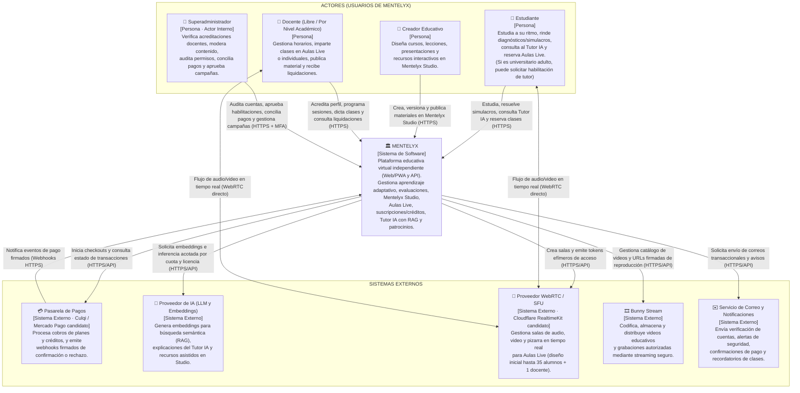

# Modelo C4 — Nivel 1: Diagrama de Contexto del Sistema (Mentelyx)

> **Proyecto:** Mentelyx · **Ubicación:** `docs/04-modelo-c4/Nivel1-DiagramadeContextodelSistema.md`  
> **Nivel C4:** Nivel 1 (Contexto del Sistema) · **Versión:** 1.0  
> **Estado:** arquitectura de referencia definida; proveedores externos sujetos a validación de contrato y capacidad.

## 1. Propósito del nivel

El **Diagrama de Contexto del Sistema (Nivel 1 del Modelo C4)** muestra a **Mentelyx** como una caja central rodeada por los actores humanos que la utilizan y los sistemas externos con los que intercambia información. Permite comprender el alcance del sistema, las fronteras de responsabilidad y qué capacidades se delegan en proveedores especializados sin exponer aún detalles internos de contenedores o bases de datos.

| Elemento | Descripción aplicada a Mentelyx |
|---|---|
| **Sistema central** | **Mentelyx — Centro educativo virtual independiente** (Primaria, Secundaria, Preuniversitario y Universitario). |
| **Actores públicos** | **Estudiante** (incluye variante de universitario adulto con habilitación adicional para tutorías), **Creador educativo** y **Docente** (modalidad independiente/libre o por nivel académico). |
| **Actor interno** | **Superadministrador** (operación, moderación, revisión de acreditaciones, conciliación y campañas). |
| **Sistemas externos** | Pasarela de pagos, Proveedor de IA (LLM y embeddings), Proveedor WebRTC/SFU (aulas en vivo), Bunny Stream (distribución de video grabado) y Servicio de correo/notificaciones. |

---

## 2. Diagrama de Contexto del Sistema (C4 Nivel 1)

**Figura 1.** Diagrama de Contexto del Sistema Mentelyx (C4 Nivel 1). *Fuente: elaboración propia.*

---

## 3. Especificación de actores y fronteras de acceso

| Actor | Tipo | Relación principal con Mentelyx | Reglas de negocio y seguridad en la frontera |
|---|---|---|---|
| **Estudiante** | Público | Consume contenido gratuito o suscrito (`Plus`/`Pro`), rinde evaluaciones deterministas, usa el Tutor IA y se inscribe a sesiones con **créditos Live**. | No requiere correo de colegio. Si es menor de edad, se aplican salvaguardas de privacidad, consentimiento parental y exclusión de perfilado publicitario. Si es universitario adulto, puede solicitar habilitación para dictar tutorías sin cambiar su tipo de cuenta. |
| **Creador educativo** | Público | Utiliza **Mentelyx Studio** (`Free`, `Plus` o `Pro`) para crear cursos, diapositivas, PDFs y bancos de ejercicios. | Las herramientas manuales de Studio no consumen créditos de IA. La publicación exige definir licencia y autorización explícita antes de indexarse en RAG. |
| **Docente** | Público | Elige modalidad **independiente/libre** (por temas y experiencia) o **por nivel académico** (Primaria, Secundaria, Preuni, Universitario con formación acreditable). | Registrarse como Docente **no** otorga automáticamente la insignia de acreditado ni el permiso para cobrar (`can_charge_classes`); ambos requieren validación documental. |
| **Superadministrador** | Interno | Administra permisos, revisa expedientes docentes, audita incidentes, supervisa conciliación financiera y autoriza campañas o patrocinios. | Requiere autenticación multifactor (**MFA**) y todas sus acciones quedan registradas de forma inmutable en auditoría. |

---

## 4. Especificación de sistemas externos e integraciones

| Sistema externo | Propósito en Mentelyx | Protocolo / Interfaz | Garantía arquitectónica exigida |
|---|---|---|---|
| **Pasarela de Pagos** | Procesar cobros de planes (`Plus`, `Pro`, `Aulas Live`, `Studio`) y compras directas en moneda local (PEN). | API REST HTTPS + Webhooks firmados | Mentelyx nunca almacena datos crudos de tarjetas (PCI-DSS delegado). Ningún beneficio o crédito se activa sin webhook verificado y transacción idempotente. |
| **Proveedor de IA (LLM + Embeddings)** | Proveer vectores para `pgvector`, respuestas pedagógicas del Tutor IA y generación asistida en Studio. | API HTTPS con control de timeout y presupuesto | Los contenidos privados o sin licencia no se envían como contexto; los datos de usuarios no se ceden para entrenar modelos públicos. |
| **Proveedor WebRTC / SFU** | Soportar las salas de **Aulas Live** (6–35 alumnos), reforzamiento (2–5) y tutorías individuales (1 a 1). | API HTTPS (control) + WebRTC SRTP (medios) | El tráfico de audio/video viaja directamente entre el navegador/PWA del usuario y el SFU; **no atraviesa** el backend Hono. |
| **Bunny Stream** | Almacenar, transcodificar y servir videos educativos pregrabados y grabaciones autorizadas de clases. | API HTTPS + HLS con tokens firmados | Reproducción protegida según derechos del estudiante; las grabaciones de clases con menores exigen consentimiento verificable. |
| **Servicio de Correo** | Entregar verificaciones de correo, alertas de cuenta, recibos y recordatorios de sesiones reservadas. | API HTTPS invocada desde Workers asíncronos | Un fallo del proveedor de correo no revierte un pago confirmado ni una reserva de clase (procesamiento desacoplado vía Outbox/Queues). |

---

## 5. Trazabilidad

- **Análisis del sistema:** `01-actores.md`, `02-historias-del-usuario.md`, `03-requisitos-funcionales.md`, `05-restricciones.md` (RC-01 a RC-37).
- **Decisiones arquitectónicas:** ADR-001, ADR-003, ADR-004, ADR-005, ADR-016, ADR-019, ADR-034, ADR-045, ADR-046.
- **Siguiente nivel:** [Nivel 2 — Diagrama de Contenedores](./Nivel2-DiagramadeContenedores.md).

