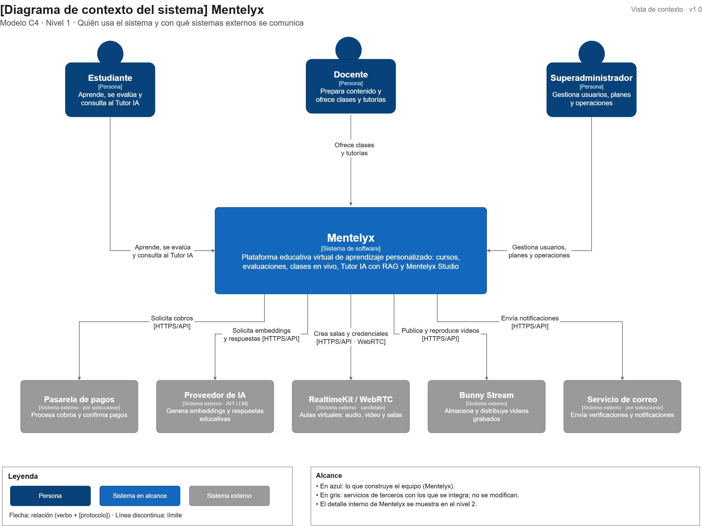

# Nivel 1 · Diagrama de contexto del sistema

> **Proyecto:** Mentelyx  
> **Modelo:** C4 · Nivel 1 de 4 · **Versión:** 2.0  
> **Estado:** Diseño arquitectónico previo a la implementación

---

## 1. Objetivo

Mostrar **Mentelyx como un único sistema**, identificando las personas que interactúan con la plataforma y los sistemas externos necesarios para ofrecer sus servicios educativos.

Esta vista permite comprender el propósito de Mentelyx sin conocer sus tecnologías ni su estructura interna.

Mentelyx es una plataforma educativa virtual orientada a estudiantes de **Primaria, Secundaria, Preuniversitario y Universitario**. Integra contenidos educativos, evaluaciones, preparación académica, tutorías humanas, clases virtuales y asistencia pedagógica mediante inteligencia artificial.

| Aspecto | Descripción |
|---|---|
| Pregunta que responde | ¿Qué es Mentelyx, quiénes lo utilizan y con qué sistemas externos se relaciona? |
| Audiencia | Docentes, estudiantes, responsables del proyecto, equipo de desarrollo y personas interesadas en la plataforma |
| Qué **no** muestra | Tecnologías de desarrollo, servidores, bases de datos, módulos internos, componentes o estructura del código |
| Sistema en estudio | Mentelyx, representado como una única caja dentro de su límite de sistema |
| Siguiente nivel | `Nivel2-DiagramadeContenedores.md` |

---

## 2. Diagrama

> Archivo editable: [nivel1-contexto.drawio](../img/fuente_drawio/nivel1-contexto.drawio)

**Figura 1.** Diagrama de contexto del sistema Mentelyx mediante el modelo C4, nivel 1.

La figura representa a Mentelyx como una única unidad. Las personas y los sistemas externos se ubican fuera de su límite.

---

## 3. Personas (usuarios)

| Persona | Descripción | Qué hace en el sistema |
|---|---|---|
| **Estudiante** | Persona que utiliza Mentelyx para aprender, reforzar sus conocimientos o prepararse académicamente. Puede pertenecer a cualquiera de los cuatro niveles educativos. | Consulta cursos y materiales, realiza diagnósticos y simulacros, revisa su progreso, utiliza el Tutor IA y reserva clases o tutorías. Puede elaborar materiales propios mediante las funciones autorizadas de Studio. |
| **Docente** | Persona que prepara e imparte actividades educativas. Puede registrarse bajo la modalidad independiente/libre o por nivel académico. | Prepara recursos en Mentelyx Studio, gestiona su perfil, organiza clases y horarios, publica materiales autorizados y ofrece tutorías remuneradas cuando obtiene la habilitación correspondiente. |
| **Superadministrador** | Responsable de la administración general de Mentelyx. Su cuenta se crea internamente y no forma parte del registro público. | Gestiona usuarios, permisos, autorizaciones docentes, contenidos, planes, operaciones económicas, seguridad e incidencias de la plataforma. |

**Consideraciones sobre los usuarios:**

- El registro público dispone de **dos tipos principales de cuenta: Estudiante y Docente**.
- Las modalidades de Docente no constituyen actores adicionales.
- Un estudiante universitario mayor de edad puede solicitar autorización para impartir tutorías sin cambiar su tipo de cuenta.
- La creación de materiales educativos es una funcionalidad de Mentelyx Studio, no un actor independiente.
- La habilitación para enseñar y la acreditación académica son procesos distintos.

---

## 4. Sistemas

| Sistema | Tipo | Responsabilidad | Quién lo construye |
|---|---|---|---|
| **Mentelyx** | Sistema en alcance | Proporciona aprendizaje virtual, contenidos, evaluaciones, preparación para exámenes, clases, tutorías, asistencia pedagógica con IA y gestión administrativa. | Equipo del proyecto Mentelyx |
| **Pasarela de pagos** | Sistema externo | Procesa cobros de suscripciones y servicios educativos, y comunica el resultado de las operaciones económicas. | Proveedor de pagos por seleccionar |
| **Servicio de videoconferencia** | Sistema externo | Facilita la comunicación audiovisual en tiempo real durante tutorías y clases virtuales. | Proveedor especializado por validar |
| **Plataforma de videos grabados** | Sistema externo | Almacena, procesa y distribuye videos educativos grabados para su reproducción autorizada. | Proveedor de streaming por validar |
| **Proveedor de inteligencia artificial** | Sistema externo | Proporciona capacidades de procesamiento y generación mediante modelos de IA utilizados en asistencia educativa y funciones autorizadas de Studio. | Proveedor de IA por seleccionar |
| **Servicio de notificaciones** | Sistema externo previsto | Entrega comunicaciones a usuarios sobre cuentas, reservas, clases y operaciones relevantes mediante canales habilitados. | Proveedor por definir |

**Delimitación:** el Tutor IA, Mentelyx Studio, las evaluaciones, los cursos y las suscripciones pertenecen a Mentelyx; no son sistemas externos independientes.

---

## 5. Relaciones

| Origen | Destino | Descripción | Protocolo |
|---|---|---|---|
| Estudiante | Mentelyx | Accede a contenidos, realiza evaluaciones, consulta su progreso y contrata servicios educativos autorizados. | — |
| Docente | Mentelyx | Prepara materiales, gestiona clases, solicita habilitación y administra sus actividades educativas. | — |
| Superadministrador | Mentelyx | Supervisa usuarios, contenidos, permisos, servicios y operaciones generales. | — |
| Mentelyx | Pasarela de pagos | Solicita operaciones de cobro y recibe confirmaciones para actualizar los estados de pagos y suscripciones. | Integración externa; contrato por validar |
| Mentelyx | Servicio de videoconferencia | Gestiona la creación de sesiones y autoriza la participación de estudiantes y docentes. | Integración externa; detalle en nivel 2 |
| Mentelyx | Plataforma de videos grabados | Gestiona la publicación y el acceso autorizado a contenidos audiovisuales. | Integración externa; detalle en nivel 2 |
| Mentelyx | Proveedor de inteligencia artificial | Solicita procesamiento y respuestas de IA para funciones educativas autorizadas. | Integración externa; contrato por validar |
| Mentelyx | Servicio de notificaciones | Solicita la entrega de comunicaciones y recibe, cuando corresponda, su estado. | Por definir |

> En el nivel 1 no se especifica el protocolo entre personas y Mentelyx. Los mecanismos de comunicación y las tecnologías de los contenedores se describirán en el nivel 2.

---

## 6. Decisiones y supuestos

| # | Decisión o supuesto | Motivo |
|---|---|---|
| 1 | Mentelyx se representa como **un solo sistema**. | El nivel 1 debe mostrar el límite general del sistema, sin descomponerlo internamente. |
| 2 | Solo existen dos tipos de cuenta públicos: Estudiante y Docente. | Se elimina la duplicación funcional introducida por el anterior tipo Creador educativo. |
| 3 | El Superadministrador es una persona que interactúa con el sistema, pero no se registra públicamente. | Permite diferenciar la administración interna de los usuarios generales. |
| 4 | Las capacidades de IA y videoconferencia se obtienen mediante proveedores especializados externos. | Evita representar estas capacidades como servicios desarrollados íntegramente por el equipo del proyecto. |
| 5 | Los pagos son procesados por una pasarela externa; Mentelyx no almacena datos completos de tarjetas. | Se delega el procesamiento sensible y se reduce el alcance de las responsabilidades de seguridad sobre datos de pago. |
| 6 | Las instituciones educativas no constituyen actores operativos de la primera versión. | Los convenios institucionales corresponden a una fase posterior y no condicionan el registro individual. |
| 7 | La publicación de contenidos, la habilitación docente y la acreditación académica son capacidades diferentes. | Evita conceder facultades de enseñanza o atribuir títulos profesionales por el simple registro. |
| 8 | Los sistemas externos se integrarán mediante contratos controlados, sin modificar sus implementaciones internas. | Facilita la sustitución de proveedores y mantiene el control de las reglas de negocio dentro de Mentelyx. |

### Pendientes por definir

| Tema | Detalle |
|---|---|
| Pasarela de pagos | Seleccionar proveedor y validar sus condiciones, comisiones, métodos disponibles y mecanismos de confirmación. |
| Videoconferencia | Validar proveedor, capacidad de participantes, moderación, grabaciones autorizadas y costos. |
| Streaming de videos | Confirmar servicio de distribución, control de acceso, costos y políticas de almacenamiento. |
| Proveedor de inteligencia artificial | Definir modelos, cuotas, tratamiento de datos, costos y criterios de calidad pedagógica. |
| Canal de notificaciones | Determinar si se utilizará correo electrónico u otros canales y seleccionar el servicio correspondiente. |
| Grupos privados docentes | Completar sus reglas funcionales y de acceso para reflejarlas posteriormente en el nivel 3 y en el diseño de M4. |

---

**Trazabilidad:** `01-actores.md`, `02-historias-del-usuario.md`, `03-requisitos-funcionales.md`, `05-restricciones.md` y `07-decisiones-arquitectonicas.md`.
