# Modelo C4 — Nivel 2: Diagrama de Contenedores (Mentelyx)

> **Proyecto:** Mentelyx · **Ubicación:** `docs/04-modelo-c4/Nivel2-DiagramadeContenedores.md`  
> **Nivel C4:** Nivel 2 (Contenedores) · **Versión:** 1.0  
> **Estado:** arquitectura objetivo serverless-first definida; conectividad y cuotas sujetas a validación en piloto.

## 1. Propósito del nivel

El **Diagrama de Contenedores (Nivel 2 del Modelo C4)** abre el límite del sistema **Mentelyx** para mostrar las unidades de ejecución y almacenamiento que lo componen: la aplicación cliente Web/PWA, la capa de borde y seguridad, el backend principal (**monolito modular en Hono + TypeScript**), los procesadores asíncronos, las colas de mensajes y los cuatro almacenes de datos especializados (**Neon PostgreSQL + pgvector**, **MongoDB Atlas**, **Redis** y **Cloudflare R2**).

---

## 2. Diagrama de Contenedores (C4 Nivel 2)

```mermaid
flowchart TB
  subgraph ACTORES["ACTORES"]
    USUARIOS["👤 Estudiante · Creador Educativo · Docente · Superadministrador"]
  end

  subgraph MENTELYX_SYSTEM["SISTEMA MENTELYX [Límite del Sistema]"]
    EDGE["🛡️ Cloudflare Edge / WAF<br/>[DNS · TLS 1.3 · CDN · DDoS · Rate Limit de borde]<br/>Protege el ingreso HTTP y distribuye activos estáticos."]

    WEB["💻 Mentelyx Web / PWA<br/>[Contenedor: Next.js + React + TypeScript]<br/>Interfaz mobile-first instalable: catálogo, estudio, evaluaciones,<br/>Mentelyx Studio, reservas Live, billetera de créditos y consola admin."]

    API["⚙️ Mentelyx API Backend (Monolito Modular)<br/>[Contenedor: Hono + TypeScript en Cloudflare Workers]<br/>Expone API REST (/api/v1/*), aplica autenticación y RBAC/ABAC,<br/>y ejecuta la lógica de los 7 módulos de negocio (M1–M7)."]

    QUEUES["📬 Cloudflare Queues + DLQ<br/>[Contenedor de Mensajería Asíncrona]<br/>Colas de eventos para indexación RAG, generaciones de Studio,<br/>notificaciones y conciliación, con Dead Letter Queue."]

    WORKER_ASYNC["🔄 Worker Consumidor y Publicador Outbox<br/>[Contenedor: Cloudflare Worker TypeScript]<br/>Publica eventos del Outbox SQL y procesa trabajos de Queues<br/>aplicando Idempotent Receiver y reintentos con backoff."]

    subgraph PERSISTENCIA["CONTENEDORES DE DATOS Y ALMACENAMIENTO"]
      PG[("🗄️ Neon PostgreSQL + pgvector<br/>[Base Relacional y Vectorial]<br/>Fuente de verdad ACID: cuentas, permisos, cursos,<br/>notas, reservas, pagos, ledgers Live/Studio,<br/>liquidaciones, outbox, auditoría y embeddings RAG.")]
      MONGO[("📄 MongoDB Atlas<br/>[Base Documental]<br/>Documentos educativos versionados, proyectos<br/>interactivos de Mentelyx Studio y bancos de preguntas.")]
      REDIS[("⚡ Redis Administrado<br/>[Caché y Estado Efímero]<br/>Caché Cache-Aside de catálogo público y contadores<br/>de rate limit. No guarda saldos financieros.")]
      R2[("📦 Cloudflare R2<br/>[Almacenamiento de Objetos]<br/>PDFs, imágenes de Studio, adjuntos y expedientes<br/>docentes con acceso mediante URLs firmadas.")]
    end
  end

  subgraph EXTERNOS["SISTEMAS EXTERNOS"]
    PAY["💳 Pasarela de Pagos"]
    AI["🤖 Proveedor IA (LLM/Embeddings)"]
    SFU["🎥 Proveedor WebRTC / SFU"]
    VIDEO["🎞️ Bunny Stream"]
    MAIL["✉️ Servicio de Correo"]
  end

  USUARIOS -->|"Navega e interactúa (HTTPS)"| EDGE
  EDGE -->|"Sirve aplicación cliente"| WEB
  WEB -->|"Peticiones JSON + Idempotency-Key (HTTPS /api/v1/*)"| EDGE
  EDGE -->|"Enruta tráfico validado"| API

  API -->|"Transacciones ACID y búsqueda vectorial (SQL/TLS)"| PG
  API -->|"Lectura/escritura de documentos versionados"| MONGO
  API -->|"Consulta caché y límites de tasa"| REDIS
  API -->|"Emite URLs pre-firmadas y gestiona objetos"| R2
  API -->|"Encola trabajos asíncronos"| QUEUES

  WORKER_ASYNC -->|"Lee Outbox pendiente y registra deduplicación"| PG
  WORKER_ASYNC -->|"Consume mensajes y envía fallos agudos a DLQ"| QUEUES
  WORKER_ASYNC -->|"Lee documentos fuente para indexación RAG"| R2
  WORKER_ASYNC -->|"Genera embeddings y guarda vectores en pgvector"| AI

  API -->|"Crea órdenes y verifica webhooks"| PAY
  PAY -->|"Envía webhooks firmados"| EDGE
  API -->|"Consultas del Tutor IA con contexto autorizado"| AI
  API -->|"Crea salas y emite credenciales efímeras"| SFU
  WEB <-->|"Audio y video en vivo directo (WebRTC SRTP)"| SFU
  API -->|"Gestiona metadatos y tokens de video"| VIDEO
  WEB -->|"Reproduce clases grabadas autorizadas (HLS)"| VIDEO
  WORKER_ASYNC -->|"Despacha correos y recordatorios"| MAIL
```

**Figura 1.** Diagrama de Contenedores de Mentelyx (C4 Nivel 2). *Fuente: elaboración propia.*

---

## 3. Catálogo de contenedores de Mentelyx

| Contenedor | Tecnología | Responsabilidad principal | Justificación arquitectónica (ADR) |
|---|---|---|---|
| **Cloudflare Edge / WAF** | DNS, TLS, CDN, WAF | Terminación TLS, mitigación DDoS y filtrado perimetral antes de llegar al backend. | ADR-013, ADR-015 |
| **Mentelyx Web / PWA** | Next.js, React, TypeScript | Experiencia de usuario *mobile-first* e instalable para los 4 actores; renderizado de Studio, evaluaciones y sala WebRTC. | ADR-003, ADR-014 |
| **Mentelyx API Backend** | Hono + TypeScript (Cloudflare Workers) | **Monolito modular** que aloja los 7 módulos de negocio (**M1–M7**), aplica RBAC/ABAC y coordina la persistencia. | ADR-001, ADR-002, ADR-013 |
| **Cloudflare Queues + DLQ** | Cola administrada | Desacoplar tareas pesadas o propensas a fallos externos (indexación RAG, IA de Studio, correos) de la respuesta HTTP. | ADR-008, ADR-042 |
| **Worker Consumidor / Outbox** | Cloudflare Worker (TypeScript) | Publicar eventos confirmados en la tabla `outbox_events` y procesar mensajes de la cola de forma idempotente. | ADR-042, ADR-043 |
| **Neon PostgreSQL + `pgvector`** | PostgreSQL 16+ serverless + extensión `pgvector` | Fuente de verdad transaccional (ACID) para identidad, permisos, notas, reservas, pagos, ledgers de créditos y vectores RAG. | ADR-006, ADR-019, ADR-023, ADR-048 |
| **MongoDB Atlas** | Base documental NoSQL | Almacenar estructuras jerárquicas y polimórficas (proyectos Studio, diapositivas, bancos de preguntas versionados). | ADR-023 |
| **Redis Administrado** | Almacén clave-valor en memoria | Caché de consultas públicas frecuentes (*Cache-Aside*) y contadores efímeros de *rate limiting*. | ADR-012, ADR-054 |
| **Cloudflare R2** | Object Storage compatible con S3 | Conservar binarios pesados (PDFs, activos gráficos de Studio, documentos de acreditación) fuera de las bases de datos. | ADR-009, ADR-017 |

---

## 4. Decisiones de comunicación y resiliencia entre contenedores

1. **Separación entre plano de control y plano de medios audiovisuales:** el contenedor **Mentelyx API Backend** valida cupos, créditos Live y permisos, y devuelve un token de corta duración; el contenedor **Mentelyx Web / PWA** establece el flujo WebRTC directamente con el **Proveedor SFU**, evitando saturar CPU o ancho de banda de Cloudflare Workers.
2. **Sin transacciones distribuidas (2PC) entre PostgreSQL y MongoDB:** las operaciones financieras, de cupos y de permisos ocurren íntegramente en **Neon PostgreSQL**. Cuando una publicación de contenido abarca MongoDB, R2 y PostgreSQL, PostgreSQL actúa como coordinador del estado de versión y utiliza el patrón **Transactional Outbox** para disparar la indexación asíncrona en `pgvector`.
3. **Degradación controlada ante caídas parciales (AC-02):**
   - Si **Redis** falla, el backend aplica *fallback* a PostgreSQL con límites de paginación sin interrumpir el estudio ni los cobros.
   - Si el **Proveedor de IA** falla, el editor manual de Mentelyx Studio y la lectura de cursos/evaluaciones siguen operativos, sin descontar créditos Studio por operaciones fallidas.

---

## 5. Trazabilidad

- **Nivel anterior:** [Nivel 1 — Diagrama de Contexto del Sistema](./Nivel1-DiagramadeContextodelSistema.md).
- **Siguiente nivel:** [Nivel 3 — Diagrama de Componentes](./Nivel3-DiagramadeComponentes.md).

