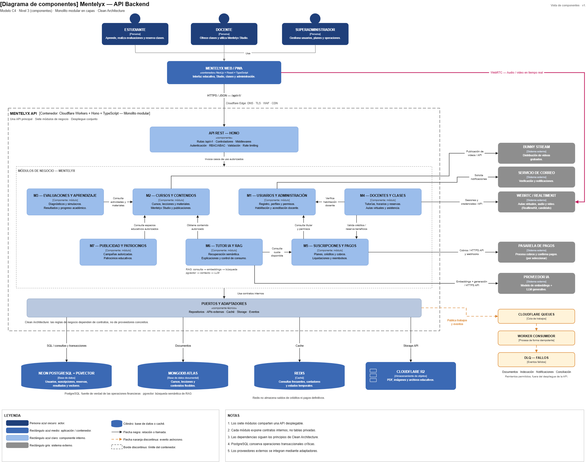

# Nivel 3 · Diagrama de componentes

> **Proyecto:** Mentelyx · **Contenedor detallado:** API Backend Mentelyx  
> **Modelo:** C4 · Nivel 3 de 4 · **Versión:** 2.0  
> **Estado:** Diseño arquitectónico previo a la implementación

---

## 1. Objetivo

Abrir el contenedor **API Backend Mentelyx** del nivel 2 y mostrar los **componentes internos que lo conforman**, las responsabilidades de cada uno y cómo colaboran entre sí y con los almacenes de datos y sistemas externos.

Mentelyx adopta un **monolito modular** con siete módulos de negocio. Estos módulos constituyen separaciones lógicas dentro de una sola aplicación backend desarrollada con TypeScript y Hono, cuyo despliegue objetivo es Cloudflare Workers.

Cada módulo organizará internamente sus responsabilidades mediante **Clean Architecture**, separando reglas de dominio, casos de uso, interfaces y adaptadores de infraestructura.

| Aspecto | Descripción |
|---|---|
| Pregunta que responde | ¿Cómo se organiza internamente la API Backend Mentelyx y qué responsabilidad tiene cada componente? |
| Audiencia | Arquitectos de software y desarrolladores |
| Qué es un componente | Una agrupación de funcionalidades relacionadas, encapsuladas detrás de interfaces claramente definidas. En Mentelyx, los siete módulos de negocio se representan como componentes principales. |
| Contenedor detallado | API Backend Mentelyx — Hono + TypeScript |
| Estilo arquitectónico | Monolito modular |
| Enfoque interno | Clean Architecture y puertos/adaptadores |
| Qué **no** muestra | Clases, atributos, métodos, entidades internas detalladas ni estructura completa de implementación |
| Nivel anterior | `Nivel2-DiagramadeContenedores.md` |
| Siguiente nivel | `Nivel4-DiagramadeCodigo.md` |

---

## 2. Diagrama

> Archivo editable: [mentelyx-componentes-arquitectonicos.drawio](../img/fuente_drawio/mentelyx-componentes-arquitectonicos.drawio)

**Figura 3.** Diagrama de componentes de la API Backend Mentelyx mediante el modelo C4, nivel 3.

El diagrama representa un único contenedor denominado **API Backend Mentelyx**, dentro del cual se encuentran el componente de entrada HTTP, los siete componentes de negocio y las capacidades técnicas compartidas que corresponda representar.

Fuera de dicho límite se sitúan:

- La **Aplicación Web/PWA**, que consume la API.
- **PostgreSQL**, que conserva los datos transaccionales y las referencias de negocio.
- **MongoDB**, que almacena estructuras pedagógicas documentales.
- **Redis**, utilizado para caché y controles temporales.
- **Cloudflare R2**, destinado a archivos educativos.
- **Cloudflare Queues y sus Workers consumidores**, que ejecutan procesamiento asíncrono fuera de la API principal.
- Los sistemas externos de pagos, videoconferencia, streaming, inteligencia artificial y notificaciones.

### Convenciones del diagrama

Cada componente debe identificarse por su **nombre, tipo, tecnología y responsabilidad principal**. Las relaciones deben utilizar flechas con dirección y etiquetas que expliquen la operación realizada.

Los módulos M1–M7 se encuentran dentro del mismo límite de contenedor y no representan microservicios.

La leyenda del diagrama debe distinguir los componentes internos, los contenedores de almacenamiento, las aplicaciones externas al backend y los sistemas de terceros.

---

## 3. Componentes

| Componente | Responsabilidad | Funcionalidades principales | Carpeta propuesta en el código |
|---|---|---|---|
| **API REST** | Punto de entrada HTTP de Mentelyx. | Rutas `/api/v1`, controladores, validación de solicitudes, comprobación de sesión, manejo de errores y delegación hacia casos de uso. | `src/api/` |
| **M1 — Usuarios y Administración** | Gestionar cuentas, autenticación, sesiones y control de acceso, perfiles y operaciones administrativas. | Registro de Estudiante y Docente, autenticación integrada, perfiles, modalidades docentes, permisos, estados de verificación documental del solicitante, de validación de credenciales académicas y de habilitación docente comunicados por M4, y auditoría administrativa. | `src/modules/users/` |
| **M2 — Cursos y Contenidos** | Administrar el catálogo y los recursos educativos de Mentelyx. | Niveles, áreas, cursos, asignaturas, lecciones, videos, materiales educativos, versiones, derechos de publicación y herramientas de autoría de Mentelyx Studio. | `src/modules/courses/` |
| **M3 — Evaluaciones y Aprendizaje** | Gestionar evaluaciones, resultados y seguimiento del aprendizaje. | Diagnósticos, ejercicios, simulacros, intentos, calificaciones, progreso, rutas personalizadas y preparación para exámenes. | `src/modules/evaluations/` |
| **M4 — Docentes y Clases** | Gestionar la oferta de enseñanza humana y las sesiones educativas. | Perfiles docentes habilitados para enseñar, disponibilidad, publicación de clases, reservas, cupos, tutorías individuales y grupales, asistencia y acceso autorizado a aulas virtuales. | `src/modules/classes/` |
| **M5 — Suscripciones y Pagos** | Gestionar productos comerciales y operaciones económicas. | Planes, suscripciones, derechos de acceso, créditos Live y Studio, órdenes de pago, confirmaciones, reembolsos, comisiones, liquidaciones docentes y conciliación. | `src/modules/billing/` |
| **M6 — Tutor IA y RAG** | Proporcionar asistencia pedagógica basada en IA y recuperación de fuentes autorizadas. | Consultas educativas, recuperación documental, referencias de contenido, generación de explicaciones y control de acceso al corpus RAG. | `src/modules/ai-tutor/` |
| **M7 — Publicidad y Patrocinios** | Administrar publicidad permitida y campañas de patrocinio. | Registro y aprobación de campañas, ubicaciones permitidas, reglas de exhibición, patrocinio y métricas agregadas. | `src/modules/advertising/` |

**Nota:** las carpetas mostradas son una convención de organización propuesta para la implementación en TypeScript. No significan que los directorios y sus archivos ya existan.

### Componentes y capacidades técnicas compartidas

Además de los siete módulos de negocio, la API requiere capacidades transversales.

| Componente o capacidad | Responsabilidad | Ubicación propuesta |
|---|---|---|
| **Seguridad de entrada** | Validar sesiones, aplicar controles HTTP, limitar solicitudes y proporcionar el contexto autenticado a los casos de uso. | `src/api/middleware/` |
| **Autorización de negocio** | Comprobar permisos por usuario, recurso, edad, modalidad, habilitación y estado de acreditación. La responsabilidad principal corresponde a M1 y a las políticas de cada módulo. | Contratos de M1 y políticas internas de módulos |
| **Adaptadores de persistencia** | Implementar los puertos de acceso a PostgreSQL, MongoDB, Redis y R2, respetando la propiedad de los datos de cada módulo. | Infraestructura de cada módulo |
| **Publicación de eventos** | Enviar tareas diferidas y eventos mediante puertos de mensajería e implementaciones sobre Queues. | Adaptadores de infraestructura |
| **Observabilidad** | Registrar errores técnicos, métricas, trazas y consumo de recursos sin exponer información sensible. | Infraestructura transversal |

Estas capacidades técnicas **no constituyen nuevos módulos de negocio**.

### Delimitación de las cuentas

Mentelyx tendrá únicamente dos tipos principales de cuenta pública:

1. **Estudiante:** puede utilizar las funciones educativas y las capacidades de autoría que tenga autorizadas. Si es universitario mayor de edad, podrá solicitar una habilitación específica de tutoría remunerada.
2. **Docente:** selecciona modalidad independiente/libre o por nivel académico. La habilitación comercial y la acreditación profesional son independientes.

El **Superadministrador** se aprovisiona internamente y administra la plataforma.

Mentelyx Studio pertenece funcionalmente a M2; no se necesita un componente denominado «Creador educativo» ni un tercer tipo de cuenta.

---

## 4. Relaciones entre componentes

| Origen | Destino | Descripción | Tipo de comunicación |
|---|---|---|---|
| Aplicación Web/PWA | API REST | Solicita funcionalidades educativas, administrativas y comerciales. | HTTPS/JSON |
| API REST | M1 — Usuarios y Administración | Delega operaciones de registro, perfiles, permisos y administración. | Llamada interna TypeScript |
| API REST | M2 — Cursos y Contenidos | Delega operaciones del catálogo, materiales y Studio. | Llamada interna TypeScript |
| API REST | M3 — Evaluaciones y Aprendizaje | Delega solicitudes de evaluación, simulacros y progreso académico. | Llamada interna TypeScript |
| API REST | M4 — Docentes y Clases | Delega solicitudes de horarios, clases, reservas y acceso a sesiones. | Llamada interna TypeScript |
| API REST | M5 — Suscripciones y Pagos | Delega operaciones de planes, pagos, saldos y liquidaciones. | Llamada interna TypeScript |
| API REST | M6 — Tutor IA y RAG | Delega consultas pedagógicas autorizadas. | Llamada interna TypeScript |
| API REST | M7 — Publicidad y Patrocinios | Delega operaciones de campañas y consulta de anuncios autorizados. | Llamada interna TypeScript |
| M4 — Docentes y Clases | M1 — Usuarios y Administración | Consulta la cuenta, valida la sesión autenticada y comprueba los permisos y la habilitación docente aplicables antes de ofrecer servicios o ingresar a una clase. | Contrato público interno |
| M2 — Cursos y Contenidos | M1 — Usuarios y Administración | Valida la sesión autenticada y comprueba los permisos por recurso necesarios para operaciones de autoría y publicación. | Contrato público interno |
| M3 — Evaluaciones y Aprendizaje | M2 — Cursos y Contenidos | Consulta preguntas, recursos, temarios y versiones de contenido requeridos para las evaluaciones. | Contrato público interno |
| M4 — Docentes y Clases | M2 — Cursos y Contenidos | Consulta materiales publicados o autorizados para asociarlos con clases. | Contrato público interno |
| M4 — Docentes y Clases | M5 — Suscripciones y Pagos | Solicita comprobación de derechos y reserva o consumo autorizado de créditos cuando corresponda a una inscripción. | Contrato público interno y coordinación transaccional |
| M5 — Suscripciones y Pagos | M1 — Usuarios y Administración | Obtiene el identificador y el estado de la cuenta para asociar suscripciones y operaciones económicas a cuentas válidas. | Contrato público interno |
| M6 — Tutor IA y RAG | M2 — Cursos y Contenidos | Solicita materiales y versiones autorizadas para recuperar información educativa. | Contrato público interno |
| M6 — Tutor IA y RAG | M5 — Suscripciones y Pagos | Comprueba derechos de acceso y cuotas asociadas a las funciones de IA. | Contrato público interno |
| M7 — Publicidad y Patrocinios | M5 — Suscripciones y Pagos | Consulta los beneficios del plan necesarios para decidir la elegibilidad comercial de anuncios. | Contrato público interno |
| M4 — Docentes y Clases | M5 — Suscripciones y Pagos | Comunica eventos válidos de asistencia o finalización que puedan originar liquidaciones. | Evento de negocio con procesamiento idempotente |
| Componentes de negocio | Publicación de eventos | Solicitan la ejecución de operaciones diferidas, como notificaciones y procesamiento de materiales. | Puerto interno de mensajería |

### Consideraciones sobre las relaciones

**1. Los módulos no se comunican mediante HTTP entre sí.**

Todos forman parte de una misma aplicación principal. La colaboración se realiza mediante interfaces públicas y llamadas internas, salvo los flujos diferidos que utilicen eventos.

**2. Los componentes no deben depender de implementaciones internas ajenas.**

Por ejemplo, M4 podrá consultar una capacidad pública de M1 para comprobar una habilitación docente, pero no deberá consultar directamente tablas privadas de cuentas.

**3. Las operaciones económicas requieren coordinación explícita.**

La validación del cupo de una clase y la reserva de créditos deben impedir sobrecupos y consumos duplicados. Al compartir PostgreSQL, los módulos pueden coordinar una unidad de trabajo transaccional a través de contratos definidos, sin escribir directamente en repositorios privados ajenos.

**4. Las comunicaciones asíncronas no reemplazan las confirmaciones críticas.**

Los eventos de notificación, procesamiento e indexación pueden ejecutarse posteriormente. Los pagos confirmados, movimientos de créditos y resultados académicos oficiales exigen persistencia verificable.

**5. Los módulos no necesitan conocerse todos entre sí.**

Las relaciones representadas son las colaboraciones principales. Se evitarán dependencias circulares y referencias innecesarias para mantener la independencia modular.

---

## 5. Relaciones con contenedores y sistemas externos

| Componente | Destino | Descripción | Protocolo o mecanismo | Patrón aplicado |
|---|---|---|---|---|
| **M1 — Usuarios y Administración** | PostgreSQL | Almacena cuentas, perfiles, permisos y estados de autorización. | SQL mediante adaptador seguro | Repository |
| **M1 — Usuarios y Administración** | Servicio de notificaciones | Solicita comunicaciones de verificación o recuperación a través de la infraestructura asíncrona cuando corresponda. | Eventos/Queues y API del proveedor | Port & Adapter |
| **M2 — Cursos y Contenidos** | PostgreSQL | Conserva referencias de recursos, propiedades, licencias y estados de publicación. | SQL mediante adaptador | Repository |
| **M2 — Cursos y Contenidos** | MongoDB | Conserva versiones y estructuras pedagógicas documentales. | Driver o interfaz compatible | Repository |
| **M2 — Cursos y Contenidos** | Cloudflare R2 | Almacena documentos, imágenes, presentaciones y archivos educativos. | Binding o API compatible | Adapter |
| **M2 — Cursos y Contenidos** | Plataforma de streaming | Gestiona videos grabados y reproducción autorizada. | HTTPS/API del proveedor | Adapter |
| **M3 — Evaluaciones y Aprendizaje** | PostgreSQL | Registra intentos, resultados, progreso y datos académicos confirmados. | SQL mediante adaptador | Repository |
| **M3 — Evaluaciones y Aprendizaje** | MongoDB | Obtiene estructuras de preguntas y actividades mediante acceso controlado por el propietario funcional de los contenidos. | Contrato de M2; adaptador documental según diseño | Repository / Port |
| **M4 — Docentes y Clases** | PostgreSQL | Conserva horarios, reservas, cupos, asistencia y estados de sesiones. | SQL mediante adaptador | Repository |
| **M4 — Docentes y Clases** | Servicio de videoconferencia | Solicita creación de salas y credenciales temporales para participantes autorizados. | HTTPS/API del proveedor | Adapter |
| **M5 — Suscripciones y Pagos** | PostgreSQL | Registra planes, órdenes, suscripciones, créditos, pagos y liquidaciones. | SQL y transacciones ACID | Repository / Unit of Work |
| **M5 — Suscripciones y Pagos** | Pasarela de pagos | Procesa solicitudes de cobro y verifica notificaciones de operaciones. | HTTPS/API y webhooks | Adapter / Idempotent Receiver |
| **M6 — Tutor IA y RAG** | PostgreSQL + pgvector | Recupera fragmentos indexados con controles de acceso y referencias de fuentes. | SQL y búsqueda vectorial | Repository / Adapter |
| **M6 — Tutor IA y RAG** | Proveedor de inteligencia artificial | Solicita explicaciones, inferencia y procesamiento autorizado. | HTTPS/API | Adapter |
| **M7 — Publicidad y Patrocinios** | PostgreSQL | Conserva campañas, ubicaciones, autorizaciones y métricas agregadas. | SQL mediante adaptador | Repository |
| **Componentes con lecturas optimizables** | Redis | Utilizan caché y contadores temporales cuando corresponda. | Cliente o interfaz Redis compatible | Cache-Aside / Adapter |
| **Componentes con tareas diferidas** | Cloudflare Queues | Publican mensajes para procesamiento auxiliar. | Binding de Cloudflare Queues | Outbox / Asynchronous Messaging |

### Propiedad y consistencia de datos

Los componentes tienen responsabilidades definidas sobre los datos que administran.

- **M1:** gestión de cuentas, autenticación, sesiones y control de acceso, perfiles y permisos de habilitación.
- **M2:** catálogo, materiales, versiones y licencias editoriales.
- **M3:** evaluaciones, intentos y progreso académico.
- **M4:** clases, reservas, cupos y asistencia.
- **M5:** suscripciones, créditos y operaciones económicas.
- **M6:** consultas pedagógicas, referencias e indexación RAG autorizada.
- **M7:** campañas y publicidad permitida.

PostgreSQL es el almacenamiento transaccional compartido, pero compartir un motor de base de datos **no autoriza el acceso indiscriminado a las tablas de otros módulos**.

MongoDB mantiene datos documentales que requieren referencias y versiones coherentes con los registros de PostgreSQL. No se supone la existencia de transacciones distribuidas automáticas entre ambos motores.

Redis conserva exclusivamente datos temporales; no constituye la fuente oficial de créditos, pagos, autorizaciones ni calificaciones.

### Comunicación audiovisual

M4 solicita la creación y autorización de una sala, pero el audio y el video se transmiten entre los clientes autorizados y el proveedor audiovisual.

Por lo tanto:

- Hono administra las reglas de acceso y coordinación.
- El proveedor de videoconferencia administra la comunicación audiovisual.
- La aplicación Web/PWA se conecta al proveedor mediante autorización temporal.
- PostgreSQL conserva los registros de reservas, asistencia y estados confirmados.

El backend de Mentelyx **no retransmite el flujo audiovisual completo**.

---

## 6. Reglas del monolito modular

| # | Regla | Motivo |
|---|---|---|
| 1 | **M1–M7 pertenecen a un único contenedor API Backend Mentelyx.** | Se mantiene el monolito modular, evitando convertir cada componente en un microservicio. |
| 2 | **Cada módulo expone sus capacidades mediante interfaces públicas.** | Otros módulos consumen contratos estables sin depender de archivos internos. |
| 3 | **Ningún módulo accede directamente a repositorios privados de otro módulo.** | Preserva los límites de negocio y evita acoplamiento de persistencia. |
| 4 | **Cada módulo organiza internamente sus responsabilidades aplicando Clean Architecture.** | Las reglas del dominio no deben depender de Hono, motores de base de datos o SDK externos. |
| 5 | **La autenticación y la autorización son responsabilidades diferenciadas.** | Una sesión válida no implica autorización automática para acceder a cualquier recurso. |
| 6 | **Los permisos docentes, la habilitación comercial y la acreditación académica se verifican independientemente.** | Impide que un registro o una declaración académica concedan privilegios indebidos. |
| 7 | **Mentelyx Studio forma parte de M2 y se utiliza según permisos.** | No se necesita un tipo de cuenta independiente para crear materiales educativos. |
| 8 | **Cada integración externa se encapsula detrás de interfaces y adaptadores.** | Permite cambiar de proveedor sin trasladar sus detalles técnicos al dominio. |
| 9 | **PostgreSQL conserva la fuente de verdad de las operaciones críticas.** | Evita inconsistencias en pagos, créditos, reservas, autorizaciones y resultados. |
| 10 | **Los mensajes asíncronos se procesan de manera idempotente.** | Los reintentos no deben duplicar publicaciones, abonos, consumos ni efectos económicos. |
| 11 | **Los módulos no realizan llamadas circulares obligatorias.** | Reduce el acoplamiento y facilita las pruebas y el mantenimiento. |
| 12 | **Toda operación sensible se valida en el backend.** | La interfaz no constituye una barrera de seguridad suficiente. |
| 13 | **Los módulos pueden desarrollarse y probarse por separado, aunque se desplieguen juntos.** | Permite una implementación incremental sin abandonar el monolito modular. |
| 14 | **Las modificaciones de contratos requieren actualizar sus consumidores y pruebas.** | Mantiene la coherencia entre la arquitectura documentada y el código real. |

### Pendientes antes de la implementación

| Tema | Definición pendiente |
|---|---|
| **Grupos privados docentes** | Precisar creación, miembros, invitaciones, acceso, administración y relación con clases y pagos. Corresponde principalmente a M4, con permisos de M1 y reglas comerciales de M5. |
| **Contratos internos** | Formalizar las interfaces públicas de M1–M7, parámetros, respuestas y errores esperados. |
| **Persistencia** | Definir tablas y relaciones PostgreSQL, documentos MongoDB y políticas de consistencia. |
| **Autenticación** | Validar la biblioteca seleccionada y su integración con Hono, sesiones y PostgreSQL. |
| **Integraciones externas** | Verificar proveedores, contratos, costos, límites y funcionamiento en Cloudflare Workers. |
| **Pruebas** | Preparar pruebas unitarias, de integración, autorización, concurrencia e idempotencia para los flujos críticos. |

---

**Trazabilidad documental:** `01-actores.md`, `02-historias-del-usuario.md`, `03-requisitos-funcionales.md`, `04-atributos-de-calidad.md`, `05-restricciones.md`, `06-drivers-arquitectonicos.md` y `07-decisiones-arquitectonicas.md`.

**Decisiones arquitectónicas relacionadas:** ADR-001 (monolito modular), ADR-002 (Clean Architecture), ADR-004 (gestión de cuentas, autenticación y autorización en backend), ADR-006 (PostgreSQL transaccional), ADR-007 (idempotencia), ADR-008 (tareas asíncronas), ADR-019 (Tutor IA y RAG), ADR-023 (persistencia políglota), ADR-034 (separación de permisos), ADR-043 (integridad de pagos) y ADR-048 (créditos transaccionales).

**Siguiente documento:** `Nivel4-DiagramadeCodigo.md`.
