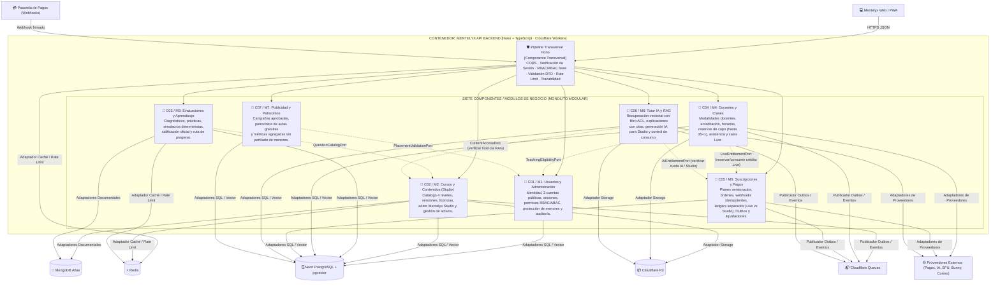

# Modelo C4 — Nivel 3: Diagrama de Componentes (Mentelyx API Backend)

> **Proyecto:** Mentelyx · **Ubicación:** `docs/04-modelo-c4/Nivel3-DiagramadeComponentes.md`  
> **Nivel C4:** Nivel 3 (Componentes del contenedor `Mentelyx API Backend`) · **Versión:** 1.0  
> **Estado:** diseño de componentes completo y alineado con `docs/02-arquitectura-software/componentes-arquitectonicos.md`.

## 1. Propósito del nivel

El **Diagrama de Componentes (Nivel 3 del Modelo C4)** hace zoom dentro del contenedor principal **`Mentelyx API Backend`** (implementado con Hono y TypeScript sobre Cloudflare Workers) para identificar sus **siete módulos de negocio (C01–C07 / M1–M7)**, los componentes transversales de entrada (middlewares de seguridad, sesión y validación), los contratos internos de colaboración y los adaptadores de salida hacia bases de datos y proveedores externos.

---

## 2. Vista gráfica de componentes arquitectónicos (C4 Nivel 3)

**Figura 1.** Diagrama de componentes de Mentelyx (C4 Nivel 3). Muestra los siete módulos de negocio dentro del límite del contenedor `Mentelyx API Backend` y sus relaciones con contenedores de datos y sistemas externos. *Fuente: elaboración propia.*

### Representación estructural detallada de colaboraciones internas

**Figura 2.** Relaciones internas entre los componentes C01–C07 mediante contratos públicos y salida por adaptadores.

---

## 3. Especificación de componentes del Backend (C01–C07)

| Código | Componente | Responsabilidades internas (Clean Architecture) | Contratos públicos que expone (`index.ts`) | Persistencia y adaptadores que utiliza |
|---|---|---|---|---|
| **C01 (M1)** | **Usuarios y Administración** | Registro de Estudiante, Creador y Docente; sesiones; política RBAC/ABAC; consentimiento de menores; auditoría de acciones sensibles. | `obtenerActor`, `verificarPermiso`, `registrarHabilitacionAprobada` | Neon PostgreSQL (`m1_users`), Better Auth candidato, Redis (límites de login), servicio de correo. |
| **C02 (M2)** | **Cursos y Contenidos (Studio)** | Catálogo por nivel, proyectos de **Mentelyx Studio** (edición manual gratuita y solicitud generativa), versionado y licencias de uso. | `consultarTemarioVersionado`, `verificarLicenciaYAcceso`, `obtenerFuenteVersionada` | MongoDB Atlas (`studio_projects`), Neon PostgreSQL (`m2_contents`), Cloudflare R2, Bunny Stream, Queues. |
| **C03 (M3)** | **Evaluaciones y Aprendizaje** | Inicio y entrega idempotente de diagnósticos y simulacros, calificación determinista y cálculo de progreso académico. | `consultarProgresoEstudiante` | Neon PostgreSQL (`m3_evaluations` para notas oficiales), MongoDB Atlas (`question_banks`), Redis. |
| **C04 (M4)** | **Docentes y Clases** | Perfil docente (`LIBRE` / `NIVEL_ACADEMICO`), expediente de acreditación, programación de sesiones, control de aforo, emisión de token WebRTC y cierre de asistencia. | `verificarAsistenciaSesion` (y emisión de evento `ClasePrestadaValidada`) | Neon PostgreSQL (`m4_classes`), adaptador WebRTC/SFU (RealtimeKit candidato), R2, Queues. |
| **C05 (M5)** | **Suscripciones y Pagos** | Catálogo comercial versionado, órdenes de pago, receptor idempotente de webhooks, ledgers inmutables de **créditos Live** y **créditos Studio**, Outbox y liquidaciones docentes. | `consultarDerechoStudio`, `consumirOperacionStudio`, `reservarCreditoLive`, `confirmarConsumoLive`, `revertirCreditoLive`, `evaluarViabilidadClase` | Neon PostgreSQL (`m5_billing` con transacciones ACID), adaptador de pasarela de pagos, Queues. |
| **C06 (M6)** | **Tutor IA y RAG** | Indexación vectorial de documentos autorizados, recuperación semántica filtrada por ACL, generación de respuestas con citas y contabilidad de tokens/costos IA. | `generarExplicacionAutorizada` (y consumidor de `StudioGenerationRequested`) | Neon PostgreSQL + `pgvector` (`m6_ai_tutor`), adaptadores LLM y Embeddings, R2 (lectura), Queues. |
| **C07 (M7)** | **Publicidad y Patrocinios** | Gestión de patrocinadores, validación de ubicaciones permitidas (excluyendo exámenes, Live, Studio y pagos) y métricas agregadas sin datos personales de menores. | `seleccionarAnuncioPermitido` | Neon PostgreSQL (`m7_advertising`). |

---

## 4. Reglas de frontera entre componentes

1. **Prohibición de acceso cruzado a base de datos:** ningún componente puede importar los repositorios concretos (`infraestructura/postgres-*.repository.ts` o `mongo-*.repository.ts`) de otro componente. Toda consulta o comando entre módulos pasa por la interfaz pública exportada en el `index.ts` del módulo propietario.
2. **Aislamiento de ciclos de dependencia:** las relaciones síncronas respetan una jerarquía acíclica (`C04 → C01/C05`, `C06 → C02/C05`, `C03 → C02`). Las notificaciones de retorno (como avisar a C05 que una clase en C04 ya fue dictada para proceder a la liquidación) se realizan mediante eventos de dominio/Outbox.

---

## 5. Trazabilidad

- **Nivel anterior:** [Nivel 2 — Diagrama de Contenedores](./Nivel2-DiagramadeContenedores.md).
- **Siguiente nivel:** [Nivel 4 — Diagrama de Código](./Nivel4-DiagramadeCodigo.md).
- **Documento complementario:** [Componentes arquitectónicos (`02-arquitectura-software`)](../02-arquitectura-software/componentes-arquitectonicos.md).

