# Modelo C4 — Nivel 4: Diagrama de Código (Módulos M1–M7 y Detalle UML de M5)

> **Proyecto:** Mentelyx · **Ubicación:** `docs/04-modelo-c4/Nivel4-DiagramadeCodigo.md`  
> **Nivel C4:** Nivel 4 (Código: paquetes, clases, interfaces y secuencias) · **Versión:** 1.0  
> **Estado:** diseño de código completo; sirve como guía directa para la codificación en TypeScript.

## 1. Propósito del nivel

El **Nivel 4 del Modelo C4 (Código)** desciende al interior de los componentes del backend para mostrar cómo se organizan las capas de **Clean Architecture** (`presentacion/`, `aplicacion/`, `dominio/`, `infraestructura/` y raíz de composición `*.module.ts`) en los siete módulos (**M1–M7**), cómo se aplican los principios **SOLID** y cómo interactúan las clases e interfaces en el flujo transaccional de referencia (**M5 — Suscripciones y Pagos**).

> **Relación con Diseño Interno:** este documento consolida las vistas gráficas de Nivel 4 del Modelo C4; el inventario exhaustivo de archivos `.ts`, invariantes y fragmentos completos de código se encuentra en [`diseño-interno-de-modulos.md`](../03-diseño-de-software/diseño-interno/diseño-interno-de-modulos.md) y [`principios-de-diseño.md`](../03-diseño-de-software/diseño-interno/principios-de-diseño.md).

---

## 2. Vistas de Paquetes y Código por Módulo (M1–M7)

En los siete módulos, todas las dependencias de código apuntan hacia `dominio/` y `aplicacion/`. Ninguna entidad o caso de uso importa Hono, drivers de PostgreSQL/MongoDB ni SDKs externos.

### 2.1. M1 — Usuarios y Administración
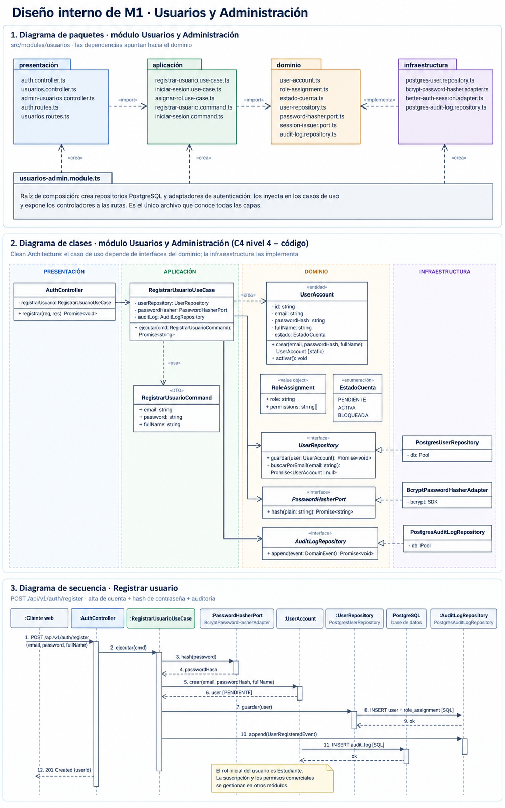
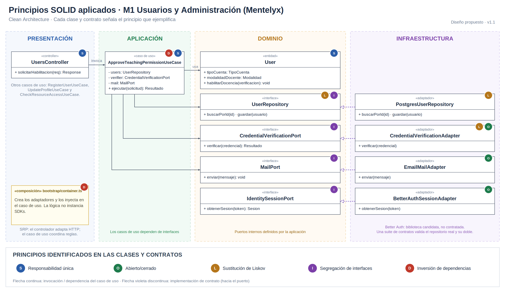

### 2.2. M2 — Cursos y Contenidos (Mentelyx Studio)
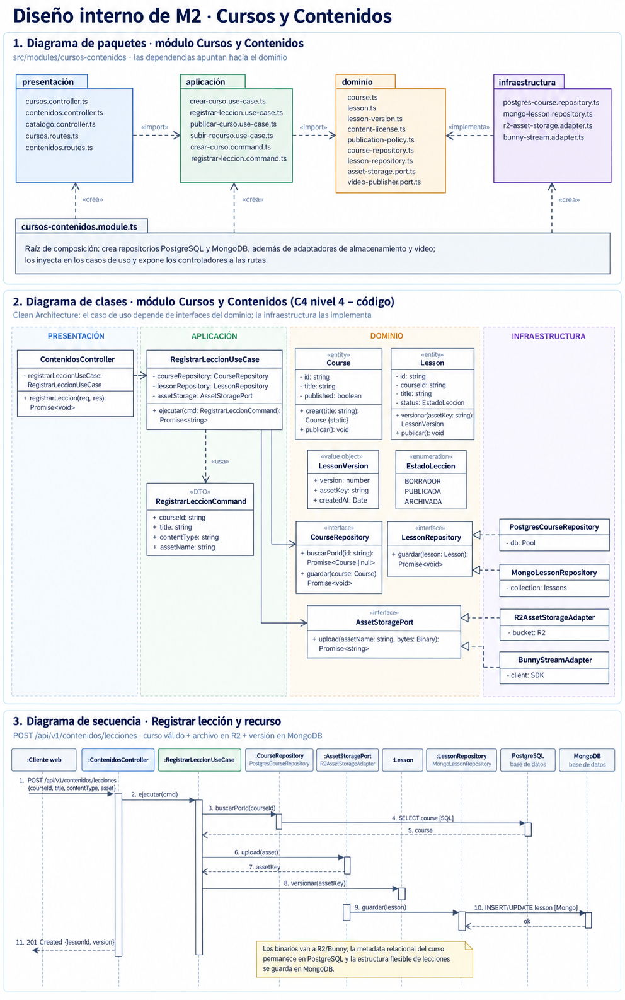
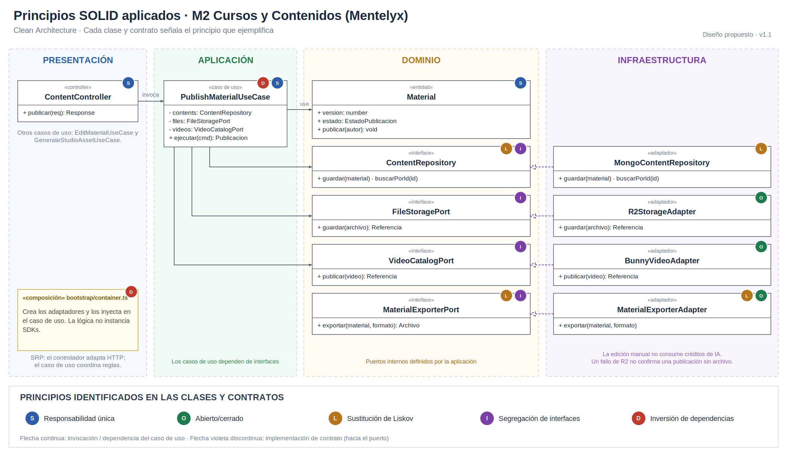

### 2.3. M3 — Evaluaciones y Aprendizaje
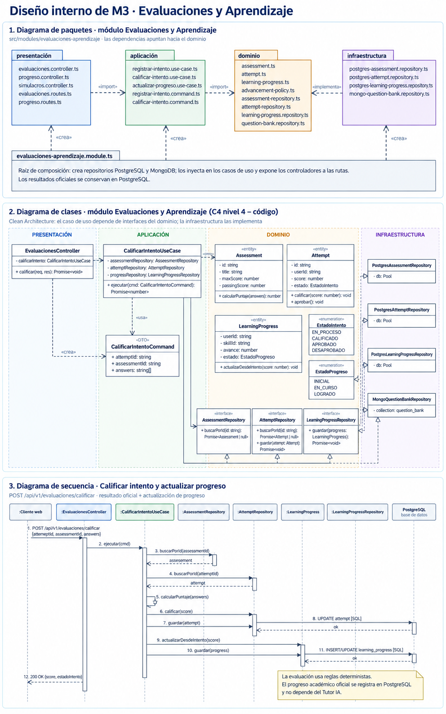
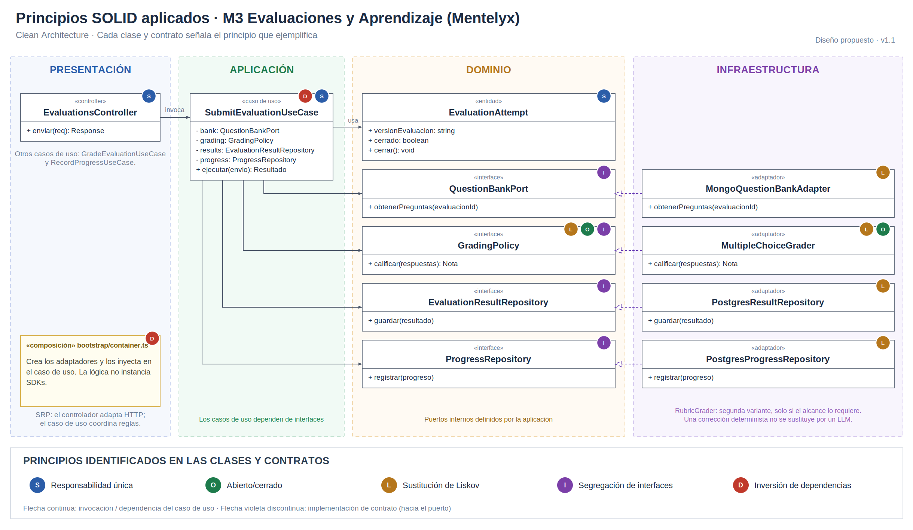

### 2.4. M4 — Docentes y Clases
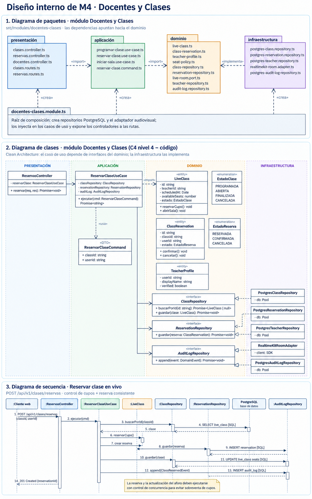
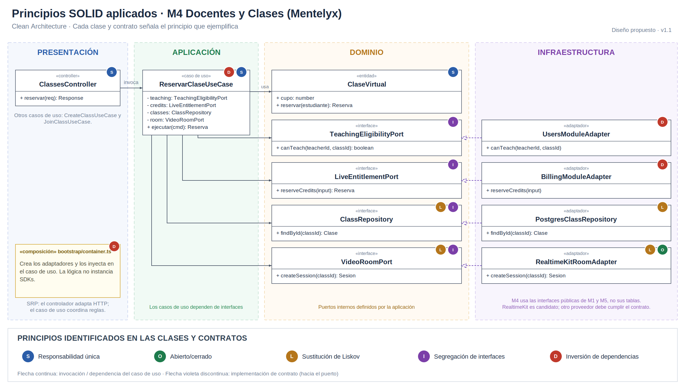

### 2.5. M5 — Suscripciones y Pagos (Módulo de referencia transaccional)
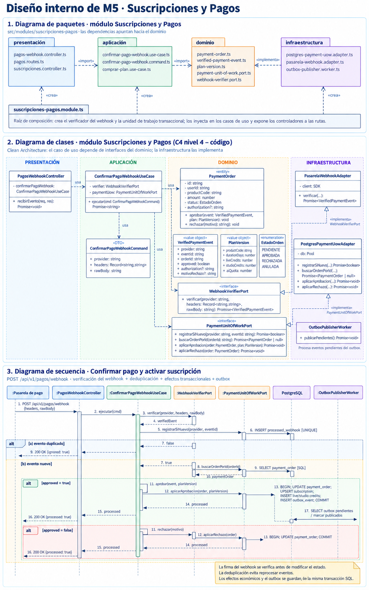
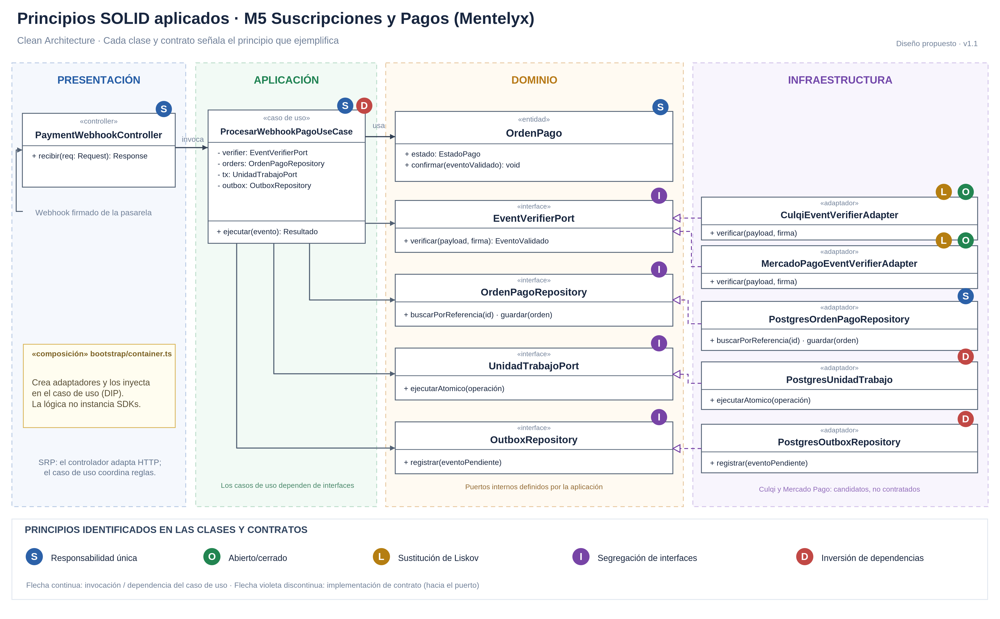

### 2.6. M6 — Tutor IA y RAG
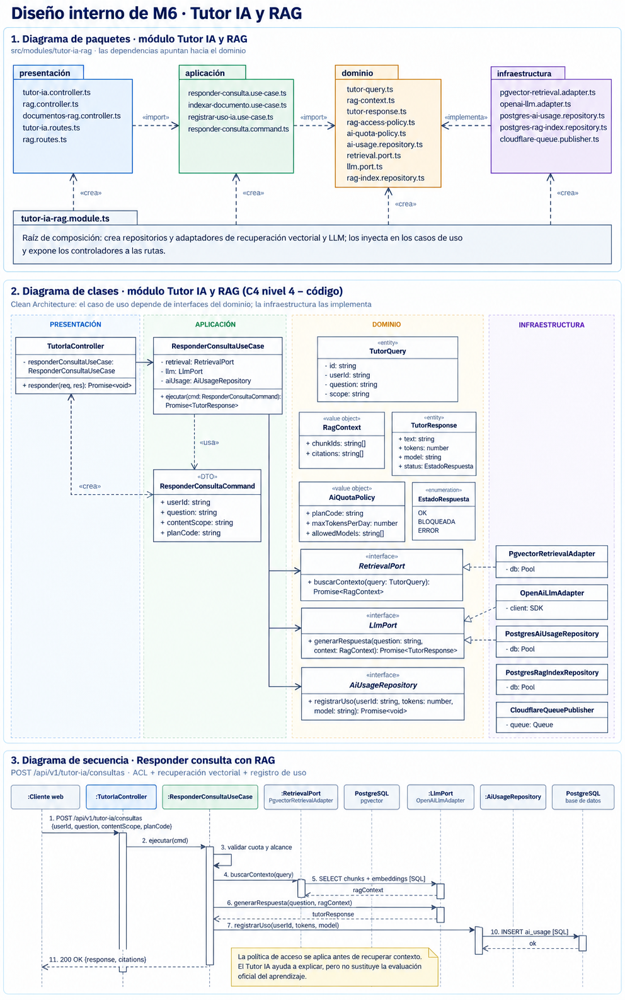
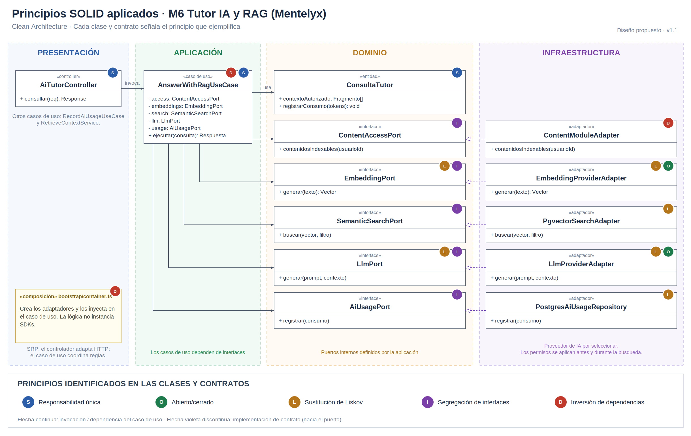

### 2.7. M7 — Publicidad y Patrocinios
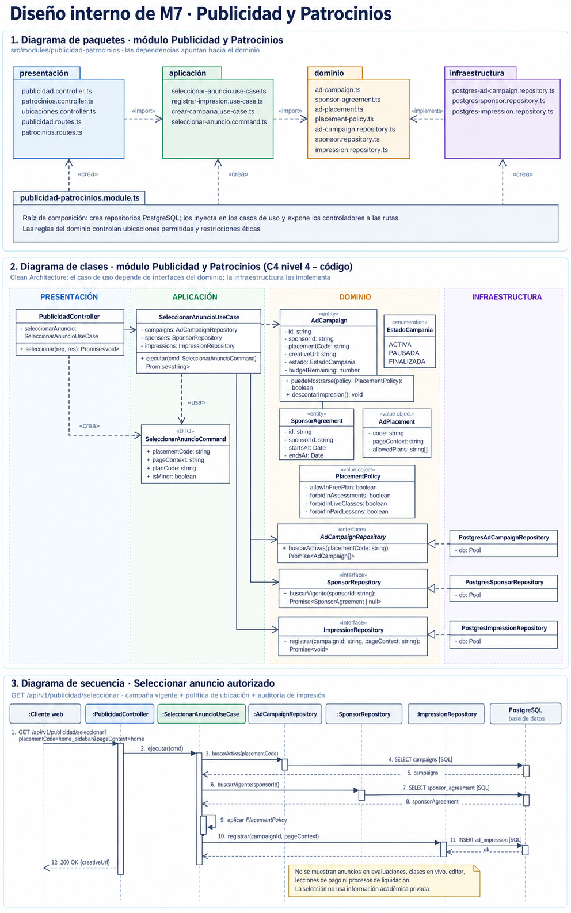
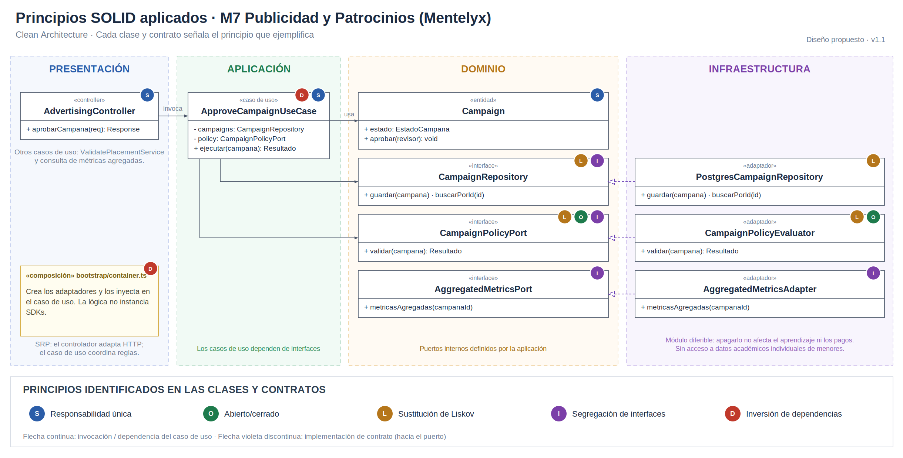

---

## 3. Diagrama de Clases UML Detallado (C4 Nivel 4 — M5 Suscripciones y Pagos)

Se modela a nivel de clases, interfaces y métodos el proceso crítico de **confirmación idempotente de pagos por webhook, activación de derechos por versión comercial, abono en ledger de créditos y registro en Outbox**.

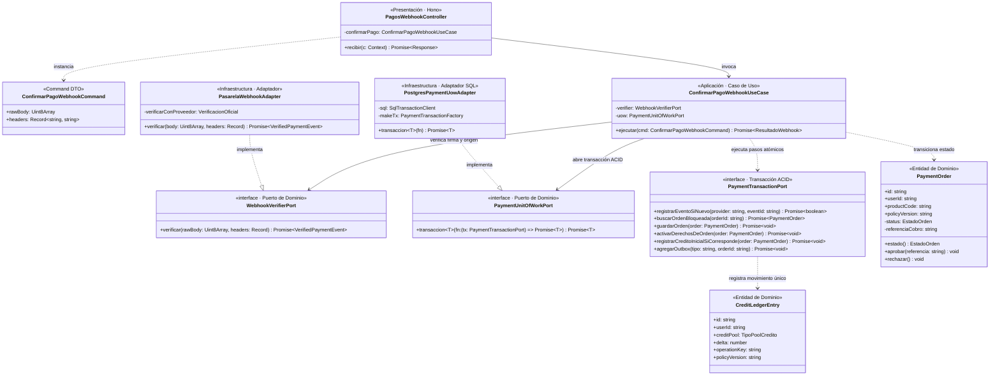

---

## 4. Diagrama de Secuencia de Código (Confirmación ACID + Idempotencia + Outbox)

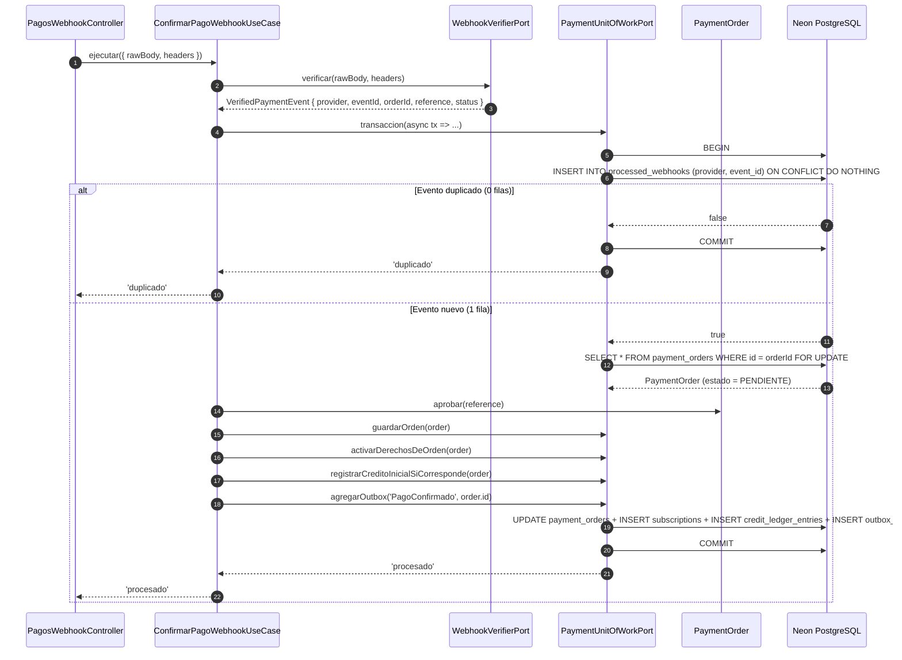

---

## 5. Trazabilidad del Modelo C4 completo

| Nivel C4 | Archivo en `docs/04-modelo-c4/` | Alcance |
|---|---|---|
| **Nivel 1 — Contexto** | [`Nivel1-DiagramadeContextodelSistema.md`](./Nivel1-DiagramadeContextodelSistema.md) | Actores humanos, sistema Mentelyx y proveedores externos. |
| **Nivel 2 — Contenedores** | [`Nivel2-DiagramadeContenedores.md`](./Nivel2-DiagramadeContenedores.md) | Web/PWA, Cloudflare Edge, API Hono/Workers, Queues/Workers y bases de datos. |
| **Nivel 3 — Componentes** | [`Nivel3-DiagramadeComponentes.md`](./Nivel3-DiagramadeComponentes.md) | Los 7 módulos del monolito modular (`C01–C07`), middlewares y contratos públicos. |
| **Nivel 4 — Código** | [`Nivel4-DiagramadeCodigo.md`](./Nivel4-DiagramadeCodigo.md) | Paquetes Clean Architecture (`M1–M7`), SOLID y clases/secuencias UML en TypeScript. |

